# 0172 · ten-, -tin-, tent- — 握住；持有；留住；保持

[逐词精讲目录](../00_逐词精讲目录.md) · [总目录](../00_总目录_按常用程度.md)

## 核心词根与来源

**这一族先记一个动作：握住，不让它离开或散掉。** 来源是拉丁语 **tenēre**“持有、保持”；在复合词里常出现 **-tin-**，分词词干可见 **tent-**。经过法语进入英语后，还会有 contain、retain、maintain 中的 **-tain**。

握住的可以是物品、职位、记忆，也可以是某种状态。contain 把东西留在里面，retain 把已经得到的继续留住，maintain 用手撑住状态，sustain 从下面托住。continue 则把一段接到下一段，让前后保持相连。

**TEN / TIN / TENT = HOLD, KEEP**

手握住东西 → 留在里面、留在身边 → 维持状态、保持连续

- **把东西留在里面**：contain · container · content · containment
- **拿到后继续握住**：obtain · retain · retention · retainer
- **把状态撑住**：maintain · maintenance · sustain · sustainable
- **让前后相接**：continue · continuous · continual · continuity
- **握有房屋、土地或职位**：tenant · tenancy · tenure · lieutenant
- **把自己控制住**：abstain · abstinence · continence · incontinence
- **紧抓目标或关联**：tenacious · tenet · pertain · pertinent
- **历史上保留下来的特殊支线**：countenance · entertain · tenor · tenuto
- **contents：装在里面的东西与目录**：content · contents
- **tennis：持有、接取动词的法语命令形式**：tennis
- **continue → continued：把前后接起来**：continue · continued
- **continue → continues：让事情接着进行**：continue · continues
- **contain → contains：保持在范围里**：contain · contains
- **obtain → obtained：取得与持有**：obtain · obtained
- **continue → continuing：保持连着与继续**：continue · continuing
- **contain → contained：装在里面与控制住**：contain · contained
- **contain → containing：把东西持在范围内**：contain · containing
- **maintain → maintaining：握住、维持现有状态**：maintain · maintaining · maintenance
- **maintain → maintains：把状态扶住，不让掉下去**：maintain · maintains
- **retain → retained：握住不放、保留下来**：retain · retained
- **obtain → obtaining：把需要的东西取得到手**：obtain · obtaining
- **tenere 词族 tenant → tenants**：tenant · tenants
- **tenor → tenors：保持声部到男高音**：tenor · tenors
- **entertain 的招待、娱乐、考虑与相关名词**：entertain · entertains · entertained · entertainment · entertainments · entertainer · entertainers
- **contain → container → containers：装住东西的容器**：containers
- **de- + ten- 持住 → detain → detained**：detained
- **re- 留回 + ten- 持有 → retaining**：retaining
- **ten- 保持：retains 与 discontinued**：retains · discontinued

## 词形与演化规律

**tenere“持有”和 tendere“伸展”要分开看。** 英语常见的十 ten、帐篷 tent、时态 tense，也不能只因拼写相近就塞进本页。每个词的实际历史来源决定归属。

**-tain / -tent / -tin- 是历史变化，不是可以任意替换的积木。** retain 和 retention 有各自的英语借入路线；maintenance、continuity、contentment 也并非全是先有现代英语动词再临时加后缀。图里保留法语、拉丁语的真实节点。

**同源不等于同义。** content 的“内容”与“满足”重音不同；continent 的“大陆”与“自制、能控制排泄”走不同语义支线。把这些岔路分清，词根才会帮忙。

contents 的名词读音重读第一音节；接拉丁所含之物的旧名词材料，table of contents 说列出内容项目的目录。

tennis 通常联系法语 tenez 接着、接住，为 tenir 持有的命令形式，上接拉丁 tenere；以发球呼声命名的解释常见但并非无争议。

continue 来自拉丁 continuare，联系连在一起；continued 是持续、继续的过去或分词形式。

保持连在一起的早期词族，发展为时间上连续不断。

合在一起持有的拉丁词族，扩展为包含、容纳与控制住。

拉丁持有词族经法语借入，现代核心是取得。

拉丁保持在一起词族经法语形成继续动作的名称。

拉丁保持在一起词族经法语借入，内容、边界、控制各看对象。

拉丁一起与持有组成，经法语形成包含、控制用途。

晚期拉丁 manu 手与 tenere 握住，经法语到英语。

法语 maintenir 接晚期拉丁用手握住的材料，现代也有坚持说的意义。

拉丁 retinere 经法语 retenir，较早 tenere 保持；现代过去尾 d。

拉丁 obtinere、法语 obtenir，现代直接加 ing，不双写 n。

持有、占用房地的人到承租人，不是英语 ten 数字。

拉丁 tenor 与 tenere 保持相连，历史上有保持主要旋律的背景；现代男高音、声音部分、演唱者分别按语境认。

经法语 entretenir 接 tenir 保持，接待、维持等历史用途走向使愉快、容纳某种想法；entertainment 另有较早法语名词借入路线。

con- 一起 + 拉丁 tenere 握住、保持 → contain，英语加 -er 构容器名，再加 -s。container 这里是物，不是只能表示人的后缀例子。

拉丁 de- 离开 + tenere 持有 → detinere 留住，经法语进入英语 detain。现代加 -ed，/n/ 后读 /d/；可说拘留，也可说被事情耽搁。

retain 经法语 retenir 接拉丁 retinere 保持、留住。现代加 -ing，原词不变；可说保温、保留特征、记住信息等。

retain 接拉丁 re- 回 + tenere 持有；discontinue 经法语、拉丁 discontinuare，接 dis- 断开与 continuare 连续。现代分别加 -s、去 e 加 -ed。

## 单词速览（按词族由简到繁）

同一基础词的相关扩展放在一起，先读基础形式，再读扩展；各组之间优先读常用的。具体词源关系见各词讲解。

| 单词 | 音标 | 核心意思 |
|---|---|---|
| [continue](#w-1) | /kənˈtɪnjuː/ | 继续；接着做；持续 |
| [continued](#w-115) | 英 /kənˈtɪnjuːd/；美 /kənˈtɪnjuːd/ | 继续了；持续的、接连的；continue 的过去式和过去分词等 |
| [continues](#w-116) | /kənˈtɪnjuːz/ | 继续；持续；接着延伸；continue 的第三人称单数 |
| [continuing](#w-119) | 英 /kənˈtɪnjuːɪŋ/；美 /kənˈtɪnjuːɪŋ/ | 继续、持续〔现在分词〕；持续进行的 |
| [continuous](#w-9) | /kənˈtɪnjuəs/ | 连续的；不间断的 |
| [continuously](#w-17) | /kənˈtɪnjuəsli/ | 连续不断地 |
| [discontinuous](#w-59) | /ˌdɪskənˈtɪnjuəs/ | 不连续的；有间断的 |
| [equicontinuous](#w-101) | /ˌiːkwɪkənˈtɪnjuəs/ | 等度连续的 |
| [continuity](#w-25) | 英 /ˌkɒntɪˈnjuːəti/；美 /ˌkɑːntɪˈnuːəti/ | 连续性；连贯；前后一致 |
| [discontinuity](#w-64) | 英 /ˌdɪskɒntɪˈnjuːəti/；美 /ˌdɪskɑːntɪˈnuːəti/ | 不连续；断裂；突变点 |
| [equicontinuity](#w-100) | 英 /ˌiːkwɪkɒntɪˈnjuːəti/ | 等度连续性 |
| [continuation](#w-27) | /kənˌtɪnjuˈeɪʃən/ | 继续；延续；续接部分 |
| [continual](#w-34) | /kənˈtɪnjuəl/ | 不断的；频繁反复的 |
| [continually](#w-21) | /kənˈtɪnjuəli/ | 不断地；频繁反复地 |
| [continuance](#w-58) | /kənˈtɪnjuəns/ | 继续；延续；延期审理 |
| [continuant](#w-87) | /kənˈtɪnjuənt/ | 连续音；持续的；持续存在物（哲学） |
| [discontinue](#w-40) | /ˌdɪskənˈtɪnjuː/ | 停止；不再生产、提供或进行 |
| [discontinued](#w-136) | 英、美 /ˌdɪskənˈtɪnjuːd/ | 停止了；停产、停止供应的 |
| [discontinuation](#w-60) | /ˌdɪskənˌtɪnjuˈeɪʃən/ | 停止；停产；终止供应 |
| [discontinuance](#w-79) | /ˌdɪskənˈtɪnjuəns/ | 停止；终止；中止持续安排 |
| [content](#w-2) | 内容：英 /ˈkɒntent/、美 /ˈkɑːntent/；满足：/kənˈtent/ | 内容；所含物；含量；满足的 |
| [contents](#w-113) | 英 /ˈkɒntents/；美 /ˈkɑːntents/ | 所装物品；内容项目；目录 |
| [contentment](#w-45) | /kənˈtentmənt/ | 满足；知足；安然满意 |
| [discontentment](#w-83) | /ˌdɪskənˈtentmənt/ | 不满足；不满情绪 |
| [contented](#w-50) | /kənˈtentɪd/ | 满足的；心满意足的 |
| [contentedly](#w-73) | /kənˈtentɪdli/ | 满足地；安然地 |
| [discontented](#w-65) | /ˌdɪskənˈtentɪd/ | 不满的；对现状不满意的 |
| [contentive](#w-97) | /kənˈtentɪv/ | 实义词；内容词；容纳的（旧义） |
| [discontent](#w-32) | /ˌdɪskənˈtent/ | 不满；不满足 |
| [contain](#w-6) | /kənˈteɪn/ | 容纳；包含；控制住 |
| [contains](#w-117) | /kənˈteɪnz/ | 包含、容纳；控制住、遏制；contain 的第三人称单数 |
| [contained](#w-120) | /kənˈteɪnd/ | 含有、容纳；控制住〔过去式、过去分词〕 |
| [containing](#w-121) | /kənˈteɪnɪŋ/ | 包含、装着；控制、遏制〔现在分词、动名词〕 |
| [container](#w-15) | 英 /kənˈteɪnə/；美 /kənˈteɪnər/ | 容器；集装箱 |
| [containers](#w-132) | 英 /kənˈteɪnəz/；美 /kənˈteɪnɚz/ | 容器；集装箱〔复数〕 |
| [containment](#w-28) | /kənˈteɪnmənt/ | 控制；遏制；围堵；容纳设施 |
| [maintain](#w-3) | /meɪnˈteɪn/ | 维持；维护；保养；坚持说 |
| [maintenance](#w-5) | /ˈmeɪntənəns/ | 维护；保养；生活供养 |
| [maintaining](#w-122) | /meɪnˈteɪnɪŋ/ | 维持、保养；坚持认为〔现在分词、动名词〕 |
| [maintains](#w-123) | /meɪnˈteɪnz/ | 维持、维护、保养；坚持说〔第三人称单数〕 |
| [maintainer](#w-68) | 英 /meɪnˈteɪnə/；美 /meɪnˈteɪnər/ | 维护者；维持运作的人 |
| [maintainable](#w-74) | /meɪnˈteɪnəbəl/ | 能够维持的；便于维护的 |
| [maintainability](#w-76) | /meɪnˌteɪnəˈbɪləti/ | 可维护性；维护难易程度 |
| [entertain](#w-22) | 英 /ˌentəˈteɪn/；美 /ˌentərˈteɪn/ | 使有趣、使愉快；招待；考虑 |
| [entertainment](#w-4) | 英 /ˌentəˈteɪnmənt/；美 /ˌentərˈteɪnmənt/ | 娱乐；文娱活动；招待 |
| [entertainments](#w-130) | 英 /ˌentəˈteɪnmənts/；美 /ˌentərˈteɪnmənts/ | 娱乐节目、娱乐活动〔复数〕 |
| [entertaining](#w-13) | 英 /ˌentəˈteɪnɪŋ/；美 /ˌentərˈteɪnɪŋ/ | 有趣的；令人愉快的 |
| [entertained](#w-128) | 英 /ˌentəˈteɪnd/；美 /ˌentərˈteɪnd/ | 使愉快、招待了；考虑过了；得到娱乐的 |
| [entertainer](#w-29) | 英 /ˌentəˈteɪnə/；美 /ˌentərˈteɪnər/ | 演艺人员；表演者；娱乐大众的人 |
| [entertainers](#w-129) | 英 /ˌentəˈteɪnəz/；美 /ˌentərˈteɪnərz/ | 艺人、娱乐表演者〔复数〕 |
| [entertains](#w-131) | 英 /ˌentəˈteɪnz/；美 /ˌentərˈteɪnz/ | 使愉快、招待；考虑〔第三人称单数〕 |
| [obtain](#w-8) | /əbˈteɪn/ | 获得；取得；适用、存在（正式） |
| [obtained](#w-118) | 英 /əbˈteɪnd/；美 /əbˈteɪnd/ | 取得、获得〔obtain 的过去式、过去分词〕 |
| [obtaining](#w-125) | /əbˈteɪnɪŋ/ | 获得、取得〔现在分词、动名词〕；适用、存在〔正式用法〕 |
| [obtainable](#w-43) | /əbˈteɪnəbəl/ | 可以获得的；拿得到的 |
| [unobtainable](#w-67) | /ˌʌnəbˈteɪnəbəl/ | 无法获得的；拿不到的 |
| [obtainment](#w-86) | /əbˈteɪnmənt/ | 取得；获得 |
| [obtention](#w-104) | /əbˈtenʃən/ | 取得；获得（少用） |
| [reobtain](#w-106) | /ˌriːəbˈteɪn/ | 重新获得 |
| [lieutenant](#w-7) | 英 /lefˈtenənt/；美 /luːˈtenənt/ | 尉官；副手；代理人 |
| [tennis](#w-114) | /ˈtenɪs/ | 网球；相关旧式球类运动 |
| [sustain](#w-19) | /səˈsteɪn/ | 维持；支撑；承受；遭受 |
| [sustained](#w-11) | /səˈsteɪnd/ | 持续的；保持了一段时间的 |
| [sustainable](#w-10) | /səˈsteɪnəbəl/ | 可持续的；能够长期维持的 |
| [sustainability](#w-26) | /səˌsteɪnəˈbɪləti/ | 可持续性；长期维持能力 |
| [unsustainable](#w-38) | /ˌʌnsəˈsteɪnəbəl/ | 无法长期维持的；不可持续的 |
| [sustenance](#w-49) | /ˈsʌstənəns/ | 食物；营养；维生、精神支撑 |
| [sustention](#w-111) | /səˈstenʃən/ | 维持；持续支撑（罕用） |
| [retain](#w-12) | /rɪˈteɪn/ | 保留；保持；记住；留用 |
| [retained](#w-124) | /rɪˈteɪnd/ | 保留了、留住了；记住了、留用的〔过去式、过去分词〕 |
| [retention](#w-23) | /rɪˈtenʃən/ | 保留；留存；记忆保持 |
| [retaining](#w-134) | 英、美 /rɪˈteɪnɪŋ/ | 保留；保持；留住；记住〔分词、动名词〕 |
| [retains](#w-135) | 英、美 /rɪˈteɪnz/ | 保留；保持；留住〔第三人称单数〕 |
| [retainer](#w-39) | 英 /rɪˈteɪnə/；美 /rɪˈteɪnər/ | 预付聘用费；牙齿保持器；随从 |
| [retainment](#w-107) | /rɪˈteɪnmənt/ | 保留；留存（少用） |
| [continent](#w-14) | 英 /ˈkɒntɪnənt/；美 /ˈkɑːntɪnənt/ | 大陆；洲；能自制的；能控制排泄的 |
| [continental](#w-16) | 英 /ˌkɒntɪˈnentəl/；美 /ˌkɑːntɪˈnentəl/ | 大陆的；洲的；欧洲大陆的 |
| [intercontinental](#w-37) | 英 /ˌɪntəkɒntɪˈnentəl/；美 /ˌɪntərkɑːntɪˈnentəl/ | 洲际的；跨洲之间的 |
| [transcontinental](#w-57) | 英 /ˌtrænzkɒntɪˈnentəl/；美 /ˌtrænzkɑːntɪˈnentəl/ | 横贯大陆的；跨越大陆的 |
| [continence](#w-77) | 英 /ˈkɒntɪnəns/；美 /ˈkɑːntɪnəns/ | 控制排泄的能力；克制、自制 |
| [incontinent](#w-69) | 英 /ɪnˈkɒntɪnənt/；美 /ɪnˈkɑːntɪnənt/ | 失禁的；不能自制的（旧义） |
| [incontinence](#w-51) | 英 /ɪnˈkɒntɪnəns/；美 /ɪnˈkɑːntɪnəns/ | 失禁；缺乏自制（旧或正式义） |
| [detain](#w-35) | /dɪˈteɪn/ | 扣留；拘留；耽搁 |
| [detention](#w-18) | /dɪˈtenʃən/ | 拘留；扣留；课后留校 |
| [detained](#w-133) | 英、美 /dɪˈteɪnd/ | 拘留了；扣留了；耽搁了〔过去式、过去分词〕 |
| [detainee](#w-55) | /ˌdiːteɪˈniː/ | 被拘留者；被扣留者 |
| [detainment](#w-70) | /dɪˈteɪnmənt/ | 扣留；被留住的状态 |
| [detainer](#w-81) | 英 /dɪˈteɪnə/；美 /dɪˈteɪnər/ | 拘留文书、请求；扣留；扣留者 |
| [tenure](#w-20) | 英 /ˈtenjə/；美 /ˈtenjər/ | 任期；职位持有；终身教职保障；土地保有 |
| [tenured](#w-56) | 英 /ˈtenjəd/；美 /ˈtenjərd/ | 获得长期教职保障的；有稳定任职资格的 |
| [tenurial](#w-112) | 英 /tenˈjʊəriəl/；美 /tenˈjʊriəl/ | 土地保有制的；任职权有关的 |
| [tenant](#w-24) | /ˈtenənt/ | 房客；承租人；空间使用者 |
| [tenants](#w-126) | /ˈtenənts/ | 租户、承租人；租用单位〔复数〕 |
| [tenancy](#w-44) | /ˈtenənsi/ | 租赁关系；租期；租用权 |
| [continuum](#w-30) | /kənˈtɪnjuəm/ | 连续体；渐变的整体 |
| [tenor](#w-31) | 英 /ˈtenə/；美 /ˈtenər/ | 男高音；男高音声部；总体基调 |
| [tenors](#w-127) | 英 /ˈtenəz/；美 /ˈtenərz/ | 男高音、相应声部或歌手〔复数〕 |
| [countertenor](#w-82) | 英 /ˌkaʊntəˈtenə/；美 /ˈkaʊntərˌtenər/ | 高男声；假声男高音歌手 |
| [pertinent](#w-33) | 英 /ˈpɜːtɪnənt/；美 /ˈpɜːrtɪnənt/ | 切题的；相关而有用的 |
| [pertinence](#w-84) | 英 /ˈpɜːtɪnəns/；美 /ˈpɜːrtɪnəns/ | 切题性；相关性 |
| [impertinent](#w-62) | 英 /ɪmˈpɜːtɪnənt/；美 /ɪmˈpɜːrtɪnənt/ | 无礼的；放肆的；不相干的（旧义） |
| [impertinence](#w-71) | 英 /ɪmˈpɜːtɪnəns/；美 /ɪmˈpɜːrtɪnəns/ | 无礼；放肆；无礼的话或行为 |
| [abstain](#w-42) | /əbˈsteɪn/ | 克制不做；戒除；弃权 |
| [abstinence](#w-36) | /ˈæbstɪnəns/ | 戒除；节制；禁欲 |
| [abstention](#w-63) | /əbˈstenʃən/ | 弃权；不参与；克制不做 |
| [tenace](#w-95) | /ˈteneɪs/ | 间张大牌组合（桥牌等） |
| [tenacity](#w-41) | /təˈnæsəti/ | 坚韧；顽强；不轻易放弃 |
| [tenacious](#w-46) | /təˈneɪʃəs/ | 顽强的；抓得牢的；不轻易放弃的 |
| [tenaciously](#w-75) | /təˈneɪʃəsli/ | 顽强地；紧紧抓住地 |
| [tenable](#w-66) | /ˈtenəbəl/ | 站得住脚的；可维持的；可守住的 |
| [untenable](#w-47) | /ʌnˈtenəbəl/ | 站不住脚的；无法维持的 |
| [tenet](#w-48) | /ˈtenɪt/，也读 /ˈtenət/ | 信条；基本原则 |
| [countenance](#w-52) | /ˈkaʊntənəns/ | 面容；神情；容许、支持 |
| [pertain](#w-53) | 英 /pəˈteɪn/；美 /pərˈteɪn/ | 与……有关；属于；适用于 |
| [tenement](#w-54) | /ˈtenɪmənt/ | 公寓楼；分户出租住宅；不动产（历史法律义） |
| [retinue](#w-61) | 英 /ˈretɪnjuː/；美 /ˈretɪnuː/ | 随从；随行人员 |
| [retentive](#w-72) | /rɪˈtentɪv/ | 善于保留的；记性好的；保水的 |
| [irretentive](#w-103) | /ˌɪrɪˈtentɪv/ | 不善保留的；记不牢的 |
| [abstinent](#w-78) | /ˈæbstɪnənt/ | 戒除某种行为的；自我节制的 |
| [malcontent](#w-80) | 名词常读 /ˈmælkəntent/；形容词也读 /ˌmælkənˈtent/ | 不满者；牢骚者；不满现状的 |
| [appurtenant](#w-85) | 英 /əˈpɜːtɪnənt/；美 /əˈpɜːrtɪnənt/ | 附属的；从属于主要事物的 |
| [tenuto](#w-88) | 英 /teˈnuːtəʊ/；美 /teˈnuːtoʊ/ | 保持音值地；充分保持的（音乐） |
| [appertain](#w-90) | 英 /ˌæpəˈteɪn/；美 /ˌæpərˈteɪn/ | 附属于；归属于；与……有关 |
| [appurtenance](#w-89) | 英 /əˈpɜːtɪnəns/；美 /əˈpɜːrtɪnəns/ | 附属物；配套设备；附随权利 |
| [continuative](#w-91) | 英 /kənˈtɪnjʊətɪv/ | 表示持续的；延续性的 |
| [pertinacity](#w-92) | 英 /ˌpɜːtɪˈnæsəti/；美 /ˌpɜːrtɪˈnæsəti/ | 顽强坚持；执拗 |
| [detinue](#w-93) | 英 /ˈdetɪnjuː/；美 /ˈdetɪnuː/ | 返还被扣动产之诉（历史法律用语） |
| [pertinacious](#w-94) | 英 /ˌpɜːtɪˈneɪʃəs/；美 /ˌpɜːrtɪˈneɪʃəs/ | 顽强的；执拗坚持的 |
| [appertinent](#w-96) | 英 /əˈpɜːtɪnənt/；美 /əˈpɜːrtɪnənt/ | 附属的；所属物（古旧） |
| [contratenor](#w-98) | 英 /ˌkɒntrəˈtenə/；美 /ˌkɑːntrəˈtenər/ | 对置于 tenor 的声部；高男声相关旧称 |
| [detainder](#w-99) | 英 /dɪˈteɪndə/；美 /dɪˈteɪndər/ | 旧式令状名；与追索被扣财物有关 |
| [intenible](#w-102) | /ɪnˈtenəbəl/ | 留不住东西的；不能容纳的（废旧） |
| [purtenance](#w-105) | 英 /ˈpɜːtɪnəns/；美 /ˈpɜːrtɪnəns/ | 所属物；家畜内脏（古旧） |
| [sustentacular](#w-108) | 英 /ˌsʌstənˈtækjʊlə/；美 /ˌsʌstənˈtækjələr/ | 支持的；起支撑作用的（解剖） |
| [sustentaculum](#w-109) | 英 /ˌsʌstenˈtækjʊləm/；美 /ˌsʌstenˈtækjələm/ | 支持结构；支撑突起（解剖） |
| [sustentation](#w-110) | /ˌsʌstənˈteɪʃən/ | 支撑；维持；供养（正式或旧用） |

## 逐词讲解

### 1. continue — 继续；接着做；持续

**音标**：/kənˈtɪnjuː/

**先抓住这个画面**

continue 像把一段线接下去：事情可以一直在做，也可以暂停后接着做。

**怎么拆**

经古法语 continuer 来自拉丁语 continuāre，联系 continuus“连在一起的”；远源是 continēre“保持在一起”。

**怎么变成今天的意思**

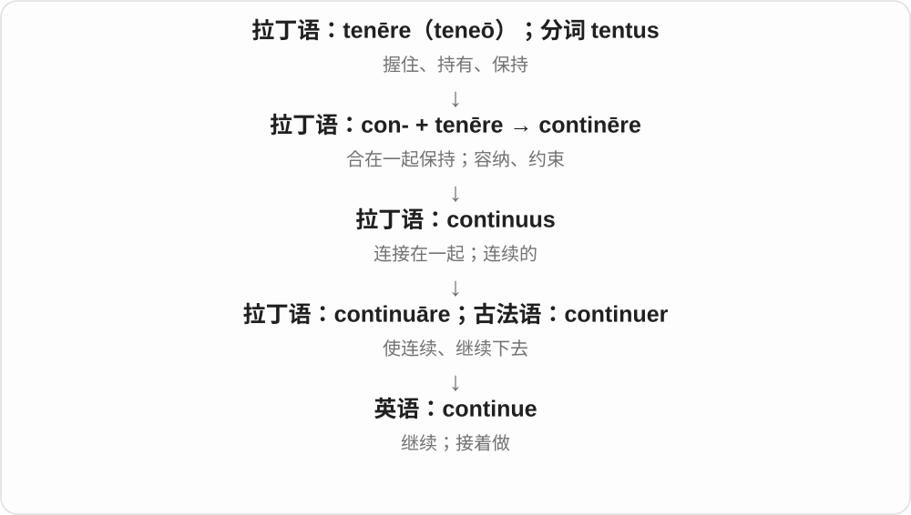

要看语境区分“没停”和“停后再来”。We continued after lunch 就明显有一段午饭间隔。

**常见搭配与例句**

continue doing / to do；continue with the work；continue for two hours。

> Please continue reading from the next paragraph.

请从下一段接着读。

> The rain continued throughout the night.

雨持续下了一整夜。

**别混淆**

continue 强调接下去；restart 强调从停止状态重新启动，可能从头开始。

### 2. continued — 继续了；持续的、接连的；continue 的过去式和过去分词等

**音标**：英 /kənˈtɪnjuːd/；美 /kənˈtɪnjuːd/

**先抓住这个画面**

把前一段和后一段接起来，让事情不断下去，是 continued。它既可说做事继续了，也可形容支持、努力一直在。

**怎么拆**

continue 去末尾 e，加完整 -ed；末尾元音后读 /d/。经古法语 continuer 接拉丁 continuare，联系 continuus 连在一起的，更远接 continere 保持在一起。

**怎么变成今天的意思**

**拉丁 continuus／continuare → 法语 continuer → continue**  
连在一起 → 持续、继续

↓

**continue 去 e + -ed → continued**  
过去继续；一直持续的

continued working／continued to work 继续工作；continued support 持续的支持；continued on 继续前行；to be continued 未完待续。

**常见搭配与例句**

continued throughout the night；continued interest。

> The rain continued throughout the afternoon.

雨下了整整一个下午。

> Thank you for your continued support.

感谢你一直以来的支持。

**别混淆**

continued 可修饰名词，如 continued support；continuously 是副词，修饰动作连续进行。两者都接得上持续画面，但句中位置不同。

### 3. continues — 继续；持续；接着延伸；continue 的第三人称单数

**音标**：/kənˈtɪnjuːz/

**先抓住这个画面**

前面的事情还没断，接着往下发生，就是 continues；一条路继续延伸，也可以这样说。

**怎么拆**

continue + -s，元音后读 /z/。continue 经古法语 continuer 接拉丁 continuāre，与 continuus 连在一起的相关，更早联系 continēre 保持在一起。

**怎么变成今天的意思**

**拉丁连续词族 → 古法语 continuer → continue**  
保持相连 → 持续、继续

↓

**continue + -s → continues**  
单数主语接着进行、延伸

continues to grow 继续增长；continues working 继续工作；the road continues 路继续延伸；the story continues 故事仍在继续。

**常见搭配与例句**

continues for several hours；continues into the next room。

> The path continues beyond the last house.

小路过了最后一所房子还继续向前延伸。

> She continues to practise even after the lesson ends.

下课后，她仍继续练习。

**别混淆**

continues to do 与 continues doing 都常表示继续做。continues 后不接对象时，主语本身就是持续的事情；接 road、line 等主语可说空间延伸。

### 4. continuing — 继续、持续〔现在分词〕；持续进行的

**音标**：英 /kənˈtɪnjuːɪŋ/；美 /kənˈtɪnjuːɪŋ/

**先抓住这个画面**

前面的事还连着往下走，没有在这里结束，就是 continuing；词族的保持连在一起很适合记继续。

**怎么拆**

continue 去 e 加 -ing → continuing，保留 u。法语 continuer 接拉丁 continuāre，与 continuus 连在一起的相连，较早联系 continēre 保持在一起。

**怎么变成今天的意思**

**拉丁 continēre、continuus、continuāre → 法语 → continue**  
保持连着 → 延续、继续

↓

**continue → continuing**  
去 e 加 ing；持续进行中的

continuing education 继续教育；continuing work 持续开展的工作；continuing to improve 继续改进。

**常见搭配与例句**

continuing the discussion；continuing with the plan。

> They are continuing the discussion after lunch.

他们午饭后继续讨论。

> The course is part of the university’s continuing education programme.

这门课属于大学继续教育项目的一部分。

**别混淆**

continue 可以接 -ing 或 to do 表示继续做，具体搭配语气有差别；continuing education 是在已有学习之后继续接受教育的固定领域名称。

### 5. continuous — 连续的；不间断的

**音标**：/kənˈtɪnjuəs/

**先抓住这个画面**

continuous 像一条没有断开的线，强调在所说的时间或范围内中间没有停顿、缺口。

**怎么拆**

来自拉丁语 continuus“连续、相接的”，与 continēre“保持在一起”相连；不是先有英语 continue 才造出所有同族形容词。

**怎么变成今天的意思**

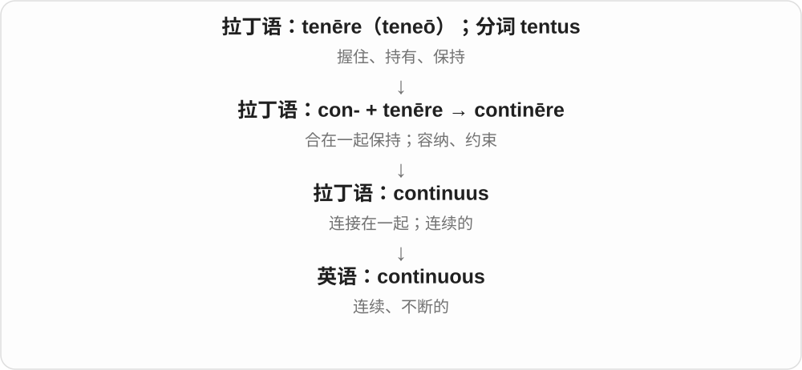

可以说机器连续运行，也可以说连续分布。数学中的连续有严格定义，直观上是输入微小变化不会在该点造成突跳。

**常见搭配与例句**

continuous operation；a continuous line；continuous improvement；a continuous function。

> The machine ran for twelve hours of continuous operation.

机器连续运行了十二个小时。

> Draw a continuous line around the shape.

沿着这个形状画一条不断开的线。

**别混淆**

continual 常强调反复发生；continuous 通常强调没有中断。实际词义有交叠，但这一区分最实用。

### 6. continuously — 连续不断地

**音标**：/kənˈtɪnjuəsli/

**先抓住这个画面**

continuously 像把计时器打开后，这件事从头到尾一直进行，没有中途停下来。

**怎么拆**

continuous + -ly。

**怎么变成今天的意思**

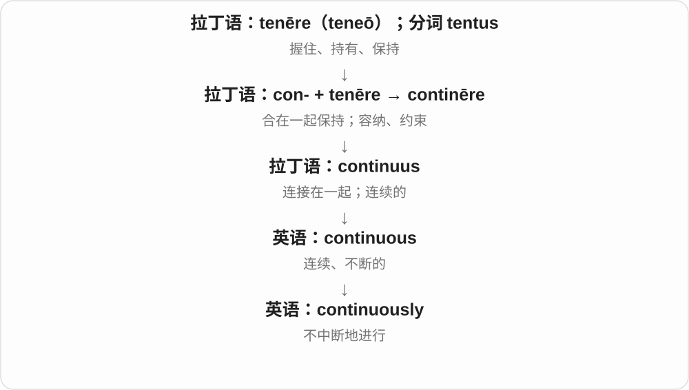

常用于运行、记录、变化等过程。即使数值在变化，只要过程没有停，也能 continuously。

**常见搭配与例句**

run continuously；record continuously；change continuously。

> The camera recorded continuously for six hours.

摄像机连续录了六个小时。

> Water flowed continuously through the pipe.

水不断地流过管道。

**别混淆**

continually 可以是一再发生；continuously 通常是持续无间断。每天响几次的铃不是全天 continuously ringing。

### 7. discontinuous — 不连续的；有间断的

**音标**：/ˌdɪskənˈtɪnjuəs/

**先抓住这个画面**

discontinuous 像虚线，中间一段一段留有空隙；也可以是过程突然跳变或停过几次。

**怎么拆**

dis-（分开、不）+ continuous。

**怎么变成今天的意思**

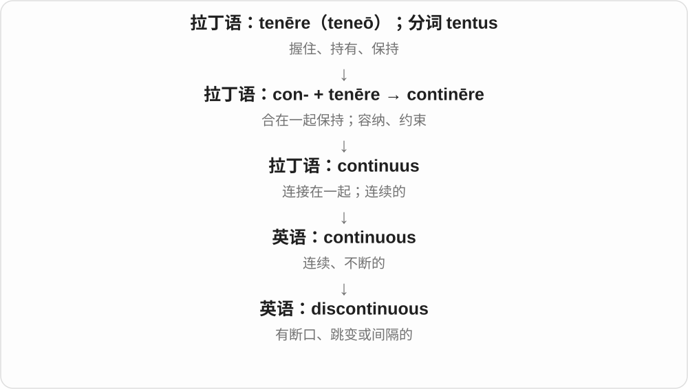

是描述实际连续性，不只是视觉上不够整齐。数学里函数在某点不连续，也不能只用图画好不好看来判断。

**常见搭配与例句**

a discontinuous line；discontinuous data；a discontinuous function。

> The map uses a discontinuous line to mark the proposed route.

地图用一条断续线标出拟议路线。

> The record is discontinuous because several pages are missing.

由于缺了几页，记录不是连续完整的。

**别混淆**

discontinued 是被停掉的；discontinuous 是存在间断，未必已经永久停止。

### 8. equicontinuous — 等度连续的

**音标**：/ˌiːkwɪkənˈtɪnjuəs/

**先抓住这个画面**

equicontinuous 描述一族函数能一起遵守同一套局部变化限制，像一组车都受同一个速度上限约束。

**怎么拆**

equi-（共同一致）+ continuous；数学义针对函数族，而非某一条线看起来平滑。

**怎么变成今天的意思**

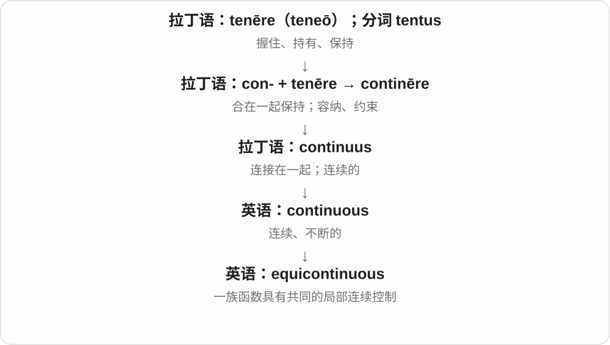

例如斜率绝对值都不超过 1 的直线族，输入变化多少，输出最多变化多少，能用同一个控制。这里只用直线帮助理解，不把等度连续等同于有导数。

**常见搭配与例句**

an equicontinuous family；equicontinuous at zero；uniformly equicontinuous。

> The family of lines with slopes between zero and one is equicontinuous.

斜率介于零和一之间的这族直线是等度连续的。

> The lecturer gave a family that was continuous term by term but not equicontinuous.

讲师举了一族每个函数都连续、整体却不等度连续的例子。

**别混淆**

each function is continuous 只逐个成立；the family is equicontinuous 还要求能统一照顾该族所有成员。

### 9. continuity — 连续性；连贯；前后一致

**音标**：英 /ˌkɒntɪˈnjuːəti/；美 /ˌkɑːntɪˈnuːəti/

**先抓住这个画面**

continuity 像把几个阶段接起来，看中间有没有断口、前后是否对得上。

**怎么拆**

经法语 continuité 来自拉丁语 continuitās，联系 continuus“连续的”；不是单纯从英语 continue 临时加 -ity。

**怎么变成今天的意思**

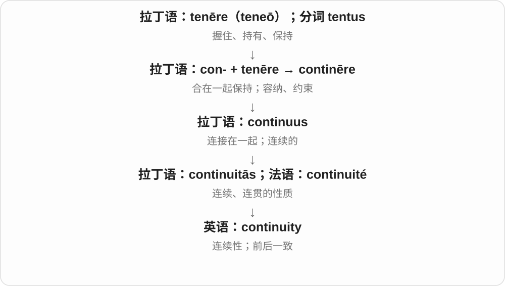

既可说服务不中断，也可说故事和电影镜头前后一致。镜头间杯子忽然换了位置，就可能有 continuity error。

**常见搭配与例句**

continuity of service；ensure continuity；a continuity error；continuity between… 。

> The handover plan ensures continuity of service.

交接计划确保服务不中断。

> A misplaced cup created a continuity error between the two shots.

一个放错位置的杯子让两个镜头之间出现了穿帮。

**别混淆**

continuation 是继续这一行为或续接部分；continuity 是各部分连续、相互接得上的性质。

### 10. discontinuity — 不连续；断裂；突变点

**音标**：英 /ˌdɪskɒntɪˈnjuːəti/；美 /ˌdɪskɑːntɪˈnuːəti/

**先抓住这个画面**

discontinuity 像连续线上的断口，前后没有平顺地接上。

**怎么拆**

来自晚期拉丁语 discontinuitās，与 discontinuus“不连续的”相连；现代可拆 dis- + continuity。

**怎么变成今天的意思**

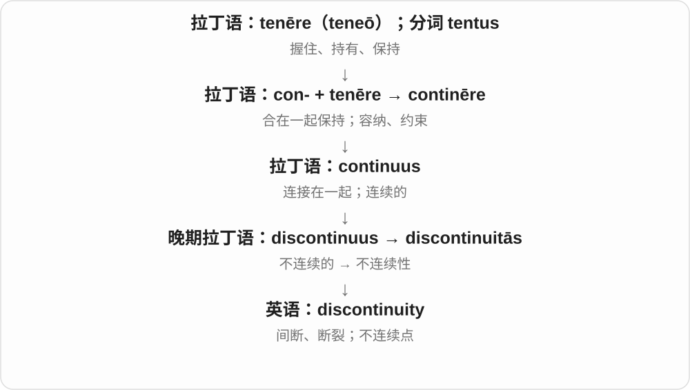

可说历史记录缺环，也可说函数在某处发生突跳。地质学中另指性质突然变化的界面。

**常见搭配与例句**

a discontinuity in the record；a point of discontinuity；cultural discontinuity。

> The missing years create a discontinuity in the historical record.

缺失的几年使历史记录出现断档。

> The graph shows a discontinuity at zero.

图像显示函数在零点处不连续。

**别混淆**

discontinuation 是停止某项活动的行为；discontinuity 是前后不连续的性质、断口或突变。

### 11. equicontinuity — 等度连续性

**音标**：英 /ˌiːkwɪkɒntɪˈnjuːəti/

**先抓住这个画面**

equicontinuity 像给一整组函数订同一条“变化别太猛”的限制：在同一点附近，不必换一个函数就重新选一套距离标准。

**怎么拆**

equi-（相等、一致）+ continuity。这里的一致说变化控制可以共同使用，不是所有函数值相等。

**怎么变成今天的意思**

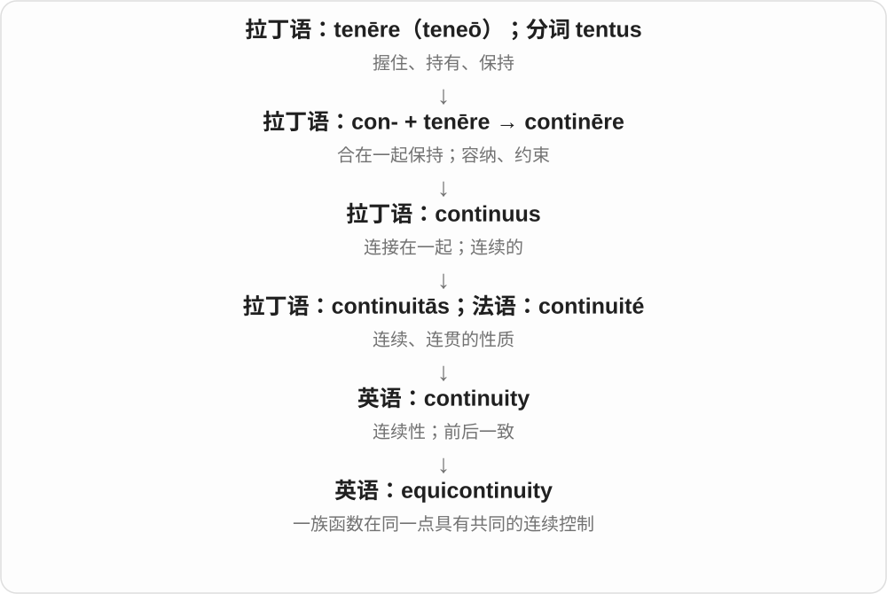

给定输出误差范围，在该点能选一个输入邻域，让这一族所有函数都满足要求。邻域可以随点和误差变，但不能随具体函数换。

**常见搭配与例句**

equicontinuity at a point；establish equicontinuity；an equicontinuity condition。

> The proof establishes equicontinuity of the family at each point.

证明确立了这族函数在每一点的等度连续性。

> Pointwise continuity alone does not guarantee equicontinuity.

仅有各函数逐点连续，并不能保证等度连续性。

**别混淆**

continuity 可以每个函数各选自己的邻域；equicontinuity 要求对整族共用。它也不意味着函数必须一致有界。

### 12. continuation — 继续；延续；续接部分

**音标**：/kənˌtɪnjuˈeɪʃən/

**先抓住这个画面**

continuation 像故事下一章把上一章接着讲，既可以说接着进行，也可以指接上来的那一段。

**怎么拆**

经古法语 continuation 来自拉丁语 continuātiō，与 continuāre“使继续”同族。

**怎么变成今天的意思**

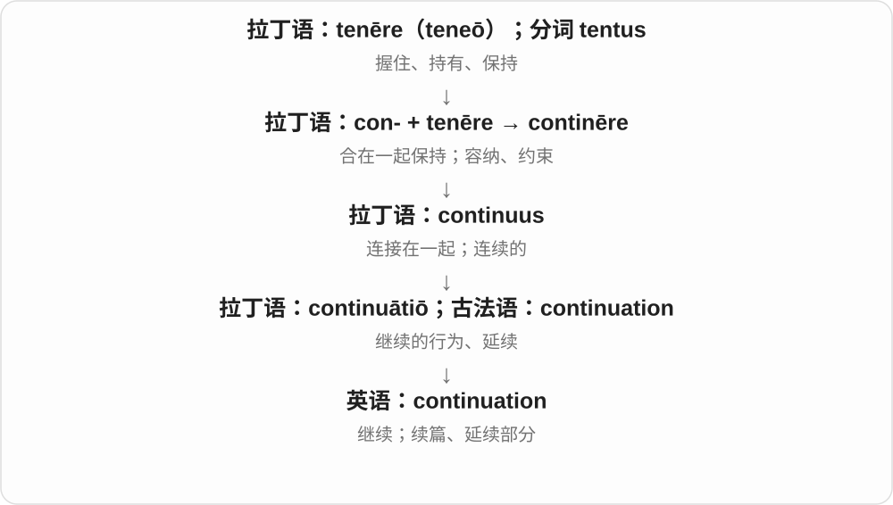

常用于工作、谈判、故事或路线的延续。不是所有 continuation 都从头重新来，通常保留前面的进展。

**常见搭配与例句**

a continuation of…；the continuation of talks；a direct continuation。

> The second book is a continuation of the first story.

第二本书接着讲第一本的故事。

> Both sides agreed to the continuation of the talks.

双方同意继续谈判。

**别混淆**

continuity 强调前后不断、相连的性质；continuation 强调继续做或接续的部分。

### 13. continual — 不断的；频繁反复的

**音标**：/kənˈtɪnjuəl/

**先抓住这个画面**

continual 像一件事隔不了多久又来一次，让人感觉总在发生。

**怎么拆**

经古法语 continuel 来自拉丁语 continuus“连续的”，历史上与 continuous 很接近。

**怎么变成今天的意思**

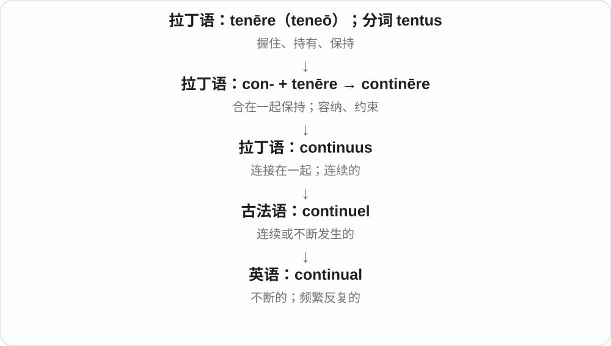

现代常用来描述持续反复的干扰、变化或要求。它也能表示连续，不必把实用辨析当成永远没有例外的规则。

**常见搭配与例句**

continual interruptions；continual change；a continual source of… 。

> Continual interruptions made it hard to finish the report.

接连不断的打扰让人难以写完报告。

> The garden is a continual source of new ideas for her paintings.

这座花园不断为她的绘画带来新想法。

**别混淆**

continuous 一般强调没有间断；continual 常强调反复不断。电话一再打来可以 continual，通话从不挂断才典型是 continuous。

### 14. continually — 不断地；频繁反复地

**音标**：/kənˈtɪnjuəli/

**先抓住这个画面**

continually 像手机一会儿响一下、一会儿又响一下，事情不断回来发生，未必每秒都在进行。

**怎么拆**

continual + -ly。

**怎么变成今天的意思**

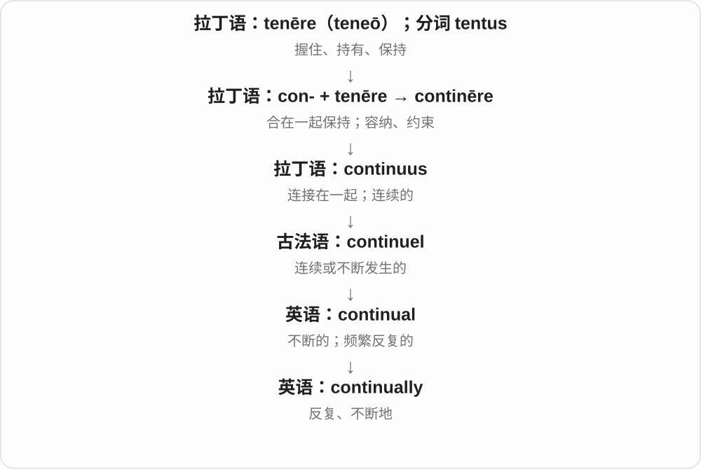

常与烦扰、更新、提问等反复行为搭配。也有不停的用法，因此遇到真实文本要结合上下文。

**常见搭配与例句**

continually ask；continually change；continually interrupt。

> He continually checked his phone during dinner.

吃晚饭时他一再查看手机。

> The website is continually updated with new examples.

网站不断补充新的例子。

**别混淆**

continuously 更突出没有停顿；continually 常突出一再发生。两词不是在所有句子里都绝对互斥。

### 15. continuance — 继续；延续；延期审理

**音标**：/kənˈtɪnjuəns/

**先抓住这个画面**

continuance 像让某个状态继续维持下去；法律里的专义却是把程序移到以后，让案件保持未完成状态。

**怎么拆**

经古法语 continuance 来自 continuer，早于现代英语随意的 continue + -ance 拆分。

**怎么变成今天的意思**

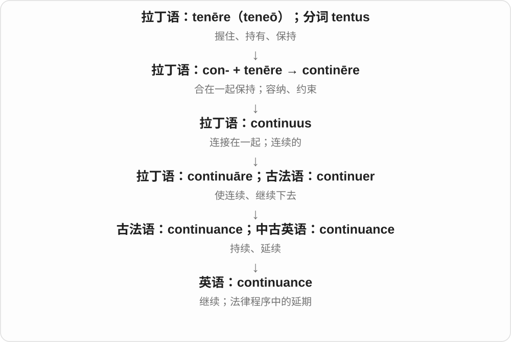

一般义与 continuation 接近；法庭语境常是获准延期，不应误译成马上继续开庭。

**常见搭配与例句**

the continuance of a practice；request a continuance；grant a continuance。

> The committee supported the continuance of the programme.

委员会支持继续开展该项目。

> The judge granted a continuance until the following week.

法官同意延期到下一周。

**别混淆**

continuation 通常说继续；continuance 在法律语境里常专指延期，不能只凭词根直译。

### 16. continuant — 连续音；持续的；持续存在物（哲学）

**音标**：/kənˈtɪnjuənt/

**先抓住这个画面**

continuant 的语言学画面是气流能够继续通过、声音可以延长，例如 /s/；它不像 /p/ 那样先完全堵住再放开。

**怎么拆**

continue + -ant，表示延续的性质或相应事物。

**怎么变成今天的意思**

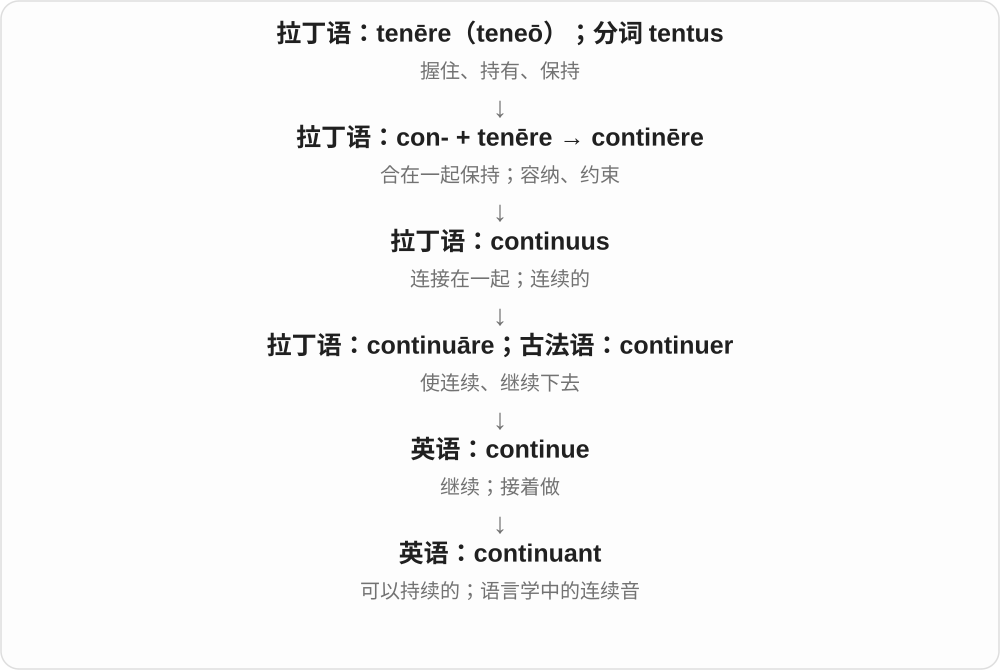

声音分类的细分标准会随理论而有差别。哲学里也可指在时间中保持自身身份的事物，不能把所有义都当成发音术语。

**常见搭配与例句**

a continuant sound；continuant consonants；a continuant entity。

> The teacher used /s/ as an example of a continuant.

老师用 /s/ 举例说明连续音。

> The exercise contrasts continuant sounds with stops.

练习把连续音与塞音作了对比。

**别混淆**

stop 指发音时气流曾被完全阻断的塞音；continuant 强调可保持的气流、声音。

### 17. discontinue — 停止；不再生产、提供或进行

**音标**：/ˌdɪskənˈtɪnjuː/

**先抓住这个画面**

discontinue 像把原先一直供应的产品或服务这条线切断，从此不再接着做。

**怎么拆**

来自古法语 descontinuer，现代可拆成 dis- + continue；否定、停止的构词在借入前已有。

**怎么变成今天的意思**

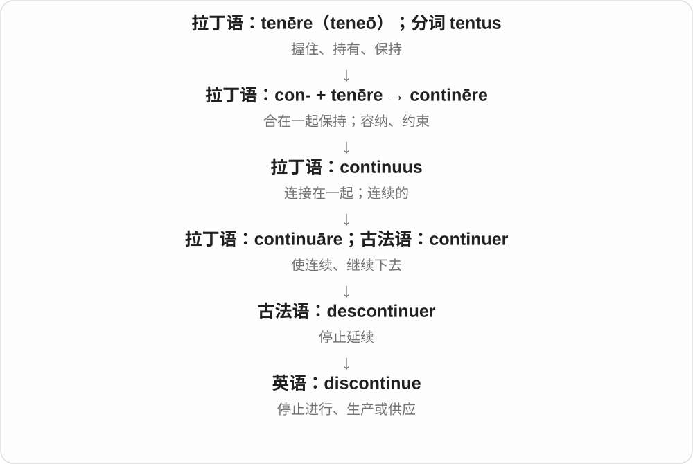

常见于产品、服务、惯例。比 pause 更容易表示某项安排正式结束，不只是短暂停一会儿。

**常见搭配与例句**

discontinue a product；discontinue a service；be discontinued。

> The company will discontinue the older model next year.

公司明年将停止生产旧型号。

> The library discontinued the service because few people used it.

图书馆因使用者很少而停止了这项服务。

**别混淆**

pause 是暂时停顿；discontinue 通常停止原有安排，是否以后恢复另说。

### 18. discontinued — 停止了；停产、停止供应的

**音标**：英、美 /ˌdɪskənˈtɪnjuːd/

**先抓住这个画面**

原来一直继续提供、执行的东西，现在不再继续，是 discontinued。商品停产、旧服务停止、某种做法不再采用，都可以用。

**怎么拆**

discontinue 去末尾 e，加完整 -ed → discontinued，/uː/ 后读 /d/。经法语、拉丁 discontinuare，含 dis- 断开、不再与 continuare 使连续。

**怎么变成今天的意思**

**拉丁 continuare 连续，配 dis- → discontinuare → discontinue**  
让原来连接、持续的事情断开

↓

**停止供应、生产、采用等义 + -ed → discontinued**  
现代既说停止动作，也说明产品、服务的状态

a discontinued model 是停产型号；discontinued a service 是停止了一项服务；discontinued the practice 是停止了这种做法。

**常见搭配与例句**

a discontinued model；discontinued a service；discontinued the practice。

> The company discontinued the old model last year.

公司去年停止生产那个旧型号。

> The library discontinued the service after opening a new website.

图书馆启用新网站后，停止了原来那项服务。

**别混淆**

discontinued 常说明不再继续生产、提供，sold out 只说明库存卖光。产品卖光后可能还会补货；discontinued 则强调供应安排已经停止。

### 19. discontinuation — 停止；停产；终止供应

**音标**：/ˌdɪskənˌtɪnjuˈeɪʃən/

**先抓住这个画面**

discontinuation 像正式宣布“这条线到这里为止”，不再继续原来的产品、服务或安排。

**怎么拆**

discontinue + -ation；与 discontinue 停止延续的用法相连。

**怎么变成今天的意思**

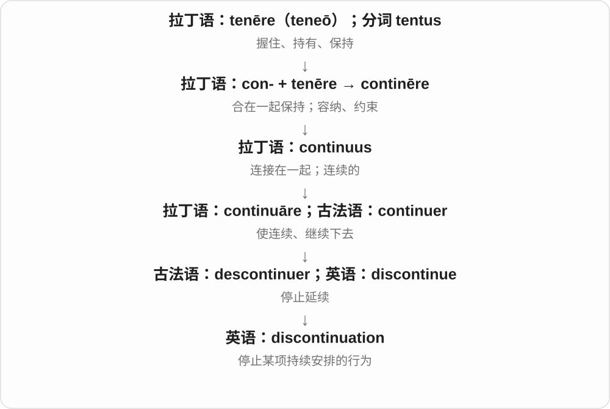

常用于公告、服务说明和项目报告。重点是有意识停止某项原先持续的安排。

**常见搭配与例句**

discontinuation of a service；product discontinuation；announce discontinuation。

> The company announced the discontinuation of the old service.

公司宣布停止提供旧服务。

> Customers received notice before the product’s discontinuation.

产品停产前，客户收到了通知。

**别混淆**

interruption 是中途被打断，通常仍可能恢复；discontinuation 更常表示正式结束。

### 20. discontinuance — 停止；终止；中止持续安排

**音标**：/ˌdɪskənˈtɪnjuəns/

**先抓住这个画面**

discontinuance 像把原来持续进行的惯例或程序收起来，不再照原样继续。

**怎么拆**

经盎格鲁法语、古法语 descontinuer 这一支线进入英语；现代可联系 discontinue 与 -ance。

**怎么变成今天的意思**

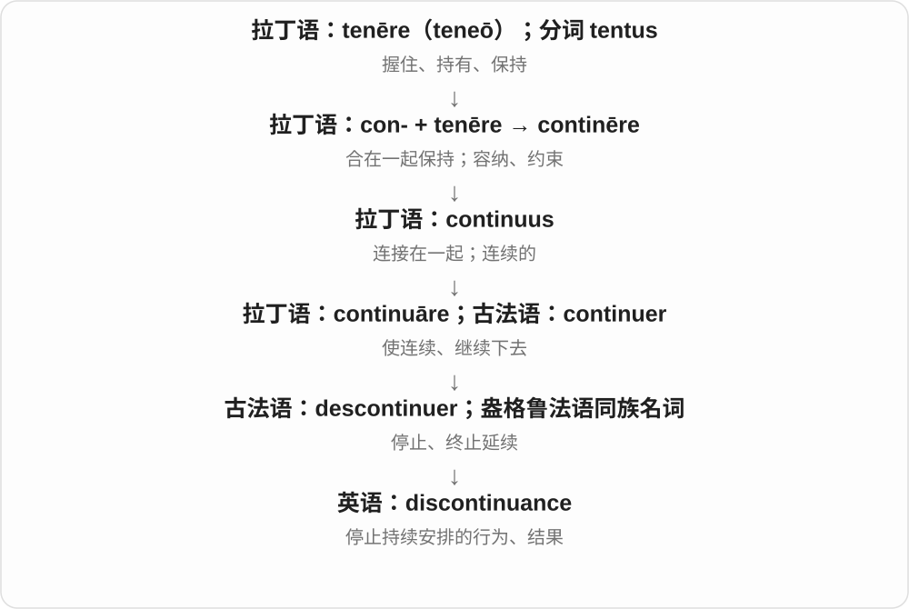

与 discontinuation 高度接近，较常见于正式、行政或法律文字；具体制度效果由语境决定。

**常见搭配与例句**

discontinuance of a service；notice of discontinuance；discontinuance of proceedings。

> Residents objected to the discontinuance of the bus service.

居民反对取消这条公交服务。

> The file contains a notice of discontinuance.

档案中有一份终止程序的通知。

**别混淆**

discontinuity 是不连续或断口；discontinuance 是把一项安排停掉。

### 21. content — 内容；所含物；含量；满足的

**音标**：内容：英 /ˈkɒntent/、美 /ˈkɑːntent/；满足：/kənˈtent/

**先抓住这个画面**

content 有两个画面：书里装着什么，是“内容”；觉得眼前拥有的已经够了，是“满足”。同源，但重音不同。

**怎么拆**

来自拉丁语 contentus，是 continēre“容纳、保持”的分词。内容义指被装在里面的东西；满足义联系自足、安于现状。

**怎么变成今天的意思**

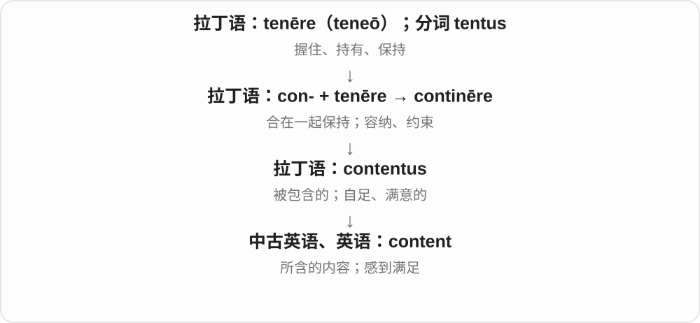

内容名词重音在前；满足形容词、使满足的动词重音在后。a table of contents 是目录；the contents of a bag 是包里的东西。

**常见搭配与例句**

online content；sugar content；be content with…；be content to do… 。

> The course focuses on the content of the argument.

课程关注论证的内容。

> She is content with a quiet evening at home.

在家安静地度过一个晚上，她就很满足。

> Check the sugar content on the label.

查看标签上的含糖量。

**别混淆**

happy 可指开心的情绪；content 更像平静地觉得“这样就够了”，不必兴高采烈。

### 22. contents — 所装物品；内容项目；目录

**音标**：英 /ˈkɒntents/；美 /ˈkɑːntents/

**先抓住这个画面**

把盒子打开，里面装的所有东西是 contents；打开书，目录先把里面有什么一项项列给你看。

**怎么拆**

接拉丁 contentum、复数 contenta 等所含之物的名词材料，上接 continere 把东西容在一起。英语 contents 很早就表示容器、文件所含的东西，后有 table of contents。

**怎么变成今天的意思**

**拉丁 continere → contentum／contenta**  
容纳 → 被容纳的东西

↓

**英语 contents**  
所装物品、内容；内容项目列表

the contents of the box 盒内物品；a table of contents 目录；empty the contents 倒出所装东西；the contents page 目录页。

**常见搭配与例句**

check the contents；the bag and its contents。

> She emptied the contents of her bag onto the table.

她把包里的东西都倒在桌上。

> Use the table of contents to find the chapter.

用目录找到那一章。

**别混淆**

名词 contents 重读第一音节；满意的 content 常重读后面 /kənˈtent/。digital content 常作不可数内容统称，不能只因中文有很多内容就到处加 s。

### 23. contentment — 满足；知足；安然满意

**音标**：/kənˈtentmənt/

**先抓住这个画面**

contentment 像坐下来觉得“我现在这样就很好”，是一种平静的够了，不一定是兴奋的快乐。

**怎么拆**

借自法语 contentement，与 content“满足”同族；现代可见 content + -ment 的结构。

**怎么变成今天的意思**

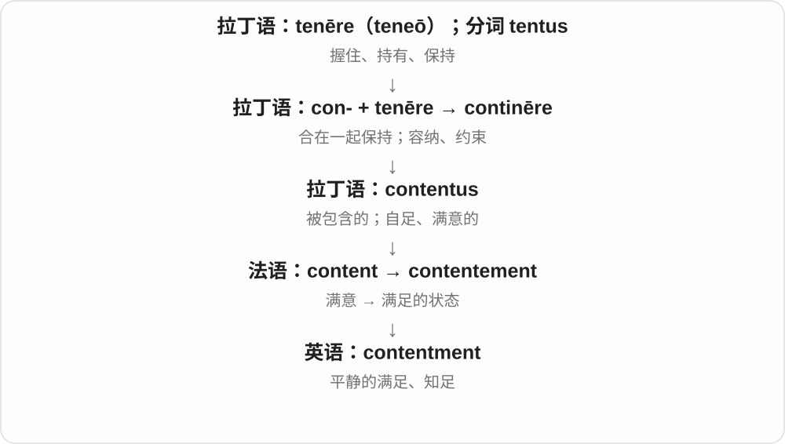

可以来自简单生活，也可以来自完成重要事情。重点是内心觉得当前所拥有的足够。

**常见搭配与例句**

a sense of contentment；quiet contentment；find contentment in… 。

> She felt a quiet contentment after finishing the garden.

收拾好花园后，她感到一种平静的满足。

> He finds contentment in simple daily routines.

他从简单的日常生活中获得满足。

**别混淆**

excitement 是兴奋、刺激；contentment 通常安静而稳定，不需要强烈情绪。

### 24. discontentment — 不满足；不满情绪

**音标**：/ˌdɪskənˈtentmənt/

**先抓住这个画面**

discontentment 像心里一直有个“还不够、不是我想要的”空缺，强调持续不满意的感受。

**怎么拆**

dis- + contentment。

**怎么变成今天的意思**

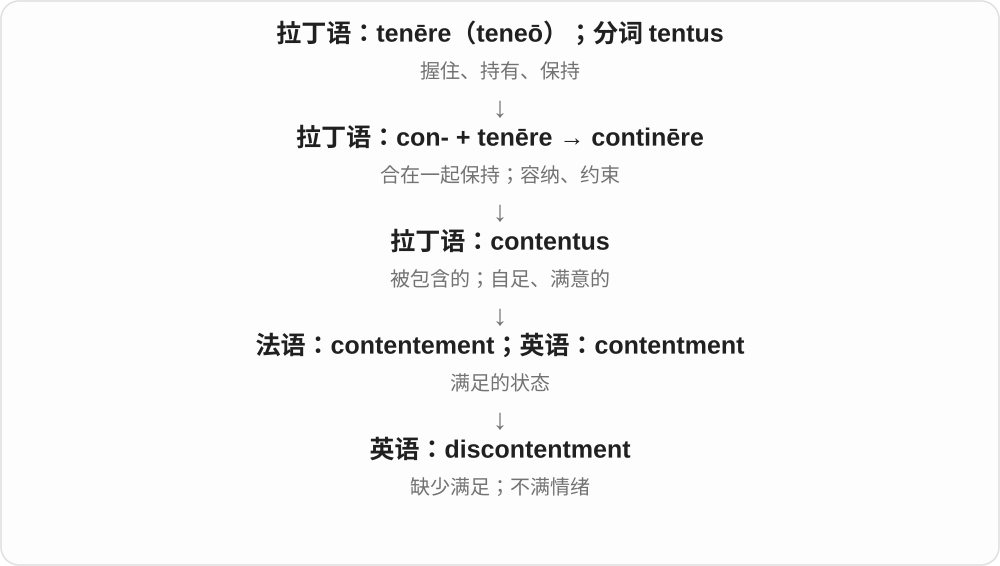

常说个人对生活、工作或处境的不满足，也可描述群体。比“愤怒”更强调满意感缺失。

**常见搭配与例句**

discontentment with…；a sense of discontentment；growing discontentment。

> She could not explain her growing discontentment with the job.

她说不清自己为什么对这份工作越来越不满意。

> The letter expresses discontentment without blaming anyone.

信中表达了不满，却没有责怪任何人。

**别混淆**

discontent 与它非常接近；discontentment 更容易突出内心状态，而 discontent 也常用于群体、社会不满。

### 25. contented — 满足的；心满意足的

**音标**：/kənˈtentɪd/

**先抓住这个画面**

contented 像饭后坐在窗边，神态安稳，觉得当前生活或处境已经足够好。

**怎么拆**

content（使满足）+ -ed，形容满足的状态。

**怎么变成今天的意思**

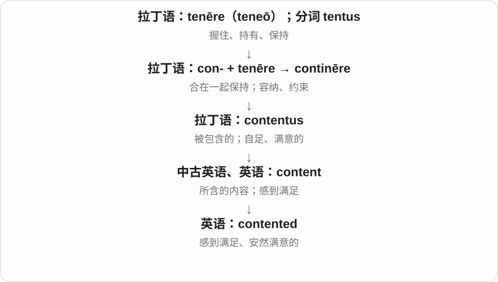

既可说人，也可修饰 smile、sigh 等表现。通常是平静满意，不必表现得很热烈。

**常见搭配与例句**

a contented smile；a contented life；look contented。

> The cat slept with a contented expression.

猫安然满足地睡着。

> She gave a contented sigh after a long walk.

长时间散步后，她满足地叹了一口气。

**别混淆**

content 常说 be content with…；contented 很自然地放在名词前，如 a contented child，两者意思接近。

### 26. contentedly — 满足地；安然地

**音标**：/kənˈtentɪdli/

**先抓住这个画面**

contentedly 像做着眼前这件简单的事，心里没有催促自己追更多，神态很满足。

**怎么拆**

contented + -ly。

**怎么变成今天的意思**

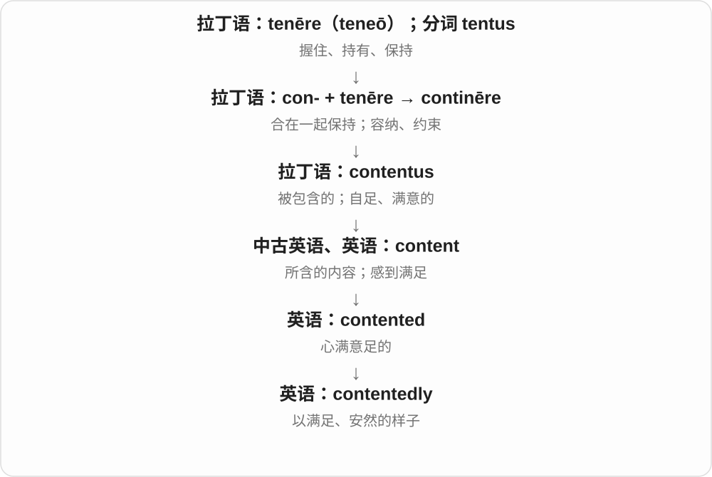

常修饰坐着、吃着、微笑等动作，描述做事时的心情。

**常见搭配与例句**

smile contentedly；sit contentedly；eat contentedly。

> He sat contentedly by the fire with a book.

他拿着一本书，满足地坐在炉火旁。

> The children ate their lunch contentedly in the garden.

孩子们在花园里满足地吃着午餐。

**别混淆**

happily 可以兴奋快乐；contentedly 更带安稳、知足、不再要求更多的感觉。

### 27. discontented — 不满的；对现状不满意的

**音标**：/ˌdɪskənˈtentɪd/

**先抓住这个画面**

discontented 像觉得眼前安排不合心意，总希望换个更好的状况。

**怎么拆**

dis-（不）+ contented。

**怎么变成今天的意思**

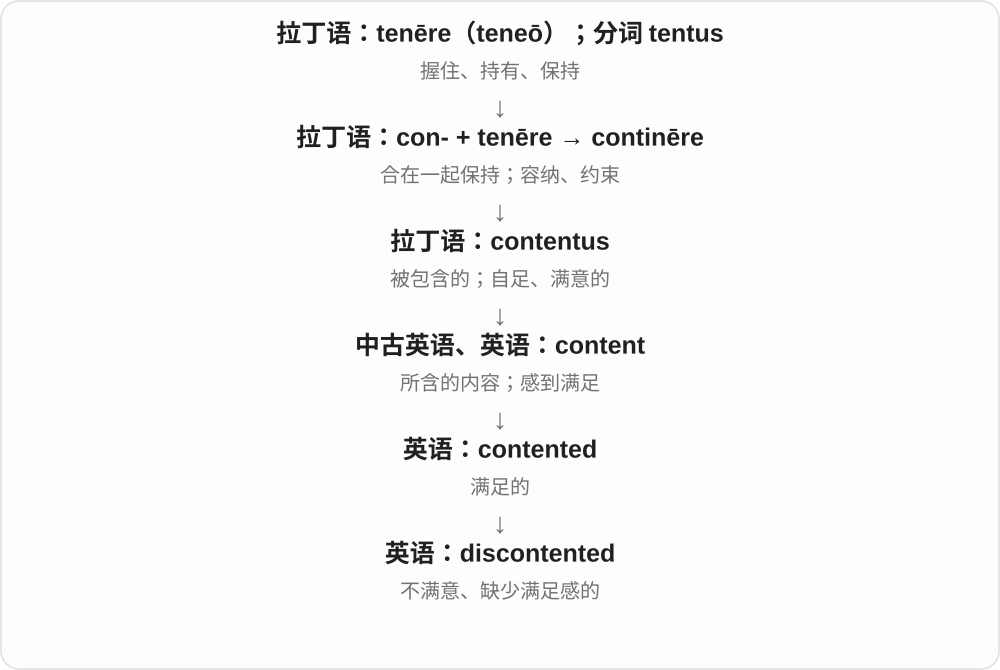

形容的是不满足，不一定已经公开反对。可接 with 说明不满对象。

**常见搭配与例句**

discontented with…；discontented workers；a discontented expression。

> Several staff members were discontented with the new arrangement.

几位员工对新安排不满意。

> He grew discontented despite his comfortable circumstances.

虽然生活舒适，他却越来越不满足。

**别混淆**

disappointed 常因具体期待落空；discontented 可是对长期现状的不满，没有一次明确落空也能发生。

### 28. contentive — 实义词；内容词；容纳的（旧义）

**音标**：/kənˈtentɪv/

**先抓住这个画面**

contentive 在语言学里像句子中装着主要画面、动作和性质的词，例如 cat、run、green，区别于主要承担语法连接的词。

**怎么拆**

content（内容）+ -ive；另有容纳、令人满意等旧形容词用法，联系 content 的不同支线。

**怎么变成今天的意思**

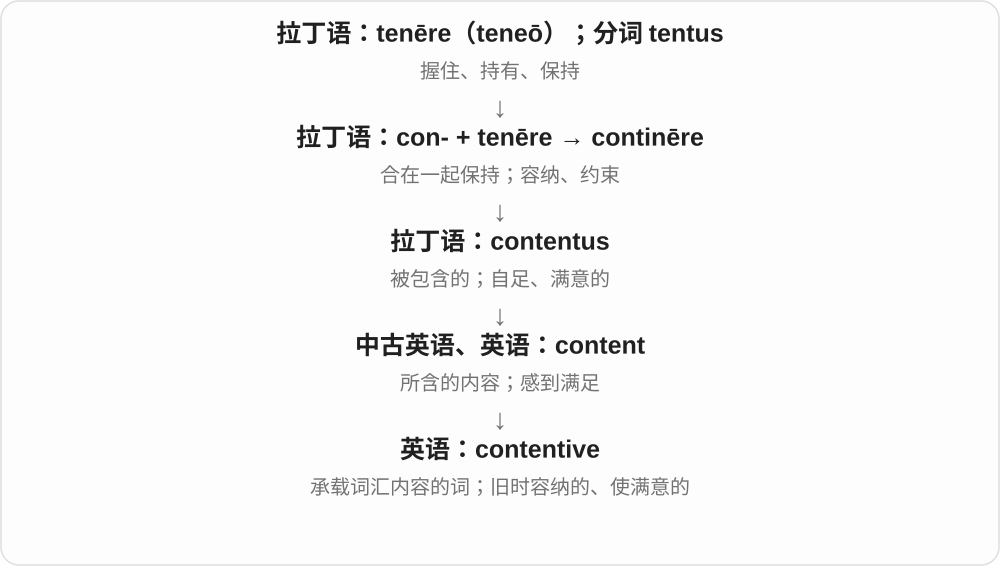

名词可与 content word 对照，强调词汇意义。不要理解为只有实义词有意思，功能词同样表达重要关系。

**常见搭配与例句**

a contentive word；contentives and function words；a contentive morpheme。

> In this example, “garden” is a contentive.

在这个例子中，garden 是一个实义词。

> The exercise asks students to distinguish contentives from function words.

练习要求学生把实义词与功能词区分开来。

**别混淆**

function word 常组织语法关系，如冠词；contentive 常提供事物、动作、性质等主要词汇内容。

### 29. discontent — 不满；不满足

**音标**：/ˌdɪskənˈtent/

**先抓住这个画面**

discontent 像看着现状，心里觉得“这样还不行”，希望事情有所改变。

**怎么拆**

dis-（否定、相反）+ content（满足）。

**怎么变成今天的意思**

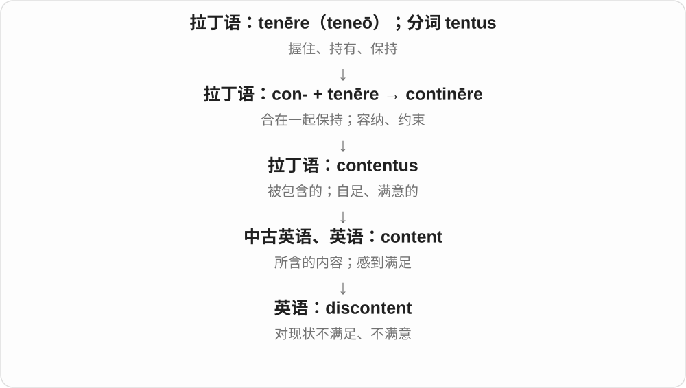

名词最常见，常说一群人对待遇、安排或生活状况的不满；并不一定已经发脾气或公开抗议。

**常见搭配与例句**

discontent with…；growing discontent；express discontent。

> There was growing discontent with the new timetable.

人们对新时间表的不满日益增加。

> The survey revealed widespread discontent among staff.

调查显示员工中普遍存在不满。

**别混淆**

anger 是愤怒；discontent 是不满意的状态，可以很安静，也可能积累成愤怒。

### 30. contain — 容纳；包含；控制住

**音标**：/kənˈteɪn/

**先抓住这个画面**

contain 像盒子把东西留在里面；再抽象一点，就是把情绪、火势或问题限制在某个范围内。

**怎么拆**

con-（一起）+ tenēre（保持）在拉丁语中形成 continēre，经古法语 contenir 进入英语。

**怎么变成今天的意思**

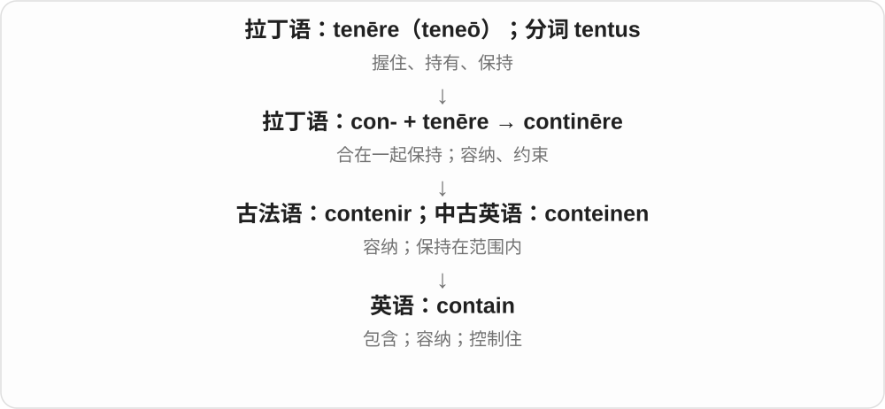

既可以描述内部有什么，也可以强调“不让它跑出去”。contain excitement 是努力控制兴奋。

**常见搭配与例句**

contain water；contain information；contain a fire；contain one’s excitement。

> This bottle contains enough water for the walk.

这只瓶子装着足够这次步行喝的水。

> She could hardly contain her excitement.

她几乎控制不住自己的兴奋。

**别混淆**

include 强调作为组成部分；contain 常强调内部有某物或把扩散控制住，二者部分重叠。

### 31. contains — 包含、容纳；控制住、遏制；contain 的第三人称单数

**音标**：/kənˈteɪnz/

**先抓住这个画面**

把内容留在一个范围之内，是 contains：盒子里有东西，文章里有信息，都属于包含；控制住火势等，也是在限制它继续越界。

**怎么拆**

contain + -s，/n/ 后读 /z/。contain 经古法语 contenir 接拉丁 continēre，con- 一起与 tenēre 保持、持有形成，早有容纳、约束义。

**怎么变成今天的意思**

**拉丁 con- + tenēre → continēre → 法语、英语 contain**  
保持在一起 → 容纳、约束

↓

**contain + -s → contains**  
单数主语包含、装得下；控制住

contains useful information 包含有用信息；contains three parts 包含三个部分；contains the spread 遏制蔓延。

**常见搭配与例句**

the box contains ...；contains more than one type。

> The box contains all the parts needed for the model.

盒子里有制作模型所需的全部零件。

> The final chapter contains several practical examples.

最后一章包含几个实际例子。

**别混淆**

contains 常说某物内部有什么，includes 常说整体把某些部分也包括进来，两者可重合。contains herself/himself 等表达还可说克制情绪，具体看主语与宾语。

### 32. contained — 含有、容纳；控制住〔过去式、过去分词〕

**音标**：/kənˈteɪnd/

**先抓住这个画面**

把东西保持在一个范围里面，是 contained；箱子含有什么、影响被限制到哪里，都可沿边界把握住的画面理解。

**怎么拆**

contain + -ed，/n/ 后读 /d/。拉丁 con- 与 tenēre 保持形成 continēre，经古法语 contenir 进入英语；范围内保持的意义又发展到控制扩散。

**怎么变成今天的意思**

**拉丁 continēre → 古法语 contenir → contain**  
保持在一起、保持在范围内 → 容纳、限制

↓

**contain + -ed → contained**  
含有过；已被控制在范围内

contained the documents 装着文件；contained in the report 包含在报告里；contained within 限于某范围。

**常见搭配与例句**

contained in one folder；contained the spread of the problem。

> The box contained old letters and photographs.

箱子里装着旧信和照片。

> The problem was contained within one small part of the system.

问题被控制在系统的一小部分之内。

**别混淆**

contained something 可以描述原来就装着什么；was contained 也可说问题已控制住。主语和宾语决定是在数内容，还是描述边界控制。

### 33. containing — 包含、装着；控制、遏制〔现在分词、动名词〕

**音标**：/kənˈteɪnɪŋ/

**先抓住这个画面**

把东西稳稳放在一个范围里，是 containing。盒子装着东西，文件带着信息；把火或问题控制在范围内，也是同一持住的线索。

**怎么拆**

contain + -ing → containing。拉丁 con- 一起 + tenēre 持有、握住 → continēre，把东西持在一起，经古法语 contenir 等进入英语。

**怎么变成今天的意思**

**拉丁 continēre → 法语 contenir → contain**  
持在范围内 → 装着、包含；控制

↓

**contain + -ing → containing**  
正在装有、包含；控制扩散的过程

a box containing tools 装有工具的箱子；a file containing notes 含有笔记的文件；containing the fire 控制火势。

**常见搭配与例句**

food containing nuts 含坚果的食物；containing the spread 控制蔓延。

> She opened a box containing old photographs.

她打开一个装着老照片的盒子。

> The team focused on containing the fire.

队伍集中力量控制火势。

**别混淆**

containing 作后置修饰很常见：a bag containing books 就是装着书的包。控制义则通常说把危险或影响限制在一定范围。

### 34. container — 容器；集装箱

**音标**：英 /kənˈteɪnə/；美 /kənˈteɪnər/

**先抓住这个画面**

container 像给东西一个能待住的外壳：饭盒、罐子是容器，运输货物的大箱子是集装箱。

**怎么拆**

contain + -er，表示用来容纳的东西。

**怎么变成今天的意思**

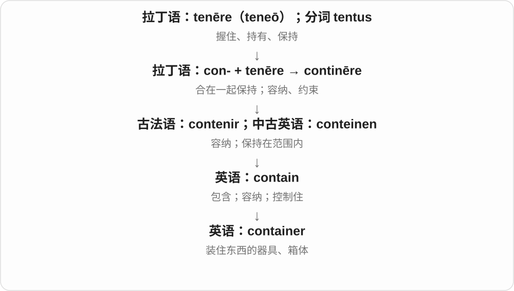

它按功能命名，不限定材料和形状。计算机容器借用了把应用及环境打包隔开的意象，具体机制另外学习。

**常见搭配与例句**

a plastic container；an airtight container；a shipping container。

> Store the biscuits in an airtight container.

把饼干放在密封容器中。

> The ship carried hundreds of steel containers.

船上载着数百个钢制集装箱。

**别混淆**

package 更强调包装好的一件物品或包裹；container 强调装东西的载体。

### 35. containers — 容器；集装箱〔复数〕

**音标**：英 /kənˈteɪnəz/；美 /kənˈteɪnɚz/

**先抓住这个画面**

能把东西装住的盒、罐等是 containers；运输场景里又常专指大集装箱。大小不同，核心都是装住、保持在里面。

**怎么拆**

contain + -er → container 容器，再加 -s → containers。contain 接拉丁 con- 一起 + tenere 保持的材料，经法语进入英语。

**怎么变成今天的意思**

**拉丁 con- + tenere → continere → 法语、英语 contain**  
把东西保持在一起、范围内

↓

**contain + -er → container → containers**  
-er 构物品名，再加复数 -s，词尾 /z/

food containers 是食物容器；shipping containers 是货运集装箱；airtight containers 是密闭容器。

**常见搭配与例句**

food containers；shipping containers；airtight containers。

> We put the leftovers in separate containers.

我们把剩菜分装进不同容器。

> The ship was loaded with shipping containers.

船上装满了货运集装箱。

**别混淆**

container 不只指集装箱；先看 food、shipping 等搭配，才能判断眼前是在说厨房里的盒子还是港口大箱子。

### 36. containment — 控制；遏制；围堵；容纳设施

**音标**：/kənˈteɪnmənt/

**先抓住这个画面**

containment 像给溢出的东西加一道边界，目标是让它别继续向外扩散。

**怎么拆**

contain + -ment。

**怎么变成今天的意思**

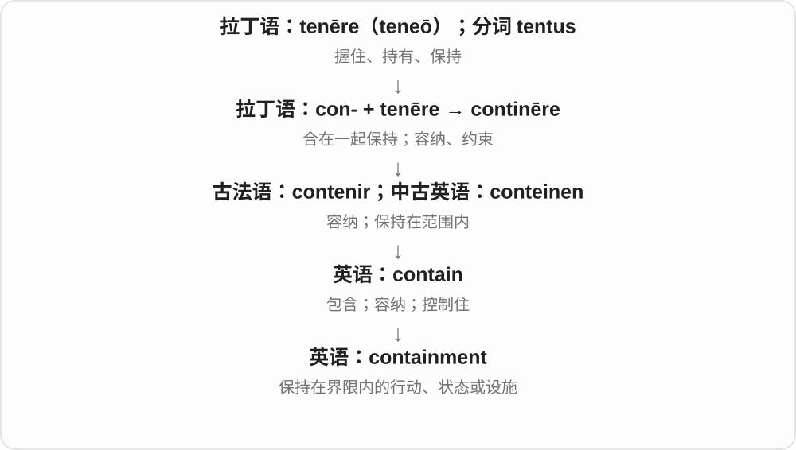

可以是实际围住泄漏物，也可以是阻止问题扩大。政治中的遏制也借用这个方向，但具体政策另有历史。

**常见搭配与例句**

spill containment；containment measures；a containment system。

> The team set up barriers for spill containment.

团队设置了围挡来控制泄漏物扩散。

> The first goal was containment of the problem.

最初的目标是控制问题，不让它扩大。

**别混淆**

elimination 是消除；containment 是控制在范围内，东西可能仍然存在。

### 37. maintain — 维持；维护；保养；坚持说

**音标**：/meɪnˈteɪn/

**先抓住这个画面**

maintain 像用手扶着一个状态，不让它垮下去：让机器好用、让联系不断，也可以坚持一个说法不松口。

**怎么拆**

古法语 maintenir 来自晚期拉丁语 manūtenēre，包含 manū“用手”和 tenēre“握住”。

**怎么变成今天的意思**

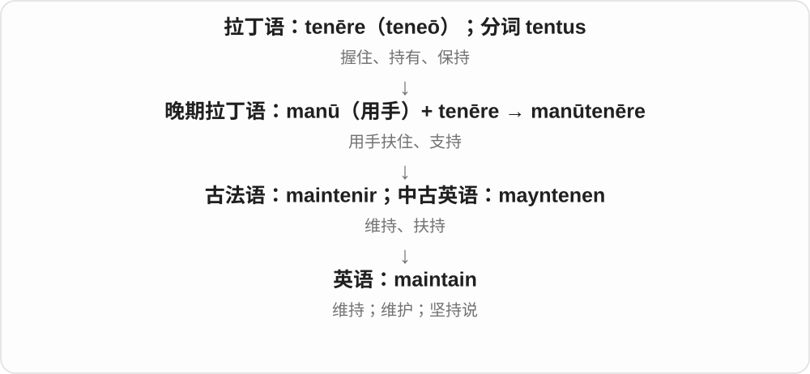

物品需要维护，关系需要维持，观点也可被坚持。maintain that… 通常是“坚持声称”，不是修理某物。

**常见搭配与例句**

maintain contact；maintain a balance；maintain equipment；maintain that… 。

> Regular checks help maintain the equipment in good condition.

定期检查有助于让设备保持良好状态。

> She maintains that the original plan is still workable.

她坚持认为原计划仍然可行。

**别混淆**

repair 是坏了之后修复；maintain 常是持续照料，让它保持良好状态。

### 38. maintenance — 维护；保养；生活供养

**音标**：/ˈmeɪntənəns/

**先抓住这个画面**

maintenance 像隔一段时间给机器检查、清洁、调整，让它继续好好工作；对人的供养也是持续把生活撑住。

**怎么拆**

借自古法语 maintenance，与 maintenir 同族。它保留 -ten-，英语 maintain 的拼写和发音后来走了不同变化。

**怎么变成今天的意思**

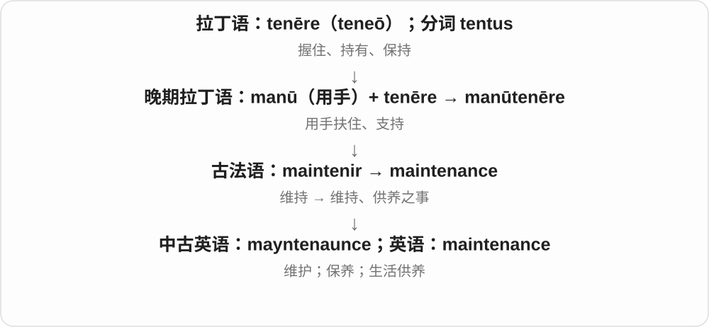

一般说的是维持状态所需的一系列工作或费用，未必有东西已经损坏。语境中也可指家庭生活供养。

**常见搭配与例句**

routine maintenance；maintenance costs；building maintenance；maintenance payments。

> The lift is closed for routine maintenance.

电梯因例行维护暂停使用。

> The budget includes the maintenance of the garden.

预算包括花园的维护费用。

**别混淆**

maintenance 是保养维护；repair 是修复具体损坏。保养得好，可能少做 repair。

### 39. maintaining — 维持、保养；坚持认为〔现在分词、动名词〕

**音标**：/meɪnˈteɪnɪŋ/

**先抓住这个画面**

东西正在往下掉，用手托住，不让原有状态失去：这是 maintaining 的历史画面。现代可以维持质量、保养机器，也可一直坚持某个说法。

**怎么拆**

maintain + -ing，直接加 ing。maintain 借古法语 maintenir，接晚期拉丁 manutenere，含 manu 用手与 tenere 握住。

**怎么变成今天的意思**

**晚期拉丁 manu 与 tenere → 法语 maintenir → maintain**  
用手握住 → 维持、支撑

↓

**maintain + -ing → maintaining**  
正在维持、保养；持续坚持某个观点

maintaining standards 维持标准；maintaining equipment 保养设备；maintaining that 坚持认为。

**常见搭配与例句**

maintaining contact 保持联系；maintaining a balance 保持平衡。

> The team is maintaining regular contact with the residents.

团队正与居民保持经常联系。

> Maintaining the equipment takes time and careful planning.

保养设备需要时间和周密安排。

**别混淆**

maintaining 强调使状态持续；improving 强调变好。maintaining that 后跟观点，不是在维修一句话。maintenance 是对应名词，拼写发生变化。

### 40. maintains — 维持、维护、保养；坚持说〔第三人称单数〕

**音标**：/meɪnˈteɪnz/

**先抓住这个画面**

像用手扶住，让状态不掉下去，就是 maintains。机器保持好用，关系保持下去，观点也可以一直坚持。

**怎么拆**

maintain + -s，/n/ 后读 /z/。maintain 经法语 maintenir 接晚期拉丁 manutenere，manu 用手与 tenere 握住组合。

**怎么变成今天的意思**

**晚期拉丁 manu + tenere → manutenere → 法语 → maintain**  
用手扶住 → 支持、保持

↓

**maintain + -s → maintains**  
某人维护状态；坚持一个说法

maintains the equipment 保养设备；maintains contact 保持联系；maintains that... 坚持说……。

**常见搭配与例句**

maintains a balance 维持平衡；maintains the same pace 保持同一速度。

> The team maintains the equipment.

团队负责维护设备。

> She maintains that the earlier version was clearer.

她坚持说早先那个版本更清楚。

**别混淆**

maintains something 是让它继续处于所需状态；maintains that 后是本人坚持的主张，词本身不保证主张已被证实。

### 41. maintainer — 维护者；维持运作的人

**音标**：英 /meɪnˈteɪnə/；美 /meɪnˈteɪnər/

**先抓住这个画面**

maintainer 像持续照看一个项目或系统的人，处理问题、更新内容，让它不至于无人打理。

**怎么拆**

经法语 mainteneor、盎格鲁法语 maintenour 发展，英语词尾后来按 -er 调整；现代可分析为 maintain + -er。

**怎么变成今天的意思**

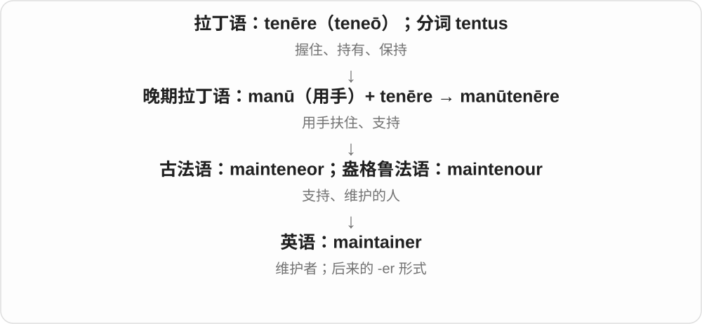

软件项目中很常见，通常包括审查变更、安排版本、维护项目方向等工作，不只会修一个错误。

**常见搭配与例句**

a project maintainer；a package maintainer；the current maintainer。

> The package maintainer reviewed the proposed change.

软件包维护者审查了提出的改动。

> The project is looking for a new maintainer.

这个项目正在寻找新的维护者。

**别混淆**

creator 是最初创建者；maintainer 是持续维护者，两者可能是同一人，也可能不同。

### 42. maintainable — 能够维持的；便于维护的

**音标**：/meɪnˈteɪnəbəl/

**先抓住这个画面**

maintainable 像一台零件容易找到、结构看得明白的机器，出了问题能照料、修改，长期用下去也撑得住。

**怎么拆**

maintain + -able。

**怎么变成今天的意思**

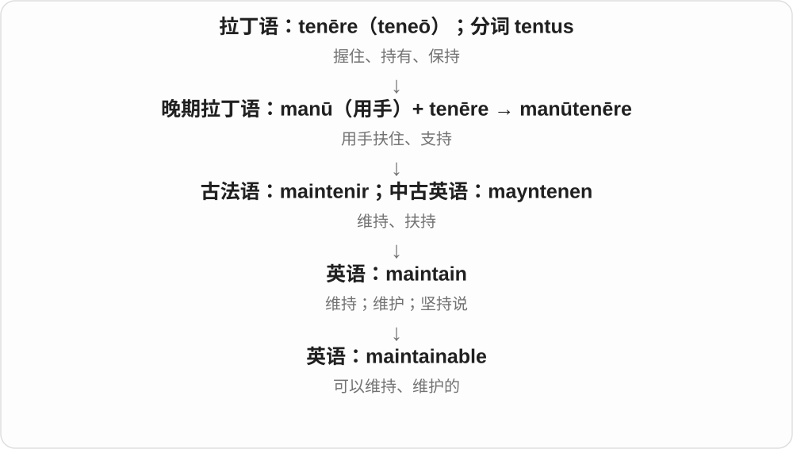

在软件和工程中常特别强调容易维护；在其他语境也可说某个水平或状态能持续保持。

**常见搭配与例句**

maintainable software；a maintainable system；a maintainable level。

> Clear naming makes the code more maintainable.

清楚的命名让代码更容易维护。

> The team chose a design that would remain maintainable for years.

团队选择了一种多年后仍能维护的设计。

**别混淆**

reliable 是运行可靠；maintainable 是便于维护。一个系统暂时可靠，也可能很难修改。

### 43. maintainability — 可维护性；维护难易程度

**音标**：/meɪnˌteɪnəˈbɪləti/

**先抓住这个画面**

maintainability 是问“以后修、改、检查它费不费劲”，不是只看今天能不能运行。

**怎么拆**

maintain + -ability；也可联系 maintainable 对应的名词形式。

**怎么变成今天的意思**

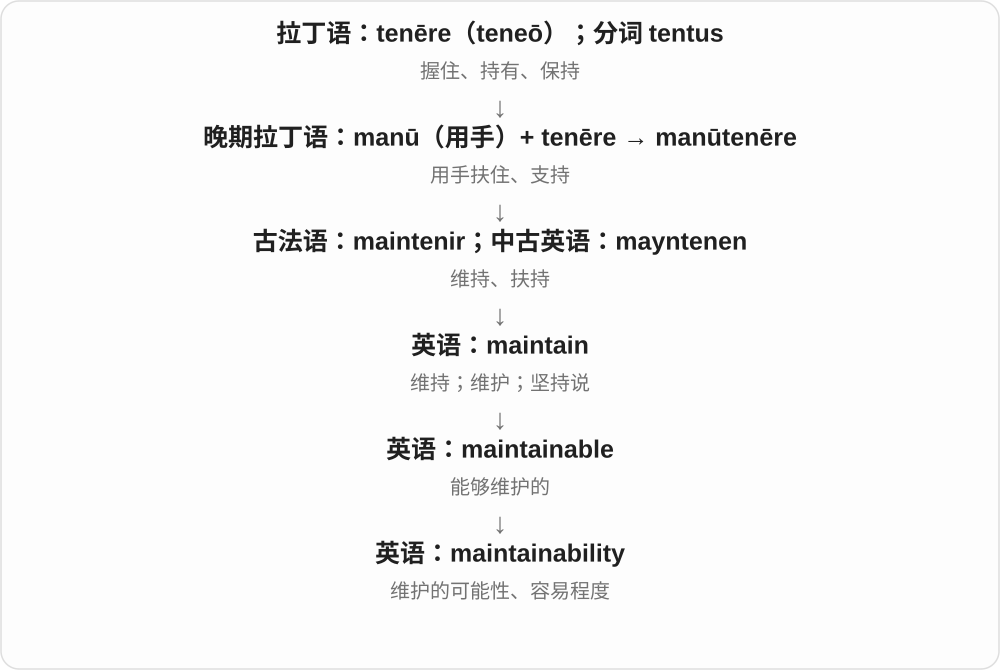

常用于设备、软件和工程设计。零件可更换、结构清晰、文档好，通常都能帮助维护。

**常见搭配与例句**

improve maintainability；design for maintainability；software maintainability。

> The redesign improved the maintainability of the engine.

重新设计提高了发动机的可维护性。

> The review considered readability and maintainability, not just speed.

评审考虑了可读性和可维护性，而不只看速度。

**别混淆**

availability 看此刻或一段时间是否可用；maintainability 看需要维护时容易不容易。

### 44. entertain — 使有趣、使愉快；招待；考虑

**音标**：英 /ˌentəˈteɪn/；美 /ˌentərˈteɪn/

**先抓住这个画面**

entertain 像把客人、注意力或一个想法留在自己这里：招待客人，吸引观众，也把想法暂时放在心里考虑。

**怎么拆**

经法语 entretenir 来自 entre“彼此、之间”+ tenir“保持”；tenir 远源是 tenēre。

**怎么变成今天的意思**

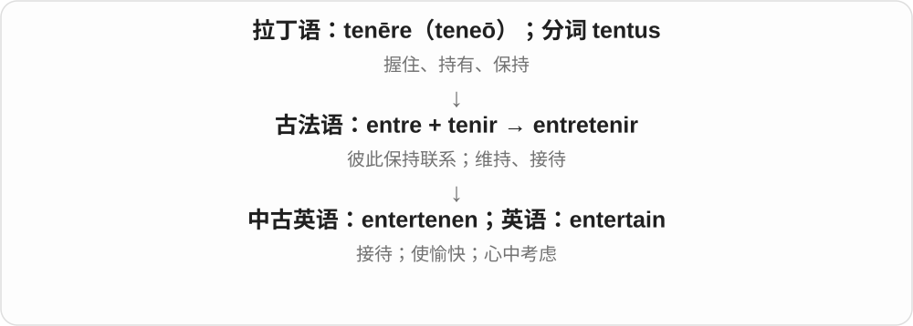

娱乐、接待与考虑之间有保持、容纳的联系。entertain an idea 是愿意考虑，不是已经赞同。

**常见搭配与例句**

entertain guests；entertain an audience；entertain an idea；entertain doubts。

> The storyteller entertained the children for an hour.

讲故事的人让孩子们听得开心，一个小时都没有厌倦。

> We are willing to entertain alternative proposals.

我们愿意考虑其他方案。

> They often entertain friends at home.

他们常在家招待朋友。

**别混淆**

consider 是普通考虑；entertain an idea 常强调允许这个可能性进入考虑范围。

### 45. entertainment — 娱乐；文娱活动；招待

**音标**：英 /ˌentəˈteɪnmənt/；美 /ˌentərˈteɪnmənt/

**先抓住这个画面**

entertainment 像有人安排节目、游戏或表演，把大家的注意力留在愉快的事情上。

**怎么拆**

经中古英语 entretenement 借自古法语 entretenement，早有维持、供养、接待义；不是仅在现代英语 entertain 后加 -ment 才出现。

**怎么变成今天的意思**

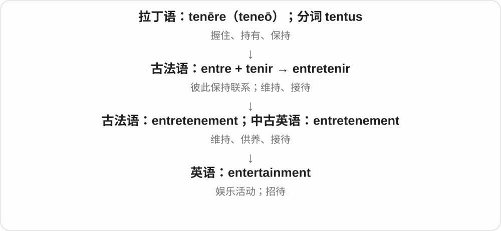

从维持、接待发展到使人愉快的活动。现在多说娱乐内容或节目，不只是招待客人的饭菜。

**常见搭配与例句**

live entertainment；the entertainment industry；provide entertainment。

> The festival offers live entertainment for all ages.

节庆活动为各年龄的人提供现场演出。

> We brought a few board games for entertainment on the trip.

我们带了几款桌游，在旅途中消遣。

**别混淆**

entertainment 是供人欣赏、消遣的活动；amusement 更常说被逗乐、觉得有趣的感受。

### 46. entertainments — 娱乐节目、娱乐活动〔复数〕

**音标**：英 /ˌentəˈteɪnmənts/；美 /ˌentərˈteɪnmənts/

**先抓住这个画面**

泛说娱乐是 entertainment；把一场场演出、游乐节目拿来分别数，就可用 entertainments。

**怎么拆**

entertainment + -s。名词经中古英语借古法语 entretenement，早有维持、招待义，现代与 entertain + -ment 对应但并非仅由现代英语新造。

**怎么变成今天的意思**

**拉丁 tenere 保持 → 法语 entre + tenir → entretenir**  
维持、接待、彼此维系等用途

↓

**古法语 entretenement → 英语 entertainment → entertainments**  
招待、供养等历史义 → 娱乐；具体娱乐节目

an evening of entertainments 可说一晚多种节目；具体、可分别安排的活动，才容易这样用复数。

**常见搭配与例句**

public entertainments 公共娱乐活动；a programme of entertainments 娱乐节目安排。

> The festival offers a variety of entertainments for children.

节庆为儿童安排了多种娱乐活动。

> The evening entertainments included music and comedy.

晚间娱乐节目包括音乐和喜剧。

**别混淆**

entertainment 泛说娱乐时常不可数；entertainments 更像一项项节目，不把所有抽象娱乐都机械加 -s。

### 47. entertaining — 有趣的；令人愉快的

**音标**：英 /ˌentəˈteɪnɪŋ/；美 /ˌentərˈteɪnɪŋ/

**先抓住这个画面**

entertaining 像一段故事把你的注意力留住，让你愿意继续听，过程也觉得有意思。

**怎么拆**

entertain + -ing，形容词描述能给人带来娱乐的性质。

**怎么变成今天的意思**

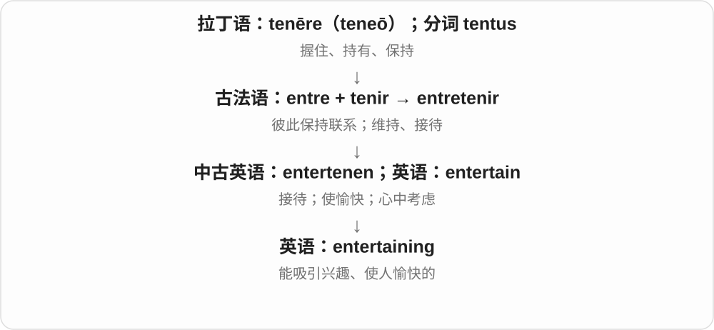

不必让人笑出声；精彩的比赛或生动的讲解也可以 entertaining。

**常见搭配与例句**

an entertaining story；an entertaining speaker；highly entertaining。

> The guide gave an entertaining account of the town’s history.

导游生动有趣地讲述了小镇的历史。

> The match was entertaining despite the low score.

虽然得分不高，这场比赛仍很好看。

**别混淆**

funny 常强调好笑；entertaining 强调有趣好看，可以包含悬念、惊奇或表演。

### 48. entertained — 使愉快、招待了；考虑过了；得到娱乐的

**音标**：英 /ˌentəˈteɪnd/；美 /ˌentərˈteɪnd/

**先抓住这个画面**

客人已经受到招待，观众已经被逗乐；一个念头曾在脑中停留考虑过，也能用 entertained。

**怎么拆**

entertain + 完整 -ed，/n/ 后读 /d/；原词不以不发音 e 结尾，直接加后缀。

**怎么变成今天的意思**

**拉丁 tenere 保持 → 法语 entre + tenir → entretenir**  
维持、接待、彼此维系等用途

↓

**英语 entertain 及相关名词**  
招待、使愉快；心里容纳、考虑一个想法

↓

**entertain + -ed → entertained**  
过去招待、使愉快、考虑；受到娱乐的状态

kept us entertained 是一直让我们觉得有趣；entertained the idea 是曾考虑过那个想法。

**常见搭配与例句**

entertained the guests 招待了客人；well entertained 玩得很尽兴的。

> The stories kept the children entertained.

这些故事让孩子们一直听得很开心。

> We briefly entertained the idea of staying another day.

我们曾短暂考虑再多留一天。

**别混淆**

entertained 说人得到娱乐后的感受，entertaining 常说人、节目本身有趣；an entertaining story 让人觉得 entertained。

### 49. entertainer — 演艺人员；表演者；娱乐大众的人

**音标**：英 /ˌentəˈteɪnə/；美 /ˌentərˈteɪnər/

**先抓住这个画面**

entertainer 像靠表演把观众留住的人，可以唱歌、变魔术、讲笑话，不只限于演员。

**怎么拆**

entertain + -er。

**怎么变成今天的意思**

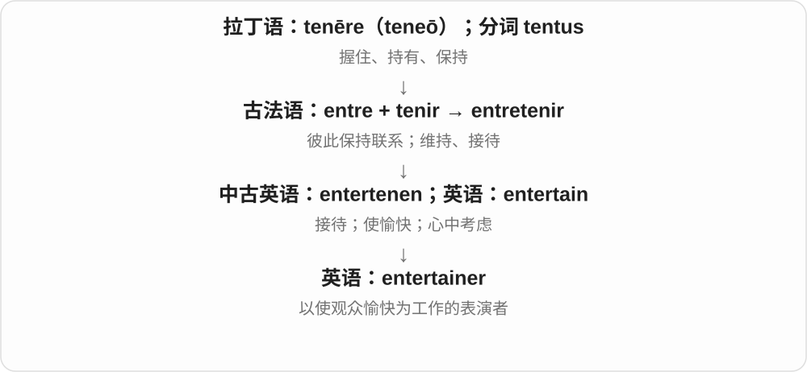

这个名称按表演的目的概括职业，不规定具体艺术形式。

**常见搭配与例句**

a professional entertainer；a children’s entertainer；a talented entertainer。

> The entertainer kept the children engaged with simple magic tricks.

表演者用简单的魔术吸引住了孩子们。

> She worked as an entertainer on a passenger ship.

她曾在客船上担任演艺人员。

**别混淆**

actor 主要表演角色；entertainer 范围更广，主持人、歌手、魔术师都可能属于它。

### 50. entertainers — 艺人、娱乐表演者〔复数〕

**音标**：英 /ˌentəˈteɪnəz/；美 /ˌentərˈteɪnərz/

**先抓住这个画面**

有人唱歌、讲笑话，有人表演魔术，工作都是让观众看得开心；这些人可统称 entertainers。

**怎么拆**

entertain + 完整 -er → entertainer，再加 -s。基础 entertain 的接待、使愉快义经法语接 tenir 保持。

**怎么变成今天的意思**

**拉丁 tenere 保持 → 法语 entre + tenir → entretenir**  
维持、接待、彼此维系等用途

↓

**英语 entertain 及相关名词**  
招待、使愉快；心里容纳、考虑一个想法

↓

**entertain + -er → entertainer → entertainers**  
为观众提供娱乐的人；多位表演者

street entertainers 是街头艺人，children’s entertainers 是给儿童表演的艺人；身份范围比演员更广。

**常见搭配与例句**

live entertainers 现场艺人；a group of entertainers 一群表演者。

> Street entertainers drew a crowd in the square.

街头艺人在广场吸引了人群。

> The hotel hired entertainers for the evening programme.

酒店为晚间节目聘请了艺人。

**别混淆**

actors 常突出扮演角色，entertainers 突出给观众提供娱乐，歌手、喜剧演员、魔术师都可能包括。

### 51. entertains — 使愉快、招待；考虑〔第三人称单数〕

**音标**：英 /ˌentəˈteɪnz/；美 /ˌentərˈteɪnz/

**先抓住这个画面**

把人招待好，让观众不无聊；也能把一个想法留在脑中考虑。entertains 的对象帮你从这些常用分支中选意思。

**怎么拆**

entertain + -s，/n/ 后读 /z/。法语 tenir 保持的材料经过接待、维持等用途进入英语词族。

**怎么变成今天的意思**

**拉丁 tenere 保持 → 法语 entre + tenir → entretenir**  
维持、接待、彼此维系等用途

↓

**英语 entertain 及相关名词**  
招待、使愉快；心里容纳、考虑一个想法

↓

**entertain + -s → entertains**  
他、她招待、使愉快或考虑

entertains children 是让孩子们开心；entertains the idea 是考虑某个想法，并非拿想法来表演。

**常见搭配与例句**

entertains guests 招待客人；entertains a possibility 考虑一种可能。

> She entertains the children with simple stories.

她用简单的故事逗孩子们开心。

> He occasionally entertains the idea of moving abroad.

他偶尔会考虑搬到国外的想法。

**别混淆**

entertain a plan 是考虑一个计划，accept a plan 是接受计划；考虑不等于同意。

### 52. obtain — 获得；取得；适用、存在（正式）

**音标**：/əbˈteɪn/

**先抓住这个画面**

obtain 像经过申请、寻找或安排，终于把需要的东西拿到手。

**怎么拆**

经法语 obtenir 来自拉丁语 obtinēre，包含 ob- 与 tenēre“持有”；历史有取得、占有、实现义。

**怎么变成今天的意思**

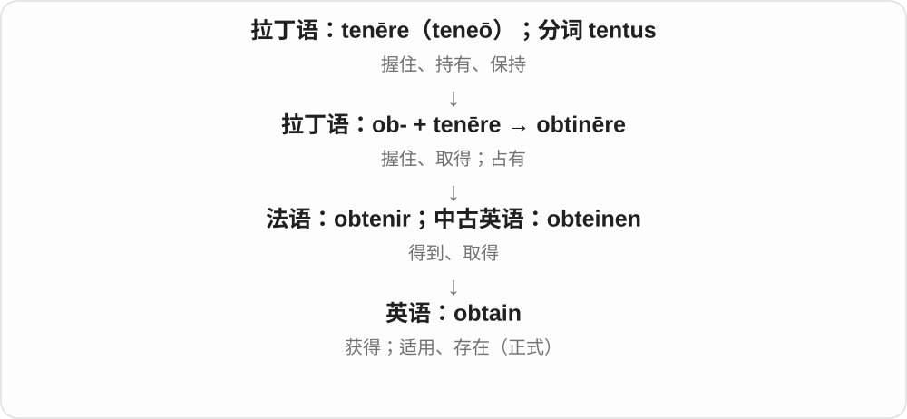

比 get 正式，常接许可、资料、结果。旧式或学术语境里 conditions obtain 表示这些条件仍成立、存在。

**常见搭配与例句**

obtain permission；obtain information；obtain a copy；conditions that obtain。

> You can obtain a copy from the front desk.

你可以在前台领取一份副本。

> We obtained permission to use the photographs.

我们取得了使用这些照片的许可。

**别混淆**

earn 强调凭劳动或表现赢得；obtain 只说成功得到，不规定通过哪种方式。

### 53. obtained — 取得、获得〔obtain 的过去式、过去分词〕

**音标**：英 /əbˈteɪnd/；美 /əbˈteɪnd/

**先抓住这个画面**

原来没有的许可、资料、结果，经过申请、查找或处理拿到了，就是 obtained。重点是取得了所需的东西。

**怎么拆**

obtain + -ed，/n/ 后读 /d/。法语 obtenir 接拉丁 obtinēre，含 ob- 与 tenēre 持有，历史有取得、占有、实现等义。

**怎么变成今天的意思**

**拉丁 ob- + tenēre → obtinēre → 法语 → obtain**  
持有、占有 → 取得

↓

**obtain + -ed → obtained**  
取得过、被获得

obtained permission 获得许可；obtained information 得到资料；results obtained 获得的结果。

**常见搭配与例句**

obtained from the archive；obtained through careful testing。

> They obtained permission to enter the archive.

他们获得了进入档案馆的许可。

> The information was obtained from old letters.

这些资料来自旧信件。

**别混淆**

obtained 比 got 通常更正式，常见于报告、申请和研究说明。obtained from 引出资料、物品的来源，obtained by 可引出取得方法。

### 54. obtaining — 获得、取得〔现在分词、动名词〕；适用、存在〔正式用法〕

**音标**：/əbˈteɪnɪŋ/

**先抓住这个画面**

想要的信息、物品或许可，经过寻找、申请等终于拿到，是 obtaining。它较正式，强调取得到手。

**怎么拆**

obtain 经法语 obtenir 接拉丁 obtinere，含 ob- 与 tenere 持有、握住。现代直接加完整 -ing；末尾音节虽重读，拼写 ai 是元音字母组合，不双写 n。

**怎么变成今天的意思**

**拉丁 obtinere → 法语 obtenir → obtain**  
握住、占有 → 取得、获得

↓

**obtain + -ing → obtaining**  
正在取得；取得的过程；另有正式存在义

obtaining information 获取信息；obtaining a copy 取得副本；a way of obtaining access 获得访问机会的方法。

**常见搭配与例句**

difficulty obtaining materials 难以取得材料；before obtaining permission 获得许可之前。

> Obtaining a clear copy took some time.

取得一份清晰副本花了一些时间。

> She is obtaining information from several sources.

她正在从几个来源获取信息。

**别混淆**

obtain 比 get 正式。obtaining 也保留少见的条件、规则存在或适用义，日常学习先掌握获得这一支。

### 55. obtainable — 可以获得的；拿得到的

**音标**：/əbˈteɪnəbəl/

**先抓住这个画面**

obtainable 像你确实有路可以找到或拿到某样东西，不是只能想想。

**怎么拆**

obtain + -able。

**怎么变成今天的意思**

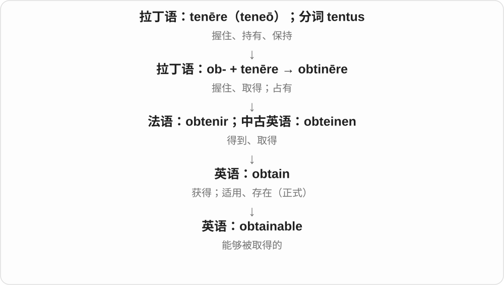

强调可取得性，不必表示免费、便宜或随处都有。

**常见搭配与例句**

readily obtainable；obtainable from…；easily obtainable information。

> Copies are obtainable from the university archive.

可以从大学档案馆获取副本。

> The materials are inexpensive and readily obtainable.

这些材料不贵，而且容易买到。

**别混淆**

available 常说可用、可供应；obtainable 更强调通过某种方式能成功取得。

### 56. unobtainable — 无法获得的；拿不到的

**音标**：/ˌʌnəbˈteɪnəbəl/

**先抓住这个画面**

unobtainable 像已经四处寻找，却没有可行渠道取得某件东西；可以是缺货，也可以是权限限制。

**怎么拆**

un-（不）+ obtainable。

**怎么变成今天的意思**

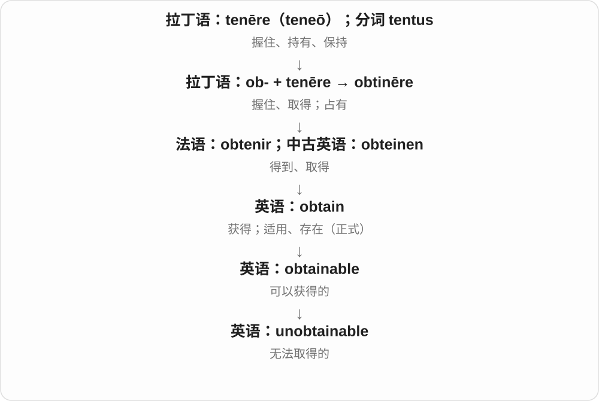

语境可能只限定某地、某时或某种条件下拿不到，不一定表示全世界永远不存在。

**常见搭配与例句**

currently unobtainable；unobtainable elsewhere；an unobtainable document。

> The replacement part is currently unobtainable.

这种替换零件目前买不到。

> The original document remained unobtainable during the investigation.

调查期间一直无法取得原始文件。

**别混淆**

unavailable 可以是暂不可用；unobtainable 更侧重无法成功取得，不一定是东西没有生产。

### 57. obtainment — 取得；获得

**音标**：/əbˈteɪnmənt/

**先抓住这个画面**

obtainment 把“最终拿到”这一步作为一件事来谈，像项目完成前先取得许可。

**怎么拆**

obtain + -ment。

**怎么变成今天的意思**

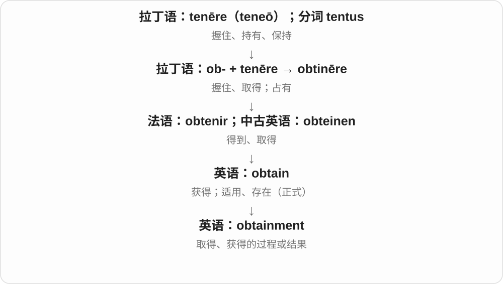

较正式、较少用，日常多直接说 obtaining something。不是专指挣到钱或买东西。

**常见搭配与例句**

the obtainment of permission；obtainment of information；successful obtainment。

> The next stage depends on the obtainment of permission.

下一阶段取决于是否取得许可。

> The report describes the obtainment of the missing records.

报告描述了获取遗失记录的过程。

**别混淆**

acquisition 常用范围更广，也可指所获得的东西；obtainment 更直接强调获得这一动作。

### 58. obtention — 取得；获得（少用）

**音标**：/əbˈtenʃən/

**先抓住这个画面**

obtention 与 obtainment 都在说“拿到这件东西”，只是它沿拉丁语名词的路线来到英语。

**怎么拆**

借自拉丁语 obtentiō，与 obtinēre“获得、持有”的分词词干 obtent- 相连。

**怎么变成今天的意思**

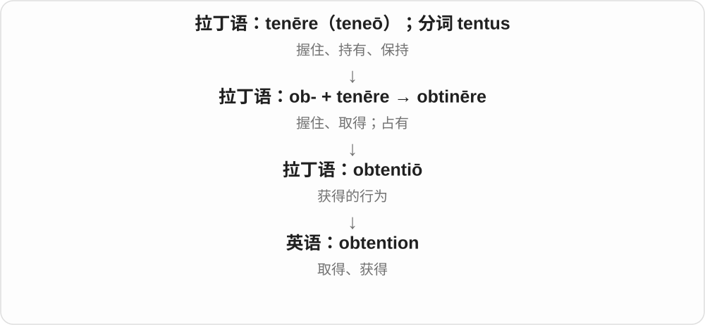

常见于正式或技术文字，普通英语通常说 obtaining 或 acquisition。它不等于 attention，也不是反对某事。

**常见搭配与例句**

the obtention of a permit；obtention of a result；conditions for obtention。

> The agreement was subject to the obtention of the necessary permits.

协议以取得所需许可为条件。

> The paper describes the obtention of a stable result.

论文描述了取得稳定结果的过程。

**别混淆**

obtainment 是英语 obtain + -ment；obtention 有拉丁语借入路线，现代意思相近。

### 59. reobtain — 重新获得

**音标**：/ˌriːəbˈteɪn/

**先抓住这个画面**

reobtain 像一份许可或一件东西失去以后，你又走了一遍流程把它拿回来。

**怎么拆**

re-（再次）+ obtain。

**怎么变成今天的意思**

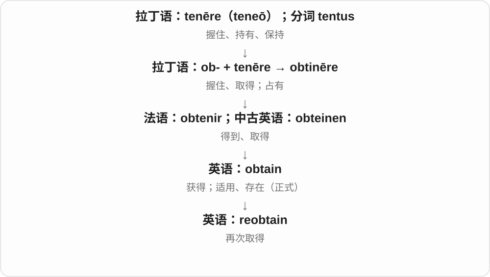

重点是重新获得；先前是否由你拥有、怎样失去，需要由上下文补足。

**常见搭配与例句**

reobtain permission；reobtain access；reobtain a document。

> She had to reobtain permission after the agreement expired.

协议到期后，她需要重新取得许可。

> We were able to reobtain the missing document from the archive.

我们成功从档案馆再次获得了那份遗失文件。

**别混淆**

retain 是始终留住；reobtain 是失去、到期或不再拥有后，再次取得。

### 60. lieutenant — 尉官；副手；代理人

**音标**：英 /lefˈtenənt/；美 /luːˈtenənt/

**先抓住这个画面**

lieutenant 的老画面是替别人站住那个位置、代行职责的人，后来发展为军衔，也能比喻得力副手。

**怎么拆**

古法语 lieu“位置”+ tenant“持有者”，经盎格鲁法语进入英语；tenant 远源是 tenēre。

**怎么变成今天的意思**

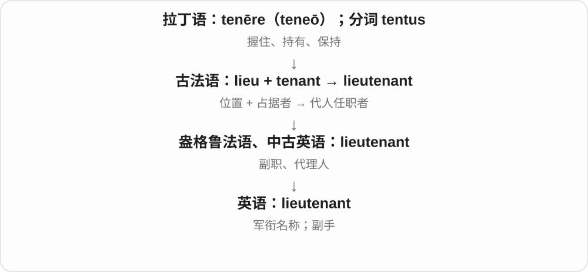

英美读音明显不同，英国常有 /f/，美国常以 /luː/ 开头。不同军种制度的具体级别并不完全一致。

**常见搭配与例句**

a lieutenant in the army；a trusted lieutenant；lieutenant colonel。

> The lieutenant briefed the team before the exercise.

这位尉官在演练前向队伍作了简报。

> She became the director’s most trusted lieutenant.

她成了主任最信任的副手。

**别混淆**

deputy 直接表示副职、代理；lieutenant 既是特定军衔，也可借指领导者的亲信副手。

### 61. tennis — 网球；相关旧式球类运动

**音标**：/ˈtenɪs/

**先抓住这个画面**

今天先记隔网用球拍对打的网球。名字通常被解释为发球时提醒对手的一声接着，老线索是接取、持有。

**怎么拆**

经中古英语 tennis 等形式，通常联系古法语 tenez、英法语 tenetz，为 tenir 持有、接取的命令形式，上接拉丁 tenere。发球呼声转成运动名的解释常见，但历史上有不同看法；旧运动与现代网球也有变化。

**怎么变成今天的意思**

**法语 tenir → tenez 等命令形式〔通常解释〕**  
持有、接取 → 接着、接住

↓

**英语 tennis**  
旧式球类名称 → 现代网球名称

play tennis 打网球；a tennis court 网球场；a tennis racket 网球拍；a tennis match 网球比赛。

**常见搭配与例句**

tennis lessons；a tennis player。

> We play tennis at the park on Sundays.

我们星期天在公园打网球。

> The tennis court was too wet to use.

网球场太湿，没法使用。

**别混淆**

运动名称通常直接说 play tennis，不加 the。tennis 与 table tennis 乒乓球不同；词尾 s 是历史拼写的一部分，不是现在给一个 tenni 加复数。

### 62. sustain — 维持；支撑；承受；遭受

**音标**：/səˈsteɪn/

**先抓住这个画面**

sustain 像从下面一直托着，让某种状态继续：维持生活、保持努力、把一个音拉住；承受伤害则是身体接住了不好的影响。

**怎么拆**

经古法语 sustenir 来自拉丁语 sustinēre，sub-（从下面）+ tenēre（保持）发生词形变化。

**怎么变成今天的意思**

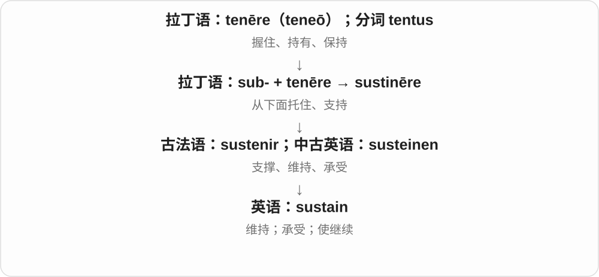

sustain an effort 是让努力持续；sustain injuries 是遭受伤害。不是所有搭配都能译为支持某个观点。

**常见搭配与例句**

sustain growth；sustain an effort；sustain an injury；sustain a note。

> The small business could not sustain such high costs.

这家小企业无法持续承担这么高的成本。

> Several passengers sustained minor injuries.

几名乘客受了轻伤。

> The singer sustained the final note.

歌手延长保持了最后一个音。

**别混淆**

support 可以在某一刻提供帮助；sustain 往往强调把它托住并维持一段时间。

### 63. sustained — 持续的；保持了一段时间的

**音标**：/səˈsteɪnd/

**先抓住这个画面**

sustained 像力量没有只闪一下，而是在一段时间里一直保持着。

**怎么拆**

sustain + -ed，由过去分词发展为形容词。

**怎么变成今天的意思**

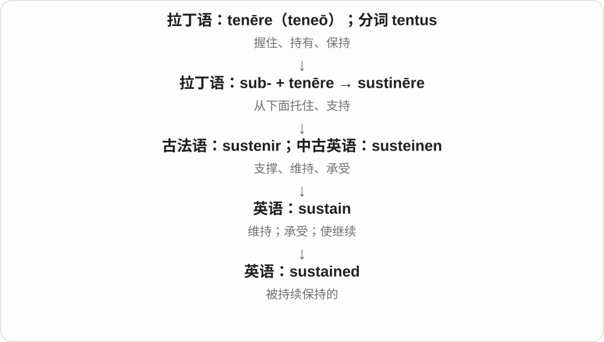

常修饰 effort、attention、growth、applause。它说实际持续，而 sustainable 说是否能够继续维持。

**常见搭配与例句**

sustained effort；sustained attention；sustained applause。

> The task requires sustained attention.

这项任务需要持续专注。

> The audience responded with sustained applause.

观众报以经久不息的掌声。

**别混淆**

sudden 强调突然发生；sustained 强调维持时间。sustained 增长未必自动 sustainable。

### 64. sustainable — 可持续的；能够长期维持的

**音标**：/səˈsteɪnəbəl/

**先抓住这个画面**

sustainable 像一种生活或生产方式，今天能运转，明天也不至于把维持它的资源和条件耗光。

**怎么拆**

sustain + -able。

**怎么变成今天的意思**

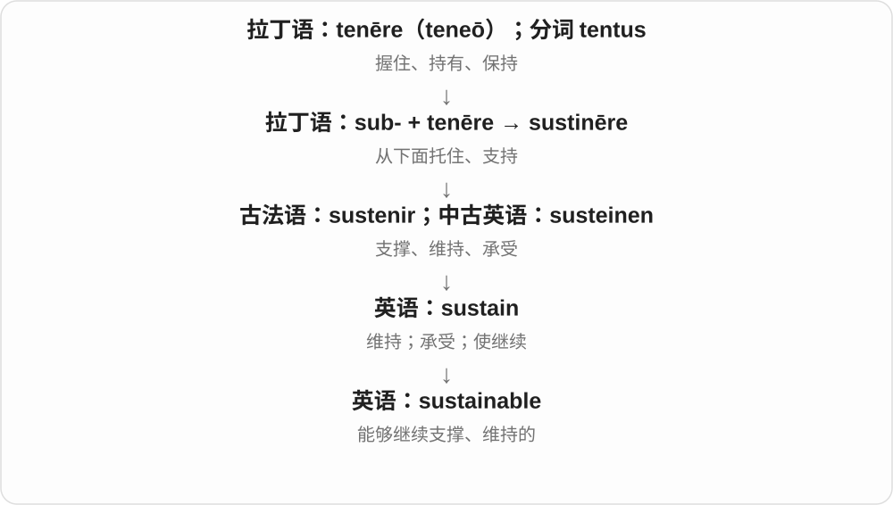

环境话题最常见，但也能说工作强度、财务模式、增长速度。不能只翻成绿色或环保而丢掉持续的含义。

**常见搭配与例句**

sustainable development；a sustainable pace；a sustainable business model。

> We need a sustainable pace of work, not constant overtime.

我们需要能长期维持的工作节奏，而不是持续加班。

> The project explores more sustainable ways to use local resources.

项目探索更可持续地使用本地资源的方法。

**别混淆**

renewable 是资源可再生；sustainable 是整体做法能否长期维持，两者相关但不完全相同。

### 65. sustainability — 可持续性；长期维持能力

**音标**：/səˌsteɪnəˈbɪləti/

**先抓住这个画面**

sustainability 是追问“这样一直做下去，还撑不撑得住”，要把资源、成本和长期影响一起考虑。

**怎么拆**

sustain + -ability，或从 sustainable 的名词形式理解。

**怎么变成今天的意思**

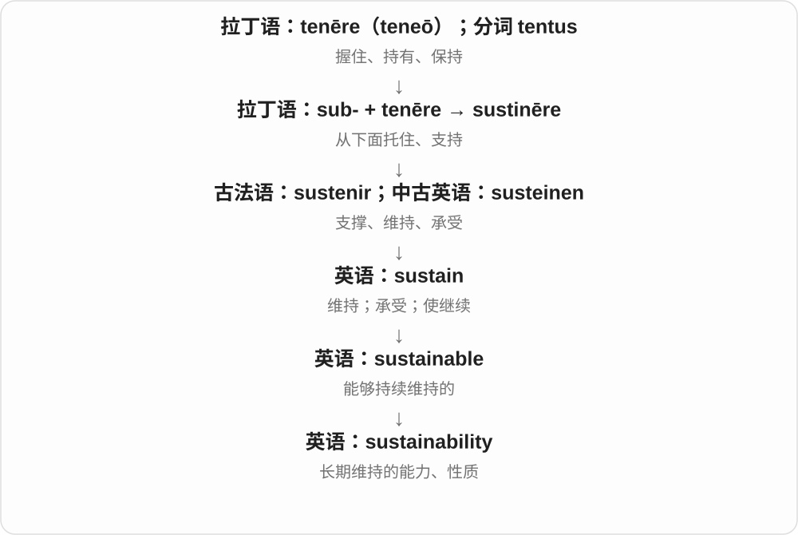

可以讨论生态，也可以讨论项目经费、工作安排。单词不是给任何新产品自动盖环保认证章。

**常见搭配与例句**

environmental sustainability；financial sustainability；long-term sustainability。

> The review questioned the financial sustainability of the programme.

评审对项目的财务可持续性提出了疑问。

> Sustainability was considered from the beginning of the design process.

设计过程从一开始就考虑了可持续性。

**别混淆**

efficiency 看投入与产出如何；sustainability 看这种做法能否持续。短期高效的做法未必长期撑得住。

### 66. unsustainable — 无法长期维持的；不可持续的

**音标**：/ˌʌnsəˈsteɪnəbəl/

**先抓住这个画面**

unsustainable 像支出一直大于收入，暂时还能撑一阵，但按同样方式继续迟早会出问题。

**怎么拆**

un-（不）+ sustainable。

**怎么变成今天的意思**

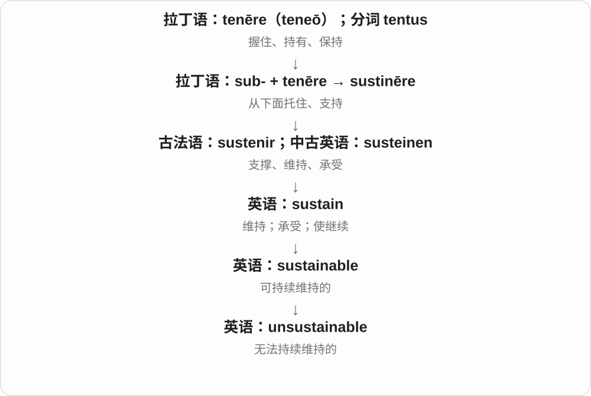

不一定表示当下马上崩溃，而是维持所需条件会被耗尽，或现有负担长期承受不了。

**常见搭配与例句**

an unsustainable workload；unsustainable costs；an unsustainable practice。

> The team’s workload had become unsustainable.

团队的工作负担已经到了无法长期维持的程度。

> Relying on emergency funds every month is unsustainable.

每个月都依靠应急资金是无法长久维持的。

**别混淆**

impossible 是无法做到；unsustainable 可以短期做到，只是无法长期照这样继续。

### 67. sustenance — 食物；营养；维生、精神支撑

**音标**：/ˈsʌstənəns/

**先抓住这个画面**

sustenance 像让人继续活下去的那一份支撑，具体是食物，也可以是情感或精神上的滋养。

**怎么拆**

经古法语 sustenance 来自 sustenir“支撑、供养”，远源为拉丁语 sustinēre。

**怎么变成今天的意思**

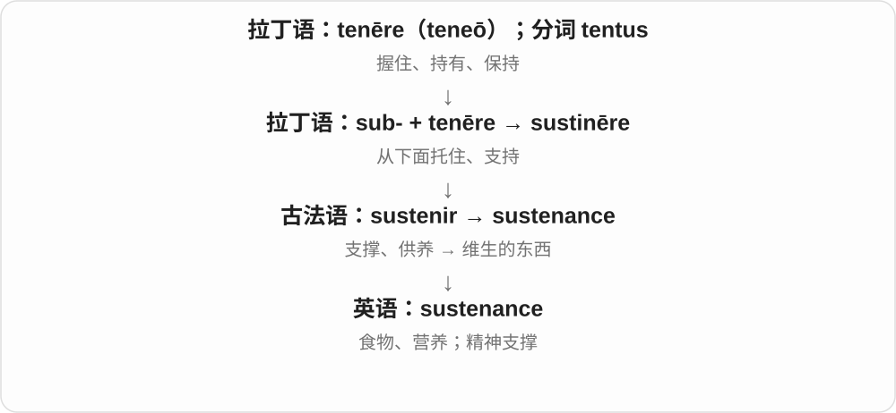

语气比 food 更书面，着重食物维持生命的作用。spiritual sustenance 不是给思想真的喂饭，而是能让人撑下去。

**常见搭配与例句**

provide sustenance；basic sustenance；emotional sustenance。

> The small farm provided sustenance for the family.

这个小农场为一家人提供维生食物。

> She drew emotional sustenance from her friends.

她从朋友那里获得了情感上的支撑。

**别混淆**

nutrition 侧重营养摄入或营养学；sustenance 侧重维生、支撑所需的东西，也可比喻使用。

### 68. sustention — 维持；持续支撑（罕用）

**音标**：/səˈstenʃən/

**先抓住这个画面**

sustention 像把一个音、一股情绪或一种力量继续托住，不让它立刻消散。

**怎么拆**

英语以 sustain 为基础，仿照 retain → retention 等词形关系形成；不是另一个直接借入的拉丁语名词。

**怎么变成今天的意思**

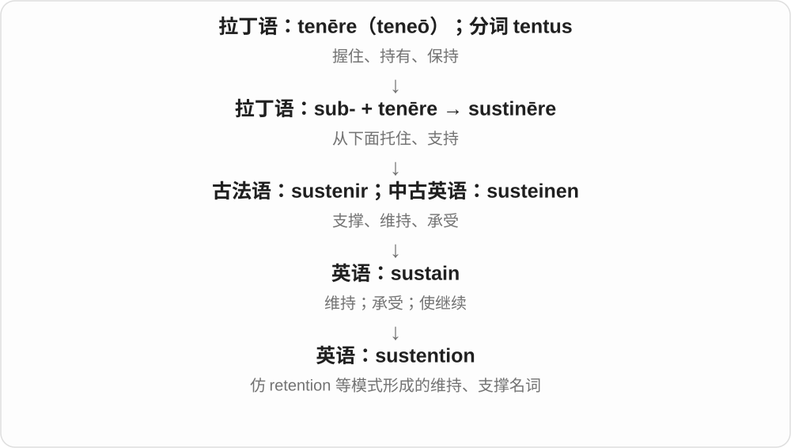

它与 sustentation 意义接近，但形成路线不同。现代通常直接用 sustaining、support 或 maintenance。

**常见搭配与例句**

the sustention of a note；sustention of an effort；sustention of emotion（旧式）。

> The old treatise discusses the sustention of a musical note.

旧论著讨论了一个音的持续保持。

> The critic praised the actor’s sustention of emotion throughout the scene.

评论者称赞演员在整场戏中持续保持了情感强度。

**别混淆**

sustentation 经拉丁语、法语借入；sustention 是较晚的英语类推构词，不能画成前者删几个字母。

### 69. retain — 保留；保持；记住；留用

**音标**：/rɪˈteɪn/

**先抓住这个画面**

retain 像本来已经在你手里的东西，你继续把它留住：资料不丢、员工不走、学过的内容还记得。

**怎么拆**

经法语 retenir 来自拉丁语 retinēre，含 re- 与 tenēre“保持”；词根重点是留住。

**怎么变成今天的意思**

不是第一次得到，而是获得之后继续保存或拥有。retain a lawyer 还可以说聘用、留用法律服务。

**常见搭配与例句**

retain information；retain control；retain staff；retain its original shape。

> The fabric retains its shape after washing.

这种布料清洗后仍保持原来的形状。

> Short review sessions help me retain new vocabulary.

短时间的复习有助于我记住所学的新词。

**别混淆**

obtain 是拿到；retain 是拿到以后仍留着。remember 更常用于具体记起，retain information 强调保存记忆。

### 70. retained — 保留了、留住了；记住了、留用的〔过去式、过去分词〕

**音标**：/rɪˈteɪnd/

**先抓住这个画面**

东西没有被放走、换掉或忘掉，还在原来的掌握中，是 retained。能留住物件，也能留住某种特点或信息。

**怎么拆**

retain 经法语 retenir 接拉丁 retinere，re- 与 tenere 保持组成留住材料。现代直接加完整 -ed，/n/ 后读 /d/。

**怎么变成今天的意思**

**拉丁 retinere → 法语 retenir → retain**  
握住、保持 → 留住、记住、留用

↓

**retain + -ed → retained**  
已经保留、留下或记住

retained its shape 保持了形状；retained the original name 保留原名；retained the information 记住了信息。

**常见搭配与例句**

retained her position 保住了职位；retained a copy 留下一份副本。

> The building retained its original name.

这座建筑保留了原来的名字。

> She retained a copy of the letter.

她留下了那封信的一份副本。

**别混淆**

retain 强调继续留住，obtain 强调取得。retained a copy 说副本继续在手里，不是在讲刚刚拿到了它。

### 71. retention — 保留；留存；记忆保持

**音标**：/rɪˈtenʃən/

**先抓住这个画面**

retention 是看本来已经得到的人或东西，还能留下多少、多久：员工留任、用户留存、知识记住都能这样说。

**怎么拆**

来自拉丁语 retentiō，经中古英语 retencioun 发展；与 retain 同族而有独立名词借入链。

**怎么变成今天的意思**

常是一个过程或衡量性质，不仅指把文件放进柜子。water retention 是水分被留在体内或材料里，需看领域。

**常见搭配与例句**

employee retention；customer retention；memory retention；data retention。

> The company is trying to improve employee retention.

公司正努力提高员工留任率。

> Regular practice improves long-term retention of new words.

经常练习能帮助长期记住新单词。

**别混淆**

acquisition 关注新增、获得；retention 关注已经得到以后还能留住。

### 72. retaining — 保留；保持；留住；记住〔分词、动名词〕

**音标**：英、美 /rɪˈteɪnɪŋ/

**先抓住这个画面**

热量本来会散掉，却被留住；知识本来可能忘记，却留在记忆里。retaining 的共同画面是“让它继续在”。

**怎么拆**

retain + -ing → retaining，原词不改。拉丁 re- 回、留回 + tenere 持有 → retinere，经法语 retenir 接英语 retain。

**怎么变成今天的意思**

**拉丁 retinere 保持、留住 → 法语 retenir → retain**  
把已有的东西继续握住、留下

↓

**retain + -ing → retaining**  
现代可接热量、信息、特征、人员等对象

retaining heat 是保温；retaining information 是记住信息；retaining original features 是保留原有特色。

**常见搭配与例句**

retaining heat；retaining information；retaining its shape。

> The thick walls help with retaining heat.

厚墙有助于留住热量。

> The design was updated while retaining its original character.

设计作了更新，同时保留了原有风格。

**别混淆**

retaining 常强调已有之物继续留下；obtaining 强调取得。retaining information 也不要求逐字背诵，而是信息没有轻易忘掉。

### 73. retains — 保留；保持；留住〔第三人称单数〕

**音标**：英、美 /rɪˈteɪnz/

**先抓住这个画面**

时间过去了、环境变了，有些东西还留在原来的主体那里，就是 retains。建筑留住旧门窗，材料留住水分，人记住知识，都能用。

**怎么拆**

retain + -s → retains，/n/ 后读 /z/。经法语 retenir 接拉丁 re- 回、留住 + tenere 持有 → retinere 保持、留住；tain 是这个词族的英语变化形式。

**怎么变成今天的意思**

**拉丁 retinere 留住 → 法语 retenir → retain**  
保持拥有、使之不离开的关系

↓

**特征、物质、记忆等对象扩大 + -s → retains**  
现代第三人称可说人、建筑、材料等

retains its character 是保持自身特色；retains moisture 是保持水分；retains information 是记住信息。

**常见搭配与例句**

retains its character；retains moisture；retains information。

> The restored house retains its original wooden doors.

修复后的房子保留了原来的木门。

> This fabric retains its colour after repeated washing.

这种布多次洗涤后仍能保持颜色。

**别混淆**

retains 强调原先有的东西仍然留着。obtains 侧重获得，regains 侧重失去后重新获得，三者的时间关系不同。

### 74. retainer — 预付聘用费；牙齿保持器；随从

**音标**：英 /rɪˈteɪnə/；美 /rɪˈteɪnər/

**先抓住这个画面**

retainer 都在帮忙“留住”：预付聘用费留住专业服务，牙齿保持器留住矫正后的位置，旧时随从则被长期留在主人身边。

**怎么拆**

retain + -er。

**怎么变成今天的意思**

几个义项按搭配分开学。pay a retainer 多是费用；wear a retainer 多是牙齿保持器。

**常见搭配与例句**

pay a retainer；on retainer；wear a retainer；a loyal retainer。

> The firm pays the consultant a monthly retainer.

公司每月向顾问支付一笔预付聘用费。

> She keeps her retainer in a small case.

她把牙齿保持器放在一个小盒子里。

**别混淆**

deposit 是多种场合的预付款、押金；retainer 特别常用于保留专业人员服务的费用。

### 75. retainment — 保留；留存（少用）

**音标**：/rɪˈteɪnmənt/

**先抓住这个画面**

retainment 是继续把东西留在手里的行为，意思与常见的 retention 接近。

**怎么拆**

retain + -ment。

**怎么变成今天的意思**

虽然构词透明，但日常和专业固定搭配中 retention 通常更自然。遇见时理解即可，不必到处替换。

**常见搭配与例句**

retainment of records；retainment of rights；retainment of information。

> The policy addresses the retainment of historical records.

政策涉及历史记录的保留。

> The agreement provided for the retainment of certain rights.

协议规定保留某些权利。

**别混淆**

retention 是更常见的同义名词；retainment 不是专指另一种保留机制。

### 76. continent — 大陆；洲；能自制的；能控制排泄的

**音标**：英 /ˈkɒntɪnənt/；美 /ˈkɑːntɪnənt/

**先抓住这个画面**

continent 的大陆义像一整片连在一起的陆地；形容词义则像把自己的身体冲动控制在内。

**怎么拆**

都联系拉丁语 continēns“连在一起的、克制的”，是 continēre 的分词。大陆和自制是不同语义支线。

**怎么变成今天的意思**

地理名词最常见；医学里 continent 可说能自主控制排尿或排便，不能理解成与洲有关的。

**常见搭配与例句**

the African continent；continental land；remain continent（身体控制义）。

> The exhibition features artists from several continents.

展览汇集了来自几个洲的艺术家。

> The report records whether the patient is continent.

报告记录了患者是否能自主控制排泄。

**别混淆**

continent 是大陆、洲；country 是国家，边界和划分依据不同。continental 才是通常的“大陆的”。

### 77. continental — 大陆的；洲的；欧洲大陆的

**音标**：英 /ˌkɒntɪˈnentəl/；美 /ˌkɑːntɪˈnentəl/

**先抓住这个画面**

continental 把注意力放到一整片大陆上，或者在英国语境里特指欧洲大陆。

**怎么拆**

continent + -al。

**怎么变成今天的意思**

continental climate 说大陆性气候；continental breakfast 是习惯性餐饮名称，常指面包、饮料等较简单早餐，不按大陆面积理解。

**常见搭配与例句**

continental climate；continental Europe；a continental breakfast。

> The region has a continental climate with cold winters.

这个地区属大陆性气候，冬季寒冷。

> The hotel serves a continental breakfast.

酒店供应欧陆式早餐。

**别混淆**

intercontinental 是跨洲之间；continental 只是与大陆有关，没有自动包含跨越的意思。

### 78. intercontinental — 洲际的；跨洲之间的

**音标**：英 /ˌɪntəkɒntɪˈnentəl/；美 /ˌɪntərkɑːntɪˈnentəl/

**先抓住这个画面**

intercontinental 像航线把一个洲和另一个洲连起来，重点是大陆之间的往来。

**怎么拆**

inter-（在……之间）+ continental。

**怎么变成今天的意思**

常形容航班、交通、贸易等。不是只在一个大陆内部横穿很长距离。

**常见搭配与例句**

an intercontinental flight；intercontinental travel；intercontinental trade。

> The airport added a new intercontinental route.

机场新开了一条洲际航线。

> Intercontinental travel requires careful planning across time zones.

跨洲旅行需要仔细规划跨时区的安排。

**别混淆**

transcontinental 通常横穿一个大陆；intercontinental 通常连接不同大陆。

### 79. transcontinental — 横贯大陆的；跨越大陆的

**音标**：英 /ˌtrænzkɒntɪˈnentəl/；美 /ˌtrænzkɑːntɪˈnentəl/

**先抓住这个画面**

transcontinental 像铁路从一个大陆的一侧铺到另一侧，重点是横跨这整片陆地。

**怎么拆**

trans-（横越）+ continental。

**怎么变成今天的意思**

可以描述铁路、道路、航线或旅程。它不必跨越两个洲，而可能完全在同一大陆内。

**常见搭配与例句**

a transcontinental railway；a transcontinental journey；transcontinental travel。

> The railway made transcontinental travel much faster.

这条铁路让横贯大陆的旅行快了许多。

> They planned a transcontinental journey by train.

他们计划乘火车横穿大陆。

**别混淆**

intercontinental 通常是洲与洲之间；transcontinental 通常是横贯大陆。

### 80. continence — 控制排泄的能力；克制、自制

**音标**：英 /ˈkɒntɪnəns/；美 /ˈkɑːntɪnəns/

**先抓住这个画面**

continence 像身体把该留住的东西稳稳控制在内，现代护理话题中常指自主控制排尿、排便。

**怎么拆**

经古法语 continence 来自拉丁语 continentia，联系 continēre“控制、约束”。

**怎么变成今天的意思**

历史上也说自我克制，尤其对欲望的节制。现代身体功能义要与道德评价分开。

**常见搭配与例句**

bladder continence；continence care；restore continence；sexual continence（正式、旧义）。

> The assessment included questions about bladder continence.

评估包括有关膀胱控制能力的问题。

> The old text praises continence as a form of self-restraint.

旧文把自制赞为克制欲望的一种表现。

**别混淆**

continence 是控制能力；abstinence 通常是有意识选择不进行某行为，二者不是任何场景都相同。

### 81. incontinent — 失禁的；不能自制的（旧义）

**音标**：英 /ɪnˈkɒntɪnənt/；美 /ɪnˈkɑːntɪnənt/

**先抓住这个画面**

incontinent 描述身体不能自主留住尿液或粪便；旧文也可能用它说欲望、言行不受控制。

**怎么拆**

经法语 incontinent 来自拉丁语 incontinēns，即 in-（不）+ continēns（自制的、能控制的）。

**怎么变成今天的意思**

现代医疗语境不带道德评价。若指人，可写 a person who is incontinent，以人的需要为中心理解。

**常见搭配与例句**

be incontinent；an incontinent patient；incontinent speech（旧式比喻）。

> The care team helped a patient who was incontinent.

护理团队帮助了一位有失禁情况的患者。

> In the old essay, “incontinent speech” means uncontrolled talking.

在这篇旧文章里，incontinent speech 指不加控制地说话。

**别混淆**

continent 可指能控制排泄；incontinent 是否定这项控制能力，不是“没有大陆”。

### 82. incontinence — 失禁；缺乏自制（旧或正式义）

**音标**：英 /ɪnˈkɒntɪnəns/；美 /ɪnˈkɑːntɪnəns/

**先抓住这个画面**

incontinence 的医学画面是身体没能把本应留住的排泄物控制住，通常说尿液或粪便不由自主排出。

**怎么拆**

经法语 incontinence 来自拉丁语 incontinentia；in-（不）与 continentia“自制、控制”结合。

**怎么变成今天的意思**

现代医疗义最常见，是身体功能问题，不应把它理解成态度懒散或品行问题。另有缺少自制的历史义。

**常见搭配与例句**

urinary incontinence；bowel incontinence；care for someone with incontinence。

> The leaflet explains urinary incontinence in clear language.

这份宣传册用清楚的语言解释尿失禁。

> The care plan includes support for a person with incontinence.

护理计划包括对失禁者的支持。

**别混淆**

retention 是本应排出的东西被留住；incontinence 是不能控制排出，方向不同。

### 83. detain — 扣留；拘留；耽搁

**音标**：/dɪˈteɪn/

**先抓住这个画面**

detain 像拉住一个本来要离开的人，不让他继续走。可能是正式扣留，也可能只是谈话把人耽误了。

**怎么拆**

经古法语 detenir 来自拉丁语 dētinēre“留住、扣住”，包含 dē- 与 tenēre。

**怎么变成今天的意思**

I won’t detain you 是礼貌地说“不耽误你了”，不涉及拘留。正式扣留义则要看机构与语境。

**常见搭配与例句**

detain a suspect；be detained for questioning；not detain someone long。

> The police detained a man for questioning.

警方扣留了一名男子进行询问。

> I will not detain you any longer.

我不再耽误你了。

**别混淆**

delay 可以由交通、天气等造成；detain 更突出某人或某种事务把人留住。

### 84. detention — 拘留；扣留；课后留校

**音标**：/dɪˈtenʃən/

**先抓住这个画面**

detention 像别人不让你按原计划离开，把你暂时留在某个地方；学校里也可指违纪后的留校。

**怎么拆**

经法语 détention 来自拉丁语 dētentiō，与 dētinēre“扣住”同族；不是仅按英语 detain 加后缀形成的历史。

**怎么变成今天的意思**

不同语境的权力和程序不同。学校 detention 与警方拘留共享留住的核心意思，但不能当成同一种处置。

**常见搭配与例句**

in detention；a detention centre；after-school detention；serve a detention。

> The report describes the conditions in the detention centre.

报告描述了拘留中心的条件。

> He received detention for repeatedly disrupting the class.

他因一再扰乱课堂而被罚课后留校。

**别混淆**

arrest 是逮捕这一行动；detention 强调被扣留的状态或一段时间，具体关系取决于语境。

### 85. detained — 拘留了；扣留了；耽搁了〔过去式、过去分词〕

**音标**：英、美 /dɪˈteɪnd/

**先抓住这个画面**

本来可以离开，却被留住，是 detained。可以是正式扣留，也可以是别的事情把人耽搁住了。

**怎么拆**

detain + -ed → detained，/n/ 后读 /d/。拉丁 de- 离开 + tenere 持住 → detinere 留住、阻住，经法语 detenir 等进入英语。

**怎么变成今天的意思**

**拉丁 detinere 留住 → 法语 detenir → detain**  
持住、不让继续前行的图景

↓

**detain + -ed → detained**  
现代过去式、过去分词，词尾 /nd/

was detained for questioning 是被扣留问话；was detained by a meeting 是被会议耽搁，后一用法较正式。

**常见搭配与例句**

was detained for questioning；detained by a meeting；briefly detained。

> In the novel, the traveler was detained for questioning.

小说里，那名旅客被扣留问话。

> I was detained by a meeting and arrived late.

我被一个会议耽搁，到晚了。

**别混淆**

detained 不等于已经被定罪；普通耽搁义也仍存在。判断是在说正式拘留还是误了时间，要看主语、原因和上下文。

### 86. detainee — 被拘留者；被扣留者

**音标**：/ˌdiːteɪˈniː/

**先抓住这个画面**

detainee 是那个被留住、不获准自由离开的人，重点在其被扣留的状态。

**怎么拆**

detain + -ee，-ee 表示承受动作的一方。

**怎么变成今天的意思**

这个称呼本身不等于已经定罪。具体拘留背景、期限和法律身份要从上下文判断。

**常见搭配与例句**

a detained person / detainee；release a detainee；a former detainee。

> The report includes interviews with former detainees.

报告包括对曾被拘留者的访谈。

> Each detainee received a copy of the notice.

每名被拘留者都收到了一份通知。

**别混淆**

prisoner 可指监禁或被俘者；detainee 强调被扣留，不能单凭词形判断是否有罪。

### 87. detainment — 扣留；被留住的状态

**音标**：/dɪˈteɪnmənt/

**先抓住这个画面**

detainment 把 detain 留住人的动作变成名词，关注这次扣留或被耽搁的状态。

**怎么拆**

detain + -ment。

**怎么变成今天的意思**

它与 detention 大量重叠，但常用程度较低；普通制度、设施名称更常用 detention。

**常见搭配与例句**

temporary detainment；the period of detainment；detainment for questioning。

> The report gives the date and length of the detainment.

报告给出了扣留的日期和时长。

> She described the events that led to her brief detainment.

她描述了导致自己被短暂扣留的经过。

**别混淆**

detention 是更常见的标准词，且常指学校留校；detainment 不自动带学校惩罚义。

### 88. detainer — 拘留文书、请求；扣留；扣留者

**音标**：英 /dɪˈteɪnə/；美 /dɪˈteɪnər/

**先抓住这个画面**

detainer 在法律文字中常像一张要求继续留住某人的文书或通知；按普通构词，也可以指留住别人的人。

**怎么拆**

法律名词经盎格鲁法语 detener、古法语 detenir 进入英语；表示施事者的用法则可由 detain + -er 形成。

**怎么变成今天的意思**

不同制度下可能指命令、请求、文书或扣留关系，不能看见 detainer 就假定某种固定法律效力。

**常见搭配与例句**

a detainer request；a detainer notice；lodge a detainer。

> The file includes a copy of the detainer notice.

档案中包括一份扣留通知的副本。

> The article explains how the detainer request was handled.

文章解释了该扣留请求如何被处理。

**别混淆**

detainee 是被扣留的人；detainer 可指扣留者，但现代法律中更常见的是相关文书、请求或安排。

### 89. tenure — 任期；职位持有；终身教职保障；土地保有

**音标**：英 /ˈtenjə/；美 /ˈtenjər/

**先抓住这个画面**

tenure 像一个人把某个职位或土地持有在手中，既能说这段持有期，也能说拥有它的制度安排。

**怎么拆**

经古法语、盎格鲁法语 tenure 来到英语，远源是 tenēre“持有”；不是 ten“十”加后缀。

**怎么变成今天的意思**

during her tenure 是她任职期间；academic tenure 是较稳定的教职保障，不等于无论发生什么都绝对不会失去职位。

**常见搭配与例句**

during someone’s tenure；academic tenure；land tenure；grant tenure。

> The library expanded during her tenure as director.

在她担任馆长期间，图书馆扩大了规模。

> He was awarded tenure after the university’s review.

大学评审后授予了他长期教职保障。

**别混淆**

term 常指预先规定的任期长度；tenure 可指实际在任时间，也可指任职资格、保障。

### 90. tenured — 获得长期教职保障的；有稳定任职资格的

**音标**：英 /ˈtenjəd/；美 /ˈtenjərd/

**先抓住这个画面**

tenured 像经过任用评审后，职位有了较强的长期保障，不是每次短期合同到期都重新竞争。

**怎么拆**

tenure + -ed。

**怎么变成今天的意思**

最常见于大学教职。具体保障和条件由制度决定，不能简单理解为任意情况下都永远不能被解雇。

**常见搭配与例句**

a tenured professor；tenured faculty；become tenured。

> She became a tenured professor after several years of teaching and research.

经过几年的教学研究，她获得了有长期保障的教授职位。

> The policy applies to both tenured and temporary faculty.

这项政策同时适用于有长期教职保障和临时聘用的教师。

**别混淆**

permanent 说永久或长期；tenured 特指 tenure 这种任职资格、保障，含制度背景。

### 91. tenurial — 土地保有制的；任职权有关的

**音标**：英 /tenˈjʊəriəl/；美 /tenˈjʊriəl/

**先抓住这个画面**

tenurial 把注意力放到“凭什么、以什么条件持有土地或职位”上，常出现在历史土地制度研究。

**怎么拆**

tenure + -ial。

**怎么变成今天的意思**

多修饰 rights、arrangements、system 等，不只是说一个人工作了多久。

**常见搭配与例句**

tenurial rights；tenurial arrangements；a tenurial system。

> The historian studied tenurial arrangements in the village.

历史学家研究了村庄的土地保有安排。

> The document records changes in tenurial rights.

文件记录了土地保有权利的变化。

**别混淆**

territorial 说领土、区域；tenurial 说持有关系和制度，一片土地可同时涉及两种角度。

### 92. tenant — 房客；承租人；空间使用者

**音标**：/ˈtenənt/

**先抓住这个画面**

tenant 是实际住着、用着某个地方的人，现代最常见的是租房或租用商铺的一方。

**怎么拆**

来自法语 tenant，原为 tenir“持有”的现在分词；经盎格鲁法语进入英语。

**怎么变成今天的意思**

老意思是土地或空间的持有者，现代并不因此等于房产所有者。软件里的 tenant 借指共享系统中的一组独立客户。

**常见搭配与例句**

a tenant of the building；a commercial tenant；landlord and tenant。

> The tenant reported a leak in the kitchen.

房客报告厨房有漏水。

> The shop has had the same tenant for ten years.

这间店铺已经由同一位租户租用了十年。

**别混淆**

landlord 出租房产；tenant 租用房产。resident 只说居住者，不一定存在租赁关系。

### 93. tenants — 租户、承租人；租用单位〔复数〕

**音标**：/ˈtenənts/

**先抓住这个画面**

不是拥有房地本身，而是按约定占用、使用它的人或机构，常叫 tenants。可以住在里面，也可以在那里开店、办公。

**怎么拆**

tenant 经盎格鲁法语 tenaunt 接法语 tenir 持有的分词 tenant，较早拉丁 tenere。持有土地、使用空间的人发展出承租义。现代加复数 -s，尾 /nts/。

**怎么变成今天的意思**

**拉丁 tenere → 法语 tenir、tenant → 英语 tenant**  
持有 → 持有、使用房地者 → 承租人

↓

**tenant + -s → tenants**  
多位租户、多个租用单位

new tenants 新租户；tenants in the building 楼里的租户；commercial tenants 商业租户。

**常见搭配与例句**

the previous tenants 上一批租户；tenants sharing a house 合租房屋的人。

> The new tenants moved in on Monday.

新租户星期一搬了进来。

> The building has several small businesses as tenants.

这栋楼的租户包括几家小企业。

**别混淆**

tenants 不必都是住户，公司租办公室也能是 tenant。landlord 是出租方，两词按租赁关系的不同位置来辨认。

### 94. tenancy — 租赁关系；租期；租用权

**音标**：/ˈtenənsi/

**先抓住这个画面**

tenancy 像 tenant 与房屋之间那段被允许租用的关系，既包括租用资格，也常指这段租期。

**怎么拆**

tenant + -cy，表示承租者的状态、关系。

**怎么变成今天的意思**

用在租房和商用物业话题中。单词本身不规定合同长度、续租办法或任何地区的具体法律。

**常见搭配与例句**

a tenancy agreement；a fixed-term tenancy；end a tenancy。

> The tenancy begins on the first of June.

租期从六月一日开始。

> Both parties signed the tenancy agreement.

双方签署了租赁协议。

**别混淆**

tenant 是人；tenancy 是关系或期间；rent 常是租金或租用动作。

### 95. continuum — 连续体；渐变的整体

**音标**：/kənˈtɪnjuəm/

**先抓住这个画面**

continuum 像从浅到深的一条色带，相邻两点变化很小，但最左和最右可以很不一样。

**怎么拆**

借自拉丁语 continuum，是 continuus“连续的”的中性形式。

**怎么变成今天的意思**

常用来提醒我们：有些事不适合只分成两个盒子，中间还有很多逐渐过渡的状态。数学中另有严格用法。

**常见搭配与例句**

a continuum of abilities；on a continuum；a spectrum or continuum。

> Confidence exists on a continuum rather than in two fixed states.

自信程度是逐渐变化的，并非只有两种固定状态。

> The colours form a continuum from pale yellow to deep orange.

这些颜色从浅黄色逐渐过渡到深橙色，构成一个连续范围。

**别混淆**

category 是一类一类划开；continuum 强调相邻状态可以平滑过渡，边界不一定清楚。

### 96. tenor — 男高音；男高音声部；总体基调

**音标**：英 /ˈtenə/；美 /ˈtenər/

**先抓住这个画面**

tenor 在音乐中原来联系“托住旋律”的声部，现代常指男高音；谈一段话的 tenor，则是在抓它贯穿始终的基调。

**怎么拆**

经法语 tenor / tenour 来自拉丁语 tenor“延续、保持的进程”，与 tenēre 同族。

**怎么变成今天的意思**

音乐历史中的声部安排逐步变化，不能把所有时代的 tenor 都套成今天的固定音域。日常书面语 general tenor 是总体意味。

**常见搭配与例句**

a tenor voice；sing tenor；the general tenor of the speech。

> The choir needs another tenor for the concert.

合唱团需要再增加一位男高音参加音乐会。

> The general tenor of the meeting was cautiously optimistic.

会议的总体基调是谨慎乐观。

**别混淆**

tone 常说当下语气、情绪；tenor 更常说整段言论贯穿的方向或总体基调。

### 97. tenors — 男高音、相应声部或歌手〔复数〕

**音标**：英 /ˈtenəz/；美 /ˈtenərz/

**先抓住这个画面**

常见男声合唱中，tenors 负责较高的一条线。名字更早带着保持、延续的意思，与历史上承载旋律的声部有关。

**怎么拆**

tenor + -s，末尾读 /z/。tenor 经法语接拉丁 tenor 延续、保持的进程，与 tenere 保持同族。

**怎么变成今天的意思**

**拉丁 tenere → tenor → 法语、英语 tenor**  
保持、延续；历史上承载主要旋律的声部

↓

**tenor + -s → tenors**  
男高音声部、演唱者；相应名词复数

the tenors in the choir 是合唱团男高音；general tenor of a speech 中 tenor 则说整体基调、意思走向。

**常见搭配与例句**

two tenors 两位男高音；the tenors enter 男高音声部加入。

> The tenors repeat the melody after the sopranos.

男高音声部在女高音之后重复旋律。

> Two tenors shared the leading role during the season.

本乐季由两位男高音轮流担任主角。

**别混淆**

tenor 是声部名称时不等于声音都轻、都小；它关注音域与演唱角色。

### 98. countertenor — 高男声；假声男高音歌手

**音标**：英 /ˌkaʊntəˈtenə/；美 /ˈkaʊntərˌtenər/

**先抓住这个画面**

countertenor 今天常指能演唱女低音或相近高音区的成年男声歌手，常使用经过训练的假声或头声机制。

**怎么拆**

经古法语 contreteneur、中古英语 countretenour 传入，联系中古拉丁语 contratenor；现代可看出 counter- 与 tenor，不能据此认定是在英语里首次拼合。

**怎么变成今天的意思**

历史声部名和现代发声分类不完全一样。高男声不等于阉人歌手，也不能单靠音域推断人的说话声或身份。

**常见搭配与例句**

a countertenor soloist；the countertenor voice；a role for countertenor。

> The countertenor sang an aria from a Baroque opera.

这位高男声歌手演唱了一首巴洛克歌剧咏叹调。

> The ensemble invited a countertenor for the concert.

乐团邀请了一位高男声歌手参加音乐会。

**别混淆**

tenor 通常是男高音声部；countertenor 现代通常在更高音区演唱，来源中的 counter- 不是音量更大。

### 99. pertinent — 切题的；相关而有用的

**音标**：英 /ˈpɜːtɪnənt/；美 /ˈpɜːrtɪnənt/

**先抓住这个画面**

pertinent 像一句话刚好落在讨论的要点上，确实与当前问题有关系。

**怎么拆**

来自拉丁语 pertinēns，经法语等进入英语；对应 pertinēre“关系到、属于”的分词。

**怎么变成今天的意思**

它常比“多少有关”更强调切中问题。pertinent question 是该在此刻问的、有帮助的问题。

**常见搭配与例句**

pertinent to…；a pertinent question；pertinent information。

> She asked a pertinent question about the deadline.

她问了一个切题的问题，涉及截止日期。

> Please include only information pertinent to the application.

请只提供与申请相关的信息。

**别混淆**

relevant 强调相关；pertinent 常进一步让人觉得切题、适用于眼前问题，二者经常重叠。

### 100. pertinence — 切题性；相关性

**音标**：英 /ˈpɜːtɪnəns/；美 /ˈpɜːrtɪnəns/

**先抓住这个画面**

pertinence 是问“这句话对眼前讨论究竟有没有帮助”，强调与问题接得上。

**怎么拆**

借自法语 pertinence，与 pertinent“相关、切题”同族。

**怎么变成今天的意思**

这是正式名词。评价材料的 pertinence，看的不是它本身多精彩，而是对这个问题是否合适。

**常见搭配与例句**

the pertinence of a question；of direct pertinence to…；question the pertinence。

> The chair questioned the pertinence of the remark.

主席质疑那句话是否切题。

> The report explains the evidence’s pertinence to the case.

报告解释了这项证据与该事项的关联。

**别混淆**

importance 是重要性；pertinence 是切题性。重要的信息也可能与当前讨论无关。

### 101. impertinent — 无礼的；放肆的；不相干的（旧义）

**音标**：英 /ɪmˈpɜːtɪnənt/；美 /ɪmˈpɜːrtɪnənt/

**先抓住这个画面**

impertinent 像在不该插嘴、追问的地方越过分寸，听起来让人觉得无礼。

**怎么拆**

经法语 impertinent 来自拉丁语 impertinēns，原是 in-（不）+ pertinēns（相关的）。

**怎么变成今天的意思**

“与此事无关”逐步发展出“不合适、不合分寸”，再到无礼。现代不能只按 not pertinent 翻译，否则会漏掉态度。

**常见搭配与例句**

an impertinent question；an impertinent remark；be impertinent to… 。

> He apologized for the impertinent remark.

他为那句无礼的话道了歉。

> She thought the question about her salary was impertinent.

她觉得询问自己工资的问题很没分寸。

**别混淆**

irrelevant 只是与题目无关；impertinent 现代常带冒犯、没分寸的评价。

### 102. impertinence — 无礼；放肆；无礼的话或行为

**音标**：英 /ɪmˈpɜːtɪnəns/；美 /ɪmˈpɜːrtɪnəns/

**先抓住这个画面**

impertinence 是让人觉得“你越过分寸了”的那种无礼，也可以指某一次具体的冒犯。

**怎么拆**

借自法语 impertinence，与 impertinent 同族；现代可联系 impertinent 的名词形式理解。

**怎么变成今天的意思**

不可数时说态度，有时也可数，指一句放肆的话或一件无礼的事。旧义不相关要依文境区分。

**常见搭配与例句**

have the impertinence to…；an act of impertinence；tolerate impertinence。

> She was surprised by the impertinence of the question.

那个问题太没分寸，让她感到惊讶。

> He had the impertinence to blame her for his own mistake.

他竟然无礼地把自己的错误怪到她头上。

**别混淆**

rudeness 是普通的粗鲁；impertinence 常特别带不合身份、场合或个人边界的冒犯感。

### 103. abstain — 克制不做；戒除；弃权

**音标**：/əbˈsteɪn/

**先抓住这个画面**

abstain 像主动把自己的手收回来：不拿酒杯、不参加某个行为，或者投票时不投赞成也不投反对。

**怎么拆**

经古法语 abstenir 来自拉丁语 abstinēre，abs- 表离开，tenēre 表保持、克制。

**怎么变成今天的意思**

通常是有意识不做。弃权不等于投反对票，也不一定表示人没有到场。

**常见搭配与例句**

abstain from alcohol；abstain from doing…；abstain from voting。

> She decided to abstain from alcohol during the trip.

她决定旅行期间不喝酒。

> Two members abstained from voting.

两名成员投票时弃权。

**别混淆**

refrain 也说克制不做，范围广；abstain 特别常用于酒食、投票等明确的选择。

### 104. abstinence — 戒除；节制；禁欲

**音标**：/ˈæbstɪnəns/

**先抓住这个画面**

abstinence 像面对想做的事，持续给自己设一道“不做”的边界，常说不喝酒、禁食某物或不发生性行为。

**怎么拆**

经古法语 abstinence 来自拉丁语 abstinentia，联系 abstinēre“把自己克制住”。

**怎么变成今天的意思**

不是简单少一点，而常指在所说的范围或期间内不做。具体戒除什么，要看 from 后面的内容。

**常见搭配与例句**

abstinence from alcohol；a period of abstinence；total abstinence。

> He chose a month of abstinence from alcohol.

他决定一个月不喝酒。

> The article discusses voluntary abstinence from certain foods.

文章讨论了自愿不吃某些食物的做法。

**别混淆**

moderation 是适量、有节制地做；abstinence 通常是在某个范围内完全不做。

### 105. abstention — 弃权；不参与；克制不做

**音标**：/əbˈstenʃən/

**先抓住这个画面**

abstention 像投票表格里留出的第三种选择：这次不投赞成，也不投反对。

**怎么拆**

经法语 abstention 来自晚期拉丁语 abstentiō，与 abstinēre 同族；不是只能由英语 abstain 临时加后缀解释。

**怎么变成今天的意思**

在会议、表决中非常常见。它可以是有意不投票，不能一律理解成没有出席。

**常见搭配与例句**

three abstentions；record an abstention；abstention from voting。

> The motion passed with two abstentions.

这项动议获得通过，有两人弃权。

> Her abstention did not count as a vote against the proposal.

她的弃权不算作反对该提案的一票。

**别混淆**

abstinence 更常是持续戒除某类行为；abstention 常是某次不参与或弃权。

### 106. tenace — 间张大牌组合（桥牌等）

**音标**：/ˈteneɪs/

**先抓住这个画面**

tenace 像两只钳口夹着中间缺的一张牌，例如同花色的 A 和 Q 之间缺 K：你握着两张较大的牌，但它们不连续。

**怎么拆**

经法语 tenace 联系西班牙语 tenaza / tenazas“钳子”，远源是拉丁语 tenāx、tenācēs“抓得牢的、钳具”。

**怎么变成今天的意思**

钳子的画面帮助理解牌形，不代表这个组合无论怎样出牌都能获胜。实际效果取决于牌位和出牌次序。

**常见搭配与例句**

an ace-queen tenace；lead into a tenace；hold a tenace。

> She held an ace-queen tenace in hearts.

她手里有红桃 A、Q 组成的间张大牌组合。

> The lesson explains why leading into a tenace can matter.

这节课解释了为什么向间张大牌组合所在方向出牌会影响结果。

**别混淆**

sequence 是连续牌序；tenace 的典型特点恰好是大牌中间有缺档。

### 107. tenacity — 坚韧；顽强；不轻易放弃

**音标**：/təˈnæsəti/

**先抓住这个画面**

tenacity 像手已经很累，仍牢牢抓住目标不松开，着重说坚持到底的劲头。

**怎么拆**

经法语 ténacité 来自拉丁语 tenācitās，后者与 tenāx“紧抓不放”同族。

**怎么变成今天的意思**

可以赞一个人克服困难的韧劲，也可说材料黏住、保持结合的能力。不是只要执拗就一定值得称赞。

**常见搭配与例句**

show tenacity；remarkable tenacity；the tenacity to keep trying。

> Her tenacity helped the team finish the difficult project.

她的坚韧帮助团队完成了这个困难的项目。

> He pursued the missing records with remarkable tenacity.

他以非凡的韧劲持续寻找那些遗失的记录。

**别混淆**

stubbornness 常批评不肯改变；tenacity 常赞面对困难仍坚持，但具体褒贬仍要看坚持的事情。

### 108. tenacious — 顽强的；抓得牢的；不轻易放弃的

**音标**：/təˈneɪʃəs/

**先抓住这个画面**

tenacious 像牢牢抓着树枝不松手：人会坚持目标，藤蔓或黏性物质也会紧紧附着。

**怎么拆**

来自拉丁语 tenāx“紧抓不放”，词干 tenāc- 与英语 -ious 形式结合；远源是 tenēre。

**怎么变成今天的意思**

常赞坚定、有韧劲，也可描述难以消除的观念、气味等。是否褒义，要看它抓住的是什么。

**常见搭配与例句**

a tenacious competitor；a tenacious grip；tenacious beliefs。

> She is a tenacious researcher who follows every lead.

她是一位有韧劲的研究者，会追查每一条线索。

> The ivy kept a tenacious grip on the old wall.

常春藤牢牢攀附着旧墙。

**别混淆**

persistent 强调持续努力或反复出现；tenacious 更有抓住目标、不肯松手的感觉。

### 109. tenaciously — 顽强地；紧紧抓住地

**音标**：/təˈneɪʃəsli/

**先抓住这个画面**

tenaciously 像用力咬住目标，遇到阻力也不松口，说明坚持的方式很顽强。

**怎么拆**

tenacious + -ly。

**怎么变成今天的意思**

可以修饰争取、坚持或实际附着。不同语境里，这种不放手可能可敬，也可能僵化。

**常见搭配与例句**

fight tenaciously；cling tenaciously to…；work tenaciously。

> She worked tenaciously to recover the lost data.

她坚持不懈地努力恢复丢失的数据。

> The old paint clung tenaciously to the surface.

旧油漆牢牢附着在表面上。

**别混淆**

carefully 是小心仔细；tenaciously 是不轻易放弃，两种特点可以同时出现。

### 110. tenable — 站得住脚的；可维持的；可守住的

**音标**：/ˈtenəbəl/

**先抓住这个画面**

tenable 像一个有支撑的立场，经得起追问和反驳，还能继续守住。

**怎么拆**

借自法语 tenable，来自 tenir“持有、守住”；-able 表能够。

**怎么变成今天的意思**

现代常形容解释、论点和立场。意思是能够合理辩护，不等于已经被证明是唯一正确答案。

**常见搭配与例句**

a tenable position；a tenable explanation；remain tenable。

> We need a tenable explanation for the difference.

我们需要一个说得通、站得住脚的解释来说明差异。

> That position is no longer tenable after the new findings.

新发现出现后，那种立场已无法维持。

**别混淆**

true 是真实；tenable 是现有理由下可以站得住脚，侧重点是能否维护。

### 111. untenable — 站不住脚的；无法维持的

**音标**：/ʌnˈtenəbəl/

**先抓住这个画面**

untenable 像一座已经撑不住的桥，拿来形容观点没有依据，或某个处境再也无法继续维持。

**怎么拆**

un-（不）+ tenable（可以守住、维持的）。

**怎么变成今天的意思**

常修饰 argument、position、situation。不是仅仅不舒服，而是已经缺少继续成立的支撑。

**常见搭配与例句**

an untenable argument；an untenable position；become untenable。

> The new evidence made that explanation untenable.

新证据使那种解释站不住脚了。

> Without funding, the project’s position became untenable.

没有资金，项目变得无法维持。

**别混淆**

unpopular 只是不得人心；untenable 说缺少支撑、无法维持，一个不受欢迎的观点仍可能有依据。

### 112. tenet — 信条；基本原则

**音标**：/ˈtenɪt/，也读 /ˈtenət/

**先抓住这个画面**

tenet 像某个群体一直握在手里的核心信念，遇事会以它为判断依据。

**怎么拆**

直接借自拉丁语 tenet：“他、她或它持有”，是 tenēre 的第三人称单数形式。

**怎么变成今天的意思**

常用于思想体系、宗教、学派或组织理念。这个词说明有人奉为原则，不替它担保绝对正确。

**常见搭配与例句**

a central tenet；a basic tenet of…；challenge a tenet。

> Open discussion is a central tenet of the group.

公开讨论是这个团体的核心原则。

> The essay challenges a familiar tenet of the theory.

文章质疑了该理论中一个熟悉的基本观点。

**别混淆**

opinion 可以是随时变化的个人看法；tenet 通常是较核心、长期坚持的原则。

### 113. countenance — 面容；神情；容许、支持

**音标**：/ˈkaʊntənəns/

**先抓住这个画面**

countenance 作名词像你脸上呈现出来的神态；作动词像对一件事点头默许、允许它继续存在。

**怎么拆**

经古法语 contenance、盎格鲁法语 countenance 发展，远源与 continēre“保持、约束”和 continentia 同族。

**怎么变成今天的意思**

从如何保持自身、表现举止，发展到外在神情；动词承接支持、认可的用法。现代日常说脸通常用 face。

**常见搭配与例句**

a calm countenance；a cheerful countenance；refuse to countenance… 。

> A smile softened her serious countenance.

一个微笑让她严肃的面容柔和下来。

> The manager would not countenance deliberate dishonesty.

经理绝不容许故意欺骗。

**别混淆**

face 是一般的脸；countenance 更书面，常强调神情。动词不等于只是“看见”，而是认可或容许。

### 114. pertain — 与……有关；属于；适用于

**音标**：英 /pəˈteɪn/；美 /pərˈteɪn/

**先抓住这个画面**

pertain 像一根关系线把某件事连到当前话题：这份材料、职责或规则到底归哪一边。

**怎么拆**

经古法语 partenir / pertenir 来自拉丁语 pertinēre，原有延伸到、关系到、属于等义。

**怎么变成今天的意思**

通常接 to。questions pertaining to the course 就是有关课程的问题，语气比 about 正式。

**常见搭配与例句**

pertain to…；rules pertaining to…；duties that pertain to an office。

> These documents pertain to the original agreement.

这些文件与原来的协议有关。

> The training covers duties pertaining to the role.

培训涵盖这个岗位相关的职责。

**别混淆**

belong to 常说归属、所有；pertain to 很常用于话题或规则上的关联，不一定涉及拥有。

### 115. tenement — 公寓楼；分户出租住宅；不动产（历史法律义）

**音标**：/ˈtenɪmənt/

**先抓住这个画面**

tenement 现在常让人想到一栋分给许多人家住的出租公寓楼；老意思更广，是被持有的房屋、土地等不动产。

**怎么拆**

经法语 tenement 来自中古拉丁语 tenimentum，与 tenēre“持有”同族。

**怎么变成今天的意思**

在不同地区，居住条件的暗示不同；美国历史语境常带拥挤旧住宅的意味，不能断言所有 tenement 都破败。

**常见搭配与例句**

a tenement building；a tenement flat；a row of tenements。

> Several families lived in the old tenement.

几户人家住在那栋老公寓楼里。

> The museum recreates a room in a nineteenth-century tenement.

博物馆复原了十九世纪出租公寓楼中的一个房间。

**别混淆**

apartment 是一套公寓；tenement 常指分户居住的整栋楼或这种住宅类型，历史法律义则更广。

### 116. retinue — 随从；随行人员

**音标**：英 /ˈretɪnjuː/；美 /ˈretɪnuː/

**先抓住这个画面**

retinue 像一位重要人物身边总有一群跟随、照料或协助的人，他们组成随行队伍。

**怎么拆**

来自古法语 retenue，是 retenir“留用、保持”的分词名词化形式；远源为 retinēre。

**怎么变成今天的意思**

常带地位、排场或历史色彩。现代也可以带一点调侃，说某人走到哪都跟着一群人。

**常见搭配与例句**

a large retinue；a retinue of advisers；arrive with a retinue。

> The ambassador arrived with a small retinue.

大使带着一小队随行人员到达。

> The painting shows the ruler surrounded by a retinue of attendants.

画中统治者身边围着一群侍从。

**别混淆**

team 强调共同做事；retinue 更强调围绕某位人物随行、服务的关系。

### 117. retentive — 善于保留的；记性好的；保水的

**音标**：/rɪˈtentɪv/

**先抓住这个画面**

retentive 像海绵把水留住，或大脑把学到的东西记住，强调具有留存能力。

**怎么拆**

经法语 rétentif / retentif 来自中古拉丁语 retentīvus，与 retinēre“留住”的 retent- 词干相连。

**怎么变成今天的意思**

最常见的学习搭配是 a retentive memory。描述土壤时要说清保留水分，不能都翻成记忆好。

**常见搭配与例句**

a retentive memory；water-retentive soil；retentive capacity。

> She has a retentive memory for names.

她很能记住人的名字。

> The soil is retentive enough to stay moist between waterings.

这种土壤保水性足够好，在两次浇水之间仍能保持湿润。

**别混淆**

retained 是已经被保留；retentive 是有保留能力，描述性质而非一次结果。

### 118. irretentive — 不善保留的；记不牢的

**音标**：/ˌɪrɪˈtentɪv/

**先抓住这个画面**

irretentive 像学习内容从脑中漏走，或材料不容易把水分留住，描述保留能力弱。

**怎么拆**

ir-（不，in- 在 r 前的形式）+ retentive。

**怎么变成今天的意思**

这是少用书面词。说记忆时，普通表达更常用 poor memory；说材料时要看留不住的对象。

**常见搭配与例句**

an irretentive memory；irretentive soil；irretentive of details。

> He described his memory for dates as irretentive.

他形容自己很难记住日期。

> The old manual calls the sandy soil irretentive of water.

旧手册说这种沙土不易保水。

**别混淆**

forgetful 常形容容易忘事；irretentive 更突出内容难以保存，未必是注意力不集中。

### 119. abstinent — 戒除某种行为的；自我节制的

**音标**：/ˈæbstɪnənt/

**先抓住这个画面**

abstinent 描述一个人正在守住“不做”的界限，例如不喝酒，而不是仅仅喝得少。

**怎么拆**

经古法语 abstinent 来自拉丁语 abstinēns，即 abstinēre 的现在分词。

**怎么变成今天的意思**

常与 from 说明戒除对象。不要只看到这个词就默认是所有欲望都已戒除。

**常见搭配与例句**

abstinent from alcohol；remain abstinent；an abstinent period。

> He remained abstinent from alcohol throughout the month.

整个月他都没有喝酒。

> The study distinguishes abstinent participants from occasional drinkers.

研究把不饮酒的参与者与偶尔饮酒者区分开。

**别混淆**

abstemious 常指饮食有节制；abstinent 常指在所说范围内不参与、完全戒除。

### 120. malcontent — 不满者；牢骚者；不满现状的

**音标**：名词常读 /ˈmælkəntent/；形容词也读 /ˌmælkənˈtent/

**先抓住这个画面**

malcontent 像一个对当前安排总不满意、经常表达不满的人；这个称呼往往带说话者的贬意。

**怎么拆**

借自法语 malcontent，包含 mal-（不佳）与 content（满足），并非英语 mal- 随意组合的新词。

**怎么变成今天的意思**

称别人 malcontent，常把对方看作爱抱怨的人。因此既要理解词义，也要听出是谁在评价谁。

**常见搭配与例句**

a group of malcontents；a political malcontent；malcontent workers。

> The manager dismissed the critics as a few malcontents.

经理把批评者说成几个爱发牢骚的人，便不予理会。

> The novel follows a malcontent who gradually learns to take action.

小说描写一个不满现状的人逐渐学会采取行动。

**别混淆**

critic 可以基于理由提出批评；malcontent 更强调不满情绪，带标签意味。

### 121. appurtenant — 附属的；从属于主要事物的

**音标**：英 /əˈpɜːtɪnənt/；美 /əˈpɜːrtɪnənt/

**先抓住这个画面**

appurtenant 像房子旁边配套的通道或设施，自己不是主体，却是随主体一起使用、享有的部分。

**怎么拆**

经古法语 apurtenant 来到英语，同族于 appertain“附属于”。

**怎么变成今天的意思**

在房产等正式文字中常见。它不仅能说实物，还可说附随的权利；具体法律关系须看文书。

**常见搭配与例句**

appurtenant to…；appurtenant rights；appurtenant structures。

> The plan shows the buildings and their appurtenant structures.

规划图显示了建筑及其附属结构。

> The document lists rights appurtenant to the property.

文件列明了附属于该物业的权利。

**别混淆**

adjacent 只是位置挨着；appurtenant 强调附属关系，附近的东西不一定归属主体。

### 122. tenuto — 保持音值地；充分保持的（音乐）

**音标**：英 /teˈnuːtəʊ/；美 /teˈnuːtoʊ/

**先抓住这个画面**

tenuto 像提醒演奏者“把这个音托住”，通常奏足应有时值，依上下文也可能给予适当强调。

**怎么拆**

借自意大利语 tenuto，是 tenere“保持”的过去分词；意大利语 tenere 承接拉丁语 tenēre。

**怎么变成今天的意思**

它可以作演奏指示，也可指相应标记。不是一见 tenuto 就任意拉长到超过节拍，需结合乐谱与风格。

**常见搭配与例句**

a tenuto mark；play the note tenuto；a tenuto passage。

> The pianist played the final note tenuto.

钢琴家充分保持了最后一个音的时值。

> A short horizontal line above the note indicates tenuto here.

这里音符上方的短横线表示保持音。

**别混淆**

staccato 强调短促分离；tenuto 强调保持。legato 是音与音连贯，不完全等同于单个音奏足。

### 123. appertain — 附属于；归属于；与……有关

**音标**：英 /ˌæpəˈteɪn/；美 /ˌæpərˈteɪn/

**先抓住这个画面**

appertain 像从一个主要事物伸出附属关系线，说明某项权利、职责或物品跟它一起。

**怎么拆**

晚期拉丁语 appertinēre 由 ad- 与 pertinēre 结合，经古法语 apartenir 进入英语。

**怎么变成今天的意思**

语气正式或古旧，通常接 to。它不强调实际站得近，而强调归属、相连。

**常见搭配与例句**

appertain to an office；rights appertaining to…；duties that appertain to… 。

> The document sets out the duties appertaining to the office.

文件列明了该职务所附带的职责。

> These privileges appertain to the position rather than to the individual.

这些特权属于职位，而不是某个个人。

**别混淆**

pertain 常表示话题相关；appertain 更常带附属、随某身份而有的意思，二者有重叠。

### 124. appurtenance — 附属物；配套设备；附随权利

**音标**：英 /əˈpɜːtɪnəns/；美 /əˈpɜːrtɪnəns/

**先抓住这个画面**

appurtenance 像某个主体旁边“随它一起算”的东西，可以是房屋设施，也可以是某种身份附带的物品。

**怎么拆**

经盎格鲁法语 apurtenance、古法语 apartenance 进入英语，联系 apartenir“附属于”。

**怎么变成今天的意思**

常用复数 appurtenances，语气正式，有时带轻微调侃，说豪华生活的一堆配套物品。

**常见搭配与例句**

the appurtenances of a house；all necessary appurtenances；rights and appurtenances。

> The inventory lists the cottage and its appurtenances.

清单列出了小屋及其附属物。

> He arrived with all the appurtenances of a professional photographer.

他带着专业摄影师整套配套装备到达。

**别混淆**

accessory 通常指附件、配饰；appurtenance 更强调附属在主体之下，也可包含非实物权利。

### 125. continuative — 表示持续的；延续性的

**音标**：英 /kənˈtɪnjʊətɪv/

**先抓住这个画面**

continuative 像在动作旁边加一个“还在继续”的标记，尤其用于分析语言怎样表达过程延续。

**怎么拆**

借自晚期拉丁语 continuātīvus，与 continuāre“使连续”相连；现代可看出 continuat- 与 -ive。

**怎么变成今天的意思**

语法里既可说动作持续，也可说从句接着叙述后来发生的事。它并不总等于单一的时态名称。

**常见搭配与例句**

a continuative form；continuative aspect；a continuative construction。

> The grammar describes this ending as continuative.

语法书把这个词尾解释为表示持续。

> In “We met a guide, who showed us the path,” the relative clause is continuative.

在 We met a guide, who showed us the path（我们遇见一位向导，他随后给我们指了路）中，关系从句接着叙述后续事件。

**别混淆**

continuous 是一般连续；continuative 常在专业分析里说某个形式表达继续这一作用。

### 126. pertinacity — 顽强坚持；执拗

**音标**：英 /ˌpɜːtɪˈnæsəti/；美 /ˌpɜːrtɪˈnæsəti/

**先抓住这个画面**

pertinacity 像认准一个问题就追着问到底，突出不肯放松、不肯改变目标的劲头。

**怎么拆**

经法语 pertinacité、pertinace 这一支线发展，远源为拉丁语 pertināx：per-（加强）+ tenāx（抓得牢）。

**怎么变成今天的意思**

是较少用的书面词，可以赞韧劲，也可批评纠缠。不是 pertinence“切题性”的另一个拼法。

**常见搭配与例句**

remarkable pertinacity；pursue with pertinacity；the pertinacity of a questioner。

> The journalist pursued the question with unusual pertinacity.

记者以不寻常的坚持劲头追问这个问题。

> His pertinacity finally brought the forgotten issue back into discussion.

他的坚持终于使那个被遗忘的问题重新进入讨论。

**别混淆**

tenacity 更常用，常说坚韧；pertinacity 往往多一点不肯让步、反复追究的色彩。

### 127. detinue — 返还被扣动产之诉（历史法律用语）

**音标**：英 /ˈdetɪnjuː/；美 /ˈdetɪnuː/

**先抓住这个画面**

detinue 的画面是“我的东西被别人留着不还”，于是通过特定诉讼要求交还。

**怎么拆**

来自中古英语 detenue、古法语 detenue，后者是 detenir“扣留”的阴性分词形式。

**怎么变成今天的意思**

这是历史及特定法域中的程序名称，不是当代英语里所有索赔的一般叫法。读史料时抓住“留着不还”。

**常见搭配与例句**

an action of detinue；bring an action in detinue；a claim in detinue。

> The old record describes an action of detinue for a borrowed chest.

旧记录描述了一起要求归还借出箱子的返还动产诉讼。

> The lecturer used detinue to illustrate an earlier form of legal remedy.

讲师用 detinue 说明一种较早的法律救济形式。

**别混淆**

detainee 是被扣留的人；detinue 的典型法律义围绕被扣留的物品，不要按相似字母混用。

### 128. pertinacious — 顽强的；执拗坚持的

**音标**：英 /ˌpɜːtɪˈneɪʃəs/；美 /ˌpɜːrtɪˈneɪʃəs/

**先抓住这个画面**

pertinacious 像把一个目标紧紧抓住，一次次追下去，不肯轻易退让。

**怎么拆**

经法语 pertinace 这一支线发展，远源是拉丁语 pertināx：per-（加强）+ tenāx（紧握的）；英语形成 -acious 词尾。

**怎么变成今天的意思**

比 tenacious 少用、更书面。可以说努力可敬，也可以说固执纠缠，不能只背一个褒义词。

**常见搭配与例句**

a pertinacious questioner；pertinacious efforts；a pertinacious belief。

> The pertinacious interviewer returned to the unanswered question.

这位不肯放弃的采访者又回到那个尚未回答的问题。

> Her pertinacious efforts eventually uncovered the missing document.

她坚持不懈的努力最终找出了那份遗失的文件。

**别混淆**

pertinent 是相关、切题；pertinacious 是坚持不放。相似词形并不等于同一种性格或性质。

### 129. appertinent — 附属的；所属物（古旧）

**音标**：英 /əˈpɜːtɪnənt/；美 /əˈpɜːrtɪnənt/

**先抓住这个画面**

appertinent 像一个主体带着的附属部分，旧文中既可说“属于它的”，也可以指这件附属物。

**怎么拆**

同族于 appertain“附属于”和 appurtenant；现代阅读时按 appertain 的附属关系理解，不能把相似拼写当成另一种专门制度。

**怎么变成今天的意思**

现代极少用，更常见 appurtenant 或 belonging to。旧契据里见到它时，可以先找它依附的房屋、土地或职位是什么。

**常见搭配与例句**

lands and things appertinent；an appertinent right（旧式）。

> The old deed lists the house and the rights appertinent to it.

旧契据列明了房屋及其附属权利。

> The glossary explains appertinent as something that belongs to another thing.

词汇表把 appertinent 解释为附属于另一事物的东西。

**别混淆**

pertinent 通常是切题；appertinent 的老用法更侧重附属、归属。

### 130. contratenor — 对置于 tenor 的声部；高男声相关旧称

**音标**：英 /ˌkɒntrəˈtenə/；美 /ˌkɑːntrəˈtenər/

**先抓住这个画面**

contratenor 的历史画面是已经有一条 tenor 旋律，再加一条与它相对运行的声部，而不是简单把男高音唱得更响。

**怎么拆**

历史音乐术语见中古拉丁语 contra“相对”+ tenor；英语也经意大利语 contratenore 借入，tenor 的远源是 tenēre“保持”。

**怎么变成今天的意思**

历史 contratenor 可在 tenor 附近、上方或下方活动，不能一律按今天高男声的固定音域来画。后来的 altus、bassus 区分很重要。

**常见搭配与例句**

a contratenor part；contratenor altus；contratenor bassus。

> The edition prints the contratenor below the tenor on the page.

这个版本在页面上把 contratenor 声部排在 tenor 下方。

> The scholar compared the tenor and contratenor parts in the manuscript.

学者比较了手稿中的 tenor 与 contratenor 声部。

**别混淆**

countertenor 今天常指高男声歌手；contratenor 在早期音乐研究中更常指声部功能，两者不可跨时代直接等同。

### 131. detainder — 旧式令状名；与追索被扣财物有关

**音标**：英 /dɪˈteɪndə/；美 /dɪˈteɪndər/

**先抓住这个画面**

detainder 是旧词典中的令状名称，词典把它指向 detinue：自己的东西被别人留着不还，需要追索。

**怎么拆**

与 detain、detinue 同族，远源相连于拉丁语 dētinēre“扣住”；旧词典用 detinue 对读这个罕见名称。

**怎么变成今天的意思**

这里被扣住的是财物，不要直接理解成对人的拘留命令。读旧档案时仍要结合原文件判断这张令状的具体作用。

**常见搭配与例句**

a writ of detainder；the word detainder in an old glossary。

> The catalogue describes the document as a writ of detainder.

目录把这份文件描述为一种旧式追索财物令状。

> The editor explains the rare word detainder in a footnote.

编辑在脚注中解释了罕见词 detainder。

**别混淆**

detainee 是人；detainder 旧词指文书。现代常见法律形式还应与 detainer 具体区分。

### 132. intenible — 留不住东西的；不能容纳的（废旧）

**音标**：/ɪnˈtenəbəl/

**先抓住这个画面**

intenible 像漏水的筛子，东西进来却留不住；旧文也能借此说记不住。

**怎么拆**

联系 in-（不）与 tenēre“容纳、保持”，可与拉丁语 intenibilis 对照；是非常罕见的旧形容词。

**怎么变成今天的意思**

学习这词要抓“容器留不住”的方向。不要看到词尾相近，就一概按 untenable 的“观点站不住脚”来译。

**常见搭配与例句**

an intenible sieve；an intenible memory（旧式比喻）。

> The poet compares memory to an intenible sieve.

诗人把记忆比作留不住东西的筛子。

> The glossary defines intenible as unable to hold what is put into it.

词汇表把 intenible 解释为留不住放进去的东西。

**别混淆**

untenable 常说立场无法维持；intenible 的旧义着重不能容纳或保留。

### 133. purtenance — 所属物；家畜内脏（古旧）

**音标**：英 /ˈpɜːtɪnəns/；美 /ˈpɜːrtɪnəns/

**先抓住这个画面**

purtenance 在旧文里可以是某人或某物的所属物；旧食谱中特别可指动物的心、肝、肺等一组内脏。

**怎么拆**

是 appurtenance 的截短形式，保留附属、所属的核心意思。

**怎么变成今天的意思**

遇到历史食谱，不能只译成“配件”。现在一般按具体器官名称或 offal 表达，不用这个旧词。

**常见搭配与例句**

the purtenance of an animal；purtenances（旧时所属物）。

> The old recipe lists the animal’s purtenance among the ingredients.

旧食谱把动物的心肝肺等内脏列为配料。

> The editor explains that purtenance can also mean a possession.

编辑解释说，purtenance 也可以表示所属物。

**别混淆**

appurtenance 是广泛的附属物；purtenance 的烹饪旧义已具体化为内脏，不是所有附属物都能互换。

### 134. sustentacular — 支持的；起支撑作用的（解剖）

**音标**：英 /ˌsʌstənˈtækjʊlə/；美 /ˌsʌstənˈtækjələr/

**先抓住这个画面**

sustentacular 像组织内部的小支架，支撑、照料周围其他结构，而不是自己承担所有主要功能。

**怎么拆**

与拉丁语 sustentāre“支撑”、sustentāculum“支撑物”同族，-ar 表相关性质。

**怎么变成今天的意思**

常见搭配 sustentacular cells 是支持细胞，具体形态和作用要看组织，不能把不同器官的支持细胞当成完全同一种。

**常见搭配与例句**

sustentacular cells；a sustentacular structure；sustentacular tissue。

> The diagram labels the sustentacular cells beside the sensory cells.

图中标出了感觉细胞旁边的支持细胞。

> The lecture describes the sustentacular role of the surrounding tissue.

讲座描述了周围组织的支撑作用。

**别混淆**

structural 是广义结构上的；sustentacular 更特指支持、支撑周围组织的作用。

### 135. sustentaculum — 支持结构；支撑突起（解剖）

**音标**：英 /ˌsʌstenˈtækjʊləm/；美 /ˌsʌstenˈtækjələm/

**先抓住这个画面**

sustentaculum 像骨头上伸出的小托台，或其他用来承托结构的身体部分。

**怎么拆**

直接借自拉丁语 sustentāculum“支撑物”，来自 sustentāre“支撑”，远源属于 sustinēre。

**怎么变成今天的意思**

它是结构名称，常见 sustentaculum tali 是跟骨上承托距骨的部分。不要把它当成任何骨突的通称。

**常见搭配与例句**

sustentaculum tali；a supporting sustentaculum；identify the sustentaculum。

> The student identified the sustentaculum tali on the bone model.

学生在骨骼模型上辨认出了载距突。

> The drawing shows how the sustentaculum supports the adjacent structure.

图示说明了这个支持结构如何承托相邻部分。

**别混淆**

sustentacular 是支持的形容词；sustentaculum 是支持结构本身。

### 136. sustentation — 支撑；维持；供养（正式或旧用）

**音标**：/ˌsʌstənˈteɪʃən/

**先抓住这个画面**

sustentation 像一直在下面托着，让生命、机构或某项活动继续存在。

**怎么拆**

经古法语 sustentacion 来自拉丁语 sustentātiō，后者来自 sustentāre“持续支撑”。

**怎么变成今天的意思**

是较正式、少见名词。历史中的 sustentation fund 可指供养宗教职员的基金，具体制度依时代和团体不同。

**常见搭配与例句**

the sustentation of life；a sustentation fund；financial sustentation。

> The passage discusses the sustentation of life in a harsh climate.

这段文字讨论了在严酷气候下如何维持生命。

> The records describe contributions to a sustentation fund.

记录描述了对一项供养基金的捐款。

**别混淆**

sustenance 常指维生的食物、支撑来源；sustentation 更突出供养、维持的行动或安排。

## 这一组要分清什么

**obtain / retain / maintain / sustain**：obtain 是取得；retain 是留住已有的；maintain 是维持状态；sustain 是支撑其继续。取得客户、留住客户、维持联系、支撑长期经营，分别体现四个方向。

**continuous / continual**：continuous 通常是一段时间里不中断；continual 常是一再发生。这是实用侧重点，不是声称两词的所有历史和现实用法绝不重叠。continuation 是继续或续接部分，continuity 是连续、前后一致的性质。

**content / contented / contentment / contents**：内容名词 content 重音在前；满足形容词 content 重音在后。contented 是满足的，contentment 是满足感；contents 常说容器里的一组东西或目录。

**tenant / tenure / tenet**：tenant 是持有、租用空间的人；tenure 是职位或土地的持有关系、期间；tenet 是人心中坚持的信条。不要把三者都译成租房。

**pertinent / impertinent / pertinacious**：pertinent 切题；impertinent 现代常是无礼、不合分寸；pertinacious 是执着不放。后两者不能只靠机械加“不”或“形容词后缀”猜。

**abstinence / abstention**：abstinence 常说持续戒除某种行为；abstention 常说一次不参与、尤其表决弃权。

**tenor / contratenor / countertenor**：tenor 的音乐旧义联系托住旋律；contratenor 是历史上与它相对配置的声部；countertenor 今天常指演唱较高音区的男声歌手，不能把不同时代一概当成同一音域。

## 串起来练习

把一个项目想成手里需要长期握住的东西：**We obtained permission, retained the original team, maintained regular contact, and sustained the effort until the work was complete.**

我们取得许可，保留原团队，维持定期联系，并持续努力直到工作完成。再试着把 retain 换成 obtain：意思会从“留住原有的”变成“第一次拿到或取得”，这就是词根搭配不同前缀后要注意的方向。
