# 0183 · trah-, tract- — 拉；拖；由拉动发展出的处理和引导

[逐词精讲目录](../00_逐词精讲目录.md) · [总目录](../00_总目录_按常用程度.md)

## 核心词根与来源

**trah-、tract-** 来自拉丁语 **trahere**“拉、拖”。向自己拉是 attract，拉出来是 extract，向不同方向拉是 distract，拉回来是 retract。再远一点，“用手拉动、处理”发展出 tractāre“处理、管理”，经法语形成 treat。这组词不要只背“拉”，还要看拉向哪里、拉的是什么。

**TRAH / TRACT = PULL, DRAW**

同一个“拉”的动作，方向一变，意思就跟着变

- **拉到这里：吸引**：attract · attractive · attraction
- **拉成一团：收紧或订约**：contract · contraction · contractor
- **从中抽出：提取或抽象**：extract · abstract · abstraction
- **注意力被拉走**：distract · distracted · distraction
- **拿走与拉回**：subtract · detract · retract
- **动手处理与引导**：tractable · treat · treaty · train
- **线条与形象**：trait · portray · portrait
- **treat → treated：处理、对待与款待**：treat · treated
- **contract → contracts：拉拢、约定与收缩**：contract · contracts
- **attract → attracted：把注意、事物拉过来**：attract · attracted
- **treat → treating：对待、处理、治疗与款待**：treat · treating · treatment
- **attract → attracting：朝自己这边拉来**：attract · attracts · attracted · attracting
- **retreat：往回拉、从原位置退开**：retreat · attract · treat
- **treat → treats：怎么对待，以及令人开心的小享受**：treat · treats
- **contractor → contractors：承接合同工作的人或机构**：contractor · contractors
- **trait → traits：画出的线条，辨认出的特征**：trait · traits
- **attract、attraction → attractions：拉来注意的地方与事物**：attract · attraction · attractions
- **contract → contracted：拉到一起的不同延伸**：contract · contracted
- **trace：从描线、循迹到重走原路、查清来路**：trace · traced · tracing · tracer · tracers · traceable · untraceable · traceless · retrace · retraces · retraced · retracing
- **train → trainer → trainers：训练者与运动鞋**：trainers
- **portray、portrait：把形象勾出来到肖像**：portraits
- **portray → portrayed：描画、描写、扮演**：portrayed
- **con- 一起 + tract- 拉 → contracting**：contracting
- **ex- 向外 + tract- 拉 → extracts**：extracts
- **ex- 向外 + tract- 拉 → extracted**：extracted

## 词形与演化规律

**trahere** 的相关分词形式有 **tractus**，所以许多英语词保留 tract-；这不是英语里 h 可以随意换成 ct。**tractāre** 则是由这个词干形成的反复动作动词，发展出处理、管理的意思。法语路径会让词形变化更大，如 treat、trait、train、portray；它们的现代拼写不能硬切回同一个模板。

从拉、反复用手处理的词族，发展出怎样对人、对物行事。

拉丁 con 与 trahere，名词合同前重音，动词收缩、订约后重音。

拉丁 ad 与 trahere 结合，不只说人的外貌。

拉丁 tractare 经法语传入；动作关系依宾语、as、with、to 等结构区分。

拉丁 ad- 与 trahere 到 attrahere，现代英语加 ing。

法语 retret、retrere 接拉丁 retrahere，re 回与 trahere 拉，独立于英语 treat 的现代构形。

拉丁 tractare 经法语形成处理、对待；款待再关联令人愉快的东西。

晚期拉丁 contractor 的借词，现代与 contract 加 or 对照；英美常见重音不同。

法语 trait 连拉丁 tractus 拉、画线材料，现代复数 ts。

attraction 经法语、拉丁名词借入，现代复数常数吸引人的事物。

收缩、订约、染上等动词义；ed 读 id。

trace 经法语接拉丁 trahere、tractus 相关材料，部分早期词义顺序不清。retrace 经法语 retracer 等，内部为 re- 再、回加 trace 对应材料；描线与追查按场景区分。

训练词族有拉、引导成形的远处背景，train + -er 可说教练、训练设备，trainers 也常在英式英语里说运动鞋。用法并列，不能把教练变成鞋当唯一演化线。

portrait 接法语描绘动词 portraire 的分词名物用法等，远有向外、画出与拉丁 trahere 拉、引出的材料；现代复数 -s，词尾 /ts/。

portray 经法语 portraire 接拉丁向外、画出与 trahere 拉的材料；末尾 ay 保留 y，再加 -ed，词尾 /d/。

contract 接拉丁 contrahere 拉到一起、contractus，现代动词后重音，加 -ing。收缩与订约、承包有共同的聚合词族，不把名词前重音套到此处。

extract 接拉丁 extrahere 拉出及分词 extractus，现代 -s。名词摘录、提取物重音通常在前，动词提取重音在后。

extract 接拉丁 extrahere 拉出，分词 extractus。现代完整 -ed，/t/ 后读 /ɪd/，提取资料与材料等。

## 单词速览（按词族由简到繁）

同一基础词的相关扩展放在一起，先读基础形式，再读扩展；各组之间优先读常用的。具体词源关系见各词讲解。

| 单词 | 音标 | 核心意思 |
|---|---|---|
| [train](#w-3) | /treɪn/ | 火车；一列；训练；培养 |
| [training](#w-1) | /ˈtreɪnɪŋ/ | 训练；培训 |
| [treat](#w-5) | /triːt/ | 对待；处理；治疗；款待；乐事 |
| [treatment](#w-2) | /ˈtriːtmənt/ | 对待；治疗；处理方式 |
| [treated](#w-39) | /ˈtriːtɪd/ | 对待、处理过；治疗过；款待、请客了；处理过的 |
| [treaty](#w-7) | /ˈtriːti/ | 条约；国家等之间的正式协定 |
| [treating](#w-42) | /ˈtriːtɪŋ/ | 对待、处理；治疗；款待、请客〔现在分词、动名词〕 |
| [treats](#w-46) | /triːts/ | 对待、治疗、款待〔第三人称单数〕；乐事、小享受、零食〔复数〕 |
| [treatise](#w-24) | /ˈtriːtɪs/；也读 /ˈtriːtɪz/ | 专著；专题论述 |
| [retreat](#w-45) | /rɪˈtriːt/ | 撤退、退避；静修活动、清静处；退却、后退 |
| [contract](#w-4) | 名词：英 /ˈkɒntrækt/，美 /ˈkɑːntrækt/；动词 /kənˈtrækt/ | 合同；收缩；订约；感染 |
| [contracts](#w-40) | 名词英 /ˈkɒntrækts/、美 /ˈkɑːntrækts/；动词 /kənˈtrækts/ | 合同、契约〔复数〕；收缩、订约、感染〔第三人称单数〕 |
| [contractor](#w-12) | 英 /kənˈtræktə/；美 /ˈkɑːntræktər/ | 承包商；签约提供服务的人或公司 |
| [contractors](#w-47) | 英 /kənˈtræktəz/；美常 /ˈkɑːntræktərz/ | 承包商、按合同承担工作的人或机构〔复数〕 |
| [contracted](#w-50) | /kənˈtræktɪd/ | 收缩了、缩小了；订约了、承包的；染上了〔过去式、过去分词〕 |
| [contracting](#w-66) | 英、美 /kənˈtræktɪŋ/ | 收缩；订约、承包〔分词、动名词〕 |
| [contraction](#w-22) | /kənˈtrækʃən/ | 收缩；缩减；缩约形式 |
| [contractual](#w-23) | /kənˈtræktʃuəl/ | 合同规定的；合同上的 |
| [attract](#w-9) | /əˈtrækt/ | 吸引；引来 |
| [attractive](#w-6) | /əˈtræktɪv/ | 有吸引力的；好看的；诱人的 |
| [attractiveness](#w-27) | /əˈtræktɪvnəs/ | 吸引力；吸引人的程度 |
| [attracted](#w-41) | /əˈtræktɪd/ | 吸引了；受到吸引的〔过去式、过去分词〕 |
| [attraction](#w-11) | /əˈtrækʃən/ | 吸引力；吸引人的事物；景点 |
| [attractions](#w-49) | /əˈtrækʃənz/ | 吸引人的事物、景点、活动〔复数〕 |
| [attracting](#w-43) | /əˈtræktɪŋ/ | 吸引、引来〔现在分词、动名词〕 |
| [attracts](#w-44) | /əˈtrækts/ | 吸引、招来〔第三人称单数〕 |
| [portrait](#w-8) | 英 /ˈpɔːtrɪt/；美 /ˈpɔːrtrət/ | 肖像；对人物或事物的刻画 |
| [portraits](#w-64) | 英 /ˈpɔːtrɪts/；美 /ˈpɔːrtrɪts/ | 肖像，人物照片；人物或事物的描绘〔复数〕 |
| [trace](#w-51) | /treɪs/ | 痕迹、微量；追查、追溯；描摹 |
| [traced](#w-52) | /treɪst/ | 追查、追溯了；描摹、沿线描出了 |
| [tracing](#w-53) | /ˈtreɪsɪŋ/ | 描摹、描图；描出的图；追查、追踪；曲线记录 |
| [tracer](#w-54) | 英 /ˈtreɪsə/；美 /ˈtreɪsər/ | 示踪物、示踪剂；追踪器、追查者；曳光弹 |
| [tracers](#w-57) | 英 /ˈtreɪsəz/；美 /ˈtreɪsərz/ | 示踪物、示踪剂；追踪装置、描摹者〔复数〕 |
| [traceable](#w-55) | /ˈtreɪsəbəl/ | 可追踪的；可追溯来源的 |
| [untraceable](#w-58) | /ʌnˈtreɪsəbəl/ | 查不到来源、去向的；无法追踪的 |
| [traceless](#w-62) | /ˈtreɪsləs/ | 不留痕迹的；没有踪迹的 |
| [retrace](#w-56) | /ˌriːˈtreɪs/ | 沿原路返回；重走、重描；回顾经过 |
| [retracing](#w-59) | /ˌriːˈtreɪsɪŋ/ | 正在沿原路返回、重走；回顾、重描 |
| [retraced](#w-60) | /ˌriːˈtreɪst/ | 沿原路返回了；重走、重描、回顾了 |
| [retraces](#w-61) | /ˌriːˈtreɪsɪz/ | 沿原路返回、重走、回顾〔第三人称单数〕 |
| [abstract](#w-10) | 名词、形容词 /ˈæbstrækt/；动词 /əbˈstrækt/ | 抽象的；摘要；抽取 |
| [abstraction](#w-25) | /əbˈstrækʃən/ | 抽象；抽象概念；提炼共同点 |
| [abstracted](#w-34) | /əbˈstræktɪd/ | 心不在焉的；走神的 |
| [abstractly](#w-35) | /æbˈstræktli/ | 抽象地；离开具体情况地 |
| [extract](#w-13) | 动词 /ɪkˈstrækt/；名词 /ˈekstrækt/ | 提取；拔出；摘录；提取物 |
| [extraction](#w-15) | /ɪkˈstrækʃən/ | 提取；取出；出身 |
| [extracted](#w-68) | 英、美 /ɪkˈstræktɪd/ | 提取了；取出了；摘取了 |
| [extracts](#w-67) | 名词：英、美 /ˈekstrækts/；动词：英、美 /ɪkˈstrækts/ | 摘录；提取物〔复数〕；提取、取出〔第三人称单数〕 |
| [trait](#w-20) | /treɪt/ | 特点；特征 |
| [traits](#w-48) | /treɪts/ | 特征、特质〔复数〕 |
| [distract](#w-19) | /dɪˈstrækt/ | 使分心；转移注意力 |
| [distracted](#w-14) | /dɪˈstræktɪd/ | 分心的；心神不宁的 |
| [distraction](#w-16) | /dɪˈstrækʃən/ | 分心；干扰；消遣 |
| [portray](#w-21) | 英 /pɔːˈtreɪ/；美 /pɔːrˈtreɪ/ | 描绘；塑造；扮演 |
| [portrayed](#w-65) | 英 /pɔːˈtreɪd/；美 /pɔːrˈtreɪd/ | 描绘了；表现为；扮演了〔过去式、过去分词〕 |
| [traction](#w-17) | /ˈtrækʃən/ | 牵引力；抓地力；逐渐获得的支持或进展 |
| [tractor](#w-18) | 英 /ˈtræktə/；美 /ˈtræktər/ | 拖拉机；牵引车 |
| [trainers](#w-63) | 英 /ˈtreɪnəz/；美 /ˈtreɪnɚz/ | 教练，培训师〔复数〕；运动鞋〔常见英式用法〕；训练设备〔复数〕 |
| [protracted](#w-26) | 英 /prəˈtræktɪd/；美 /proʊˈtræktɪd/ | 拖延很久的；持续过长的 |
| [subtract](#w-28) | /səbˈtrækt/ | 减去；扣除 |
| [subtraction](#w-31) | /səbˈtrækʃən/ | 减法；减去；扣除 |
| [subtractive](#w-37) | /səbˈtræktɪv/ | 通过减去实现的；减法的 |
| [retract](#w-29) | /rɪˈtrækt/ | 缩回；收回言论；撤回 |
| [retraction](#w-33) | /rɪˈtrækʃən/ | 收回；撤回声明；缩回 |
| [detract](#w-30) | /dɪˈtrækt/ | 减损；贬低 |
| [tractable](#w-36) | /ˈtræktəbəl/ | 容易处理的；易管理的；可求解的 |
| [intractable](#w-32) | /ɪnˈtræktəbəl/ | 难以处理的；棘手的；难以改变的 |
| [subtrahend](#w-38) | /ˈsʌbtrəhend/ | 减数 |

## 逐词讲解

### 1. train — 火车；一列；训练；培养

**音标**：/treɪn/

**先抓住这个画面**

名词 train 可以先想“一串被带着往前走的东西”：车厢成列。动词则是把人或能力持续带向某个目标。

**怎么拆**

经古法语 train“拖带的一列”和 traïner“拖、牵引”追溯到拉丁语 trahere；中间还涉及重建的通俗拉丁语形式。英语动词由名词发展而来。

**怎么变成今天的意思**

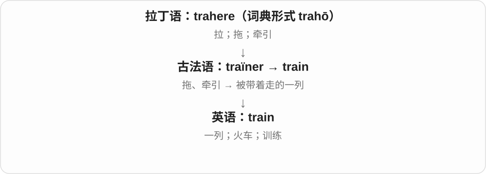

列车义来自一列连续相接的东西，早于现代铁路还有拖尾、随从等用法。训练义沿引导、使形成习惯发展；不能把火车速度快当作训练义的词源。

**常见搭配与例句**

catch a train；a train of thought；train someone to do…；train for a race；train a dog。

> I missed the train and had to wait for the next one.

我错过了火车，只好等下一班。

> She trains new staff to handle customer complaints.

她培训新员工处理顾客投诉。

**别混淆**

teach 常突出教授知识或方法；train 常突出反复练习、形成技能或习惯。两者经常一起发生。

### 2. training — 训练；培训

**音标**：/ˈtreɪnɪŋ/

**先抓住这个画面**

training 是把“知道怎么做”练成“实际做得出来”的过程，可能包括讲解、演练、反馈和反复尝试。

**怎么拆**

train + -ing，在这里作为动作或活动名词。不要把它当作 train“火车”的复数。

**怎么变成今天的意思**

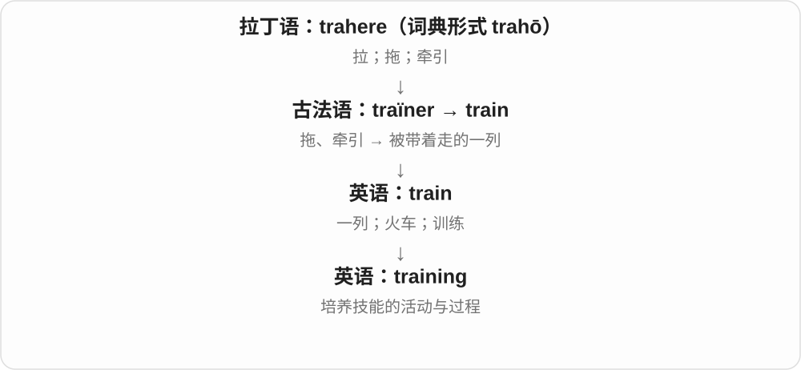

它沿 train 的指导和练习义发展。体育训练、岗位培训和模型训练对象不同，但都着眼于经过过程形成能力。

**常见搭配与例句**

staff training；receive training；a training session；training in first aid；training for a marathon。

> All new employees receive safety training.

所有新员工都要接受安全培训。

> Regular training helped her run farther without tiring.

规律训练让她能跑得更远而不容易疲劳。

**别混淆**

training 常作不可数名词；一次培训通常说 a training session 或 a training course，而不必说 a training。

### 3. treat — 对待；处理；治疗；款待；乐事

**音标**：/triːt/

**先抓住这个画面**

treat 先抓住“怎样处理、怎样对待”：对人友好、处理问题、治疗疾病、请人吃点好的，都是对不同对象采取做法。

**怎么拆**

来自古法语 tretier / traitier，追溯到拉丁语 tractāre“处理、管理”，再往前是 trahere“拉”。现代 treat 已不能按字母硬切。

**怎么变成今天的意思**

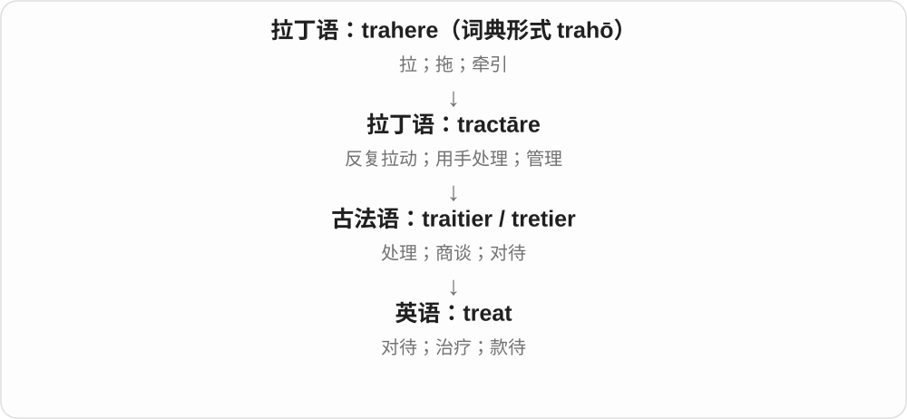

历史从动手处理扩展到商谈、对待和照料。治疗是对疾病作处理；款待是给人好的招待，名词 a treat 又可指带来快乐的食物或经历。

**常见搭配与例句**

treat someone with respect；treat A as B；treat a disease；treat someone to lunch；a special treat。

> She treats every customer with respect.

她尊重每一位顾客。

> Let me treat you to lunch; it is my birthday.

让我请你吃午饭吧，今天是我生日。

**别混淆**

treat a disease 是治疗，并不保证治好；cure 更强调治愈。treat someone to dinner 是请客，不能省略 to 后直接照搬“治疗某人”。

### 4. treatment — 对待；治疗；处理方式

**音标**：/ˈtriːtmənt/

**先抓住这个画面**

treatment 把“怎样对待”变成可讨论的一整套做法：病人接受什么治疗，员工受到怎样的待遇，材料经过什么处理。

**怎么拆**

treat + -ment；-ment 形成动作、过程或结果名词，也可与法语 traitement 对照。

**怎么变成今天的意思**

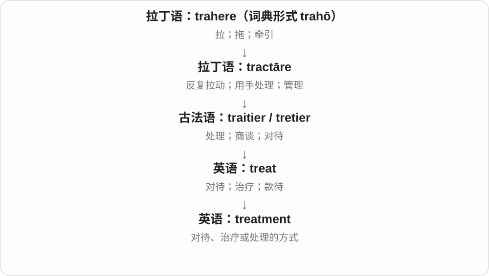

核心始终是对象被怎样处理。medical treatment 只是一支；equal treatment 说一视同仁，water treatment 说水处理。

**常见搭配与例句**

receive treatment；equal treatment；the treatment of…；water treatment；special treatment。

> All applicants should receive equal treatment.

所有申请者都应受到平等对待。

> The water passes through several stages of treatment.

这些水会经过几个处理阶段。

**别混淆**

treatment 可以指治疗过程；medicine 可以指药物或医学。一次治疗未必只靠吃药。

### 5. treated — 对待、处理过；治疗过；款待、请客了；处理过的

**音标**：/ˈtriːtɪd/

**先抓住这个画面**

面对一个人或东西，你怎样处理、怎样对它，就是 treated 的共同线索；治疗是处理病情，款待则是好好招待。

**怎么拆**

treat + -ed，/t/ 后增加 /ɪd/。treat 经古法语 traitier、tretier 接拉丁 tractāre 处理、管理，较早联系 trahere 拉、拖的词族。

**怎么变成今天的意思**

**拉丁 trahere、tractāre → 法语 → treat**  
拉、反复处理 → 处理、对待等

↓

**treat + -ed → treated**  
对待过、处理过；受处理的

treated us kindly 友好对待我们；treated the wood 处理过木材；treated the patient 给病人治疗；treated me to lunch 请我吃午饭。

**常见搭配与例句**

was treated as an equal；treated with respect。

> They treated every visitor with respect.

他们尊重地对待每位访客。

> She treated me to lunch after the exam.

考试后，她请我吃了午饭。

**别混淆**

treated as ... 是被当作……对待；treated with ... 说明用何种态度或材料处理；treated someone to something 是请人享用某物。

### 6. treaty — 条约；国家等之间的正式协定

**音标**：/ˈtriːti/

**先抓住这个画面**

treaty 像把长时间商谈的结果落成一份正式文本，参与方据此承担约定。

**怎么拆**

经古法语 traité / traitié 进入英语，与 traiter“处理、商谈”的分词名词化有关；更远属于拉丁语 tractāre。不是 treat + 普通后缀 y 随意造出来。

**怎么变成今天的意思**

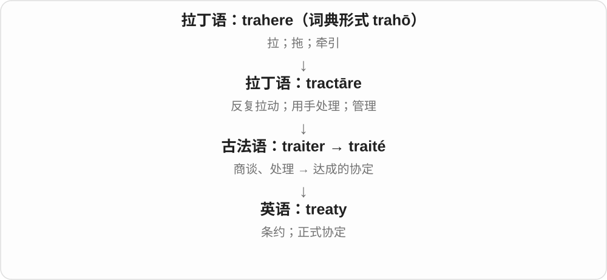

同一个“商谈、处理”词族，一条支路形成对待和治疗，另一条留下正式协商的成果。现代 treaty 常见于国家或政治实体之间。

**常见搭配与例句**

sign a treaty；a peace treaty；a trade treaty；treaty obligations。

> The two countries signed a treaty to protect the river.

两国签署了一项保护这条河流的条约。

> The treaty sets out how the resources will be shared.

条约规定了这些资源如何共享。

**别混淆**

agreement 很宽泛；treaty 常是正式国际条约。朋友约好周末吃饭通常不是 treaty。

### 7. treating — 对待、处理；治疗；款待、请客〔现在分词、动名词〕

**音标**：/ˈtriːtɪŋ/

**先抓住这个画面**

把一个人或一件事放到手里，决定怎样处理、怎样对待，是 treating 的共同起点。医疗里处理病情，请客时给人一份特别享受。

**怎么拆**

treat + -ing，直接加 ing，不双写 t。treat 经古法语 traitier、tretier 接拉丁 tractare 处理、管理，较远与 trahere 拉相关。

**怎么变成今天的意思**

**拉丁 trahere → tractare → 古法语 → treat**  
拉、摆弄 → 处理、对待

↓

**treat + -ing → treating**  
正在对待、处理、治疗或款待

treating people fairly 公平对人；treating something as a priority 把某事当作优先事项；treating someone to lunch 请某人吃午饭。

**常见搭配与例句**

treating a condition 治疗病症；treating the surface 处理表面。

> Thank you for treating us to dinner.

谢谢你请我们吃晚饭。

> The team is treating the issue as a priority.

团队正把这个问题作为优先事项处理。

**别混淆**

treating someone to a meal 是请客；treating someone with respect 是尊重地对待。宾语、介词共同决定用法。

### 8. treats — 对待、治疗、款待〔第三人称单数〕；乐事、小享受、零食〔复数〕

**音标**：/triːts/

**先抓住这个画面**

你怎么处理、照顾一个人，是 treats 的动作；专门拿好东西让人开心，就又有款待和小享受。

**怎么拆**

treat + -s，/t/ 后读 /s/。treat 经法语 traitier、tretier 接拉丁 tractare 处理，更早联系 trahere 拉；款待用法再关联乐事、零食名词。

**怎么变成今天的意思**

**拉丁 tractare → 法语 → treat**  
处理 → 对待、治疗、款待

↓

**treat + -s → treats**  
某人这样对待、款待；多份令人开心的东西

treats people fairly 公平待人；treats someone to lunch 请人吃午饭；sweet treats 甜食小点。

**常见搭配与例句**

special treats 特别的小享受；treats the subject seriously 认真对待话题。

> She treats every guest with respect.

她尊重每一位客人。

> We packed a few treats for the journey.

我们为旅途装了些好吃的小零食。

**别混淆**

动词 treats someone to something 是请客、给人享受；名词 treats 可以是零食，也可以是其他令人开心的事。

### 9. treatise — 专著；专题论述

**音标**：/ˈtriːtɪs/；也读 /ˈtriːtɪz/

**先抓住这个画面**

treatise 是把一个主题认真讲透的一篇或一部作品：有体系地展开，不只是随手写几句看法。

**怎么拆**

来自盎格鲁诺曼语 tretiz、古法语 traitis，与 traitier“处理、论述”有关；最终属于 tractāre 词族。

**怎么变成今天的意思**

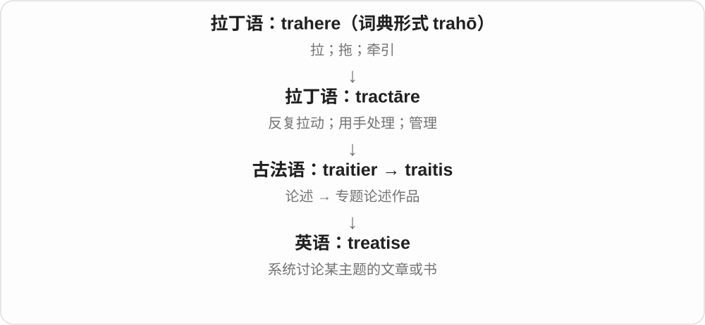

这里“处理”的对象是知识主题：把问题拿出来逐层论述。它与 treaty 同源，但一个留下研究论著，一个留下协定。

**常见搭配与例句**

a treatise on ethics；write a treatise；a philosophical treatise。

> She wrote a treatise on the ethics of scientific research.

她写了一部讨论科研伦理的专著。

> The old treatise includes detailed drawings of bridges.

那部旧论著中有桥梁的详细图示。

**别混淆**

essay 可以较短、较个人化；treatise 常给人系统、正式、充分展开的感觉。篇幅不是唯一判断标准。

### 10. retreat — 撤退、退避；静修活动、清静处；退却、后退

**音标**：/rɪˈtriːt/

**先抓住这个画面**

原来向前或待在某个位置，现在往回收、退出，是 retreat 的核心。离开喧闹，到清静地方专心休息、写作或修习，也沿用退出日常事务的方向感。

**怎么拆**

经古法语 retret 及 retrere 拉回的词族，接拉丁 retrahere：re- 回 + trahere 拉。英语 retreat 不是给现代 treat 对待前面简单加 re 重新对待。

**怎么变成今天的意思**

**拉丁 re- + trahere → retrahere → 古法语 retrere、retret**  
往回拉、撤回

↓

**法语相关词 → 英语 retreat**  
撤退、退避；后有避静之处、集中静修活动

a retreat from a position 从某个立场退回；a quiet retreat 清静的去处；a writing retreat 集中写作活动。

**常见搭配与例句**

retreat into the forest 退入森林；beat a retreat 赶紧退开。

> The hikers decided to retreat before the weather worsened.

徒步者决定在天气变坏前退回去。

> The cabin was her quiet retreat from city life.

小屋是她远离城市生活的清静去处。

**别混淆**

retreat 可以是军事撤退，也可以是离开压力、喧闹的日常退避。a retreat 作为活动、场所要看语境，不必都译成战场撤退。

### 11. contract — 合同；收缩；订约；感染

**音标**：名词：英 /ˈkɒntrækt/，美 /ˈkɑːntrækt/；动词 /kənˈtrækt/

**先抓住这个画面**

contract 有两幅常用画面：把东西拉紧，体积就缩小；把双方的承诺定在一起，就有了合同。

**怎么拆**

con-（一起）+ trahere（拉）形成拉丁语 contrahere。名词和动词经相关拉丁、法语形式传入，不能把 contract 拆成 contra-。

**怎么变成今天的意思**

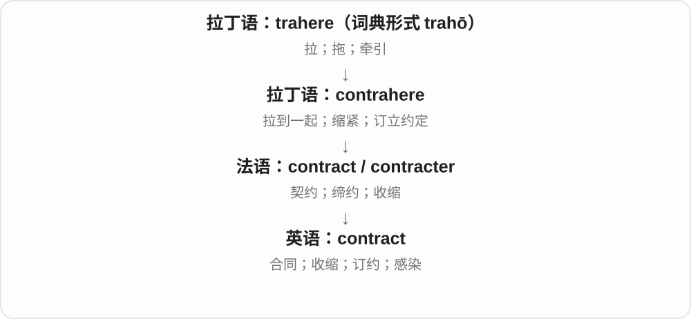

“拉到一起”在身体上是收缩，在交易中是达成约定。contract a disease 的“感染”来自获得、招致这一用法，不能硬想成把病菌捏小。

**常见搭配与例句**

sign a contract；contract with a supplier；muscles contract；contract a disease。名词重音在前，动词在后。

> We signed a contract for six months of maintenance.

我们签了一份为期六个月的维护合同。

> The metal contracts as it cools.

金属冷却时会收缩。

**别混淆**

contract 作名词通常比 agreement 更强调有约束力的约定；作动词也可能只说收缩，与合同无关。

### 12. contracts — 合同、契约〔复数〕；收缩、订约、感染〔第三人称单数〕

**音标**：名词英 /ˈkɒntrækts/、美 /ˈkɑːntrækts/；动词 /kənˈtrækts/

**先抓住这个画面**

把双方拉到一项约定里，是合同的理解线索；把一个东西向内拉紧，是收缩。contracts 用不同重音区分这些名词、动词用途。

**怎么拆**

contract + -s，/t/ 后读 /s/。拉丁 con- 一起 + trahere 拉 → contrahere，接 contractus 等形式；名词、动词各经法语、拉丁相关路线借入，现代重音分化。

**怎么变成今天的意思**

**拉丁 contrahere、contractus → 法语、英语 contract**  
拉到一起 → 订约、合同；缩紧

↓

**contract + -s → contracts**  
名词多份合同；动词单数主语收缩等

sign contracts 签合同；contracts with suppliers 与供应商的合同；the muscle contracts 肌肉收缩。

**常见搭配与例句**

employment contracts 雇用合同；contracts a disease 染上某种疾病。

> The two companies signed the contracts on Monday.

两家公司周一签了合同。

> The muscle contracts when the signal reaches it.

信号到达时，肌肉便收缩。

**别混淆**

合同名词前重音；收缩、感染等动词后重音。contract a disease 是染病，contract to do 是订约做某事，要按宾语和结构分别理解。

### 13. contractor — 承包商；签约提供服务的人或公司

**音标**：英 /kənˈtræktə/；美 /ˈkɑːntræktər/

**先抓住这个画面**

contractor 是按合同接下一项工作的人或公司：修屋顶、建房子、维护系统，都可能交给它。

**怎么拆**

来自晚期拉丁语 contractor；现代可用 contract + -or“承担合同工作的一方”帮助理解。英美常见重音不同。

**怎么变成今天的意思**

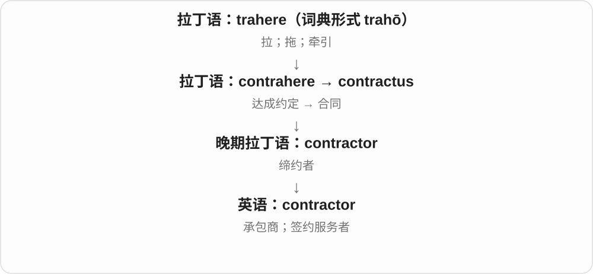

焦点由那份约定转到承担工作的一方。它可以是个人，也可以是公司，不是只指建筑工人。

**常见搭配与例句**

hire a contractor；a building contractor；an independent contractor；the main contractor。

> We hired a contractor to repair the roof.

我们请了一家承包商修屋顶。

> The contractor must finish the work by June.

承包商必须在六月前完成工作。

**别混淆**

contractor 强调合同下提供服务的角色；employee 是雇员。具体法律身份不能只看当事人用了哪个称呼。

### 14. contractors — 承包商、按合同承担工作的人或机构〔复数〕

**音标**：英 /kənˈtræktəz/；美常 /ˈkɑːntræktərz/

**先抓住这个画面**

某项工作交给外部的人或公司按合同来做，这些承接方就是 contractors。不是每位普通雇员都因为工作有约定就这样称呼。

**怎么拆**

contractor 接晚期拉丁 contractor 缔约者，较早 contrahere、contractus 的达成约定材料。现代可对应 contract + -or，整个名词再加 -s，读 /z/；英美常见重音不同。

**怎么变成今天的意思**

**拉丁 contrahere、contractus → contractor → 英语 contractor**  
达成约定 → 缔约者、承担合同工作者

↓

**contractor + -s → contractors**  
多位承接工作者、多家承包机构

building contractors 建筑承包商；independent contractors 独立承接工作者；local contractors 当地承包商。

**常见搭配与例句**

hire contractors 请承包商；contractors working on the project 项目上的承接方。

> Local contractors repaired the school roof.

当地承包商修好了学校屋顶。

> The project brought together several contractors.

这个项目汇集了几家承包机构。

**别混淆**

contractors 是人或机构，contracts 是合同。这里在解释词义，具体身份在不同工作安排中可能不同，不能只凭词形把两者混成一样东西。

### 15. contracted — 收缩了、缩小了；订约了、承包的；染上了〔过去式、过去分词〕

**音标**：/kənˈtræktɪd/

**先抓住这个画面**

把散开的东西拉到一起，空间就缩紧；把双方拉进一个约定，就订了约。contracted 的这些常用意思，都可从收拢、形成关系来理解。

**怎么拆**

拉丁 con- 一起 + trahere 拉 → contrahere，经相关法语、拉丁形式接英语 contract 动词。现代加完整 -ed，/t/ 后读 /ɪd/，保持动词后重音。

**怎么变成今天的意思**

**拉丁 contrahere → 法语、英语 contract 动词**  
拉在一起 → 收缩、订约；另有招致、染上义

↓

**contract + -ed → contracted**  
已经收缩、订约、染上等

contracted in the cold 冷时收缩了；contracted to provide… 订约提供……；a contracted form 缩约形式。

**常见搭配与例句**

contracted services 外包、依合同提供的服务；contracted a disease 染上某种疾病。

> The material contracted as it cooled.

材料冷却时收缩了。

> The company contracted to supply the costumes.

公司签约供应戏服。

**别混淆**

contracted 作过去动词不能照名词 contract 的前重音读。具体是收缩、订约还是染上，要看后面接的对象和介词。

### 16. contracting — 收缩；订约、承包〔分词、动名词〕

**音标**：英、美 /kənˈtræktɪŋ/

**先抓住这个画面**

原来展开的一团，现在向里收，是 contracting。订合同时，原来分开的双方也被一份约定联系起来，这是同一词族发展的另一支。

**怎么拆**

contract + 完整 -ing → contracting，原词不改。接拉丁 con- 一起 + trahere 拉 → contrahere 拉到一起，分词 contractus；英语动词重读后面的 tract。

**怎么变成今天的意思**

**拉丁 contrahere 拉到一起、缔结 → contractus → contract**  
收拢与建立约束关系的意义很早就并存

↓

**英语动词 contract + -ing → contracting**  
现代描写收缩，或通过合同安排工作

contracting muscles 是正在收缩的肌肉；contracting work out 是把工作外包；contracting with a company 是与公司订约。

**常见搭配与例句**

contracting muscles；contracting work out；contracting with。

> The diagram shows the material expanding and contracting.

图中展示了这种材料的膨胀和收缩。

> The museum is contracting out its printing work.

这家博物馆正在把印刷工作外包。

**别混淆**

contracting 的动词重音在后，/kənˈtrækt/。名词 contract 合同通常重音在前；看到同样字母，要用句中的词性帮助读音。

### 17. contraction — 收缩；缩减；缩约形式

**音标**：/kənˈtrækʃən/

**先抓住这个画面**

contraction 是从展开变紧凑：肌肉缩紧，经济规模变小，或者 do not 缩成 don’t。

**怎么拆**

来自拉丁语 contractiō，经法语传入；现代可对照 contract + -ion。

**怎么变成今天的意思**

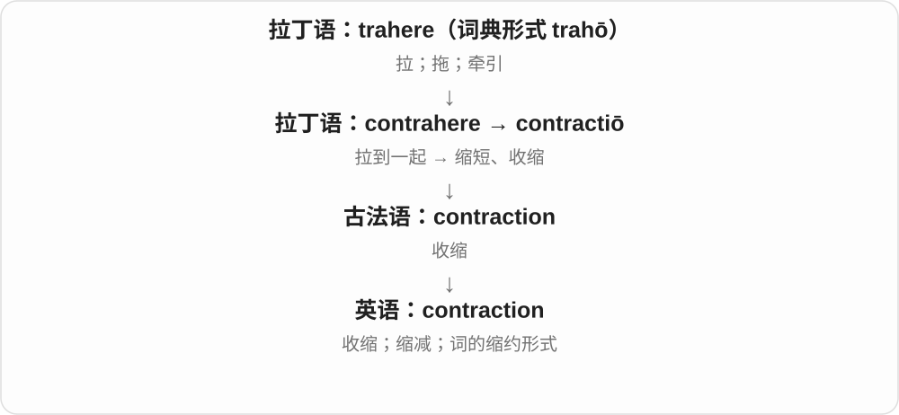

几种意义共享“变短、变小、变紧”的结果。分娩语境的 contractions 特指子宫收缩，语言里的 contraction 则是压缩后的词形。

**常见搭配与例句**

muscle contraction；economic contraction；a contraction of…；the contraction don’t。

> The device measures muscle contractions.

这台设备测量肌肉的收缩。

> “Can’t” is a contraction of “cannot.”

can’t 是 cannot 的缩约形式。

**别混淆**

contraction 不等于 contract“合同”的数量变化。abbreviation 泛指缩写，contraction 常涉及删去中间音或字母并缩合。

### 18. contractual — 合同规定的；合同上的

**音标**：/kənˈtræktʃuəl/

**先抓住这个画面**

contractual 指“写在合同关系里、因此需要履行的”：不能只说自己不想做，还得看当初答应了什么。

**怎么拆**

contract + -ual，形成“与合同有关的”形容词，历史基础仍是拉丁语 contractus。

**怎么变成今天的意思**

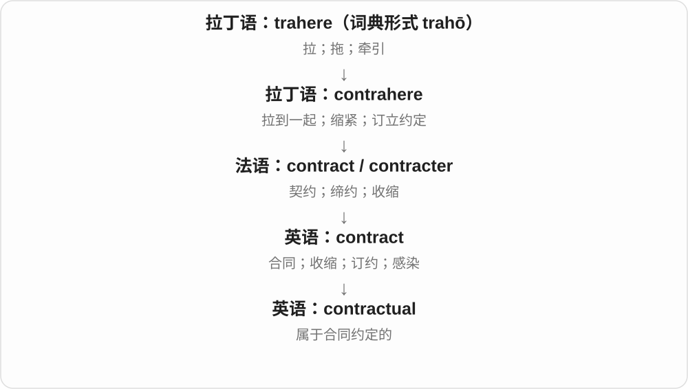

contract 表示约定本身；contractual 把这种关系加到责任、权利和条件上。它不表示所有相关事项都已经没有争议。

**常见搭配与例句**

contractual obligations；contractual rights；a contractual requirement；contractual terms。

> The company met all its contractual obligations.

公司履行了所有合同义务。

> The extra service is not a contractual requirement.

这项额外服务不是合同规定的要求。

**别混淆**

contractual 是来自合同的；voluntary 是自愿提供的。两者不一定冲突：自愿签约之后，也可能承担合同义务。

### 19. attract — 吸引；引来

**音标**：/əˈtrækt/

**先抓住这个画面**

attract 像有一股看不见的力，把目光、人或物拉向这里：磁铁吸铁，香味吸引顾客，异常举动引起注意。

**怎么拆**

ad-（朝向）+ trahere（拉）；ad- 遇到 t 同化成 at-，形成 attrahere。

**怎么变成今天的意思**

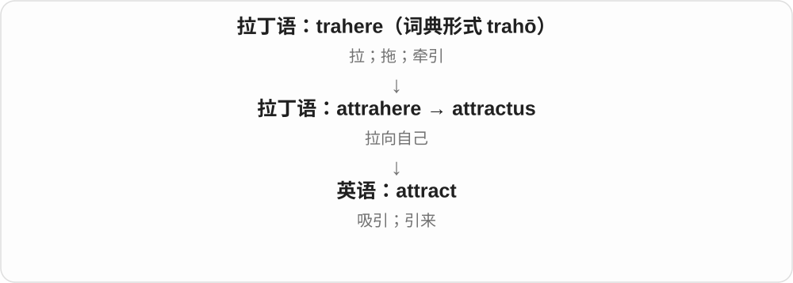

具体的拉力扩展到注意力、兴趣和好感。attract criticism 也成立，因为引来的不一定是好东西。

**常见搭配与例句**

attract attention；attract visitors；attract criticism；be attracted to… 。

> The bright display attracted a crowd.

明亮的陈列吸引了一群人。

> The proposal attracted criticism from several groups.

这项提案招来了几个团体的批评。

**别混淆**

attract 说产生吸引力；invite 是发出邀请。商店可以靠橱窗 attract customers，不必逐个邀请。

### 20. attractive — 有吸引力的；好看的；诱人的

**音标**：/əˈtræktɪv/

**先抓住这个画面**

attractive 让人愿意靠近、选择或多看一眼。人可以好看，价格可以划算，工作机会可以很值得考虑。

**怎么拆**

经法语 attractif，来自拉丁语 attractīvus；现代对照 attract + -ive。

**怎么变成今天的意思**

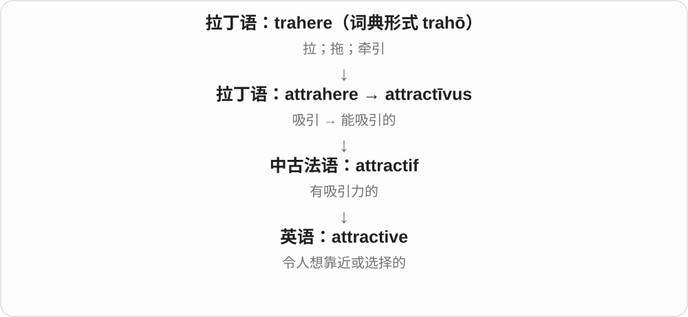

它把“吸引”变成对象的特点。attractive salary 通常是薪资条件不错，绝不是说数字长得漂亮。

**常见搭配与例句**

an attractive offer；an attractive price；look attractive；attractive to buyers。

> The apartment is attractive to people who work downtown.

这套公寓对在市中心工作的人很有吸引力。

> They offered her an attractive salary.

他们给她开出了诱人的薪资。

**别混淆**

beautiful 更直接评价美；attractive 的范围更广，能包括实惠、便利和机会。

### 21. attractiveness — 吸引力；吸引人的程度

**音标**：/əˈtræktɪvnəs/

**先抓住这个画面**

attractiveness 问“为什么人愿意选它、它有多吸引人”。它可以来自外貌，也可以来自地段、价格或方便程度。

**怎么拆**

attractive + -ness，表示“有吸引力”这种性质。

**怎么变成今天的意思**

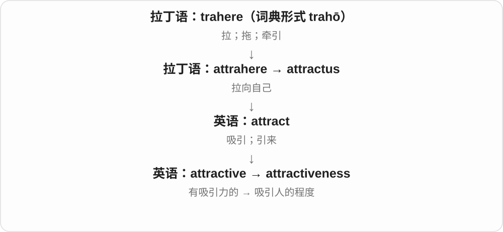

形容词夸这个对象有吸引力，名词让你进一步分析或比较这种吸引力。不是只用于外貌打分。

**常见搭配与例句**

the attractiveness of…；increase attractiveness；commercial attractiveness；physical attractiveness。

> Better transport increased the attractiveness of the area.

交通改善提高了这个地区的吸引力。

> The study examined the attractiveness of different job offers.

研究考察了不同工作机会的吸引力。

**别混淆**

attractiveness 评价吸引人的程度；attraction 还可以数具体的景点。三个景点是 three attractions，不是 three attractivenesses。

### 22. attracted — 吸引了；受到吸引的〔过去式、过去分词〕

**音标**：/əˈtræktɪd/

**先抓住这个画面**

把东西、注意或人拉到自己这边，是 attracted。磁铁可以吸引铁块，一个活动、想法也能把人的兴趣拉过来。

**怎么拆**

attract + -ed，/t/ 后读 /ɪd/。拉丁 ad- 朝向在 t 前同化 + trahere 拉 → attrahere，分词 attractus 等接到英语词族。

**怎么变成今天的意思**

**拉丁 attrahere、attractus → attract**  
朝这边拉 → 吸引事物、注意或兴趣

↓

**attract + -ed → attracted**  
过去吸引；被某种特征吸引

attracted attention 引起注意；attracted visitors 吸引游客；attracted to the idea 被这个想法吸引。

**常见搭配与例句**

attracted by the design 被设计吸引；attracted a large audience 吸引大量观众。

> The exhibition attracted visitors from nearby towns.

展览吸引了附近城镇的游客。

> She was attracted to the job by the chance to learn.

她因学习机会而对这份工作产生兴趣。

**别混淆**

attracted 不只说恋爱或外貌，也常说活动、工作机会、物理吸引。be attracted to something 说明对什么感兴趣、受到什么吸引。

### 23. attraction — 吸引力；吸引人的事物；景点

**音标**：/əˈtrækʃən/

**先抓住这个画面**

attraction 既可以是把人拉过去的力量，也可以是那个值得去看的东西。

**怎么拆**

经古法语 attraction，来自拉丁语 attractiō；现代可对照 attract + -ion。

**怎么变成今天的意思**

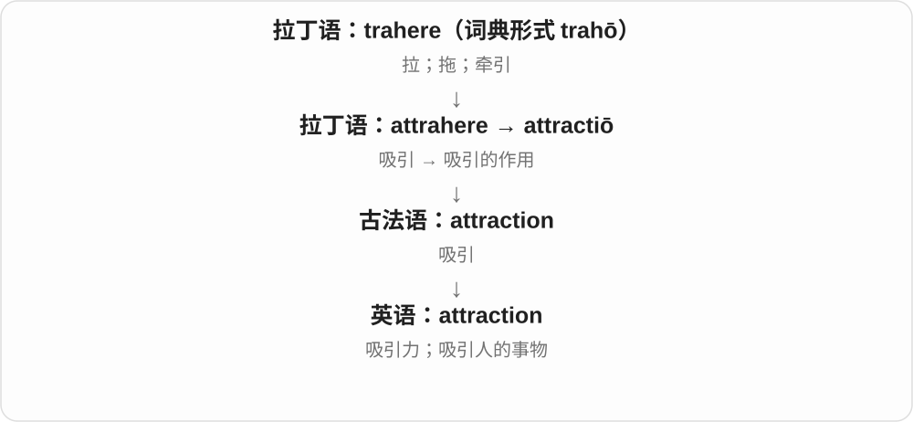

“它有吸引力”容易进一步变成“它就是一个吸引人的去处”，于是有 tourist attraction。人与人之间的 attraction 也不一定已经发展成爱情。

**常见搭配与例句**

a tourist attraction；the main attraction；physical attraction；an attraction to… 。

> The old castle is the town’s main attraction.

那座古堡是镇上最吸引游客的地方。

> She felt an immediate attraction to his sense of humor.

他的幽默感一下就吸引了她。

**别混淆**

attraction 可以指吸引本身；destination 只是目的地。不是所有旅行目的地都叫 tourist attraction。

### 24. attractions — 吸引人的事物、景点、活动〔复数〕

**音标**：/əˈtrækʃənz/

**先抓住这个画面**

某个地方为什么让人想去？古堡、花园、演出都可能是它的 attractions。不是只能数旅游景点，也能数让人动心的优点或活动。

**怎么拆**

attraction 经法语接拉丁 attractio，较早 attrahere 拉向、吸引，连 ad- 与 trahere。现代整个名词加 -s，/n/ 后读 /z/。

**怎么变成今天的意思**

**拉丁 attrahere、attractio → 法语、英语 attraction**  
拉过来 → 吸引作用、吸引人的东西

↓

**attraction + -s → attractions**  
多个景点、活动或有吸引力的特点

tourist attractions 旅游景点；local attractions 当地游览项目；the attractions of the job 工作吸引人的地方。

**常见搭配与例句**

main attractions 主要看点；several attractions 几处景点或几项看点。

> The town has several historic attractions.

镇上有几处历史景点。

> One of the attractions of the job is the flexible schedule.

这份工作吸引人的一点是时间安排灵活。

**别混淆**

attraction 泛谈吸引力时常不可数；attractions 通常把具体吸引人的东西分开数。景点只是一种常见对象，不能覆盖所有句子。

### 25. attracting — 吸引、引来〔现在分词、动名词〕

**音标**：/əˈtræktɪŋ/

**先抓住这个画面**

目标原来在别处，现在有一股力量把它朝这里拉过来。可以是磁力，也可以是景色、作品让人的注意力过来。

**怎么拆**

attract + -ing，直接加 ing。拉丁 ad- 朝向 + trahere 拉形成 attrahere，d 在 t 前同化；英语采用相关 attract- 词干。

**怎么变成今天的意思**

**拉丁 attrahere、attract- → attract**  
朝自己这边拉 → 吸引人、物或注意

↓

**attract + -ing → attracting**  
正在吸引、引来

attracting visitors 吸引游客；attracting attention 引起注意；attracting support 赢得支持。

**常见搭配与例句**

attracting more readers 吸引更多读者；a magnet attracting iron 磁铁吸引铁。

> The exhibition is attracting visitors from nearby towns.

展览正吸引附近城镇的游客。

> The unusual design is attracting a lot of attention.

这个不同寻常的设计正引起大量关注。

**别混淆**

attracting 讲把注意或目标拉过来；attractive 形容有吸引力。吸引不只指外貌，也可指内容、机会或物理力。

### 26. attracts — 吸引、招来〔第三人称单数〕

**音标**：/əˈtrækts/

**先抓住这个画面**

一处花园把蝴蝶引来，一块招牌把目光引来：attracts 说目标被朝这边拉近，力量可能是物理的，也可能是兴趣。

**怎么拆**

attract + -s，/t/ 后读 /s/。拉丁 ad- 与 trahere 拉形成 attrahere，辅音同化为 att-，英语接相关 attract- 词干。

**怎么变成今天的意思**

**拉丁 attrahere、attract- → attract**  
朝某处拉 → 吸引注意、人或物

↓

**attract + -s → attracts**  
第三人称主语吸引、引来

attracts attention 引起注意；attracts visitors 吸引游客；attracts iron 吸引铁。

**常见搭配与例句**

attracts interest 引起兴趣；attracts a wide audience 吸引广泛观众。

> The bright sign attracts attention.

明亮的招牌吸引目光。

> The garden attracts butterflies in summer.

花园在夏天会吸引蝴蝶。

**别混淆**

attracts 是动作，attractive 是有吸引力的性质。attracts 不只说外貌，也可以讲磁力、内容或机会。

### 27. portrait — 肖像；对人物或事物的刻画

**音标**：英 /ˈpɔːtrɪt/；美 /ˈpɔːrtrət/

**先抓住这个画面**

portrait 是留下来的那幅形象：可以是人的肖像照，也可以是文字中对一个家庭或时代的描写。

**怎么拆**

来自法语 portraict / pourtraict，是 portraire“描绘”的分词用作名词；不是从现代英语 portray 直接加一个 t。

**怎么变成今天的意思**

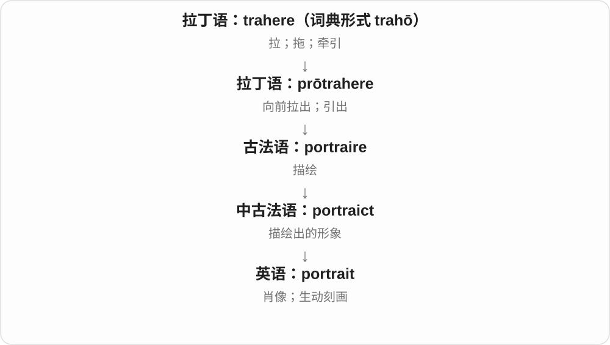

portray 看描绘的动作，portrait 看描绘出来的形象。设备界面里的 portrait orientation 又借肖像常见的竖向构图表示竖屏方向。

**常见搭配与例句**

paint a portrait；a family portrait；a vivid portrait of…；portrait orientation。

> A portrait of her grandfather hung above the desk.

桌子上方挂着她祖父的肖像。

> The book offers a vivid portrait of life in the city.

这本书生动地描绘了这座城市的生活。

**别混淆**

portrait 通常聚焦人物形象或某对象的整体面貌；landscape 常指风景，在页面方向里则表示横向。

### 28. portraits — 肖像，人物照片；人物或事物的描绘〔复数〕

**音标**：英 /ˈpɔːtrɪts/；美 /ˈpɔːrtrɪts/

**先抓住这个画面**

画出或拍出一个人的形象，是 portrait；文章把某个人、城市写得生动，也能叫 portrait。复数 portraits 可以是几幅像，也可以是几段有形象的描绘。

**怎么拆**

portrait + -s → portraits，/t/ 后读 /s/。portrait 接法语 portraire 描绘的分词名词形式等，远有 por- 向外 + traire 画、拉，接拉丁 trahere。

**怎么变成今天的意思**

**拉丁拉、引出的材料 → 法语 portraire 勾画、描绘**  
把形象勾出来帮助理解画与描绘的联系

↓

**法语 portrait 等 → 英语 portrait → portraits**  
现代加复数 -s，词尾 /ts/

family portraits 是家庭肖像；painted portraits 是绘画肖像；portraits of city life 可以是对城市生活的描绘。

**常见搭配与例句**

family portraits；painted portraits；portraits of city life。

> Family portraits hung along the hallway.

走廊里挂着家庭肖像。

> The essays offer vivid portraits of city life.

这些随笔生动描绘了城市生活。

**别混淆**

portrait 不限定油画，照片、文字也能表现人物形象；具体媒介由 painted、photographic、written 等搭配说明。

### 29. trace — 痕迹、微量；追查、追溯；描摹

**音标**：/treɪs/

**先抓住这个画面**

顺着留下的痕迹找来源，是 trace；沿着已有轮廓描一遍，也叫 trace。痕迹只剩一点点，又形成微量的意思。

**怎么拆**

经古法语 trace、tracer 进入中古英语。更早涉及拉丁拖、描线与追踪等形式的不同分析，不把所有阶段都画成唯一无疑的直线。

**怎么变成今天的意思**

**古法语 trace／tracer → 中古英语 trace／tracen**  
痕迹、轮廓；描画、跟随、追查

↓

**英语 trace 的不同常用方向**  
沿痕追溯；按轮廓描画；留下的细微痕迹、微量

trace the source 追查来源，trace a picture 描图，a trace of smoke 一丝烟，without a trace 不留痕迹，trace elements 微量元素。

**常见搭配与例句**

trace the source；trace back to；a trace of；without a trace。

> They traced the fault to a loose connection.

他们追查到故障源于一个松动的连接。

> A trace of smoke remained in the room.

房间里还留着一丝烟雾。

**别混淆**

trace 既能追查，也能描画，不是每次都在偷偷跟踪。a trace of 强调很少量，a track 更常是轨迹、小路等。

### 30. traced — 追查、追溯了；描摹、沿线描出了

**音标**：/treɪst/

**先抓住这个画面**

把线索一段段接回去，查到源头，是 traced；把透明纸放在图上沿轮廓描，也叫 traced。两种场景都像沿着线走。

**怎么拆**

trace 去 e 加完整 -ed，/s/ 后词尾读 /t/，结尾 /st/。基础词经法语接拉丁拖、描线材料。

**怎么变成今天的意思**

**拉丁 trahere 拉、拖 → tractus 等路线、拖出材料**  
经法语 tracier、trace 等进入英语；早期描线、追随义的具体发展并非全都清楚

↓

**沿线描、循迹找 → 描摹、追查、追溯**  
trace 的名词痕迹、微量义与动词用法并存，不只一种词性

↓

**trace → traced**  
过去沿线描摹，或沿线索查清来路

traced the fault to a loose wire 把故障追查到一根松线；traced a map 描了一张地图；traced back to 追溯到。

**常见搭配与例句**

traced the source；traced the outline。

> We traced the noise to a loose panel on the door.

我们查出噪声来自门上一块松动的板。

> She traced the outline of the leaf on thin paper.

她在薄纸上描出了叶子的轮廓。

**别混淆**

tracked 更常跟踪位置、进展，traced 更容易强调循线查来源或描出轮廓；语境也有交叠。

### 31. tracing — 描摹、描图；描出的图；追查、追踪；曲线记录

**音标**：/ˈtreɪsɪŋ/

**先抓住这个画面**

把纸盖在原图上，沿线描出的那张图是 a tracing；沿证据寻找人、物、来源，也可以用 tracing 说过程。

**怎么拆**

trace + -ing，去末尾 e。中古英语已有 tracyng；同一个形式可命名动作、结果，或由仪器留下的曲线记录。

**怎么变成今天的意思**

**古法语 trace／tracer → 中古英语 trace／tracen**  
痕迹、轮廓；描画、跟随、追查

↓

**英语 trace 的不同常用方向**  
沿痕追溯；按轮廓描画；留下的细微痕迹、微量

↓

**trace + -ing → tracing**  
描画、追查过程；描图或记录结果

tracing paper 描图纸，a tracing of the design 设计的描图，contact tracing 接触者追踪，a heart tracing 心脏活动曲线记录〔依具体检查语境〕。

**常见搭配与例句**

tracing paper；a tracing of；contact tracing。

> She placed tracing paper over the sketch.

她把描图纸放在草图上。

> The team worked on tracing the source of the error.

团队着手追查错误来源。

**别混淆**

tracing 不总是一个人在追踪，a tracing 也可能是图纸、记录。drawing 范围宽，tracing 往往有沿已有线条复制的关系。

### 32. tracer — 示踪物、示踪剂；追踪器、追查者；曳光弹

**音标**：英 /ˈtreɪsə/；美 /ˈtreɪsər/

**先抓住这个画面**

在某个流动、变化过程中放入可识别的标记，跟着它看路径，那个标记可以叫 tracer。重点是让原本不易看见的路线可追踪。

**怎么拆**

trace + -er，去末尾 e。可指执行追踪的人，也可指帮助显示、记录路线的物质、装置；军械里还形成能显出弹道的曳光弹名称。

**怎么变成今天的意思**

**古法语 trace／tracer → 中古英语 trace／tracen**  
痕迹、轮廓；描画、跟随、追查

↓

**英语 trace 的不同常用方向**  
沿痕追溯；按轮廓描画；留下的细微痕迹、微量

↓

**trace + -er → tracer**  
执行或帮助追踪的角色、物质、器具

a chemical tracer 化学示踪物，a radioactive tracer 放射性示踪物，a tracer study 示踪研究。是否具有放射性由具体物质决定，不是每种 tracer 都有。

**常见搭配与例句**

a chemical tracer；a radioactive tracer；a tracer study。

> The researchers used a dye as a tracer in the water.

研究人员用染料给水流作示踪标记。

> The report describes a tracer study of air movement.

报告描述了一项空气流动示踪研究。

**别混淆**

tracer 是用于追踪的东西、角色；trace 可以是留下的微量。-er 不等于每次都是一位调查员。

### 33. tracers — 示踪物、示踪剂；追踪装置、描摹者〔复数〕

**音标**：英 /ˈtreɪsəz/；美 /ˈtreɪsərz/

**先抓住这个画面**

给本来难看清的流动放一个可追踪的标记，就像让它留下一条看得见的线；这些帮助循迹的东西叫 tracers。

**怎么拆**

trace 去 e 加完整 -er → tracer，再加 -s；-er 可命名做描摹、追踪的人，也可命名帮助追踪的物质或装置。

**怎么变成今天的意思**

**拉丁 trahere 拉、拖 → tractus 等路线、拖出材料**  
经法语 tracier、trace 等进入英语；早期描线、追随义的具体发展并非全都清楚

↓

**沿线描、循迹找 → 描摹、追查、追溯**  
trace 的名词痕迹、微量义与动词用法并存，不只一种词性

↓

**trace → tracer → tracers**  
循迹角色、材料或装置，再作复数

chemical tracers 化学示踪物；tracers in a flow experiment 流动实验中的示踪物；军事场景也可说曳光弹。

**常见搭配与例句**

use tracers to follow movement；fluorescent tracers 荧光示踪物。

> The researchers used tracers to study how the water moved.

研究人员用示踪物研究水怎样流动。

> Tiny fluorescent tracers made the flow visible.

微小的荧光示踪物让流动变得可见。

**别混淆**

tracers 是用来追踪的对象、工具或标记，traces 是踪迹或微量本身；多一个 -er，角色就不同。

### 34. traceable — 可追踪的；可追溯来源的

**音标**：/ˈtreɪsəbəl/

**先抓住这个画面**

顺着记录或证据，能找回它从哪来、经过哪里，就是 traceable。不是说现在正在查，而是说有条件查得到。

**怎么拆**

trace + -able，去末尾 e，表示能被追踪、追溯。也有专门数学用法，此处先学日常、管理常见含义。

**怎么变成今天的意思**

**古法语 trace／tracer → 中古英语 trace／tracen**  
痕迹、轮廓；描画、跟随、追查

↓

**英语 trace 的不同常用方向**  
沿痕追溯；按轮廓描画；留下的细微痕迹、微量

↓

**trace + -able → traceable**  
具备追踪、追溯的可能性

traceable to a source 可追溯到某来源，traceable products 可追溯产品，an easily traceable error 容易追查的错误。

**常见搭配与例句**

traceable to；traceable products；easily traceable。

> Each batch is traceable to its supplier.

每批产品都能追溯到供应商。

> The error was traceable to a missing line in the file.

错误可追查到文件中缺失的一行。

**别混淆**

traceable 说可追查，不保证产品必定优质，也不等于 transparent 一切信息都已公开。

### 35. untraceable — 查不到来源、去向的；无法追踪的

**音标**：/ʌnˈtreɪsəbəl/

**先抓住这个画面**

手里有一条线索，却怎么往回接都接不到源头，或怎么查也找不到人去了哪里，这种查不出的状态叫 untraceable。

**怎么拆**

否定 un- + traceable；内层 trace + -able 保留 e，再加 un-。这里 un- 是否定，不是拉丁“一个”的词根。

**怎么变成今天的意思**

**拉丁 trahere 拉、拖 → tractus 等路线、拖出材料**  
经法语 tracier、trace 等进入英语；早期描线、追随义的具体发展并非全都清楚

↓

**沿线描、循迹找 → 描摹、追查、追溯**  
trace 的名词痕迹、微量义与动词用法并存，不只一种词性

↓

**trace → traceable → untraceable**  
可追查的 → 不可追查、查不到的

an untraceable source 无法查明的来源；untraceable calls 查不清来源的电话；remain untraceable 仍然查不到。

**常见搭配与例句**

untraceable origins；become untraceable。

> The quotation was copied so often that its original source became untraceable.

那句话被反复转抄，原始出处已经查不到了。

> Several missing items remain untraceable.

几件丢失的物品仍然查不到去向。

**别混淆**

untraceable 描述在相应条件下查不到，不是凭空断言任何时代、任何方法都永远查不到。

### 36. traceless — 不留痕迹的；没有踪迹的

**音标**：/ˈtreɪsləs/

**先抓住这个画面**

东西曾在这里，后来拿走、擦掉，连一条能看出的痕迹都没留下，这种样子叫 traceless。这个词较偏书面描写。

**怎么拆**

trace + 缺少、没有的 -less，保留基础 e；现代按痕迹名词来理解。

**怎么变成今天的意思**

**拉丁 trahere 拉、拖 → tractus 等路线、拖出材料**  
经法语 tracier、trace 等进入英语；早期描线、追随义的具体发展并非全都清楚

↓

**沿线描、循迹找 → 描摹、追查、追溯**  
trace 的名词痕迹、微量义与动词用法并存，不只一种词性

↓

**trace + -less → traceless**  
缺少可见、可寻的痕迹

a traceless disappearance 消失得不留痕迹；leave a surface traceless 让表面不留痕迹，实际表达常用 leave no trace。

**常见搭配与例句**

traceless removal；a traceless vanishing act。

> In the story, the magician makes a traceless disappearance.

故事里，魔术师消失得不留痕迹。

> The film turns on the seemingly traceless theft of a painting.

这部电影围绕一幅画看似未留痕迹的失窃展开。

**别混淆**

traceless 突出没留痕迹，untraceable 突出查不出来源、去向；留下了一点线索，也仍可能暂时 untraceable。

### 37. retrace — 沿原路返回；重走、重描；回顾经过

**音标**：/ˌriːˈtreɪs/

**先抓住这个画面**

东西丢了，先想自己走过哪儿，再沿刚才的路返回去找，这叫 retrace your steps。也能在脑里把事情经过重新走一遍。

**怎么拆**

经法语 retracer 等借入，内部可对应 re- 再、回 + trace 沿线描、循迹；现代构词关系清楚，不把借入史略成英语当场拼造。

**怎么变成今天的意思**

**拉丁 trahere 拉、拖 → tractus 等路线、拖出材料**  
经法语 tracier、trace 等进入英语；早期描线、追随义的具体发展并非全都清楚

↓

**沿线描、循迹找 → 描摹、追查、追溯**  
trace 的名词痕迹、微量义与动词用法并存，不只一种词性

↓

**法语 re- + tracer 等 → 英语 retrace**  
英语早期已有追溯源头义，后来也说沿原路返回；现代还能回顾经过

retrace your steps 沿原路返回；retrace the route 重走路线；retrace the events 回顾事情经过。

**常见搭配与例句**

retrace the outline 重新描轮廓；retrace the journey 重走旅程。

> We had to retrace our steps to find the missing keys.

我们得沿原路返回，找丢失的钥匙。

> The book helps readers retrace the events of that evening.

这本书帮助读者回顾那天晚上的事情经过。

**别混淆**

return 只说回来，retrace your steps 还明确沿先前经过的那段路返回，常用于寻找遗失物。

### 38. retracing — 正在沿原路返回、重走；回顾、重描

**音标**：/ˌriːˈtreɪsɪŋ/

**先抓住这个画面**

人正一步步走回刚才经过的地方，或正顺着记忆梳理事情的前后，这段过程叫 retracing。

**怎么拆**

retrace 去 e 加 -ing；re- 作用于 trace，外层 -ing 再把整个动作变成进行形式或过程名词。

**怎么变成今天的意思**

**拉丁 trahere 拉、拖 → tractus 等路线、拖出材料**  
经法语 tracier、trace 等进入英语；早期描线、追随义的具体发展并非全都清楚

↓

**沿线描、循迹找 → 描摹、追查、追溯**  
trace 的名词痕迹、微量义与动词用法并存，不只一种词性

↓

**法语 re- + tracer 等 → 英语 retrace**  
英语早期已有追溯源头义，后来也说沿原路返回；现代还能回顾经过

↓

**retrace → retracing**  
沿先前路线、经过重新追寻的过程

retracing our steps 沿原路返回；retracing the history 回顾历史；retracing a line 重新描线。

**常见搭配与例句**

spend the morning retracing a route；retracing a family’s journey。

> We spent the morning retracing the route of our first walk.

我们上午重走了第一次散步的路线。

> She was retracing the events in her mind.

她正在脑海里回顾事情经过。

**别混淆**

retracing 通常指已有一条路线、经过可循；exploring 可以面对还不熟悉、未确定的地方。

### 39. retraced — 沿原路返回了；重走、重描、回顾了

**音标**：/ˌriːˈtreɪst/

**先抓住这个画面**

找不到东西，沿刚才的脚步倒回去，再把经过查一遍；完成于过去时，就是 retraced。

**怎么拆**

retrace 去 e 加完整 -ed，/s/ 后词尾读 /t/；/st/ 作为结尾，不读成 /sɪd/。

**怎么变成今天的意思**

**拉丁 trahere 拉、拖 → tractus 等路线、拖出材料**  
经法语 tracier、trace 等进入英语；早期描线、追随义的具体发展并非全都清楚

↓

**沿线描、循迹找 → 描摹、追查、追溯**  
trace 的名词痕迹、微量义与动词用法并存，不只一种词性

↓

**法语 re- + tracer 等 → 英语 retrace**  
英语早期已有追溯源头义，后来也说沿原路返回；现代还能回顾经过

↓

**retrace → retraced**  
过去重新循原来的路径、线条或经过

retraced our steps 沿原路返回了；retraced the outline 重新描轮廓；retraced the sequence 回顾顺序。

**常见搭配与例句**

retraced the route；retraced the final hours。

> We retraced our steps and found the scarf on a bench.

我们沿原路返回，在长椅上找到了围巾。

> He retraced the route with his finger on the map.

他用手指在地图上重新沿着那条路线划了一遍。

**别混淆**

retraced the route 可以真走，也可以在地图上沿线查看；具体介质由句子说明。

### 40. retraces — 沿原路返回、重走、回顾〔第三人称单数〕

**音标**：/ˌriːˈtreɪsɪz/

**先抓住这个画面**

她从刚才走过的路往回找，或一段纪录片把一位人物的经历重新梳理出来，动词都可以用 retraces。

**怎么拆**

retrace + -s，基础 /s/ 后词尾读 /ɪz/；前缀 re- 在这里保留 /riː/ 的再、回感觉。

**怎么变成今天的意思**

**拉丁 trahere 拉、拖 → tractus 等路线、拖出材料**  
经法语 tracier、trace 等进入英语；早期描线、追随义的具体发展并非全都清楚

↓

**沿线描、循迹找 → 描摹、追查、追溯**  
trace 的名词痕迹、微量义与动词用法并存，不只一种词性

↓

**法语 re- + tracer 等 → 英语 retrace**  
英语早期已有追溯源头义，后来也说沿原路返回；现代还能回顾经过

↓

**retrace + -s → retraces**  
他、她重新沿先前路线或经过追寻

retraces her steps 沿她走过的路返回；retraces a journey 重走旅程；retraces the events 回顾经过。

**常见搭配与例句**

retraces the route on a map；retraces his early career。

> She retraces her steps whenever she loses her keys.

她每次丢钥匙，都会沿走过的路返回寻找。

> The documentary retraces his first journey across the country.

这部纪录片重走了他第一次穿越该国的旅程。

**别混淆**

repeats 只说重复，retraces 通常保留路径、线条或先后经过的线索感。

### 41. abstract — 抽象的；摘要；抽取

**音标**：名词、形容词 /ˈæbstrækt/；动词 /əbˈstrækt/

**先抓住这个画面**

abstract 像从许多具体东西里抽出共同点：不再讨论这把椅子的颜色，而是讨论“家具”这个概念。

**怎么拆**

abs-（离开）+ trahere（拉）形成 abstrahere；其分词 abstractus 进入英语。abstract 的词尾不是英语 act“行动”。

**怎么变成今天的意思**

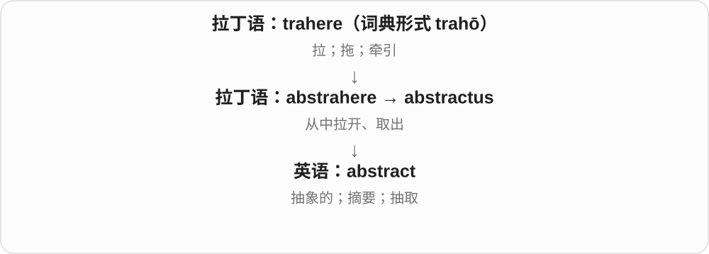

抽象思考是离开具体个体，保留关系或概念；论文摘要则从长文抽取要点。抽象画也不以照搬可辨认的具体物象为主要目标。

**常见搭配与例句**

an abstract idea；abstract art；read the abstract；abstract information from… 。

> The teacher used coins to explain an abstract idea.

老师用硬币来解释一个抽象概念。

> Read the abstract before deciding whether to study the full paper.

先读摘要，再决定是否研究整篇论文。

**别混淆**

abstract 是脱离具体个体或形象；vague 是说不清楚。一个抽象概念仍然可以定义得很清楚。

### 42. abstraction — 抽象；抽象概念；提炼共同点

**音标**：/əbˈstrækʃən/

**先抓住这个画面**

abstraction 就是把不需要的细节暂时拿走，留下你眼下要研究的那一层。

**怎么拆**

来自中古法语 abstraction 或中世纪拉丁语 abstrāctiō“分离”，现代可对照 abstract + -ion。

**怎么变成今天的意思**

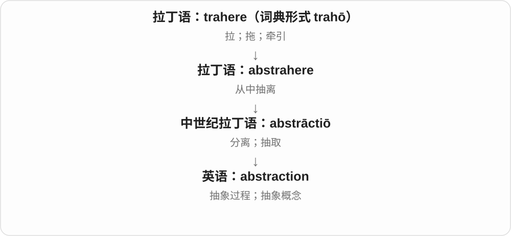

它可以指抽离细节的过程，也可以指得到的概念。地图省掉每棵树，保留道路关系，就是容易理解的抽象画面。

**常见搭配与例句**

a level of abstraction；an abstract concept / an abstraction；abstraction from detail。

> A subway map is a useful abstraction of the city’s transport network.

地铁图是对城市交通网络的一种有用抽象。

> The discussion stayed at a high level of abstraction.

讨论一直停留在很抽象的层面。

**别混淆**

abstraction 是有选择地忽略细节；oversimplification 是省略得过头，导致判断失真。抽象并不必然错误。

### 43. abstracted — 心不在焉的；走神的

**音标**：/əbˈstræktɪd/

**先抓住这个画面**

abstracted 像人的身体还在这里，心思已经被抽到别处，别人说话都没听进去。

**怎么拆**

abstract + -ed。作形容词时，“被抽离”落在注意力上；也可按动词分词理解为已经提取的。

**怎么变成今天的意思**

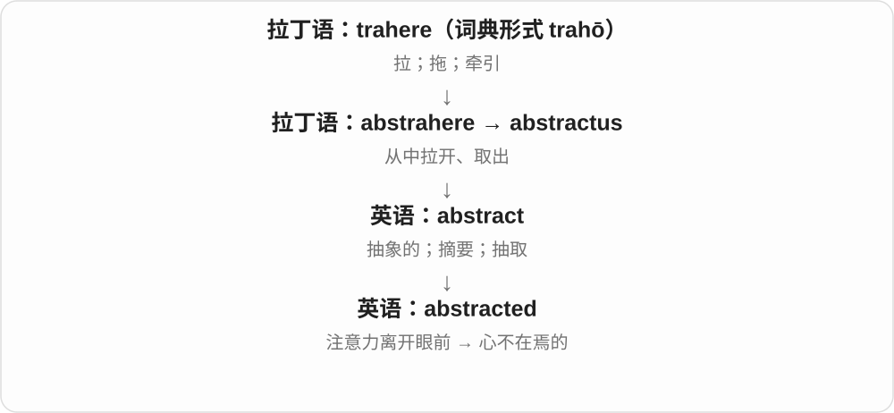

这是比 abstract“抽象的”更具体的人物状态。文学描写常用 an abstracted look：眼睛看着前方，人却在想别的事。

**常见搭配与例句**

an abstracted look；an abstracted smile；seem abstracted。

> He gave an abstracted smile and returned to his calculations.

他心不在焉地笑了笑，又继续计算。

> She seemed abstracted during dinner, barely hearing the conversation.

吃晚饭时她显得心不在焉，几乎没听到大家在说什么。

**别混淆**

abstract 描述概念；abstracted 常描述人的神情。distracted 更常见，abstracted 比较书面。

### 44. abstractly — 抽象地；离开具体情况地

**音标**：/æbˈstræktli/

**先抓住这个画面**

abstractly 是只讨论概念和原则，暂时不落到某个具体的人、数字或现场。

**怎么拆**

abstract + -ly，把形容词变成说明思考、讨论方式的副词。

**怎么变成今天的意思**

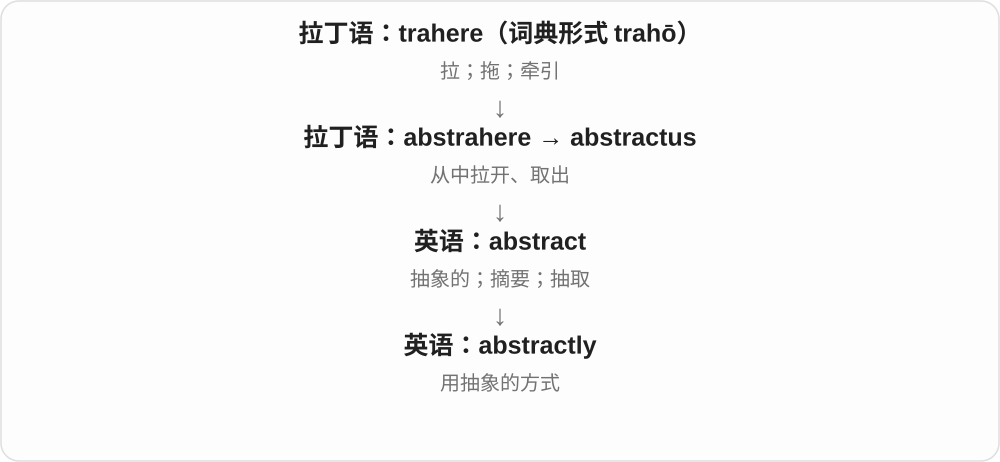

它并不等于“随便说说”。你可以严密地讨论一个模型，只是还没有给它具体实例。

**常见搭配与例句**

think abstractly；speak abstractly；discuss something abstractly。

> Children gradually learn to think abstractly.

孩子们逐渐学会抽象思考。

> We discussed fairness abstractly before examining a real case.

我们先从抽象层面讨论公平，再分析一个真实案例。

**别混淆**

abstractly 是不依附具体实例；theoretically 常强调按理论推演，或与实际情况作比较。两者有交集，但不完全相同。

### 45. extract — 提取；拔出；摘录；提取物

**音标**：动词 /ɪkˈstrækt/；名词 /ˈekstrækt/

**先抓住这个画面**

extract 是从里面把目标拿出来：从牙床拔牙，从植物提取物质，从长文摘出一段。

**怎么拆**

ex-（向外）+ trahere（拉）形成 extrahere，相关形式 extractum 进入英语。

**怎么变成今天的意思**

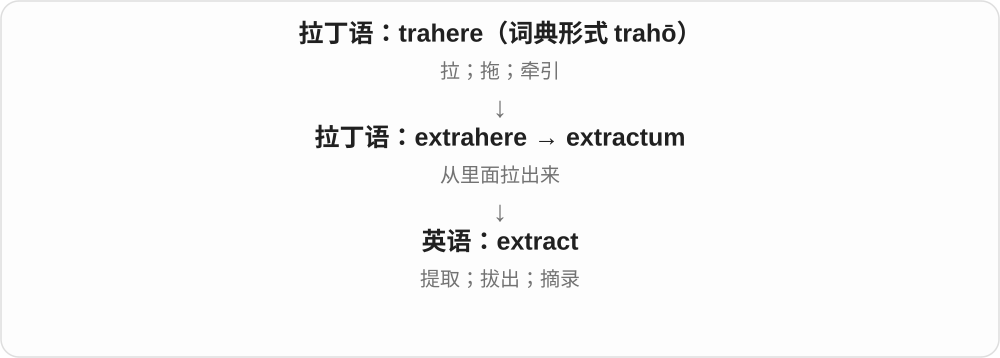

动作未必真要用力拉；现代数据处理中，extract 也能说把需要的数据取出来。名词可以指取出的物质或文章片段。

**常见搭配与例句**

extract data from…；extract a tooth；vanilla extract；an extract from a novel。

> The program extracts dates from the documents.

这个程序从文档中提取日期。

> We read an extract from her latest novel.

我们读了她最新小说中的一个片段。

**别混淆**

extract 常强调从更大整体中取出某部分；remove 只说移走。名词重音在前，动词在后。

### 46. extraction — 提取；取出；出身

**音标**：/ɪkˈstrækʃən/

**先抓住这个画面**

extraction 把“从某个来源取出来”变成一个过程：提取数据、开采资源、拔出牙齿。

**怎么拆**

经古法语 estraction，来自中世纪拉丁语 extractiō；现代可对照 extract + -ion。

**怎么变成今天的意思**

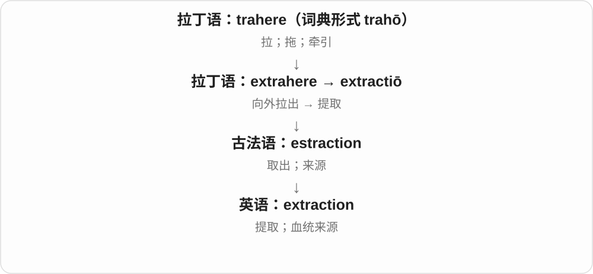

它通常谈取出过程；较正式的 of Irish extraction 则谈祖先来自哪里，是“来源”这一支，不是在说把谁从土地里拔出来。

**常见搭配与例句**

data extraction；oil extraction；tooth extraction；of mixed extraction。

> The team automated the extraction of names from the records.

团队把从记录中提取姓名的工作自动化了。

> Her grandparents were of Italian extraction.

她的祖父母具有意大利血统。

**别混淆**

extract 可以是得到的提取物；extraction 通常是提取过程。两者一个常看结果，一个常看动作。

### 47. extracted — 提取了；取出了；摘取了

**音标**：英、美 /ɪkˈstræktɪd/

**先抓住这个画面**

东西藏在一大块材料里面，把需要的部分取出来，就是 extracted。可以取出颜色、信息、数字，也可以从文章里摘出一段话。

**怎么拆**

extract + 完整 -ed → extracted，/t/ 后读 /ɪd/。ex- 向外 + tract- 拉；接拉丁 extrahere 拉出，其分词 extractus 提供英语形式材料。

**怎么变成今天的意思**

**拉丁 ex- + trahere 拉 → extrahere、extractus → extract**  
字面拉出，英语也广泛用于抽取、取得

↓

**extract + -ed → extracted**  
现代实体材料、数据、文字都能成为提取对象

extracted from 是从……提取；extracted data 是提取的数据；extracted a passage 是摘出了一段文字。

**常见搭配与例句**

extracted from；extracted data；extracted a passage。

> The program extracted the dates from the document.

程序从文档中提取了日期。

> The colour was extracted from the leaves.

颜色是从叶片中提取的。

**别混淆**

extracted 强调从原来包含它的东西里取出所需部分；copied 强调做出一份副本。数据可以先被 extracted，再被 copied 到另一份文件。

### 48. extracts — 摘录；提取物〔复数〕；提取、取出〔第三人称单数〕

**音标**：名词：英、美 /ˈekstrækts/；动词：英、美 /ɪkˈstrækts/

**先抓住这个画面**

从一大块内容、材料里，把需要的那部分拿出来，是 extract。拿出来的文字是摘录，拿出来的成分是提取物。

**怎么拆**

extract + -s → extracts，末尾 /kts/。接拉丁 ex- 向外 + trahere 拉 → extrahere，分词词干 extract-；名词通常前重音，动词后重音。

**怎么变成今天的意思**

**拉丁 extrahere 拉出 → extractus → extract**  
具体取出与抽出信息等用法共同发展

↓

**摘录、提取物名词与提取动词 + -s → extracts**  
现代读音随词性变化

extracts from a book 是书中摘录；plant extracts 是植物提取物；extracts data 是提取数据。

**常见搭配与例句**

extracts from a book；plant extracts；extracts data。

> The lesson includes extracts from three novels.

课文里有三部小说的节选。

> The program extracts dates from the documents.

程序从文档中提取日期。

**别混淆**

extracts 说文字时是从较长作品取出的片段，summaries 则是重新概括的摘要。软件 extracts data 可以按字段提取，并非一定逐字摘录一整段。

### 49. trait — 特点；特征

**音标**：/treɪt/

**先抓住这个画面**

trait 像画像里一笔让人认出对象的线条：耐心、爱冒险，或某种遗传特征，都是能描述它的特点。

**怎么拆**

来自法语 trait“线条、特征”，追溯到拉丁语 tractus“拉、画出的线”，属于 trahere。

**怎么变成今天的意思**

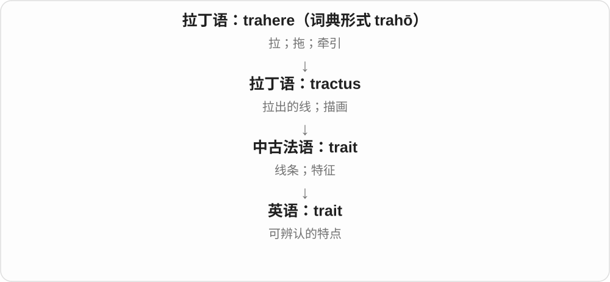

从画面上的线条发展到人物的特征，再扩展到性格、生物等方面。这是有词源根据的联系，但不是说性格真的由一根线决定。

**常见搭配与例句**

a personality trait；a genetic trait；share a trait；an inherited trait。

> Patience is one of her strongest traits.

耐心是她最突出的性格特点之一。

> The researchers studied how the trait passed between generations.

研究人员考察了这一特征如何在代际之间传递。

**别混淆**

trait 是一个特点；character 常指整体性格，也可以指人物。trait 和 traitor“叛徒”不能因拼写接近就合成同一来源。

### 50. traits — 特征、特质〔复数〕

**音标**：/treɪts/

**先抓住这个画面**

观察一个人或事物，能反复认出来的特点，是 traits。像画肖像时留下几条有辨识度的线，把它和别的对象区分开。

**怎么拆**

trait 借法语 trait 线条、特征，较早接拉丁 tractus 拉、画出的线，连 trahere。现代直接加 -s，常用读法保留词干 /t/，尾 /ts/。

**怎么变成今天的意思**

**拉丁 tractus → 法语 trait → 英语 trait**  
拉出、画出的线 → 可辨认的特征

↓

**trait + -s → traits**  
多个特点、特质

personality traits 性格特质；shared traits 共同特点；distinctive traits 显著特征。

**常见搭配与例句**

inherited traits 遗传特征；traits of the character 角色的特点。

> Patience is one of her most noticeable traits.

耐心是她最明显的特质之一。

> The two designs share several traits.

这两个设计有几个共同特点。

**别混淆**

traits 可以说人的性格，也可以说生物或事物的特征。不是所有 traits 都由遗传决定，具体成因要由内容说明。

### 51. distract — 使分心；转移注意力

**音标**：/dɪˈstrækt/

**先抓住这个画面**

distract 像把聚在书本上的注意力拉到手机上。东西可能没移动，心思却换了方向。

**怎么拆**

dis-（分开、向不同方向）+ trahere（拉），形成拉丁语 distrahere。这里不是“不能拉”。

**怎么变成今天的意思**

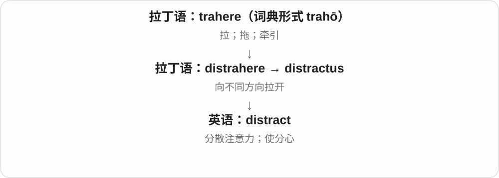

“拉开”在心理上变成分散注意。它可以妨碍工作，也可以帮助暂时忘记痛苦，所以不总是负面的。

**常见搭配与例句**

distract someone from…；be easily distracted；distract attention from… 。

> The noise distracted me from my reading.

噪声让我无法专心阅读。

> A short walk helped distract her from her worries.

散步一会儿帮助她暂时放下烦恼。

**别混淆**

attract 把注意力拉过来；distract 把注意力从原目标拉走。同一个手机通知可能同时做到这两件事。

### 52. distracted — 分心的；心神不宁的

**音标**：/dɪˈstræktɪd/

**先抓住这个画面**

distracted 描述人已经不在专注状态：手在翻页，脑子却在想另一件事。

**怎么拆**

distract + -ed，表示注意力受到转移后的状态。

**怎么变成今天的意思**

有时是外界打扰，有时是心里有事。较强的语境里它也可表示因忧虑而心烦意乱。

**常见搭配与例句**

look distracted；seem distracted；get distracted by…；distracted driving。

> He looked distracted and answered the wrong question.

他看起来心不在焉，答非所问。

> I get distracted whenever messages appear on the screen.

屏幕上一弹出消息，我就会分心。

**别混淆**

distracted 是自己分心；distracting 是会让别人分心。一个 distracted reader 可能正在受 distracting noise 影响。

### 53. distraction — 分心；干扰；消遣

**音标**：/dɪˈstrækʃən/

**先抓住这个画面**

distraction 可以是注意力被拉走的状态，也可以是那个拉走你的东西，比如响个不停的通知。

**怎么拆**

经法语 distraction，来自拉丁语 distractiō；现代可对照 distract + -ion。

**怎么变成今天的意思**

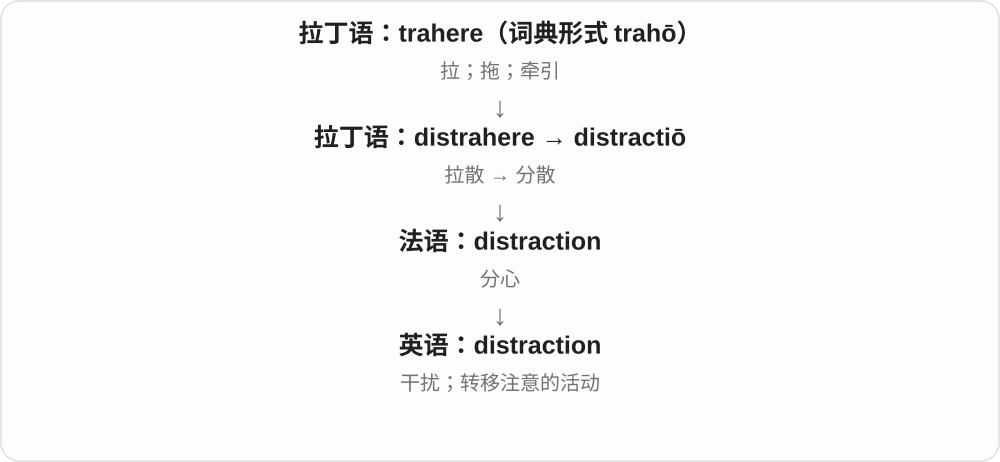

离开原来的关注点，有时是干扰，有时是休息。a welcome distraction 常是让人暂时不再忧虑的好事。

**常见搭配与例句**

avoid distractions；a distraction from…；a welcome distraction；work without distraction。

> I turned off notifications to reduce distractions.

我关闭了通知，以减少干扰。

> The children’s laughter was a welcome distraction from the long wait.

孩子们的笑声让漫长的等待不那么难熬，是一种令人愉快的消遣。

**别混淆**

interruption 强调活动被打断；distraction 强调注意力转移。人还在工作，脑子却飘走，也算 distraction。

### 54. portray — 描绘；塑造；扮演

**音标**：英 /pɔːˈtreɪ/；美 /pɔːrˈtreɪ/

**先抓住这个画面**

portray 是把某个人或事物呈现成一个形象，可以用画笔、文字、镜头，也可以用表演。

**怎么拆**

来自法语 portraire；其 por- 与拉丁语 prō- 有关，traire 来自 trahere。不要把现代拼写拆成 port“港口”与 ray“光线”。

**怎么变成今天的意思**

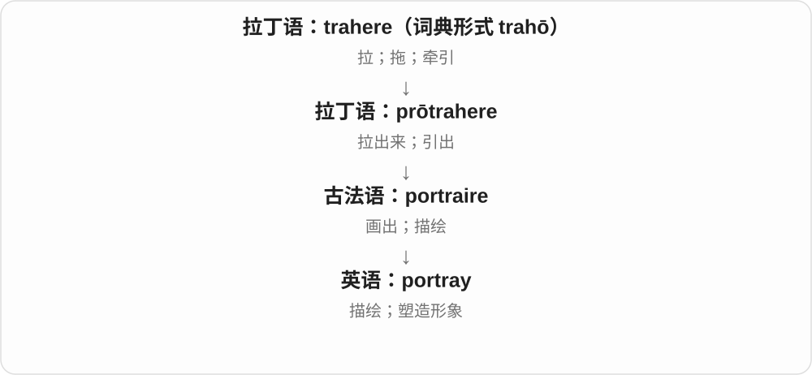

拉丁语“引出、拉出”在法语这一支发展为描画。现代既能描绘外貌，也能让读者形成某种看法，所以 portray A as B 很常见。

**常见搭配与例句**

portray someone as…；portray a character；portray daily life；accurately portray。

> The novel portrays life in a small fishing village.

小说描绘了一个小渔村的生活。

> The actor portrays a teacher who refuses to give up.

这位演员扮演一名不肯放弃的教师。

**别混淆**

portray 强调呈现出来的形象，不保证完全客观。某电影把人 portray as a hero，不等于他在现实中必然是英雄。

### 55. portrayed — 描绘了；表现为；扮演了〔过去式、过去分词〕

**音标**：英 /pɔːˈtreɪd/；美 /pɔːrˈtreɪd/

**先抓住这个画面**

画家把一个人画成形象，作家把一座城市写出来，演员把一个角色演出来，都能用 portrayed。核心是把某个形象呈现给别人。

**怎么拆**

portray + -ed → portrayed，ay 是元音字母 + y，保留 y 直接加 -ed，读 /d/。portray 经法语 portraire 接向外、画出的材料，远有拉丁 trahere 拉、引出。

**怎么变成今天的意思**

**拉丁拉、引出的材料 → 法语 portraire 画、描绘**  
把形象勾出来的词线

↓

**英语 portray + -ed → portrayed**  
描写、表现、扮演的过去式或过去分词

portrayed the city 是描绘城市；portrayed him as kind 是把他表现得很友善；portrayed a teacher 是扮演教师角色。

**常见搭配与例句**

portrayed the city；portrayed him as kind；portrayed a teacher。

> The novel portrayed the city as lively and crowded.

小说把这座城市描绘得热闹拥挤。

> She portrayed a teacher in the film.

她在电影里扮演一位教师。

**别混淆**

portray 不保证所呈现形象完全等于事实；小说、报道、表演都可能从某个角度表现对象。这里是在讲呈现方式。

### 56. traction — 牵引力；抓地力；逐渐获得的支持或进展

**音标**：/ˈtrækʃən/

**先抓住这个画面**

traction 先想轮胎抓住地面，车才能向前。引申到计划，就是终于有了能让它推进的支持和响应。

**怎么拆**

来自中世纪拉丁语 tractiō，基础是 trahere 的相关词干 tract-，加动作名词结尾。

**怎么变成今天的意思**

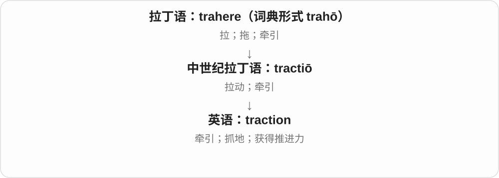

汽车语境关注轮胎是否能把动力传到地面；get traction 则借这个画面形容主意开始被接受、产品开始有人用。

**常见搭配与例句**

lose traction；improve traction；gain traction；a proposal that gets traction。

> The tires lost traction on the icy road.

轮胎在结冰的路面上失去了抓地力。

> The idea began to gain traction among local businesses.

这个想法开始得到当地企业的支持。

**别混淆**

traction 与 speed 不同：有抓地力才容易加速，但抓地力本身不是速度。抽象义也强调起作用、有人响应，不保证已经成功。

### 57. tractor — 拖拉机；牵引车

**音标**：英 /ˈtræktə/；美 /ˈtræktər/

**先抓住这个画面**

tractor 是能把其他东西拖着走的机器：在农田里拉犁，在其他场景也可牵引重物。

**怎么拆**

以拉丁语 tract-“拉”的相关词干加 -or 形成；-or 在这里指执行动作的机器。

**怎么变成今天的意思**

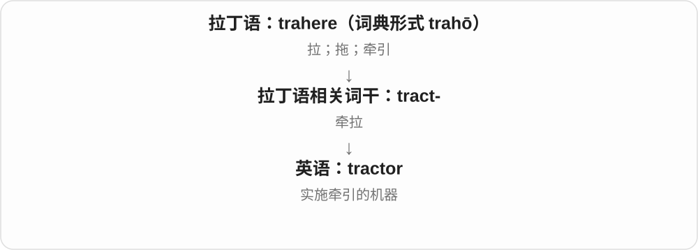

它的名称首先来自工作方式，而不只是使用地点。农用拖拉机最熟悉，但“牵引车辆”的范围更广。

**常见搭配与例句**

drive a tractor；a farm tractor；a tractor pulling a plough。

> The tractor pulled a plough across the field.

拖拉机拉着犁穿过田地。

> A small tractor moved the heavy equipment into position.

一辆小型牵引车把重型设备拉到了指定位置。

**别混淆**

tractor 强调牵引；trailer 通常是被拖着走的拖车。一个负责拉，一个被拉。

### 58. trainers — 教练，培训师〔复数〕；运动鞋〔常见英式用法〕；训练设备〔复数〕

**音标**：英 /ˈtreɪnəz/；美 /ˈtreɪnɚz/

**先抓住这个画面**

健身房里的 trainers 可以是教练；脚上 a pair of trainers 则是运动鞋。共享训练这个用途，具体是人还是鞋，要看搭配。

**怎么拆**

train 训练 + -er → trainer；加 -s → trainers。人的用法是训练者，鞋、设备的用法接训练用途，不必讲成教练后来变成鞋。

**怎么变成今天的意思**

**train + -er → trainer**  
训练的人，也可用于训练的设备

↓

**训练用鞋的命名 → trainer、trainers**  
鞋义在英式日常常见

↓

**trainer + -s → trainers**  
教练等的复数；一双鞋常用 a pair 来数

fitness trainers 是健身教练；a pair of trainers 是一双运动鞋；flight trainers 可能指飞行训练设备，需看上下文。

**常见搭配与例句**

fitness trainers；a pair of trainers；experienced trainers。

> The new staff met their trainers on Monday.

新员工周一见了培训师。

> I put on my trainers before going for a walk.

出门散步前，我穿上了运动鞋。

**别混淆**

运动鞋义常对应美式 sneakers；职业人物义与地区鞋名要分开，不把所有 trainers 都译成培训师。

### 59. protracted — 拖延很久的；持续过长的

**音标**：英 /prəˈtræktɪd/；美 /proʊˈtræktɪd/

**先抓住这个画面**

protracted 像一条本该很短的时间线，被一直向后拉，迟迟没有结束。

**怎么拆**

protract + -ed；protract 的来源包括拉丁语 prōtrahere“向前拉出、延长”的相关形式，也有从 protraction 逆构的历史。

**怎么变成今天的意思**

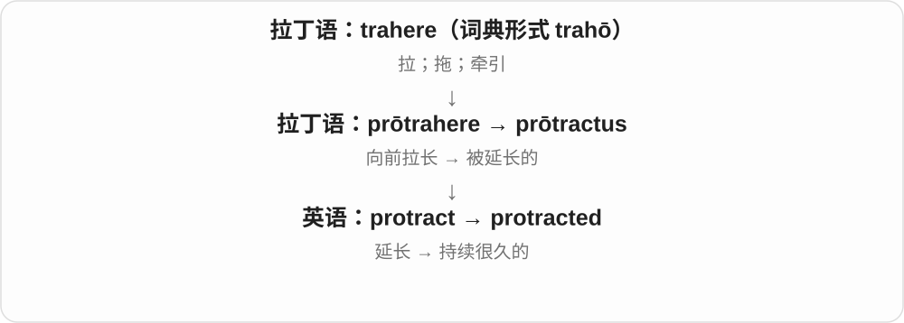

它把拉长的对象换成时间，常用于谈判、争执和困难过程。一般暗示比预期或希望的更久。

**常见搭配与例句**

protracted negotiations；a protracted dispute；a protracted struggle；a protracted delay。

> After protracted negotiations, the two sides reached an agreement.

经过长时间的谈判，双方终于达成一致。

> The repair turned into a protracted and expensive project.

这次维修变成了一个拖延很久、费用高昂的项目。

**别混淆**

long 只说长；protracted 常让人感觉事情被拖着，结束得太慢。不是所有长久的幸福都适合用它。

### 60. subtract — 减去；扣除

**音标**：/səbˈtrækt/

**先抓住这个画面**

subtract 像从一堆筹码里拿走几枚：总量因此变少。

**怎么拆**

sub-（在下）+ trahere（拉）形成 subtrahere，历史意思包括从下面抽走、移除；相关形式 subtractus 进入英语。

**怎么变成今天的意思**

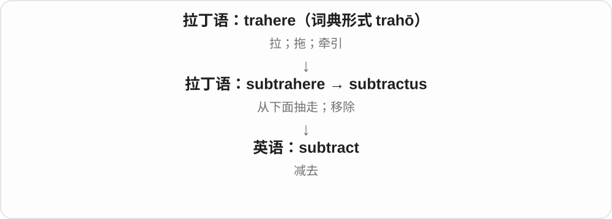

具体的“拿走”很容易进入算术：从原数移除一部分。现代不必真从下面抽，sub- 只是历史构词线索。

**常见搭配与例句**

subtract A from B（从 B 中减去 A）；subtract the cost；subtract five from twelve。

> Subtract seven from twenty to get thirteen.

二十减七，得到十三。

> We subtracted the delivery charge from the total.

我们从总额中扣除了运费。

**别混淆**

subtract A from B 的计算顺序是 B − A，不是 A − B。deduct 更常用于从应付金额或税额中扣除。

### 61. subtraction — 减法；减去；扣除

**音标**：/səbˈtrækʃən/

**先抓住这个画面**

subtraction 讨论的是“从原数拿走一部分”这个运算，而不是被拿走的那个数字。

**怎么拆**

来自晚期拉丁语 subtractiō；现代可拆解理解为 subtract + -ion。

**怎么变成今天的意思**

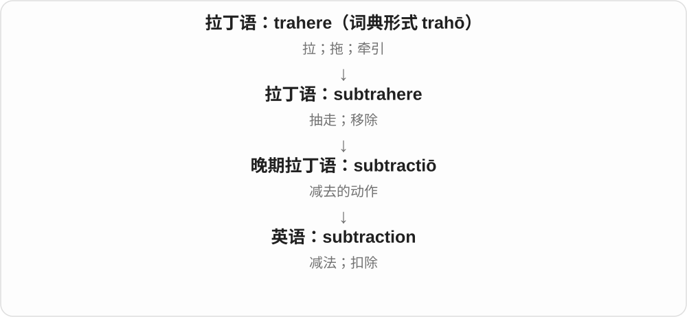

subtract 是动词“减去”，subtraction 是名词“减法或减去过程”。它也能用于材料、数量的减少，不只用于课本。

**常见搭配与例句**

addition and subtraction；a subtraction problem；subtraction of expenses。

> The children practiced subtraction with small blocks.

孩子们用小积木练习减法。

> The final amount is calculated by subtraction of the expenses.

最后的金额通过扣除各项支出来计算。

**别混淆**

subtraction 是减去的操作；difference 可以是相减后的差。做减法和所得结果要分开。

### 62. subtractive — 通过减去实现的；减法的

**音标**：/səbˈtræktɪv/

**先抓住这个画面**

subtractive 像从一块木头里刻出雕像：结果靠拿掉材料得到，不靠不断往上加。

**怎么拆**

subtract + -ive，表示与减去有关、通过减去来实现的。

**怎么变成今天的意思**

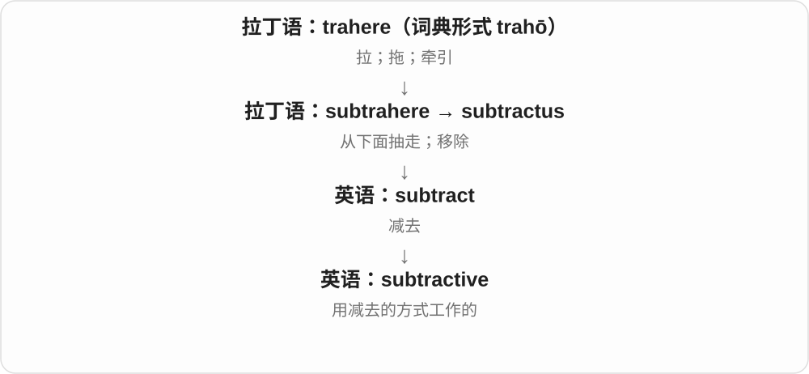

这个思路可用于加工，也可用于颜色：颜料会吸收一部分光，混色涉及从反射光中减掉某些成分，因此叫 subtractive mixing。

**常见搭配与例句**

subtractive manufacturing；subtractive color mixing；a subtractive process。

> Carving is a subtractive process because material is removed.

雕刻是一种减材过程，因为它通过去除材料成形。

> The class compared additive and subtractive color mixing.

课堂比较了加色混合与减色混合。

**别混淆**

additive 是不断增加；subtractive 是不断拿走。3D 打印常是前者，切削一整块材料常是后者。

### 63. retract — 缩回；收回言论；撤回

**音标**：/rɪˈtrækt/

**先抓住这个画面**

retract 是把已经伸出去的东西拉回来：猫收起爪子，人收回先前说过的话。

**怎么拆**

re-（回）+ trahere（拉）形成 retrahere；言论撤回义也联系到拉丁语 retractāre，经法语 rétracter 传入。两条路线同属“拉”的词族。

**怎么变成今天的意思**

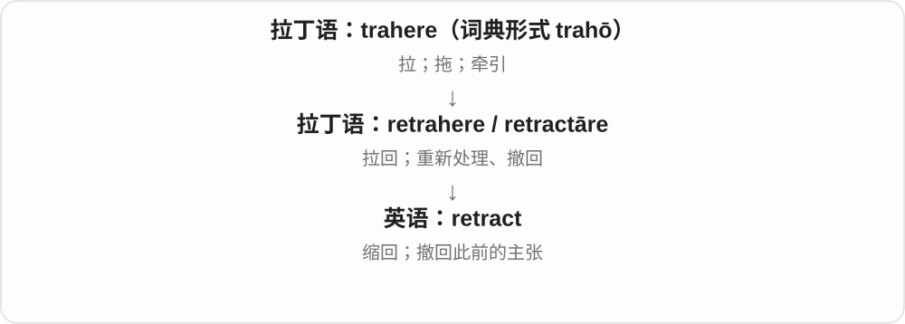

物理缩回和撤回主张共享“收回”的画面。撤回不等于自动修复后果，只是表示不再维持原来的说法。

**常见搭配与例句**

retract a statement；retract a claim；retract the landing gear；retract one’s claws。

> The newspaper retracted its claim after checking the records.

报纸核对记录后撤回了原来的说法。

> The aircraft retracted its landing gear after takeoff.

飞机起飞后收起了起落架。

**别混淆**

retract 是收回；deny 是否认。一个人可以 deny making a statement，声称自己根本没说过，并非 retract 已承认说过的话。

### 64. retraction — 收回；撤回声明；缩回

**音标**：/rɪˈtrækʃən/

**先抓住这个画面**

retraction 是收回这个动作，也可以是正式说明“先前那段内容不再成立”的声明。

**怎么拆**

现代可对照 retract + -ion；也可见 re- 与 traction 的结构联系。实际用法要沿 retract“收回”理解。

**怎么变成今天的意思**

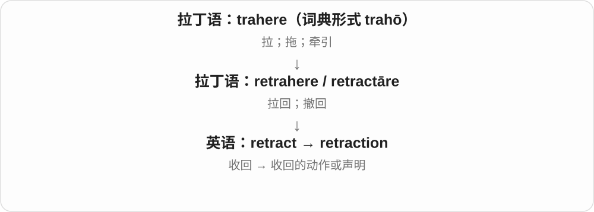

在机构、媒体和学术场景里，它常指纠正已公开内容的撤回。机械里的 retraction 则仍是很直接的缩回。

**常见搭配与例句**

issue a retraction；publish a retraction；demand a retraction；retraction of the landing gear。

> The journal published a retraction of the article.

期刊发表声明，撤回了那篇文章。

> The mechanism allows smooth retraction of the cable.

这个机构能让电缆平稳地收回。

**别混淆**

correction 可以只修改错误部分；retraction 通常意味着撤回相关内容。是否撤回全文，要看具体声明。

### 65. detract — 减损；贬低

**音标**：/dɪˈtrækt/

**先抓住这个画面**

detract 常像从一个优点上拿走一点分数：小瑕疵没有毁掉整件事，却让它没那么好。

**怎么拆**

de-（向下、离开）+ trahere 形成拉丁语 detrahere“拉走、减少”；经法语 détracter 传来。

**怎么变成今天的意思**

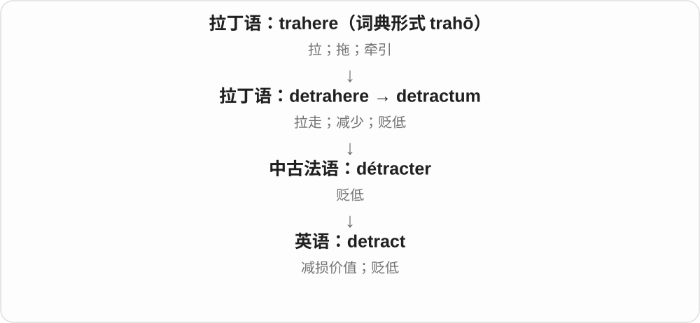

现代最常见 detract from：某事使总体价值或效果有所下降。早期的“拉走”不必理解成实际拿走一块物体。

**常见搭配与例句**

detract from the value；detract from the achievement；nothing to detract from… 。

> A few scratches do not detract from the table’s beauty.

几道划痕并不减损这张桌子的美。

> The delay should not detract from what the team achieved.

这次延误不应掩盖或贬低团队取得的成果。

**别混淆**

detract from 是减损价值；distract from 是转移注意力。噪声可以 distract you，也可能 detract from an otherwise enjoyable visit。

### 66. tractable — 容易处理的；易管理的；可求解的

**音标**：/ˈtræktəbəl/

**先抓住这个画面**

tractable 像一个能理顺的结：找到办法后，就能操作、解决或控制。

**怎么拆**

来自拉丁语 tractābilis，基础 tractāre 有处理、管理的意思。不是“能被拖着走”就涵盖所有现代义。

**怎么变成今天的意思**

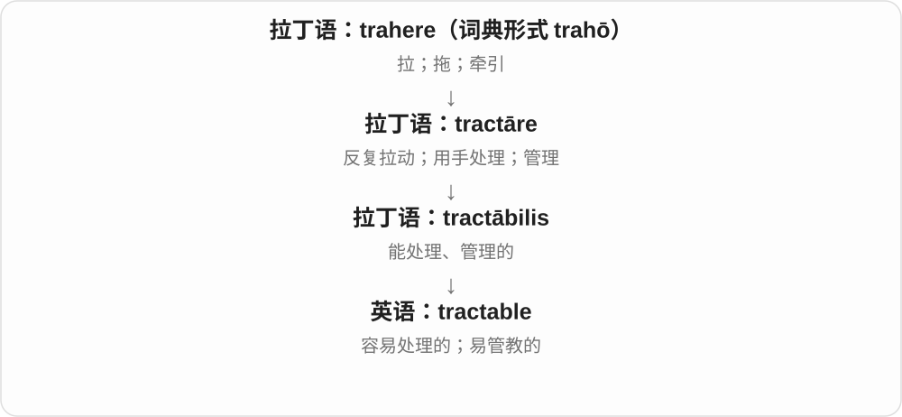

从用手处理东西，到管理人和解决问题，词义逐渐抽象。现代技术语境常说问题在计算或推理上可以处理。

**常见搭配与例句**

a tractable problem；make a problem tractable；a tractable model；a tractable child（较书面）。

> Breaking the task into smaller parts made it tractable.

把任务拆成小部分后，它就容易处理了。

> The new method produces a mathematically tractable model.

新方法得到一个在数学上便于分析的模型。

**别混淆**

tractable 是便于处理；trivial 是太简单或不重要。一个 tractable problem 仍可能需要认真工作。

### 67. intractable — 难以处理的；棘手的；难以改变的

**音标**：/ɪnˈtræktəbəl/

**先抓住这个画面**

intractable 像怎么拉都理不开的结：换了几种办法，问题仍然不动。

**怎么拆**

in-（不）+ tractable（容易处理的）。这次 in- 是否定，和 inflict 那种方向前缀不同。

**怎么变成今天的意思**

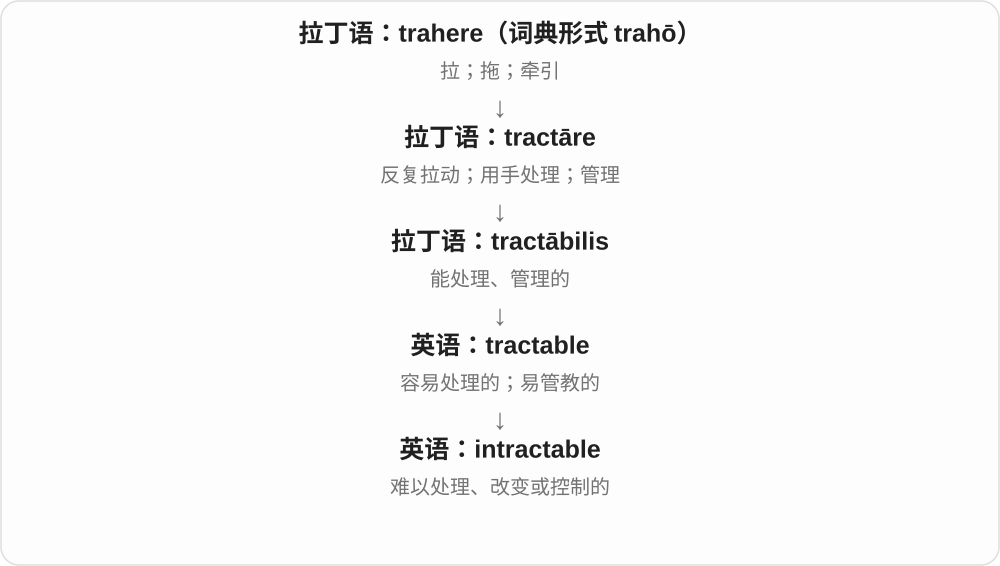

它常说长期棘手的问题、难以控制的疼痛或固执的人。重点是处理困难，不是在严格证明永远没有解。

**常见搭配与例句**

an intractable problem；intractable pain；an intractable dispute；remain intractable。

> The talks stalled over several intractable issues.

谈判因几个难解的问题陷入停滞。

> The project turned a seemingly intractable problem into a manageable one.

这个项目把一个看似无从下手的问题变成了可以处理的问题。

**别混淆**

difficult 的范围很广；intractable 更突出多次努力也难以解决。unsolvable 才更直接说不可解决。

### 68. subtrahend — 减数

**音标**：/ˈsʌbtrəhend/

**先抓住这个画面**

在 12 − 5 = 7 里，subtrahend 是 5：它就是准备从原数中拿走的那一份。

**怎么拆**

来自拉丁语 subtrahendus numerus“要被减去的数”。词尾保留拉丁语“应被做某事”的形式，不是英语单词 end。

**怎么变成今天的意思**

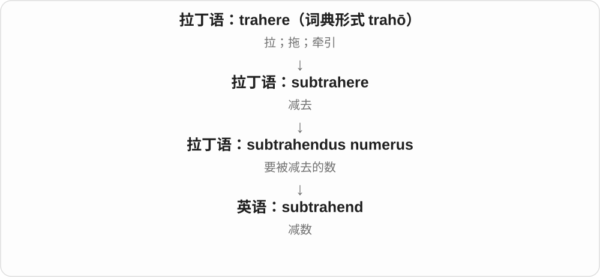

它给减法中的一个角色命名。原来的数是 minuend“被减数”，拿走的是 subtrahend“减数”，余下的是 difference“差”。

**常见搭配与例句**

the minuend and the subtrahend；identify the subtrahend；subtract the subtrahend from the minuend。

> In twelve minus five, five is the subtrahend.

在十二减五中，五是减数。

> Keep the minuend fixed and increase the subtrahend by one.

保持被减数不变，把减数加一。

**别混淆**

中文“被减数”容易造成方向误会：被减数是起点，减数才是要扣掉的那部分。

## 这一组要分清什么

**attract / distract / detract**：attract 把注意力拉过来；distract 把注意力从原目标拉走；detract from 则说减损价值或效果。

**abstract / extract**：abstract 常抽离细节、留下概念；extract 常从整体取出目标部分。两者都含“抽出”，实际任务不同。

**treat / treaty / treatise** 同属历史上的处理、商谈词族，但今天分别常说对待或治疗、条约、专题论著。

**trait 与 traitor** 不要按拼写归在一起；traitor 属于“交出、背叛”的另一条来源。

## 串起来练习

**The app extracts useful information without distracting the reader.**

这个应用提取有用的信息，又不会让读者分心。extract 是把需要的部分取出，distract 是把注意力从原本的任务拉走。
