# 0185 · val- — 有力量、有效；值得、有价值；健康

[逐词精讲目录](../00_逐词精讲目录.md) · [总目录](../00_总目录_按常用程度.md)

## 核心词根与来源

拉丁语 valēre 表示强健、有力量，也表示有效、有用、值得。它经法语 valoir 形成 value、avail 等支线；经拉丁语 validus 留下 valid；经 praevalēre 留下 prevail。勇气、康复、等值与化学价都能联系到力量或作用，但每个词的实际意思要按自己的演化路线理解。

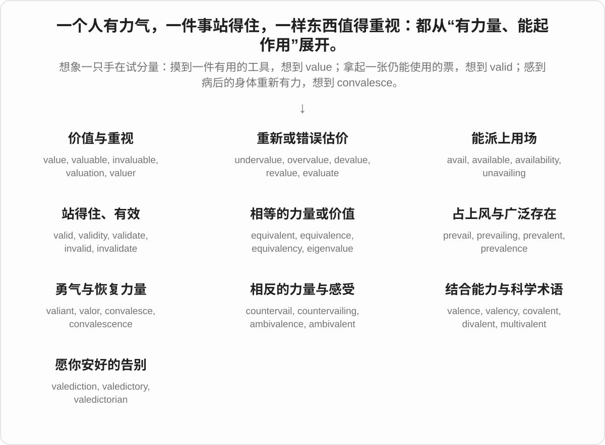

## 词形与演化规律

val- 常见于 value、valid；avail、prevail 中的 -vail 来自法语阶段的词形；-valent、-valence 与拉丁语 valēns、valentia 相连。convalesce 的 -valesc- 表示逐渐变强。valedict- 中的 valē 原来是“愿你安好”，加上“说”才成了道别。

## 单词速览（按词族由简到繁）

同一基础词的相关扩展放在一起，先读基础形式，再读扩展；各组之间优先读常用的。具体词源关系见各词讲解。

| 单词 | 音标 | 核心意思 |
|---|---|---|
| [avail](#w-16) | 英、美 /əˈveɪl/ | 有用、有帮助；利用；用处 |
| [available](#w-1) | 英、美 /əˈveɪləbəl/ | 可获得、可使用的；有空的 |
| [availability](#w-7) | 英、美 /əˌveɪləˈbɪləti/ | 可获得性；有货、可用情况；空闲时间 |
| [unavailable](#w-15) | 英、美 /ˌʌnəˈveɪləbəl/ | 无法获得或使用的；没有空的 |
| [unavailing](#w-63) | 英、美 /ˌʌnəˈveɪlɪŋ/ | 无效的；徒劳的 |
| [value](#w-2) | 英、美 /ˈvæljuː/ | 价值；数值；重视；估价；价值观〔values〕 |
| [valuable](#w-3) | 英、美 /ˈvæljuəbəl/ | 有价值的；贵重的；很有用的 |
| [invaluable](#w-19) | 英、美 /ɪnˈvæljuəbəl/ | 极有价值的；帮助极大的 |
| [valuation](#w-11) | 英、美 /ˌvæljuˈeɪʃən/ | 估价；评估价值；估出的金额 |
| [revaluation](#w-40) | 英、美 /ˌriːvæljuˈeɪʃən/ | 重新估价；重新评价；货币升值调整 |
| [valueless](#w-49) | 英、美 /ˈvæljuːləs/ | 没有价值的；没有用处的 |
| [valuer](#w-51) | 英 /ˈvæljuːə/；美 /ˈvæljuːər/ | 估价师；给物品估值的人 |
| [devalue](#w-34) | 英、美 /ˌdiːˈvæljuː/ | 使贬值；降低价值；贬低 |
| [devaluation](#w-26) | 英、美 /ˌdiːvæljuˈeɪʃən/ | 贬值；价值或评价的降低 |
| [eigenvalue](#w-42) | 英、美 /ˈaɪɡənˌvæljuː/ | 特征值 |
| [undervalue](#w-43) | 英 /ˌʌndəˈvæljuː/；美 /ˌʌndərˈvæljuː/ | 低估价值；不够重视 |
| [overvalue](#w-54) | 英 /ˌəʊvəˈvæljuː/；美 /ˌoʊvərˈvæljuː/ | 高估价值；过分重视 |
| [revalue](#w-62) | 英、美 /ˌriːˈvæljuː/ | 重新估价；重新评价价值；调高货币比价 |
| [equivalent](#w-4) | 英、美 /ɪˈkwɪvələnt/ | 等值、等效的；相当的；对应物 |
| [equivalence](#w-23) | 英、美 /ɪˈkwɪvələns/ | 等值；等价关系；相当 |
| [equivalency](#w-32) | 英、美 /ɪˈkwɪvələnsi/ | 等同、相当；同等资格 |
| [equivalently](#w-39) | 英、美 /ɪˈkwɪvələntli/ | 等价地；等效地；换个等价说法 |
| [valid](#w-5) | 英、美 /ˈvælɪd/ | 有效的；有充分根据的；符合规则的 |
| [validity](#w-12) | 英、美 /vəˈlɪdəti/ | 有效性；成立程度；有效期 |
| [validate](#w-20) | 英、美 /ˈvælɪdeɪt/ | 确认有效；验证；使生效；认可感受 |
| [validation](#w-13) | 英、美 /ˌvælɪˈdeɪʃən/ | 验证；使生效；认可、肯定 |
| [validly](#w-37) | 英、美 /ˈvælɪdli/ | 有效地；合乎规定或推理地 |
| [invalid](#w-9) | 无效义：英、美 /ɪnˈvælɪd/；病弱者及相关动词：英、美 /ˈɪnvəlɪd/ | 无效、不成立的；病弱者〔旧用语〕；因病伤使退役 |
| [invalidate](#w-25) | 英、美 /ɪnˈvælɪdeɪt/ | 使无效；推翻、否定效力 |
| [invalidation](#w-46) | 英、美 /ɪnˌvælɪˈdeɪʃən/ | 使无效；宣布无效；否定他人感受 |
| [invalidity](#w-48) | 英、美 /ˌɪnvəˈlɪdəti/ | 无效性；不成立；病弱、失能状态〔部分制度用语〕 |
| [evaluate](#w-8) | 英、美 /ɪˈvæljueɪt/ | 评估、评价；求数值 |
| [evaluation](#w-6) | 英、美 /ɪˌvæljuˈeɪʃən/ | 评估；评价过程；评估结果 |
| [evaluator](#w-38) | 英 /ɪˈvæljueɪtə/；美 /ɪˈvæljueɪtər/ | 评估者；评估程序 |
| [evaluative](#w-44) | 英、美 /ɪˈvæljuətɪv/ | 评价性的；用于评估的 |
| [reevaluate](#w-28) | 英、美 /ˌriːɪˈvæljueɪt/ | 重新评估；重新考虑 |
| [prevalent](#w-10) | 英、美 /ˈprevələnt/ | 普遍存在的；盛行的 |
| [prevalence](#w-14) | 英、美 /ˈprevələns/ | 普遍程度；盛行；患病率〔流行病学〕 |
| [prevail](#w-17) | 英、美 /prɪˈveɪl/ | 获胜；占主导；普遍存在；说服成功 |
| [prevailing](#w-18) | 英、美 /prɪˈveɪlɪŋ/ | 占主导的；普遍的；现行的 |
| [valiant](#w-21) | 英、美 /ˈvæliənt/ | 勇敢的；顽强努力的 |
| [valiantly](#w-35) | 英、美 /ˈvæliəntli/ | 英勇地；顽强地 |
| [valor](#w-22) | 美 /ˈvælər/；英 /ˈvælə/ | 英勇；勇武〔美式拼写〕 |
| [valorous](#w-52) | 英、美 /ˈvælərəs/ | 英勇的；勇武的〔书面〕 |
| [ambivalent](#w-24) | 英、美 /æmˈbɪvələnt/ | 心情矛盾的；态度摇摆的 |
| [valour](#w-27) | 英 /ˈvælə/；美 /ˈvælər/ | 英勇；勇武〔英式拼写〕 |
| [valence](#w-29) | 英、美 /ˈveɪləns/ | 价、化合价；情绪效价；配价〔语言学〕 |
| [valency](#w-56) | 英、美 /ˈveɪlənsi/ | 化合价；动词配价 |
| [ambivalence](#w-30) | 英、美 /æmˈbɪvələns/ | 矛盾心理；又想要又抗拒的态度 |
| [valedictory](#w-50) | 英 /ˌvælɪˈdɪktəri/；美 /ˌvæləˈdɪktəri/ | 告别的；告别演说 |
| [valedictorian](#w-31) | 英、美 /ˌvælədɪkˈtɔːriən/ | 毕业典礼致辞的优秀毕业生代表 |
| [covalent](#w-33) | 英 /kəʊˈveɪlənt/；美 /koʊˈveɪlənt/ | 共价的 |
| [covalence](#w-65) | 美 /koʊˈveɪləns/ | 共价数；共价结合 |
| [convalesce](#w-59) | 英 /ˌkɒnvəˈles/；美 /ˌkɑːnvəˈles/ | 病后或术后逐渐康复；休养恢复 |
| [convalescent](#w-36) | 英 /ˌkɒnvəˈlesənt/；美 /ˌkɑːnvəˈlesənt/ | 康复期的；休养中的；康复期病人 |
| [convalescence](#w-41) | 英 /ˌkɒnvəˈlesəns/；美 /ˌkɑːnvəˈlesəns/ | 康复过程；病后休养期 |
| [divalent](#w-45) | 英、美 /daɪˈveɪlənt/ | 二价的 |
| [countervail](#w-64) | 英 /ˌkaʊntəˈveɪl/；美 /ˌkaʊntərˈveɪl/ | 抵消；抗衡〔正式〕 |
| [countervailing](#w-47) | 英 /ˌkaʊntəˈveɪlɪŋ/；美 /ˌkaʊntərˈveɪlɪŋ/ | 抵消的；起制衡作用的 |
| [trivalent](#w-53) | 英、美 /traɪˈveɪlənt/；另有 /ˈtrɪvələnt/ | 三价的；具有三个相关结合位置的 |
| [monovalent](#w-55) | 英 /ˌmɒnəʊˈveɪlənt/；美 /ˌmɑːnoʊˈveɪlənt/ | 单价的；一价的；只针对一种对象的〔免疫学〕 |
| [polyvalent](#w-57) | 英 /ˌpɒlɪˈveɪlənt/；美 /ˌpɑːliˈveɪlənt/；另有 /pəˈlɪvələnt/ | 多价的；能针对多种对象发挥作用的 |
| [multivalent](#w-58) | 英、美 /ˌmʌltɪˈveɪlənt/ | 多价的；具有多重意义或作用的 |
| [bivalent](#w-60) | 英、美 /baɪˈveɪlənt/；另有 /ˈbɪvələnt/ | 二价的；成对的；二价体〔遗传学〕 |
| [valediction](#w-61) | /ˌvælɪˈdɪkʃən/ | 告别的话；辞别 |

## 逐词讲解

### 1. avail — 有用、有帮助；利用；用处

**音标**：英、美 /əˈveɪl/

**先抓住这个画面**

某个办法有没有帮上忙、产生作用，正是 avail 最核心的问题。

**怎么拆**

来自盎格鲁法语相关形式：a- + valoir 的 vaill- 词干，更早是 valēre“有力量、有用”。

**怎么变成今天的意思**

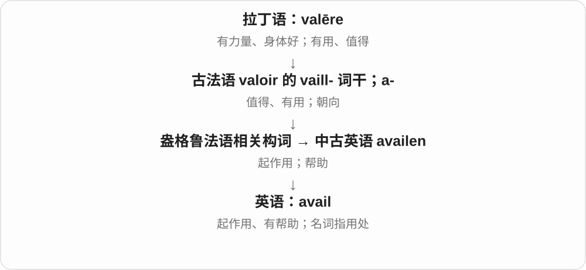

现代常见 to no avail“没有奏效”、of little avail“没多少用”。avail yourself of an opportunity 是较正式地说利用机会，yourself 不能随意省掉。

**常见搭配与例句**

to no avail；of little avail；avail oneself of…。

> We searched the attic for hours, but to no avail.

我们在阁楼找了几个小时，却一无所获。

> Students may avail themselves of the free tutoring service.

学生可以利用免费的辅导服务。

**别混淆**

use 是日常“使用”；avail 作为独立动词较正式，很多时候靠固定搭配出现。

### 2. available — 可获得、可使用的；有空的

**音标**：英、美 /əˈveɪləbəl/

**先抓住这个画面**

东西在那里，并且你现在有机会拿来用；说人 available，则通常是他有时间回应或参加。

**怎么拆**

avail + -able；从“能起作用、有益”发展到“可供使用、可以取得”。

**怎么变成今天的意思**

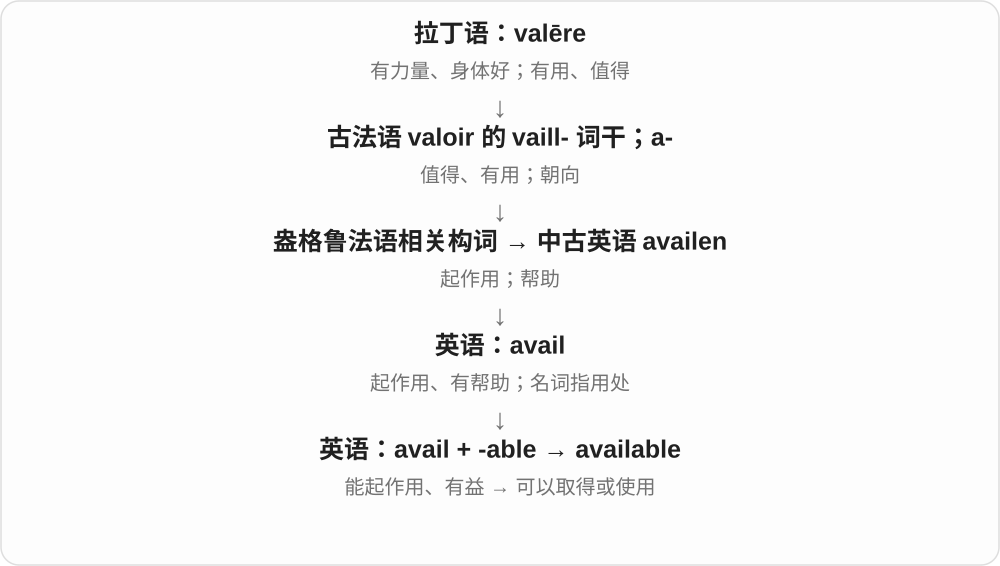

available online 是网上可获得；available for a meeting 是有空开会。东西存在不等于一定 available：可能已售完、被预约，或你没有权限。

**常见搭配与例句**

available to users；available for purchase；readily available。

> The guide is available online at no charge.

这份指南可以在网上免费获取。

> Are you available for a short meeting tomorrow?

你明天有空开个短会吗？

**别混淆**

accessible 强调能接近、能使用的便利或条件；available 强调有得用、有得取。

### 3. availability — 可获得性；有货、可用情况；空闲时间

**音标**：英、美 /əˌveɪləˈbɪləti/

**先抓住这个画面**

不只问“有没有”，还问什么时间、多少数量、哪些人能用到。

**怎么拆**

available 的 -able 变为 -ability，形成状态名词。

**怎么变成今天的意思**

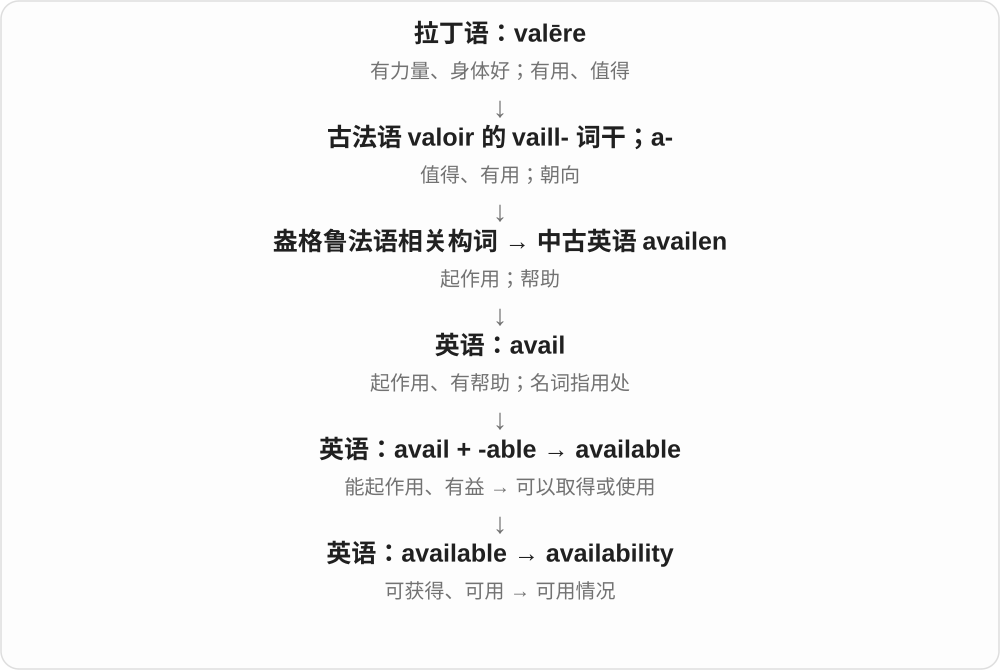

check availability 可以查房间、票或人的时间。limited availability 是供应或可用名额有限，不一定已经完全没有。

**常见搭配与例句**

check availability；subject to availability；staff availability。

> Please send me your availability for next week.

请把你下周有空的时间发给我。

> The website shows the current availability of each room.

网站显示每个房间目前是否可订。

**别混淆**

availability 看有得用的情况；affordability 看价格是否负担得起。

### 4. unavailable — 无法获得或使用的；没有空的

**音标**：英、美 /ˌʌnəˈveɪləbəl/

**先抓住这个画面**

你现在想用它、买它或联系这个人，但眼下用不了、拿不到或联系不上。

**怎么拆**

un-“不” + available。

**怎么变成今天的意思**

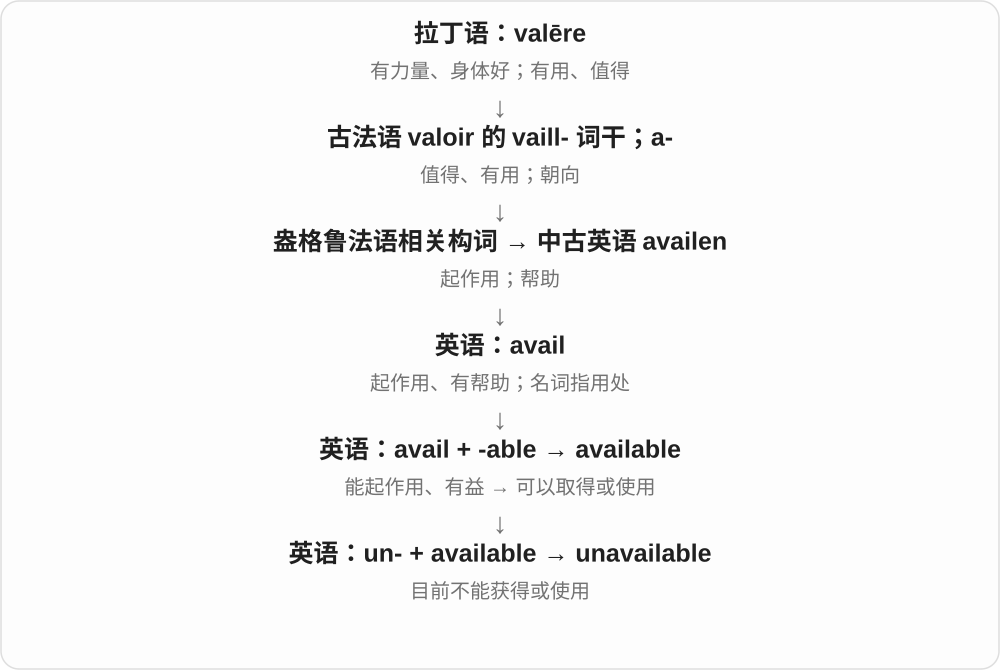

可以是暂时缺货、服务停用，也可以是人忙着。temporarily unavailable 表示暂不可用；不要自动推断东西永久消失了。

**常见搭配与例句**

temporarily unavailable；unavailable for comment；currently unavailable。

> The booking system is temporarily unavailable.

预订系统暂时无法使用。

> The manager was unavailable for comment on Tuesday.

经理周二无法接受采访作出评论。

**别混淆**

unavailable 不可用；unwilling 是不愿意，人的缺席不一定出于不愿意。

### 5. unavailing — 无效的；徒劳的

**音标**：英、美 /ˌʌnəˈveɪlɪŋ/

**先抓住这个画面**

力气花了、办法试了，但没有推动事情变好。

**怎么拆**

un-“不” + availing“起作用的”，后者来自 avail + -ing。

**怎么变成今天的意思**

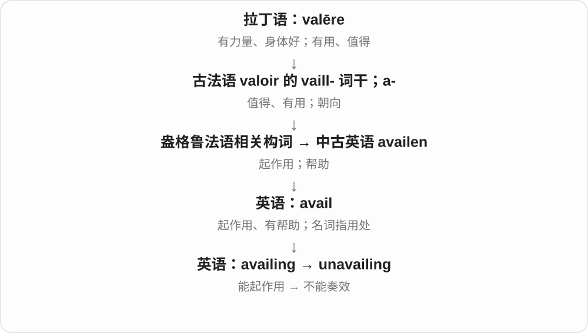

这是较正式的形容词，常修饰 effort、attempt、appeal。它评的是没有达到效果，不是在说当事人根本没努力。

**常见搭配与例句**

unavailing efforts；an unavailing attempt；prove unavailing。

> Their efforts to contact the missing courier were unavailing.

他们尝试联系失联快递员的努力没有奏效。

> She made one last, unavailing appeal for more time.

她最后一次请求多给些时间，却仍未成功。

**别混淆**

unavailable 是拿不到、用不了；unavailing 是已经尝试却不奏效。

### 6. value — 价值；数值；重视；估价；价值观〔values〕

**音标**：英、美 /ˈvæljuː/

**先抓住这个画面**

一件东西对你有多重要、有多大用处，就是它的 value。这个“分量”可以用钱表示，也可以完全不是钱。

**怎么拆**

名词经古法语 value 来自 valoir“值得”，更早是拉丁语 valēre。动词可能由名词转用，也有盎格鲁法语 valuer 的影响。

**怎么变成今天的意思**

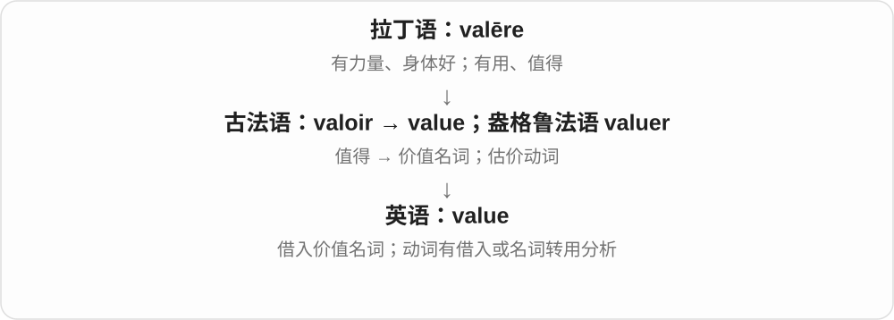

a house’s value 是房屋价值；value your advice 是重视建议；the value of x 是 x 的数值。复数 values 还指判断什么重要、什么正确的一套价值观。

**常见搭配与例句**

of great value；value something highly；market value；personal values。

> I value your honesty more than your agreement.

比起你赞同我，我更重视你的坦诚。

> The watch has little market value but great sentimental value.

这块表市场价值不高，却承载着很深的感情。

> Find the value of x when x plus three equals seven.

当 x 加三等于七时，求 x 的值。

**别混淆**

price 是标出的价格；value 是价值，价格未必准确反映它。

### 7. valuable — 有价值的；贵重的；很有用的

**音标**：英、美 /ˈvæljuəbəl/

**先抓住这个画面**

值得你花心思保存、认真听取或好好利用。可以是一颗宝石，也可以是一条省去很多麻烦的建议。

**怎么拆**

value + -able；英语派生，词尾 e 去掉后加 -able。

**怎么变成今天的意思**

valuable information 常是“很有用的信息”，不一定能卖钱。复数名词 valuables 专指珠宝等贵重物品。

**常见搭配与例句**

valuable advice；a valuable lesson；keep valuables safe。

> The interview gave us valuable information about the problem.

这次访谈给了我们关于这个问题的重要信息。

> Please keep your valuables with you during the journey.

旅途中请随身保管贵重物品。

**别混淆**

expensive 是价格高；valuable 可以贵重，也可以只对某件事有帮助。

### 8. invaluable — 极有价值的；帮助极大的

**音标**：英、美 /ɪnˈvæljuəbəl/

**先抓住这个画面**

价值高到很难准确估出来，因此是“太有用、太重要”，不是“没有价值”。

**怎么拆**

in-“不能” + valuable 的“可以估价”这一历史理解：难以估量其价值。这里否定的是能否估得出，不是否定价值。

**怎么变成今天的意思**

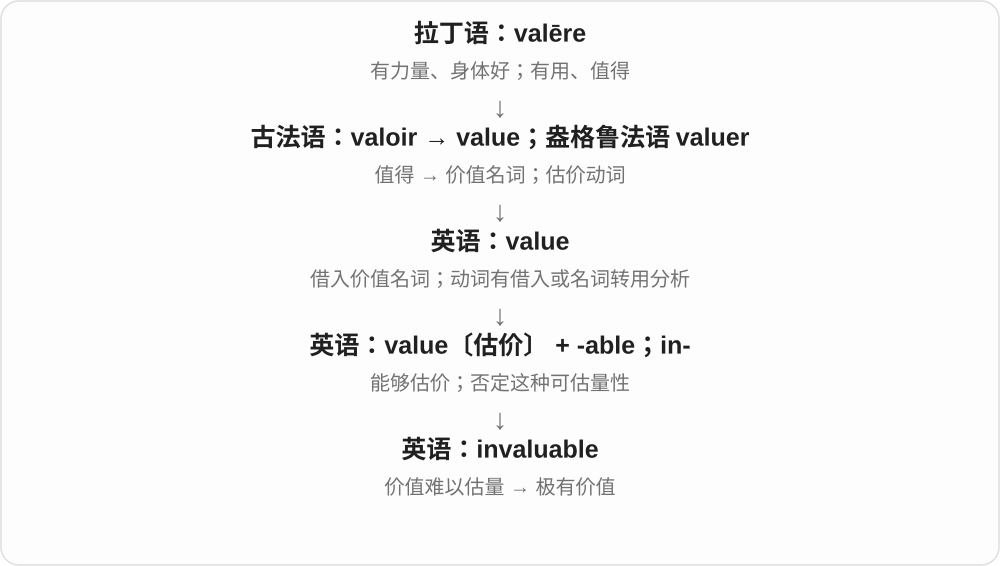

常用于称赞帮助、经验、资源。说 someone’s help was invaluable，通常是认真感谢对方帮了大忙，不是讨论准确售价。

**常见搭配与例句**

invaluable help；an invaluable resource；invaluable experience。

> Her local knowledge proved invaluable during the search.

她对当地的了解在搜寻中帮了大忙。

> The archive is an invaluable resource for historians.

这批档案是历史学者极宝贵的资料。

**别混淆**

invaluable 是极有价值；valueless 才是没有价值。

### 9. valuation — 估价；评估价值；估出的金额

**音标**：英、美 /ˌvæljuˈeɪʃən/

**先抓住这个画面**

请人看一看这件东西，再给出“它大概值多少”的判断。

**怎么拆**

借自法语 valuation，属于 valuer / valoir 词族；现代能联系 value 与 -ation。

**怎么变成今天的意思**

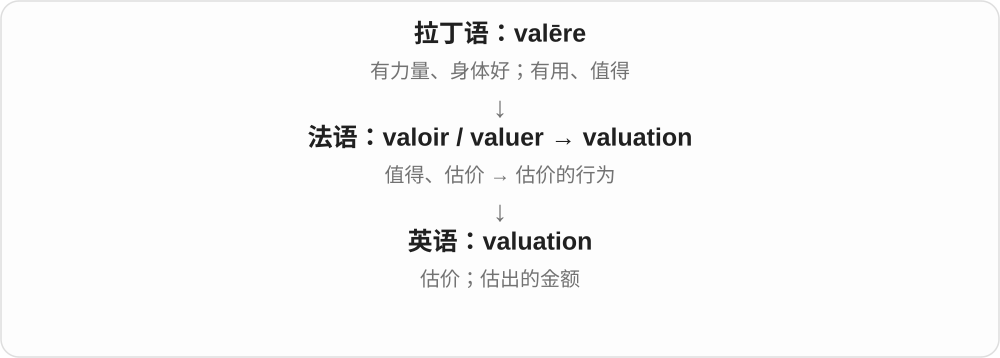

a property valuation 可以指评估过程，也可以指给出的金额。估价依赖时间、用途与方法，不是一个永远不变的标签。

**常见搭配与例句**

a property valuation；an independent valuation；a valuation of…。

> We requested an independent valuation of the painting.

我们请独立人士给这幅画估价。

> The two valuations differed by several thousand pounds.

两份估价相差几千英镑。

**别混淆**

evaluation 更广，可以评表现和质量；valuation 常尤其指经济价值。

### 10. revaluation — 重新估价；重新评价；货币升值调整

**音标**：英、美 /ˌriːvæljuˈeɪʃən/

**先抓住这个画面**

过去给过一次估价，现在换了时间、证据或标准，再算一遍。

**怎么拆**

re-“重新” + valuation。

**怎么变成今天的意思**

资产 revaluation 可能上调，也可能下调；特定货币制度中的 revaluation 通常指官方上调汇率价值。不要把所有“重新估价”都等于涨价。

**常见搭配与例句**

a revaluation of assets；a property revaluation；currency revaluation。

> The museum arranged a revaluation of its collection for insurance purposes.

博物馆为保险用途安排了藏品重新估价。

> The revaluation produced a lower figure than the previous estimate.

重新估价得到的金额低于先前估计。

**别混淆**

reevaluation 是更广的重新评估；revaluation 常更集中于价值，尤其金额。

### 11. valueless — 没有价值的；没有用处的

**音标**：英、美 /ˈvæljuːləs/

**先抓住这个画面**

本来希望它能派上用场，结果一点实际价值也没有。

**怎么拆**

value + -less“没有”。

**怎么变成今天的意思**

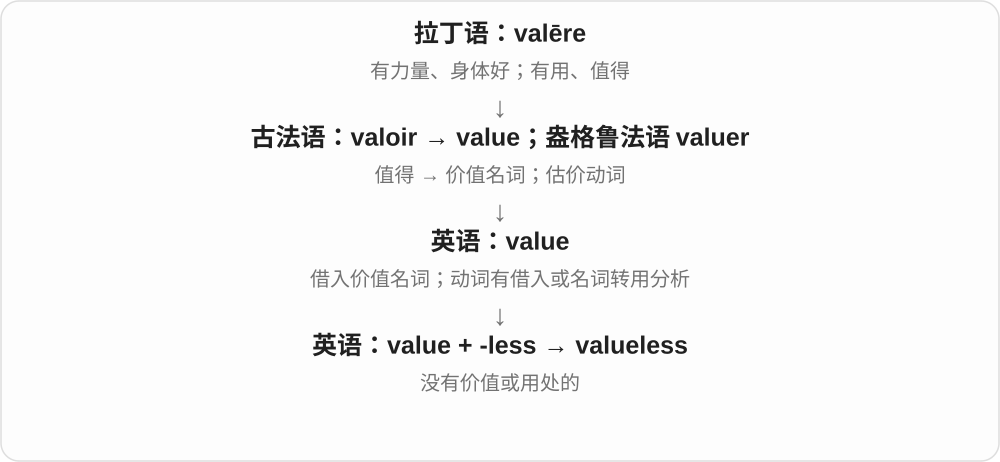

可指经济上不值钱，也可指信息无法发挥作用。对一个任务 valueless，不表示在所有情况下都没用。

**常见搭配与例句**

commercially valueless；virtually valueless；render something valueless。

> Without a date, the measurement is almost valueless for this study.

没有日期，这个测量值对本研究几乎没有用。

> The damaged stamp was considered commercially valueless.

这枚损坏的邮票被认为没有商业价值。

**别混淆**

valueless 是否定价值；priceless、invaluable 往往反而表示非常珍贵。

### 12. valuer — 估价师；给物品估值的人

**音标**：英 /ˈvæljuːə/；美 /ˈvæljuːər/

**先抓住这个画面**

仔细查看房产、首饰或其他物品，然后评估它值多少的人。

**怎么拆**

value 作“估价”动词 + -er。

**怎么变成今天的意思**

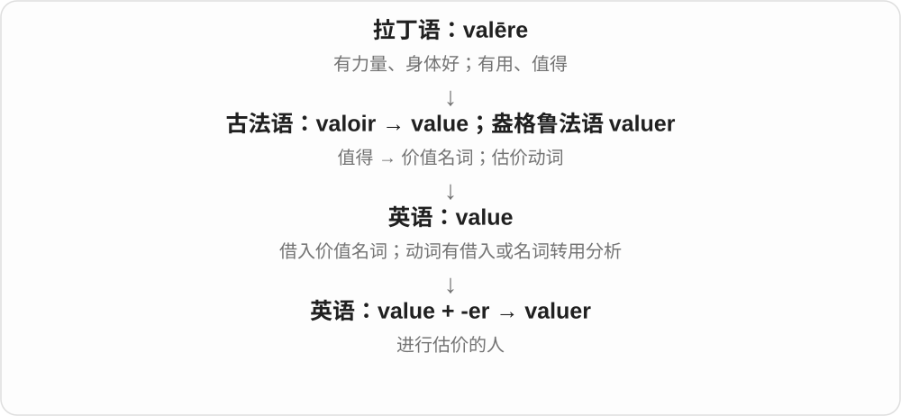

英国等地常用于房产或资产估价职业。它不是所有评价事物的人都适用的普通称呼。

**常见搭配与例句**

a property valuer；a qualified valuer；an independent valuer。

> The valuer inspected the roof before preparing the report.

估价师先查看了屋顶，再编写报告。

> An experienced valuer identified the ring’s unusual craftsmanship.

一位经验丰富的估价师看出了戒指不同寻常的工艺。

**别混淆**

valuer 常评货币价值；evaluator 可以评课程、产品效果或工作表现。

### 13. devalue — 使贬值；降低价值；贬低

**音标**：英、美 /ˌdiːˈvæljuː/

**先抓住这个画面**

原先值那么多，现在把它的价值往下压；也可以是说话做事让别人的贡献显得不重要。

**怎么拆**

de-“降低、去掉” + value。

**怎么变成今天的意思**

货币语境可指正式下调货币价值；普通语境中 devalue someone’s work 是贬低其工作。不要和 undervalue“本来就估低了”混为一谈。

**常见搭配与例句**

devalue a currency；devalue someone’s contribution；devalue an achievement。

> The decision to devalue the currency was announced on Friday.

下调货币价值的决定于周五公布。

> A small mistake should not devalue months of careful work.

一个小失误不应贬低数月认真工作的价值。

**别混淆**

undervalue 是低估；devalue 强调把已有的价值或评价降低。

### 14. devaluation — 贬值；价值或评价的降低

**音标**：英、美 /ˌdiːvæljuˈeɪʃən/

**先抓住这个画面**

把价值往下调这件事，作为一次变化或一种过程来谈。

**怎么拆**

de- + valuation；与 devalue 配套。

**怎么变成今天的意思**

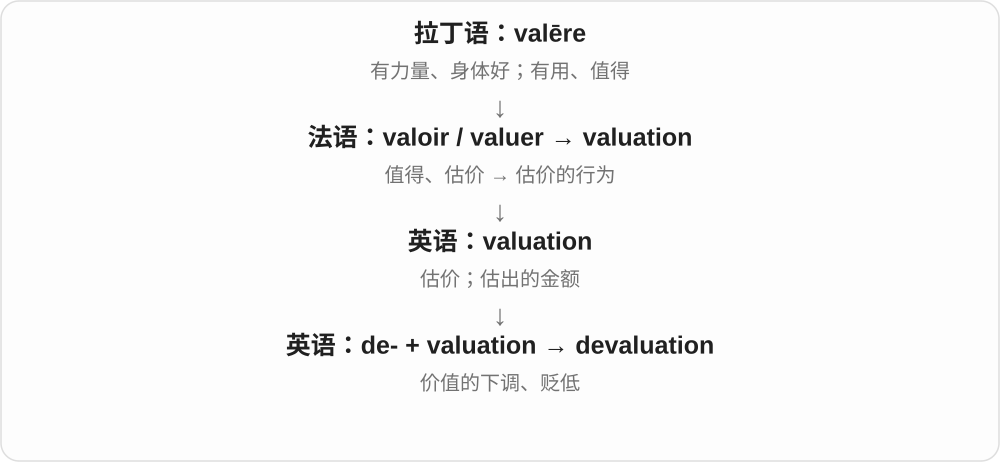

经济报道常用来指货币的正式贬值；更广泛地也可指某种工作、技能的价值被降低。

**常见搭配与例句**

currency devaluation；a sharp devaluation；the devaluation of…。

> The article examines the effects of the currency devaluation.

文章考察货币贬值产生的影响。

> She criticized the gradual devaluation of practical skills.

她批评了实用技能逐渐被轻视的现象。

**别混淆**

devaluation 常强调有意下调；depreciation 可指市场贬值或资产随时间折旧，具体看领域。

### 15. eigenvalue — 特征值

**音标**：英、美 /ˈaɪɡənˌvæljuː/

**先抓住这个画面**

某个变换作用在一个非零向量上，只把它沿原来的直线拉长、缩短、反向或压成零；那个倍数就是对应的特征值。

**怎么拆**

部分翻译德语 Eigenwert：eigen-“自身的、特征性的”保留德语，Wert“值”用英语 value 翻译。

**怎么变成今天的意思**

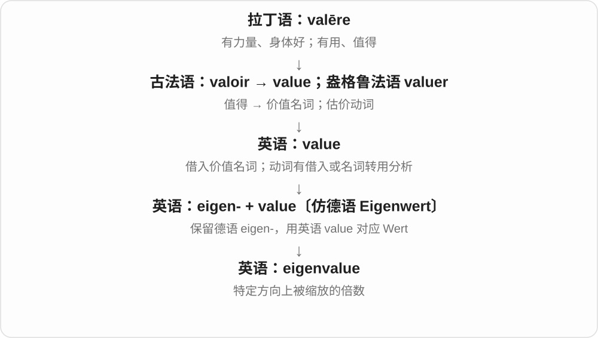

公式 Av = λv 中 v 必须非零，λ 是特征值。它不一定为正，也不一定是实数；“拉伸倍数”是理解实特征值时的直观画面。

**常见搭配与例句**

an eigenvalue of a matrix；compute eigenvalues；a negative eigenvalue。

> The matrix doubles every vector, so its only eigenvalue is two.

这个矩阵把每个向量都放大两倍，所以唯一的特征值是二。

> An eigenvalue of minus one means that the corresponding eigenvector is reversed without changing its length.

特征值为负一，意味着对应特征向量经过变换后方向相反，长度不变。

**别混淆**

eigenvector 是保持在同一直线上的那个向量；eigenvalue 是对应的数，不是向量长度本身。

### 16. undervalue — 低估价值；不够重视

**音标**：英 /ˌʌndəˈvæljuː/；美 /ˌʌndərˈvæljuː/

**先抓住这个画面**

东西或人的贡献明明有那么大分量，你给出的评价却压得太低。

**怎么拆**

under-“不足、低于应有水平” + value。

**怎么变成今天的意思**

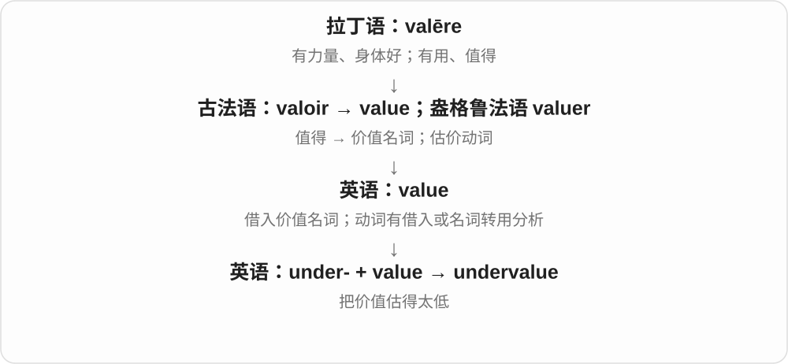

可以低估价格，也可以忽视某人的努力。feel undervalued 常是觉得自己的工作没有得到应有重视。

**常见搭配与例句**

undervalue someone’s contribution；undervalue an asset；feel undervalued。

> The team should not undervalue the work of its support staff.

团队不应低估支持人员的贡献。

> The old map was undervalued because its origin was unknown.

这张旧地图因来历不明而被低估了价值。

**别混淆**

underestimate 可以低估数量、难度等；undervalue 特别强调价值或重要性。

### 17. overvalue — 高估价值；过分重视

**音标**：英 /ˌəʊvəˈvæljuː/；美 /ˌoʊvərˈvæljuː/

**先抓住这个画面**

把某件事看得比它实际更值钱、更重要，给它的分量加过了头。

**怎么拆**

over-“过度” + value。

**怎么变成今天的意思**

既能说资产估值过高，也能说人们太重视某种指标。不是说它毫无价值，而是相对分量给得太多。

**常见搭配与例句**

overvalue an asset；overvalue qualifications；be overvalued。

> Collectors sometimes overvalue an item because of its famous owner.

收藏者有时会因为物品的知名前主人而高估它的价值。

> The selection process overvalues speed and ignores accuracy.

选拔过程过于看重速度，却忽视了准确性。

**别混淆**

overprice 是定价过高；overvalue 是估计或看重程度过高，不一定真的出售。

### 18. revalue — 重新估价；重新评价价值；调高货币比价

**音标**：英、美 /ˌriːˈvæljuː/

**先抓住这个画面**

拿出原来的价格或价值判断，再按新的情况估一遍。结果可能改高，也可能改低；货币专门用法通常指调高。

**怎么拆**

英语 re-“重新” + value“估价、评价价值”。

**怎么变成今天的意思**

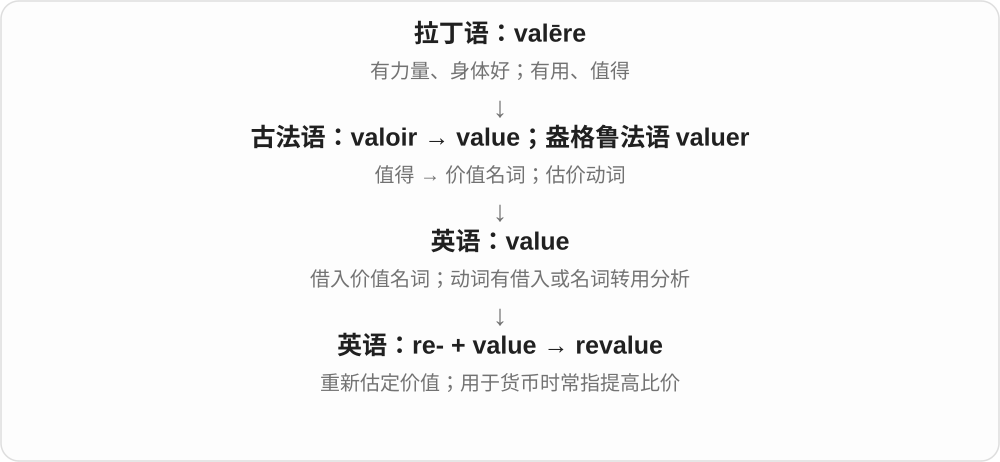

revalue property 是重新评估房地产价值；revalue a currency 常指当局上调货币的官方比价。前者不保证估价上升，后者的技术用法则有明确方向。

**常见搭配与例句**

revalue assets；revalue property；revalue a currency。

> The company revalued its buildings after the renovation.

公司在翻新后重新评估了这些建筑的价值。

> New evidence led collectors to revalue the artist’s early work.

新证据让收藏者重新评价了这位艺术家早期作品的价值。

**别混淆**

reevaluate 更广，可重评计划或证据；revalue 更聚焦价值，尤其经济金额。

### 19. equivalent — 等值、等效的；相当的；对应物

**音标**：英、美 /ɪˈkwɪvələnt/

**先抓住这个画面**

样子可以不同，但在眼下比较的价值、作用或数量上，能放在同一个位置。

**怎么拆**

后期拉丁语 aequus“相等” + valēre“有力量、有价值” → aequivalēns；现代可识别 equi- + -valent。

**怎么变成今天的意思**

equivalent to 后接比较对象。两种资格等同，不表示课程完全一样；两种说法含义相当，也不表示每个字一一对应。

**常见搭配与例句**

equivalent to；an equivalent amount；the nearest equivalent。

> One kilometre is equivalent to one thousand metres.

一公里等于一千米。

> This expression has no exact equivalent in English.

这个表达在英语中没有完全对应的说法。

**别混淆**

equal 常直接说量相等；equivalent 常说在某个关系或用途上相当。

### 20. equivalence — 等值；等价关系；相当

**音标**：英、美 /ɪˈkwɪvələns/

**先抓住这个画面**

关注两件事之间那条“在这个标准下算一样”的关系。

**怎么拆**

经法语 équivalence 来自中世纪拉丁语 aequivalentia；不只是现代 equivalent 换词尾。

**怎么变成今天的意思**

数学、翻译、资格比较都可以谈 equivalence。说 equivalence between A and B，必须看是哪方面等价；不能自动扩大到所有方面。

**常见搭配与例句**

logical equivalence；equivalence between；establish equivalence。

> The exercise asks you to prove the equivalence of the two statements.

这道练习要求证明两个命题等价。

> The translator looked for equivalence of meaning rather than identical word order.

译者追求意义相当，而不是词序完全一致。

**别混淆**

similarity 是相似；equivalence 是在指定意义上等价，要求更具体。

### 21. equivalency — 等同、相当；同等资格

**音标**：英、美 /ɪˈkwɪvələnsi/

**先抓住这个画面**

尤其常用在资格认定里：走过的学习路线不同，但能不能认作同一水平。

**怎么拆**

与 equivalence 同属 aequivalentia 词族，英语使用 -ency 名词形式。

**怎么变成今天的意思**

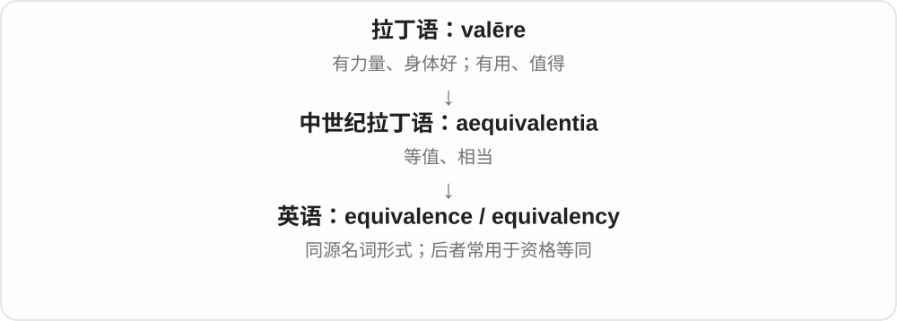

high school equivalency 常指达到高中同等水平的认定。不同制度的具体标准不同，不能因为名称有 equivalency 就认定所有机构都接受。

**常见搭配与例句**

a high school equivalency test；degree equivalency；equivalency assessment。

> She passed the high school equivalency test last year.

她去年通过了高中同等学力考试。

> The office reviewed the equivalency of his overseas qualification.

办公室审查了他的海外资格是否达到相应的同等水平。

**别混淆**

equivalency 和 equivalence 可重叠；正式数学关系通常更常写 equivalence。

### 22. equivalently — 等价地；等效地；换个等价说法

**音标**：英、美 /ɪˈkwɪvələntli/

**先抓住这个画面**

换了表达方式或处理方式，但关键的意义、值或效果保持相同。

**怎么拆**

equivalent + -ly。

**怎么变成今天的意思**

数学中常用 equivalently 引出逻辑等价的写法；一般技术文字也用来说明不同方案实现同等作用。

**常见搭配与例句**

equivalently expressed；treat equivalently；or, equivalently…。

> The fraction can be written equivalently as one half.

这个分数可以等价地写成二分之一。

> The two inputs are treated equivalently by the program.

程序对这两种输入作等效处理。

**别混淆**

similarly 是相似地；equivalently 更强，要求在相关标准下等价。

### 23. valid — 有效的；有充分根据的；符合规则的

**音标**：英、美 /ˈvælɪd/

**先抓住这个画面**

把东西拿来检验，它站得住、规则认它、理由撑得住。力量从身体转移到了证件、理由和推理上。

**怎么拆**

法语 valide 来自拉丁语 validus“强健、有力”，更早是 valēre。

**怎么变成今天的意思**

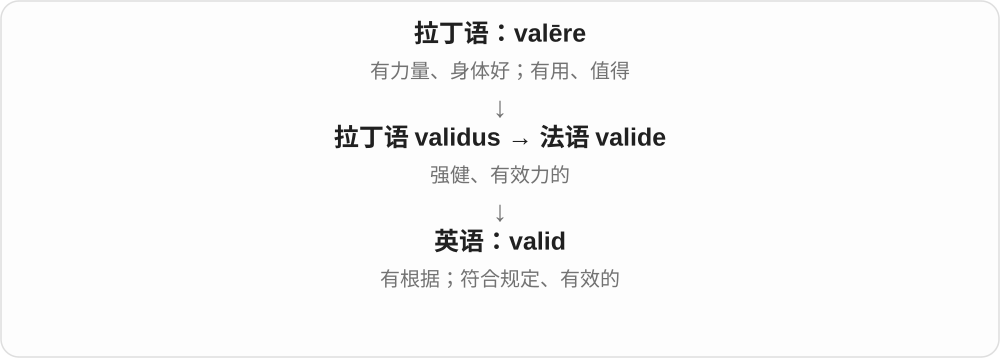

a valid ticket 是可按规定使用的票；a valid reason 是有根据的理由。逻辑里的 valid 说推理形式成立：前提若真，结论不能假，并不单独保证前提真实。

**常见搭配与例句**

a valid passport；a valid reason；valid for six months。

> The pass is valid for thirty days from the date of purchase.

这张通票自购买之日起三十天内有效。

> You have raised a valid concern about the timetable.

你对时间表提出的担忧有道理。

**别混淆**

true 描述陈述真假；valid 可描述推理是否成立，不能只用“真”替换。

### 24. validity — 有效性；成立程度；有效期

**音标**：英、美 /vəˈlɪdəti/

**先抓住这个画面**

不是只问结论是什么，而是检查“它凭什么站得住”。也可以问证件能有效使用到什么时候。

**怎么拆**

经法语 validité 或后期拉丁语 validitās 借入；现代可联系 valid + -ity，重音移到第二音节。

**怎么变成今天的意思**

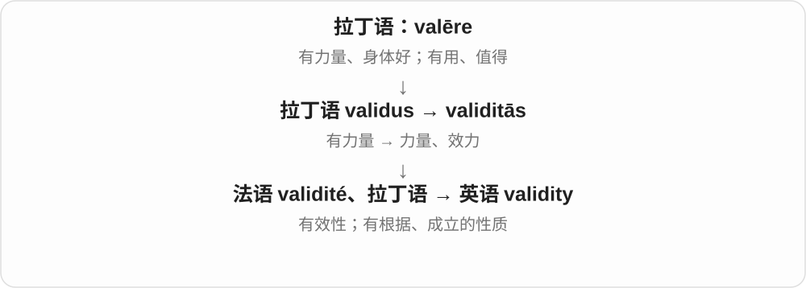

question the validity of a claim 是质疑主张是否有根据；passport validity 可指护照有效状态或有效期限。研究方法中还关心测量是否真的测到了想测的东西。

**常见搭配与例句**

the validity of an argument；a validity period；question the validity。

> The new evidence calls the validity of the conclusion into question.

新证据使这个结论是否成立受到质疑。

> Please check the validity of your passport before booking.

预订前请检查护照是否仍在有效期内。

**别混淆**

reliability 偏向结果稳定一致；validity 关心是否真能支持预期解释，两者相关却不等同。

### 25. validate — 确认有效；验证；使生效；认可感受

**音标**：英、美 /ˈvælɪdeɪt/

**先抓住这个画面**

拿到证据或完成手续，让“这个站得住、这个可以用”得到确认。对感受说 validate，则是承认它值得被理解。

**怎么拆**

来自中世纪拉丁语 validāre 的分词 validātus；现代能看成 valid + -ate。

**怎么变成今天的意思**

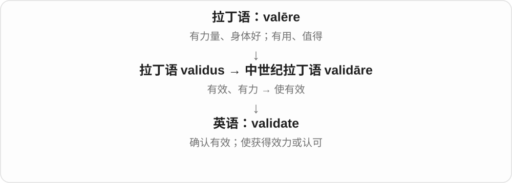

validate a ticket 可以指让车票开始生效；validate a model 是检验模型是否适合预定用途。validate someone’s feelings 是承认其感受，并不等于同意其每个判断。

**常见搭配与例句**

validate a ticket；validate a method；validate someone’s feelings。

> Please validate your ticket before boarding.

上车前请完成车票生效手续。

> The team used new data to validate the model.

团队用新数据验证模型。

> Listening carefully can help validate a friend’s feelings.

认真倾听能让朋友感到自己的感受被理解和认可。

**别混淆**

verify 常偏向核实某项信息；validate 常偏向确认有效、适用或可接受，技术领域会有更具体的约定。

### 26. validation — 验证；使生效；认可、肯定

**音标**：英、美 /ˌvælɪˈdeɪʃən/

**先抓住这个画面**

用证据或程序确认东西可用；在人际关系中，则是得到“你的感受或付出被看见了”的肯定。

**怎么拆**

属于 validāre / validate 词族；词典有英语 validate + -ion 和法语 validation 借入两种处理，现代词形关系清楚。

**怎么变成今天的意思**

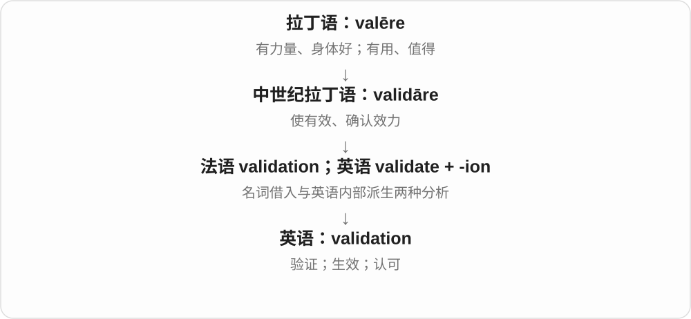

data validation 检查数据是否符合要求；seek validation 是寻求他人的认可。被认可不自动等于观点已被证明正确。

**常见搭配与例句**

data validation；model validation；seek external validation。

> The form performs validation before saving the data.

表单在保存数据前会进行校验。

> She wanted honest feedback rather than constant validation.

她想要的是诚实反馈，而不是持续不断的肯定。

**别混淆**

validation 可以是技术核查，也可以是情感认可；要看它的对象。

### 27. validly — 有效地；合乎规定或推理地

**音标**：英、美 /ˈvælɪdli/

**先抓住这个画面**

不仅做了某个动作，而且做法符合使它成立的规则。

**怎么拆**

valid + -ly。

**怎么变成今天的意思**

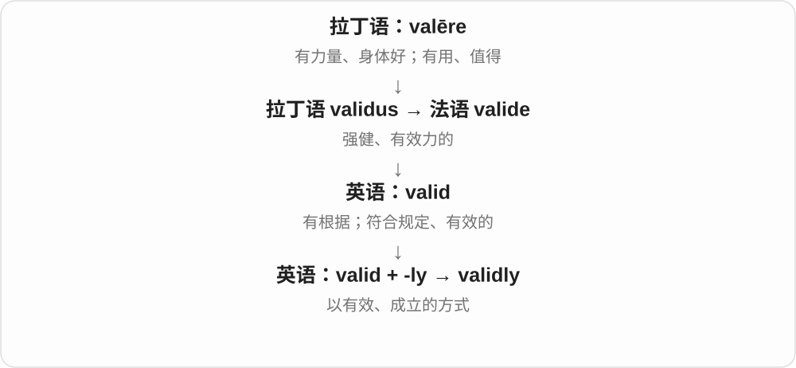

常见于正式论证或程序：validly infer 是按成立的推理得出；validly issued 是按规定有效签发。它不只是“做得快、效果好”。

**常见搭配与例句**

validly infer；validly issued；validly conclude。

> We cannot validly infer the cause from this correlation alone.

仅凭这种相关性，我们不能有效推断原因。

> The document confirms that the permit was validly issued.

文件确认许可证是按规定有效签发的。

**别混淆**

effectively 侧重实际效果；validly 侧重依据、规则或推理能否成立。

### 28. invalid — 无效、不成立的；病弱者〔旧用语〕；因病伤使退役

**音标**：无效义：英、美 /ɪnˈvælɪd/；病弱者及相关动词：英、美 /ˈɪnvəlɪd/

**先抓住这个画面**

两支都可追到“没有力量”：一支是证件或论证没有效力；另一支是身体病弱。现代读音用不同重音把它们分开。

**怎么拆**

拉丁语 in-“不” + validus“强健、有力”；无效义与病弱义分别发展，病弱支也受法语 invalide 影响。

**怎么变成今天的意思**

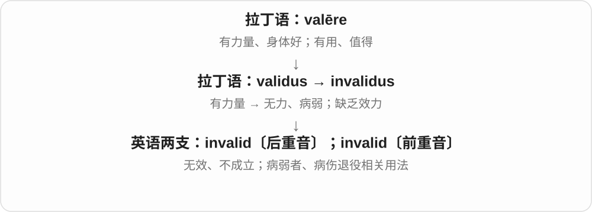

invalid password 是无效密码，重音在 val。旧书里的 an invalid 指长期病弱的人，重音在开头；现代一般按具体状况说 person with an illness 等，避免拿它笼统称呼残障者。be invalided out of the army 是因伤病退役。

**常见搭配与例句**

an invalid ticket；an invalid argument；be invalided out of…。

> The system rejected the invalid date.

系统拒绝了这个无效日期。

> In the old novel, the aunt is described as an invalid.

那部旧小说把姑妈描述为长期病弱的人。

> He was invalided out of the army after the injury.

他受伤后因伤退役。

**别混淆**

invalid“无效”不等于 illegal“违法”；一张过期票无效，不表示买票行为违法。

### 29. invalidate — 使无效；推翻、否定效力

**音标**：英、美 /ɪnˈvælɪdeɪt/

**先抓住这个画面**

原先看起来能成立，某个错误、新证据或违规让它失去了成立的条件。

**怎么拆**

现代可拆 invalid + -ate，也可联系 in- + validate；历史词典还记录法语 invalider 的借入路线。

**怎么变成今天的意思**

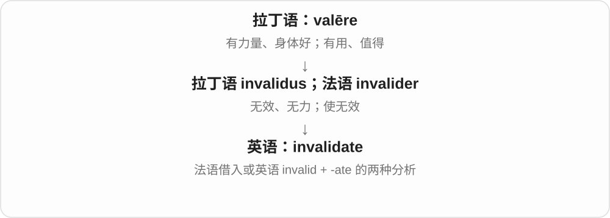

invalidate a ticket 是使票无效；invalidate a conclusion 是破坏结论所需的依据。它通常带使役动作，不只是描述当前状态。

**常见搭配与例句**

invalidate a result；invalidate a claim；invalidate an agreement。

> The missing control group may invalidate the conclusion.

缺少对照组可能使这个结论无法成立。

> Any alteration to the ticket will invalidate it.

对票据作任何改动都会使其失效。

**别混淆**

invalid 是无效的状态；invalidate 是导致或认定它无效的动作。

### 30. invalidation — 使无效；宣布无效；否定他人感受

**音标**：英、美 /ɪnˌvælɪˈdeɪʃən/

**先抓住这个画面**

把某事原先拥有或声称拥有的效力撤掉；在人际语境里，也可能是把别人的感受说成不值一提。

**怎么拆**

invalidate 的 -ate 变 -ation；也能按 in- + validation 分析。

**怎么变成今天的意思**

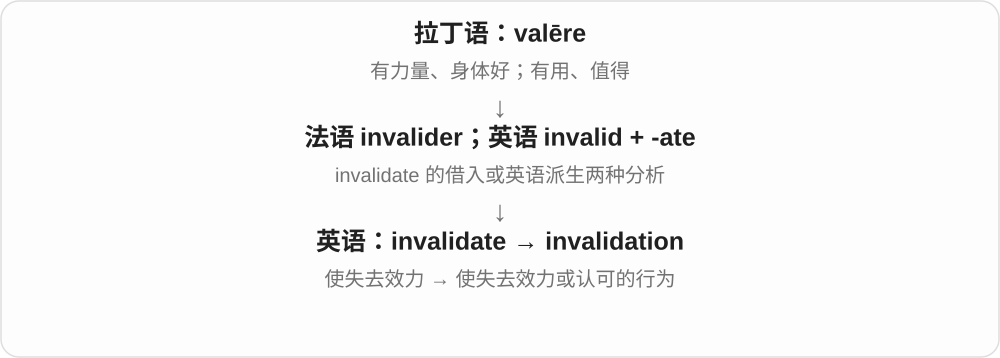

既可指结果、票据被判无效，也能指 emotional invalidation。后者不是普通意见不一致，而是把对方的感受直接否定掉。

**常见搭配与例句**

invalidation of results；the invalidation of a vote；emotional invalidation。

> The error led to the invalidation of the test results.

这个错误导致测试结果被判无效。

> The discussion focused on how repeated invalidation affects trust.

讨论聚焦于反复否定对方感受会怎样影响信任。

**别混淆**

disagreement 是观点不同；invalidation 在情感语境中强调否定感受的合理存在。

### 31. invalidity — 无效性；不成立；病弱、失能状态〔部分制度用语〕

**音标**：英、美 /ˌɪnvəˈlɪdəti/

**先抓住这个画面**

同一老词根留下两个名词用法：文件或论证站不住；人因身体状况不能正常工作。

**怎么拆**

经法语 invalidité 或中世纪拉丁语 invaliditās 借入；历史上不是只由现代英语 invalid 加 -ity 产生。

**怎么变成今天的意思**

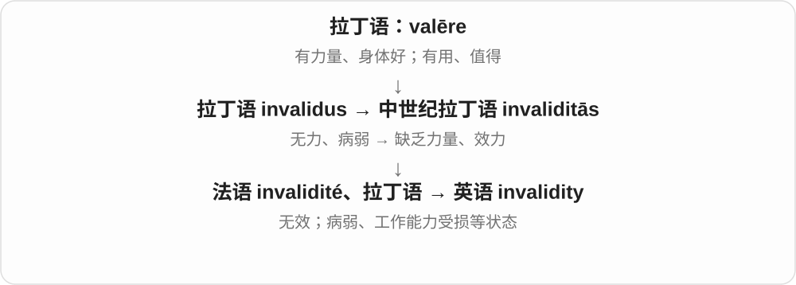

the invalidity of an argument 是论证不成立；invalidity benefit 等搭配是一些制度中的失能福利名称，需按制度背景翻译，不要译成“无效福利”。

**常见搭配与例句**

the invalidity of a claim；invalidity benefit；establish invalidity。

> The report explains the invalidity of the original calculation.

报告解释了原先计算为何不成立。

> The archive contains records of applications for invalidity benefit.

档案中保存着失能福利金申请记录。

**别混淆**

invalidity 是无效或某种失能状态；invalidation 是使某物无效、宣布无效的动作。

### 32. evaluate — 评估、评价；求数值

**音标**：英、美 /ɪˈvæljueɪt/

**先抓住这个画面**

不是凭第一眼说好坏，而是拿标准和证据来判断：值不值得、效果怎样，或这个式子等于多少。

**怎么拆**

常解释为从较早的 evaluation 反构；也有词典提出法语 évaluer 的影响。现代能联系 value，但不能只按 e- + value + -ate 虚构借入顺序。

**怎么变成今天的意思**

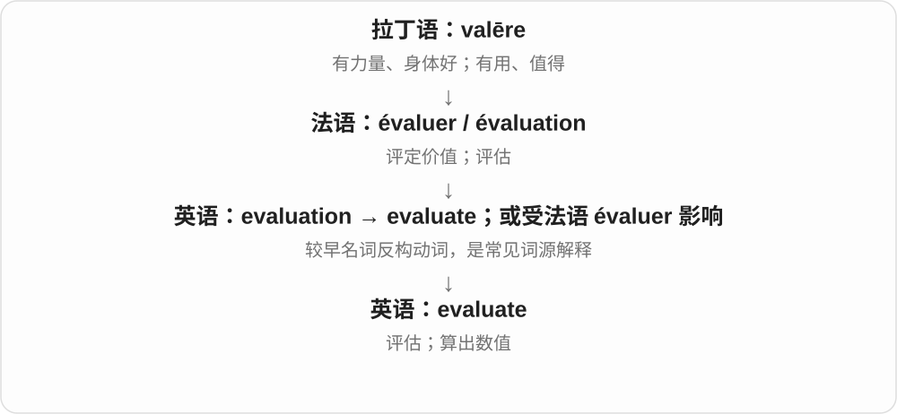

evaluate a method 是评估方法；数学里的 evaluate an expression 是算出表达式的值。评估可能得出好或坏的结论，词本身不表扬。

**常见搭配与例句**

evaluate the evidence；evaluate performance；evaluate an expression。

> We need to evaluate the results before changing the design.

改变设计前，我们需要先评估结果。

> Evaluate the expression when x equals two.

当 x 等于二时，求这个表达式的值。

**别混淆**

describe 是描述；evaluate 要进一步按某种标准判断。

### 33. evaluation — 评估；评价过程；评估结果

**音标**：英、美 /ɪˌvæljuˈeɪʃən/

**先抓住这个画面**

把证据收集起来，与标准对照，再形成一个能说明理由的判断。

**怎么拆**

借自法语 évaluation；英语名词比 evaluate 的常见记录更早，所以历史图从名词借入讲起。

**怎么变成今天的意思**

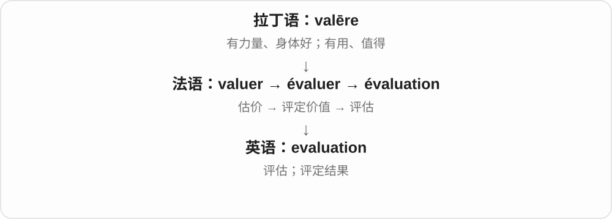

可以谈项目评估、表现评估，也可以指某一份具体评估。a positive evaluation 是好评；evaluation 本身不保证结论积极。

**常见搭配与例句**

a thorough evaluation；performance evaluation；an evaluation of…。

> The evaluation found that the new layout reduced waiting time.

评估发现，新布局缩短了等待时间。

> Each applicant received a written evaluation.

每位申请者都收到了一份书面评价。

**别混淆**

assessment 和 evaluation 常重叠；evaluation 尤其常用于判断价值、效果或质量，没有处处适用的硬分界。

### 34. evaluator — 评估者；评估程序

**音标**：英 /ɪˈvæljueɪtə/；美 /ɪˈvæljueɪtər/

**先抓住这个画面**

按照标准查看材料、判断效果并给出结果的人或程序。

**怎么拆**

evaluate 去掉词尾 e，加表示执行者的 -or。

**怎么变成今天的意思**

可以是评审员，也可以是程序中的计算、评价模块。不是一见 -or 就只指人。

**常见搭配与例句**

an independent evaluator；a trained evaluator；an expression evaluator。

> An independent evaluator reviewed the training programme.

一位独立评估者审查了培训项目。

> The expression evaluator returned an error for the unfinished formula.

表达式计算程序对这个未写完的公式返回了错误。

**别混淆**

valuer 常给物品估金额；evaluator 的对象可以是教学、工作、算法等。

### 35. evaluative — 评价性的；用于评估的

**音标**：英、美 /ɪˈvæljuətɪv/

**先抓住这个画面**

不只是说“发生了什么”，还在说“这样好不好、效果怎样”。

**怎么拆**

evaluate + -ive，形成形容词；不是 evaluation 去掉 -ion 后随便加词尾。

**怎么变成今天的意思**

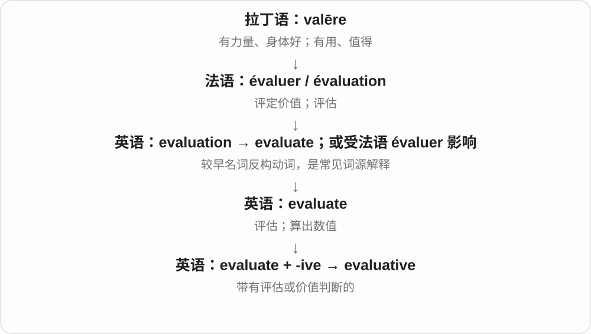

“房间有三扇窗”偏描述；“房间采光设计很好”含评价。evaluative language 可以正面也可以负面。

**常见搭配与例句**

evaluative comments；an evaluative approach；evaluative criteria。

> The report should include evaluative comments, not just a list of activities.

报告应包含评价性意见，而不只是活动清单。

> Words such as “excellent” and “poor” are evaluative.

“优秀”和“糟糕”这样的词带有评价性质。

**别混淆**

descriptive 主要描述；evaluative 加入按标准作出的判断。

### 36. reevaluate — 重新评估；重新考虑

**音标**：英、美 /ˌriːɪˈvæljueɪt/

**先抓住这个画面**

新的情况来了，把原先的判断重新放到桌上检查。

**怎么拆**

re-“重新” + evaluate；也常写带连字符的形式，这里保留连写词条。

**怎么变成今天的意思**

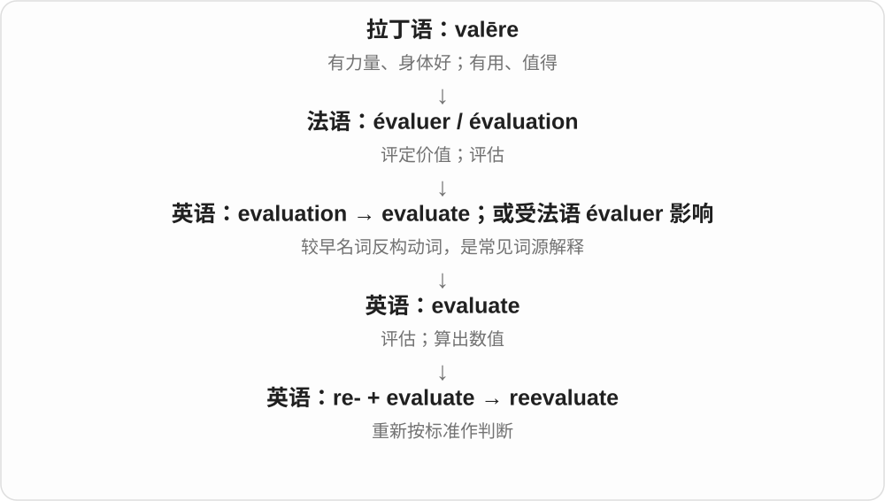

可以 reevaluate a decision，也可以 reevaluate your priorities。重新看过后，结论可能变，也可能仍旧相同。

**常见搭配与例句**

reevaluate a policy；reevaluate priorities；reevaluate the evidence。

> The new evidence forced us to reevaluate our conclusion.

新证据迫使我们重新评估结论。

> She took a week off to reevaluate her priorities.

她休息了一周，重新考虑自己的优先事项。

**别混淆**

revalue 常指重新估价；reevaluate 更广，包括判断方法、计划和表现。

### 37. prevalent — 普遍存在的；盛行的

**音标**：英、美 /ˈprevələnt/

**先抓住这个画面**

走到哪里都容易碰到：一种习惯、看法或问题，在某个地方或群体里相当常见。

**怎么拆**

来自拉丁语 praevalēns，是 praevalēre 的现在分词。英语早期也有强势、占优势义，后来突出“广泛存在”。

**怎么变成今天的意思**

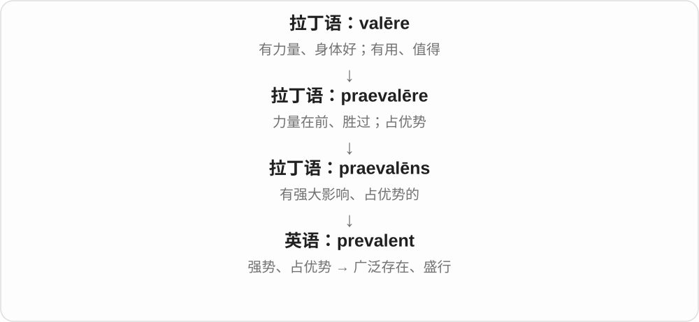

常用 prevalent in、among，说明范围。说 a disease is prevalent 只是说某病在该人群中较常见，并未交代它是如何传播的。

**常见搭配与例句**

prevalent among teenagers；prevalent in the region；a prevalent belief。

> This belief was prevalent in the village for many years.

这种看法曾在村里流传了很多年。

> The problem is more prevalent among older buildings.

这个问题在较老的建筑中更常见。

**别混淆**

popular 可能表示受欢迎；prevalent 只说普遍存在，坏习惯也可以 prevalent。

### 38. prevalence — 普遍程度；盛行；患病率〔流行病学〕

**音标**：英、美 /ˈprevələns/

**先抓住这个画面**

不只问“有没有”，还问“在这群人或这片地方里，有多常见”。

**怎么拆**

法语 prévalence 来自中世纪拉丁语 praevalentia，与 praevalēns“占优势的”同族；现代能联系 prevalent 与 -ence。

**怎么变成今天的意思**

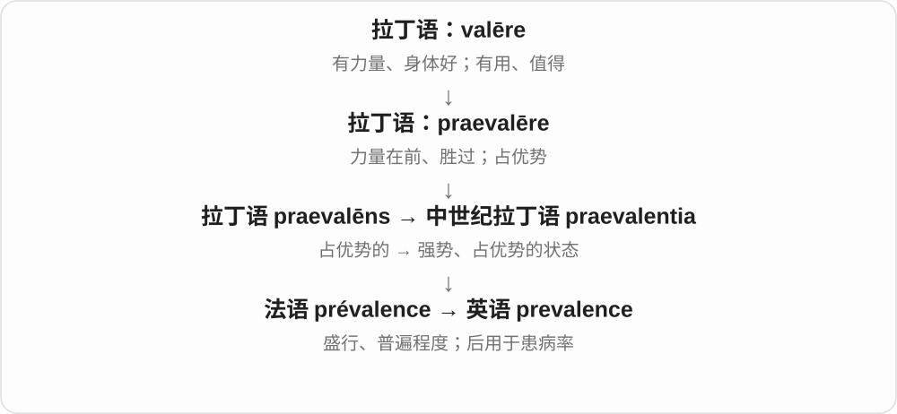

日常可说 the prevalence of online shopping。流行病学的 prevalence 统计某时点或期间已经存在的病例，常表达为相应人群中的比例；它与只计新发病例的 incidence 不同。

**常见搭配与例句**

the prevalence of a disease；high prevalence；the prevalence of a belief。

> The report examines the prevalence of remote work in small firms.

报告考察了远程办公在小公司的普遍程度。

> The survey estimated the prevalence of asthma among schoolchildren.

这项调查估计了学龄儿童中的哮喘患病率。

**别混淆**

prevalence 看已有多少；incidence 看指定期间新出现多少，不能把两个术语当同义词。

### 39. prevail — 获胜；占主导；普遍存在；说服成功

**音标**：英、美 /prɪˈveɪl/

**先抓住这个画面**

两股力量相遇，某一股最终占了上风。也可以是某种想法、风气长期压过其他声音。

**怎么拆**

拉丁语 prae-“在前、胜过” + valēre“有力量” → praevalēre，经古法语 prevaler 借入。

**怎么变成今天的意思**

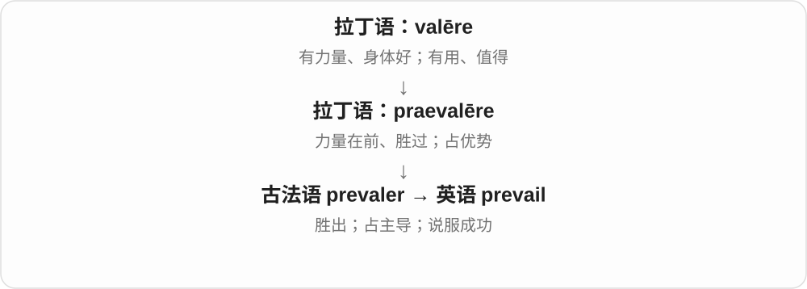

prevail over 是战胜或压过；a belief prevails 是某种看法盛行。prevail on someone to do something 是终于说服对方做某事，重点在劝说取得效果。

**常见搭配与例句**

prevail over difficulties；common sense prevails；prevail on someone to…。

> After hours of argument, common sense finally prevailed.

争论了几个小时后，大家终于作出了合乎常理的决定。

> We prevailed on him to stay for dinner.

我们终于说服他留下吃晚饭。

**别混淆**

win 常对应一场明确的胜负；prevail 还可以说道理、制度或某种风气占据主导。

### 40. prevailing — 占主导的；普遍的；现行的

**音标**：英、美 /prɪˈveɪlɪŋ/

**先抓住这个画面**

眼下影响最大、最常出现的那一股力量或趋势。就像风大多数时候从同一个方向吹来。

**怎么拆**

prevail + -ing；分词用作形容词。

**怎么变成今天的意思**

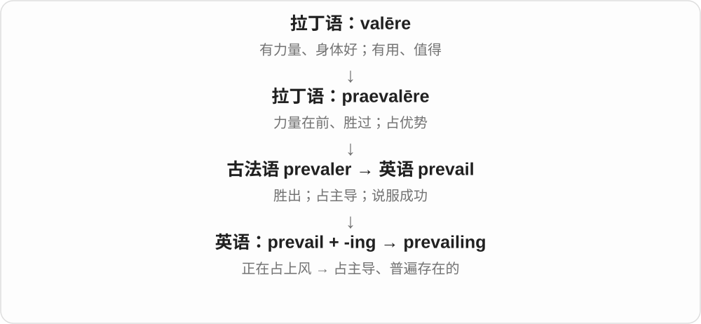

prevailing opinion 是占主流的意见；prevailing winds 是盛行风；prevailing conditions 是当时实际存在的状况。它不表示这种状态永远不会变。

**常见搭配与例句**

the prevailing view；prevailing winds；prevailing market conditions。

> The prevailing view is that the project needs more time.

目前占主流的看法是这个项目需要更多时间。

> The house was designed to make use of the prevailing winds.

这栋房子在设计时考虑了利用当地的盛行风。

**别混淆**

prevalent 偏重某事很常见；prevailing 还常强调它在当时占主导地位。

### 41. valiant — 勇敢的；顽强努力的

**音标**：英、美 /ˈvæliənt/

**先抓住这个画面**

知道事情很难，还是鼓起力量往前顶。它称赞的是勇气和努力，不保证最后赢了。

**怎么拆**

古法语 vaillant 是 valoir 的分词，意义从有力量、有价值发展到勇敢，经法语借入英语。

**怎么变成今天的意思**

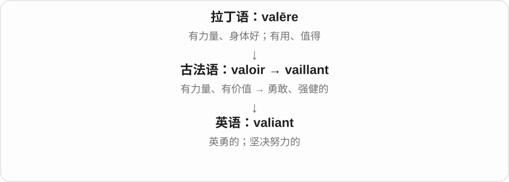

valiant effort 常用于虽未成功却值得敬佩的努力；valiant defender 则强调勇敢坚持。语气比 brave 更有书面、赞颂色彩。

**常见搭配与例句**

a valiant effort；a valiant attempt；a valiant defender。

> She made a valiant effort to finish the race despite the pain.

尽管疼痛，她仍顽强地努力跑完全程。

> The small team put up a valiant defence.

这支小队进行了英勇的防守。

**别混淆**

successful 说结果成功；valiant 说努力勇敢，可能是 a valiant but unsuccessful attempt。

### 42. valiantly — 英勇地；顽强地

**音标**：英、美 /ˈvæliəntli/

**先抓住这个画面**

把“敢顶住、肯坚持”落到行动方式上：人虽然处于劣势，却没有轻易退缩。

**怎么拆**

valiant + -ly。

**怎么变成今天的意思**

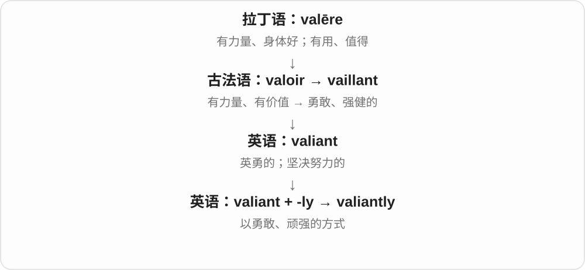

常跟 fought、tried、struggled。既可写战斗，也可略带温暖或幽默地描写某人努力完成艰巨日常任务。

**常见搭配与例句**

fight valiantly；struggle valiantly；try valiantly。

> The goalkeeper fought valiantly to keep the score level.

守门员顽强奋战，努力守住平局。

> He valiantly tried to remember everyone’s name.

他很努力地想记住每个人的名字。

**别混淆**

bravely 适用更广；valiantly 更突出顽强努力，有时带郑重的赞许。

### 43. valor — 英勇；勇武〔美式拼写〕

**音标**：美 /ˈvælər/；英 /ˈvælə/

**先抓住这个画面**

面对危险仍能挺身而出的勇气，尤其让人想到战斗、救援等需要冒险的行动。

**怎么拆**

后期拉丁语 valor“力量、价值”经古法语 valor / valour 进入英语；勇武义也受意大利语 valore 影响。valor 是现代美式常用拼写。

**怎么变成今天的意思**

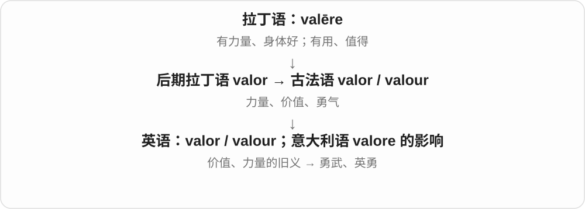

常见于表彰、历史叙述和纪念文字。它比 courage 更庄重，通常强调危险中的实际表现，而不只是心里鼓起勇气。

**常见搭配与例句**

an act of valor；a medal for valor；show great valor。

> The medal recognized her valor during the rescue.

这枚奖章表彰了她在救援中的英勇表现。

> The historian wrote about acts of valor on both sides.

历史学家记述了双方的英勇事迹。

**别混淆**

courage 可以是承认错误的勇气；valor 更容易让人想到英勇行动，特别是战场或险境。

### 44. valorous — 英勇的；勇武的〔书面〕

**音标**：英、美 /ˈvælərəs/

**先抓住这个画面**

像英雄故事里的描述：一个人在险境中表现出值得颂扬的勇气。

**怎么拆**

经法语 valeureux 借入，与 valeur“价值、勇气”同族；现代可联系 valor + -ous，但并非只有英语内部派生这一历史。

**怎么变成今天的意思**

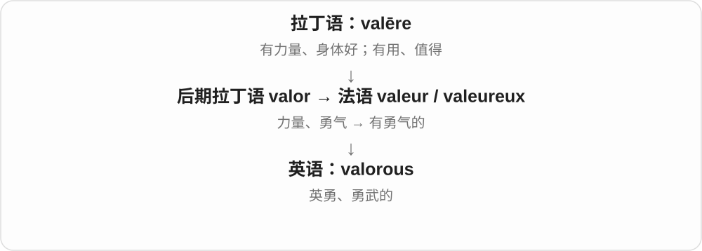

常形容 deeds、soldiers、conduct，语体郑重，有时带文学色彩。日常夸人勇敢通常直接说 brave。

**常见搭配与例句**

valorous deeds；valorous conduct；a valorous soldier。

> The poem celebrates the hero’s valorous deeds.

这首诗歌颂了英雄的英勇事迹。

> The citation described her valorous conduct during the attack.

嘉奖词描述了她在袭击中的英勇表现。

**别混淆**

valiant 很常用于努力与尝试；valorous 更侧重英雄式的勇武表现。

### 45. ambivalent — 心情矛盾的；态度摇摆的

**音标**：英、美 /æmˈbɪvələnt/

**先抓住这个画面**

嘴上说“我还没决定”，心里却不是空白，而是赞成和反对的理由都在用力。

**怎么拆**

英语从 ambivalence / 较早的 ambivalency 这组名词反构出形容词；更早来源是德语 Ambivalenz。

**怎么变成今天的意思**

常用 ambivalent about 或 towards。一个人可以对升职感到 ambivalent：想要机会，也担心更大的工作压力。

**常见搭配与例句**

feel ambivalent about；remain ambivalent；an ambivalent attitude。

> I’m ambivalent about the offer: the work is exciting, but the hours are long.

我对这个机会心情矛盾：工作很有意思，但工时很长。

> The review is ambivalent rather than wholly negative.

这篇评论的态度有褒有贬，并非全盘否定。

**别混淆**

uncertain 可能只是信息不足；ambivalent 更强调同时存在相反的感受或态度。

### 46. valour — 英勇；勇武〔英式拼写〕

**音标**：英 /ˈvælə/；美 /ˈvælər/

**先抓住这个画面**

不是笼统说一个人很优秀，而是赞叹他在危险面前拿出了勇气。

**怎么拆**

与 valor 同词同源；来自古法语 valour、valor，现代英国英语通常保留 -our。

**怎么变成今天的意思**

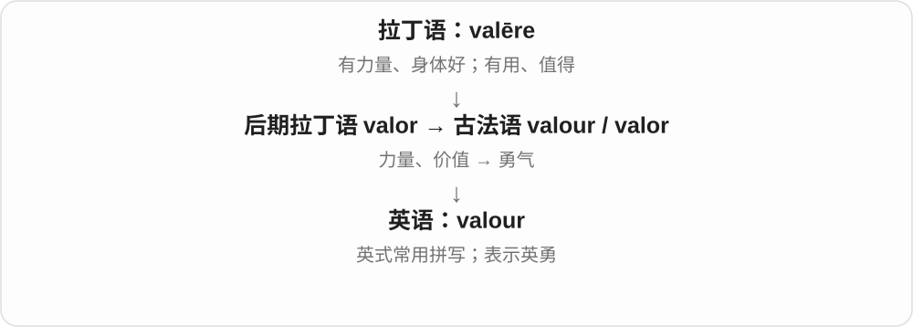

英式历史、军队荣誉或纪念语境常见 valour。更换英美拼写不会改变核心意思，也无需把它拆出一个有独立意义的 -our。

**常见搭配与例句**

a display of valour；an award for valour；personal valour。

> The inscription honours the soldiers’ valour.

碑文颂扬了士兵们的英勇。

> Her account focuses on quiet acts of valour during the disaster.

她的叙述着重记录了灾难中那些不事张扬的英勇举动。

**别混淆**

valour 与 valor 是拼写差异；valuable 是有价值的，不是“英勇的”。

### 47. valence — 价、化合价；情绪效价；配价〔语言学〕

**音标**：英、美 /ˈveɪləns/

**先抓住这个画面**

从“能发挥多大作用”走向不同专业：原子能怎样结合，感受把人吸引过来还是推开，动词需要哪些角色参与。

**怎么拆**

现代化学义经德语 Valenz，追到拉丁语 valentia“力量、能力”；语言学等用途再借用“结合能力”的画面。它与较早同源的草药制剂义不是一条简单的意义递变。

**怎么变成今天的意思**

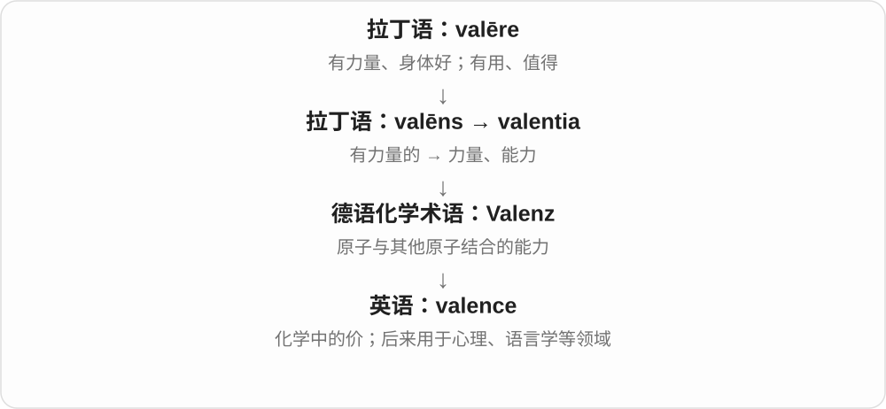

在入门化学中可用“与其他原子结合的能力”理解，如水中的氧通常是二价。心理学的 positive / negative valence 指愉快、吸引与不愉快、排斥的方向；语言学则看动词可带哪些参与者。

**常见搭配与例句**

valence electrons；positive emotional valence；the valence of a verb。

> In water, oxygen has a valence of two.

在水中，氧的价为二。

> The pictures differed in emotional valence but had similar levels of arousal.

这些图片引发的情绪正负方向不同，但唤醒程度相近。

**别混淆**

化学价不等于价电子的个数；心理学 valence 说正负感受，arousal 则说激动、唤醒程度。

### 48. valency — 化合价；动词配价

**音标**：英、美 /ˈveɪlənsi/

**先抓住这个画面**

像问一个部件留了多少连接位置：化学里谈原子的结合能力，语言里谈一个动词需要带出哪些角色。

**怎么拆**

十九世纪科学词，取自拉丁语 valentia“力量、能力”，与 valence 同源并列；不要理解成“化学价再加一个新的意思”。

**怎么变成今天的意思**

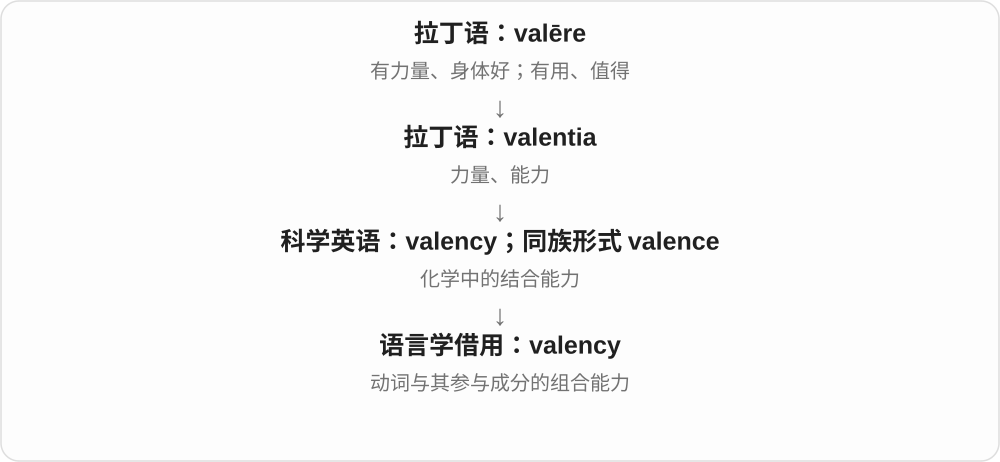

英国英语化学教材常写 valency。语言学里，sleep 常只需要“谁睡”，give 在典型用法中涉及“谁给、给什么、给谁”；不同理论对配价的计算和省略条件有更细的说明。

**常见搭配与例句**

the valency of carbon；verb valency；a change in valency。

> The class used simple molecular models to explore valency.

课堂用简单分子模型来理解化合价。

> The dictionary includes information about the valency of common verbs.

这本词典收录了常见动词的配价信息。

**别混淆**

valency 与 valence 常可互换；它不是一个原子核里有几个质子，也不是句子里随便出现几个词。

### 49. ambivalence — 矛盾心理；又想要又抗拒的态度

**音标**：英、美 /æmˈbɪvələns/

**先抓住这个画面**

同一件事把你往两个方向拉：想接受它带来的好处，又放不下它带来的损失。

**怎么拆**

借自德语心理学词 Ambivalenz，由 ambi-“两边”与 valentia“力量、效力”组成。英语还曾用 ambivalency；这不是普通英语 ambi- + valence 临时拼出的词。

**怎么变成今天的意思**

可以同时期待与害怕搬家，同时欣赏又怨恨一个人。ambivalence 不是完全没有态度，而是几种相反态度同时存在。

**常见搭配与例句**

ambivalence about a decision；ambivalence towards someone；a sense of ambivalence。

> She felt ambivalence about leaving a secure job to travel.

她对放弃稳定工作去旅行心情矛盾，既向往又舍不得。

> The novel captures his ambivalence towards his hometown.

小说写出了他对故乡既亲近又抗拒的复杂感情。

**别混淆**

indifference 是不在乎；ambivalence 是在乎，却同时被相反感受拉扯。

### 50. valedictory — 告别的；告别演说

**音标**：英 /ˌvælɪˈdɪktəri/；美 /ˌvæləˈdɪktəri/

**先抓住这个画面**

离开前对大家说一番话：回顾走过的路，表达感谢，也祝愿彼此以后安好。

**怎么拆**

拉丁语 valē“愿你安好、再见” + dīcere“说”形成 valedīcere；取其 valedict- 词干加 -ory。valē 是 valēre 的命令式。

**怎么变成今天的意思**

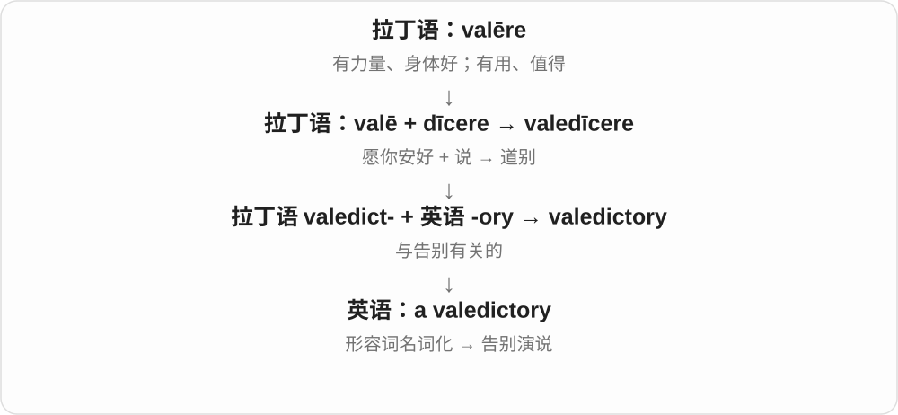

a valedictory address 可以是毕业致辞，也可以是离职、退休或任期结束时的告别讲话。不是所有 valedictory 都由毕业生发表。

**常见搭配与例句**

a valedictory speech；a valedictory address；a valedictory note。

> The retiring director gave a brief valedictory speech.

即将退休的主任发表了简短的告别讲话。

> Her final column had a warm, valedictory tone.

她最后一期专栏带着温暖的告别意味。

**别混淆**

farewell 是通用的告别；valedictory 更常形容正式致辞或带总结意味的告别文字。

### 51. valedictorian — 毕业典礼致辞的优秀毕业生代表

**音标**：英、美 /ˌvælədɪkˈtɔːriən/

**先抓住这个画面**

毕业时站上台，代表这一届学生向学校告别的人。常由成绩最优者担任，但核心角色是毕业告别致辞者。

**怎么拆**

英语从 valedictory“告别的、告别演说”派生人物名词，词尾由 -ory 变成 -orian；更早的 valē + dīcere 是“说再见”。

**怎么变成今天的意思**

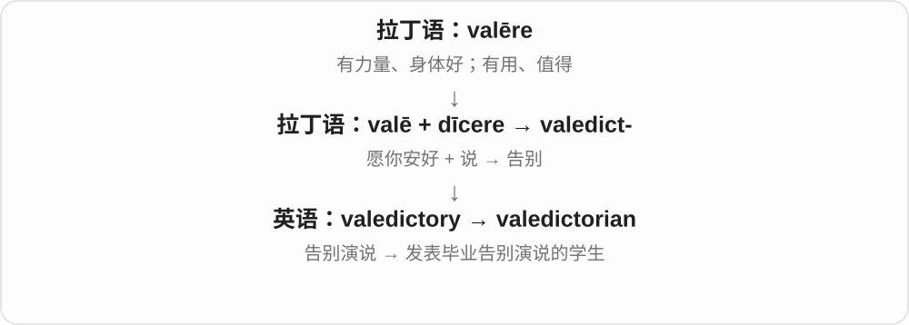

常见于美国等地学校语境。许多学校授予学业排名领先的毕业生，但选择标准可能不只看平均分，也可能有多位；不要机械翻成所有制度中的“状元”。

**常见搭配与例句**

class valedictorian；be named valedictorian；the valedictorian’s address。

> She was named valedictorian of her graduating class.

她被选为这一届毕业生的优秀毕业生代表。

> The valedictorian thanked the teachers and the families in the audience.

毕业生代表向老师和现场的家人们表示感谢。

**别混淆**

valedictorian 通常是学生代表；commencement speaker 则可以是受邀校友、公众人物或其他演讲者。

### 52. covalent — 共价的

**音标**：英 /kəʊˈveɪlənt/；美 /koʊˈveɪlənt/

**先抓住这个画面**

想象两个原子共同拉住一组电子：电子同时受到两个原子核吸引，把两边联系起来。

**怎么拆**

来自较早的 covalence“共价结合”；现代构件是 co-“共同”与 -valent“有某种价、结合能力”。

**怎么变成今天的意思**

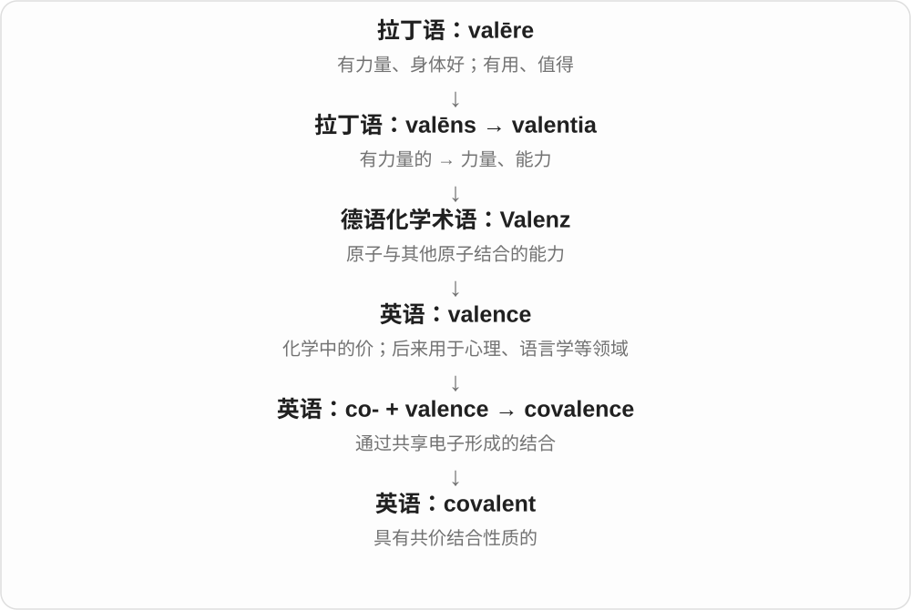

最常见搭配是 covalent bond。单键通常共享一对电子；共价键还可以有极性，意思是共享电子更偏向其中一个原子，不是完全平均分布。

**常见搭配与例句**

a covalent bond；covalent bonding；a polar covalent bond。

> The two hydrogen atoms are joined by a covalent bond.

两个氢原子通过一个共价键结合。

> The oxygen–hydrogen bonds in water are polar covalent bonds.

水中的氧氢键是极性共价键。

**别混淆**

ionic bond 主要描述相反电荷离子间的吸引；covalent bond 强调共享电子，实际化学键可有不同程度的离子性与共价性。

### 53. covalence — 共价数；共价结合

**音标**：美 /koʊˈveɪləns/

**先抓住这个画面**

一个原子能和别的原子共享几对电子，就是在数它的共价数。这个词也可泛指通过共享电子形成的结合。

**怎么拆**

二十世纪科学构词 co-“共同” + valence“价、结合能力”；covalent 形容词由这个较早的名词发展。

**怎么变成今天的意思**

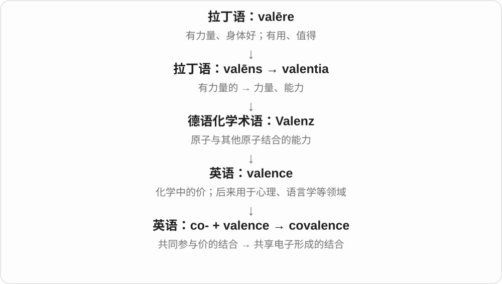

这是比 covalent bond 更少见的名词。共价数数的是共享的电子对，而不是把所有电子逐个数一遍；作为结合性质来用时，抓住共享电子的画面。

**常见搭配与例句**

a covalence of four；the concept of covalence；covalence in chemical bonding。

> In methane, carbon has a covalence of four.

在甲烷中，碳的共价数为四。

> The diagram uses a shared pair of electrons to illustrate covalence.

图中用一对共享电子说明共价结合。

**别混淆**

covalence 聚焦共价结合；valence 是更广的价概念，不能总把两个词当成同一个数。

### 54. convalesce — 病后或术后逐渐康复；休养恢复

**音标**：英 /ˌkɒnvəˈles/；美 /ˌkɑːnvəˈles/

**先抓住这个画面**

病已经过去一些，身体却还没回到原来的力气，需要一段时间一点点恢复。

**怎么拆**

来自拉丁语 convalēscere：con- 在这里有加强作用，valēscere 是从 valēre 形成的“变得强健”。

**怎么变成今天的意思**

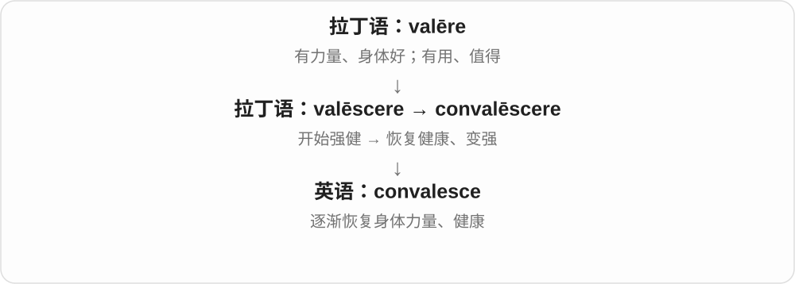

这是偏正式的动词，常接 from an illness、after surgery，或说明在哪里休养。它强调恢复阶段，不表示躺下休息一下就算完成康复。

**常见搭配与例句**

convalesce at home；convalesce after surgery；convalesce from an illness。

> She spent several weeks convalescing at her sister’s home.

她在姐姐家休养了几个星期，逐渐恢复身体。

> He read short novels while convalescing after surgery.

术后休养期间，他读了几部短篇幅的小说。

**别混淆**

recover 可以恢复金钱、数据、健康；convalesce 专门偏向病伤后的逐渐康复。

### 55. convalescent — 康复期的；休养中的；康复期病人

**音标**：英 /ˌkɒnvəˈlesənt/；美 /ˌkɑːnvəˈlesənt/

**先抓住这个画面**

已经走上恢复的路，但还需要照顾、休息和时间。既可形容这个阶段，也可指处在这个阶段的人。

**怎么拆**

法语 convalescent 来自拉丁语 convalēscēns，是 convalēscere 的分词；英语形容词后来也用作人物名词。

**怎么变成今天的意思**

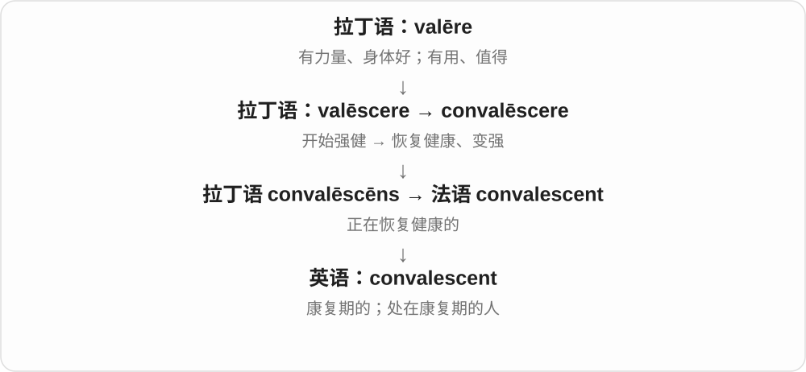

convalescent care 是恢复期照护，convalescent home 是供人病后休养的机构。名词 a convalescent 语气偏正式。

**常见搭配与例句**

a convalescent patient；convalescent care；a convalescent home。

> The garden provided a quiet place for convalescent patients.

花园为康复期病人提供了安静的去处。

> As a convalescent, he needed rest more than a busy schedule.

作为正在康复的人，他更需要休息，而不是紧凑的日程。

**别混淆**

healthy 说身体健康；convalescent 说正在恢复，未必已经恢复如常。

### 56. convalescence — 康复过程；病后休养期

**音标**：英 /ˌkɒnvəˈlesəns/；美 /ˌkɑːnvəˈlesəns/

**先抓住这个画面**

从“病得很虚弱”到“又能正常生活”之间的那段过渡期。

**怎么拆**

经法语 convalescence 来自后期拉丁语 convalēscentia，名词在拉丁语里已经形成；不是英语 convalesce 再随意加一串字母。

**怎么变成今天的意思**

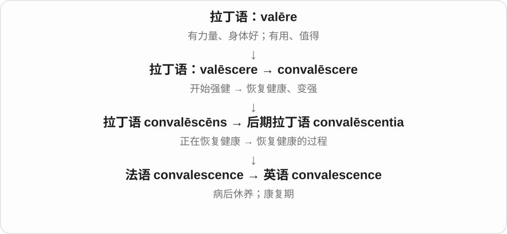

可说 during convalescence、a period of convalescence。它重点描述恢复过程与时段；具体长短和活动程度由实际身体状况决定。

**常见搭配与例句**

a long convalescence；during convalescence；a period of convalescence。

> During her convalescence, friends took turns bringing meals.

她休养期间，朋友们轮流送饭。

> The diary records a slow but steady convalescence.

日记记录了一个缓慢却稳步推进的康复过程。

**别混淆**

rehabilitation 更突出恢复功能的训练或安排；convalescence 指病后恢复阶段，两者可以同时发生。

### 57. divalent — 二价的

**音标**：英、美 /daɪˈveɪlənt/

**先抓住这个画面**

这里的 two 是化学结合中的“二”，不是说东西分成两份或同时含有两种元素。

**怎么拆**

现代科学构词 di-“二” + -valent“有某种价的”；-valent 追到拉丁语 valēns“有力量的”。

**怎么变成今天的意思**

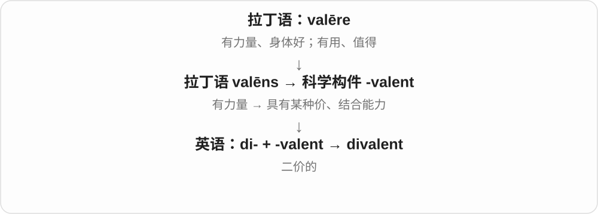

divalent cation 指带两个单位正电荷的阳离子，例如 Ca²⁺。divalent atom 或 group 则按具体成键语境理解二价；不能把“二价”一律理解成有两个价电子。

**常见搭配与例句**

a divalent cation；divalent calcium；a divalent metal ion。

> Calcium commonly forms a divalent cation.

钙通常形成二价阳离子。

> The experiment compared monovalent and divalent ions.

实验比较了单价离子和二价离子。

**别混淆**

divalent 常与 bivalent 的化学义重合；bivalent 还可用于成对染色体等其他领域。

### 58. countervail — 抵消；抗衡〔正式〕

**音标**：英 /ˌkaʊntəˈveɪl/；美 /ˌkaʊntərˈveɪl/

**先抓住这个画面**

一边往这里推，另一边拿出相应的力量顶回去，让原来的影响减弱或保持平衡。

**怎么拆**

经盎格鲁法语 countrevaloir、古法语 contrevaloir，追到拉丁语 contra valēre“以力量或价值相抗”；不是英语 counter + avail。

**怎么变成今天的意思**

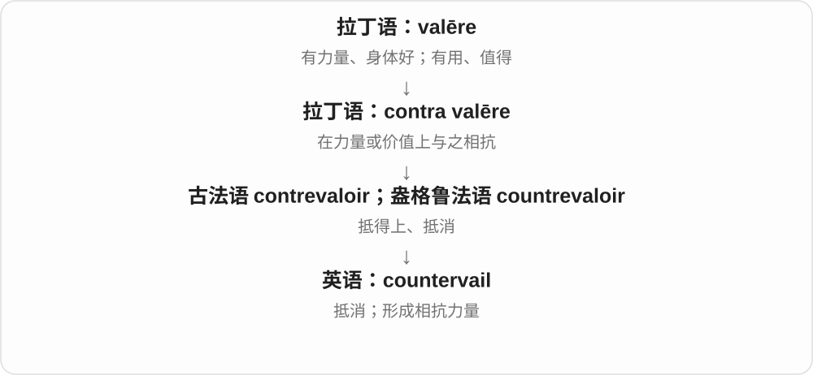

这是少见的正式动词，countervailing 形容词更常见。可说一项好处抵消损失，或一种力量制衡另一种力量。

**常见搭配与例句**

countervail an advantage；countervail a loss；countervailing forces。

> The savings may countervail the initial expense.

节省下来的开支可能抵消最初的花费。

> No independent body existed to countervail the minister’s power.

当时没有独立机构能制衡这位大臣的权力。

**别混淆**

outweigh 是超过、压过；countervail 可以只是在相反方向上抵消、制衡，未必完全胜过。

### 59. countervailing — 抵消的；起制衡作用的

**音标**：英 /ˌkaʊntəˈveɪlɪŋ/；美 /ˌkaʊntərˈveɪlɪŋ/

**先抓住这个画面**

别的力量正在把结果往一个方向推，它则往相反方向用力，让结果不至于完全倒向一边。

**怎么拆**

countervail + -ing；分词形容词化。

**怎么变成今天的意思**

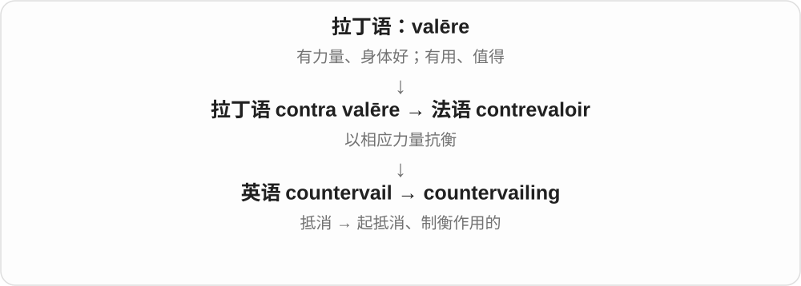

常见 countervailing forces、countervailing influence、countervailing evidence。它描述作用方向，不必意味着双方力量正好相等。

**常见搭配与例句**

countervailing forces；a countervailing influence；countervailing pressures。

> Lower fuel costs provided a countervailing influence on prices.

燃料成本下降对价格上涨形成了抵消作用。

> The committee considered the countervailing evidence before deciding.

委员会在作决定前考虑了支持相反结论的证据。

**别混淆**

opposing 只说相反或反对；countervailing 进一步说它能抵消另一因素的部分作用。

### 60. trivalent — 三价的；具有三个相关结合位置的

**音标**：英、美 /traɪˈveɪlənt/；另有 /ˈtrɪvələnt/

**先抓住这个画面**

tri- 把价或结合数量标成“三”。这是一项具体数量说明，不是“力量比别人强三倍”。

**怎么拆**

现代科学构词 tri-“三” + -valent，后者源于拉丁语 valēns“有力量的”。

**怎么变成今天的意思**

常见 trivalent metal ion，如 Al³⁺。其他专业语境也可能用来描述三个结合位点或三条染色体的关联，必须按所说对象理解。

**常见搭配与例句**

a trivalent ion；trivalent aluminium；a trivalent antigen。

> Aluminium commonly forms a trivalent ion.

铝通常形成三价离子。

> The sample was tested for trivalent metal ions.

研究人员检测了样品中的三价金属离子。

**别混淆**

trivalent 是三价；divalent 是二价。不要把三价离子读成由三个原子组成的离子。

### 61. monovalent — 单价的；一价的；只针对一种对象的〔免疫学〕

**音标**：英 /ˌmɒnəʊˈveɪlənt/；美 /ˌmɑːnoʊˈveɪlənt/

**先抓住这个画面**

mono- 把范围限定到“一”：可能是一个单位的价，也可能是在特定免疫学描述中只针对一种对象。

**怎么拆**

现代科学构词 mono-“一、单” + -valent；-valent 追到拉丁语 valēns“有力量的”。

**怎么变成今天的意思**

化学中 a monovalent ion 带一个单位的电荷，例如 Na⁺ 或 Cl⁻。免疫学的具体含义要看对象，可能谈一个结合位点或一种抗原对象；不是“药效只有一分”。

**常见搭配与例句**

a monovalent ion；monovalent sodium；a monovalent antibody fragment。

> Sodium forms a monovalent positive ion.

钠形成一价正离子。

> The table lists monovalent ions separately from divalent ions.

表格把单价离子与二价离子分开列出。

**别混淆**

monovalent 与 divalent 在价数上是一与二；价数较高本身不表示更好或更有效。

### 62. polyvalent — 多价的；能针对多种对象发挥作用的

**音标**：英 /ˌpɒlɪˈveɪlənt/；美 /ˌpɑːliˈveɪlənt/；另有 /pəˈlɪvələnt/

**先抓住这个画面**

把“只和一种对象、只按一种方式发生作用”的范围扩大到多种。科学领域会进一步规定这里的“多”具体数什么。

**怎么拆**

现代国际科学构词 poly-“多” + -valent；后者追到拉丁语 valēns“有力量的”。

**怎么变成今天的意思**

化学里可指价较高或具有不止一种价，具体定义要看文献。免疫学中 polyvalent serum 可含针对不同抗原的抗体；不是说它对所有对象都有效。

**常见搭配与例句**

polyvalent metal ions；a polyvalent serum；polyvalent binding。

> The method separates polyvalent metal ions from the solution.

这种方法能从溶液中分离多价金属离子。

> The laboratory tested the polyvalent serum against several antigens.

实验室检测了这种多价血清对几种抗原的反应。

**别混淆**

polyvalent 与 multivalent 在科学用法中常重合；写文艺作品的多重意义时，multivalent 更常见。

### 63. multivalent — 多价的；具有多重意义或作用的

**音标**：英、美 /ˌmʌltɪˈveɪlənt/

**先抓住这个画面**

一个东西不止沿一条路起作用：科学中可以有多重结合关系，文艺作品中则可以同时带出几层意义。

**怎么拆**

科学构词 multi-“多” + -valent，后者来自拉丁语 valēns；后来也用“多重价值、力量”的画面描述意义和吸引力。

**怎么变成今天的意思**

科学语境中与 polyvalent 常有重合；评论里的 a multivalent symbol 是能承载几层意义的象征。它说有多种作用或解释，不自动表示意义混乱。

**常见搭配与例句**

a multivalent symbol；multivalent meanings；multivalent interactions。

> The river is a multivalent symbol of freedom, danger, and change.

河流是一个多义象征，同时代表自由、危险和变化。

> The paper compares multivalent and monovalent interactions.

这篇论文比较了多价相互作用和单价相互作用。

**别混淆**

ambiguous 可能让人无法确定到底是哪一个意思；multivalent 可以是多个意义同时成立、互相叠加。

### 64. bivalent — 二价的；成对的；二价体〔遗传学〕

**音标**：英、美 /baɪˈveɪlənt/；另有 /ˈbɪvələnt/

**先抓住这个画面**

抓住“二”这一点，再看领域：化学中是二价；减数分裂中则是两条同源染色体配成一对。

**怎么拆**

现代科学构词 bi-“二” + -valent；后者最终来自拉丁语 valēns“有力量的”，用于结合能力。

**怎么变成今天的意思**

在化学里可与 divalent 重合；遗传学名词 a bivalent 是配对的两条同源染色体。两条染色体各自已经复制时共有四条染色单体，不要把“二价体”误数成两条染色单体。

**常见搭配与例句**

a bivalent metal ion；bivalent chromosomes；a bivalent formed during meiosis。

> The diagram shows a bivalent formed by two homologous chromosomes.

图中显示了两条同源染色体配对形成的二价体。

> The solution contains bivalent calcium ions.

溶液中含有二价钙离子。

**别混淆**

bivalent 是二价或成对；ambivalent 是同时持有相反态度，不是化学上的“二价”。

### 65. valediction — 告别的话；辞别

**音标**：/ˌvælɪˈdɪkʃən/

**先抓住这个画面**

临别时郑重说的最后几句话，不只是随手挥一下手。valediction 是告别中的那份言语。

**怎么拆**

拉丁语 valē（再见；原为保重）+ dīcere（说），形成新拉丁语 valedictiō。

**怎么变成今天的意思**

说“保重”就是一种告别，两个成分合起来命名了告别行为和告别的话。这个词偏正式或文学，日常 goodbye 已够用。

**常见搭配与例句**

a farewell valediction；a final valediction；a moving valediction。

> He ended the letter with a warm valediction.

他用温暖的告别话语结束了信件。

> The final poem serves as a valediction to her hometown.

最后一首诗是她献给故乡的告别辞。

**别混淆**

benediction 是祝福，valediction 是告别；告别中可以带祝福，但两个词强调不同事情。

## 这一组要分清什么

invaluable 是价值难以估量，因此极有价值；valueless 才是没有价值。invalid 的“无效”与旧时“病弱者”有不同重音。ambivalent 表示相反感受并存，indifferent 才是不在乎。valley、valve 虽然字母相似，却不属于 valēre：valley 来自 vallis“山谷”，valve 属于 valva“门扇”一支。

## 串起来练习

用三句话连起核心：Your advice is valuable，建议有分量；This ticket is still valid，这张票仍有效；Common sense prevailed，常理最后占了上风。再比较 I am ambivalent about the move：搬家同时有吸引我和拉住我的两股力量。
