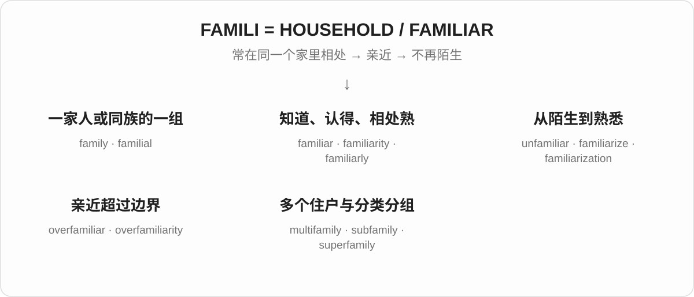
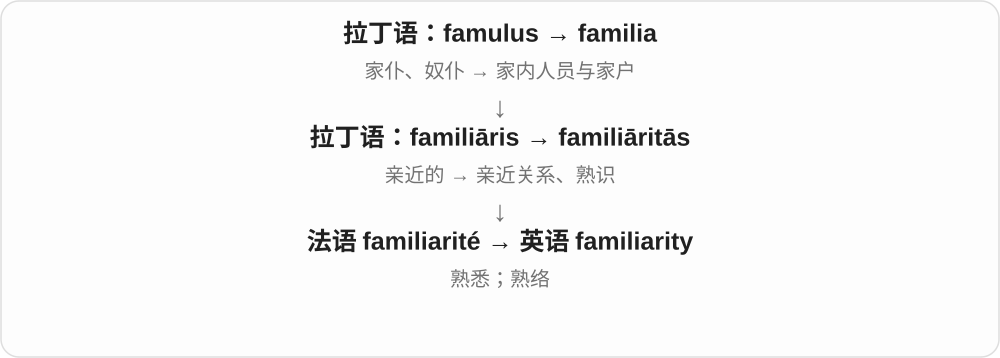
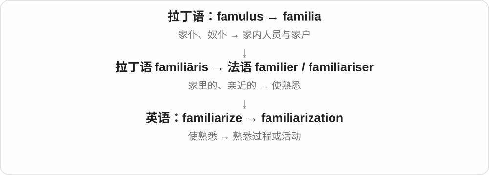
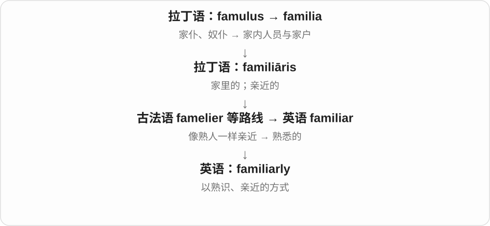
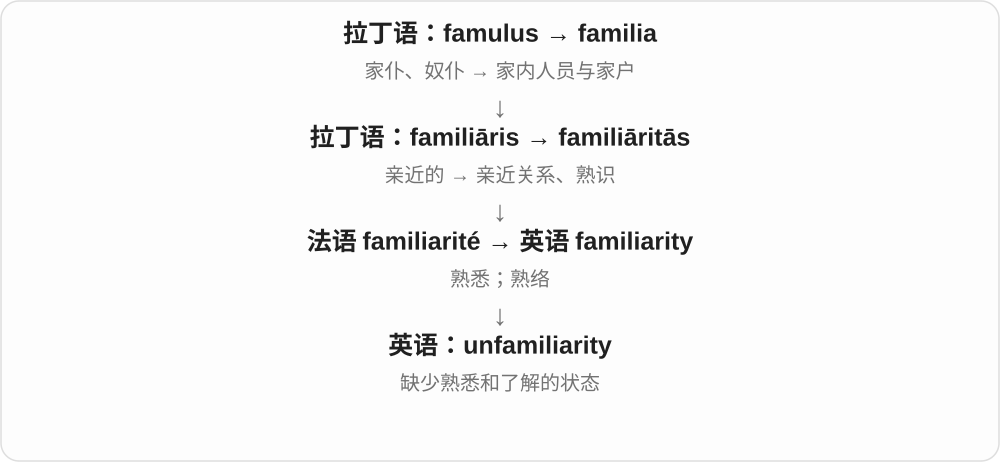
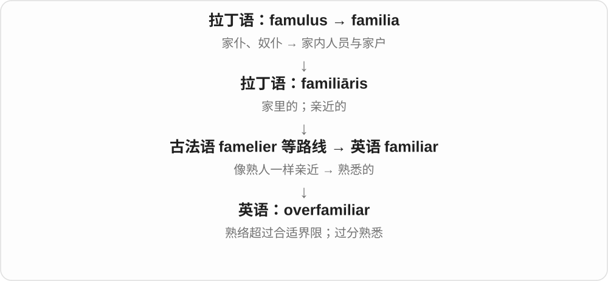
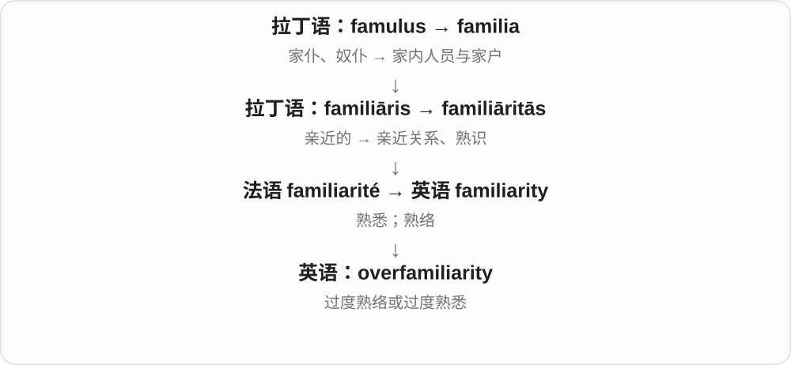

# 0189 · famili- — 家内的人；家庭与家族；因亲近而熟悉

[逐词精讲目录](../00_逐词精讲目录.md) · [总目录](../00_总目录_按常用程度.md)

## 核心词根与来源

**famili-** 从拉丁语 **familia**“家户、家内人员”来。它更早与 **famulus**“家仆、奴仆”相关，这反映的是当时的家户制度。现代学习先抓两条线：family 是“一家人”；familiar 是“像家里常见的人和东西一样，不陌生”。

## 词形与演化规律

**family** 来自 familia；**familiar** 来自 familiāris，经法语等路线进入英语；**familiarity** 来自 familiāritās，经过法语 familiarité。它们是一家词，但不全是用现代英语 family 逐个拼出来的。

**familial** 是另一条法语借词，专门说“家庭相关”。**familiarize / familiarise** 与 **familiarization / familiarisation** 是常见拼写差异，意思不另立一套。

**famulus 更早的来源存在不同分析**，本页不把有争议的远祖画成确定的演化链。

## 单词速览（按词族由简到繁）

同一基础词的相关扩展放在一起，先读基础形式，再读扩展；各组之间优先读常用的。具体词源关系见各词讲解。

| 单词 | 音标 | 核心意思 |
|---|---|---|
| [family](#w-1) | 英 /ˈfæməli/、/ˈfæmli/；美 /ˈfæməli/、/ˈfæmli/ | 家庭；家人；家族；相关的一组 |
| [familial](#w-5) | 英 /fəˈmɪliəl/；美 /fəˈmɪljəl/ | 家庭的；家族相关的 |
| [multifamily](#w-7) | 英 /ˌmʌltiˈfæməli/；美 /ˌmʌltiˈfæməli/，也读 /ˌmʌltaɪˈfæməli/ | 多家庭的；多户住宅的 |
| [subfamily](#w-8) | 英 /ˈsʌbˌfæməli/；美 /ˈsʌbˌfæməli/ | 亚科；一个大族中的次级分组 |
| [superfamily](#w-9) | 英 /ˈsuːpəˌfæməli/；美 /ˈsuːpərˌfæməli/ | 总科；超家族 |
| [familiar](#w-2) | 英 /fəˈmɪliə/；美 /fəˈmɪljər/ | 熟悉的；熟络的；过于随便的 |
| [familiarity](#w-4) | 英 /fəˌmɪliˈærəti/；美 /fəˌmɪliˈerəti/ | 熟悉程度；亲近、熟络；过分随便 |
| [familiarize](#w-6) | 英 /fəˈmɪliəraɪz/；美 /fəˈmɪljəraɪz/ | 使熟悉；让自己熟悉 |
| [familiarization](#w-12) | 英 /fəˌmɪliəraɪˈzeɪʃən/；美 /fəˌmɪljərəˈzeɪʃən/ | 熟悉过程；入门熟悉训练 |
| [familiarly](#w-11) | 英 /fəˈmɪliəli/；美 /fəˈmɪljərli/ | 熟络地；随便亲近地；以熟知的方式 |
| [unfamiliar](#w-3) | 英 /ˌʌnfəˈmɪliə/；美 /ˌʌnfəˈmɪljər/ | 不熟悉的；陌生的 |
| [unfamiliarity](#w-10) | 英 /ˌʌnfəˌmɪliˈærəti/；美 /ˌʌnfəˌmɪliˈerəti/ | 不熟悉；缺乏了解 |
| [overfamiliar](#w-13) | 英 /ˌəʊvəfəˈmɪliə/；美 /ˌoʊvərfəˈmɪljər/ | 过于熟络的；亲昵失礼的；熟悉过头的 |
| [overfamiliarity](#w-14) | 英 /ˌəʊvəfəˌmɪliˈærəti/；美 /ˌoʊvərfəˌmɪliˈerəti/ | 过于熟络；熟悉过头 |

## 逐词讲解

### 1. family — 家庭；家人；家族；相关的一组

**音标**：英 /ˈfæməli/、/ˈfæmli/；美 /ˈfæməli/、/ˈfæmli/

**先抓住这个画面**

先想同一个家里的人，再扩大到有亲缘关系的人；事物有共同来源或特征，也能被说成“一家”。

**怎么拆**

来自拉丁语 familia，起初与 famulus“家仆、奴仆”相关，后来包括家内人员、亲属等。现代 family 的范围不是古罗马家户制度的原样复制。

**怎么变成今天的意思**

family 可以是同住的一家，也可以是分住各地的亲属。a language family 是语系；生物分类的 family 是科。

**常见搭配与例句**

family life；a family member；a family of languages；start a family。

> My family lives in several different cities.

我的家人住在几个不同的城市。

> English belongs to the Germanic branch of the Indo-European language family.

英语属于印欧语系的日耳曼语族。

**别混淆**

family 强调亲属或被视为家人的关系；household 强调共同居住的住户，二者不完全相同。

### 2. familial — 家庭的；家族相关的

**音标**：英 /fəˈmɪliəl/；美 /fəˈmɪljəl/

**先抓住这个画面**

把问题放回家庭关系里：家人之间的责任、联系、习惯或共同出现的特点。

**怎么拆**

借自法语 familial，来自拉丁语 familia；现代可理解为 family 词族 + -al，但与 familiar 是不同的借词。

**怎么变成今天的意思**

较正式，常用于 familial bonds、familial obligations。日常简单表达时，family 作定语通常更自然。

**常见搭配与例句**

familial ties；familial responsibilities；familial relationships。

> The novel explores love and familial obligations.

小说探讨爱与家庭责任。

> They maintained strong familial ties despite living far apart.

尽管相隔很远，他们仍保持着紧密的家庭联系。

**别混淆**

familiar 是熟悉的；familial 是家庭相关的。某个人很 familiar，不说明他是亲属。

### 3. multifamily — 多家庭的；多户住宅的

**音标**：英 /ˌmʌltiˈfæməli/；美 /ˌmʌltiˈfæməli/，也读 /ˌmʌltaɪˈfæməli/

**先抓住这个画面**

一栋建筑里分成几个住户单元，各住各的一家；不只是同一个大家庭人数多。

**怎么拆**

multi- 多 + family。

**怎么变成今天的意思**

常修饰 housing、building、property，特别常见于住房与城市规划语境。

**常见搭配与例句**

multifamily housing；a multifamily building。

> The project will add more multifamily housing near the station.

这个项目将在车站附近增加多户住宅。

> The old house was converted into a multifamily building.

老房子被改成了供多户居住的建筑。

**别混淆**

multifamily housing 说多个住户单元；a large family 只是一个家庭人数多。

### 4. subfamily — 亚科；一个大族中的次级分组

**音标**：英 /ˈsʌbˌfæməli/；美 /ˈsʌbˌfæməli/

**先抓住这个画面**

先圈出一个大家族，再在内部把联系更近的成员圈成较小的一组。

**怎么拆**

sub- 在下、次一级 + family 族、科。

**怎么变成今天的意思**

生物分类中低于科、高于属；语言分类等语境也可用来表示一个大族内的分支。不是某个家庭社会地位低。

**常见搭配与例句**

a subfamily of insects；classify into subfamilies。

> The chart divides the family into three subfamilies.

图表把这一科分成三个亚科。

> These insects belong to the same subfamily.

这些昆虫属于同一个亚科。

**别混淆**

subfamily 的 sub- 表分类层级更细；superfamily 则比 family 更宽。

### 5. superfamily — 总科；超家族

**音标**：英 /ˈsuːpəˌfæməli/；美 /ˈsuːpərˌfæməli/

**先抓住这个画面**

几个相关的小家族，还能往外套一个更大的圈；这个更宽的分组就是 superfamily。

**怎么拆**

super- 在上、更高层级 + family。

**怎么变成今天的意思**

生物分类中高于科、低于目；分子生物学里的 protein superfamily 指相关蛋白质家族构成的较大群。

**常见搭配与例句**

a superfamily of proteins；a biological superfamily。

> Several related families are grouped into one superfamily.

几个相关的科被归入同一个总科。

> The protein belongs to a large superfamily.

这种蛋白质属于一个很大的超家族。

**别混淆**

super- 在这里不表示“特别优秀”，而是分类范围更大。

### 6. familiar — 熟悉的；熟络的；过于随便的

**音标**：英 /fəˈmɪliə/；美 /fəˈmɪljər/

**先抓住这个画面**

像家里常见的人和东西，不用第一次重新认识，一眼、一听就有“我知道”的感觉。

**怎么拆**

经法语等路线来自拉丁语 familiāris“家里的、亲近的”，与 familia 同族；不是由现代英语 family 临时改拼写而来。

**怎么变成今天的意思**

I am familiar with it 是我熟悉它；It is familiar to me 是它对我来说很熟悉。a familiar tone 还可表示熟络，若越过关系边界，也可能显得失礼。 奇幻或民俗中的名词 a familiar 指与巫师相伴、为其服务的精灵或动物形象，来自 familiar spirit 的用法。

**常见搭配与例句**

familiar with；familiar to；a familiar face；sound familiar。

> Her face looks familiar, but I cannot remember her name.

她看起来面熟，但我想不起她的名字。

> Are you familiar with this software?

你熟悉这个软件吗？

**别混淆**

familiar 是熟悉；familial 是家庭相关。a familiar voice 是熟悉的声音，不一定来自亲属。

### 7. familiarity — 熟悉程度；亲近、熟络；过分随便

**音标**：英 /fəˌmɪliˈærəti/；美 /fəˌmɪliˈerəti/

**先抓住这个画面**

见过、用过很多次，东西在脑中有了位置；人与人相处久了，也可能越来越不拘礼节。

**怎么拆**

经法语 familiarité 来自拉丁语 familiāritās，名词有自己的借入历史；现代与 familiar + -ity 对应。

**怎么变成今天的意思**

familiarity with a subject 是熟悉某领域；excessive familiarity 则是过度亲昵。词尾变化时主重音移到后部。

**常见搭配与例句**

familiarity with the system；a sense of familiarity；excessive familiarity。

> The job requires some familiarity with basic accounting.

这份工作要求对基础会计有所了解。

> He spoke with a familiarity that made her uncomfortable.

他说话过于熟络，让她感到不自在。

**别混淆**

familiarity 是熟悉，不保证 competence“胜任能力”：常见过一种工具，未必会熟练操作。

### 8. familiarize — 使熟悉；让自己熟悉

**音标**：英 /fəˈmɪliəraɪz/；美 /fəˈmɪljəraɪz/

**先抓住这个画面**

带一个人认路、试用工具、了解规则，让原本陌生的东西逐渐变得顺手。

**怎么拆**

现代可拆 familiar + -ize“使……”。历史上也有法语 familiariser 的借入分析，不能只认定为英语新造词；英式也常写 familiarise。

**怎么变成今天的意思**

常见 familiarize yourself with，也可说 familiarize someone with。需要说明谁变熟悉，以及熟悉什么。

**常见搭配与例句**

familiarize yourself with；familiarize new staff with…。

> Take a few minutes to familiarize yourself with the controls.

花几分钟熟悉一下这些控制装置。

> The tour familiarized new students with the campus.

这次参观让新生熟悉了校园。

**别混淆**

familiarize 是使熟悉的过程；be familiar 是已经熟悉的状态。

### 9. familiarization — 熟悉过程；入门熟悉训练

**音标**：英 /fəˌmɪliəraɪˈzeɪʃən/；美 /fəˌmɪljərəˈzeɪʃən/

**先抓住这个画面**

正式开始之前，先认环境、看操作、试一下，让人不再摸不着头脑。

**怎么拆**

familiarize + -ation，也可分析 familiar + -ization；英式有 familiarisation。

**怎么变成今天的意思**

多见于培训、设备操作和新员工入门。一次 familiarization 不必等于完整专业训练。

**常见搭配与例句**

a familiarization session；equipment familiarization。

> New employees attend a familiarization session on their first day.

新员工第一天参加入门熟悉活动。

> The programme includes familiarization with the laboratory equipment.

项目包括熟悉实验室设备的环节。

**别混淆**

familiarity 是已经熟悉的程度；familiarization 是逐渐熟悉的过程。

### 10. familiarly — 熟络地；随便亲近地；以熟知的方式

**音标**：英 /fəˈmɪliəli/；美 /fəˈmɪljərli/

**先抓住这个画面**

说话做事像已经认识很久，少了陌生人之间的客气距离。

**怎么拆**

familiar + -ly，中古英语已有 familierly 等形式。

**怎么变成今天的意思**

可描述友善亲近，也可能暗示不合时宜的随便；是否合适要看双方关系。familiarly known as 还可引出常用昵称。

**常见搭配与例句**

speak familiarly；address someone familiarly；familiarly known as…。

> He greeted the regular customers familiarly.

他熟络地招呼那些老顾客。

> The building is familiarly known as the Red House.

这栋楼被大家习惯地称为“红房子”。

**别混淆**

familiarly 是熟络或熟知的方式；familially 才是较少见的“在家庭关系方面”，不要混读词形。

### 11. unfamiliar — 不熟悉的；陌生的

**音标**：英 /ˌʌnfəˈmɪliə/；美 /ˌʌnfəˈmɪljər/

**先抓住这个画面**

眼前的东西没有接上已有的经验：地方不认识、规则没用过、声音没听惯。

**怎么拆**

un- 否定 familiar。

**怎么变成今天的意思**

可以说 I am unfamiliar with the rules，也可以说 The rules are unfamiliar to me。陌生不一定奇怪或危险。

**常见搭配与例句**

an unfamiliar place；unfamiliar with；unfamiliar to…。

> The map helped us find our way through an unfamiliar city.

地图帮助我们在陌生的城市里找到路。

> The terminology was unfamiliar to most of the students.

大多数学生都不熟悉这些术语。

**别混淆**

unfamiliar 是对某人不熟悉；strange 还可以说事物本身奇怪，含义更宽。

### 12. unfamiliarity — 不熟悉；缺乏了解

**音标**：英 /ˌʌnfəˌmɪliˈærəti/；美 /ˌʌnfəˌmɪliˈerəti/

**先抓住这个画面**

事情难做，不一定是能力不够，也可能只是还不知道这套环境怎样运转。

**怎么拆**

un- 否定 familiarity；也对应 unfamiliar 的名词形式。

**怎么变成今天的意思**

常用 unfamiliarity with，说明不熟悉什么；是较正式的名词表达。

**常见搭配与例句**

unfamiliarity with the procedure；initial unfamiliarity。

> Her mistakes came from unfamiliarity with the new system.

她的失误来自对新系统不熟悉。

> Initial unfamiliarity soon gave way to confidence.

起初的陌生感很快被信心取代。

**别混淆**

unfamiliarity 是缺少经验或接触；inability 是做不到，两者不能直接画等号。

### 13. overfamiliar — 过于熟络的；亲昵失礼的；熟悉过头的

**音标**：英 /ˌəʊvəfəˈmɪliə/；美 /ˌoʊvərfəˈmɪljər/

**先抓住这个画面**

关系还没到那一步，却先叫很私人的昵称、开越界的玩笑，让对方觉得“我们有这么熟吗？”

**怎么拆**

over- 过度 + familiar；这是英语里直接组合的形容词。

**怎么变成今天的意思**

通常批评对人过分随便；形容故事、曲调时也可指熟悉得缺乏新鲜感。

**常见搭配与例句**

an overfamiliar manner；overfamiliar jokes；an overfamiliar tune。

> His overfamiliar jokes made the new colleague uncomfortable.

他那些过于熟络的玩笑让新同事不舒服。

> The film relies on an overfamiliar plot.

这部电影依赖一个过于老套、大家太熟悉的情节。

**别混淆**

friendly 是友善；overfamiliar 加入了“超过关系允许的距离”的负面判断。

### 14. overfamiliarity — 过于熟络；熟悉过头

**音标**：英 /ˌəʊvəfəˌmɪliˈærəti/；美 /ˌoʊvərfəˌmɪliˈerəti/

**先抓住这个画面**

亲近感超过了边界，或因为见得太多而失去了新鲜感。

**怎么拆**

over- 过度 + familiarity；也可看作 overfamiliar 对应的性质名词。

**怎么变成今天的意思**

谈人际态度时常带失礼、唐突的意味；谈作品时可能是熟悉到厌倦。

**常见搭配与例句**

a tone of overfamiliarity；avoid overfamiliarity。

> The manager’s tone crossed from friendliness into overfamiliarity.

经理的语气从友善越过了界，显得过分熟络。

> Overfamiliarity with the story reduced its surprise.

对这个故事太熟悉，削弱了其中的惊喜。

**别混淆**

familiarity 可以是宝贵的了解；overfamiliarity 多了一层“过头”的评价。

## 这一组要分清什么

**family / household**：家庭关系 / 共同居住的住户，可能重合但不是一回事。

**familiar / familial**：熟悉的 / 家庭相关的。

**familiar with / familiar to**：I am familiar with the place（我熟悉这个地方）；The place is familiar to me（这个地方让我感到熟悉）。

**familiarity / familiarization**：已经有的熟悉程度 / 逐渐熟悉的过程。

**subfamily → family → superfamily**：分组由小到大；不是生物从亚科“进化成”总科。

## 串起来练习

**The familiarization session helped new employees become familiar with an initially unfamiliar system.**

入门活动帮助新员工熟悉一套原本陌生的系统。familiarization 是过程，unfamiliar 是起点，familiar 是逐渐达到的状态。
