# 0190 · sequ-, secut- — 跟随；接续；由跟随引申为结果与追求

[逐词精讲目录](../00_逐词精讲目录.md) · [总目录](../00_总目录_按常用程度.md)

## 核心词根与来源

**sequ-/secut-** 来自拉丁语 **sequī**“跟随”。东西排着跟上是 sequence，排在后面是 subsequent，由前事带来的结果是 consequence。把目光和行动一直跟着目标走，就有 pursue；追着人伤害，则成了 persecute。

**SEQU / SECUT = FOLLOW**

前面一步走出，后面一步跟上：可以是顺序、结果或紧追不放

- **依次跟上**：second · sequence · sequential
- **后来发生**：subsequent · subsequently · ensue
- **跟出结果**：consequence · consequently · consequential
- **接连不断**：consecutive · consecutively
- **持续追求**：pursue · pursuit · pursuer
- **诉讼与迫害分开**：prosecute · persecute
- **跟不上逻辑或跟得过头**：non sequitur · obsequious
- **seconds：秒、第二份食物与次品**：second · seconds
- **consequence → consequences：跟在后面的结果**：consequence · consequences
- **pursue → pursuing：沿目标继续跟下去**：pursue · pursuing
- **pursue → pursued：跟着走、追求目标**：pursue · pursued
- **pursue：沿着目标一路跟进**：pursue · pursues · pursued · pursuing · pursuer · pursuers
- **sue：跟随、追求一条线到法律追究**：sue · sues · sued · suing
- **second → sec → secs：秒到一会儿**：sec · secs
- **同一秒的不同细分：毫秒、微秒、纳秒**：milliseconds · microseconds · nanoseconds
- **sequi 跟随 → sequence → sequences**：sequences
- **pro- 向前 + secut- 跟随 → prosecutors**：prosecutors

## 词形与演化规律

**sequ-** 常见于 sequence；**secut-** 来自拉丁语相关分词形式，见 prosecute、consecutive。法语音变让 pursue、ensue 不再保留完整 sequ。**second** 来自 secundus“跟在后面的”，时间单位“秒”又源于第二次六十分割。

秒接第二次六十分割；第二份食物和次品接次序、等级的 second 分支，各有固定名词用法。

跟随词族的名词借入，结果本身未必不利。

盎格鲁诺曼语接拉丁 prosequi，并有 persequi 影响，现代 ing 去 e。

盎格鲁诺曼语接拉丁跟随材料；去 e 加完整 ed。

经古法语 poursuir 等接拉丁 prosequi，pro- 向前加 sequi 跟随；现代 pursues、pursuers 分别是动词三单与人物词复数。

经法语 suer、suivre 等词线接拉丁 sequi 跟随；跟着一件事追下去的画面联系法律追究。现代 sue someone for damages 中，直接对象是被起诉的一方，for 后是索求等内容。

second 秒源于第二次细分的小份，second 第二本来接跟随、下一位的词族；sec、secs 是口语短称，a sec 常只表示一会儿，不保证正好一秒。

second 秒的名称有第二次细分小份的历史背景；milli-、micro-、nano- 分别把秒缩为千分之一、百万分之一、十亿分之一。学习时按尺度比较，不表示一个单词由另一个单词演化。

拉丁 sequi 跟随、分词 sequens → sequentia 相继，经法语等进入英语。sequence 保留词末 e 加 -s，/s/ 后复数、第三人称读 /ɪz/。

prosecutor 接拉丁 prosequi 追随、继续进行的行为者词族，现代常说检察官、公诉人或提起诉讼的一方，具体制度称呼有差别。

## 单词速览（按词族由简到繁）

同一基础词的相关扩展放在一起，先读基础形式，再读扩展；各组之间优先读常用的。具体词源关系见各词讲解。

| 单词 | 音标 | 核心意思 |
|---|---|---|
| [second](#w-1) | /ˈsekənd/；借调义动词英 /sɪˈkɒnd/ | 第二；秒；附议；另有借调义 |
| [seconds](#w-29) | /ˈsekəndz/ | 秒〔复数〕；第二份食物；次品；second 的第三人称形式 |
| [microseconds](#w-42) | 英 /ˈmaɪkrəʊˌsekəndz/；美 /ˈmaɪkroʊˌsɛkəndz/ | 微秒 |
| [sec](#w-39) | 英 /sek/；美 /sɛk/ | 秒；一会儿〔second 的口语短称〕 |
| [secs](#w-40) | 英 /seks/；美 /sɛks/ | 秒；几秒钟、一会儿〔复数短称〕 |
| [sequence](#w-3) | /ˈsiːkwəns/ | 顺序；序列；一连串 |
| [sequences](#w-44) | 英 /ˈsiːkwənsɪz/；美 /ˈsiːkwənsɪz/ | 序列，一连串；片段〔复数〕；安排顺序、测定序列〔第三人称〕 |
| [sequential](#w-15) | /sɪˈkwenʃəl/ | 按顺序的；依次发生的 |
| [sequencer](#w-23) | 英 /ˈsiːkwənsə/；美 /ˈsiːkwənsər/ | 音序器；测序仪；顺序控制装置 |
| [consequence](#w-8) | 英 /ˈkɒnsɪkwəns/；美 /ˈkɑːnsəkwəns/ | 结果；后果；重要性 |
| [consequences](#w-30) | 英 /ˈkɒnsɪkwənsɪz/；美 /ˈkɑːnsɪkwənsɪz/ | 结果、后果〔consequence 的复数〕 |
| [subsequent](#w-2) | /ˈsʌbsɪkwənt/ | 随后的；之后发生的 |
| [subsequently](#w-5) | /ˈsʌbsɪkwəntli/ | 随后；后来 |
| [pursue](#w-4) | 英 /pəˈsjuː/；美 /pərˈsuː/ | 追赶；追求；继续从事 |
| [pursuing](#w-31) | 英 /pəˈsjuːɪŋ/；美 /pərˈsuːɪŋ/ | 追赶、追求；继续从事、深入处理〔现在分词、动名词〕 |
| [pursued](#w-32) | 英 /pəˈsjuːd/；美 /pərˈsuːd/ | 追赶了、追求了；继续从事了〔过去式、过去分词〕 |
| [pursues](#w-33) | 英 /pəˈsjuːz/；美 /pərˈsuːz/ | 追赶、追求；继续进行〔第三人称单数〕 |
| [pursuer](#w-24) | 英 /pəˈsjuːə/；美 /pərˈsuːər/ | 追赶者；追求者 |
| [pursuers](#w-34) | 英 /pəˈsjuːəz/；美 /pərˈsuːərz/ | 追赶者、追求者〔复数〕 |
| [pursuance](#w-26) | 英 /pəˈsjuːəns/；美 /pərˈsuːəns/ | 执行；落实；追求的过程 |
| [sue](#w-35) | 英 /suː/，也可 /sjuː/；美 /suː/ | 起诉、控告；〔sue for〕请求、寻求 |
| [sued](#w-36) | 英 /suːd/，也可 /sjuːd/；美 /suːd/ | 起诉了；被起诉〔过去式、过去分词〕 |
| [suing](#w-37) | 英 /ˈsuːɪŋ/，也可 /ˈsjuːɪŋ/；美 /ˈsuɪŋ/ | 正在起诉；起诉行为 |
| [sues](#w-38) | 英 /suːz/，也可 /sjuːz/；美 /suːz/ | 起诉；请求〔第三人称单数〕 |
| [consecutive](#w-6) | /kənˈsekjətɪv/ | 连续的；接连的 |
| [consecutively](#w-18) | /kənˈsekjətɪvli/ | 连续地；依次不断地 |
| [pursuit](#w-7) | 英 /pəˈsjuːt/；美 /pərˈsuːt/ | 追求；追赶；业余爱好 |
| [prosecute](#w-14) | 英 /ˈprɒsɪkjuːt/；美 /ˈprɑːsəkjuːt/ | 起诉；进行公诉；持续推进 |
| [prosecution](#w-9) | 英 /ˌprɒsɪˈkjuːʃən/；美 /ˌprɑːsəˈkjuːʃən/ | 起诉；公诉；控方 |
| [prosecutor](#w-12) | 英 /ˈprɒsɪkjuːtə/；美 /ˈprɑːsəkjuːtər/ | 检察官；公诉人；起诉方人员 |
| [prosecutors](#w-45) | 英 /ˈprɒsɪkjuːtəz/；美 /ˈprɑːsɪkjuːtɚz/ | 检察官；公诉人；提起诉讼者〔复数〕 |
| [prosecutorial](#w-22) | 英 /ˌprɒsɪkjuːˈtɔːriəl/；美 /ˌprɑːsəkjuːˈtɔːriəl/ | 检察工作的；公诉方的 |
| [sequel](#w-10) | /ˈsiːkwəl/ | 续集；后续事件 |
| [consequent](#w-17) | 英 /ˈkɒnsɪkwənt/；美 /ˈkɑːnsəkwənt/ | 随之产生的；由此导致的 |
| [consequently](#w-11) | 英 /ˈkɒnsɪkwəntli/；美 /ˈkɑːnsəkwəntli/ | 因此；所以 |
| [consequential](#w-16) | 英 /ˌkɒnsɪˈkwenʃəl/；美 /ˌkɑːnsəˈkwenʃəl/ | 影响重大的；随之产生的 |
| [inconsequential](#w-20) | 英 /ɪnˌkɒnsɪˈkwenʃəl/；美 /ɪnˌkɑːnsəˈkwenʃəl/ | 无关紧要的；影响很小的 |
| [persecute](#w-21) | 英 /ˈpɜːsɪkjuːt/；美 /ˈpɜːrsəkjuːt/ | 迫害；持续骚扰 |
| [persecution](#w-13) | 英 /ˌpɜːsɪˈkjuːʃən/；美 /ˌpɜːrsəˈkjuːʃən/ | 迫害；持续压迫 |
| [persecutor](#w-28) | 英 /ˈpɜːsɪkjuːtə/；美 /ˈpɜːrsəkjuːtər/ | 迫害者 |
| [ensue](#w-19) | 英 /ɪnˈsjuː/；美 /ɪnˈsuː/ | 接着发生；随之而来 |
| [milliseconds](#w-41) | 英 /ˈmɪlɪˌsekəndz/；美 /ˈmɪlɪˌsɛkəndz/ | 毫秒 |
| [non sequitur](#w-25) | 英 /ˌnɒn ˈsekwɪtə/；美 /ˌnɑːn ˈsekwɪtər/ | 不合逻辑的推论；突兀、不相干的话 |
| [nanoseconds](#w-43) | 英 /ˈnænəʊˌsekəndz/；美 /ˈnænoʊˌsɛkəndz/ | 纳秒；极短的一瞬间〔夸张〕 |
| [obsequious](#w-27) | /əbˈsiːkwiəs/ | 谄媚的；过分顺从的 |

## 逐词讲解

### 1. second — 第二；秒；附议；另有借调义

**音标**：/ˈsekənd/；借调义动词英 /sɪˈkɒnd/

**先抓住这个画面**

第一个走在前面，紧跟着的就是 second。“秒”也保留第二的概念，只是指把时间再次六十分割后的那一份。

**怎么拆**

拉丁语 secundus“跟在后面的”经法语进入英语。时间单位来自中世纪拉丁语 secunda pars minuta“第二次细分的一份”。

**怎么变成今天的意思**

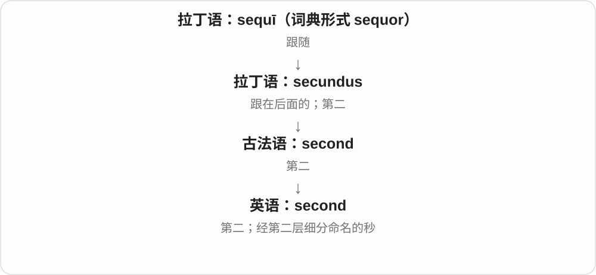

一小时先分成六十份得到分钟，再把一分钟分成六十份得到秒。动词 second a motion 是跟进支持一项提议；借调义读音另有变化。

**常见搭配与例句**

the second floor；a second chance；wait a second；second a motion。

> She finished second in the race.

她在比赛中获得第二名。

> Wait a second while I find the key.

等一下，我找找钥匙。

**别混淆**

second 的第二义与 two 的数量义不同。second a motion 是附议，不是把提议重复第二遍。

### 2. seconds — 秒〔复数〕；第二份食物；次品；second 的第三人称形式

**音标**：/ˈsekəndz/

**先抓住这个画面**

几秒钟是 seconds；吃完一份又添一份，是 have seconds。它还可指质量第二档的货品，后两支都抓第二这一层。

**怎么拆**

second 的秒义接中世纪拉丁第二次细分：小时六十分得分钟，再六十分得秒。添饭、次品等则接 second 次序或等级的用法，复数形成固定名词。

**怎么变成今天的意思**

**拉丁 second 的第二、接续词族 → 时间单位**  
第二次六十分割 → 秒

↓

**second 的次序、等级分支 + -s**  
再来一份；第二档、未达一等标准的货品

ten seconds 十秒；go back for seconds 再添一份；factory seconds 工厂次品、瑕疵品；she seconds the proposal 她附议提案。

**常见搭配与例句**

in seconds；Would you like seconds?。

> The screen went blank for a few seconds.

屏幕黑了几秒钟。

> The soup was so good that everyone went back for seconds.

汤太好喝，大家都又添了一份。

> The outlet sells factory seconds with small defects.

那家折扣店销售带小瑕疵的工厂次品。

**别混淆**

have seconds 常是再吃一份，不是拥有几秒。seconds 作货品名也不自动等于二手货：次品与用过是两个不同维度。

### 3. microseconds — 微秒

**音标**：英 /ˈmaɪkrəʊˌsekəndz/；美 /ˈmaɪkroʊˌsɛkəndz/

**先抓住这个画面**

一秒切成一百万份，每一份才是一微秒。它适合描述电子信号、快速计算里非常短的时间。

**怎么拆**

micro- 百万分之一 + second 秒 → microsecond；加复数 -s → microseconds，词尾 /ndz/。micro- 远接希腊 mikros 小。

**怎么变成今天的意思**

**希腊 mikros 小 → 计量 micro- 百万分之一**  
小的材料被赋予明确倍率

↓

**microsecond + -s → microseconds**  
1000000 microseconds = 1 second

a few microseconds 是几微秒；每一微秒都是一百万分之一秒。机器快的场景用它，普通约会时间不用这么细。

**常见搭配与例句**

a few microseconds；a delay of five microseconds；timing in microseconds。

> The two signals arrived five microseconds apart.

两个信号到达的时间相差五微秒。

> The table records each delay in microseconds.

表格用微秒记录每次延迟。

**别混淆**

一毫秒包含一千微秒；一微秒又包含一千纳秒。按单位大小排是毫秒、微秒、纳秒。

### 4. sec — 秒；一会儿〔second 的口语短称〕

**音标**：英 /sek/；美 /sɛk/

**先抓住这个画面**

Wait a sec 是“等一下”，通常不要求你真的计时一秒。短词背后，秒和第二其实有一段共同来历。

**怎么拆**

second 秒缩成 sec。小时先分为六十分之一的小份，再对它作第二次六十等分，第二次的小份成为 second 秒；second 第二更远接拉丁随后的、跟随材料。

**怎么变成今天的意思**

**拉丁 secundus 随后的、第二的 → 第二次细分的小份称呼**  
秒的名称与分钟之后再细分一层有关

↓

**英语 second → sec → secs**  
既说秒，也常用一秒、一会儿来表示很短时间

a sec 是一秒、一会儿；just a sec 是稍等一下；in a sec 是马上、一会儿就好。

**常见搭配与例句**

just a sec；wait a sec；in a sec。

> Wait a sec while I find the key.

等一下，我找找钥匙。

> I will be ready in a sec.

我马上就准备好。

**别混淆**

sec 的时间义常是 second 的短称；口语 a sec 可表示很短时间，不是每次都作严格的一秒承诺。

### 5. secs — 秒；几秒钟、一会儿〔复数短称〕

**音标**：英 /seks/；美 /sɛks/

**先抓住这个画面**

a few secs 是几秒钟，也常随意说稍微等一会儿。它给 sec 这个短称加上普通英语复数。

**怎么拆**

sec + -s → secs，/k/ 后读 /s/，词尾 /ks/。来自 second 的短称，不是另一个古典计时词根。

**怎么变成今天的意思**

**拉丁 secundus 随后的、第二的 → 第二次细分的小份称呼**  
秒的名称与分钟之后再细分一层有关

↓

**英语 second → sec → secs**  
既说秒，也常用一秒、一会儿来表示很短时间

↓

**sec + -s → secs**  
多秒、几秒钟，词尾 /ks/

a few secs 是几秒钟；ten secs 是十秒；back in a few secs 是几秒钟后回来。

**常见搭配与例句**

a few secs；ten secs；back in a few secs。

> The screen went dark for a few secs.

屏幕黑了几秒。

> Give me ten secs to finish this.

给我十秒把这个做完。

**别混淆**

随意文本可写 secs；正式计量中秒的单位符号是 s，不随着复数再添 s。

### 6. sequence — 顺序；序列；一连串

**音标**：/ˈsiːkwəns/

**先抓住这个画面**

把几件事按“谁跟着谁”排成一条队，这条队和它的排列方式都可以叫 sequence。

**怎么拆**

拉丁语 sequēns“跟着的”形成 sequentia，经古法语进入英语。

**怎么变成今天的意思**

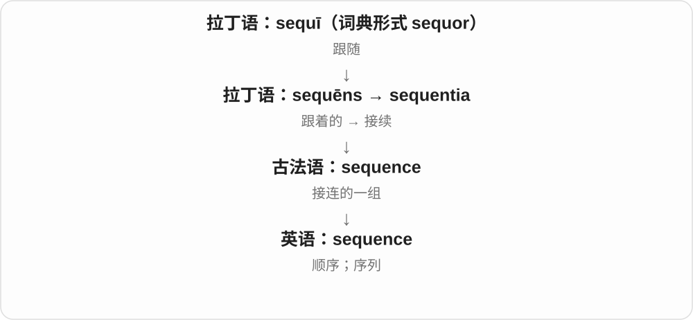

数字、镜头、操作步骤都能形成 sequence。它不一定表示因果，只说明存在次序或连续安排。

**常见搭配与例句**

in sequence；a sequence of events；the correct sequence；sequence data。

> Put the pictures in the correct sequence.

把图片按正确顺序排列。

> The film opens with a long sequence set in a railway station.

电影以一段发生在火车站的较长连续场景开场。

**别混淆**

sequence 是排列；consequence 是由前面引出的结果。先后顺序本身不能证明因果。

### 7. sequences — 序列，一连串；片段〔复数〕；安排顺序、测定序列〔第三人称〕

**音标**：英 /ˈsiːkwənsɪz/；美 /ˈsiːkwənsɪz/

**先抓住这个画面**

一个接一个、按某种次序连起来，便是 sequences。可以是数字、一组动作，或电影里连续的一段镜头。

**怎么拆**

sequence + -s → sequences，保留末尾 e，/s/ 后读 /ɪz/。sequence 经法语与拉丁 sequentia 相继，接 sequi 跟随的分词材料。

**怎么变成今天的意思**

**拉丁 sequi 跟随 → sequens、sequentia 相继**  
后一个跟着前一个的历史材料

↓

**法语等 → 英语 sequence → sequences**  
名词复数，也有安排、测定序列的动词第三人称

number sequences 是数字序列；dance sequences 是连续舞步；film sequences 是电影片段；sequences the tasks 是给任务排顺序。

**常见搭配与例句**

number sequences；dance sequences；film sequences。

> The lesson introduces simple number sequences.

这节课介绍简单的数字序列。

> The film includes several long action sequences.

影片包含几段较长的动作场面。

**别混淆**

sequence 侧重按次序相继，不只是随便凑成一堆；group 侧重成组，具体有没有顺序要另看说明。

### 8. sequential — 按顺序的；依次发生的

**音标**：/sɪˈkwenʃəl/

**先抓住这个画面**

第一步走完再接第二步，步骤按预定次序排开，这种安排是 sequential。

**怎么拆**

拉丁语 sequentia“接续”词族加 -al 形成；现代与 sequence 对应，词中发音变为 /kwenʃ/。

**怎么变成今天的意思**

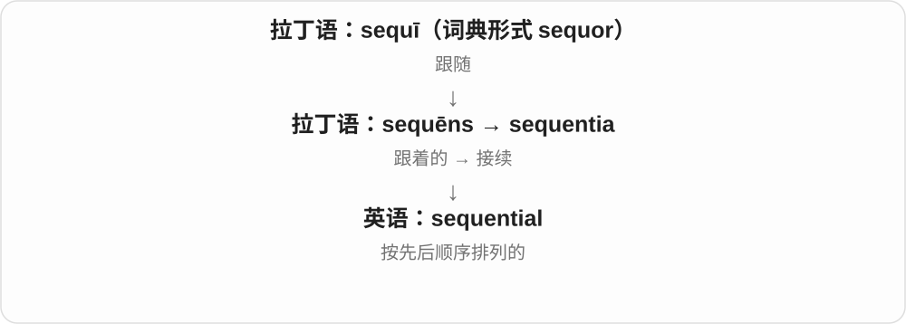

常用来描述编号、步骤、阅读或处理方式。强调有序推进，不一定每两个事件之间完全没有间隔。

**常见搭配与例句**

sequential steps；sequential numbering；sequential processing。

> The instructions describe five sequential steps.

说明书列出了五个依次进行的步骤。

> Each page is given a sequential number.

每页都有一个连续编号。

**别混淆**

sequential 说按顺序；simultaneous 说同时发生。consecutive 更强调连续、没有跳过中间项。

### 9. sequencer — 音序器；测序仪；顺序控制装置

**音标**：英 /ˈsiːkwənsə/；美 /ˈsiːkwənsər/

**先抓住这个画面**

有的设备替你安排“先放哪个音、再放哪个音”；有的设备读取分子里的排列顺序。它们都围绕 sequence 工作。

**怎么拆**

sequence + -er，表示处理、生成或读取序列的设备、工具。

**怎么变成今天的意思**

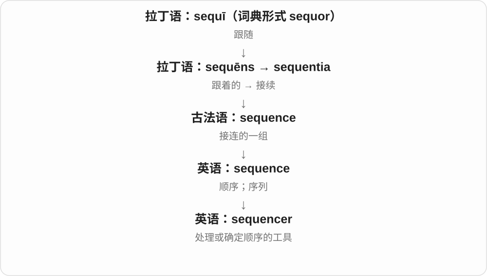

音乐里的 sequencer 编排音符或事件；生物学里的 sequencer 测定分子序列。不能看见相同后缀就认定是同一种机器。

**常见搭配与例句**

a music sequencer；a DNA sequencer；a software sequencer。

> She programmed the drum pattern with a sequencer.

她用音序器编排了鼓点。

> The laboratory installed a new DNA sequencer.

实验室安装了一台新的 DNA 测序仪。

**别混淆**

sequencer 是设备或软件；sequence 是它处理的顺序或序列。测序仪不是“排序人员”。

### 10. consequence — 结果；后果；重要性

**音标**：英 /ˈkɒnsɪkwəns/；美 /ˈkɑːnsəkwəns/

**先抓住这个画面**

把一块多米诺骨牌推倒，后面跟着倒下的那些，就是前一步带来的 consequences。

**怎么拆**

拉丁语 cōnsequī“跟随”产生 consequentia，经法语进入英语。

**怎么变成今天的意思**

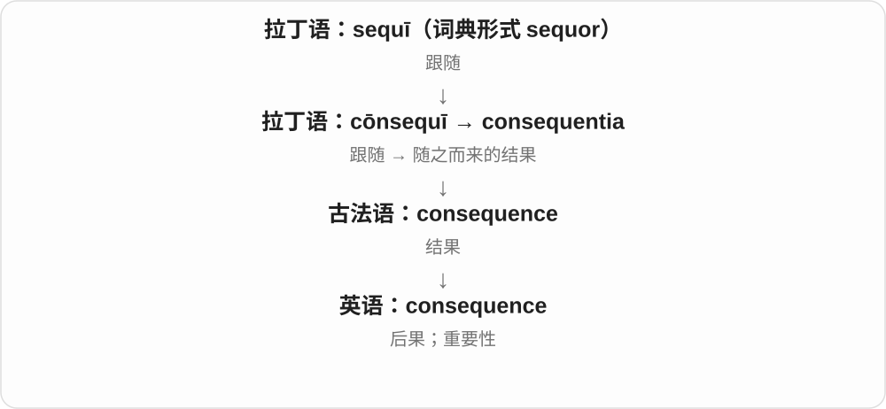

“跟在后面的事”发展成因行动而来的结果。常谈不好的后果，但也能有 positive consequences。of consequence 则是有分量、有重要性。

**常见搭配与例句**

as a consequence；face the consequences；unintended consequences；of little consequence。

> Every choice has consequences.

每个选择都会带来后果。

> The delay had little consequence for the final result.

这次延误对最终结果影响不大。

**别混淆**

result 比较中性；consequence 常提醒你承担后续影响，但它并不天然等于惩罚。

### 11. consequences — 结果、后果〔consequence 的复数〕

**音标**：英 /ˈkɒnsɪkwənsɪz/；美 /ˈkɑːnsɪkwənsɪz/

**先抓住这个画面**

一件事做了之后，跟着出现的事情，就是 consequences。先抓跟在后面的结果，比只背有点吓人的后果更准确。

**怎么拆**

consequence + -s，/s/ 后增加 /ɪz/。拉丁 cōnsequī 跟随形成 consequentia，经法语进入英语；现代复数把多个后续影响分别数出。

**怎么变成今天的意思**

**拉丁 cōnsequī → consequentia → 法语 → consequence**  
跟随 → 随后出现的结果

↓

**consequence + -s → consequences**  
多项后续结果、影响

unexpected consequences 意外后果；positive consequences 积极结果；consider the consequences 考虑后果。

**常见搭配与例句**

consequences of the change；consequences that appeared later。

> The change had several unexpected consequences.

这项改变带来了一些意料之外的后果。

> We should consider the consequences before choosing a plan.

选方案前，我们应考虑它可能带来的结果。

**别混淆**

consequences 常在提醒不利结果时出现，但也可明确说 positive consequences。词本身不保证好坏，通常强调结果由前面的事情带来。

### 12. subsequent — 随后的；之后发生的

**音标**：/ˈsʌbsɪkwənt/

**先抓住这个画面**

先在时间线上标出一件事，再看它后面发生的事，这些后来的事就是 subsequent events。

**怎么拆**

拉丁语 sub- 在这里有随后、紧跟的意味，与 sequī 组成 subsequī，再经法语传入。

**怎么变成今天的意思**

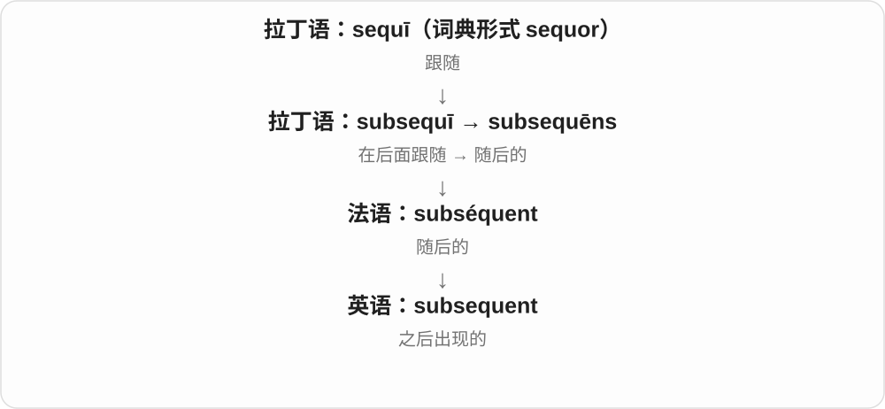

重点是相对于某个已说出的时间点更晚，不必紧贴下一秒，也不一定由前面的事导致。

**常见搭配与例句**

subsequent events；subsequent changes；subsequent to。

> The first test failed, but subsequent tests were successful.

第一次测试失败了，但后来的测试都成功了。

> The report includes subsequent changes to the plan.

报告包括之后对计划作出的修改。

**别混淆**

subsequent 只说后来的；consequent 常说由此前事情产生的。两件事先后发生，不代表后者是前者的后果。

### 13. subsequently — 随后；后来

**音标**：/ˈsʌbsɪkwəntli/

**先抓住这个画面**

叙述先往前走了一步，subsequently 再把你带到更晚的时候。

**怎么拆**

subsequent + -ly。

**怎么变成今天的意思**

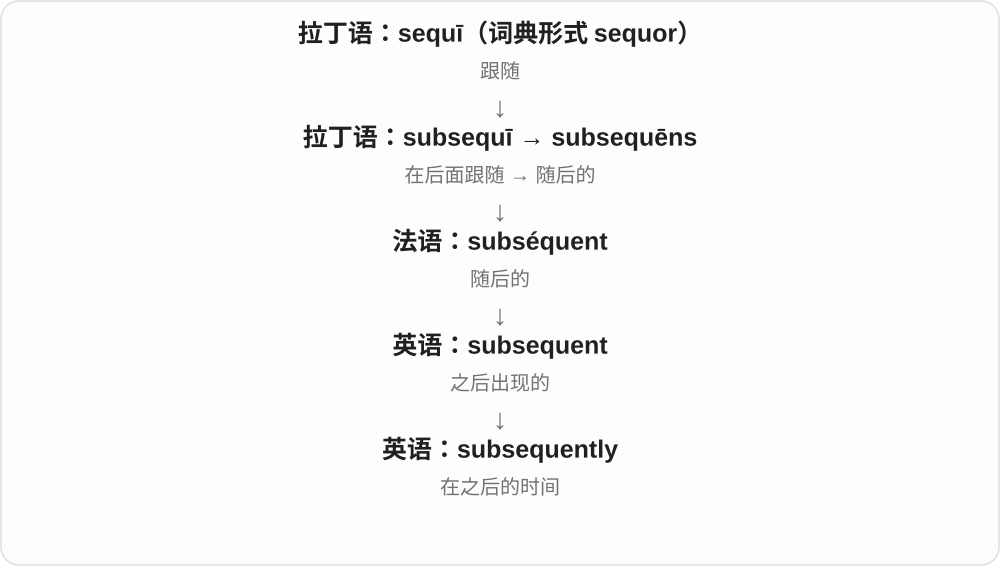

常用于较正式的事件叙述。说后来改了名、后来发现问题，只交代时间推进，不自动说明为什么。

**常见搭配与例句**

subsequently discovered；subsequently became；was subsequently changed。

> The building was subsequently converted into a library.

这栋建筑后来被改成了图书馆。

> She applied for the post and was subsequently invited for an interview.

她申请了这个职位，随后获邀参加面试。

**别混淆**

subsequently 是后来；consequently 是因此。这个差别在解释事件时很关键。

### 14. pursue — 追赶；追求；继续从事

**音标**：英 /pəˈsjuː/；美 /pərˈsuː/

**先抓住这个画面**

目标在前面，你把脚步、注意力或努力持续跟上去：追人、追梦想、追问一条线索都能用 pursue。

**怎么拆**

经盎格鲁诺曼语来自拉丁语 prōsequī，并受 persequī 影响；与 prosecute 是不同传入路线的亲戚。

**怎么变成今天的意思**

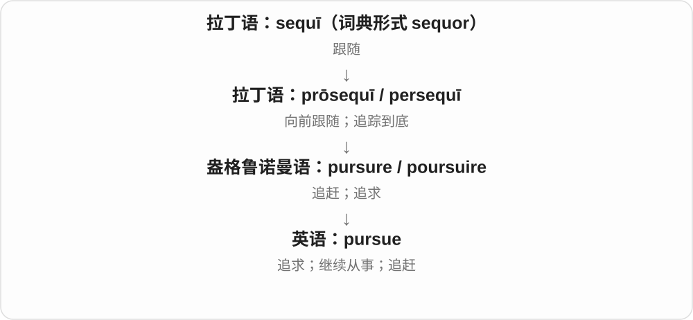

实体追逐扩展为长期追求事业、学习或目标，也可说继续推进某项调查。不是每次都带攻击意味。

**常见搭配与例句**

pursue a career；pursue a goal；pursue a line of inquiry；pursue further study。

> She moved to the city to pursue a career in music.

她搬到这座城市，追求音乐事业。

> The detective pursued a new line of inquiry.

侦探沿着一条新的思路继续调查。

**别混淆**

follow 可以只跟在后面；pursue 通常更有目标感和持续投入。拼写里不要漏掉末尾 e。

### 15. pursuing — 追赶、追求；继续从事、深入处理〔现在分词、动名词〕

**音标**：英 /pəˈsjuːɪŋ/；美 /pərˈsuːɪŋ/

**先抓住这个画面**

目光盯着一个目标，沿着它继续跟下去，就是 pursuing。目标可以是眼前的人，也可以是理想、事业或待查问题。

**怎么拆**

pursue 去结尾 e 加完整 -ing，保留 u。pursue 经盎格鲁诺曼语接拉丁 prosequi，并受 persequi 影响，根在 sequi 跟随。

**怎么变成今天的意思**

**拉丁 prosequi、persequi → 盎格鲁诺曼语 → pursue**  
向前跟随、追到底 → 追赶、追求

↓

**pursue 去 e + -ing → pursuing**  
正在跟进目标；从事、追求

pursuing a career 发展一项事业；pursuing a goal 追求目标；pursuing the matter further 深入处理这件事。

**常见搭配与例句**

pursuing an interest 深入发展兴趣；pursuing a suspect 追踪嫌疑人。

> She is pursuing a career in design.

她正朝设计事业发展。

> They are pursuing the matter further.

他们正在进一步处理这件事。

**别混淆**

pursuing 不只指身体奔跑追人，也能说持续投入一个方向。pursue a goal 常直接接目标，不再加 after；run after 则是另一种结构。

### 16. pursued — 追赶了、追求了；继续从事了〔过去式、过去分词〕

**音标**：英 /pəˈsjuːd/；美 /pərˈsuːd/

**先抓住这个画面**

前面有一个人、目标或想法，自己一直跟着往前走，就是 pursued。可以真追人，也可以持续做学业、兴趣或事业。

**怎么拆**

pursue 经盎格鲁诺曼语 pursure、poursuire 接拉丁 prosequi，并受 persequi 影响，连 sequi 跟随。现代去末尾 e 加完整 -ed，尾 /d/。

**怎么变成今天的意思**

**拉丁跟随材料 → 盎格鲁诺曼语 → pursue**  
向前跟随、追踪 → 追求、继续从事

↓

**pursue 去 e + -ed → pursued**  
已经追赶、追求或从事

pursued a goal 追求目标；pursued an interest 继续发展兴趣；pursued the matter 继续追查此事。

**常见搭配与例句**

pursued further study 继续深造；pursued by… 被……追赶。

> She pursued her interest in photography at college.

上大学时，她继续发展对摄影的兴趣。

> The dog pursued the ball across the grass.

狗追着球跑过草地。

**别混淆**

pursued 是朝目标努力，不表示已经拿到结果。pursued a career in music 说走音乐这条路，不自动说已经成名。

### 17. pursues — 追赶、追求；继续进行〔第三人称单数〕

**音标**：英 /pəˈsjuːz/；美 /pərˈsuːz/

**先抓住这个画面**

目标在前面，自己一路跟上去，可以是追一个人，也可以是追一门学业、一个梦想；动词用 pursues。

**怎么拆**

pursue + -s，词尾读 /z/；基础词经法语接拉丁 pro- + sequi，现代结尾 ue 的 e 不单独发音。

**怎么变成今天的意思**

**拉丁 pro- 向前 + sequi 跟随 → prosequi**  
一路跟着、伴随、继续跟进

↓

**古法语 poursuir、porsivre 等 → 英语 pursue**  
追赶目标，也追求梦想、继续开展某项工作

↓

**pursue + -s → pursues**  
他、她沿目标追赶、寻求或继续开展

pursues a career 追求某种职业；pursues a lead 跟进线索；pursues further study 继续深造。

**常见搭配与例句**

pursues his dream；pursues the suspect。

> She pursues her dream of becoming an architect.

她努力追求成为建筑师的梦想。

> The reporter pursues every promising lead.

这名记者会跟进每一条有希望的线索。

**别混淆**

pursues a goal 说持续朝目标行动，不保证目标已经达到；achieves the goal 才明确达到。

### 18. pursuer — 追赶者；追求者

**音标**：英 /pəˈsjuːə/；美 /pərˈsuːər/

**先抓住这个画面**

前面有人或目标，后面紧跟不放的那一方就是 pursuer。

**怎么拆**

pursue + -er，去掉末尾不发音 e 后加 -er。

**怎么变成今天的意思**

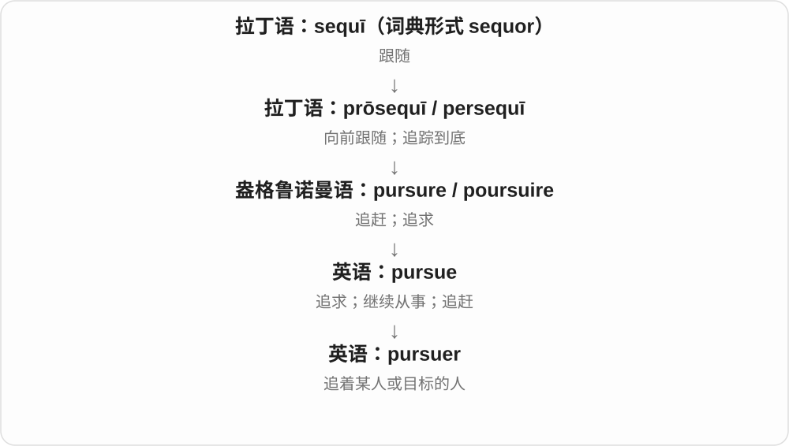

可以是具体追赶的人，也可在较正式文字里指某种目标的追求者。含义是否负面取决于追的是什么。

**常见搭配与例句**

escape a pursuer；shake off pursuers；a pursuer of knowledge。

> She turned into a side street to escape her pursuers.

她拐进一条小街，想摆脱追赶者。

> The essay describes him as a tireless pursuer of knowledge.

文章把他描述为孜孜不倦的求知者。

**别混淆**

pursuer 比 follower 更突出主动追踪；follower 也可能只是追随某人观点或订阅其账号。

### 19. pursuers — 追赶者、追求者〔复数〕

**音标**：英 /pəˈsjuːəz/；美 /pərˈsuːərz/

**先抓住这个画面**

不是只说追的动作，而是点名后面追着的人：被追的人拐进小巷，想甩掉的就是 his pursuers。

**怎么拆**

pursue 去不发音 e，加完整人物后缀 -er → pursuer，再加 -s；不是只加一个 -r。

**怎么变成今天的意思**

**拉丁 pro- 向前 + sequi 跟随 → prosequi**  
一路跟着、伴随、继续跟进

↓

**古法语 poursuir、porsivre 等 → 英语 pursue**  
追赶目标，也追求梦想、继续开展某项工作

↓

**pursue → pursuer → pursuers**  
把追赶、追求的动作变成行动者，再作复数

escape from pursuers 甩开追赶者；pursuers of knowledge 追求知识的人，较正式。

**常见搭配与例句**

stay ahead of the pursuers；lose his pursuers 甩掉追他的人。

> He turned into a narrow lane to lose his pursuers.

他拐进一条窄巷，想甩掉追他的人。

> The deer disappeared into the forest ahead of its pursuers.

鹿赶在追赶者前面，消失在森林里。

**别混淆**

pursuers 是行动者复数；pursues 才是动词三单，多了 -er 就把视角转成谁在追。

### 20. pursuance — 执行；落实；追求的过程

**音标**：英 /pəˈsjuːəns/；美 /pərˈsuːəns/

**先抓住这个画面**

文件里说 in pursuance of a plan，就是照着计划继续做，把纸上的目标往前落实。

**怎么拆**

pursue + -ance，形成行为名词。

**怎么变成今天的意思**

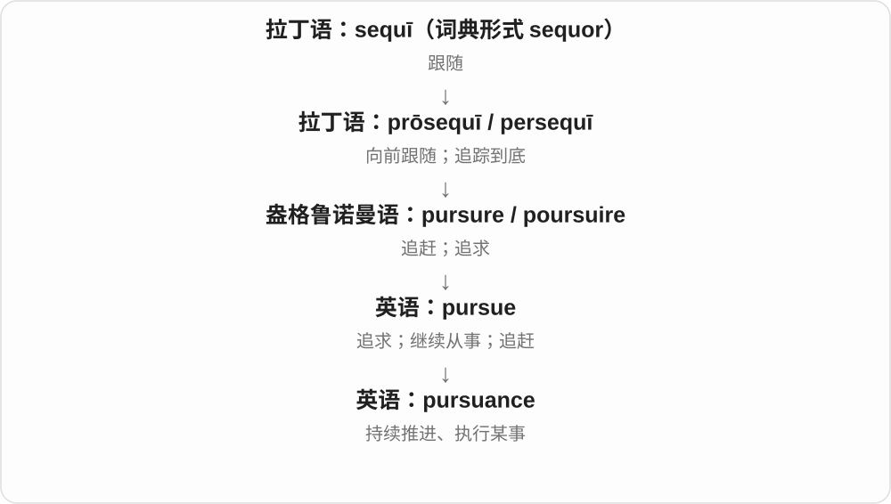

多用于正式文件，尤其 in pursuance of。日常表达常可改成 carrying out 或 following。

**常见搭配与例句**

in pursuance of a policy；in pursuance of an agreement。

> The committee met in pursuance of the agreement.

委员会为落实协议而举行了会议。

> The report describes work done in pursuance of the plan.

报告说明了为执行计划而开展的工作。

**别混淆**

pursuit 范围更广，可说追赶或兴趣；pursuance 常偏执行某计划、职责或安排。

### 21. sue — 起诉、控告；〔sue for〕请求、寻求

**音标**：英 /suː/，也可 /sjuː/；美 /suː/

**先抓住这个画面**

一件事不肯就此放下，转去法院继续追究，可以说 sue。词源里的“跟下去、追下去”，帮助理解这个法律动作。

**怎么拆**

经古法语 suer、suivre 等词线接拉丁 sequi 跟随；英语旧义包括跟随、追求，法律义沿追究一件事的关系发展。

**怎么变成今天的意思**

**拉丁 sequi 跟随 → 通俗拉丁、古法语相关形式**  
法语 suer、suivre 等含追随、继续及法律追究用法

↓

**英语 sue：旧时跟随、追求 → 现代起诉、请求**  
现代先掌握起诉义，不等于远源是英语 court

sue a company 是起诉一家公司；sue someone for damages 是起诉某人要求赔偿；sue for peace 是请求和平，后者保留寻求、请求义。

**常见搭配与例句**

sue a company；sue for damages；sue for peace。

> The company threatened to sue the publisher.

公司威胁要起诉出版商。

> The novel describes a defeated ruler trying to sue for peace.

小说描写一位战败统治者试图请求和平。

**别混淆**

sue someone 直接接被起诉的一方，不写 sue against someone；for 后可接索赔、原因等。Sue 大写也可为人名，另有来源。

### 22. sued — 起诉了；被起诉〔过去式、过去分词〕

**音标**：英 /suːd/，也可 /sjuːd/；美 /suːd/

**先抓住这个画面**

已经把争议带去法院追究，是 sued；被对方起诉，则说 was sued。形式相同，主动和被动把双方位置换开。

**怎么拆**

sue 去末尾 e + -ed → sued，元音后 -ed 读 /d/；不是在读音里额外加 /ɪd/。

**怎么变成今天的意思**

**拉丁 sequi 跟随 → 通俗拉丁、古法语相关形式**  
法语 suer、suivre 等含追随、继续及法律追究用法

↓

**英语 sue：旧时跟随、追求 → 现代起诉、请求**  
现代先掌握起诉义，不等于远源是英语 court

↓

**sue 去 e + -ed → sued**  
规则过去式、过去分词；后缀 /d/

sued the company 是起诉了公司；was sued by 是被某方起诉；sued for damages 是起诉索赔。

**常见搭配与例句**

sued the company；was sued by；sued for damages。

> The designer sued the retailer over an unpaid bill.

设计师因一笔未付账款起诉了零售商。

> The newspaper reported that the company had been sued.

报纸报道该公司已经被起诉。

**别混淆**

sued 说明起诉发生，不表示已经胜诉。won the case 才说明在诉讼结果上赢了，两个动词关注阶段不同。

### 23. suing — 正在起诉；起诉行为

**音标**：英 /ˈsuːɪŋ/，也可 /ˈsjuːɪŋ/；美 /ˈsuɪŋ/

**先抓住这个画面**

谈当前正发生的起诉，或把起诉当成一件事讨论，用 suing。它不是“赢官司”的分词，仍只说追究这一行为。

**怎么拆**

sue 去末尾 e + -ing → suing，u 与后面的 i 分属读音部分；不写 sueing。

**怎么变成今天的意思**

**拉丁 sequi 跟随 → 通俗拉丁、古法语相关形式**  
法语 suer、suivre 等含追随、继续及法律追究用法

↓

**英语 sue：旧时跟随、追求 → 现代起诉、请求**  
现代先掌握起诉义，不等于远源是英语 court

↓

**sue 去 e + -ing → suing**  
现在分词、动名词，读音保留 /uː/ 加 /ɪŋ/

be suing someone 是正在起诉某人；suing for damages 是起诉索赔；by suing 是通过提起诉讼。

**常见搭配与例句**

suing the company；suing for damages；the cost of suing。

> The artist is suing a dealer over a missing painting.

艺术家正因一幅失踪画作起诉经销商。

> The documentary examines the cost of suing a large corporation.

纪录片讨论了起诉大型公司的成本。

**别混淆**

suing someone 是主动；being sued 是被动。-ing 本身没有决定谁起诉谁，需要连着主语和被动结构看。

### 24. sues — 起诉；请求〔第三人称单数〕

**音标**：英 /suːz/，也可 /sjuːz/；美 /suːz/

**先抓住这个画面**

报道说某公司起诉另一方，主语单数时可以用 sues。它把一个正在叙述、经常发生或标题概述的动作放到现在形式。

**怎么拆**

sue + -s → sues，基础词已有 e，再加 s；元音后后缀读 /z/，没有额外 /ɪz/ 音节。

**怎么变成今天的意思**

**拉丁 sequi 跟随 → 通俗拉丁、古法语相关形式**  
法语 suer、suivre 等含追随、继续及法律追究用法

↓

**英语 sue：旧时跟随、追求 → 现代起诉、请求**  
现代先掌握起诉义，不等于远源是英语 court

↓

**sue + -s → sues**  
第三人称单数；末尾 /uːz/

sues the company 是起诉公司；sues for damages 是起诉索赔。标题里现在时可概述刚发生的事件，具体时间看正文。

**常见搭配与例句**

sues the publisher；sues for damages；sues her former employer。

> In the film, she sues the company that copied her design.

电影里，她起诉了抄袭自己设计的公司。

> The company sues competitors over copied designs.

公司因设计被抄袭而起诉竞争对手。

**别混淆**

sues 不是苏这个人名的所有格；Sue’s 才带撇号表示相应所有格或缩写，虽然读音可能相同。

### 25. consecutive — 连续的；接连的

**音标**：/kənˈsekjətɪv/

**先抓住这个画面**

编号 1、2、3、4 一个跟着一个，中间不跳号；连续四天，也不能中途漏掉一天。

**怎么拆**

拉丁语 cōnsequī“跟随”的相关形式 cōnsecūtus 形成 cōnsecūtīvus，经法语 consécutif 进入英语。

**怎么变成今天的意思**

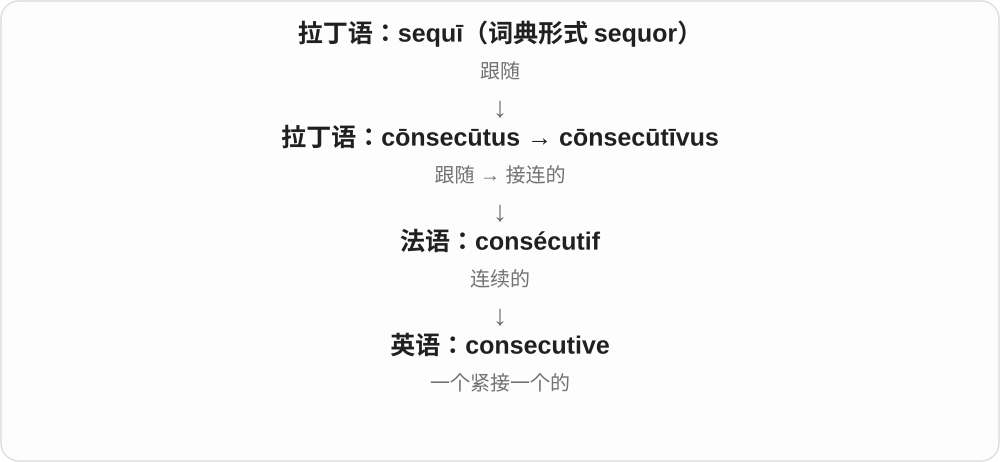

它强调中间没有打断序列。three consecutive wins 是连续赢三次，不是总共赢过三次。

**常见搭配与例句**

three consecutive days；consecutive wins；consecutive numbers。

> It rained for five consecutive days.

雨连续下了五天。

> The team won its third consecutive match.

球队取得了第三场连胜。

**别混淆**

consecutive 是一个接一个；concurrent 是同一时段重叠进行。

### 26. consecutively — 连续地；依次不断地

**音标**：/kənˈsekjətɪvli/

**先抓住这个画面**

看一次行动之后是否紧接同系列的下一次，中间没有插入别的结果或漏掉一项。

**怎么拆**

consecutive + -ly。

**怎么变成今天的意思**

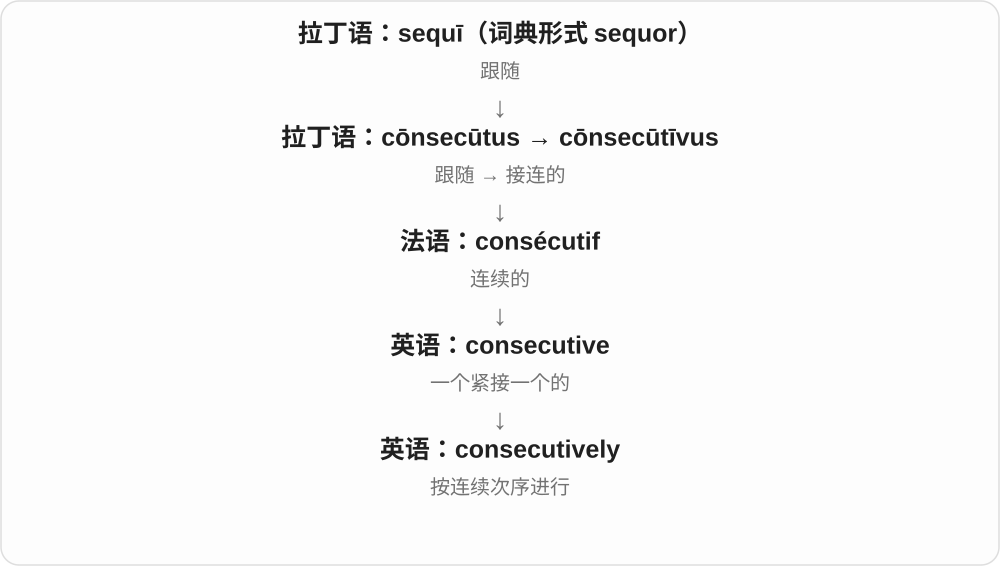

可以说比赛连胜，也可以说页码连续编排。它强调持续排列方式，不强调速度。

**常见搭配与例句**

number consecutively；win consecutively；run consecutively。

> Number the pages consecutively from one to twenty.

把页面从一到二十连续编号。

> She won the award three years consecutively.

她连续三年获得了这个奖。

**别混淆**

consecutively 不是 constantly：后者常说持续不变或反复，前者要有可依次排列的一系列项目。

### 27. pursuit — 追求；追赶；业余爱好

**音标**：英 /pəˈsjuːt/；美 /pərˈsuːt/

**先抓住这个画面**

pursue 是你往目标走；pursuit 把一路跟进的活动变成名词，既能是追捕，也能是持续投入的兴趣。

**怎么拆**

来自古法语 poursuite，是追赶动词词族的名词形式。不是英语 pursue 简单加 t 的规则。

**怎么变成今天的意思**

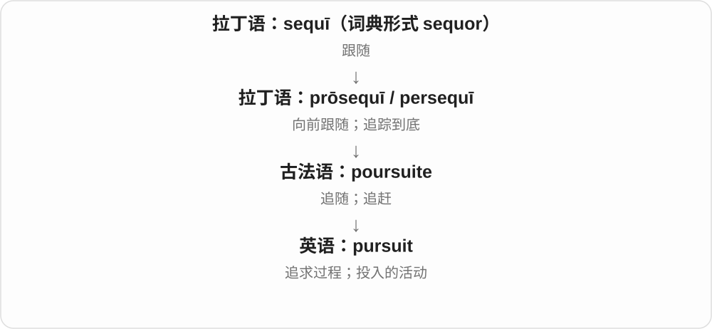

in pursuit of 常接目标；复数 leisure pursuits 则是闲暇投入的各种爱好。

**常见搭配与例句**

in pursuit of happiness；in hot pursuit；leisure pursuits。

> He travelled widely in pursuit of new ideas.

他为寻找新想法而四处旅行。

> Her favourite leisure pursuits are gardening and painting.

她最喜欢的业余爱好是园艺和绘画。

**别混淆**

pursuit 指活动或追求过程；goal 是目标本身。不是每个 pursuit 都有一个能完成打钩的终点。

### 28. prosecute — 起诉；进行公诉；持续推进

**音标**：英 /ˈprɒsɪkjuːt/；美 /ˈprɑːsəkjuːt/

**先抓住这个画面**

把一件案件沿程序往前跟进，让指控进入审理，这就是 prosecute 最常见的现代画面。

**怎么拆**

来自拉丁语 prōsequī“往前跟随”的相关形式 prōsecūtus。与 pursue 同源，但法律意义更集中。

**怎么变成今天的意思**

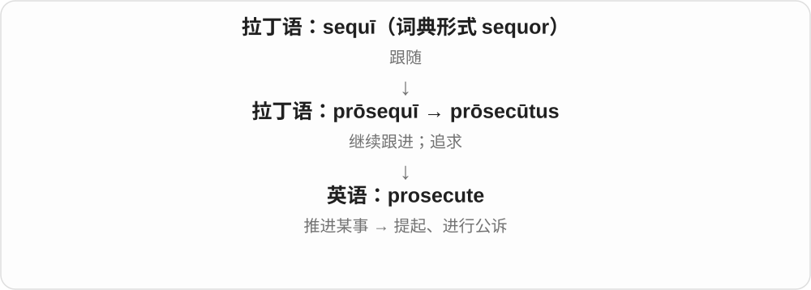

它不等于已经判定有罪，只说提出或推进指控。旧式、正式用法中还可说 prosecute a war，表示继续进行战争。

**常见搭配与例句**

prosecute someone for an offence；prosecute a case；decide to prosecute。

> The authorities decided to prosecute the case.

有关部门决定就此案提起公诉。

> He was prosecuted for damaging public property.

他因损坏公共财物受到起诉。

**别混淆**

prosecute 是法律程序中的起诉；persecute 是迫害。两词拼写接近，伦理评价和实际含义不能互换。

### 29. prosecution — 起诉；公诉；控方

**音标**：英 /ˌprɒsɪˈkjuːʃən/；美 /ˌprɑːsəˈkjuːʃən/

**先抓住这个画面**

它既可以指把案件往前推进的过程，也可以把负责这一边的人统称为 the prosecution。

**怎么拆**

晚期拉丁语 prōsecutiō 经法语进入英语；与 prosecute 同族，名词并非仅由现代英语动词现场加后缀。

**怎么变成今天的意思**

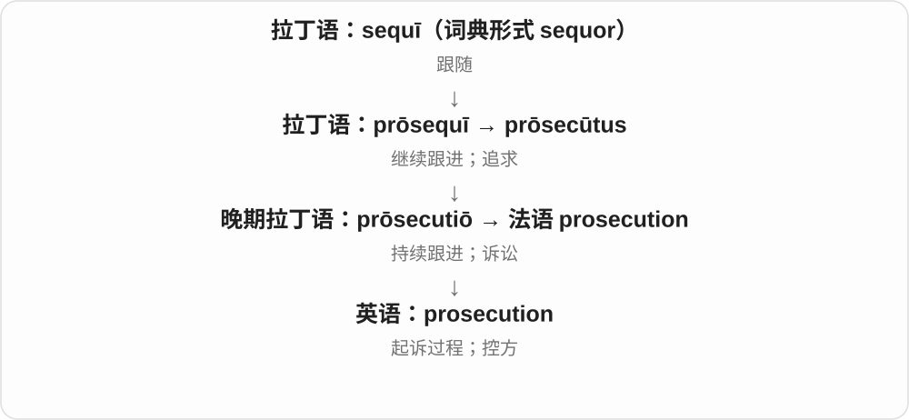

the prosecution 对应诉讼中提出指控的一方；a prosecution 可指一次起诉。是否胜诉是另一件事。

**常见搭配与例句**

face prosecution；the prosecution’s case；a prosecution witness。

> The prosecution called three witnesses.

控方传唤了三名证人。

> The article traces the prosecution of the case.

文章梳理了这起案件的起诉过程。

**别混淆**

prosecution 与 conviction 不同：前者是起诉或控方，后者是定罪。

### 30. prosecutor — 检察官；公诉人；起诉方人员

**音标**：英 /ˈprɒsɪkjuːtə/；美 /ˈprɑːsəkjuːtər/

**先抓住这个画面**

在庭审中代表控方提出指控、展示证据的人，常称 prosecutor。

**怎么拆**

来自中世纪拉丁语 prōsecūtor，现代可以联系 prosecute + -or，-or 表示相关执行者。

**怎么变成今天的意思**

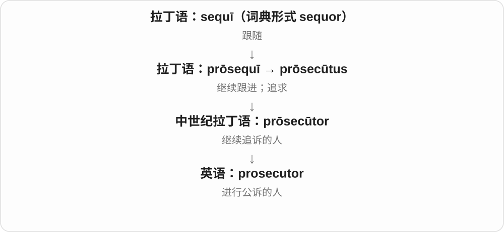

它是案件中的职责角色，不是审判者。具体职称和任职方式随制度而异，理解时先抓住“控方工作”。

**常见搭配与例句**

a public prosecutor；the lead prosecutor；a prosecutor’s office。

> The prosecutor presented the evidence to the court.

公诉人向法庭出示了证据。

> The prosecutor questioned the witness about the timeline.

检察官就时间经过询问了证人。

**别混淆**

prosecutor 提出、推进指控；judge 负责审判。不要把两者都译成法官。

### 31. prosecutors — 检察官；公诉人；提起诉讼者〔复数〕

**音标**：英 /ˈprɒsɪkjuːtəz/；美 /ˈprɑːsɪkjuːtɚz/

**先抓住这个画面**

在案件中把指控正式提出、向法庭说明证据的一方，常由 prosecutors 承担。它强调推进起诉的人，而不是裁决的人。

**怎么拆**

prosecutor + -s → prosecutors。远接拉丁 pro- 向前 + sequi 跟随 → prosequi 追随、继续进行，分词词干 prosecut-；行为者名后来用于诉讼语境。

**怎么变成今天的意思**

**拉丁 prosequi 追随、继续进行 → prosecutor 行动推进者**  
英语早期可以泛说追求某种目的的人

↓

**法律上的起诉者意义固定 → prosecutors**  
现代职位、职责的具体范围随制度不同

public prosecutors 是公诉人；prosecutors presented evidence 是检方人员提出了证据；a team of prosecutors 是一个检方团队。

**常见搭配与例句**

public prosecutors；prosecutors presented evidence；a team of prosecutors。

> In the courtroom drama, the prosecutors present new evidence.

在这部法庭剧里，检方人员提出了新证据。

> The novel follows two prosecutors working on a difficult case.

小说讲述两位检察官办理一宗复杂案件的经历。

**别混淆**

prosecutors 提出、推进指控，judges 负责审理和裁决等工作；辩护方常称 defence、defense 或 defence lawyers。先区分案件中的角色。

### 32. prosecutorial — 检察工作的；公诉方的

**音标**：英 /ˌprɒsɪkjuːˈtɔːriəl/；美 /ˌprɑːsəkjuːˈtɔːriəl/

**先抓住这个画面**

把镜头从“谁起诉”转到“这是谁的职责、权限或行为”：与公诉工作相关，就是 prosecutorial。

**怎么拆**

prosecutor + -ial，形成相关性质的形容词。

**怎么变成今天的意思**

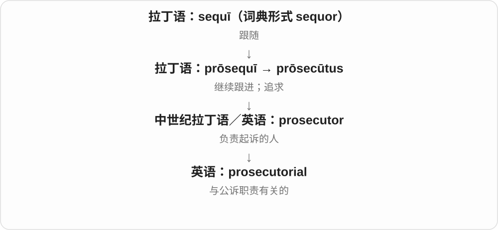

常见于讨论权力、判断和职业行为的正式文字。它描述职能来源，不自行评价行为好坏。

**常见搭配与例句**

prosecutorial decisions；prosecutorial discretion；prosecutorial conduct。

> The report reviews prosecutorial decisions in several cases.

报告审视了几起案件中的公诉决定。

> The course includes a discussion of prosecutorial ethics.

课程包含对检察职业伦理的讨论。

**别混淆**

judicial 是司法、审判相关的更宽词或特指法官职责；prosecutorial 明确指公诉方工作。

### 33. sequel — 续集；后续事件

**音标**：/ˈsiːkwəl/

**先抓住这个画面**

故事还没走完，后面再跟上一部，继续同一个世界或情节，这一部就是 sequel。

**怎么拆**

拉丁语 sequēla“跟随、随后的事”经法语 sequele 进入英语。

**怎么变成今天的意思**

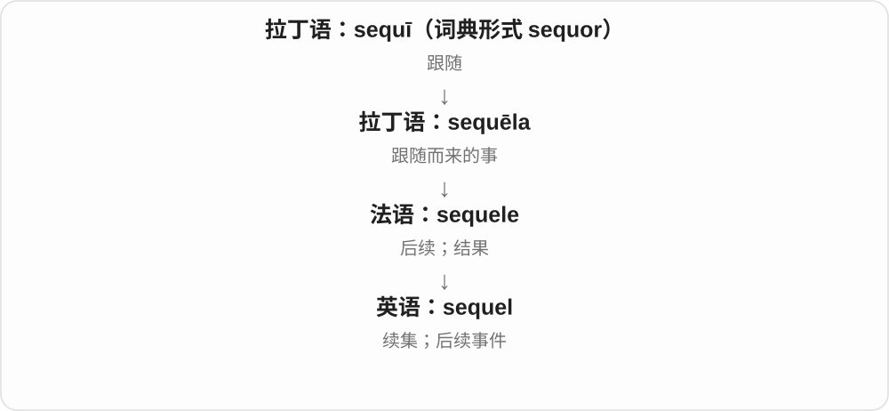

早期可泛指后续或结果，现代最常见于电影、小说等的续作。不是任何第二部作品都自动是第一部的 sequel。

**常见搭配与例句**

a sequel to the film；write a sequel；the long-awaited sequel。

> The author is writing a sequel to her first novel.

这位作者正在写首部小说的续集。

> The sequel follows the characters ten years later.

续集讲述这些人物十年后的故事。

**别混淆**

sequel 接续先前故事；remake 是重新拍同一个故事；prequel 则讲发生在原作之前的故事。

### 34. consequent — 随之产生的；由此导致的

**音标**：英 /ˈkɒnsɪkwənt/；美 /ˈkɑːnsəkwənt/

**先抓住这个画面**

不是只排在后面，而是前面的事情把它带了出来：停电以及随之而来的中断。

**怎么拆**

经法语来自拉丁语 cōnsequēns“跟随的”，是 cōnsequī 的相关形式。

**怎么变成今天的意思**

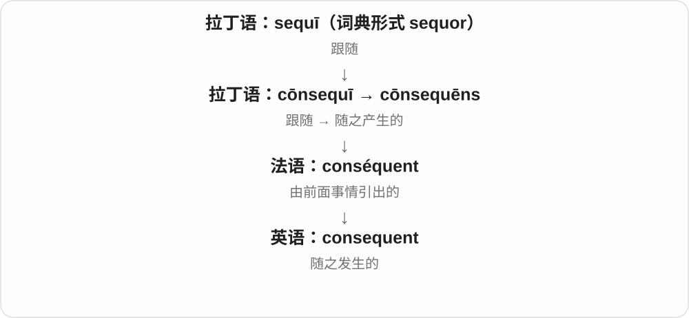

形容某个变化是前面情况的结果，常见较正式书面语。名词在逻辑里也可指条件命题的后件。

**常见搭配与例句**

the consequent delay；consequent upon；the consequent loss。

> The storm and the consequent power cuts disrupted the event.

暴风雨及其引起的停电打乱了活动。

> The report describes changes consequent upon the merger.

报告描述了合并后由此带来的变化。

**别混淆**

subsequent 只说时间在后；consequent 往往还建立因果或逻辑关系。

### 35. consequently — 因此；所以

**音标**：英 /ˈkɒnsɪkwəntli/；美 /ˈkɑːnsəkwəntli/

**先抓住这个画面**

前一句是推动骨牌的原因，后一句说跟着倒下的结果，consequently 就放在这两步之间。

**怎么拆**

consequent + -ly。

**怎么变成今天的意思**

用于明确因果关系，语气较正式。它并非只是“后来”，作者是在说前面的事造成后面的事。

**常见搭配与例句**

and consequently…；consequently, …；consequently unable to…。

> The road was flooded; consequently, the bus took another route.

道路被水淹了，因此公交车改走了另一条路。

> She missed the deadline and consequently lost her place.

她错过了截止日期，因此失去了名额。

**别混淆**

consequently 是因此；subsequently 是随后。下雨后停电，只说先后时用 subsequently；已知因暴雨停电才适合 consequently。

### 36. consequential — 影响重大的；随之产生的

**音标**：英 /ˌkɒnsɪˈkwenʃəl/；美 /ˌkɑːnsəˈkwenʃəl/

**先抓住这个画面**

一个看似小的决定能把后面许多事情一起带动，它就是 consequential：后果有分量。

**怎么拆**

consequent + -ial，构成描述性质的形容词。

**怎么变成今天的意思**

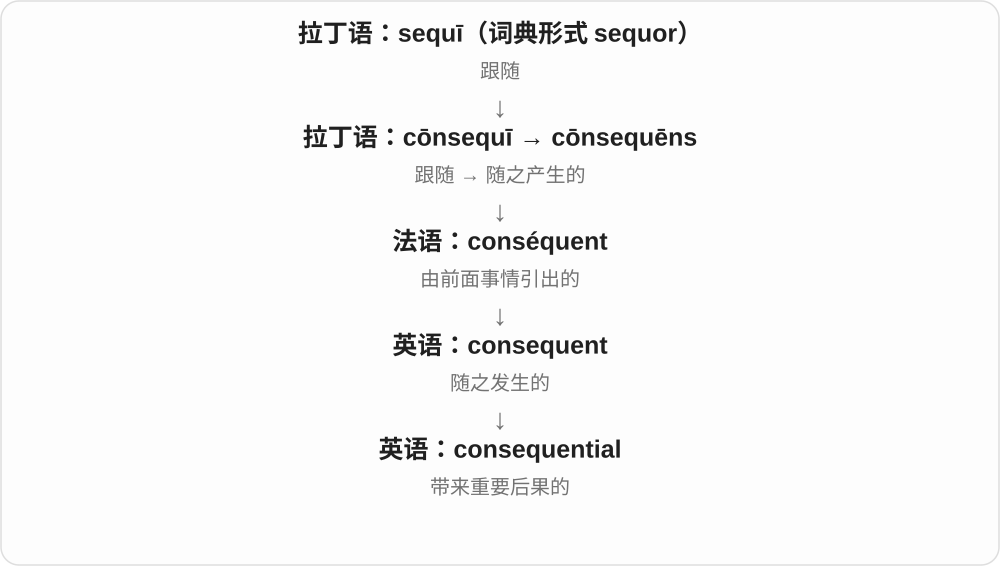

重要义来自“会产生重要后果”。专业文字中也可直接表示由前事引起的，比如 consequential changes。

**常见搭配与例句**

a consequential decision；a consequential change；consequential effects。

> Choosing the site was a consequential decision.

选址是一个影响重大的决定。

> The report overlooks several consequential changes.

报告忽略了几项影响重大的变化。

**别混淆**

consequent 通常说随之而来的；consequential 很常强调影响重大。confidential“保密的”则完全不同。

### 37. inconsequential — 无关紧要的；影响很小的

**音标**：英 /ɪnˌkɒnsɪˈkwenʃəl/；美 /ɪnˌkɑːnsəˈkwenʃəl/

**先抓住这个画面**

从整体中拿掉这个小细节，事情基本照样进行；它没有带来值得在意的后果。

**怎么拆**

in-（不）+ consequential（影响重大的）。

**怎么变成今天的意思**

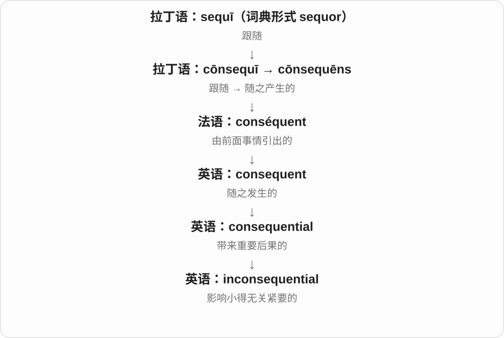

常评价细节、差异或评论，说明它不影响主要问题。不是说事情绝对没有任何结果。

**常见搭配与例句**

an inconsequential detail；an inconsequential difference；seem inconsequential。

> The spelling difference is inconsequential in this discussion.

在这次讨论中，这个拼写差别无关紧要。

> He worried about an inconsequential detail.

他为一个不重要的细节担心。

**别混淆**

inconsistent 是前后不一致；inconsequential 是不重要。一个细节可以完全一致却仍无关紧要。

### 38. persecute — 迫害；持续骚扰

**音标**：英 /ˈpɜːsɪkjuːt/；美 /ˈpɜːrsəkjuːt/

**先抓住这个画面**

不是一次不愉快，而是盯住某个人或群体，反复压迫、伤害、让其无法正常生活。

**怎么拆**

拉丁语 per-（贯穿、彻底）+ sequī（跟随）形成 persequī“紧追到底”，经法语及拉丁语借入。

**怎么变成今天的意思**

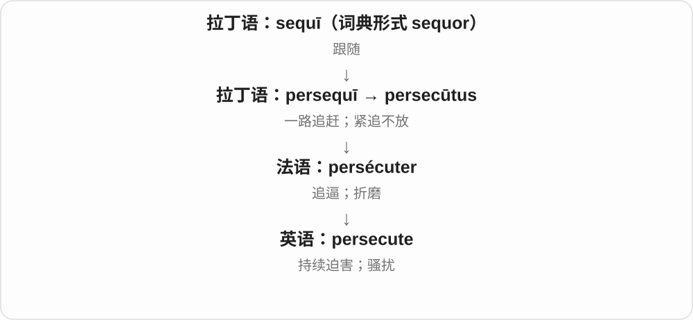

“追着不放”走向持续逼迫。现代常谈因信仰、身份或观点遭受迫害；这是描述伤害，不是中性的司法程序。

**常见搭配与例句**

persecute someone for their beliefs；a persecuted minority。

> The regime persecuted people for expressing dissent.

那个政权迫害表达异议的人。

> The novel follows a family persecuted for its beliefs.

小说讲述了一个因信仰而受迫害的家庭。

**别混淆**

persecute 是迫害；prosecute 是起诉。遭起诉不自动等于被迫害，是否构成迫害要看事实。

### 39. persecution — 迫害；持续压迫

**音标**：英 /ˌpɜːsɪˈkjuːʃən/；美 /ˌpɜːrsəˈkjuːʃən/

**先抓住这个画面**

把一连串追逼与伤害作为整体来看，就是 persecution。重点是持续受到不公正的针对。

**怎么拆**

教会拉丁语 persecūtiō 经法语进入英语，来自 persequī“追赶、紧追”。

**怎么变成今天的意思**

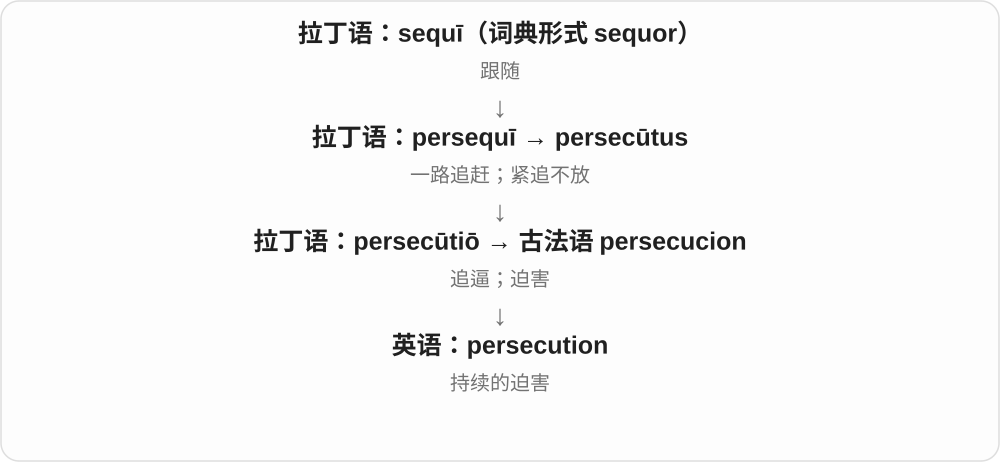

它把迫害行为作为社会现象或个人遭遇来谈。比一般 disagreement“意见不合”或 criticism“批评”严重得多。

**常见搭配与例句**

religious persecution；escape persecution；fear of persecution。

> The family fled the country to escape persecution.

这个家庭为躲避迫害逃离了国家。

> The museum documents the persecution of minority communities.

博物馆记录了少数群体遭受迫害的历史。

**别混淆**

prosecution 是起诉；persecution 是迫害。多出来的 er 不能在拼写时忽略。

### 40. persecutor — 迫害者

**音标**：英 /ˈpɜːsɪkjuːtə/；美 /ˈpɜːrsəkjuːtər/

**先抓住这个画面**

受迫害的人被追逼，站在持续伤害那一边、实施迫害的人就是 persecutor。

**怎么拆**

拉丁语 persecūtor 经古法语进入英语；现代词形与 persecute + -or 对应。

**怎么变成今天的意思**

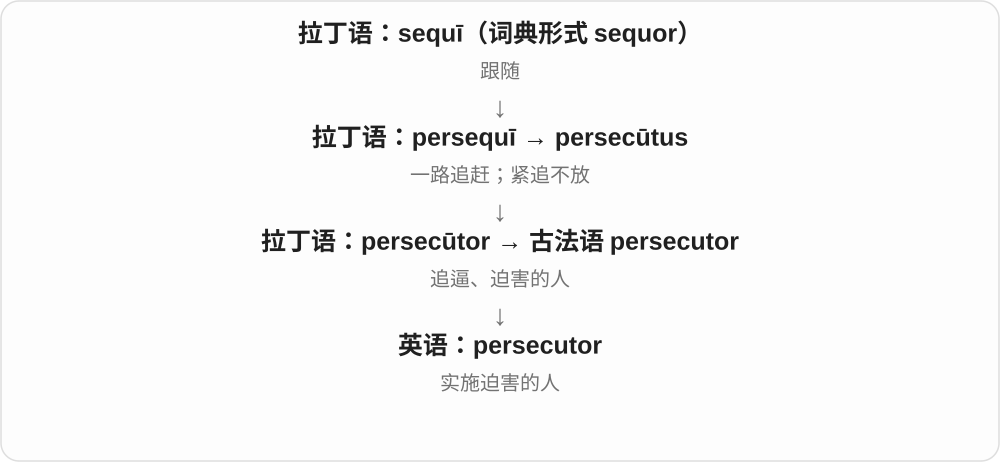

它强调施害者身份，常用于历史、文学或受害经历的叙述。这个词不只是“态度严格的人”。

**常见搭配与例句**

escape a persecutor；identify the persecutors；victims and persecutors。

> The survivors identified several of their persecutors.

幸存者辨认出了几名迫害者。

> The story is told from the victim’s viewpoint, not the persecutor’s.

故事从受害者的视角讲述，而非迫害者的视角。

**别混淆**

persecutor 迫害人；prosecutor 负责起诉，不能只凭相近声音混淆。

### 41. ensue — 接着发生；随之而来

**音标**：英 /ɪnˈsjuː/；美 /ɪnˈsuː/

**先抓住这个画面**

前一件事像拉开闸门，后面的局面跟着涌来：争论随之爆发，沉默接着出现。

**怎么拆**

拉丁语 in- 与 sequī 形成 insequī“紧随”，经古法语 ensuivre 的词干 ensu- 进入英语。

**怎么变成今天的意思**

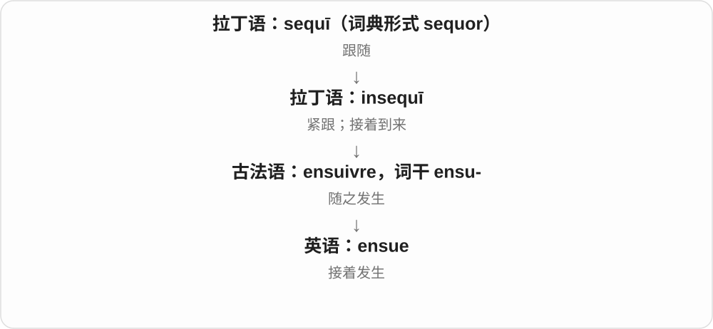

常用于叙述前事之后出现的结果或局面。它是不及物动词，后面直接出现的事件通常作主语。

**常见搭配与例句**

a debate ensued；chaos ensued；ensue from。

> A long silence ensued after the announcement.

公告之后出现了长时间的沉默。

> The argument that ensued lasted for hours.

随之而来的争论持续了几个小时。

**别混淆**

ensure 是确保，需要有人去保证；ensue 是后面的事情发生。一个字母 r 就改变了整个意思。

### 42. milliseconds — 毫秒

**音标**：英 /ˈmɪlɪˌsekəndz/；美 /ˈmɪlɪˌsɛkəndz/

**先抓住这个画面**

把一秒分成一千格，一格就是一毫秒。屏幕响应、程序延迟，常用 milliseconds 来量这种很短的等待。

**怎么拆**

milli- 千分之一 + second 秒 → millisecond，再加 -s → milliseconds；/d/ 后的 -s 读 /z/，词尾 /ndz/。

**怎么变成今天的意思**

**拉丁 mille 千 → 现代 milli- 千分之一**  
与 second 秒组合，得到更细的时间单位

↓

**millisecond + -s → milliseconds**  
1000 milliseconds = 1 second

a delay of twenty milliseconds 是二十毫秒延迟；in milliseconds 表示用毫秒计。重点是时间很短，不是“一千秒”。

**常见搭配与例句**

a few milliseconds；a delay of twenty milliseconds；measured in milliseconds。

> The screen responded within twenty milliseconds.

屏幕在二十毫秒内作出了响应。

> The delay is measured in milliseconds.

这段延迟以毫秒计。

**别混淆**

1 millisecond = 1000 microseconds。milli- 与 micro- 看着都很小，数量级却差一千倍。

### 43. non sequitur — 不合逻辑的推论；突兀、不相干的话

**音标**：英 /ˌnɒn ˈsekwɪtə/；美 /ˌnɑːn ˈsekwɪtər/

**先抓住这个画面**

前面铺了 A，后面突然跳到一个接不上的 B；逻辑链断了，这一步就是 non sequitur。

**怎么拆**

直接借拉丁短语 nōn sequitur，字面是“它并不跟随”。nōn 是否定，sequitur 是 sequī 的动词形式。

**怎么变成今天的意思**

它可以严格指结论不能从前提推出，也可以在日常对话里说答非所问、突然跳题。不是只要自己不同意，就能叫它 non sequitur。

**常见搭配与例句**

a complete non sequitur；respond with a non sequitur。

> His comment about the weather was a complete non sequitur.

他那句谈天气的话完全与话题无关。

> Saying that a product is popular does not prove it is safe; that conclusion is a non sequitur.

说产品受欢迎并不能证明它安全；这个结论推不出来。

**别混淆**

a false statement 可能只是事实错；non sequitur 重点在前后推理接不上，结论甚至可能碰巧是真的。

### 44. nanoseconds — 纳秒；极短的一瞬间〔夸张〕

**音标**：英 /ˈnænəʊˌsekəndz/；美 /ˈnænoʊˌsɛkəndz/

**先抓住这个画面**

一纳秒只有十亿分之一秒。技术文章真在计时；日常说 in nanoseconds，也可能只是在夸张“快得几乎没间隔”。

**怎么拆**

nano- 十亿分之一 + second 秒 → nanosecond；加 -s → nanoseconds，词尾 /ndz/。nano- 名称远接希腊 nanos 小个子的材料。

**怎么变成今天的意思**

**希腊 nanos 小个子 → 科学 nano- 十亿分之一**  
旧词义帮助记住微小，精确倍率由现代约定

↓

**nanosecond + -s → nanoseconds**  
技术计时，也可夸张说极短时间

measured in nanoseconds 是以纳秒测量；felt like nanoseconds 是主观觉得一瞬间。写科学结果时按精确数值理解。

**常见搭配与例句**

a few nanoseconds；a delay of ten nanoseconds；in nanoseconds。

> The instrument measures delays in nanoseconds.

这台仪器用纳秒测量延迟。

> The tickets seemed to disappear in nanoseconds.

那些票好像一瞬间就没了。

**别混淆**

这里 nano- 精确表示十亿分之一；宣传里泛泛说 nano 的“小”，不能直接充当一项测量结果。

### 45. obsequious — 谄媚的；过分顺从的

**音标**：/əbˈsiːkwiəs/

**先抓住这个画面**

别人稍一动，你就急着跟上；他还没说完，你已经点头讨好。这种过头的顺从是 obsequious。

**怎么拆**

拉丁语 ob-（朝向）+ sequī（跟随）形成 obsequī“顺从”，再由 obsequium、obsequiōsus 发展成英语词。

**怎么变成今天的意思**

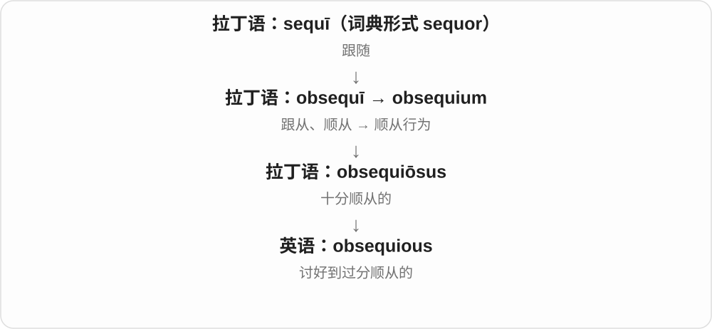

跟随本来未必不好，但这个词的现代语气明显负面，常暗示为了讨好有权势者而丢掉自己的判断。

**常见搭配与例句**

an obsequious manner；an obsequious smile；obsequious flattery。

> His obsequious manner made the guests uncomfortable.

他那副过分讨好的样子让客人感到不自在。

> She disliked the obsequious praise surrounding the manager.

她不喜欢经理身边那些谄媚的赞美。

**别混淆**

polite 是礼貌；obsequious 是过分讨好。对人尊重并不需要 obsequious。

## 这一组要分清什么

**subsequently / consequently**：随后 / 因此；时间先后不能直接当因果。

**prosecute / persecute**：提起、进行公诉 / 迫害。相应 prosecution、persecution 也必须分清。

**sequence / sequel**：一个序列或顺序 / 接续原故事的作品。

**consecutive / concurrent**：一个接一个不中断 / 同一时段重叠进行。

## 串起来练习

**She pursued the question through a sequence of tests; subsequent evidence changed her conclusion.**

她通过一系列测试追查这个问题；后来的证据改变了她的结论。pursue 是追着问题走，sequence 是有次序的测试，subsequent 只说证据后来出现。
