# 0191 · quer-, -quir-, quesit-, -quisit- — 寻找、询问；寻求得到；提出需要

[逐词精讲目录](../00_逐词精讲目录.md) · [总目录](../00_总目录_按常用程度.md)

## 核心词根与来源

先抓住一个动作：**自己还没有，于是去找。** 找的是答案，就走向 **question、query、inquire**；找的是知识、物品或公司，就走向 **acquire**；希望别人把需要的东西提供过来，就走向 **request、require**。**conquer** 又多了一层“努力拿下、战胜阻力”。同一个寻找动作，可以走进学习、工作、商业和历史。

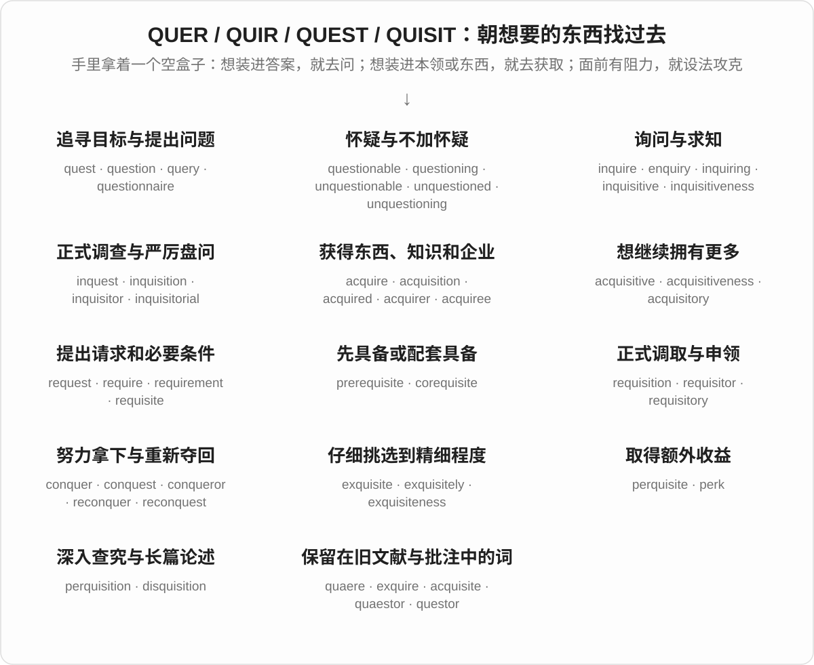

## 词形与演化规律

拉丁语 **quaerere** 是寻找、询问，其分词是 **quaesitus**；进入拉丁复合词后，元音变化使我们看见 **-quir- / -quisit-**，如 acquirere / acquisitus。**quest-** 等外形又与分词名词形式和法语传承有关。这是历史词形变化，不是英语可以任意换字母。

**acquire / acquisition、conquer / conquest、inquire / inquisition** 可以成对学习，但多有各自的借入路线。**exquisite** 走的是“仔细找出、挑选 → 精选、讲究 → 精美或程度极高”。**perk** 的福利义缩自 perquisite；perk up“振作”和煮咖啡的 perk 是另外的来源。星号表示重构形式；形象联想帮助理解，并不替代历史证据。

## 单词速览（按词族由简到繁）

同一基础词的相关扩展放在一起，先读基础形式，再读扩展；各组之间优先读常用的。具体词源关系见各词讲解。

| 单词 | 音标 | 核心意思 |
|---|---|---|
| [quest](#w-5) | /kwest/ | 追寻；探索；寻求 |
| [question](#w-1) | /ˈkwestʃən/ | 问题；疑问；询问；质疑 |
| [questioning](#w-10) | /ˈkwestʃənɪŋ/ | 询问；盘问；带疑问的；不轻信的 |
| [questioningly](#w-55) | /ˈkwestʃənɪŋli/ | 带疑问地；探询地 |
| [unquestioning](#w-39) | /ʌnˈkwestʃənɪŋ/ | 不加质疑的；全盘接受的 |
| [unquestioningly](#w-44) | /ʌnˈkwestʃənɪŋli/ | 不加质疑地；毫不怀疑地 |
| [questionable](#w-11) | /ˈkwestʃənəbəl/ | 可疑的；有争议的；不太可靠或不太妥当的 |
| [questionably](#w-45) | /ˈkwestʃənəbli/ | 令人怀疑地；以不太妥当的方式 |
| [unquestionable](#w-35) | /ʌnˈkwestʃənəbəl/ | 毫无疑问的；无可争议的 |
| [unquestionably](#w-26) | /ʌnˈkwestʃənəbli/ | 毫无疑问地；无可争议地 |
| [unquestioned](#w-36) | /ʌnˈkwestʃənd/ | 未受质疑的；公认的；未被问及的 |
| [questioner](#w-37) | 英 /ˈkwestʃənə/；美 /ˈkwestʃənər/ | 提问者；询问者；质疑者 |
| [questionary](#w-68) | 英 /ˈkwestʃənəri/；美 /ˈkwestʃəneri/ | 问卷、问题清单；询问的（少用） |
| [questor](#w-52) | 英 /ˈkwiːstə/；美 /ˈkwestər/，也读 /ˈkwiːstər/ | quaestor 的异体拼写；古罗马财务官 |
| [request](#w-3) | /rɪˈkwest/ | 请求；申请；要求提供；点播 |
| [requester](#w-40) | 英 /rɪˈkwestə/；美 /rɪˈkwestər/ | 请求者；申请人；发起请求的一方 |
| [inquest](#w-24) | /ˈɪŋkwest/ | 死因调查；正式调查；事后追究 |
| [require](#w-2) | 英 /rɪˈkwaɪə/；美 /rɪˈkwaɪr/ | 需要；要求；规定必须 |
| [requirement](#w-7) | 英 /rɪˈkwaɪəmənt/；美 /rɪˈkwaɪrmənt/ | 要求；必要条件；需求 |
| [requisite](#w-22) | /ˈrekwɪzɪt/ | 必要的；所需的；必需条件或用品 |
| [requisitor](#w-70) | 英 /rɪˈkwɪzɪtə/ | 提出正式要求的人；受委托调查者（少用） |
| [requisitory](#w-71) | 参考读法 /rɪˈkwɪzɪtəri/（据旧词典重音与词形转写） | 正式要求的；请求性的；检察官的正式请求书（旧或专门用法） |
| [requisitive](#w-69) | 参考读法 /rɪˈkwɪzɪtɪv/（据旧词典重音与词形转写） | 表示要求的；提出请求的人或事物（少用） |
| [prerequisite](#w-21) | /ˌpriːˈrekwɪzɪt/ | 先决条件；先修课程；预先必需的 |
| [corequisite](#w-63) | 美 /koʊˈrekwəzɪt/ | 共同必备条件；同时修读的配套课程 |
| [requisition](#w-34) | /ˌrekwɪˈzɪʃən/ | 正式申领；申请单；征用；申领、征用某物 |
| [acquire](#w-9) | 英 /əˈkwaɪə/；美 /əˈkwaɪr/ | 获得；学得；收购；逐渐养成 |
| [acquired](#w-4) | 英 /əˈkwaɪəd/；美 /əˈkwaɪrd/ | 后天获得的；学来的；逐渐形成的 |
| [acquisition](#w-6) | /ˌækwɪˈzɪʃən/ | 获得；习得；收购；新购入的东西 |
| [acquirer](#w-38) | 英 /əˈkwaɪərə/；美 /əˈkwaɪrər/ | 取得者；收购方 |
| [acquirement](#w-51) | 英 /əˈkwaɪəmənt/；美 /əˈkwaɪrmənt/ | 获得；学得的知识或技能（较书面） |
| [acquiree](#w-60) | /əˌkwaɪəˈriː/，也可省去中间的 /ə/ | 被收购方；拟被收购的对象 |
| [inquire](#w-18) | 英 /ɪnˈkwaɪə/；美 /ɪnˈkwaɪr/ | 询问；查问；调查 |
| [inquiry](#w-8) | 英 /ɪnˈkwaɪəri/；美 /ˈɪnkwɪri/，也读 /ɪnˈkwaɪri/ | 询问；调查；探究 |
| [inquisition](#w-19) | /ˌɪŋkwɪˈzɪʃən/ | 严厉盘问；调查；宗教裁判制度或机构 |
| [inquiring](#w-27) | 英 /ɪnˈkwaɪərɪŋ/；美 /ɪnˈkwaɪrɪŋ/ | 好问的；爱探究的；探询的 |
| [inquiringly](#w-58) | /ɪnˈkwaɪərɪŋli/ | 探询地；带着求解的神情 |
| [inquirer](#w-29) | 英 /ɪnˈkwaɪərə/；美 /ɪnˈkwaɪrər/ | 询问者；探究者 |
| [conquer](#w-12) | 英 /ˈkɒŋkə/；美 /ˈkɑŋkər/ | 征服；战胜；克服；攻克 |
| [conquering](#w-20) | 英 /ˈkɒŋkərɪŋ/；美 /ˈkɑŋkərɪŋ/ | 正在征服的；凯旋获胜的；克服 |
| [conqueror](#w-23) | 英 /ˈkɒŋkərə/；美 /ˈkɑŋkərər/ | 征服者；战胜对手的人 |
| [unconquered](#w-42) | 英 /ʌnˈkɒŋkəd/；美 /ʌnˈkɑŋkərd/ | 未被征服的；未被攻克的；不屈的 |
| [reconquer](#w-47) | 英 /ˌriːˈkɒŋkə/；美 /ˌriːˈkɑŋkər/ | 重新征服；夺回；再次攻克 |
| [conquest](#w-13) | 英 /ˈkɒŋkwest/；美 /ˈkɑŋkwest/ | 征服；攻克；征服所得 |
| [reconquest](#w-43) | 英 /ˌriːˈkɒŋkwest/；美 /ˌriːˈkɑŋkwest/ | 重新征服；收复；夺回的过程 |
| [query](#w-14) | 英 /ˈkwɪəri/；美 /ˈkwɪri/，也读 /ˈkweri/ | 询问；疑问；查询；对……提出疑问 |
| [exquisite](#w-15) | /ɪkˈskwɪzɪt/，也读 /ˈekskwɪzɪt/ | 精美的；细腻的；极强烈的 |
| [exquisitely](#w-30) | /ɪkˈskwɪzɪtli/，也读 /ˈekskwɪzɪtli/ | 精美地；精细地；极其 |
| [exquisiteness](#w-56) | /ɪkˈskwɪzɪtnəs/，也读 /ˈekskwɪzɪtnəs/ | 精美；精妙；细腻到极致的品质 |
| [questionnaire](#w-16) | 英 /ˌkwestʃəˈneə/；美 /ˌkwestʃəˈner/ | 调查问卷 |
| [enquire](#w-31) | 英 /ɪnˈkwaɪə/；美 /ɪnˈkwaɪr/ | 询问；打听；查问 |
| [enquiry](#w-17) | 英 /ɪnˈkwaɪəri/；美 /ɪnˈkwaɪri/ | 询问；咨询；调查 |
| [enquirer](#w-33) | 英 /ɪnˈkwaɪərə/；美 /ɪnˈkwaɪrər/ | 询问者；咨询者 |
| [perk](#w-25) | 英 /pɜːk/；美 /pɜrk/ | 额外福利、好处；振作；变得更活跃 |
| [inquisitive](#w-28) | /ɪnˈkwɪzətɪv/ | 好奇好问的；爱打听的 |
| [inquisitiveness](#w-48) | /ɪnˈkwɪzətɪvnəs/ | 好奇心；好问；爱打听的倾向 |
| [inquisitively](#w-50) | /ɪnˈkwɪzətɪvli/ | 好奇地；探问地；爱打听地 |
| [inquisitor](#w-32) | 英 /ɪnˈkwɪzɪtə/；美 /ɪnˈkwɪzətər/ | 审问者；苛刻的盘问者；宗教裁判官 |
| [inquisitory](#w-65) | 美 /ɪnˈkwɪzəˌtɔri/ | 调查的；审问的；严加探问的（少用） |
| [inquisitorial](#w-46) | 英 /ɪnˌkwɪzɪˈtɔːriəl/；美 /ɪnˌkwɪzəˈtɔriəl/ | 盘问式的；审问的；调查式诉讼的 |
| [acquisite](#w-61) | 参考读法 /ˈækwɪzɪt/（据旧词典重音与 s 的浊音说明转写） | 已取得的；获得的（废旧词） |
| [acquisitive](#w-41) | /əˈkwɪzətɪv/ | 热衷获取的；贪于占有的；积极收购的 |
| [acquisitiveness](#w-57) | /əˈkwɪzətɪvnəs/ | 占有欲；获取财物的欲望 |
| [perquisite](#w-49) | 英 /ˈpɜːkwɪzɪt/；美 /ˈpɜrkwəzɪt/ | 额外待遇；职位带来的便利或特权 |
| [perquisition](#w-66) | 英 /ˌpɜːkwɪˈzɪʃən/；美 /ˌpərkwɪˈzɪʃən/ | 彻底搜查；仔细调查（少用） |
| [disquisition](#w-53) | 英 /ˌdɪskwɪˈzɪʃən/；美 /ˌdɪskwəˈzɪʃən/ | 专题探究；长篇论述；详细议论 |
| [quaestor](#w-54) | 英 /ˈkwiːstə/；美 /ˈkwestər/，也读 /ˈkwiːstər/ | 古罗马财务官等官职称号 |
| [acquest](#w-59) | /əˈkwest/ | 所得之物；后天取得的财产（少用） |
| [acquisitory](#w-62) | 英 /əˈkwɪzɪtəri/；美 /əˈkwɪzɪˌtɔri/ | 倾向获取、占有的（少用） |
| [exquire](#w-64) | 参考读法：英 /ɪkˈskwaɪə/；美 /ɪkˈskwaɪr/（据旧词典重音与词形转写） | 查究；探查清楚（废旧词） |
| [quaere](#w-67) | 英 /ˈkwɪəri/；美 /ˈkwɪri/ | 此处存疑；请查证；疑问（法律、编辑用语） |

## 逐词讲解

### 1. quest — 追寻；探索；寻求

**音标**：/kwest/

**先抓住这个画面**

quest 是心里有一个重要目标，带着它一路寻找，像故事里的主人公寻找失落的城。

**怎么拆**

经古法语 queste 进入中古英语，追溯至拉丁 quaerere 的分词名词形式；不是 question 删掉后半段造出的词。

**怎么变成今天的意思**

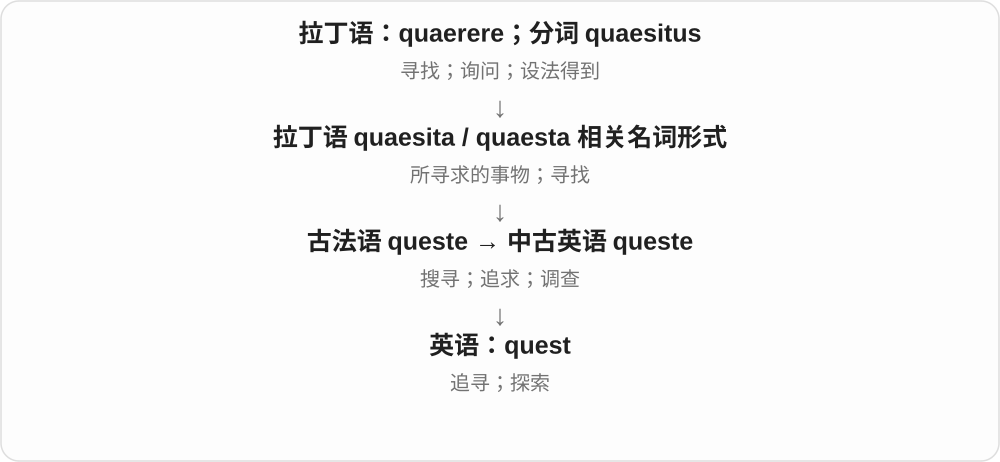

现代常用于 a quest for truth / peace / identity，目标可能抽象而长期。也可作动词 quest for，但日常说“找钥匙”通常不需要这么有故事感的词。

**常见搭配与例句**

a quest for knowledge；in quest of；an endless quest。

> The expedition began as a quest for a lost city.

这次探险最初是为了寻找一座失落的城市。

> Her quest for a quieter life took her to a small coastal town.

为了追求更宁静的生活，她来到一座海边小镇。

**别混淆**

search 可以是普通、短暂的查找；quest 常让人感觉目标重要、过程有挑战。

### 2. question — 问题；疑问；询问；质疑

**音标**：/ˈkwestʃən/

**先抓住这个画面**

question 像把一个空白处圈起来：“这里还需要一个答案。”圈住的是事实，就是提问；圈住的是别人的说法，就是质疑。

**怎么拆**

来自拉丁 quaestio，经法语进入英语，也有直接拉丁借入。动词既与英语名词转用有关，也受法语 questioner 影响；不能把它的全部历史简写成英语 quest + -ion。

**怎么变成今天的意思**

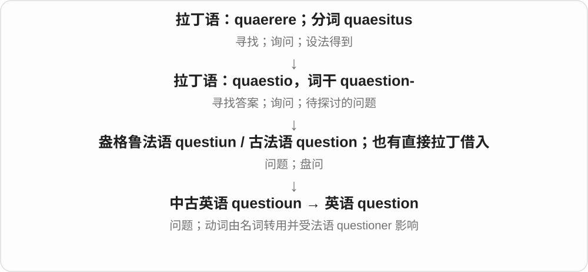

ask a question 是提出问题；question someone 是向某人问话；question a decision 是不轻易接受那个决定。the question of cost 指费用这个议题，不一定是一句带问号的话。

**常见搭配与例句**

ask / answer a question；question the decision；in question（正在谈论的）；out of the question（不可能考虑的）。

> Please ask one question at a time.

请一次只问一个问题。

> Several members questioned the need for a new office.

几位成员对是否需要新办公室提出了质疑。

**别混淆**

question 可以是等待回答的问题；problem 常是需要解决的困难。question his honesty 是怀疑他是否诚实。

### 3. questioning — 询问；盘问；带疑问的；不轻信的

**音标**：/ˈkwestʃənɪŋ/

**先抓住这个画面**

questioning 可以是一连串问话，也可以是一个无声的眼神：“这到底怎么回事？”

**怎么拆**

question + -ing，由动词的进行形式发展出名词和形容词用法。

**怎么变成今天的意思**

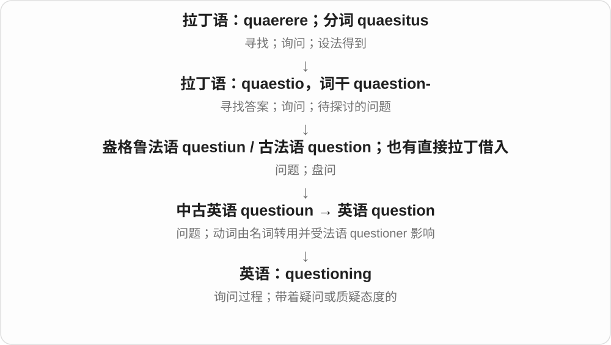

under questioning 是在接受问话；a questioning look 是疑惑的目光；a questioning mind 是愿意追问依据的头脑。这里形容词不等于“自身可疑”。

**常见搭配与例句**

under questioning；a questioning look；a questioning attitude。

> He gave me a questioning look when I arrived with three suitcases.

我提着三个箱子到达时，他疑惑地看了我一眼。

> The witness remained calm throughout the questioning.

证人在整个询问过程中都很镇定。

**别混淆**

questionable 的对象值得怀疑；questioning 的人或神情正在提出疑问。

### 4. questioningly — 带疑问地；探询地

**音标**：/ˈkwestʃənɪŋli/

**先抓住这个画面**

questioningly 像扬起眉毛、等对方补一句说明：话也许没有说出口，问题已经在脸上了。

**怎么拆**

questioning + -ly，描写带着疑问的方式。

**怎么变成今天的意思**

最适合修饰 look、glance、raise an eyebrow 这类动作，也可以修饰带试探语气的说话。

**常见搭配与例句**

look questioningly at；glance questioningly；ask questioningly。

> Maya looked questioningly at the locked door.

玛雅疑惑地望着那扇锁上的门。

> “Tomorrow?” he repeated questioningly.

“明天？”他带着疑问又问了一遍。

**别混淆**

questioningly 是“我想弄明白”；suspiciously 常多了一层怀疑对方有问题的意味。

### 5. unquestioning — 不加质疑的；全盘接受的

**音标**：/ʌnˈkwestʃənɪŋ/

**先抓住这个画面**

unquestioning 是别人说什么就照单全收，脑中没有按下“为什么”的按钮。

**怎么拆**

un- + questioning，否定主动发问、质疑的态度。

**怎么变成今天的意思**

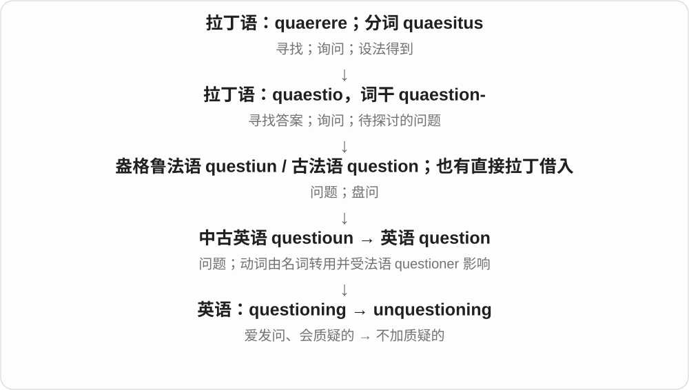

unquestioning obedience 是不问原因的服从；unquestioning trust 是毫无保留的信任。是否值得肯定，需要看关系和情境。

**常见搭配与例句**

unquestioning loyalty；unquestioning obedience；unquestioning acceptance。

> The manager expected unquestioning obedience from the staff.

经理希望员工不问缘由地服从。

> Their unquestioning trust made the deception easier.

他们毫无怀疑的信任让骗局更容易得逞。

**别混淆**

unquestioning 描写接受者不问；unquestioned 描写一件事没有被问，主动和被动的方向不同。

### 6. unquestioningly — 不加质疑地；毫不怀疑地

**音标**：/ʌnˈkwestʃənɪŋli/

**先抓住这个画面**

unquestioningly 描写信息或命令进来之后，直接被接受，没有经过追问。

**怎么拆**

unquestioning + -ly。

**怎么变成今天的意思**

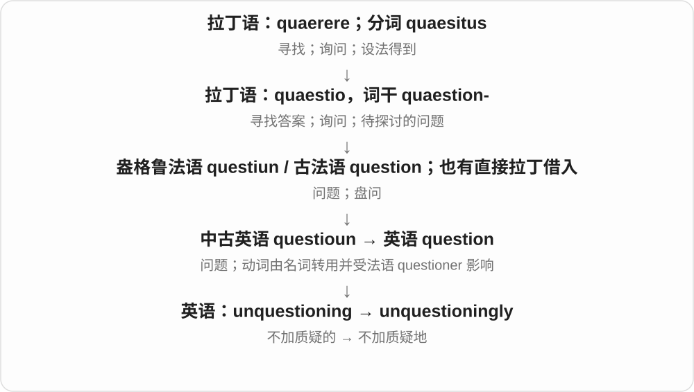

常与 accept、obey、follow 搭配。它说明接受的方式，不保证被接受的东西是真实或正确的。

**常见搭配与例句**

accept unquestioningly；obey unquestioningly；follow unquestioningly。

> He accepted the explanation unquestioningly.

他毫不怀疑地接受了这个解释。

> Students should not follow every online tutorial unquestioningly.

学生不应不加判断地照做每一份网上教程。

**别混淆**

unquestionably 肯定事情本身；unquestioningly 描写人没有去质疑。

### 7. questionable — 可疑的；有争议的；不太可靠或不太妥当的

**音标**：/ˈkwestʃənəbəl/

**先抓住这个画面**

questionable 是看完之后还想在旁边打个问号：“这个靠谱吗？这样做合适吗？”

**怎么拆**

question + -able，原本有可以被询问之义，后来转向可以被质疑；现代主要评价真实性、质量或做法。

**怎么变成今天的意思**

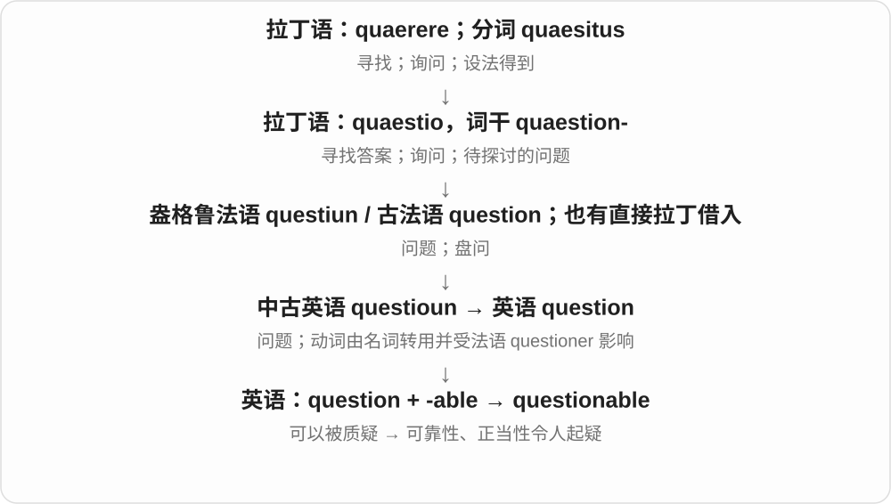

questionable evidence 可能不可靠；questionable behaviour 可能不妥当。它常比直接说 false / dishonest 更保留，但仍明显表达怀疑。

**常见搭配与例句**

questionable quality；questionable motives；a questionable decision。

> The report relies on figures of questionable accuracy.

报告所用数字的准确性令人怀疑。

> Charging visitors twice was a questionable decision.

向游客收两次费用，这个决定不太妥当。

**别混淆**

questioning 描写正在追问或怀疑的态度；questionable 描写被人怀疑的对象。

### 8. questionably — 令人怀疑地；以不太妥当的方式

**音标**：/ˈkwestʃənəbli/

**先抓住这个画面**

questionably 是给某个做法或评价加上“这里有疑点”的标记。

**怎么拆**

questionable + -ly，词尾 -ble 变成 -bly。

**怎么变成今天的意思**

常用于 questionably obtained“取得方式可能不正当”一类组合，也可修饰人们并不完全认可的评价。不是把一个问题用疑问语气问出来。

**常见搭配与例句**

questionably obtained；questionably legal；behave questionably。

> The article used questionably obtained personal records.

文章使用了一些取得方式存疑的个人资料。

> The company behaved questionably during the bidding process.

这家公司在竞标过程中的做法令人质疑。

**别混淆**

questioningly 是带着疑问地看或问；questionably 是行为或判断本身可疑。

### 9. unquestionable — 毫无疑问的；无可争议的

**音标**：/ʌnˈkwestʃənəbəl/

**先抓住这个画面**

unquestionable 是证据或表现摆在那里，几乎没有给合理怀疑留下空间。

**怎么拆**

un- + questionable，把可以被质疑的性质否定。

**怎么变成今天的意思**

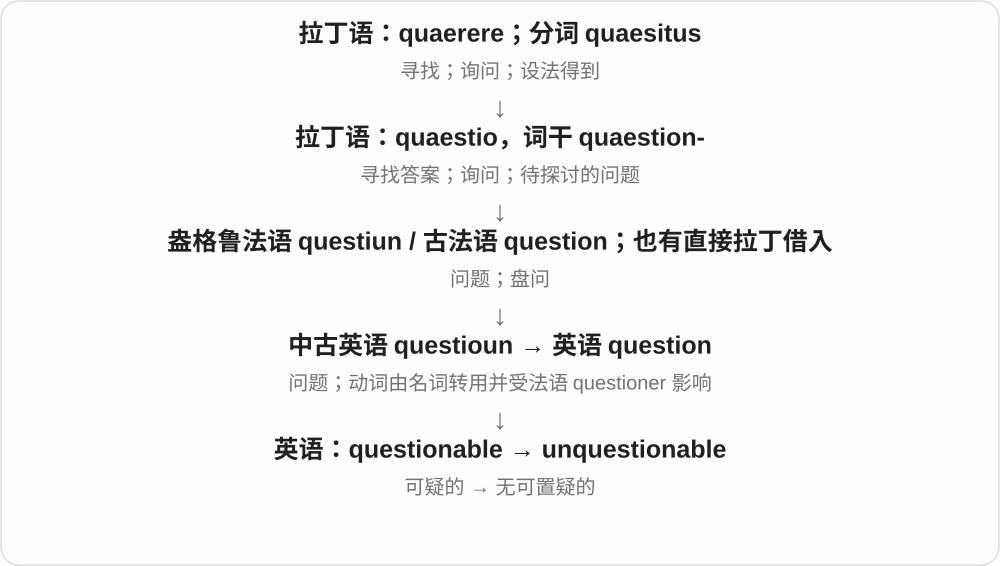

an unquestionable achievement 肯定取得了成就；unquestionable honesty 强烈肯定诚实。它表达说话者的确定判断，不是禁止别人开口提问。

**常见搭配与例句**

unquestionable talent；unquestionable importance；beyond question。

> Her contribution to the project is unquestionable.

她对这个项目的贡献毋庸置疑。

> The photograph provides unquestionable evidence that the bridge was already damaged.

这张照片确凿地证明，那座桥当时已经损坏。

**别混淆**

unquestioned 可能只是尚无人质疑；unquestionable 更强，意思是确实没有什么可争辩的。

### 10. unquestionably — 毫无疑问地；无可争议地

**音标**：/ʌnˈkwestʃənəbli/

**先抓住这个画面**

unquestionably 像把结论下面画一道实线：“这一点可以确定。”

**怎么拆**

unquestionable + -ly，-ble 变为 -bly。

**怎么变成今天的意思**

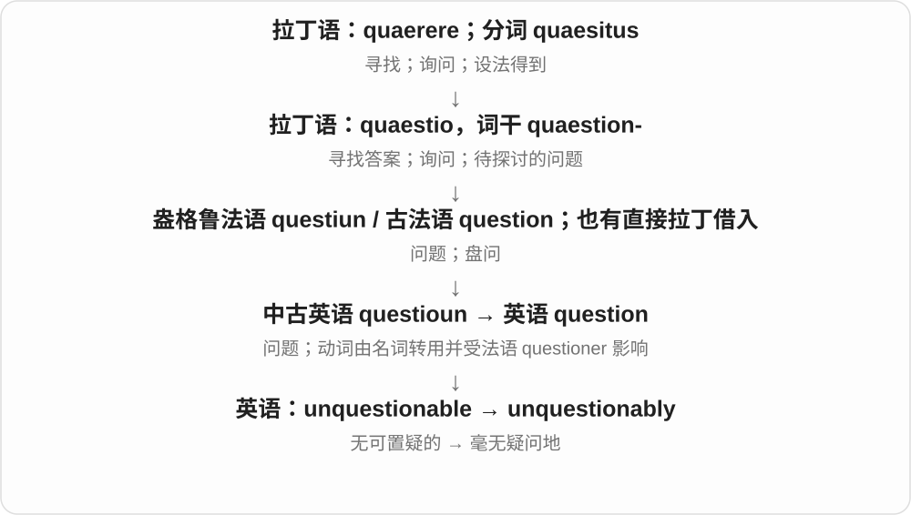

常放在形容词、最高级或整个判断之前，加强肯定。说 unquestionably the best 时，是强烈的评价，不意味着完成了某种客观证明。

**常见搭配与例句**

unquestionably true；unquestionably important；unquestionably the best。

> The new design is unquestionably easier to use.

新设计无疑更容易使用。

> She is unquestionably one of the team’s most reliable players.

她毫无疑问是队里最可靠的队员之一。

**别混淆**

probably 表示很可能；unquestionably 几乎不保留怀疑余地，语气强很多。

### 11. unquestioned — 未受质疑的；公认的；未被问及的

**音标**：/ʌnˈkwestʃənd/

**先抓住这个画面**

unquestioned 是一项说法一直放在那里，没有人向它提出挑战。

**怎么拆**

un- + questioned；-ed 从受到询问、质疑这一动作出发，表示没有受到这种动作。

**怎么变成今天的意思**

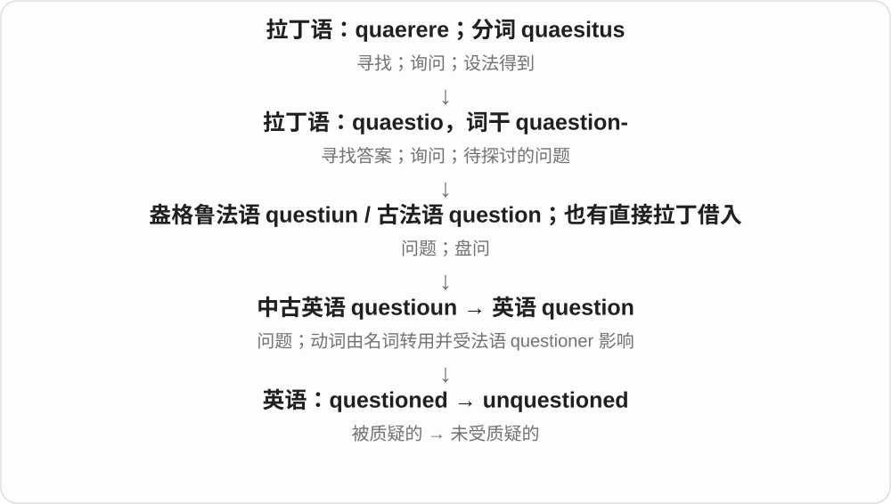

unquestioned authority 可指大家默认的权威；an unquestioned assumption 则提醒你，这个假设可能只是一直没人检查。语气可以赞许，也可以批评。

**常见搭配与例句**

unquestioned authority；an unquestioned assumption；remain unquestioned。

> For years, his version of events remained unquestioned.

多年来，他对事情的说法一直无人质疑。

> The coach enjoyed unquestioned authority in the dressing room.

这位教练在更衣室里拥有公认的权威。

**别混淆**

unquestioned 说没有被挑战；unquestionable 说站得住脚、无可争议，前者未必能推出后者。

### 12. questioner — 提问者；询问者；质疑者

**音标**：英 /ˈkwestʃənə/；美 /ˈkwestʃənər/

**先抓住这个画面**

questioner 是把问题抛出来的那个人，像问答环节中举手接过话筒的人。

**怎么拆**

question + -er；中古英语已有相应的人名词形式。

**怎么变成今天的意思**

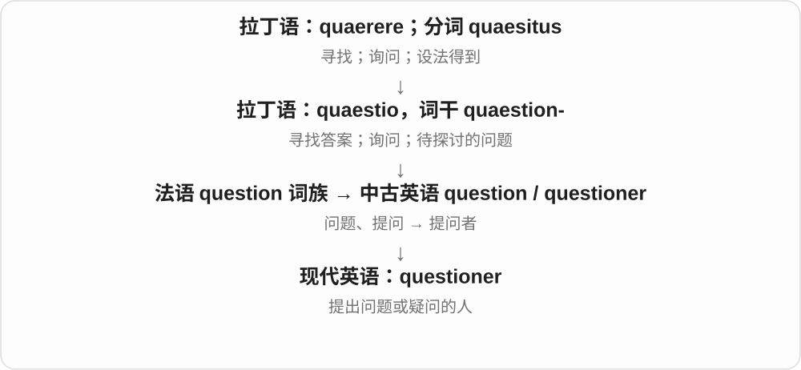

可中性地指观众中的提问者，也可指不断追问的人；是否咄咄逼人，要看 persistent、hostile 等上下文。

**常见搭配与例句**

the next questioner；a persistent questioner；answer a questioner。

> The next questioner wanted to know how much the project would cost.

下一位提问者想知道项目要花多少钱。

> She was a patient teacher who welcomed even the youngest questioner.

她是一位耐心的老师，连年纪最小的提问者也欢迎。

**别混淆**

interviewer 是采访或面试角色；questioner 只说明这个人在提问，不一定有正式职责。

### 13. questionary — 问卷、问题清单；询问的（少用）

**音标**：英 /ˈkwestʃənəri/；美 /ˈkwestʃəneri/

**先抓住这个画面**

questionary 可以把一组问题装在一起，也可以形容某种不断发问的方式；今天很少这样说。

**怎么拆**

有英语 question + -ary 的分析，也有法语 questionnaire 影响的分析。不同义项的来路不能一律简化为 questionnaire 的拼写错误。

**怎么变成今天的意思**

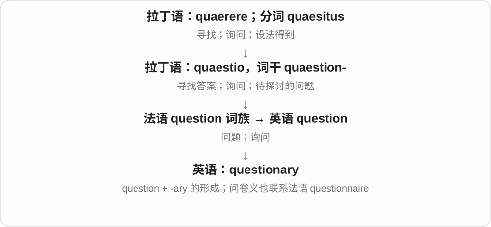

在旧书中可作名词指问题表，或作形容词指询问性质的。现代写调查问卷，用 questionnaire 最清楚；以下保留少见词的书面语境。

**常见搭配与例句**

a printed questionary；a questionary method；an old questionary。

> The archive contains a questionary sent to village schools in 1890.

档案中保存着一份于 1890 年寄给乡村学校的问题清单。

> The tutor used a questionary method, leading the pupil forward through a series of prompts.

这位导师采用提问式方法，用一连串提示引导学生往下思考。

**别混淆**

questionary 不是 questionnaire 的常用短写，也不能与 query 随意替换。

### 14. questor — quaestor 的异体拼写；古罗马财务官

**音标**：英 /ˈkwiːstə/；美 /ˈkwestər/，也读 /ˈkwiːstər/

**先抓住这个画面**

questor 少写了一个 a，但在罗马官名这一义上，仍指同一个职位。

**怎么拆**

中古英语 questor 来自拉丁 quaestor；现代它是 quaestor 较少用的异体。这里的官名不能拆成现代英语 quest“探险”加 -or，误认为冒险者。

**怎么变成今天的意思**

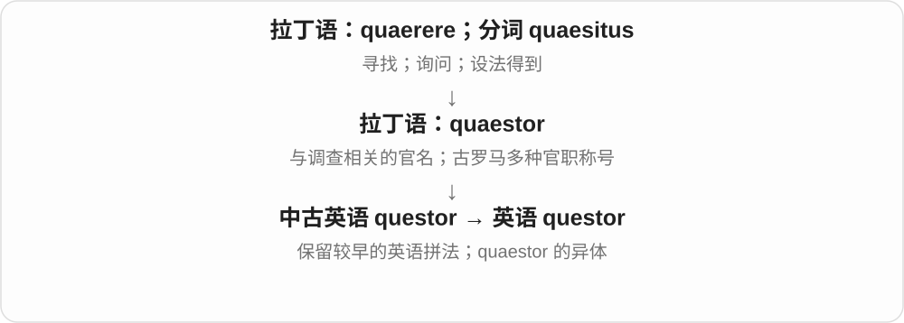

读历史材料时，questor 与 quaestor 可能指同一类官员；须看所处时代及机构。今天描述现代财务人员通常不用这个古罗马头衔。

**常见搭配与例句**

a Roman questor；elected questor；the questor’s accounts。

> The inscription names the questor who supervised the funds.

铭文列出了监管这笔经费的财务官姓名。

> He was elected questor before holding higher office.

他先当选财务官，后来才担任更高的官职。

**别混淆**

questor 与 quaestor 是此义下的拼写变体；quest 是寻求，不是该官名的现代直接来源。

### 15. request — 请求；申请；要求提供；点播

**音标**：/rɪˈkwest/

**先抓住这个画面**

request 像把一张写着“请帮我……”的纸递给对方，希望得到东西、许可或行动。

**怎么拆**

名词经古法语 requeste 来自拉丁 requisita 的相关形式；动词可由英语名词转用，也有法语 requester 借入分析。不是现代英语 re- + quest 表示再次寻找。

**怎么变成今天的意思**

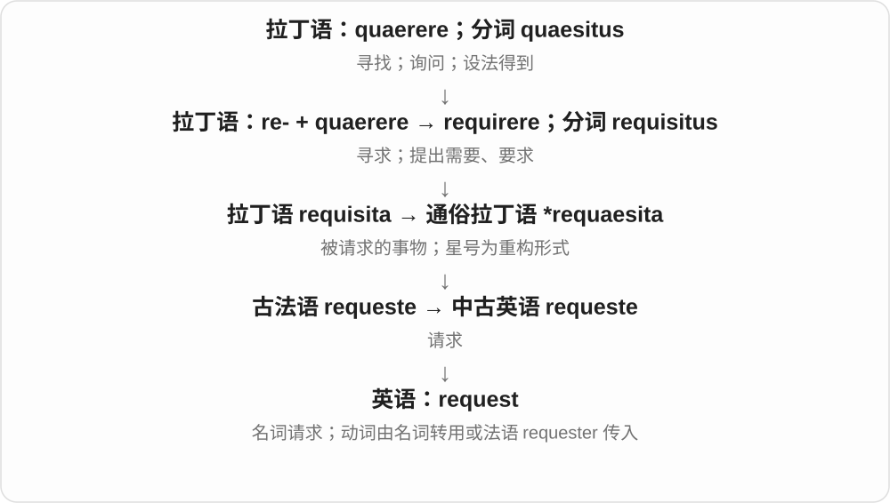

make a request 是提出请求；request information 是请求资料；request that someone do something 是正式提出希望对方做某事。request 比 ask 更适合正式书面场合。

**常见搭配与例句**

a request for；at someone’s request；on request；request that...。

> She requested a copy of the meeting notes.

她请求提供一份会议记录。

> A vegetarian meal is available on request.

如有需要，可以提供素餐。

**别混淆**

ask a question 想得到答案；make a request 往往想让对方提供东西或做事。request 与 require 的强制程度也不同。

### 16. requester — 请求者；申请人；发起请求的一方

**音标**：英 /rɪˈkwestə/；美 /rɪˈkwestər/

**先抓住这个画面**

requester 是按下“提交申请”按钮的人或系统。

**怎么拆**

request + -er，标记发出请求的主体；也有 requestor 拼写。

**怎么变成今天的意思**

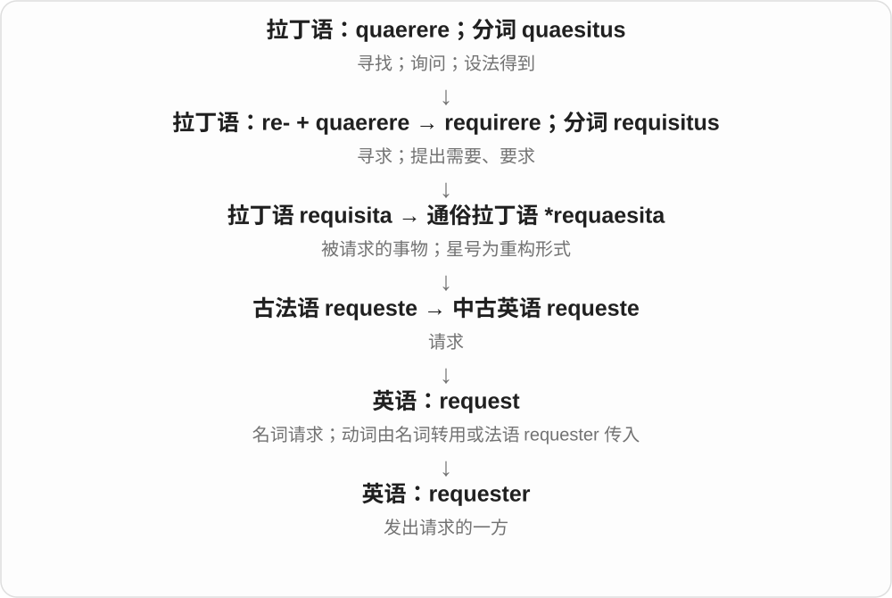

在客服、审批、采购流程中常用来标明角色；计算机里也可以是发出请求的程序。不是所有 requester 都正在申请职位，所以不要总译成求职者。

**常见搭配与例句**

the original requester；notify the requester；the requester’s details。

> The system sends a confirmation email to the requester.

系统会向请求者发送确认邮件。

> Please contact the requester if any details are unclear.

如有任何细节不清楚，请联系申请人。

**别混淆**

requester 提出需要；approver 决定是否批准；recipient 是收到请求的人，三者角色不同。

### 17. inquest — 死因调查；正式调查；事后追究

**音标**：/ˈɪŋkwest/

**先抓住这个画面**

inquest 是把一件已经发生、还没弄清的事摊开来，正式查明到底发生了什么。

**怎么拆**

经古法语 enqueste、中古英语 enquest 传入；更早联系拉丁 inquisita，通俗拉丁语中间形式常重构为 *inquaestia。不是现代英语 in + quest 临时拼成。

**怎么变成今天的意思**

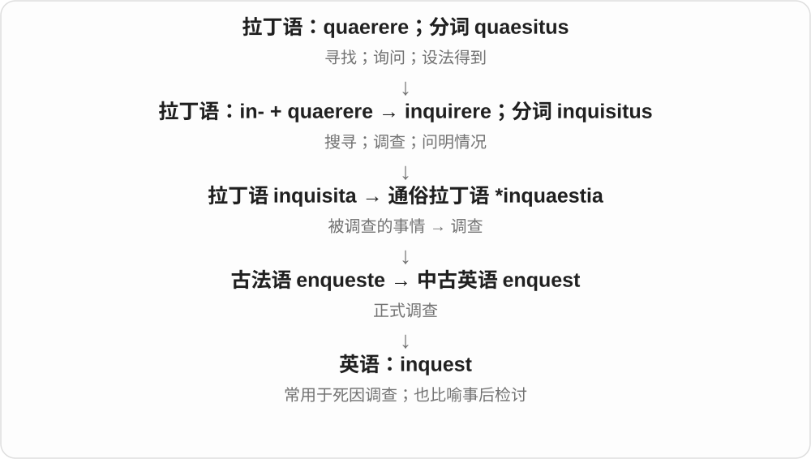

英格兰和威尔士语境中的 coroner’s inquest 主要查明死者身份及死亡的时间、地点和经过，不是决定某人刑事有罪的审判。体育报道中也可比喻对惨败的事后追究。

**常见搭配与例句**

hold an inquest；an inquest into a death；an inquest into a defeat。

> The inquest heard evidence from two witnesses.

死因调查听取了两名证人的证言。

> After the heavy defeat, the club began its own inquest into what had gone wrong.

惨败之后，俱乐部开始自行检讨究竟出了什么问题。

**别混淆**

inquiry 范围很广；inquest 常指特定的死因调查程序，或带“事后找原因”的比喻。

### 18. require — 需要；要求；规定必须

**音标**：英 /rɪˈkwaɪə/；美 /rɪˈkwaɪr/

**先抓住这个画面**

require 是事情把手伸出来：“要把我办成，这个条件少不了。”它可以是实际需要，也可以是规则要求。

**怎么拆**

远源为拉丁 re- + quaerere → requirere，原有寻求、请求的意思；经法语借入英语，逐渐突出需要和强制要求。这里 re- 不能一律译成“再来一次”。

**怎么变成今天的意思**

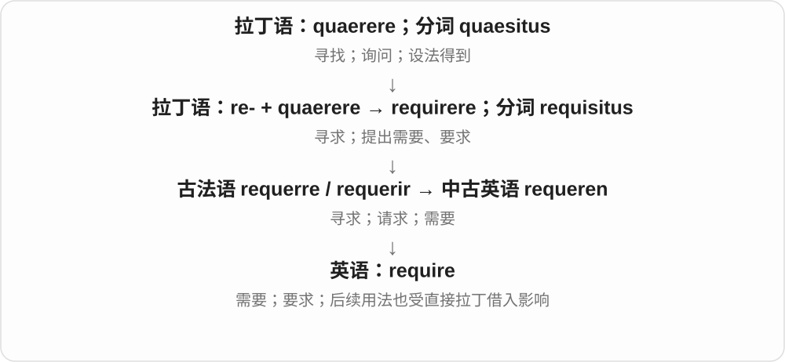

This job requires patience 是工作需要耐心；The rules require visitors to sign in 是规则要求访客登记。require doing 可表示需要被做，如 requires cleaning。

**常见搭配与例句**

require something；require someone to do；be required to do；require that...。

> The recipe requires only four ingredients.

这个食谱只需要四种原料。

> All visitors are required to wear a badge.

所有访客都必须佩戴证件牌。

**别混淆**

request 通常提出请求；require 表示必要条件或明确要求。请求可能未获满足，要求则通常应被遵守。

### 19. requirement — 要求；必要条件；需求

**音标**：英 /rɪˈkwaɪəmənt/；美 /rɪˈkwaɪrmənt/

**先抓住这个画面**

requirement 像一张写着“要做到这些”的清单，其中每一项都是做成事情需要满足的条件。

**怎么拆**

require + -ment，英语内部的名词派生；早期也有请求义，现代主要指所需的条件或东西。

**怎么变成今天的意思**

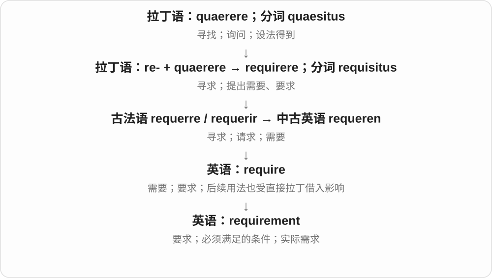

entry requirements 是入学或入境等准入条件；user requirements 是用户要解决的事情、需要的功能。复数 requirements 很常用，未必都来自法律。

**常见搭配与例句**

meet / satisfy a requirement；minimum requirements；entry requirements；user requirements。

> The laptop meets the software’s minimum requirements.

这台笔记本满足软件的最低要求。

> We discussed the users’ requirements before drawing the first design.

我们先讨论了用户的需求，再画第一版设计。

**别混淆**

request 是一次请求；requirement 是事情需要达到的条件。wish 只是愿望，不一定是硬性需求。

### 20. requisite — 必要的；所需的；必需条件或用品

**音标**：/ˈrekwɪzɪt/

**先抓住这个画面**

requisite 是清单上不能空着的那一格：“这个必须有。”

**怎么拆**

借自拉丁 requisitus，原是 requirere 的过去分词，表示被要求、被需要；英语里又从形容词发展出名词。

**怎么变成今天的意思**

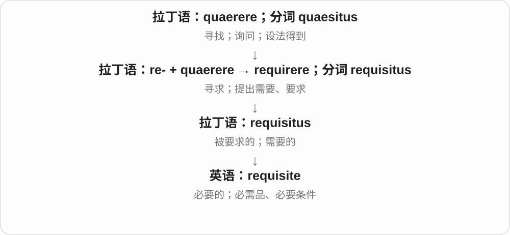

the requisite skills 是所需技能；the requisites for a journey 是旅行必备的东西或条件。语气比 necessary 正式，常见于资格、条件和程序说明。

**常见搭配与例句**

the requisite knowledge；the requisite qualifications；a requisite for。

> She has the requisite experience to lead the team.

她具备带领团队所需的经验。

> Reliable transport is a requisite for this fieldwork.

可靠的交通工具是开展这项野外工作的必要条件。

**别混淆**

requisite 说必要；prerequisite 进一步强调须先具备、才能进行下一步。

### 21. requisitor — 提出正式要求的人；受委托调查者（少用）

**音标**：英 /rɪˈkwɪzɪtə/

**先抓住这个画面**

requisitor 是正式把要求提出来的人；在旧用法中，也可能是带着委托去查事实的人。

**怎么拆**

关联拉丁 requirere、requisit- 的要求词族，-or 标记执行者。拉丁语也有 requisitor“询问者”；这里不把词形对应冒充已确定的每一步借入路线。

**怎么变成今天的意思**

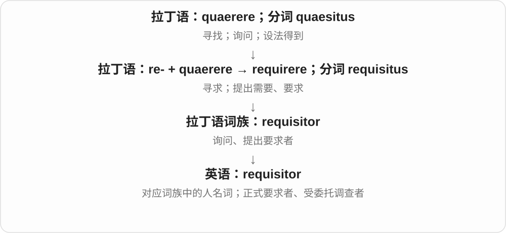

这是少见、偏旧的名词。理解时抓住谁在提出正式要求、谁受命查问；现代一般流程中 requester 或 investigator 通常更清楚。

**常见搭配与例句**

a requisitor’s report；the appointed requisitor；a formal requisitor。

> The requisitor submitted a detailed request for supplies.

提出申领的人递交了一份详细的物资申请。

> The appointed requisitor examined the records and reported his findings.

受委托的调查者审查了记录并报告了发现。

**别混淆**

requisition 是请求或征用行为；requisitor 是相关的人。别与 inquisitor“审问者”仅凭外形混用。

### 22. requisitory — 正式要求的；请求性的；检察官的正式请求书（旧或专门用法）

**音标**：参考读法 /rɪˈkwɪzɪtəri/（据旧词典重音与词形转写）

**先抓住这个画面**

requisitory 像带着正式身份发出的一封函：“请依法或依程序办理这件事。”

**怎么拆**

形容词经中古英语 requisitorie 来自中世纪拉丁 requisitorius；法语法律语境中的英语名词另借自 réquisitoire，并受英语形容词形式影响。

**怎么变成今天的意思**

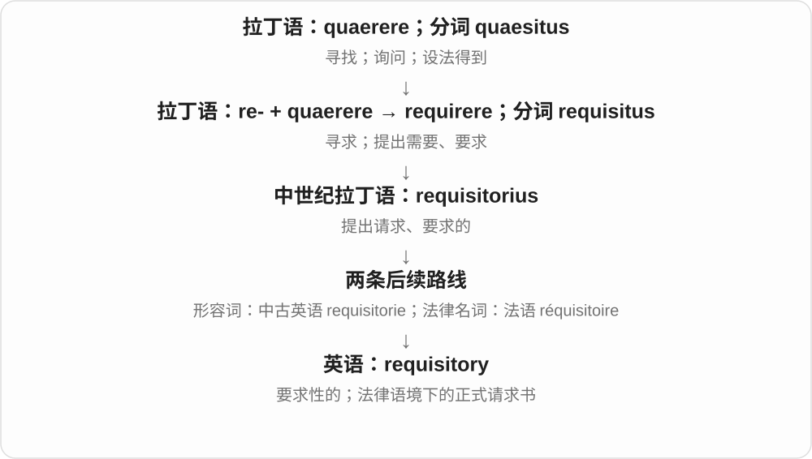

形容词可以描述正式请求函；名词是涉及法语法律制度的特定书面用语。日常写“请求信”通常不需要这个罕见词，更不应直接套作现代法律文书的统一名称。

**常见搭配与例句**

a requisitory letter；requisitory terms；a prosecutor’s requisitory。

> The court sent a requisitory letter asking for the missing documents.

法院发出了一封正式请求函，索取缺失的文件。

> The historical account quotes the prosecutor’s requisitory in full.

这份历史叙述全文引述了检察官的正式请求书。

**别混淆**

requisitive 泛指表达要求的性质；requisitory 在旧式公文、法律语境中更常见，名词用法尤其专门。

### 23. requisitive — 表示要求的；提出请求的人或事物（少用）

**音标**：参考读法 /rɪˈkwɪzɪtɪv/（据旧词典重音与词形转写）

**先抓住这个画面**

requisitive 把一句话或一个人的姿态标成“在向对方要什么”，而不是单纯说明事实。

**怎么拆**

词形可联系 requisit-“要求”与 -ive；它属于 requirere 的英语派生词族。图中表示词族联系，不将未经确认的拉丁同形词当成直接借入来源。

**怎么变成今天的意思**

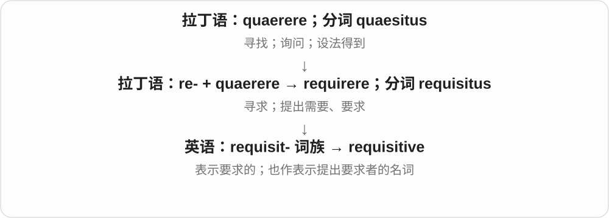

旧语法书里可用来描述要求性的语气；也有名词“提出要求者”的旧义。现代常用 requesting、demanding 或 requester，以下保留旧式书面语境。

**常见搭配与例句**

a requisitive expression；a requisitive tone；a requisitive mood（旧语法术语）。

> The grammar treats “Give me the book” as a requisitive expression.

这本语法书把“把书给我”归为表达要求的话语。

> Her letter grew more requisitive as the delay continued.

随着延误持续，她信中的要求意味越来越强。

**别混淆**

requisite 说东西是必要的；requisitive 说话语或主体在提出要求，不是同一种语法角色。

### 24. prerequisite — 先决条件；先修课程；预先必需的

**音标**：/ˌpriːˈrekwɪzɪt/

**先抓住这个画面**

prerequisite 像下一关门口的钥匙：要进去，得先拿到它。

**怎么拆**

pre-“在前” + requisite“必要的”，在英语中构成；不是所有必要条件都强调先后，但这个词强调。

**怎么变成今天的意思**

课程目录里可指必须先完成的课程；一般语境里指任何先决条件。常用 a prerequisite for / to，不要把它理解为仅仅“建议准备一下”。

**常见搭配与例句**

a prerequisite for；a prerequisite to；meet the prerequisites；a prerequisite course。

> Basic algebra is a prerequisite for this course.

基础代数是这门课的先修要求。

> Trust is a prerequisite for effective cooperation.

信任是有效合作的先决条件。

**别混淆**

prerequisite 要先满足；corequisite 通常允许或要求同时满足，具体以课程规定为准。

### 25. corequisite — 共同必备条件；同时修读的配套课程

**音标**：美 /koʊˈrekwəzɪt/

**先抓住这个画面**

corequisite 像两件要配套使用的工具：学这一门时，另一门也要跟上。

**怎么拆**

co-“共同、一起” + requisite“必要条件”，是英语中的组合。

**怎么变成今天的意思**

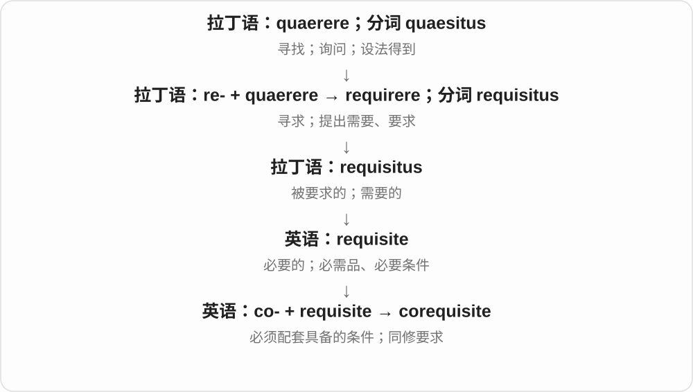

课程语境里常指需要与另一门课同时修读的课程；有些学校也允许此前已经修过。它强调配套要求，是否必须同一学期要看具体课程说明。

**常见搭配与例句**

a corequisite for；a corequisite course；prerequisites and corequisites。

> The laboratory class is a corequisite for the introductory chemistry course.

这门实验课是化学入门课的同修配套课程。

> Students must check both the prerequisites and the corequisites before registering.

学生选课前必须同时查看先修要求和同修要求。

**别混淆**

prerequisite 通常要在前；corequisite 重点在同时具备，不必总是先完成。

### 26. requisition — 正式申领；申请单；征用；申领、征用某物

**音标**：/ˌrekwɪˈzɪʃən/

**先抓住这个画面**

requisition 像有制度、有权限支撑的领用单：“请按流程把这些物资调过来。”

**怎么拆**

来自拉丁及中世纪拉丁 requisitio，经法语、再入英语；英语动词又由名词转用。其 -sition 不是可以任意套在 require 后面的普通后缀。

**怎么变成今天的意思**

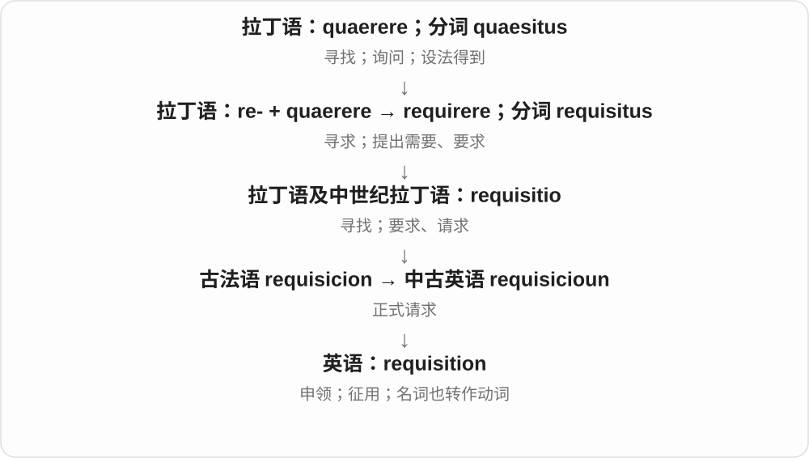

办公室里的 purchase requisition 是采购申请；战时 requisition a building 是征用建筑。共同点是正式调取，但申请与强制征用的力度不同，要看场景。

**常见搭配与例句**

a purchase requisition；a requisition form；requisition supplies；requisition a building。

> The technician submitted a requisition for replacement parts.

技术员提交了一份更换零件的申领单。

> The army requisitioned the empty warehouse for storage.

军队征用了那座空仓库来存放物资。

**别混淆**

request 范围广，也可以很私人；requisition 常有组织流程或正式权力作为背景。

### 27. acquire — 获得；学得；收购；逐渐养成

**音标**：英 /əˈkwaɪə/；美 /əˈkwaɪr/

**先抓住这个画面**

acquire 像把原本不属于自己的东西，慢慢带进自己的生活：可以是一家公司，也可以是一门技能或一种口味。

**怎么拆**

拉丁 ad- + quaerere 形成 acquirere“取得”，经古法语进入中古英语；今形又受约 1600 年前后的拉丁再借入影响。ac- 不是表示否定的 a-。

**怎么变成今天的意思**

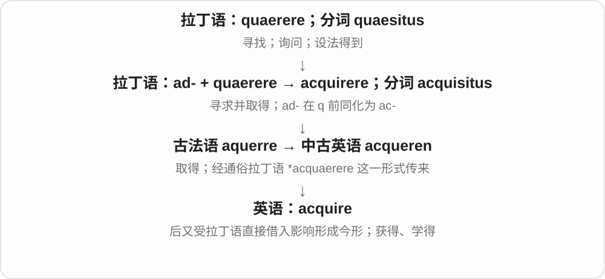

可说 acquire knowledge、acquire a business、acquire a reputation。取得不一定靠花钱，也不一定是主动计划的：人也会逐渐养成习惯或获得坏名声。

**常见搭配与例句**

acquire a skill；acquire knowledge；acquire a company；acquire a taste for。

> She acquired practical skills while repairing old bicycles.

她在修旧自行车的过程中学到了实用技能。

> The company acquired a small software studio last year.

公司去年收购了一家小型软件工作室。

**别混淆**

buy 明确通过购买；acquire 只强调最后获得，渠道可以是学习、经验、购买或其他方式。

### 28. acquired — 后天获得的；学来的；逐渐形成的

**音标**：英 /əˈkwaɪəd/；美 /əˈkwaɪrd/

**先抓住这个画面**

acquired 是“后来装进去的”，像经过接触才学会的本领，或吃了几次才开始喜欢的味道。

**怎么拆**

acquire 的过去分词，作为形容词突出并非生来就有；acquired taste 是从这种后天获得发展出的固定说法。

**怎么变成今天的意思**

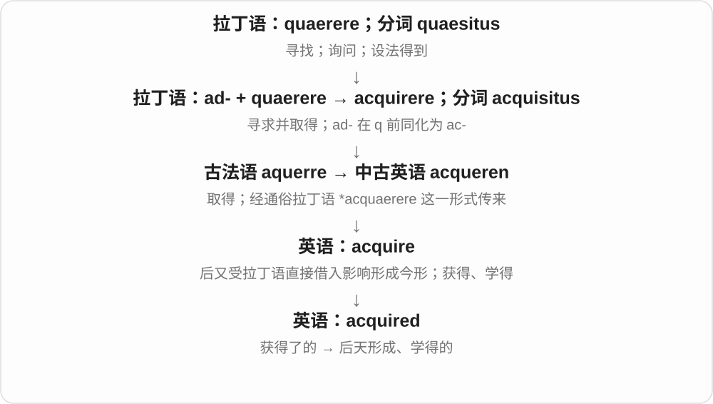

acquired skills 指学来的技能；an acquired taste 指起初未必喜欢、后来才欣赏的东西。并不意味着它难吃，只是喜好需要培养。

**常见搭配与例句**

acquired knowledge；an acquired skill；an acquired taste。

> Public speaking is an acquired skill for many people.

对很多人来说，公开演讲是一项后天学来的技能。

> Strong blue cheese can be an acquired taste.

味道浓烈的蓝纹奶酪可能要吃过几次才会喜欢。

**别混淆**

innate 是先天的；acquired 是后天获得的。bought 只说明买来的，不适合替代所有 acquired。

### 29. acquisition — 获得；习得；收购；新购入的东西

**音标**：/ˌækwɪˈzɪʃən/

**先抓住这个画面**

acquisition 可以是把东西拿到手的过程，也可以是已经进了自己收藏、公司或知识库的新成员。

**怎么拆**

来自拉丁 acquisitio，经法语或直接进入英语，是与 acquire 平行借入的名词。现代把二者配对很有用，但不是英语 acquire 机械变成 acquisition 的全部历史。

**怎么变成今天的意思**

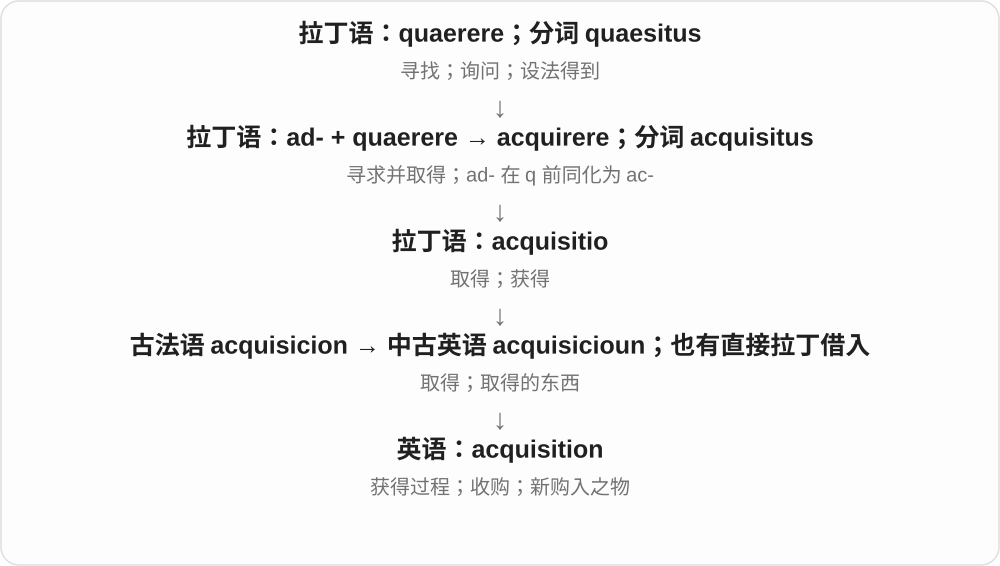

language acquisition 是语言习得；a business acquisition 是企业收购；the museum’s latest acquisition 是博物馆新得到的一件藏品。同一个词兼顾过程和成果。

**常见搭配与例句**

language acquisition；the acquisition of skills；mergers and acquisitions；a recent acquisition。

> The study follows children’s acquisition of vocabulary.

这项研究跟踪儿童词汇的习得过程。

> The gallery displayed its newest acquisition near the entrance.

画廊把最新购入的藏品陈列在入口附近。

**别混淆**

acquisition 强调获得、取得；possession 强调已经占有的状态。企业 acquisition 也不等同于双方合并成一家这一具体安排。

### 30. acquirer — 取得者；收购方

**音标**：英 /əˈkwaɪərə/；美 /əˈkwaɪrər/

**先抓住这个画面**

acquirer 是伸手把东西纳入自己范围的一方，在收购交易里就是买下另一家企业的一方。

**怎么拆**

acquire + -er，表示取得或收购的主体；主体可以是个人，也可以是机构。

**怎么变成今天的意思**

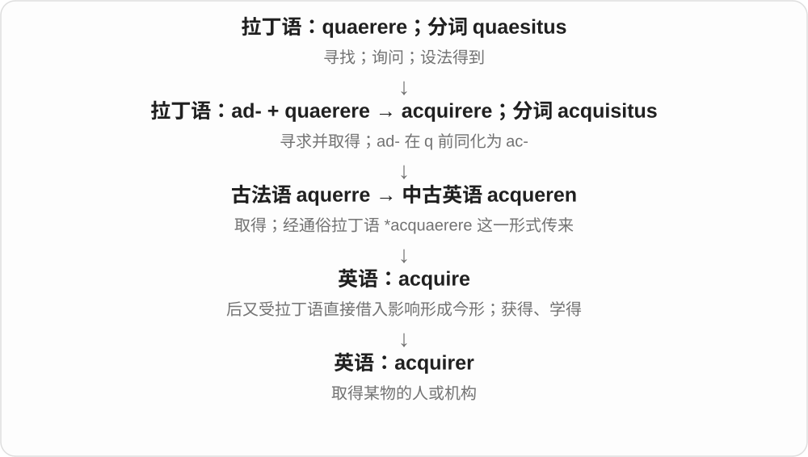

商业报道里 a potential acquirer 是潜在收购方；金融支付语境中的 acquirer 还有收单机构的专门用法，要按行业角色理解，不直接等同于刷卡顾客。

**常见搭配与例句**

a potential acquirer；the acquiring company；a corporate acquirer。

> The board met representatives of a potential acquirer.

董事会会见了一家潜在收购方的代表。

> The acquirer agreed to keep the studio’s existing name.

收购方同意保留工作室现有的名称。

**别混淆**

acquirer 是取得的一方；acquiree 是被取得的一方。二者的角色方向相反。

### 31. acquirement — 获得；学得的知识或技能（较书面）

**音标**：英 /əˈkwaɪəmənt/；美 /əˈkwaɪrmənt/

**先抓住这个画面**

acquirement 像经过学习攒进自己工具箱的一项本领。

**怎么拆**

acquire + -ment，在英语中构成表示获得过程或结果的名词。

**怎么变成今天的意思**

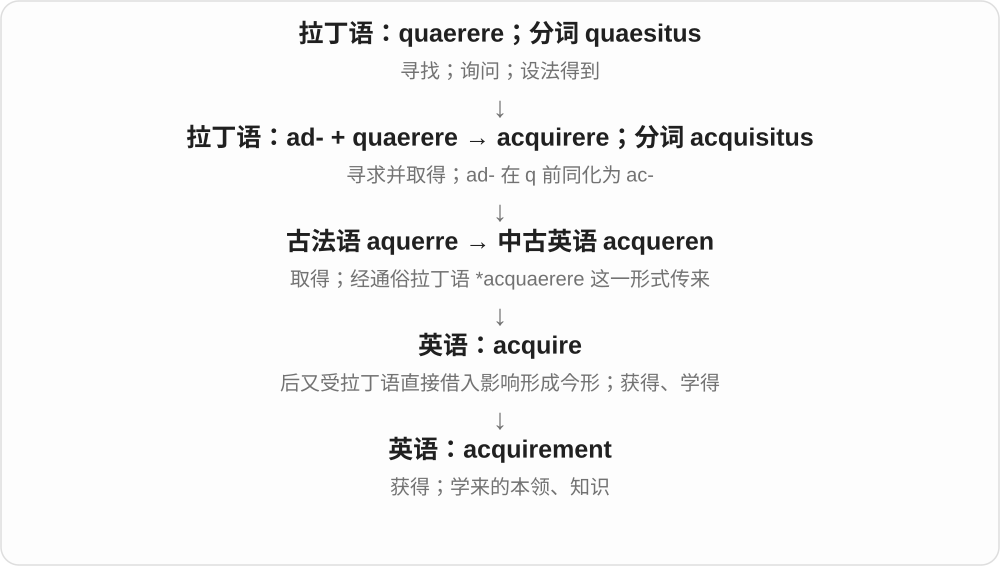

旧式或正式文字中，复数 acquirements 常指学识、技能。今天普通地说 skills、knowledge 往往更自然；若是企业收购，通常用 acquisition。

**常见搭配与例句**

intellectual acquirements；linguistic acquirements；the acquirement of knowledge。

> Her linguistic acquirements included the ability to read old manuscripts.

她学得的语言本领包括阅读古代手稿的能力。

> The course values the acquirement of practical knowledge.

这门课程重视实用知识的获得。

**别混淆**

acquisition 在现代英语中更常用、范围更宽；acquirement 更容易指靠学习得到的东西。

### 32. acquiree — 被收购方；拟被收购的对象

**音标**：/əˌkwaɪəˈriː/，也可省去中间的 /ə/

**先抓住这个画面**

acquiree 是交易中被纳入另一方的公司：不是拿购物篮的人，而是这次收购的目标。

**怎么拆**

acquire + -ee，-ee 在这里标出动作落到谁身上；词尾重读。

**怎么变成今天的意思**

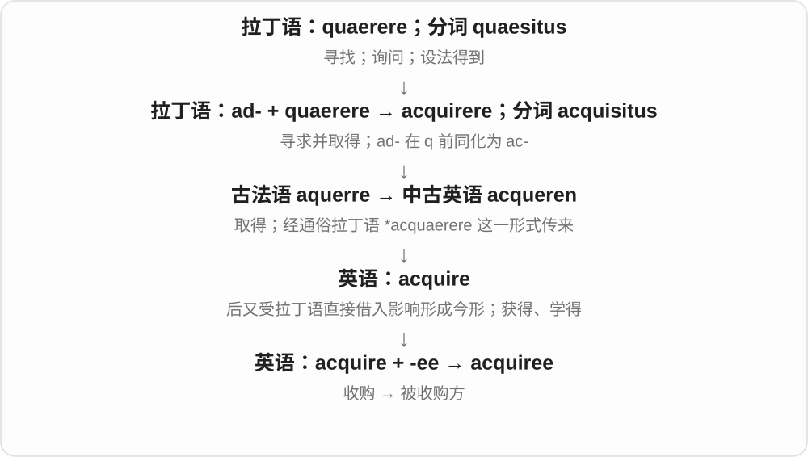

主要见于并购、商业分析。acquiree 可以是已被收购的企业，也可在讨论方案时指拟收购的目标，要看交易进度。

**常见搭配与例句**

the potential acquiree；the acquiree’s assets；acquirer and acquiree。

> The acquiree owns several valuable patents.

被收购方拥有几项有价值的专利。

> Managers from the acquirer and the acquiree met to discuss the transition.

收购方与被收购方的管理人员会面，讨论交接安排。

**别混淆**

acquirer 收购别人；acquiree 被收购。employee 的 -ee 类似，也常标记承受某种关系的一方。

### 33. inquire — 询问；查问；调查

**音标**：英 /ɪnˈkwaɪə/；美 /ɪnˈkwaɪr/

**先抓住这个画面**

inquire 是朝信息所在的地方伸出问题：“我想把这件事问明白。”

**怎么拆**

远源是拉丁 inquirere，in- 表示向内、深入，quaerere 表示寻找；经古法语和中世纪拉丁语进入中古英语，后按拉丁形式改用 in- 拼写。

**怎么变成今天的意思**

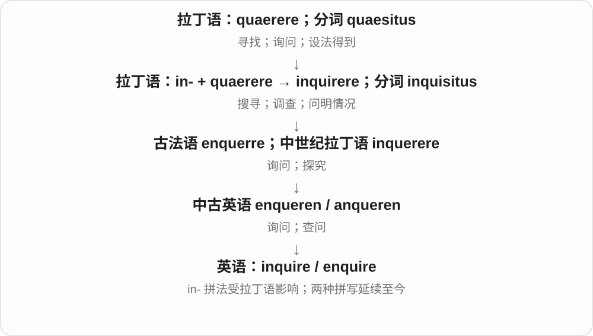

inquire about a room 是询问房间情况；inquire into a problem 是深入调查问题。不是每次 inquire 都很严肃，但比 ask 更书面。

**常见搭配与例句**

inquire about；inquire into；inquire whether；inquire after someone（问候其近况）。

> I called to inquire about the weekend opening hours.

我打电话询问周末的开放时间。

> The panel will inquire into the cause of the delay.

调查小组将查明延误的原因。

**别混淆**

ask 最日常；inquire 常用于办事、书信或调查。inquire into 后面接调查的事项。

### 34. inquiry — 询问；调查；探究

**音标**：英 /ɪnˈkwaɪəri/；美 /ˈɪnkwɪri/，也读 /ɪnˈkwaɪri/

**先抓住这个画面**

inquiry 把“想弄明白”变成一件事：小到一封询价邮件，大到一项正式调查。

**怎么拆**

由中古英语 enquery 延续而来，属于法语询问词族，后来按拉丁语改用 in- 拼写；现代可与 inquire 配对记忆，不能据此断言先有现代 inquire 再加 -y。

**怎么变成今天的意思**

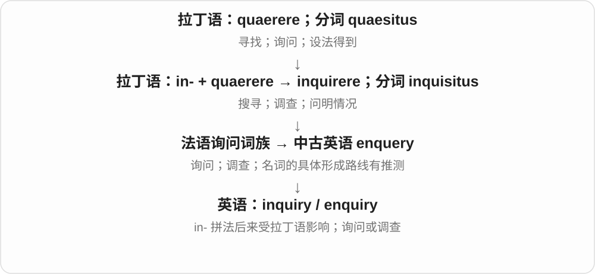

make an inquiry 是询问信息；an inquiry into an accident 是针对事故开展调查。scientific inquiry 则指通过提问、观察和证据进行探究。

**常见搭配与例句**

make inquiries；an inquiry about；an inquiry into；a public inquiry。

> We received an inquiry about renting the hall.

我们收到了一条关于租用大厅的询问。

> An independent inquiry examined how the files had been lost.

一项独立调查查明了文件是如何丢失的。

**别混淆**

inquiry 可指一个询问动作或完整调查；question 常是其中一个具体问题。

### 35. inquisition — 严厉盘问；调查；宗教裁判制度或机构

**音标**：/ˌɪŋkwɪˈzɪʃən/

**先抓住这个画面**

inquisition 原本是查明情况，后来常让人想到一连串逼近、不肯放过细节的盘问。

**怎么拆**

拉丁 inquirere 派生出名词 inquisitio，经法语及拉丁借词路线进入英语；它是独立借入的名词，不是英语 inquire 直接加 -sition。

**怎么变成今天的意思**

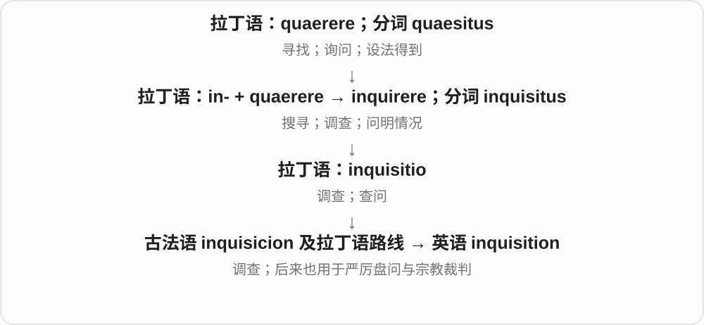

小写 an inquisition 可夸张地说“像受审一样被追问”。大写 the Inquisition 指历史上某些宗教裁判制度和机构；不能把任何普通询问都译成宗教审判。

**常见搭配与例句**

subject someone to an inquisition；a lengthy inquisition；the Spanish Inquisition。

> What began as a friendly chat soon felt like an inquisition.

本来是友好聊天，很快却让人感觉像在受审。

> The exhibition examines the records of the Spanish Inquisition.

展览研究了西班牙宗教裁判所的档案。

**别混淆**

inquiry 可以中性；inquisition 在现代日常语境通常带侵入、压迫或审讯意味。

### 36. inquiring — 好问的；爱探究的；探询的

**音标**：英 /ɪnˈkwaɪərɪŋ/；美 /ɪnˈkwaɪrɪŋ/

**先抓住这个画面**

inquiring 像一个不断靠近事物、想看看里面怎么运作的脑袋。

**怎么拆**

inquire + -ing；由询问的动作形成形容词。

**怎么变成今天的意思**

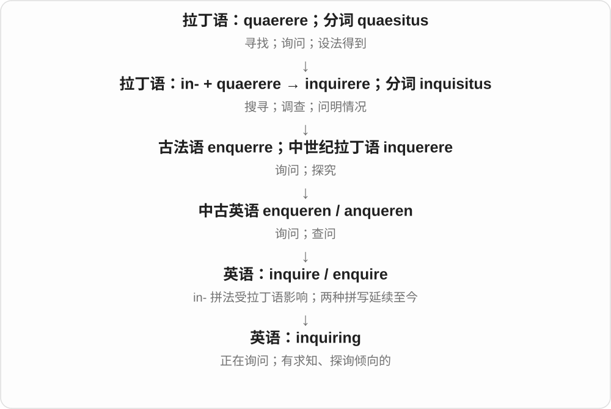

an inquiring mind 常是赞扬求知欲；an inquiring look 是想获得说明的眼神。作为动词形式，仍可说 is inquiring about the price。

**常见搭配与例句**

an inquiring mind；an inquiring look；an inquiring attitude。

> The museum is full of activities for inquiring minds.

博物馆里有许多适合好奇、爱探究的人参与的活动。

> She turned towards me with an inquiring expression.

她转向我，脸上露出探询的神情。

**别混淆**

inquiring 常侧重求知；inquisitive 也能表示好学，但在私人话题上可能变成爱打听。

### 37. inquiringly — 探询地；带着求解的神情

**音标**：/ɪnˈkwaɪərɪŋli/

**先抓住这个画面**

inquiringly 像用眼神伸出一个问号，等着对方把没有说清楚的部分补上。

**怎么拆**

inquiring + -ly，描述求知、探询的方式。

**怎么变成今天的意思**

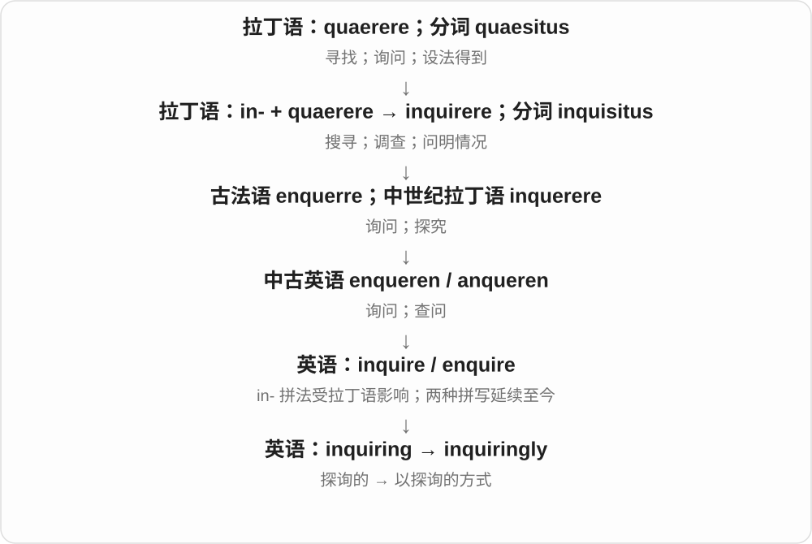

多见于叙述人的目光、神情和语气，可以只是礼貌地等一个说明，不必带怀疑。

**常见搭配与例句**

look inquiringly at；glance inquiringly；raise one’s eyebrows inquiringly。

> The child looked inquiringly at the empty birdcage.

孩子带着疑问看着空鸟笼。

> “Another meeting?” she asked inquiringly.

“还要开一次会？”她探询地问。

**别混淆**

inquiringly 侧重想知道；accusingly 则像已经在指责对方，语气不同。

### 38. inquirer — 询问者；探究者

**音标**：英 /ɪnˈkwaɪərə/；美 /ɪnˈkwaɪrər/

**先抓住这个画面**

inquirer 是带着一个“不知道”而来、想找出答案的人。

**怎么拆**

inquire + -er，表示进行询问、探究的人。

**怎么变成今天的意思**

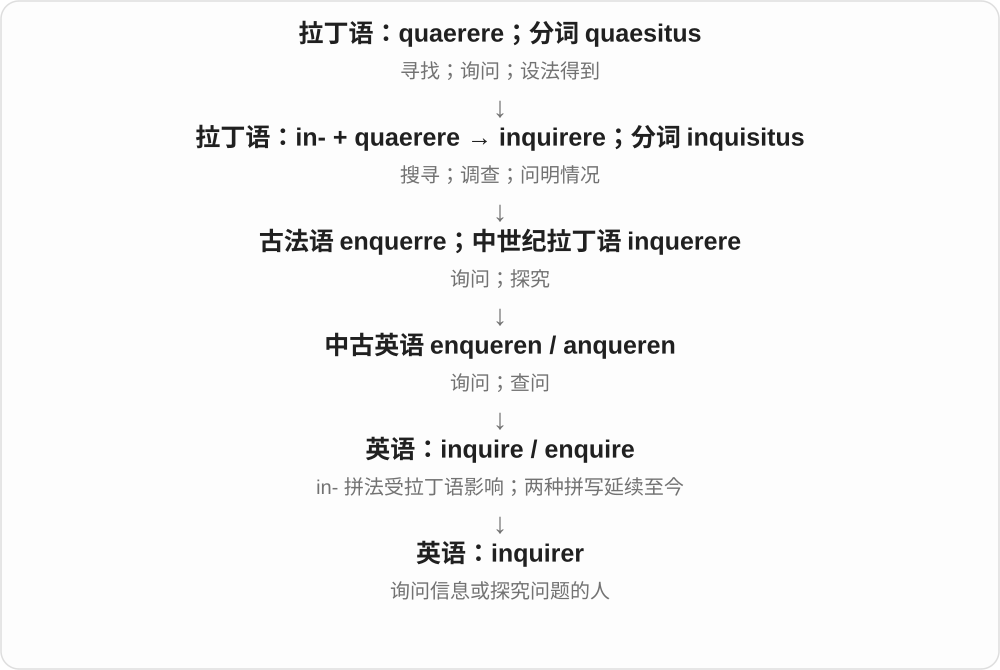

既能指一次咨询的来访者，也能指长期追索知识的人。这个词本身不带逼供、挑刺的意思。

**常见搭配与例句**

an interested inquirer；a serious inquirer；respond to an inquirer。

> The librarian directed the inquirer to the local history section.

图书管理员把那位询问者引到地方史专区。

> A careful inquirer checks the evidence before accepting a claim.

谨慎的探究者会先核查证据，再接受一个说法。

**别混淆**

inquirer 可以中性或褒义；inquisitor 往往带有严厉审问的角色或态度。

### 39. conquer — 征服；战胜；克服；攻克

**音标**：英 /ˈkɒŋkə/；美 /ˈkɑŋkər/

**先抓住这个画面**

conquer 是面前有阻力，经过一番努力把它拿下：可能是城池，也可能是恐惧或难题。

**怎么拆**

经古法语 conquerre 来自通俗拉丁语 *conquaerere，对应拉丁 conquirere“努力寻求、取得”；con- 在这里有加强作用。寻找、争取，逐渐走向战胜并取得。

**怎么变成今天的意思**

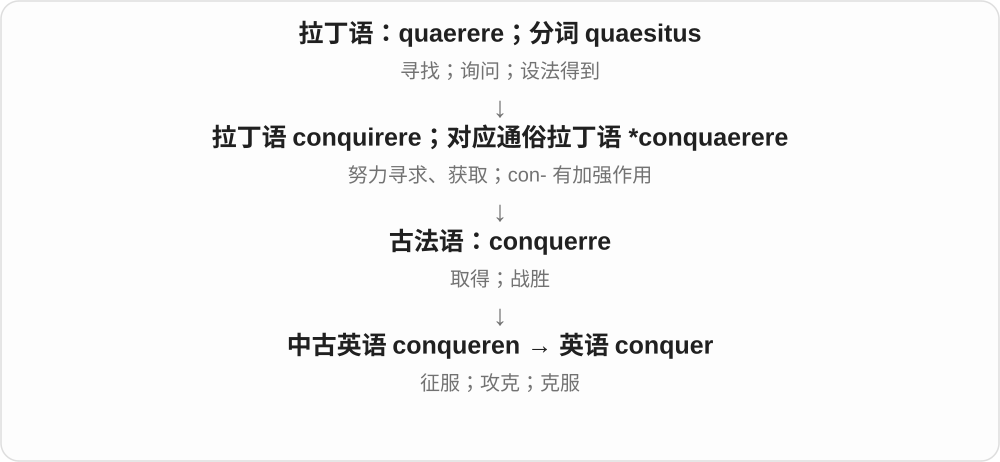

conquer a country 是武力征服；conquer a fear 是不再被恐惧控制；conquer a difficult route 则是成功完成挑战。不是只要完成一件事就都用 conquer。

**常见搭配与例句**

conquer a fear；conquer a territory；conquer a challenge；divide and conquer。

> She gradually conquered her fear of deep water.

她逐渐克服了对深水的恐惧。

> The army failed to conquer the mountain region.

那支军队没能征服这片山区。

**别混淆**

defeat 可以只说一次交锋中打败对手；conquer 常进一步让人想到拿下、控制或彻底克服。

### 40. conquering — 正在征服的；凯旋获胜的；克服

**音标**：英 /ˈkɒŋkərɪŋ/；美 /ˈkɑŋkərɪŋ/

**先抓住这个画面**

conquering 把“拿下挑战”的动作放到镜头里，也可把胜利的气势带到人身上。

**怎么拆**

conquer + -ing，是动词分词，也能修饰人物或军队。

**怎么变成今天的意思**

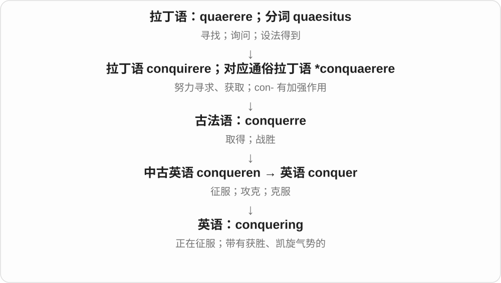

a conquering army 是征服中的军队；a conquering hero 常指凯旋英雄。Conquering fear takes time 中，它又把克服恐惧这个过程放到句首。

**常见搭配与例句**

a conquering army；a conquering hero；conquering fear。

> The conquering army entered the city at dawn.

获胜的军队在黎明时进入了城市。

> Conquering her nervousness took months of practice.

为了克服紧张，她练习了好几个月。

**别混淆**

conquering 主动战胜；conquered 是已经被战胜、被征服。一个在施加动作，一个在承受结果。

### 41. conqueror — 征服者；战胜对手的人

**音标**：英 /ˈkɒŋkərə/；美 /ˈkɑŋkərər/

**先抓住这个画面**

conqueror 是越过阻力、站到胜利一侧的人，在历史中常指夺取领土的统治者。

**怎么拆**

经古法语 conquereor、盎格鲁法语 conquerour 借入中古英语；现代可按 conquer + -or 记，但历史上是人名词独立借入。

**怎么变成今天的意思**

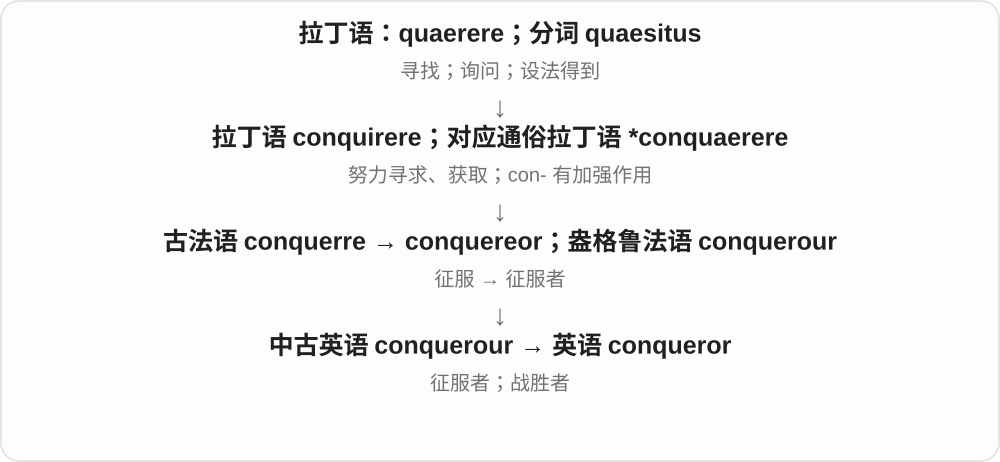

可用于军事历史，也可用较有气势的比喻形容挑战的成功者。the Conqueror 作历史称号时大写，普通征服者小写。

**常见搭配与例句**

a foreign conqueror；the returning conqueror；William the Conqueror。

> The conqueror imposed new taxes on the city.

征服者向这座城市征收了新的税款。

> The defeated champion shook hands with his young conqueror.

失利的冠军与击败他的年轻对手握了手。

**别混淆**

winner 可以是任何比赛的胜者；conqueror 更有击败强大阻力或掌控他人的色彩。

### 42. unconquered — 未被征服的；未被攻克的；不屈的

**音标**：英 /ʌnˈkɒŋkəd/；美 /ʌnˈkɑŋkərd/

**先抓住这个画面**

unconquered 像还没有倒下的旗：别人试过，但没有拿下；也可能从未被拿下过。

**怎么拆**

un- + conquered，否定已经被征服的状态。

**怎么变成今天的意思**

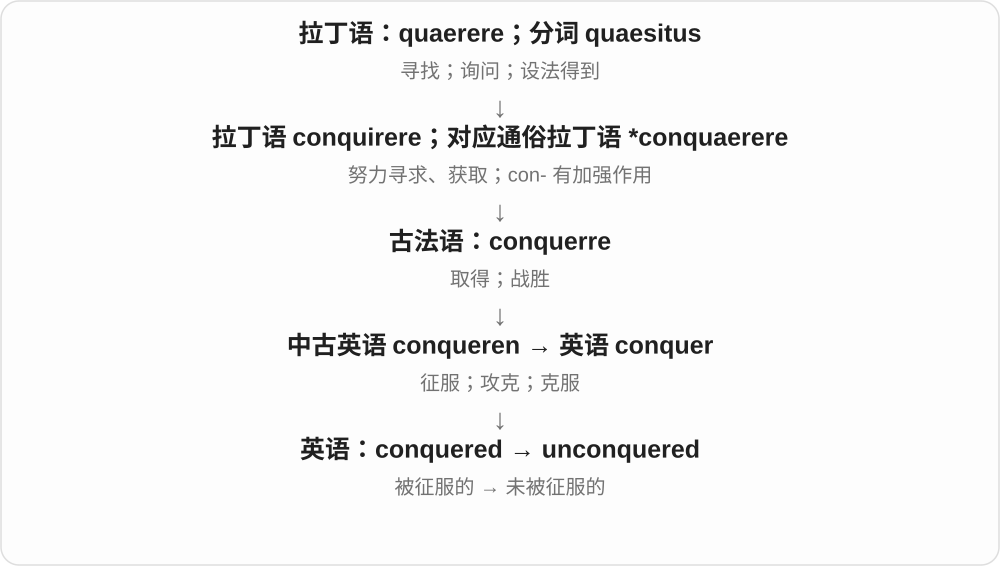

可指领土、山峰或精神。unconquered territory 是尚未被征服的地区；an unconquered spirit 则是受到打击仍不屈服的精神。

**常见搭配与例句**

unconquered territory；an unconquered peak；an unconquered spirit。

> The remote valley remained unconquered for decades.

那个偏远山谷几十年间一直未被征服。

> The final scene celebrates her unconquered spirit.

最后一幕赞颂了她不屈的精神。

**别混淆**

unconquered 说截至某时没有被拿下；unconquerable 更强，表示无法征服，不要混为一谈。

### 43. reconquer — 重新征服；夺回；再次攻克

**音标**：英 /ˌriːˈkɒŋkə/；美 /ˌriːˈkɑŋkər/

**先抓住这个画面**

reconquer 是曾经拿下、后来失去，如今又把它重新夺回来。

**怎么拆**

有法语 reconquerre / reconquérir 借入的路线，也可按英语 re- + conquer 分析；两种语言的派生不能画成英语 conquer 反过来产生法语。

**怎么变成今天的意思**

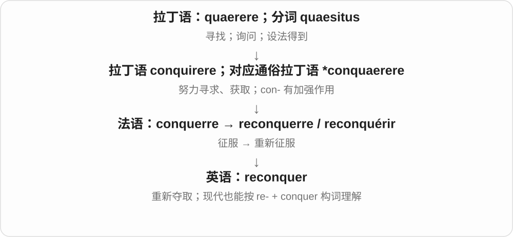

多用于失而复得的领土、控制权，也可作比喻。通常隐含以前已取得或控制过，后来需要再次赢回。

**常见搭配与例句**

reconquer a city；reconquer lost territory；reconquer a market。

> The king launched a campaign to reconquer the lost provinces.

国王发动了一场旨在夺回失地的战役。

> The company hopes to reconquer the market it once dominated.

公司希望重新占领它曾经主导的市场。

**别混淆**

conquer 不要求以前拥有过；reconquer 把“再次、夺回”的时间关系加进来。

### 44. conquest — 征服；攻克；征服所得

**音标**：英 /ˈkɒŋkwest/；美 /ˈkɑŋkwest/

**先抓住这个画面**

conquest 是“拿下来了”这件事，或拿下之后得到的领土和成果。

**怎么拆**

来自古法语 conquest / conqueste 等名词形式，也有中世纪拉丁语路线；与 conquer 同源，但不是在英语里把 conquer 的词尾换成 -quest。

**怎么变成今天的意思**

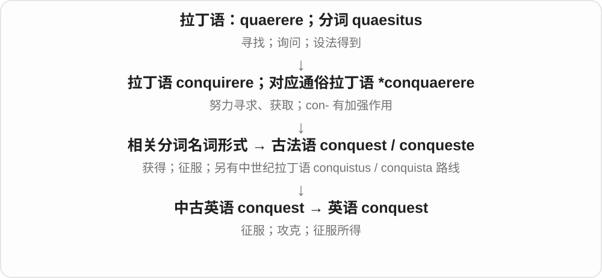

the conquest of a territory 是征服某地；the conquest of fear 是克服恐惧。旧式用语也可把赢得的恋爱对象叫 a conquest，通常带物化或炫耀口吻。

**常见搭配与例句**

military conquest；the conquest of；territorial conquests；the Norman Conquest。

> The map shows the empire before its northern conquests.

地图展示了这个帝国向北征服之前的疆域。

> For him, the solo flight marked a personal conquest of fear.

对他而言，这次单人飞行标志着他战胜了自己的恐惧。

**别混淆**

conquer 是动作；conquest 是事件、过程或所得。victory 只说胜利，不必包含征服。

### 45. reconquest — 重新征服；收复；夺回的过程

**音标**：英 /ˌriːˈkɒŋkwest/；美 /ˌriːˈkɑŋkwest/

**先抓住这个画面**

reconquest 把“又夺回来了”当作一段完整的行动或历史过程。

**怎么拆**

有从法语 reconqueste 借入的路线；现代也可按 re- + conquest 理解。与 reconquer 配对，但不是必须先有现代英语动词再改词尾。

**怎么变成今天的意思**

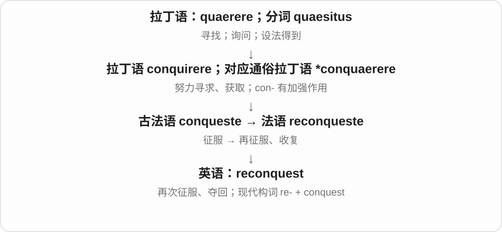

常见于历史叙述，也可用于市场、影响力等比喻。大写 Reconquest 在某些历史文本中可能特指一段收复运动，要看上下文指谁。

**常见搭配与例句**

the reconquest of；a campaign of reconquest；territorial reconquest。

> The chapter describes the reconquest of the coastal towns.

这一章叙述了沿海城镇的收复过程。

> The reconquest proved more difficult than the original invasion.

重新征服比最初的入侵更加困难。

**别混淆**

reconquest 强调再次靠征服拿回；recovery 可以通过恢复、归还、改善等许多方式实现。

### 46. query — 询问；疑问；查询；对……提出疑问

**音标**：英 /ˈkwɪəri/；美 /ˈkwɪri/，也读 /ˈkweri/

**先抓住这个画面**

query 像递出一张小纸条：“这一个具体地方，请解释一下。”计算机里，则是把这张纸条写成机器能执行的查询。

**怎么拆**

由拉丁命令式 quaere“查问一下”的英语化拼写演变而来；英语动词再由名词转用。现代不能把 query 硬拆成一个表示询问的独立英语 quer 加 y。

**怎么变成今天的意思**

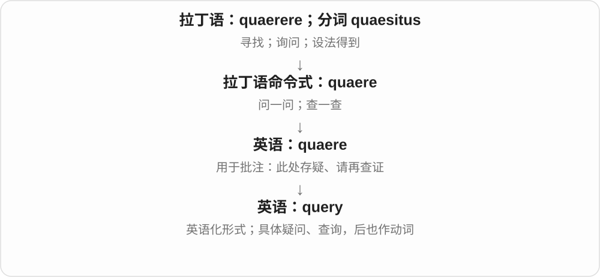

a query about a bill 是账单上的具体疑问；query a charge 是对收费提出疑问。数据库 query 是按条件取出或处理数据的指令，并不是屏幕上写一个普通问句。

**常见搭配与例句**

raise / answer a query；a query about；query a database；a search query。

> I sent the supplier a query about the delivery charge.

我就运费向供应商发出了一条询问。

> This query returns all orders placed yesterday.

这条查询会返回昨天下的所有订单。

**别混淆**

question 用途最广；query 常出现在客服、编辑和信息检索里，聚焦一个待核实之处。

### 47. exquisite — 精美的；细腻的；极强烈的

**音标**：/ɪkˈskwɪzɪt/，也读 /ˈekskwɪzɪt/

**先抓住这个画面**

exquisite 像从许多东西中精挑出来的一件：每个细节都讲究。它还保留“达到很高程度”的方向，所以痛苦也能 exquisite。

**怎么拆**

来自拉丁 exquisitus，即 exquirere“仔细搜寻、挑选”的过去分词。搜寻出来、精心挑选，再延伸为精美或程度极高。

**怎么变成今天的意思**

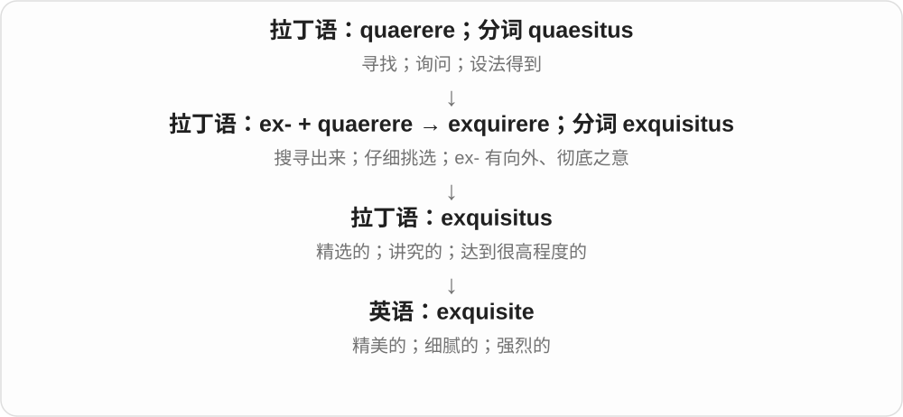

an exquisite necklace 是精美项链；exquisite sensitivity 是极细腻或高度敏锐的感受；exquisite pain 是剧烈疼痛，绝不是“很漂亮的疼痛”。

**常见搭配与例句**

exquisite craftsmanship；exquisite detail；exquisite taste；exquisite pain。

> The box is decorated with exquisite miniature flowers.

盒子上装饰着精美的微型花朵。

> The slightest touch caused exquisite pain in his injured finger.

受伤的手指稍微一碰就剧痛难忍。

**别混淆**

beautiful 泛指美；exquisite 更突出精致、细腻、达到极高程度。不要把所有含义压缩为 beautiful。

### 48. exquisitely — 精美地；精细地；极其

**音标**：/ɪkˈskwɪzɪtli/，也读 /ˈekskwɪzɪtli/

**先抓住这个画面**

exquisitely 像把镜头拉近，让你看到动作或成品的每个细节都处理得极细；也能把某种感觉推到极高程度。

**怎么拆**

exquisite + -ly，沿着精致和极高程度两条意义继续使用。

**怎么变成今天的意思**

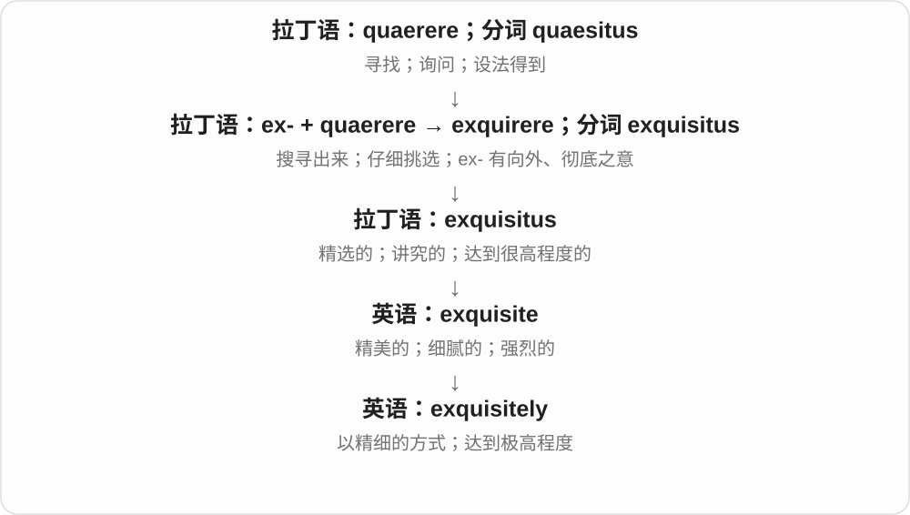

exquisitely carved 说雕工极细；exquisitely sensitive 说非常敏感、能感到极细微变化。后者不一定是在评价美感。

**常见搭配与例句**

exquisitely carved；exquisitely detailed；exquisitely sensitive。

> The bird was exquisitely carved from a single piece of wood.

那只鸟由一整块木头精雕而成。

> The instrument is exquisitely sensitive to tiny changes in pressure.

这台仪器对极小的压力变化也极其敏感。

**别混淆**

beautifully 更容易表示好看、做得好；exquisitely 常加上精细到极致或敏感到极点的感觉。

### 49. exquisiteness — 精美；精妙；细腻到极致的品质

**音标**：/ɪkˈskwɪzɪtnəs/，也读 /ˈekskwɪzɪtnəs/

**先抓住这个画面**

exquisiteness 是让人愿意凑近细看的那份精巧：小小一处，也能看出做得多讲究。

**怎么拆**

exquisite + -ness，把精美、精细或程度极高的性质变成名词。

**怎么变成今天的意思**

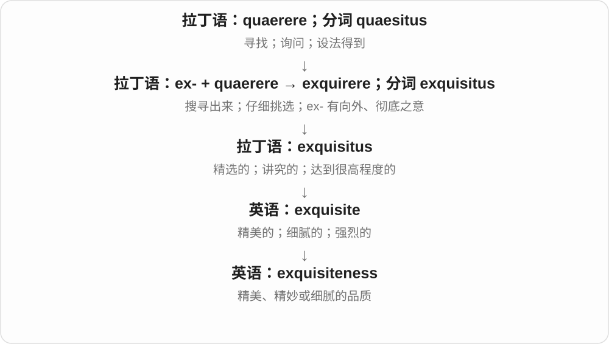

较书面，常描述艺术品、音乐、工艺的精细之美。与原形一样可有程度义，但日常最好从具体对象的精妙之处理解。

**常见搭配与例句**

the exquisiteness of；exquisiteness of detail；delicacy and exquisiteness。

> The exquisiteness of the embroidery drew visitors closer.

刺绣的精美吸引参观者走近细看。

> She admired the exquisiteness of the pianist’s phrasing.

她赞赏那位钢琴家处理乐句时的细腻精妙。

**别混淆**

beauty 是美；exquisiteness 更突出细致、讲究、近乎完美的那一面。

### 50. questionnaire — 调查问卷

**音标**：英 /ˌkwestʃəˈneə/；美 /ˌkwestʃəˈner/

**先抓住这个画面**

questionnaire 是把想知道的事情排成一张问题清单，让不同的人按同一套问题回答。

**怎么拆**

借自法语 questionnaire，与法语 questionner“提问”及 question 词族有关；远源是拉丁 quaestio。不是在现代英语 question 后随意加一个 -naire 就造出的借词。

**怎么变成今天的意思**

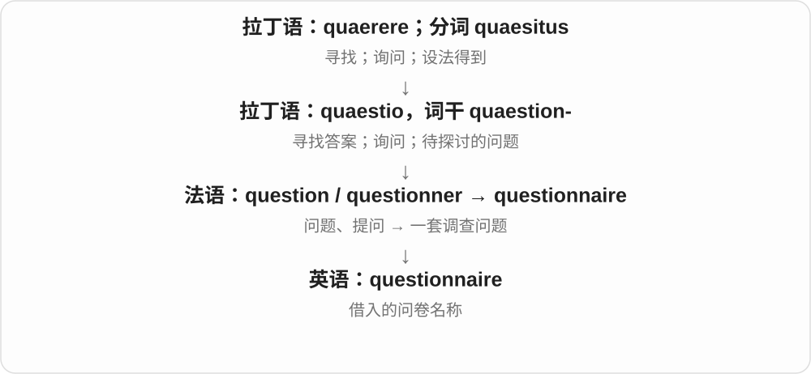

问卷可以在纸上，也可以在线填写。它是一种收集资料的工具；题目可以是选择题、量表或开放回答，不必都是是非题。

**常见搭配与例句**

fill in / fill out a questionnaire；complete a questionnaire；a survey questionnaire。

> Please complete the questionnaire before leaving the workshop.

离开工作坊前，请填写问卷。

> The questionnaire includes a space for additional comments.

这份问卷留有补充意见栏。

**别混淆**

survey 是调查活动或调查结果；questionnaire 是调查使用的那份问题表。

### 51. enquire — 询问；打听；查问

**音标**：英 /ɪnˈkwaɪə/；美 /ɪnˈkwaɪr/

**先抓住这个画面**

enquire 像到服务台探头问一句：“我想了解一下。”它与 inquire 是同一个词的另一种拼法。

**怎么拆**

保留较接近古法语 enquerre、中古英语 enqueren 的 en-；inquire 的 in- 后来受到拉丁拼写影响。不是在现代 inquire 前更换了一个不同意义的前缀。

**怎么变成今天的意思**

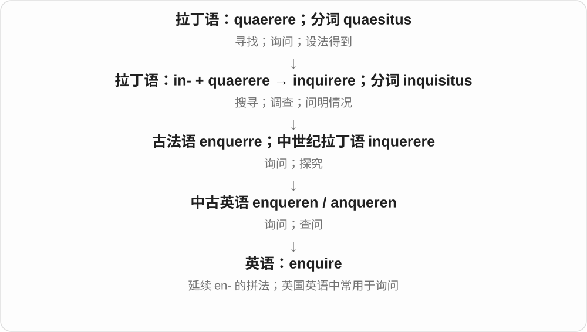

在英国英语里很常见于日常询问，正式调查也常见 inquire。有些写作者据此区分二者，但这不是所有英语使用者都遵守的硬规则；美国英语通常选 inquire。

**常见搭配与例句**

enquire about availability；enquire at reception；enquire whether。

> Please enquire at reception about bicycle hire.

关于租自行车的事，请向前台询问。

> She emailed to enquire whether the room was still available.

她发邮件询问那间房是否仍可预订。

**别混淆**

enquire 与 inquire 的差别主要在拼写习惯和语域倾向，不是两个彼此无关的动作。

### 52. enquiry — 询问；咨询；调查

**音标**：英 /ɪnˈkwaɪəri/；美 /ɪnˈkwaɪri/

**先抓住这个画面**

enquiry 常像服务台收到的一条咨询：“还有位置吗？价格是多少？”

**怎么拆**

是 inquiry 的 en- 拼写，延续中古英语 enquery 一路；远源仍是 inquirere，不是另一个词根。

**怎么变成今天的意思**

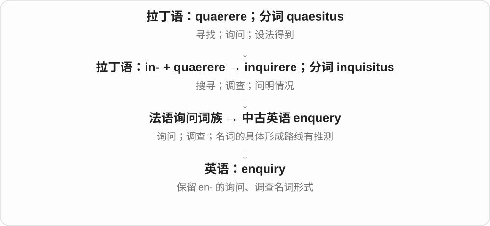

英国英语中可见 enquiries desk、customer enquiries。有些场合把一般咨询写作 enquiry、正式调查写作 inquiry，但二者有重叠，不能据拼写判断调查是否正式。

**常见搭配与例句**

customer enquiries；an enquiry about；an enquiries desk。

> All booking enquiries should be sent to this email address.

所有预订咨询请发到这个邮箱。

> The receptionist answered my enquiry about luggage storage.

前台回答了我关于行李寄存的询问。

**别混淆**

enquiry 是询问或咨询；request 往往要求对方提供东西或采取行动，不只索取信息。

### 53. enquirer — 询问者；咨询者

**音标**：英 /ɪnˈkwaɪərə/；美 /ɪnˈkwaɪrər/

**先抓住这个画面**

enquirer 是发来咨询、需要一个答复的那个人，常见于英国办事语境。

**怎么拆**

enquire + -er；与 inquirer 只是同族拼写选择，不表示一种特殊的调查职业。

**怎么变成今天的意思**

可以是来电者、发邮件的人或到柜台咨询的人。大写 Enquirer 若出现在报刊名称中，要按刊名理解，不能由普通词义猜测其报道性质。

**常见搭配与例句**

a telephone enquirer；the original enquirer；reply to the enquirer。

> The adviser asked the enquirer which course she was interested in.

顾问问这位咨询者对哪门课程感兴趣。

> We sent the enquirer a copy of the timetable.

我们向那位询问者发送了一份时间表。

**别混淆**

applicant 已提出某项申请；enquirer 可能还在打听，并没有正式申请。

### 54. perk — 额外福利、好处；振作；变得更活跃

**音标**：英 /pɜːk/；美 /pɜrk/

**先抓住这个画面**

名词 perk 是主菜之外附送的小点心：工作已经有薪水，还额外带来便利。perk up 则像原本耷拉着的人重新抬起头。

**怎么拆**

福利义是 perquisite 的缩短形式，图画的是这条路线。perk up 的动词另有中古英语 perken 路线，远源不确定；煮滤咖啡的 perk 又是 percolate 的缩短形式，不能都归入 quaerere。

**怎么变成今天的意思**

perks of the job 是工作福利；a perk of living nearby 是住得近的附带好处。perk up 表示精神好起来、使局面活跃起来，与福利名词同形但不同源。咖啡用法较口语。

**常见搭配与例句**

job perks；one of the perks；perk up；perk someone up。

> Free language classes are one of the perks of the job.

免费的语言课是这份工作的福利之一。

> She perked up when she heard that her friend was visiting.

听说朋友要来，她一下子精神起来。

> Coffee was perking in the kitchen.

厨房里的滤煮壶正煮着咖啡。

**别混淆**

salary 是固定薪水；perk 是额外便利。别把 perk up 机械翻成“增加福利”。

### 55. inquisitive — 好奇好问的；爱打听的

**音标**：/ɪnˈkwɪzətɪv/

**先抓住这个画面**

inquisitive 像总想把盒盖打开看看的人：对象是知识时很好，对象是别人隐私时就可能越界。

**怎么拆**

来自后期拉丁 inquisitivus，经古法语 inquisitif 进入英语，远源为 inquirere。现代可看出 inquisit- 和 -ive，但不是把 inquiry 的词尾直接换掉。

**怎么变成今天的意思**

an inquisitive child 往往是好奇宝宝；inquisitive questions about someone’s salary 则可能让人觉得被窥探。褒贬取决于问的内容和分寸。

**常见搭配与例句**

an inquisitive mind；an inquisitive child；inquisitive about。

> The inquisitive child wanted to know how the lock worked.

这个好奇的孩子想知道锁是怎么工作的。

> I felt uncomfortable with his inquisitive questions about my income.

他不断打听我的收入，让我不太舒服。

**别混淆**

curious 更宽泛，可指一时好奇；inquisitive 更容易让人想到主动追问、探查。

### 56. inquisitiveness — 好奇心；好问；爱打听的倾向

**音标**：/ɪnˈkwɪzətɪvnəs/

**先抓住这个画面**

inquisitiveness 是一种停不下来的求知冲动：“再看一眼，再问一句。”

**怎么拆**

inquisitive + -ness，将好奇好问的性格特点变成名词。

**怎么变成今天的意思**

鼓励孩子的 inquisitiveness 是鼓励探索；抱怨邻居的 inquisitiveness 则可能是在说爱打听。不能只背成贬义“多管闲事”。

**常见搭配与例句**

encourage inquisitiveness；natural inquisitiveness；intellectual inquisitiveness。

> Her natural inquisitiveness led her to study insects.

天生的好奇心让她开始研究昆虫。

> His inquisitiveness about our private plans became irritating.

他老是打听我们的私人计划，渐渐让人烦了。

**别混淆**

curiosity 可指一时的好奇，也可指古怪事物；inquisitiveness 更集中于主动探求的性格或态度。

### 57. inquisitively — 好奇地；探问地；爱打听地

**音标**：/ɪnˈkwɪzətɪvli/

**先抓住这个画面**

inquisitively 描写人靠近、端详、发问时那股“我想知道里面有什么”的劲。

**怎么拆**

inquisitive + -ly；保留形容词既可能好学、也可能好管闲事的两面。

**怎么变成今天的意思**

可以形容动物探索新物品，也可形容人询问私人细节。仅凭副词，不能决定这是赞扬还是嫌弃。

**常见搭配与例句**

look inquisitively；peer inquisitively；ask inquisitively。

> The puppy sniffed inquisitively at the new suitcase.

小狗好奇地嗅着新来的行李箱。

> She leaned forward inquisitively as he opened the ancient box.

他打开那个古老盒子时，她好奇地探身向前。

**别混淆**

inquiringly 常像等一个答复；inquisitively 更突出浓厚好奇和主动探查。

### 58. inquisitor — 审问者；苛刻的盘问者；宗教裁判官

**音标**：英 /ɪnˈkwɪzɪtə/；美 /ɪnˈkwɪzətər/

**先抓住这个画面**

inquisitor 是坐在你对面、把问题一个接一个推过来的那个人。

**怎么拆**

拉丁 inquisitor 本来指调查者，经法语 inquisiteur 或直接拉丁路线借入英语；不是英语 inquisition 简单换成 -or。

**怎么变成今天的意思**

历史语境可指宗教裁判官；现代也可比喻问得严厉、敌意明显的人。不宜把普通客服咨询者叫 inquisitor。

**常见搭配与例句**

a relentless inquisitor；face one’s inquisitors；a medieval inquisitor。

> The witness answered the inquisitor’s questions in a low voice.

证人低声回答审问者的问题。

> At dinner, his uncle became a relentless inquisitor about his career plans.

吃饭时，他叔叔变成了一个不依不饶的盘问者，追着问他的职业计划。

**别混淆**

inquirer 是询问、探究的人；inquisitor 常多了审查权力或让人招架不住的语气。

### 59. inquisitory — 调查的；审问的；严加探问的（少用）

**音标**：美 /ɪnˈkwɪzəˌtɔri/

**先抓住这个画面**

inquisitory 也围绕“追问到底”，像不断翻查细节、要求说明的调查过程。

**怎么拆**

借自中世纪拉丁 inquisitorius，来自 inquisitor“调查者”；不是现代 inquisitorial 误删几个字母。

**怎么变成今天的意思**

多见于旧式或专业书面语，与 inquisitorial 接近。它可以突出调查性质，也可带盘问意味；日常形容咄咄逼人的提问，用 inquisitorial 更常见。

**常见搭配与例句**

an inquisitory examination；inquisitory methods；an inquisitory process。

> The committee adopted an inquisitory method, examining each account in detail.

委员会采用细查的方式，逐项审视每一份叙述。

> The memoir describes the inquisitory atmosphere of the interview.

回忆录描述了那次谈话如同审问般的气氛。

**别混淆**

inquisitory 是少见形容词；inquisitor 是实施调查或盘问的人。

### 60. inquisitorial — 盘问式的；审问的；调查式诉讼的

**音标**：英 /ɪnˌkwɪzɪˈtɔːriəl/；美 /ɪnˌkwɪzəˈtɔriəl/

**先抓住这个画面**

inquisitorial 像一束不肯移开的灯，持续照着细节追问；在法律术语里，也可以中性地描述主动调查事实的制度。

**怎么拆**

与 inquisitor、inquisitory 同族，有从英语 inquisitory 加 -ial 的词源分析；现代也很容易联系 inquisitor“审问者”理解其性质。

**怎么变成今天的意思**

an inquisitorial tone 是审讯般的口气。inquisitorial system 指一种程序结构，不能只因字面联想到宗教裁判，就把所有这类制度都理解成迫害。

**常见搭配与例句**

an inquisitorial tone；inquisitorial questioning；an inquisitorial system。

> Her inquisitorial tone made the conversation uncomfortable.

她审讯般的语气让谈话变得不舒服。

> The textbook contrasts inquisitorial and adversarial procedures.

教材比较了调查式与对抗式的诉讼程序。

**别混淆**

inquisitive 可以是友好的好奇；inquisitorial 在普通对话里通常更有压迫感。法律技术用法需另看制度语境。

### 61. acquisite — 已取得的；获得的（废旧词）

**音标**：参考读法 /ˈækwɪzɪt/（据旧词典重音与 s 的浊音说明转写）

**先抓住这个画面**

acquisite 像给已经到手的东西贴一个旧式标签：“这是后来取得的。”

**怎么拆**

借自拉丁 acquisitus，即 acquirere“取得”的过去分词；与今天的 acquired 近义。早期英语也曾将它作为 acquire 的分词使用。

**怎么变成今天的意思**

这是读旧文献时可能遇到的形式，现代一般用 acquired。以下是为理解旧义编写的仿旧式例句，不能据此把它当作当代常用形容词。

**常见搭配与例句**

acquisite knowledge；acquisite skill（旧式组合）。

> His skill was acquisite, the fruit of many years of practice.

他的本领是后天得来的，是多年练习的成果。

> She distinguished natural powers from acquisite knowledge.

她区分了天赋能力和后天获得的知识。

**别混淆**

acquisite 指已经获得；acquisitive 指有意愿、倾向继续获得。只差几个字母，时间方向不同。

### 62. acquisitive — 热衷获取的；贪于占有的；积极收购的

**音标**：/əˈkwɪzətɪv/

**先抓住这个画面**

acquisitive 像购物篮一直不肯放下：眼前已有不少东西，仍想再拿一点。

**怎么拆**

由拉丁分词词干 acquisit- 加 -ive 形成；较早的“已取得的”义后来少用，现代常转向“总想获得的”。

**怎么变成今天的意思**

an acquisitive person 常带贪求财物的批评；an acquisitive company 可以较中性地说这家公司热衷收购扩张。并非所有语境都在骂人贪婪。

**常见搭配与例句**

an acquisitive society；acquisitive instincts；an acquisitive company。

> The film mocks the acquisitive habits of its wealthy characters.

电影讽刺了那些富有人物不断占有更多东西的习惯。

> The acquisitive group bought three regional businesses in one year.

这个积极扩张的集团一年内收购了三家地区企业。

**别混淆**

ambitious 想取得成就、地位；acquisitive 更突出把财富、物品或企业纳入自己手中。

### 63. acquisitiveness — 占有欲；获取财物的欲望

**音标**：/əˈkwɪzətɪvnəs/

**先抓住这个画面**

acquisitiveness 是总觉得“还可以再拥有一点”的那股欲望。

**怎么拆**

acquisitive + -ness，将热衷获取的倾向变成名词。

**怎么变成今天的意思**

常用于批评过度追求物品和财富，也可分析消费习惯。它关注继续获得，不是担心已经拥有的东西被别人碰。

**常见搭配与例句**

material acquisitiveness；unchecked acquisitiveness；encourage acquisitiveness。

> The essay links advertising with the growth of acquisitiveness.

文章把广告与占有欲的增长联系起来。

> Her love of collecting gradually turned into acquisitiveness.

她对收藏的喜爱渐渐变成了不断占有更多东西的欲望。

**别混淆**

acquisitiveness 侧重还想要更多；possessiveness 侧重把已经视作自己的东西牢牢控制住。

### 64. perquisite — 额外待遇；职位带来的便利或特权

**音标**：英 /ˈpɜːkwɪzɪt/；美 /ˈpɜrkwəzɪt/

**先抓住这个画面**

perquisite 像工资之外另附的一小袋好处：有这个职位，就多得到一项便利。

**怎么拆**

来自中世纪拉丁 perquisitum“所得、收益”，远源是 perquirere“彻底寻求”。早期英语可指非继承所得，后来转向固定报酬以外的收益。

**怎么变成今天的意思**

可以是住房、停车位、差旅待遇，也可以是某种职位专属的便利。它不自动等于不合法的“灰色收入”；现代口语常用缩短形式 perk。

**常见搭配与例句**

a perquisite of office；executive perquisites；a traditional perquisite。

> A reserved parking space was a perquisite of the position.

专用停车位是这个职位附带的一项待遇。

> The report lists the executives’ salaries and perquisites separately.

报告把高管的工资和额外待遇分开列出。

**别混淆**

prerequisite 是先决条件；perquisite 是额外好处。前面几个字母很像，意思完全不同。

### 65. perquisition — 彻底搜查；仔细调查（少用）

**音标**：英 /ˌpɜːkwɪˈzɪʃən/；美 /ˌpərkwɪˈzɪʃən/

**先抓住这个画面**

perquisition 像把房间的角落、抽屉和缝隙都查一遍：重点在找得彻底。

**怎么拆**

经法语 perquisition 借自后期拉丁 perquisitio，远源是 perquirere“彻底寻找”；不是 perquisite 的额外福利变成了搜查。

**怎么变成今天的意思**

是较少见、偏书面的词，可指彻底调查，也见于法律语境中的授权搜查。日常描述找东西，thorough search 更自然。

**常见搭配与例句**

a thorough perquisition；a perquisition of the premises；careful perquisitions。

> A perquisition of the old storeroom uncovered the missing ledger.

对旧储藏室的一番彻底搜查找出了失踪的账本。

> His careful perquisitions through the archives produced little evidence.

他仔细查遍档案，却没找到多少证据。

**别混淆**

inquisition 常让人想到追问人；perquisition 更突出搜寻、查查各处，但实际用法可以交叉。

### 66. disquisition — 专题探究；长篇论述；详细议论

**音标**：英 /ˌdɪskwɪˈzɪʃən/；美 /ˌdɪskwəˈzɪʃən/

**先抓住这个画面**

disquisition 像把一个话题拆开，沿着各部分细细追究，再展开讲上一大段。

**怎么拆**

来自拉丁 disquisitio，源于 dis- + quaerere → disquirere“调查”；有经法语借入的分析，也有直接拉丁借入分析。dis- 在此不是简单的“不”。

**怎么变成今天的意思**

可以赞许系统、深入的论述，也可略带调侃地说别人讲得太长。常见 a disquisition on，后接论述的主题。

**常见搭配与例句**

a disquisition on；a lengthy disquisition；a learned disquisition。

> The lecture ended with a disquisition on the meaning of freedom.

讲座最后对自由的含义作了一番详细论述。

> My simple question prompted a twenty-minute disquisition on coffee.

我一个简单的问题，竟引出了一段长达二十分钟的咖啡论说。

**别混淆**

discussion 可以是多人简短讨论；disquisition 通常更正式、详细，更像展开的一篇论说。

### 67. quaestor — 古罗马财务官等官职称号

**音标**：英 /ˈkwiːstə/；美 /ˈkwestər/，也读 /ˈkwiːstər/

**先抓住这个画面**

quaestor 是古罗马的一种官名。学习时先想到账册、经费和公共财务，但这个职位在不同时期并不只有一种职责。

**怎么拆**

来自拉丁 quaestor，与 quaerere 早期分词形式有关，本义联系调查、查问；中古英语已有 questor，后也采用较贴近拉丁语的 quaestor 拼法。

**怎么变成今天的意思**

常在罗马史中指管理财政事务的官员。不能因为远源是询问，就把任何调查员叫 quaestor；它是具体历史制度里的头衔。

**常见搭配与例句**

a Roman quaestor；serve as quaestor；the office of quaestor。

> The young official served as a quaestor in the province.

这位年轻官员曾在该行省担任财务官。

> The quaestor kept records of the army’s expenditure.

财务官记录了军队的开支。

**别混淆**

quaestor 是官名；questioner 是普通提问者。同源并不意味着现代可以互换。

### 68. acquest — 所得之物；后天取得的财产（少用）

**音标**：/əˈkwest/

**先抓住这个画面**

acquest 是“到手的那一份”，旧法律语境里尤其可能把它与祖传的财产分开。

**怎么拆**

中古英语 aqueste 来自古法语 aquest，远源为表示取得的拉丁词族；通俗拉丁语形式常重构为 *acquaesitum。

**怎么变成今天的意思**

一般旧义是获得或所得；某些历史法律分类里指通过买卖、赠与等取得而非继承的财产。具体法律定义依制度而异，不把这个旧词当作现代通行财产分类。

**常见搭配与例句**

a valuable acquest；lands held as acquests；ancestral property and acquests。

> The old inventory lists the estate’s recent acquests.

那份旧清单列出了庄园近来取得的财物。

> The historian separates inherited land from later acquests.

历史学家把继承的土地与后来取得的地产分开讨论。

**别混淆**

acquisition 适用于现代一般语境；acquest 多见旧式或历史法律文字。

### 69. acquisitory — 倾向获取、占有的（少用）

**音标**：英 /əˈkwɪzɪtəri/；美 /əˈkwɪzɪˌtɔri/

**先抓住这个画面**

acquisitory 也像一只总想往自己这边收东西的手，强调获取的能力或倾向。

**怎么拆**

可联系拉丁 acquisit-“取得”与形容词结尾 -ory 理解，属于 acquire 的派生词族；这里只表示词族关系，不假定它整词借自某个同形拉丁词。

**怎么变成今天的意思**

含义接近 acquisitive，常见于较少见的书面描述。它不是 acquisition 的标准通用形容词，不能用它替代所有“与收购有关的”。

**常见搭配与例句**

acquisitory impulses；an acquisitory habit；acquisitory tendencies。

> His acquisitory impulses filled every shelf with objects he rarely used.

他不断想要占有东西的冲动，让每个架子都堆满了很少使用的物件。

> The critic described the era’s acquisitory spirit.

这位评论家描述了那个时代热衷获取财富的风气。

**别混淆**

acquisitive 是更常见的选择；acquisitory 可认读，但日常写作一般无需刻意使用。

### 70. exquire — 查究；探查清楚（废旧词）

**音标**：参考读法：英 /ɪkˈskwaɪə/；美 /ɪkˈskwaɪr/（据旧词典重音与词形转写）

**先抓住这个画面**

exquire 是把藏着、没弄清的东西认真找出来，像追着线索往下查。

**怎么拆**

直接联系拉丁 exquirere“搜寻出来、查究”，ex- 表示向外或彻底；与 exquisite 同源，但英语中不是从 exquisite 逆构出来的普通动词。

**怎么变成今天的意思**

主要用于阅读早期英语文献。今天通常说 investigate、inquire into 或 find out；以下是为旧义编写的仿旧式例句。

**常见搭配与例句**

exquire the cause；exquire the truth（旧式组合）。

> They sent a messenger to exquire the cause of the quarrel.

他们派了一名信使去查明争吵的原因。

> No scholar could exquire how the manuscript had vanished.

没有学者能查清那份手稿是如何消失的。

**别混淆**

exquire 查明原因；acquire 获得东西。两者虽同属寻找词根，现代使用频率差别很大。

### 71. quaere — 此处存疑；请查证；疑问（法律、编辑用语）

**音标**：英 /ˈkwɪəri/；美 /ˈkwɪri/

**先抓住这个画面**

quaere 像编辑在页边写下“再查一下”，把一处尚未确定的说法圈出来。

**怎么拆**

直接采用拉丁 quaerere 的单数命令式 quaere；字面是“去问、去查”。英语 query 是与它相关的英语化形式。

**怎么变成今天的意思**

主要用于学术、法律或编辑批注，提醒某个论断尚待核查。它可以单独放在一条批注开头；不用它代替日常的 please ask。

**常见搭配与例句**

Quaere whether...；a marginal quaere；quaere the date。

> Quaere whether the date on the letter is correct.

请核查信上的日期是否正确。

> The editor added a quaere beside the unexplained figure.

编辑在那个未经说明的数字旁加了一个存疑批注。

**别混淆**

query 是普通英语中更实用的询问、查询；quaere 保留了拉丁批注式口吻。

## 这一组要分清什么

**question / query / quest**：一个问题或质疑 / 一个具体询问、查询 / 一段有目标的追寻。

**inquire / enquire；inquiry / enquiry**：同族拼写变体。英国英语有把一般咨询与正式调查分写的习惯，但不是绝对界限；美国英语通常偏好 in-。

**questionable / questioning**：东西本身令人怀疑 / 人的态度或神情在追问。**unquestioned / unquestionable / unquestioning**：没被质疑 / 无可置疑 / 自己不加质疑。

**inquisitive / inquisitorial**：好奇好问，可能爱打听 / 审问般的；后者在法律中另有中性的程序含义。

**acquire / require / inquire**：获得 / 需要、要求 / 询问、调查。可以用一句话记：I acquired the information I required by inquiring at the desk——我到服务台询问，获得了所需的信息。

**acquirer / acquiree**：收购方 / 被收购方。**acquisitiveness / possessiveness**：还想获得更多 / 想牢牢掌控已视作自己的东西。

**request / requirement / requisition**：一次请求 / 必须满足的需求或条件 / 正式申领、调取或征用。

**prerequisite / perquisite**：先决条件 / 额外待遇。**corequisite** 则是配套要求。

**conquer / conquest / conqueror**：征服的动作 / 征服的过程、结果 / 征服者。**exquisite** 的强烈义也别遗漏：exquisite pain 是剧痛。

## 串起来练习

**The team’s quest began with a simple question. After making several inquiries, they acquired the knowledge required to build the device. Patience was a prerequisite; discovering an unexpected use for it was an extra perk.**

团队的探索始于一个简单的问题。经过几番询问，他们获得了制造这台设备所需的知识。耐心是先决条件，而发现它还有一种意想不到的用途，则是额外收获。quest 是追寻；inquiries 是询问；acquired 是得到；required 是需要；prerequisite 是得先有；perk 是顺带得到的好处。
