# 0207 · prob- — 好、可靠、正直；检验是否合格；证明与认可

[逐词精讲目录](../00_逐词精讲目录.md) · [总目录](../00_总目录_按常用程度.md)

## 核心词根与来源

**prob-** 的出发点是拉丁语 **probus**“好的、可靠的、正直的”，以及动词 **probāre**“检验、证明、认可”。可以想象一件东西拿来验收：先 **probe** 探查，用证据 **prove** 它符合要求，再 **approve** 表示认可；这是一幅帮助理解的画面，不是三个英语词互相演化的历史顺序。

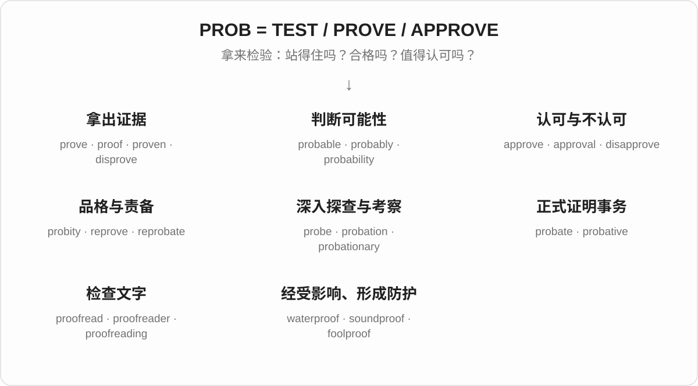

## 词形与演化规律

**prob- / prov- / proof**：同一拉丁词族经过不同借入路线，留下不同拼写。prove 常经法语动词，proof 有独立的名词历史，probe 则保留较明显的 b。不要把它们画成现代英语 prove → proof → probe。

**probable 与 provable** 都和“可信、能证明”相关，但今天一个是“很可能”，另一个是“可证明”。**probity** 直接保留“正直品格”这一支。

**approve** 的 ap- 是拉丁 ad- 在 p 前的同化；**reprove / reprobate** 中的 re- 随历史词义走向不认可、拒绝，不能固定套用“再次”。**improbable** 的 im- 则是否定前缀 in- 在 p 前的同化。

**opprobrium** 虽然拼写里有 prob，却来自拉丁语 probrum“耻辱、责难”一支，不应塞进 probus“好的”这一词族。**improve** 也不是 im- + prove，历史上另有“有益、获利”的来源。

## 单词速览（按词族由简到繁）

同一基础词的相关扩展放在一起，先读基础形式，再读扩展；各组之间优先读常用的。具体词源关系见各词讲解。

| 单词 | 音标 | 核心意思 |
|---|---|---|
| [probe](#w-9) | 英 /prəʊb/；美 /proʊb/ | 探查；深入调查；探针；探测器 |
| [probable](#w-10) | 英 /ˈprɒbəbəl/；美 /ˈprɑːbəbəl/ | 很可能的；大概会发生或属实的 |
| [probably](#w-1) | 英 /ˈprɒbəbli/；美 /ˈprɑːbəbli/ | 很可能；大概；多半 |
| [probability](#w-7) | 英 /ˌprɒbəˈbɪləti/；美 /ˌprɑːbəˈbɪləti/ | 可能性；概率 |
| [probabilistic](#w-21) | 英 /ˌprɒbəbɪˈlɪstɪk/；美 /ˌprɑːbəbɪˈlɪstɪk/ | 概率性的；用概率表达的 |
| [improbable](#w-13) | 英 /ɪmˈprɒbəbəl/；美 /ɪmˈprɑːbəbəl/ | 不大可能的；令人难以相信的 |
| [improbably](#w-31) | 英 /ɪmˈprɒbəbli/；美 /ɪmˈprɑːbəbli/ | 出人意料地；不大可能地；不合常理地 |
| [improbability](#w-33) | 英 /ɪmˌprɒbəˈbɪləti/；美 /ɪmˌprɑːbəˈbɪləti/ | 不大可能；不合常理之处 |
| [probate](#w-16) | 英 /ˈprəʊbeɪt/；美 /ˈproʊbeɪt/ | 遗嘱认证；相关遗产处理程序 |
| [probation](#w-11) | 英 /prəˈbeɪʃən/，也读 /prəʊˈbeɪʃən/；美 /proʊˈbeɪʃən/ | 试用期；考察期；缓刑或社区监督考察 |
| [probationary](#w-24) | 英 /prəˈbeɪʃənəri/；美 /proʊˈbeɪʃəneri/ | 试用的；考察期的 |
| [probationer](#w-39) | 英 /prəˈbeɪʃənə/；美 /proʊˈbeɪʃənər/ | 试用人员；接受缓刑监督的人 |
| [probative](#w-35) | 英 /ˈprəʊbətɪv/；美 /ˈproʊbətɪv/ | 有证明作用的；能帮助证实的 |
| [reprobate](#w-32) | 名词、形容词 /ˈreprəbət/；动词 /ˈreprəbeɪt/ | 品行不端的人；堕落的；谴责（动词，少见） |
| [reprobation](#w-41) | 英 /ˌreprəˈbeɪʃən/；美 /ˌreprəˈbeɪʃən/ | 强烈反对；谴责；弃绝（神学用语） |
| [probity](#w-29) | 英 /ˈprəʊbəti/；美 /ˈproʊbəti/ | 正直；廉洁；诚实操守 |
| [prove](#w-2) | 英 /pruːv/；美 /pruːv/ | 证明；证实；结果显示是 |
| [proven](#w-5) | 英 /ˈpruːvən/，也读 /ˈprəʊvən/；美 /ˈpruːvən/ | 已证明的；经过验证的 |
| [unproven](#w-18) | 英 /ˌʌnˈpruːvən/；美 /ˌʌnˈpruːvən/ | 尚未证实的；未经验证的 |
| [proving](#w-8) | 英 /ˈpruːvɪŋ/；美 /ˈpruːvɪŋ/ | 证明、检验的过程；面团醒发（尤英式） |
| [provable](#w-27) | 英 /ˈpruːvəbəl/；美 /ˈpruːvəbəl/ | 可证明的 |
| [unprovable](#w-37) | 英 /ʌnˈpruːvəbəl/；美 /ʌnˈpruːvəbəl/ | 无法证明的 |
| [unproved](#w-38) | 英 /ˌʌnˈpruːvd/；美 /ˌʌnˈpruːvd/ | 未证明的；尚待证实的 |
| [disprove](#w-19) | 英 /dɪsˈpruːv/；美 /dɪsˈpruːv/ | 证明错误；证伪 |
| [reprove](#w-40) | 英 /rɪˈpruːv/；美 /rɪˈpruːv/ | 责备；训诫 |
| [reproof](#w-36) | 英 /rɪˈpruːf/；美 /rɪˈpruːf/ | 责备；训斥；告诫 |
| [reproving](#w-43) | 英 /rɪˈpruːvɪŋ/；美 /rɪˈpruːvɪŋ/ | 责备的；表示不赞同的 |
| [proof](#w-3) | 英 /pruːf/；美 /pruːf/ | 证明；证据；校样；酒精度数标示 |
| [proofing](#w-23) | 英 /ˈpruːfɪŋ/；美 /ˈpruːfɪŋ/ | 醒发面团；校样检查；防护处理 |
| [proofread](#w-25) | 现在时 /ˈpruːfriːd/；过去式、过去分词 /ˈpruːfred/ | 校对文字 |
| [proofreading](#w-26) | 英 /ˈpruːfriːdɪŋ/；美 /ˈpruːfriːdɪŋ/ | 文字校对 |
| [proofreader](#w-34) | 英 /ˈpruːfriːdə/；美 /ˈpruːfriːdər/ | 校对员 |
| [approve](#w-6) | 英 /əˈpruːv/；美 /əˈpruːv/ | 赞同；认可；批准 |
| [approval](#w-4) | 英 /əˈpruːvəl/；美 /əˈpruːvəl/ | 赞同；认可；批准 |
| [disapprove](#w-17) | 英 /ˌdɪsəˈpruːv/；美 /ˌdɪsəˈpruːv/ | 不赞同；不认可 |
| [disapproval](#w-14) | 英 /ˌdɪsəˈpruːvəl/；美 /ˌdɪsəˈpruːvəl/ | 不赞同；反对的态度 |
| [waterproof](#w-12) | 英 /ˈwɔːtəpruːf/；美 /ˈwɔːtərpruːf/ | 防水的；做防水处理 |
| [bulletproof](#w-15) | 英 /ˈbʊlɪtpruːf/；美 /ˈbʊlɪtpruːf/ | 防弹的；坚不可摧的；难以反驳的 |
| [foolproof](#w-20) | 英 /ˈfuːlpruːf/；美 /ˈfuːlpruːf/ | 容易操作、不易出错的；周全可靠的 |
| [fireproof](#w-22) | 英 /ˈfaɪəpruːf/；美 /ˈfaɪərpruːf/ | 防火的；耐火的；做防火处理 |
| [soundproof](#w-28) | 英 /ˈsaʊndpruːf/；美 /ˈsaʊndpruːf/ | 隔音的；做隔音处理 |
| [approbate](#w-44) | 英 /ˈæprəbeɪt/；美 /ˈæprəbeɪt/ | 正式认可；批准（少见、正式用语） |
| [approbation](#w-30) | 英 /ˌæprəˈbeɪʃən/；美 /ˌæprəˈbeɪʃən/ | 认可；赞许 |
| [disapprobation](#w-42) | 英 /ˌdɪsæprəˈbeɪʃən/；美 /ˌdɪsæprəˈbeɪʃən/ | 不赞许；反对；谴责 |

## 逐词讲解

### 1. probe — 探查；深入调查；探针；探测器

**音标**：英 /prəʊb/；美 /proʊb/

**先抓住这个画面**

把一根细探针或一个问题伸进去，摸清表面下面到底是什么。

**怎么拆**

名词经中世纪拉丁语 proba“检查”借入，远源 probāre；动词有“英语名词转用”的解释，也有“借自拉丁语 probāre”的分析；两条分析不宜硬合成唯一过程。

**怎么变成今天的意思**

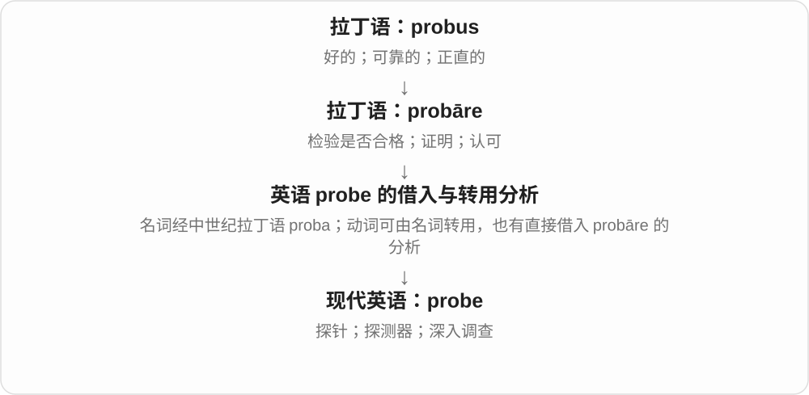

a temperature probe 是测温探头；a space probe 是太空探测器；probe a problem 或 probe into an issue 是深入查问。

**常见搭配与例句**

a space probe；a temperature probe；probe into the cause。

> The sensor has a thin probe that measures the temperature.

这个传感器有一根测温用的细探头。

> The interviewer probed the reasons behind her decision.

采访者深入追问了她作决定的原因。

**别混淆**

probe 强调深入探查的过程；prove 强调证明一个结论。进行调查不一定已经证实了什么。

### 2. probable — 很可能的；大概会发生或属实的

**音标**：英 /ˈprɒbəbəl/；美 /ˈprɑːbəbəl/

**先抓住这个画面**

把现有线索放在一起，看起来这一边更站得住，所以判断“多半如此”。

**怎么拆**

拉丁语 probābilis 原有可信、值得接受义，经法语借入；与 probāre 检验相连。

**怎么变成今天的意思**

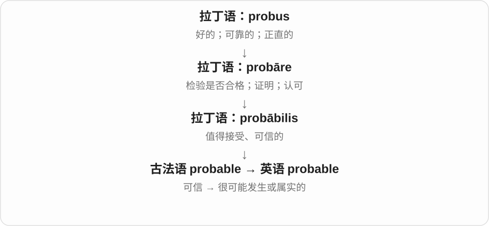

可说 the probable cause of a fault，指故障的可能原因；It is probable that… 较正式，日常常用 probably。

**常见搭配与例句**

a probable outcome；the probable explanation；it is probable that…。

> A loose connection is the probable cause of the problem.

接头松动很可能是问题的原因。

> It is probable that the meeting will finish early.

会议很可能会提前结束。

**别混淆**

possible 是有可能；probable 通常比 possible 更有把握。但日常词语不自带一个精确固定的概率百分数。

### 3. probably — 很可能；大概；多半

**音标**：英 /ˈprɒbəbli/；美 /ˈprɑːbəbli/

**先抓住这个画面**

说话时留一点余地：目前看来大概是这样，但还没有把话说死。

**怎么拆**

probable + -ly，词尾 -le 在副词中成为 -ly。

**怎么变成今天的意思**

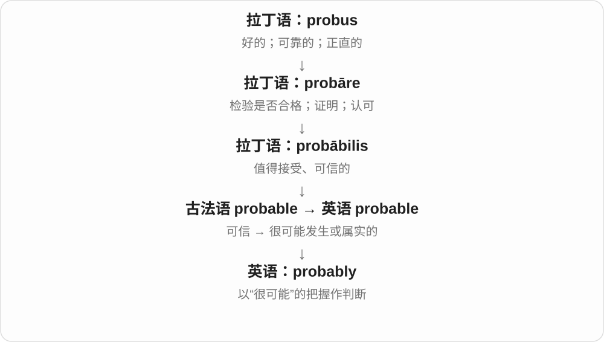

通常放在主要动词之前、be 之后，或放在句首。口语快速读时可能省弱音，但学习音标先保留清楚读法。

**常见搭配与例句**

will probably…；is probably…；probably not。

> I will probably take the earlier train.

我大概会坐前一班火车。

> She is probably already at the library.

她多半已经在图书馆了。

**别混淆**

probably 表较强可能，certainly 表确定；perhaps 或 maybe 往往保留更多不确定性。

### 4. probability — 可能性；概率

**音标**：英 /ˌprɒbəˈbɪləti/；美 /ˌprɑːbəˈbɪləti/

**先抓住这个画面**

把“多大可能发生”当成一个可以讨论、比较，有时还能计算的量。

**怎么拆**

来自拉丁语 probābilitās，经法语等路线借入；名词早有自己的历史，不只是现代英语 probable 临时加后缀。

**怎么变成今天的意思**

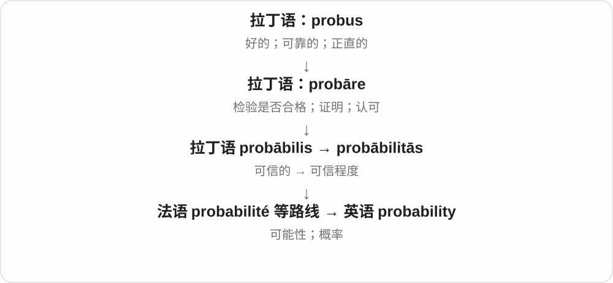

普通语境说 high probability；数学中常用 0 到 1 表示概率。in all probability 是固定说法，意为极有可能。

**常见搭配与例句**

the probability of…；a high probability；in all probability。

> The model estimates the probability of a delayed arrival.

模型估计到达延误的概率。

> In all probability, the parcel will arrive tomorrow.

包裹极有可能明天送到。

**别混淆**

probability 可是一般可能性，也可是模型内的数值；估计得到一个概率，不等于已经知道单次结果。

### 5. probabilistic — 概率性的；用概率表达的

**音标**：英 /ˌprɒbəbɪˈlɪstɪk/；美 /ˌprɑːbəbɪˈlɪstɪk/

**先抓住这个画面**

不只给一个铁定答案，而是把不同结果发生的可能性也放进模型。

**怎么拆**

由 probability / probabilism 词族加 -istic 形成；技术语境主要联系 probability“概率”。

**怎么变成今天的意思**

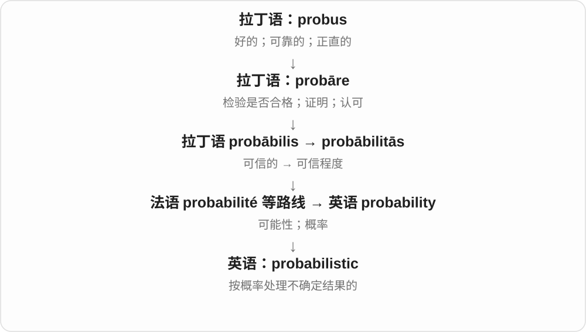

probabilistic forecast 可描述多种天气结果的可能性；probabilistic model 用概率分布表示不确定性，不保证每次预测正确。

**常见搭配与例句**

a probabilistic model；probabilistic reasoning；a probabilistic forecast。

> The system uses a probabilistic model to rank possible explanations.

系统用概率模型给不同解释排序。

> A probabilistic forecast shows more than one possible outcome.

概率预测会展示不止一种可能结果。

**别混淆**

probable 是某件事很可能；probabilistic 是分析方法使用概率，不等于模型只研究高概率事件。

### 6. improbable — 不大可能的；令人难以相信的

**音标**：英 /ɪmˈprɒbəbəl/；美 /ɪmˈprɑːbəbəl/

**先抓住这个画面**

不是完全没有这条路，而是按现有条件看，走到这一步的机会很小。

**怎么拆**

与拉丁语 improbābilis 有借入联系，也可分析 in- 不 + probable；n 在 p 前同化为 m。

**怎么变成今天的意思**

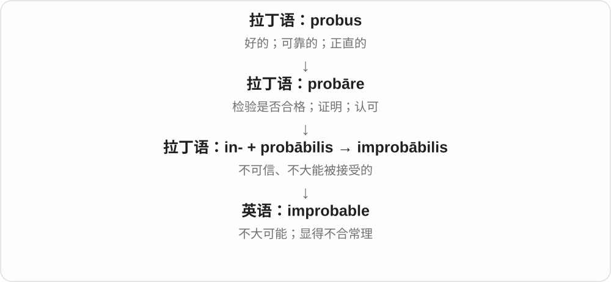

an improbable victory 是原本很不被看好却发生的胜利；an improbable story 可以是听起来不可信的故事。

**常见搭配与例句**

an improbable outcome；an improbable explanation。

> The team pulled off an improbable victory.

这支队伍取得了一场原本几乎没人看好的胜利。

> His explanation sounded increasingly improbable.

他的解释听起来越来越不可信。

**别混淆**

improbable 不是 impossible。低概率事件仍可能发生。

### 7. improbably — 出人意料地；不大可能地；不合常理地

**音标**：英 /ɪmˈprɒbəbli/；美 /ɪmˈprɑːbəbli/

**先抓住这个画面**

结果竟然发生了，或某个特点夸张得让人觉得“这也太不容易相信了”。

**怎么拆**

improbable + -ly。

**怎么变成今天的意思**

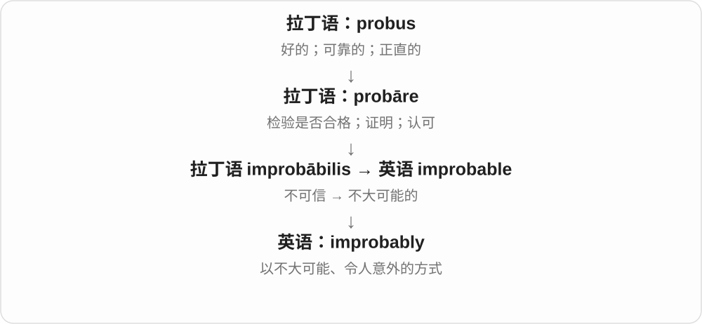

可修饰整个事件，也可说 improbably large，表示大得令人惊讶；并不要求每次都有正式概率计算。

**常见搭配与例句**

improbably successful；improbably large；however improbably。

> Improbably, the tiny shop became an international success.

出人意料的是，那家小店竟在国际上大获成功。

> An improbably large suitcase blocked the doorway.

一个大得夸张的行李箱堵住了门口。

**别混淆**

improbably 常带惊讶；probably 是通常判断“多半”，两者不只是语气轻重变化。

### 8. improbability — 不大可能；不合常理之处

**音标**：英 /ɪmˌprɒbəˈbɪləti/；美 /ɪmˌprɑːbəˈbɪləti/

**先抓住这个画面**

当一件事需要太多巧合才能成立，人们会谈它有多“不像会发生”。

**怎么拆**

im- 否定 + probability，也对应 improbable 的性质名词；并非把概率变成负数。

**怎么变成今天的意思**

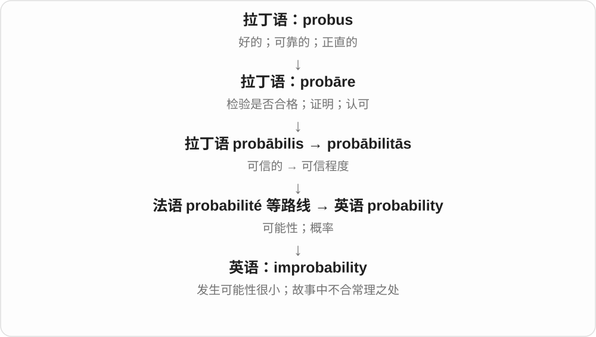

the improbability of success 是成功可能性低；复数 improbabilities 可指故事里一处处不可信的安排。

**常见搭配与例句**

the improbability of…；narrative improbabilities。

> The improbability of the coincidence made us check the records again.

这个巧合实在太罕见，我们又查了一遍记录。

> The film is enjoyable despite its many improbabilities.

虽然有许多不合常理的情节，这部电影仍很好看。

**别混淆**

improbability 不是数学里的负概率；它通常用自然语言评价低可能性或不可信程度。

### 9. probate — 遗嘱认证；相关遗产处理程序

**音标**：英 /ˈprəʊbeɪt/；美 /ˈproʊbeɪt/

**先抓住这个画面**

这里需要“证实”的，是遗嘱及处理遗产的法律资格；后来词义也涵盖相关程序。

**怎么拆**

源于中世纪法律拉丁语 probātum“被证实的事项”，来自 probāre 的过去分词 probātus。

**怎么变成今天的意思**

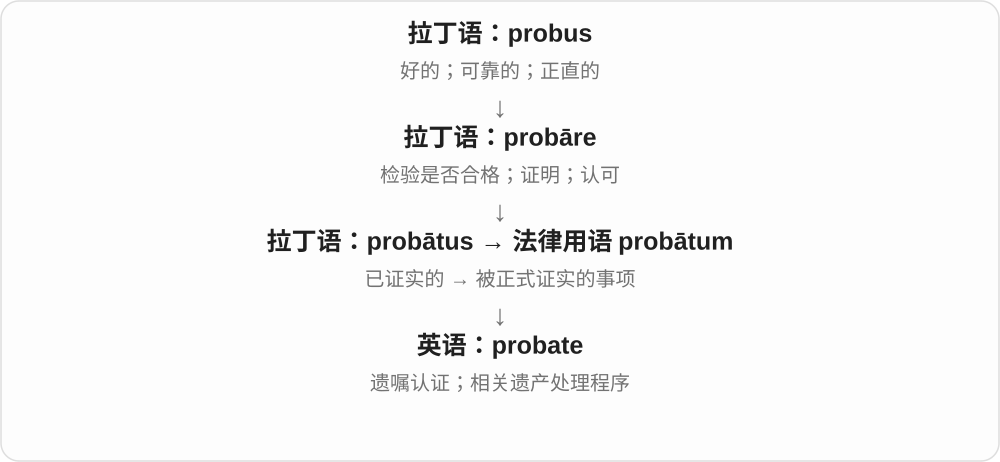

常见 probate court、probate records、apply for probate；制度范围因地区而异。理解阅读时先抓住“正式确认并处理遗产事务”。

**常见搭配与例句**

probate records；a probate court；the probate process。

> The historian searched the probate records for family details.

历史学家从遗嘱认证记录中查找家庭资料。

> The lawyer explained the probate process in plain language.

律师用简单语言解释了相关遗产处理程序。

**别混淆**

probate 不是 probation：前者属于遗嘱、遗产事务，后者是试用或行为考察。

### 10. probation — 试用期；考察期；缓刑或社区监督考察

**音标**：英 /prəˈbeɪʃən/，也读 /prəʊˈbeɪʃən/；美 /proʊˈbeɪʃən/

**先抓住这个画面**

先观察一段时间，看行为和表现是否符合要求，而不是立刻完全放手。

**怎么拆**

来自拉丁语 probātiō“检验、考察”，经法语等路线进入英语；不是 probable“可能”的缩短形式。

**怎么变成今天的意思**

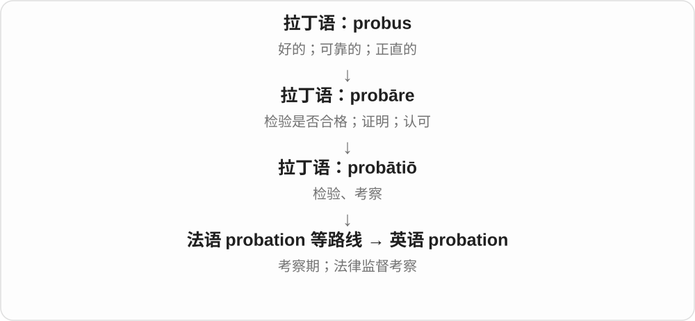

工作中的 on probation 是试用考察；刑事司法中的 probation 常指按条件在社区接受监督的处置。具体制度不同，不能一律理解成“坐牢后提前放出来”。

**常见搭配与例句**

on probation；a probation period；a probation officer。

> New employees are on probation for the first three months.

新员工前三个月处于试用期。

> The novel follows a young man who is on probation.

小说讲述了一名接受缓刑监督的年轻人的经历。

**别混淆**

probation 与 parole 不能简单互换；后者常涉及服刑后的有条件释放。日常工作试用不涉及刑罚。

### 11. probationary — 试用的；考察期的

**音标**：英 /prəˈbeɪʃənəri/；美 /proʊˈbeɪʃəneri/

**先抓住这个画面**

这段安排还带着“先看看”的条件，表现要继续接受观察。

**怎么拆**

probation + -ary，表示与考察或试用有关。

**怎么变成今天的意思**

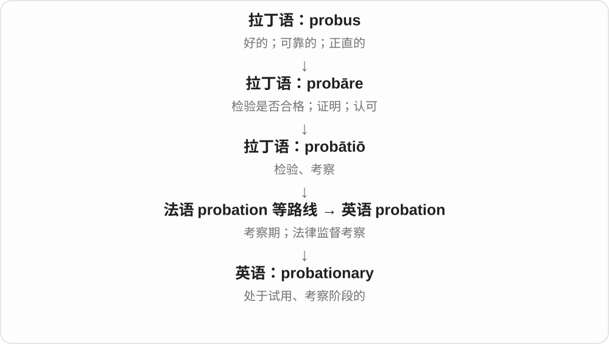

常用于 probationary period、probationary employee。是否以及怎样转为正式状态，由相关安排决定，词本身不包含固定期限。

**常见搭配与例句**

a probationary period；a probationary appointment。

> She completed her probationary period successfully.

她顺利完成了试用期。

> The offer was for a probationary appointment.

这份聘用安排带有试用考察条件。

**别混淆**

probationary 强调考察条件；temporary 只强调暂时，两者可能同时成立，也可能不同。

### 12. probationer — 试用人员；接受缓刑监督的人

**音标**：英 /prəˈbeɪʃənə/；美 /proʊˈbeɪʃənər/

**先抓住这个画面**

把“处在考察期”这个状态落实到一个人身上。

**怎么拆**

probation + -er 表示相关的人；不是负责监督别人的 officer。

**怎么变成今天的意思**

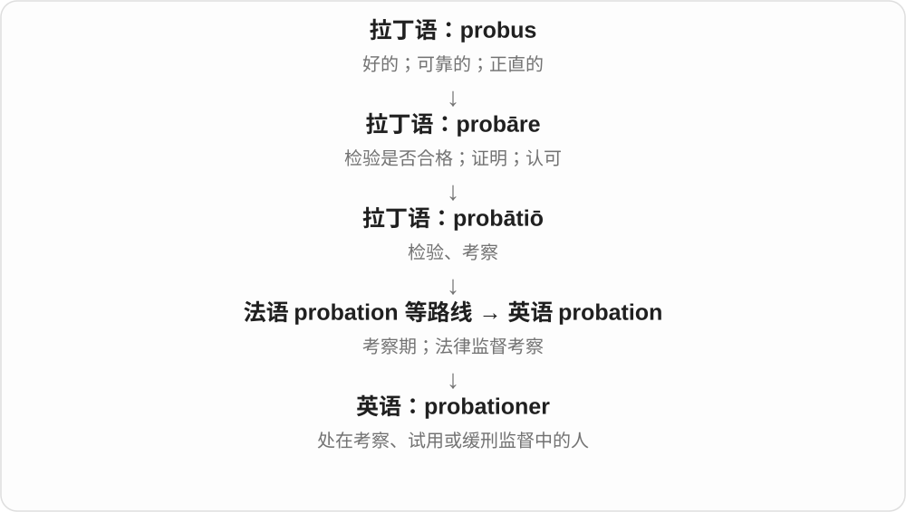

职业培训中可指试用或见习人员；司法文章中常指接受 probation 的人。先看语境，再选中文意思。

**常见搭配与例句**

a probationer teacher；a probationer’s progress。

> Each probationer was assigned an experienced mentor.

每位试用人员都配有一名经验丰富的导师。

> The report describes the support available to probationers.

报告介绍了接受缓刑监督者可以获得的支持。

**别混淆**

probationer 是被考察的人；probation officer 是开展监督工作的人。

### 13. probative — 有证明作用的；能帮助证实的

**音标**：英 /ˈprəʊbətɪv/；美 /ˈproʊbətɪv/

**先抓住这个画面**

这份材料不是摆在那里凑数，它能使某个事实更容易被确认。

**怎么拆**

经法语 probatif 等路线来自拉丁语 probātīvus，与 probāre 检验、证明相连；不是从英语 probate 的遗产义引申出来。

**怎么变成今天的意思**

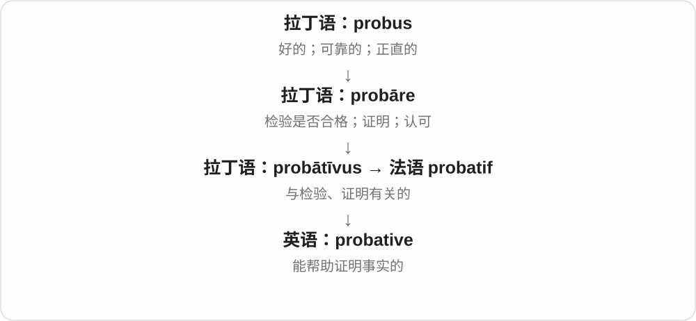

正式用语，常见 probative value“证明价值”。有证明价值不等于单独一份就能决定全部结论。

**常见搭配与例句**

probative evidence；probative value；highly probative。

> The dated photograph had considerable probative value.

那张有日期的照片具有相当大的证明价值。

> The article distinguishes relevant background from probative evidence.

文章区分了相关背景材料与具有证明作用的证据。

**别混淆**

probative 说证据的作用；probable 说结果或判断的可能性。

### 14. reprobate — 品行不端的人；堕落的；谴责（动词，少见）

**音标**：名词、形容词 /ˈreprəbət/；动词 /ˈreprəbeɪt/

**先抓住这个画面**

历史上是“被判定为不合格、应遭拒绝”，后来常拿来给品行很差的人贴标签。

**怎么拆**

来自后期拉丁语 reprobātus，被拒绝、被谴责的，是 reprobāre 的过去分词；名词由形容词转指人，英语动词也与这一词族相连。

**怎么变成今天的意思**

名词或形容词带强烈评价；有时朋友间 an old reprobate 带戏谑语气，但也可能很冒犯。神学文本还有特定教义含义。

**常见搭配与例句**

an old reprobate；a reprobate character。

> The novel portrays him as a charming but unreliable reprobate.

小说把他写成一个有魅力却靠不住的浪荡人物。

> “You old reprobate,” she said with an affectionate smile.

“你这个老不正经的。”她带着亲昵的笑容说。

**别混淆**

不能因为 re- 就记成“再次证明”。名词末尾弱读 /ət/，动词末尾读 /eɪt/。

### 15. reprobation — 强烈反对；谴责；弃绝（神学用语）

**音标**：英 /ˌreprəˈbeɪʃən/；美 /ˌreprəˈbeɪʃən/

**先抓住这个画面**

不是轻轻摇头，而是把一个行为或对象判为不可接受。

**怎么拆**

来自拉丁语 reprobātiō，也有法语 réprobation 的借入路线；是与 reprobate 对应的名词，并非必定在现代英语里加 -ion 才出现。

**怎么变成今天的意思**

普通正式语境可指严厉谴责；神学中涉及被弃绝、不获救赎的教义概念，不能当作一般情绪词处理。

**常见搭配与例句**

moral reprobation；public reprobation；the doctrine of reprobation。

> The abuse of power drew public reprobation.

滥用权力的行为招致了公众谴责。

> The chapter explains the doctrine of reprobation in its historical setting.

这一章在历史背景中解释了弃绝论。

**别混淆**

disapproval 可轻可重；reprobation 通常更严厉、更书面。

### 16. probity — 正直；廉洁；诚实操守

**音标**：英 /ˈprəʊbəti/；美 /ˈproʊbəti/

**先抓住这个画面**

判断一个人靠不靠谱，不是看他多聪明，而是看他是否诚实、不弄虚作假。

**怎么拆**

来自拉丁语 probitās“正直”，经法语 probité 借入；直接承接 probus“好的、正直的”这一支。

**怎么变成今天的意思**

正式用语，常见于 public probity、financial probity，强调公职、财务等事情上的诚信。

**常见搭配与例句**

personal probity；financial probity；a reputation for probity。

> Her reputation for probity helped restore public trust.

她素来正直的名声有助于恢复公众信任。

> The audit raised questions about the firm’s financial probity.

审计使人对这家公司的财务诚信产生了疑问。

**别混淆**

probity 是品格上的可信；ability 是做事能力，一个人可以有其中一项而缺另一项。

### 17. prove — 证明；证实；结果显示是

**音标**：英 /pruːv/；美 /pruːv/

**先抓住这个画面**

把说法放到证据或实践面前，让人看出它是否站得住。

**怎么拆**

来自拉丁语 probāre，经古法语 prover 等路线进入英语；古英语也有同源借词。probāre 本来与“检验是否够好、够可靠”相关。

**怎么变成今天的意思**

prove a claim 是证明一个主张；prove yourself 是用表现证明自己的能力；prove useful 是实践下来发现有用，不要求后面再加一个宾语。

**常见搭配与例句**

prove that…；prove to be useful；prove someone wrong；prove yourself。

> The records prove that the payment was made on time.

记录证明款项按时付出了。

> The spare battery proved useful during the trip.

备用电池在旅途中果然派上了用场。

**别混淆**

prove 表示拿出足以支持结论的证明；suggest 只是提示一种可能。实际证明到哪一步，要看证据和语境。

### 18. proven — 已证明的；经过验证的

**音标**：英 /ˈpruːvən/，也读 /ˈprəʊvən/；美 /ˈpruːvən/

**先抓住这个画面**

不是第一次试，而是已有证据或实际表现说明它能行。

**怎么拆**

prove 的过去分词之一；proven 形式经苏格兰英语传播，历史上与中古英语 preve 的词形变化有关。不能简单说 prove 的规则过去式就是 proven。

**怎么变成今天的意思**

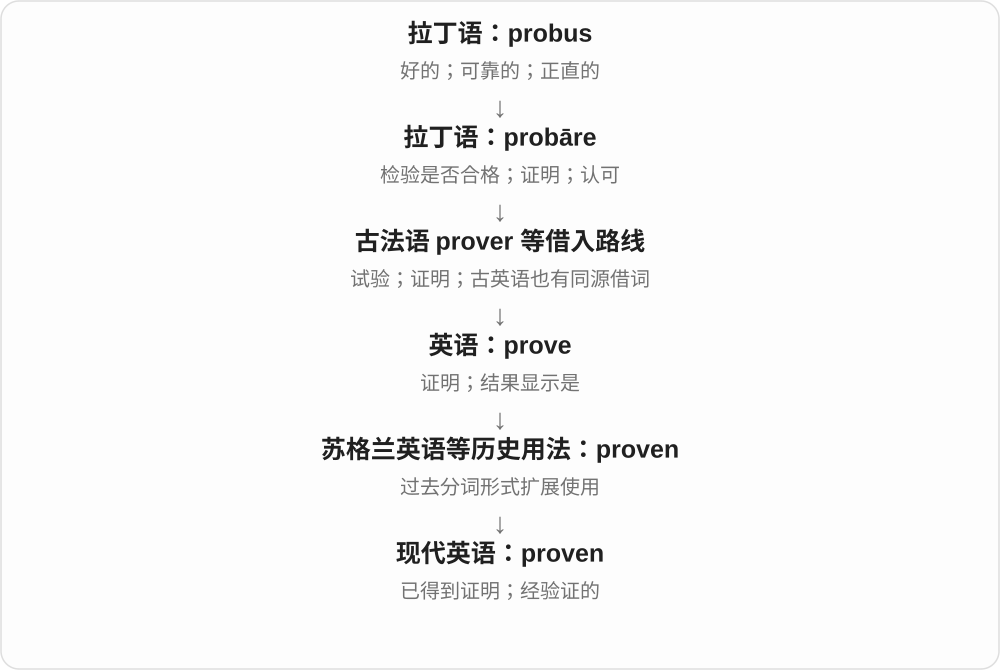

a proven method 是经验证的方法；has proven 也可作谓语的一部分。proved 也是正常的过去分词，过去时通常用 proved。

**常见搭配与例句**

a proven method；a proven record；has proven effective。

> We chose a proven method instead of an untested one.

我们选择了经验证的方法，没有采用尚未测试的方案。

> The new layout has proven effective in reducing delays.

新布局已被证明能有效减少延误。

**别混淆**

proven 说明已有验证，不表示在所有条件下永远有效；proof 是名词，不能直接替代这个形容词。

### 19. unproven — 尚未证实的；未经验证的

**音标**：英 /ˌʌnˈpruːvən/；美 /ˌʌnˈpruːvən/

**先抓住这个画面**

说法还没有通过证据这一关，先把结论留着。

**怎么拆**

un- 否定 + proven 已证明的。

**怎么变成今天的意思**

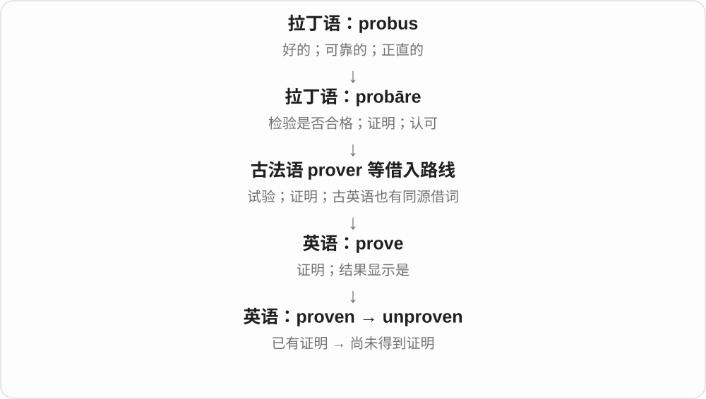

可谈 unproven claims、unproven technology；重点是缺乏充分验证，并不自动宣布它一定错误。

**常见搭配与例句**

an unproven claim；remain unproven；an unproven approach。

> The report distinguishes established facts from unproven claims.

报告区分了已确立的事实和未经证实的说法。

> They were reluctant to rely on an unproven design.

他们不愿依赖尚未验证的设计。

**别混淆**

unproven 是未证实；disproved 是已经被证伪，两者差别很大。

### 20. proving — 证明、检验的过程；面团醒发（尤英式）

**音标**：英 /ˈpruːvɪŋ/；美 /ˈpruːvɪŋ/

**先抓住这个画面**

把东西拿来试，或让实际结果慢慢显出来；做面包时，也会把面团发起来的过程叫 proving。

**怎么拆**

prove + -ing；检验、证明义延续 prove，烘焙义是这个动词的专门用法。

**怎么变成今天的意思**

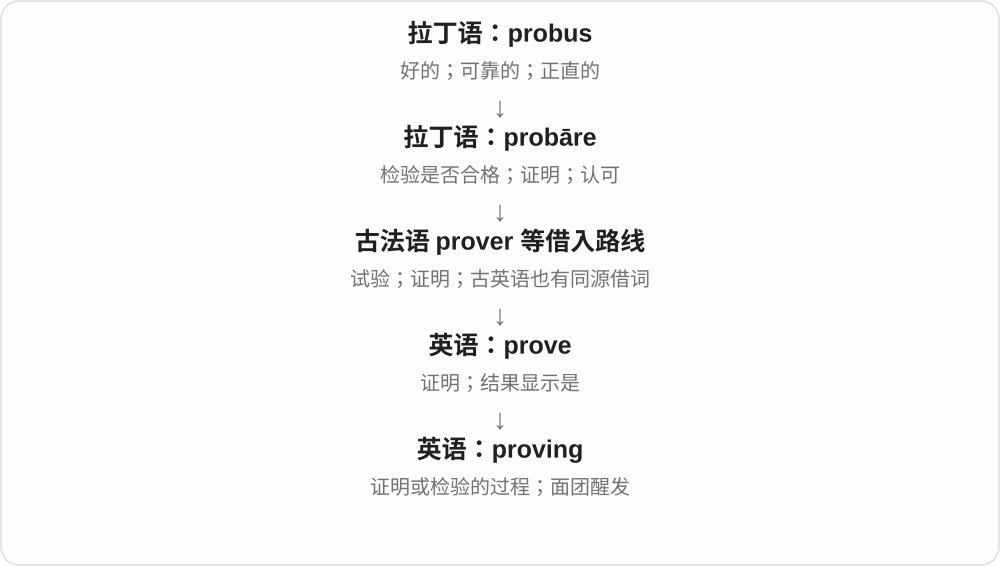

proving ground 是测试场，也能比喻检验能力的地方。烘焙中的 proving 不是证明一个数学命题，而是让面团发酵膨起。

**常见搭配与例句**

a proving ground；proving a theorem；a proving basket。

> The workshop became a proving ground for new ideas.

这个工作坊成了检验新想法的试验场。

> The dough needs more proving time before baking.

面团烘烤前还需要更多醒发时间。

**别混淆**

proving 与 proofing 在烘焙中可对应，英式常说 proving，美式常说 proofing；proofreading 则是校对文字。

### 21. provable — 可证明的

**音标**：英 /ˈpruːvəbəl/；美 /ˈpruːvəbəl/

**先抓住这个画面**

不仅觉得像真的，而且原则上有办法拿出证明。

**怎么拆**

prove + -able“能够……的”；与 probable 深层同源，现代意思已经分开。

**怎么变成今天的意思**

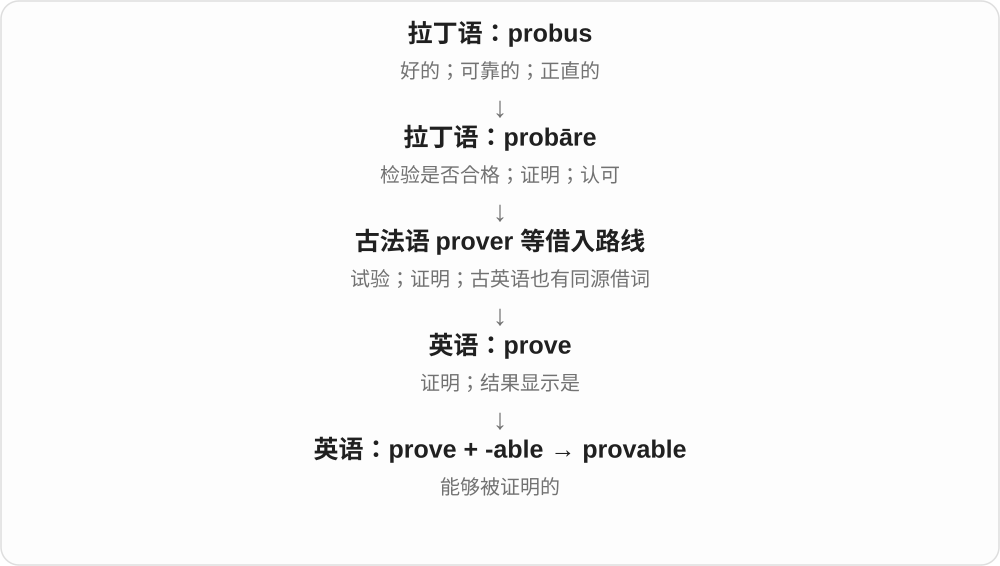

常说 provable facts 或 provable within a system，后者强调在指定规则内可以推出。

**常见搭配与例句**

a provable claim；mathematically provable。

> The conclusion is provable from the stated assumptions.

这个结论可以从列出的假设中证明。

> She focused on facts that were independently provable.

她把注意力放在可独立证实的事实上。

**别混淆**

provable 是可证明；probable 是很可能，后者不能保证存在严格证明。

### 22. unprovable — 无法证明的

**音标**：英 /ʌnˈpruːvəbəl/；美 /ʌnˈpruːvəbəl/

**先抓住这个画面**

不是暂时没完成作业，而是按所说的证据条件或推理规则，证明这条路走不通。

**怎么拆**

un- + provable。

**怎么变成今天的意思**

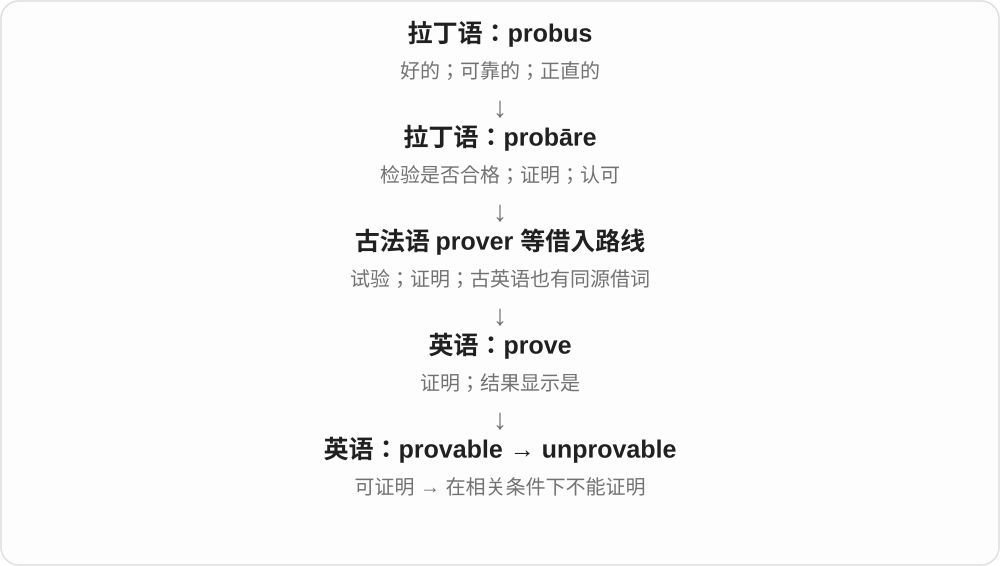

日常可说某猜测无法核实；逻辑中应说明相对于哪个形式系统，不把“在这个系统内不可证明”扩大成一切意义上的不可知。

**常见搭配与例句**

an unprovable claim；unprovable within a system。

> Without any surviving records, the accusation was effectively unprovable.

没有任何留存记录，这项指控实际上无法证实。

> The statement is unprovable within the system discussed in the paper.

在论文讨论的系统内，这个命题不可证明。

**别混淆**

unproved 只说还没有证明；unprovable 对能否证明作出更强判断。

### 23. unproved — 未证明的；尚待证实的

**音标**：英 /ˌʌnˈpruːvd/；美 /ˌʌnˈpruːvd/

**先抓住这个画面**

问题还开着：目前没有足够证明把它钉下来。

**怎么拆**

un- + proved；proved 是 prove 的规则过去式及一种过去分词。

**怎么变成今天的意思**

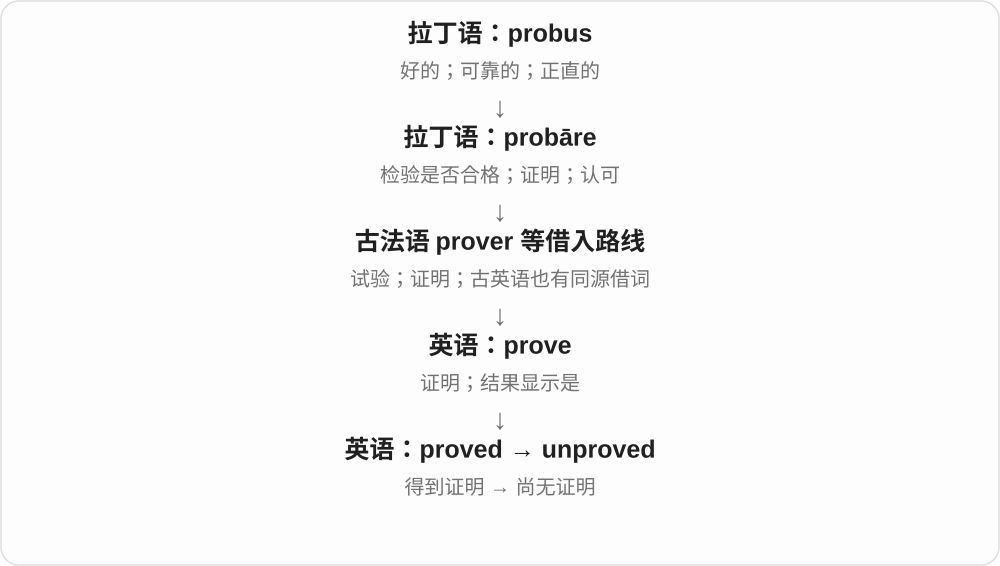

与 unproven 很接近，数学或论证语境可见 an unproved conjecture。这里是未给出证明，不是已经找到反例。

**常见搭配与例句**

an unproved assumption；an unproved conjecture。

> The argument rests on an unproved assumption.

这个论证建立在一个未经证明的假设上。

> The conjecture remained unproved for many years.

这个猜想许多年都没有得到证明。

**别混淆**

unproved 与 unproven 常可互换；unprovable 更强，表示在相关条件或系统内无法证明。

### 24. disprove — 证明错误；证伪

**音标**：英 /dɪsˈpruːv/；美 /dɪsˈpruːv/

**先抓住这个画面**

不是说“我不信”，而是拿出材料，让那个主张站不住。

**怎么拆**

经古法语 desprover 借入，历史构词 des- 否定、撤销 + prover 证明；现代可看作 dis- + prove。

**怎么变成今天的意思**

可用于理论、猜测、指控。一个真正适用的反例可以推翻“所有情况都如此”的断言。

**常见搭配与例句**

disprove a theory；disprove an allegation；disprove a claim。

> A single counterexample disproved the general claim.

一个反例就推翻了那条普遍断言。

> The new records disproved the rumour.

新发现的记录证实那则传言不实。

**别混淆**

disapprove 是不赞同；disprove 是证明不对。你不喜欢一个结论，并不等于你证伪了它。

### 25. reprove — 责备；训诫

**音标**：英 /rɪˈpruːv/；美 /rɪˈpruːv/

**先抓住这个画面**

对别人的行为指出“这样不妥”，希望他改正。

**怎么拆**

责备义来自拉丁语 reprobāre“不认可、谴责”，经古法语 reprover 借入；这里 re- 不能硬译成“再证明一次”。

**怎么变成今天的意思**

较正式或文学化，常用 reprove someone for something。另有 re- + prove“再次证明”的组合用法，读音可强调 /riː-/，与本义需按上下文区分。

**常见搭配与例句**

reprove someone for being late；gently reprove。

> She gently reproved him for interrupting.

她温和地责备他打断别人。

> The teacher reproved the class for leaving the room untidy.

老师批评全班离开时没把教室收拾整齐。

**别混淆**

reprove 针对行为提出责备；disprove 针对主张给出反证。

### 26. reproof — 责备；训斥；告诫

**音标**：英 /rɪˈpruːf/；美 /rɪˈpruːf/

**先抓住这个画面**

责备不一定是一大段训话，一句提醒甚至一个眼神也能让人知道自己做错了。

**怎么拆**

来自古法语 reprove，是 reprover“责备”的名词形式；与 reprove 同源，但不能按“再次 + 证明”解释常用义。

**怎么变成今天的意思**

a word of reproof 是一句责备的话；a look of reproof 是带责备的眼神。较书面。

**常见搭配与例句**

a word of reproof；a look of reproof；gentle reproof。

> There was a note of reproof in her voice.

她的声音里带着一丝责备。

> He accepted the reproof and corrected his mistake.

他接受了批评，并改正了错误。

**别混淆**

proof 是证明；reproof 在通常的人际语境里是责备，不是第二份证据。

### 27. reproving — 责备的；表示不赞同的

**音标**：英 /rɪˈpruːvɪŋ/；美 /rɪˈpruːvɪŋ/

**先抓住这个画面**

一句话或一个表情里带着“你不该这样”的意思。

**怎么拆**

reprove + -ing，分词用作形容词。

**怎么变成今天的意思**

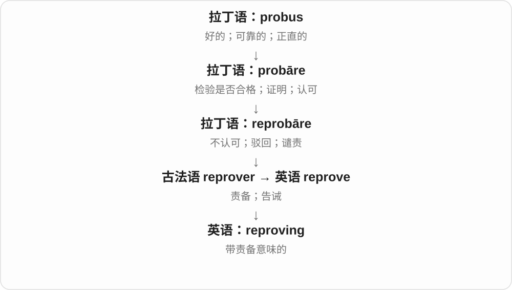

常修饰 look、glance、tone，不一定是大声斥责。用语气就能传达不赞同。

**常见搭配与例句**

a reproving glance；a reproving tone。

> She gave him a reproving glance when his phone rang.

他的手机响起来时，她责备地看了他一眼。

> His tone was reproving rather than angry.

他的语气带着责备，倒没有发怒。

**别混淆**

reproving 形容正在表现责备；reproved 说已经受到责备，方向相反。

### 28. proof — 证明；证据；校样；酒精度数标示

**音标**：英 /pruːf/；美 /pruːf/

**先抓住这个画面**

能让一个说法站住脚的东西；也可以是先拿出来检查是否合格的一份样品。

**怎么拆**

名词经古法语 proeve 等形式来自后期拉丁语 proba；与 prove 同源，但有自己的名词借入链。词末历史上的 v 清化成 f，形成今天的 proof。

**怎么变成今天的意思**

proof of purchase 是购买凭证；数学中 a proof 是一套证明；printing proofs 是印刷校样。酒类标签的 proof 源于检验酒液强度，数值规则要看所用制度。

**常见搭配与例句**

proof of identity；provide proof；a mathematical proof；check the proofs。

> Keep the receipt as proof of purchase.

留好收据，作为购买凭证。

> The editor found a spelling error in the final proofs.

编辑在最后一版校样里发现了一个拼写错误。

**别混淆**

evidence 是支持或反对判断的材料；proof 更强调材料足以把结论确立。普通证据义常不可数，数学证明或校样可数。

### 29. proofing — 醒发面团；校样检查；防护处理

**音标**：英 /ˈpruːfɪŋ/；美 /ˈpruːfɪŋ/

**先抓住这个画面**

这个词跟着 proof 动词的不同意思走：厨房里让面团膨起，出版时查样张，材料处理中让它能抵挡某种影响。

**怎么拆**

proof + -ing；proof 这个动词本身从名词或相关复合词发展出几种用法，不能硬编成一个具体动作包办一切。

**怎么变成今天的意思**

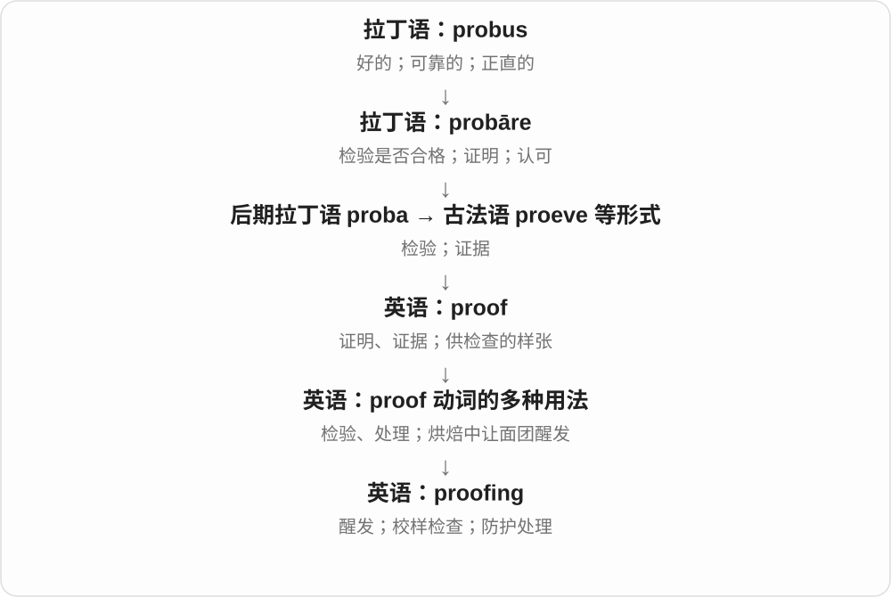

上下文会限定意思：bread proofing 是醒发，colour proofing 是检查色彩样张。材料的防护一般还要说明针对什么。

**常见搭配与例句**

bread proofing；colour proofing；a proofing basket。

> The baker placed the shaped dough in a proofing basket.

面包师把整形后的面团放进醒发篮。

> Colour proofing revealed that the printed blue was too dark.

色彩打样检查发现，印出来的蓝色太深了。

**别混淆**

proofing 可以是校样检查，但普通“校对这段文字”用 proofreading 最清楚。

### 30. proofread — 校对文字

**音标**：现在时 /ˈpruːfriːd/；过去式、过去分词 /ˈpruːfred/

**先抓住这个画面**

把即将交出去的文字再逐行过一遍，抓出拼写、标点和排版的小错。

**怎么拆**

现代可拆 proof 校样 + read 阅读；历史上很可能从较早的 proofreader 反构出动词。不要把“读证明题”当作默认意思。

**怎么变成今天的意思**

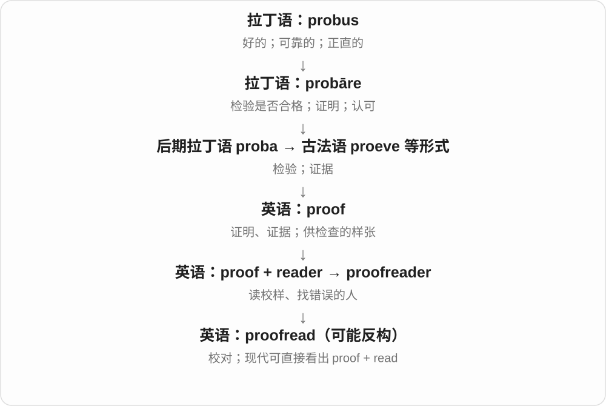

既可校对印刷校样，也可校对邮件、简历或网页。read 这一部分过去式拼写不变，读音变为 /red/。

**常见搭配与例句**

proofread a document；proofread for spelling errors。

> Please proofread the email before sending it.

请在发送前校对这封邮件。

> She proofread the final draft yesterday.

她昨天校对了最后一稿。

**别混淆**

proofread 主要找文字和呈现错误；edit 更宽，还可能改结构、论点和表达。

### 31. proofreading — 文字校对

**音标**：英 /ˈpruːfriːdɪŋ/；美 /ˈpruːfriːdɪŋ/

**先抓住这个画面**

在发布前做最后几轮细看，让那些小错不跟着成稿一起出去。

**怎么拆**

proofread + -ing；也可从 proof 校样 + reading 阅读理解构词。

**怎么变成今天的意思**

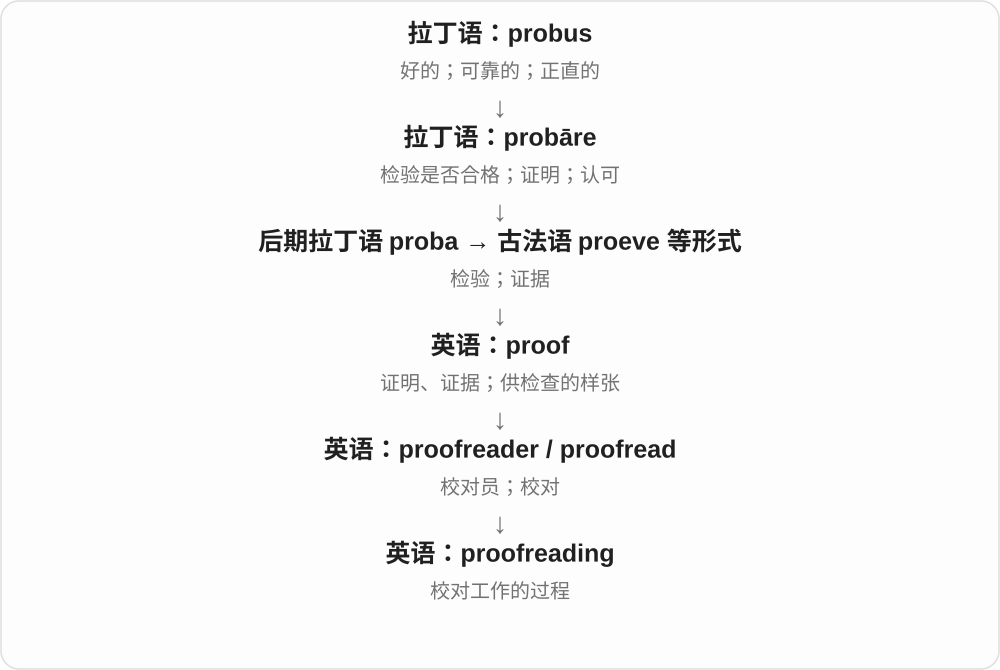

通常作不可数名词，常见 proofreading services、final proofreading。工作范围可以约定，但词本身通常不等于重写全文。

**常见搭配与例句**

careful proofreading；final proofreading；proofreading errors。

> The manuscript is ready for final proofreading.

稿件已准备好进行最后校对。

> Careful proofreading removed several distracting errors.

细致的校对消除了几处影响阅读的错误。

**别混淆**

proofreading 看文字；烘焙的 proofing 看面团，两者不要漏读中间的 read。

### 32. proofreader — 校对员

**音标**：英 /ˈpruːfriːdə/；美 /ˈpruːfriːdər/

**先抓住这个画面**

别人负责把内容写出来，这个人专门盯住还没被发现的小错误。

**怎么拆**

proof 印刷校样 + reader 读者；这个人物名历史上早于常用动词 proofread 的记录。

**怎么变成今天的意思**

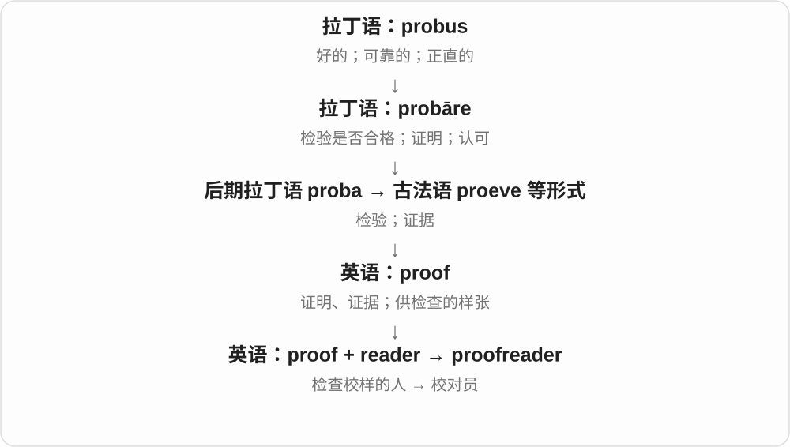

可以是职业名称，也可以指这次负责校对的人。a proofreader 关注文字准确，并不必然承担事实调查的全部职责。

**常见搭配与例句**

a professional proofreader；hire a proofreader。

> The proofreader caught a repeated word in the title.

校对员发现标题中有一个词重复了。

> A second proofreader checked the revised pages.

另一名校对员检查了修改后的页面。

**别混淆**

proofreader 是校对人；spellchecker 是拼写检查工具，工具不能代替所有语境判断。

### 33. approve — 赞同；认可；批准

**音标**：英 /əˈpruːv/；美 /əˈpruːv/

**先抓住这个画面**

看过之后点头：“这个可以。”点头可能是个人态度，也可能是正式许可。

**怎么拆**

拉丁语 ad- + probāre 形成 approbāre，d 在 p 前同化为 p；经古法语进入英语。

**怎么变成今天的意思**

approve of a decision 是赞同决定；approve a budget 是正式批准预算。是否有 of 往往让重心从态度转向授权。

**常见搭配与例句**

approve of something；approve a plan；approve an application。

> The committee approved the revised budget.

委员会批准了修改后的预算。

> I do not approve of the way he treated his assistant.

我不赞同他对待助理的方式。

**别混淆**

prove 是用证据证明；approve 是认可。审批通过，也不表示其中每个判断都已经获得证明。

### 34. approval — 赞同；认可；批准

**音标**：英 /əˈpruːvəl/；美 /əˈpruːvəl/

**先抓住这个画面**

别人那个“可以”的点头，变成一种态度或一个获准的结果。

**怎么拆**

approve + -al，动词转为行为或状态名词。

**怎么变成今天的意思**

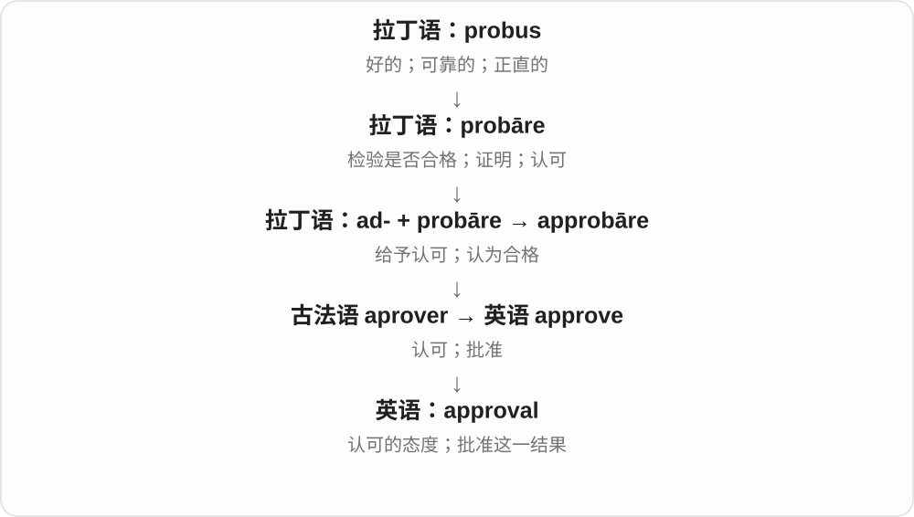

seek approval 可以是寻求批准，也可以是希望得到别人的认同；approval from the manager 则要看具体情境。

**常见搭配与例句**

get approval；seek approval；give approval；with someone’s approval。

> The project cannot begin without the owner’s approval.

没有业主批准，项目不能开始。

> She no longer needed everyone’s approval to feel confident.

她不再需要人人认可，才能感到自信。

**别混淆**

approval 是认可，appraisal 是评价、估价；做过评价并不保证最后批准。

### 35. disapprove — 不赞同；不认可

**音标**：英 /ˌdɪsəˈpruːv/；美 /ˌdɪsəˈpruːv/

**先抓住这个画面**

对一个行为摇头，认为它不妥。

**怎么拆**

dis- 否定 + approve。

**怎么变成今天的意思**

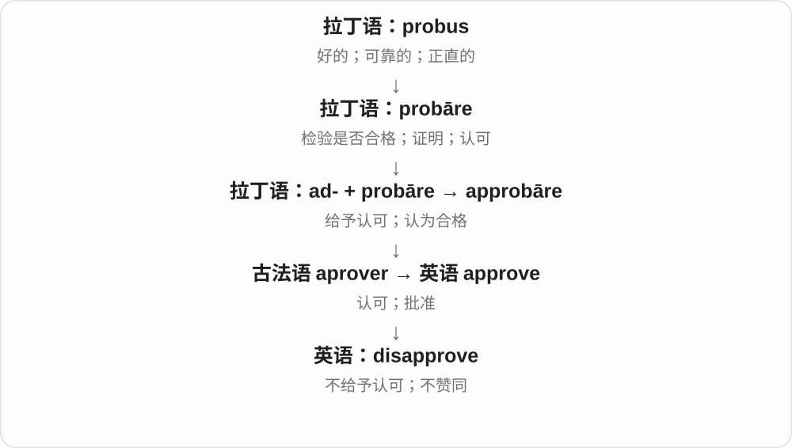

最常见 disapprove of something 或 disapprove of someone doing something。正式语境也可直接接需要审批的事项。

**常见搭配与例句**

disapprove of the decision；strongly disapprove。

> Her parents disapproved of the risky plan.

她父母不赞同那个冒险的计划。

> He clearly disapproved, but he did not interrupt.

他明显不赞同，但没有打断别人。

**别混淆**

disapprove 说态度或审批结果；disprove 说用证据推翻说法。

### 36. disapproval — 不赞同；反对的态度

**音标**：英 /ˌdɪsəˈpruːvəl/；美 /ˌdɪsəˈpruːvəl/

**先抓住这个画面**

即使没有说“不”，一个眼神、语气或摇头也能把反对传达出来。

**怎么拆**

disapprove + -al；形式上也容易看出 dis- 与 approval 的对应。

**怎么变成今天的意思**

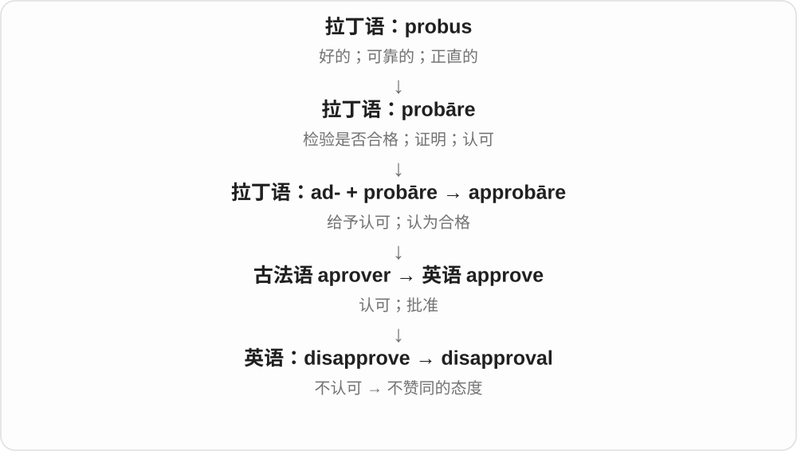

常搭 express、show、meet with。disapproval 可以很强烈，也可能只是冷淡的一眼。

**常见搭配与例句**

express disapproval；a look of disapproval；public disapproval。

> She expressed her disapproval in a brief email.

她用一封简短邮件表达了反对。

> His suggestion met with quiet disapproval.

他的建议遭到了不动声色的反对。

**别混淆**

disapproval 不一定阻止行动；a ban 才是禁止，不能把态度和规则混为一谈。

### 37. waterproof — 防水的；做防水处理

**音标**：英 /ˈwɔːtəpruːf/；美 /ˈwɔːtərpruːf/

**先抓住这个画面**

水来到表面，材料能挡住它，不让里面轻易湿掉。

**怎么拆**

water 水 + -proof“能经受、能抵挡”；-proof 从经检验而能抵御的意思发展出来，不是“证明水”。

**怎么变成今天的意思**

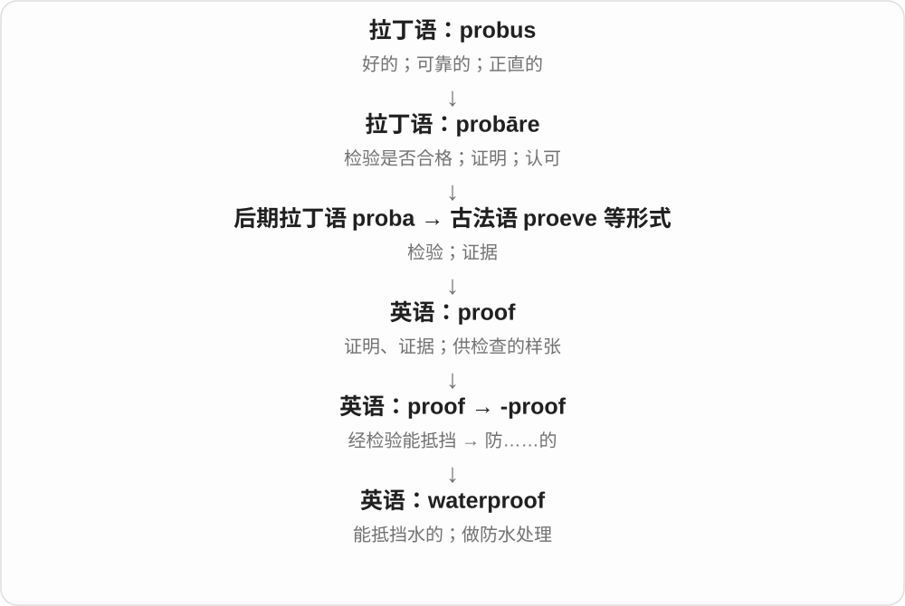

常见 waterproof jacket、waterproof bag；作动词可说 waterproof a surface。产品的实际防水能力取决于使用条件与说明。

**常见搭配与例句**

a waterproof jacket；waterproof material；waterproof the seams。

> She packed her phone in a waterproof pouch.

她把手机装进一个防水袋里。

> The workers waterproofed the roof before the rainy season.

工人在雨季前给屋顶做了防水处理。

**别混淆**

waterproof 通常比 water resistant 表达更强的防水能力，但单看一个词并不能知道具体耐水条件。

### 38. bulletproof — 防弹的；坚不可摧的；难以反驳的

**音标**：英 /ˈbʊlɪtpruːf/；美 /ˈbʊlɪtpruːf/

**先抓住这个画面**

字面上是能挡住子弹；比喻时是攻击、批评打过来，论点或系统仍站得住。

**怎么拆**

bullet 子弹 + -proof 能抵挡；这是英语复合词。

**怎么变成今天的意思**

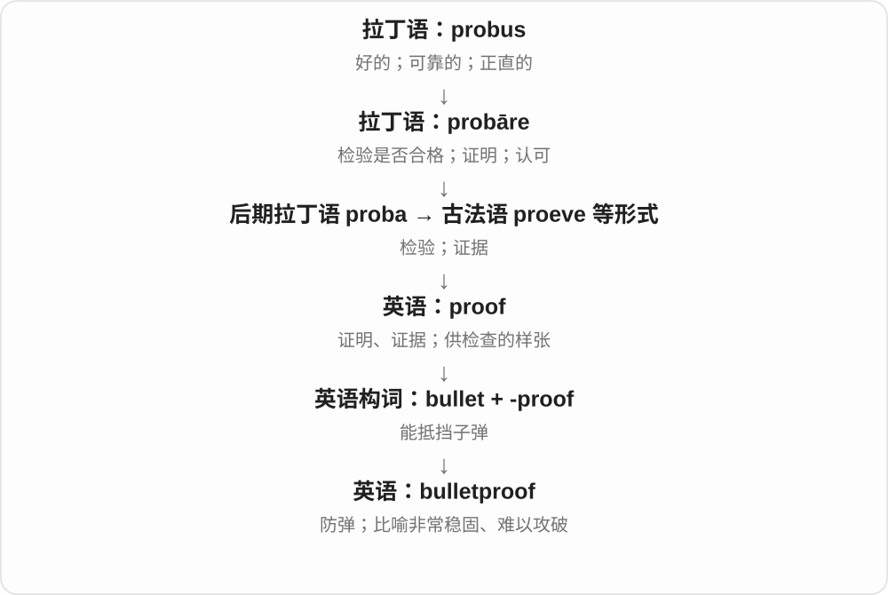

防护材料在具体条件下发挥作用；比喻 bulletproof argument 则赞扬论证难以推翻，常带夸张。

**常见搭配与例句**

bulletproof glass；a bulletproof argument；a bulletproof system。

> The guard sat behind bulletproof glass.

警卫坐在防弹玻璃后面。

> She wanted stronger evidence before calling the argument bulletproof.

她希望有更强的证据，再把这个论证称为无懈可击。

**别混淆**

bulletproof 比喻“很牢靠”，不是已经严格证明没有任何漏洞。

### 39. foolproof — 容易操作、不易出错的；周全可靠的

**音标**：英 /ˈfuːlpruːf/；美 /ˈfuːlpruːf/

**先抓住这个画面**

把容易弄错的地方提前堵上，让不熟悉的人也能顺利操作。

**怎么拆**

fool 笨人、不熟练的人 + -proof 能抵挡；原构词带有“不易被错误操作搞坏”的夸张。

**怎么变成今天的意思**

常修饰 method、system、plan。日常经常带夸张语气，不保证世界上绝无失败情形。

**常见搭配与例句**

a foolproof method；a foolproof plan。

> The guide offers a nearly foolproof way to fold the map.

指南提供了一种几乎不会出错的折地图方法。

> No backup plan is completely foolproof.

没有任何备用方案能保证万无一失。

**别混淆**

foolproof 指方法不易出错，不是说使用者真的愚蠢；ordinary mistake 与 fool 是不同层面的评价。

### 40. fireproof — 防火的；耐火的；做防火处理

**音标**：英 /ˈfaɪəpruːf/；美 /ˈfaɪərpruːf/

**先抓住这个画面**

让材料或结构在火面前更能坚持，保护里面的东西或延缓损坏。

**怎么拆**

fire 火 + -proof 能抵御。

**怎么变成今天的意思**

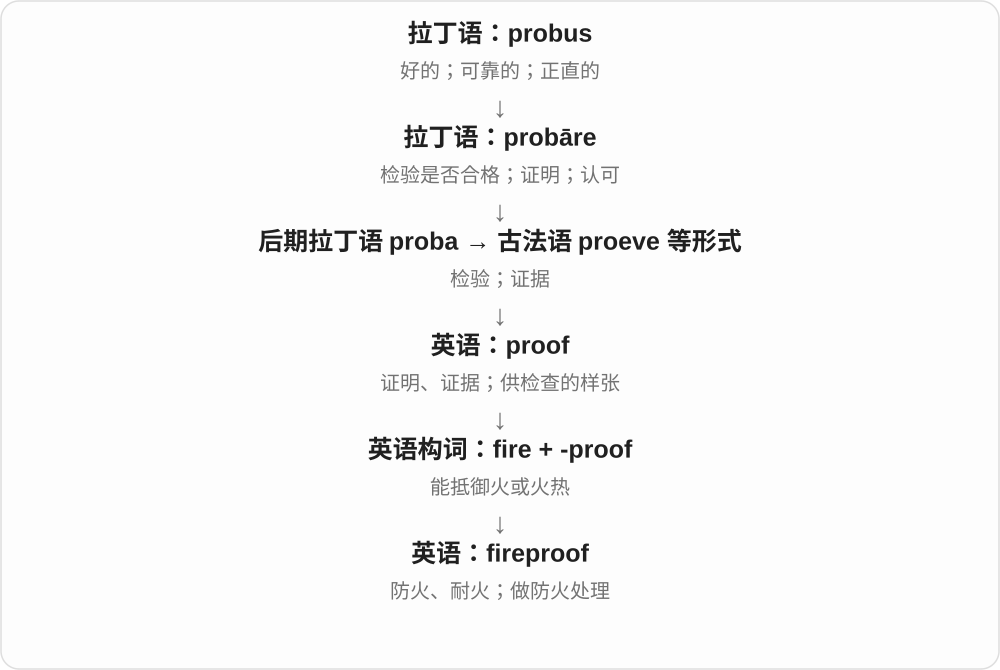

常见 fireproof safe、fireproof door；具体耐火能力有条件和时间范围，词本身不是“无论烧多久都没事”的保证。

**常见搭配与例句**

a fireproof safe；fireproof materials；fireproof a structure。

> Important documents were stored in a fireproof safe.

重要文件存放在防火保险柜里。

> The renovation included fireproofing the steel supports.

翻修工程包括给钢支撑做防火处理。

**别混淆**

fireproof 指防火耐火；firefighter 是消防员，后半段是 fighter，与 proof 无关。

### 41. soundproof — 隔音的；做隔音处理

**音标**：英 /ˈsaʊndpruːf/；美 /ˈsaʊndpruːf/

**先抓住这个画面**

给声音的进出加一道阻挡，让外面的噪声不容易进来，里面的声音不容易传出去。

**怎么拆**

sound 声音 + -proof 能抵挡。

**怎么变成今天的意思**

可形容 room、wall，也可作动词 soundproof a studio。实际降低多少声音要看结构和频率，日常说法不必意味着绝对无声。

**常见搭配与例句**

a soundproof room；soundproof the walls。

> The interview took place in a soundproof booth.

采访在一间隔音小室里进行。

> They soundproofed the studio to reduce street noise.

他们给录音室做了隔音处理，以减轻街道噪声。

**别混淆**

soundproof 强调阻挡声音穿过；sound absorbing 强调吸收声音、减少反射，功能有联系但不相同。

### 42. approbate — 正式认可；批准（少见、正式用语）

**音标**：英 /ˈæprəbeɪt/；美 /ˈæprəbeɪt/

**先抓住这个画面**

把“我认为它可以”说成正式接受或准许。

**怎么拆**

来自拉丁语 approbātus，是 approbāre 的过去分词；与经法语发展的 approve 属于不同借入形式。

**怎么变成今天的意思**

现代很少见；苏格兰法律文字也有专门搭配 approbate and reprobate，涉及一面接受、一面否认。这里只把握词义，不把固定法律用法机械推广到日常。

**常见搭配与例句**

approbate a proposal；approbate and reprobate。

> The old charter empowered the council to approbate new rules.

那份旧章程授权理事会正式批准新规则。

> In this passage, “approbate” means to accept the arrangement as valid.

在这段文字里，approbate 指认可这项安排有效。

**别混淆**

approve 是日常正常用词；approbate 多用于旧文或正式领域，不是更高级的万能替代词。

### 43. approbation — 认可；赞许

**音标**：英 /ˌæprəˈbeɪʃən/；美 /ˌæprəˈbeɪʃən/

**先抓住这个画面**

不仅没有异议，还带着“做得好、值得肯定”的点头。

**怎么拆**

来自拉丁语 approbātiō，经法语或直接借入；名词有自己的历史，并非现代 approve 临时换尾。

**怎么变成今天的意思**

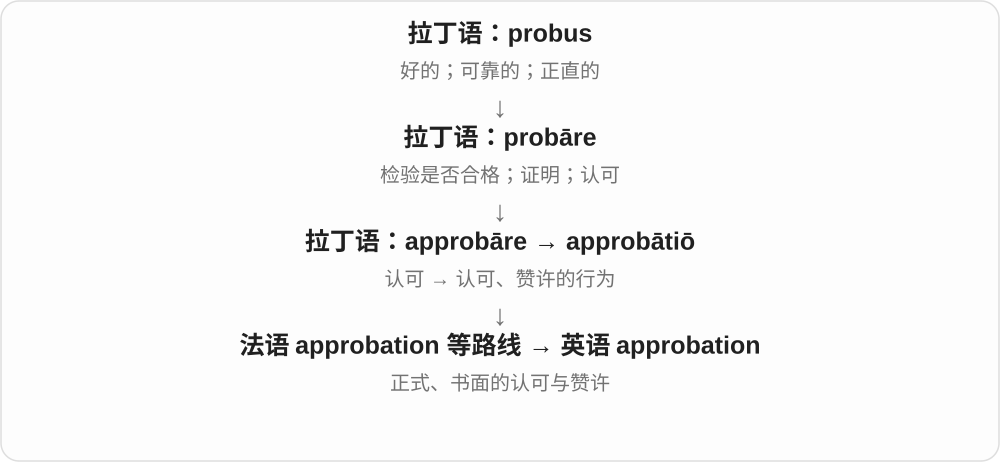

比 approval 书面，常出现在文学、评论或正式讨论里。日常申请获批通常用 approval 更自然。

**常见搭配与例句**

win approbation；public approbation；a nod of approbation。

> The performance won the critics’ approbation.

这场演出赢得了评论家的赞许。

> He received the suggestion with a nod of approbation.

他赞许地点头，接受了这个建议。

**别混淆**

approbation 与 probation 不是同一词：前者是赞许，后者是接受考察的阶段。

### 44. disapprobation — 不赞许；反对；谴责

**音标**：英 /ˌdɪsæprəˈbeɪʃən/；美 /ˌdɪsæprəˈbeɪʃən/

**先抓住这个画面**

把赞许收回，明确表示这件事不值得认可。

**怎么拆**

dis- + approbation，英语构词；正式或文学用语。

**怎么变成今天的意思**

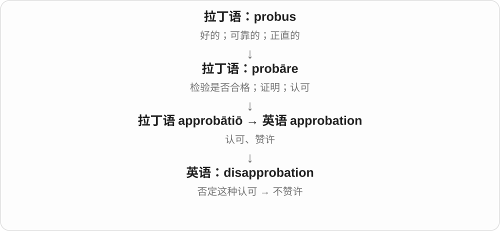

通常比日常 disapproval 更郑重，有时带道德谴责的意味。阅读时能认出即可，普通对话常用 disapproval。

**常见搭配与例句**

express disapprobation；general disapprobation。

> The decision drew widespread disapprobation.

这项决定引来了广泛的不赞同。

> The narrator records the custom with obvious disapprobation.

叙述者记下这一习俗时，明显带着反对态度。

**别混淆**

disapproval 是日常常用的“不赞同”；disapprobation 更正式、更书面，常带郑重谴责的语气。

## 这一组要分清什么

**prove / probe / approve**：证明结论 / 深入探查 / 表示认可或批准。

**probable / provable / proven**：很可能 / 可证明 / 已证明。**unproven / disproved / unprovable**：还未证实 / 已证伪 / 在相关条件内无法证明。

**approval / approbation / probation**：认可、批准 / 较书面的赞许 / 试用与考察。**probate** 是遗嘱、遗产事务中的词。

**disprove / disapprove / reprove**：证伪主张 / 不赞同 / 责备行为。

**proofread** 现在读 /riːd/，过去读 /red/；**reprobate** 名词、形容词末尾 /ət/，动词末尾 /eɪt/。

## 串起来练习

**The results look promising, but they do not prove the claim. We will probably need more evidence before we approve the plan.**

结果看起来不错，但还不能证明那个主张。在批准计划之前，我们大概还需要更多证据。prove 是证实；probably 是有保留的判断；approve 是批准。
