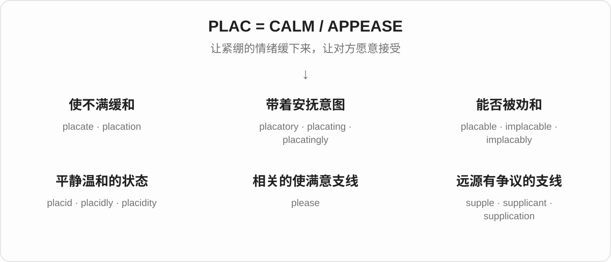
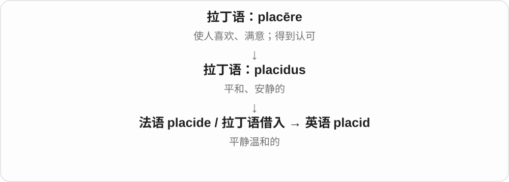
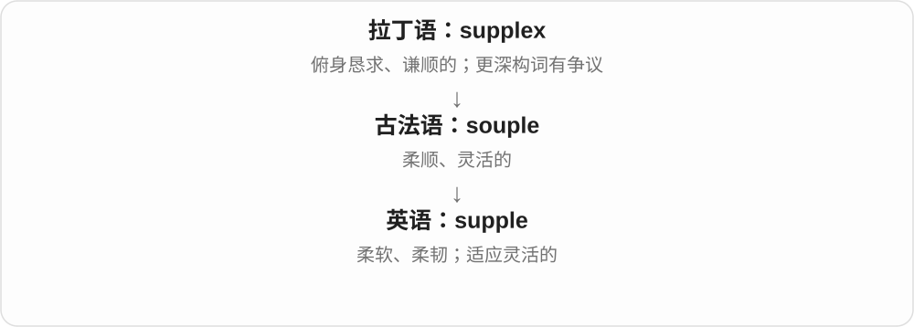
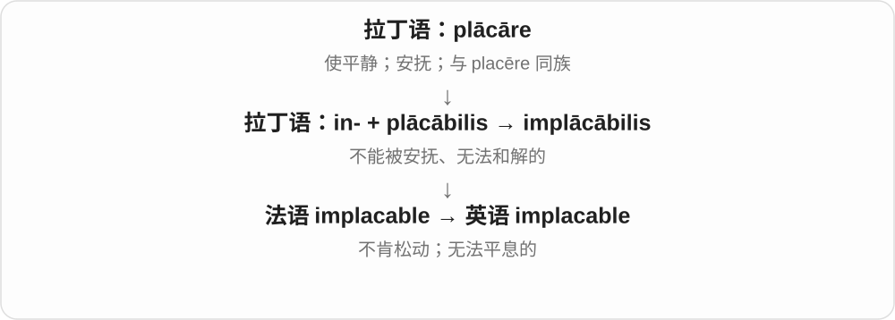
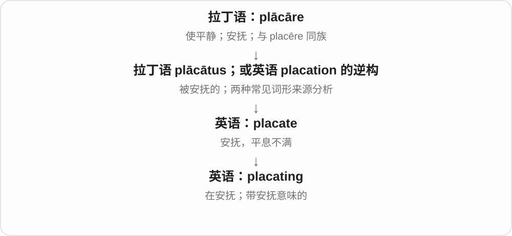
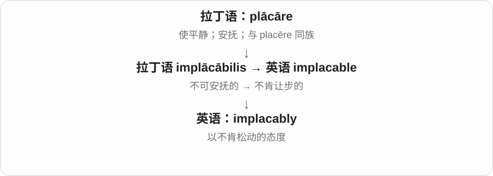
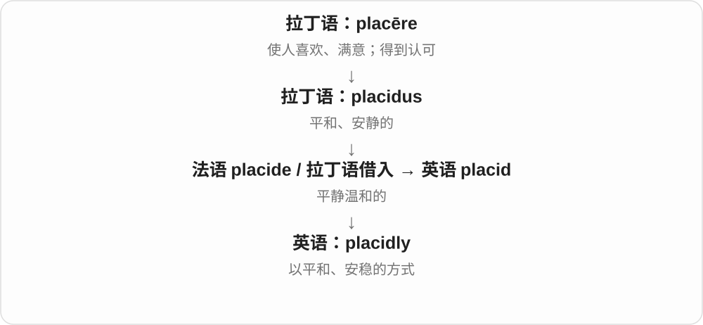
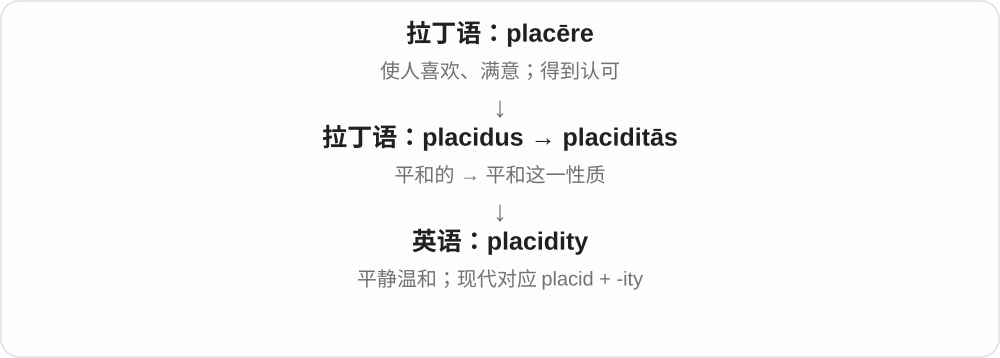
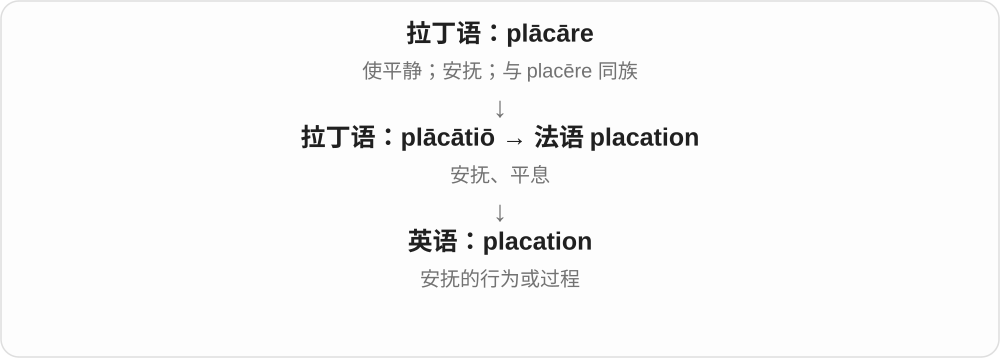
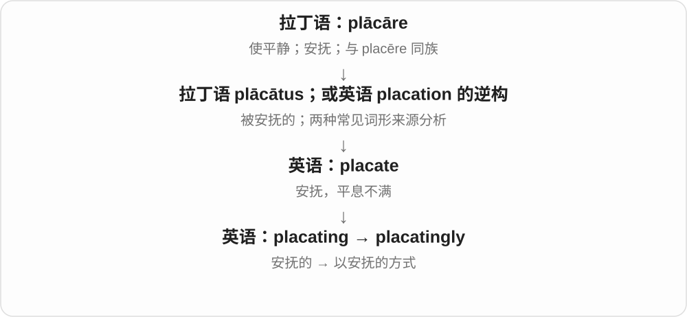

# 0211 · plac- — 使人平静；安抚、平息不满

[逐词精讲目录](../00_逐词精讲目录.md) · [总目录](../00_总目录_按常用程度.md)

## 核心词根与来源

**plācāre** 是拉丁语的“安抚、使平静”，与 **placēre**“使满意”相连。可以想象对方正皱眉、气愤，你用解释或行动让情绪缓下来：这就是 **placate** 的核心。词根不是万能公式，**supple / supplicate** 的更深来源有分歧，在本页单独保留说明。

## 词形与演化规律

**plācāre → plācātus** 是拉丁动词与过去分词的关系；英语 **placate** 还可能从较早的 placation 逆构而来。**placation、placatory、placable** 各有拉丁或法语借入路线，不能一律画成现代英语 placate 加后缀。

**implacable** 的 im- 是否定 in- 在 p 前变为 m：“无法被安抚”。**placid** 则属于相关的 placēre / placidus 支线，强调平静状态。

**supple、supplicant、supplicate、supplication** 的可靠起点是 supplex / supplicāre。更早有“弯身、折叠”与“谦恭安抚”等不同分析；图从可确认的拉丁词开始，不强接到 plācāre。

现代常用 **supply**“供给”来自拉丁语 supplēre“填满”。虽有非常少见的同形副词 supply 可按 supple + -ly 解释，本页不把常用供给义误作安抚义。

## 单词速览（常用到不常用）

| 单词 | 音标 | 核心意思 |
|---|---|---|
| [please](#w-1) | 英 /pliːz/；美 /pliːz/ | 使高兴、满意；请；随自己愿意 |
| [placid](#w-2) | 英 /ˈplæsɪd/；美 /ˈplæsɪd/、/ˈplæsəd/ | 平静的；温和的；不易激动的 |
| [supple](#w-3) | 英 /ˈsʌpəl/；美 /ˈsʌpəl/ | 柔软有韧性的；灵活的 |
| [placate](#w-4) | 英 /pləˈkeɪt/；美 /ˈpleɪkeɪt/，也读 /pleɪˈkeɪt/ | 安抚；平息不满 |
| [implacable](#w-5) | 英 /ɪmˈplækəbəl/；美 /ɪmˈplækəbəl/ | 无法安抚的；不肯让步的；坚定不移的 |
| [supplication](#w-6) | 英 /ˌsʌplɪˈkeɪʃən/；美 /ˌsʌpləˈkeɪʃən/ | 恳求；祈求；恳切的请求 |
| [placating](#w-7) | 英 /pləˈkeɪtɪŋ/；美 /ˈpleɪkeɪtɪŋ/ | 安抚的；正在平息不满的 |
| [supplicant](#w-8) | 英 /ˈsʌplɪkənt/；美 /ˈsʌplɪkənt/ | 恳求者；祈求者；恳求的 |
| [implacably](#w-9) | 英 /ɪmˈplækəbli/；美 /ɪmˈplækəbli/ | 坚决不让步地；无法安抚地 |
| [placidly](#w-10) | 英 /ˈplæsɪdli/；美 /ˈplæsɪdli/、/ˈplæsədli/ | 平静地；温和地；不慌不忙地 |
| [supplicate](#w-11) | 英 /ˈsʌplɪkeɪt/；美 /ˈsʌpləkeɪt/ | 恳求；祈求 |
| [placidity](#w-12) | 英 /pləˈsɪdɪti/；美 /pləˈsɪdəti/ | 平静；温和沉着 |
| [placation](#w-13) | /pleɪˈkeɪʃən/ | 安抚；平息不满 |
| [placatory](#w-14) | 英 /pləˈkeɪtəri/；美 /ˈpleɪkətɔːri/ | 安抚性的；旨在平息不满的 |
| [placable](#w-15) | 英 /ˈplækəbəl/，也读 /ˈpleɪkəbəl/；美 /ˈpleɪkəbəl/、/ˈplækəbəl/ | 可安抚的；容易消气的 |
| [placatingly](#w-16) | 英 /pləˈkeɪtɪŋli/；美 /ˈpleɪkeɪtɪŋli/ | 安抚地；以平息不满的口气 |

## 逐词讲解

### 1. please — 使高兴、满意；请；随自己愿意

**音标**：英 /pliːz/；美 /pliːz/

**先抓住这个画面**

让对方觉得“这样合我的意”；请求别人做事时，就变成了较礼貌的“如果你愿意，请……”。

**怎么拆**

经古法语 plaisir / plaire 来自拉丁语 placēre。请求中的 please 与 if it please you 一类旧表达有关，不是一个毫无来历的礼貌小词。

**怎么变成今天的意思**

The result pleased her 是结果让她满意；Please sit down 是请坐；Do as you please 是随你喜欢怎么做。

**常见搭配与例句**

please someone；hard to please；if you please；as you please。

> The good news pleased everyone in the room.

好消息让屋里每个人都很高兴。

> Please leave the door open.

请把门留开。

> You can arrange the furniture as you please.

你可以按自己喜欢的方式摆放家具。

**别混淆**

please 是使人高兴的动作；pleased 是感到高兴；pleasant 是事物或人令人相处舒服。

### 2. placid — 平静的；温和的；不易激动的

**音标**：英 /ˈplæsɪd/；美 /ˈplæsɪd/、/ˈplæsəd/

**先抓住这个画面**

像没有大波浪的湖面，也像不容易被小事激怒的人。

**怎么拆**

来自拉丁语 placidus，与 placēre 相连；有法语 placide 和直接拉丁借入的分析。

**怎么变成今天的意思**

可说 placid lake、placid child、placid expression。强调安稳、不起波澜，不必表示环境完全没有声音。

**常见搭配与例句**

a placid lake；a placid temperament；a placid expression。

> The boat moved slowly across the placid lake.

小船缓缓驶过平静的湖面。

> The child remained placid despite the noise around her.

尽管周围很吵，孩子仍很安静平和。

**别混淆**

placid 是平静的状态；placating 是努力让别人平静；complacent 是自满到忽略问题。

### 3. supple — 柔软有韧性的；灵活的

**音标**：英 /ˈsʌpəl/；美 /ˈsʌpəl/

**先抓住这个画面**

像好皮革或柔韧的身体，可以弯转、顺势改变形状，不是僵硬的一块。

**怎么拆**

经古法语 souple 来自拉丁语 supplex“谦卑恳求、俯身的”。更早构词有 sub- + plicāre“弯折”等分析，也有联系 plācāre“安抚”的说法；本页把它作为可能相关支线，不断言确定同源。

**怎么变成今天的意思**

常说 supple leather、supple limbs；a supple mind 是思路灵活。柔韧不是软弱，柔软材料也可以结实。

**常见搭配与例句**

supple leather；keep the body supple；a supple mind。

> The bag is made of soft, supple leather.

这个包用柔软有韧性的皮革制成。

> Years of dance practice kept her movements supple.

多年的舞蹈练习让她的动作保持柔韧。

**别混淆**

supple 是可弯、柔韧；supply“供应”来自 supplēre“填满”一族，现代常用义并不是 supple 的动词。

### 4. placate — 安抚；平息不满

**音标**：英 /pləˈkeɪt/；美 /ˈpleɪkeɪt/，也读 /pleɪˈkeɪt/

**先抓住这个画面**

对方正不高兴，你做点解释、让步或补偿，让情绪缓下来。

**怎么拆**

来自拉丁语 plācātus“被安抚的”，也有从较早英语 placation 逆构的分析；最终都联系 plācāre“安抚”。

**怎么变成今天的意思**

常接 angry customers、critics、opponents。它强调先平息不满，不一定代表问题已经真正解决。

**常见搭配与例句**

placate angry customers；an attempt to placate。

> The airline offered vouchers to placate the delayed passengers.

航空公司提供代金券，安抚航班延误的乘客。

> A brief apology did little to placate the neighbours.

一句简短道歉没能让邻居们消气。

**别混淆**

please 是让人满意；placate 通常预设对方有愤怒或不满，需要把情绪压下来。

### 5. implacable — 无法安抚的；不肯让步的；坚定不移的

**音标**：英 /ɪmˈplækəbəl/；美 /ɪmˈplækəbəl/

**先抓住这个画面**

解释、请求或让步摆在面前，对方仍然不松口，态度没有缓下来的空间。

**怎么拆**

经法语来自拉丁语 implācābilis：in- 不 + plācābilis 可安抚的；n 在 p 前同化为 m。

**怎么变成今天的意思**

an implacable opponent 是坚定不肯妥协的对手；implacable hostility 是难以化解的敌意。不限于某个人正在发脾气。

**常见搭配与例句**

an implacable opponent；implacable hostility；implacably opposed。

> She remained an implacable opponent of the proposal.

她始终坚决反对这项提议。

> The apology did not soften his implacable hostility.

道歉没能缓解他那难以化解的敌意。

**别混淆**

implacable 强调无法软化立场或敌意；angry 只表示生气，不说明能否消气。

### 6. supplication — 恳求；祈求；恳切的请求

**音标**：英 /ˌsʌplɪˈkeɪʃən/；美 /ˌsʌpləˈkeɪʃən/

**先抓住这个画面**

把心愿或困难以谦恭、急切的方式呈上，希望得到回应。

**怎么拆**

经古法语 suplicacion 或直接来自拉丁语 supplicātiō。英语名词较早，不简单画成英语 supplicate 先加 -ion；更深来源争议与 supplicate 同。

**怎么变成今天的意思**

常见 in supplication、a prayer of supplication，可指宗教祈祷，也可描写向人求情。

**常见搭配与例句**

raise hands in supplication；a plea of supplication。

> He clasped his hands in supplication.

他双手合拢，作出恳求的姿态。

> The letter ended with a supplication for forgiveness.

信的结尾恳切请求宽恕。

**别混淆**

supplication 比普通 request 更谦恭、郑重或急切，不是每个客服请求都用这个词。

### 7. placating — 安抚的；正在平息不满的

**音标**：英 /pləˈkeɪtɪŋ/；美 /ˈpleɪkeɪtɪŋ/

**先抓住这个画面**

说话或行动正努力让对方消气，少一些对抗。

**怎么拆**

placate + -ing；可作动词的一部分，也可作形容词。

**怎么变成今天的意思**

a placating smile 是想缓和气氛的微笑；was placating the crowd 则是正在安抚人群。

**常见搭配与例句**

a placating smile；a placating response。

> He offered a placating smile before explaining the delay.

他先露出安抚的微笑，再解释延误。

> She spent the morning placating disappointed customers.

她整个上午都在安抚失望的顾客。

**别混淆**

placating 与 placatory 意思接近；前者保留明显的动作感，后者较书面。

### 8. supplicant — 恳求者；祈求者；恳求的

**音标**：英 /ˈsʌplɪkənt/；美 /ˈsʌplɪkənt/

**先抓住这个画面**

带着低姿态向有权力或能提供帮助的一方提出请求。

**怎么拆**

来自拉丁语 supplicāns，supplicāre“恳求”的现在分词。更早与 plācāre 或 plicāre 的关系有不同分析，图从可靠的拉丁词开始。

**怎么变成今天的意思**

常见于文学、历史或宗教语境。可以是具体求助者，也可比喻在强者面前被迫低头请求的一方。

**常见搭配与例句**

a humble supplicant；a supplicant at the door。

> A supplicant waited outside the ruler’s chamber.

一位恳求者等在统治者的房间外。

> She refused to approach the committee as a helpless supplicant.

她不愿以无助恳求者的姿态去找委员会。

**别混淆**

supplicant 比 applicant 更突出恳求姿态；applicant 通常只是提交申请的人。

### 9. implacably — 坚决不让步地；无法安抚地

**音标**：英 /ɪmˈplækəbli/；美 /ɪmˈplækəbli/

**先抓住这个画面**

立场像卡住了一样，没有被劝松、谈软。

**怎么拆**

implacable + -ly，词尾 -able 转成 -ably。

**怎么变成今天的意思**

常见 implacably opposed to，也可形容追究、敌对的态度。比 firmly 更带不可和解的意味。

**常见搭配与例句**

implacably opposed；implacably hostile。

> The residents were implacably opposed to the demolition plan.

居民坚决反对拆除计划，毫不让步。

> She pursued the complaint implacably despite repeated delays.

尽管一再拖延，她仍不肯罢休地追究投诉。

**别混淆**

firmly 可以是稳健坚定；implacably 更强调没有软化或妥协的余地。

### 10. placidly — 平静地；温和地；不慌不忙地

**音标**：英 /ˈplæsɪdli/；美 /ˈplæsɪdli/、/ˈplæsədli/

**先抓住这个画面**

周围有变化，自己的动作和情绪却没有被带得起起伏伏。

**怎么拆**

placid + -ly。

**怎么变成今天的意思**

可描写人说话、动物吃草或船漂着的样子。语气常比 calmly 更有画面感。

**常见搭配与例句**

sit placidly；graze placidly；reply placidly。

> The cows grazed placidly beside the road.

牛群在路边安静地吃草。

> She listened placidly while the others argued.

别人争论时，她平静地听着。

**别混淆**

placidly 是不激动；complacently 还加入了自满和低估问题的负面判断。

### 11. supplicate — 恳求；祈求

**音标**：英 /ˈsʌplɪkeɪt/；美 /ˈsʌpləkeɪt/

**先抓住这个画面**

把姿态放低，认真请求对方给予帮助、宽恕或回应。

**怎么拆**

可来自拉丁语 supplicātus，也可能从英语 supplication 逆构；两者都联系 supplicāre“谦卑恳求”。深层拆分存在不同词源分析。

**怎么变成今天的意思**

文学或宗教语体，普通对话更常用 beg、plead。可接请求对象，也可用 supplicate for mercy。

**常见搭配与例句**

supplicate for mercy；supplicate a ruler。

> The poem describes villagers supplicating for rain.

诗中描写了村民祈求降雨。

> The messenger supplicated the ruler for mercy.

信使向统治者恳求宽恕。

**别混淆**

supplicate 强调恳切低姿态；placate 是让对方平息不满，两种动作不完全一样。

### 12. placidity — 平静；温和沉着

**音标**：英 /pləˈsɪdɪti/；美 /pləˈsɪdəti/

**先抓住这个画面**

把平和、不起波澜这一状态看作整体，就像观察湖面的安静或人的稳定性情。

**怎么拆**

与拉丁语 placiditās“温和平静”相连；现代可分析 placid + -ity，重音移到第二音节。

**怎么变成今天的意思**

较书面，常描述神情、性情、环境。它不必表示毫无感受，只是外在或整体比较安稳。

**常见搭配与例句**

an air of placidity；outward placidity。

> The placidity of the lake contrasted with the busy road nearby.

湖面的平静与附近繁忙的道路形成对比。

> Her outward placidity concealed a firm decision.

她平静的外表下藏着一个坚定的决定。

**别混淆**

placidity 是平静；passivity 是被动不行动，平静的人也可以果断行动。

### 13. placation — 安抚；平息不满

**音标**：/pleɪˈkeɪʃən/

**先抓住这个画面**

通过措辞或行动，把对方正在上升的怒气压下去的过程。

**怎么拆**

经法语 placation 来自拉丁语 plācātiō；英语名词早于常用动词 placate 的记录，不画成 placate 先变出它。

**怎么变成今天的意思**

较正式、少见，通常在分析冲突处理方式时出现。日常更常使用动词 placate 或名词 appeasement。

**常见搭配与例句**

a gesture of placation；placation of critics。

> The offer was a gesture of placation, not a lasting solution.

这个提议只是安抚姿态，并非长久解决办法。

> The report criticizes the policy as an exercise in placation.

报告批评这项政策只是在做安抚工作。

**别混淆**

placation 可能只有安抚效果；resolution 进一步说问题得到解决，不保证两者同步。

### 14. placatory — 安抚性的；旨在平息不满的

**音标**：英 /pləˈkeɪtəri/；美 /ˈpleɪkətɔːri/

**先抓住这个画面**

一个手势、一句话或一点让步，是想让对方先别生气。

**怎么拆**

来自拉丁语 plācātōrius，与 plācāre 相连；英语里它有独立借入历史，不只是现代 placate 加 -ory。

**怎么变成今天的意思**

常形容 tone、gesture、remark。描述的是意图，不保证对方最后真的被安抚。

**常见搭配与例句**

a placatory gesture；a placatory tone。

> She raised a hand in a placatory gesture.

她抬起一只手，作出安抚的姿态。

> His placatory tone failed to calm the discussion.

他安抚的语气没能让讨论平静下来。

**别混淆**

placatory 是试图平息冲突；placid 是本来平静的状态。

### 15. placable — 可安抚的；容易消气的

**音标**：英 /ˈplækəbəl/，也读 /ˈpleɪkəbəl/；美 /ˈpleɪkəbəl/、/ˈplækəbəl/

**先抓住这个画面**

虽然正在生气，但并不是油盐不进；解释或道歉还有机会让他松动。

**怎么拆**

借自拉丁语 plācābilis，与 plācāre 安抚 + -bilis 可被……的相连。

**怎么变成今天的意思**

少见，常出现在文学或正式描写里。其反面 implacable 更常见。

**常见搭配与例句**

a placable opponent；a placable disposition。

> Despite his anger, he remained placable.

尽管生气，他仍有被劝和的余地。

> The story contrasts a placable ruler with an unforgiving rival.

故事对比了一位愿意息怒的统治者和一个不肯宽恕的对手。

**别混淆**

placable 是能够被安抚；placid 是已经平和，不需要先有一次生气。

### 16. placatingly — 安抚地；以平息不满的口气

**音标**：英 /pləˈkeɪtɪŋli/；美 /ˈpleɪkeɪtɪŋli/

**先抓住这个画面**

说同样一句话时，特意放柔语气，让对方先缓一缓。

**怎么拆**

placating + -ly，表示动作方式。

**怎么变成今天的意思**

较少见，常在叙事中与 say、speak、smile 搭配。是否听起来真诚，取决于场景。

**常见搭配与例句**

speak placatingly；smile placatingly。

> “We can discuss it again,” she said placatingly.

“我们可以再商量。”她用安抚的口气说。

> He spoke placatingly, hoping to prevent another argument.

他说话时尽量缓和，希望避免再次争吵。

**别混淆**

placatingly 描述劝慰、缓和的意图；calmly 只说自己平静，未必是在安抚别人。

## 这一组要分清什么

**please / placate**：让人满意 / 平息已经存在的不满。

**placid / placable / placatory**：本来平静 / 能被安抚 / 意在安抚。**implacable** 则是不肯软化、无法劝和。

**supple** 是身体、皮革等柔韧；**supplicate** 是恳求。它们较深的历史分析有分歧，不能只凭一个想象中的“弯腰讨好”故事就断定全部路线。

## 串起来练习

**Her placatory tone did not placate the customer, who remained implacable.**

她安抚的语气没有让顾客消气，对方仍不肯让步。placatory 说意图，placate 说安抚动作，implacable 说态度不肯软化。
