# 0219 · ple-, plet- — 填满；补足；完成

[逐词精讲目录](../00_逐词精讲目录.md) · [总目录](../00_总目录_按常用程度.md)

## 核心词根与来源

拉丁语 plēre 的核心是“填满”。它常保存在 complēre、implēre、supplēre 等带前缀的动词里，分词词干能见到 plēt-。从填容器到完成任务，再到履行要求，这个动作逐渐走进抽象生活。plēnus“满的”属于同源的形容词支线，另列 plen-；两支有关，不必硬画成一个直接生出另一个。

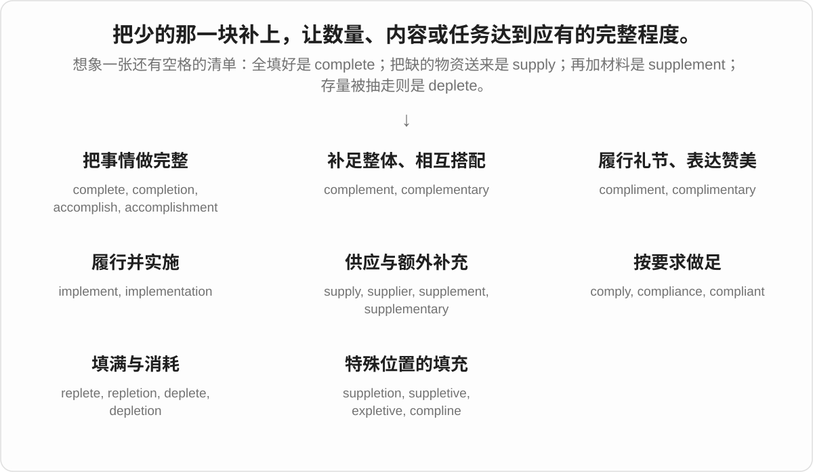

## 词形与演化规律

ple-/plet- 来自拉丁语不同词形。complete、replete 保留明显的 -plete；complement、implement、supplement 保留 -plement；supply、comply、accomplish 经过法语等语言后，表面已经不那么像。-tion 名词有些早在拉丁语形成，甚至比对应英语动词更早出现。

## 单词速览（按词族由简到繁）

同一基础词的相关扩展放在一起，先读基础形式，再读扩展；各组之间优先读常用的。具体词源关系见各词讲解。

| 单词 | 音标 | 核心意思 |
|---|---|---|
| [complete](#w-1) | 英、美 /kəmˈpliːt/ | 完整的；全部的；彻底的；完成 |
| [completely](#w-2) | 英、美 /kəmˈpliːtli/ | 完全地；彻底地 |
| [completion](#w-5) | 英、美 /kəmˈpliːʃən/ | 完成；竣工；完成的时点 |
| [completeness](#w-23) | 英、美 /kəmˈpliːtnəs/ | 完整性；齐全程度 |
| [incomplete](#w-13) | 英、美 /ˌɪnkəmˈpliːt/ | 不完整的；未完成的 |
| [incompleteness](#w-31) | 英、美 /ˌɪnkəmˈpliːtnəs/ | 不完整；缺失的状态 |
| [incompletely](#w-33) | 英、美 /ˌɪnkəmˈpliːtli/ | 不完全地；未彻底地 |
| [autocomplete](#w-34) | 英 /ˈɔːtəʊkəmˌpliːt/；美 /ˈɑːtoʊkəmˌpliːt/ | 自动补全；自动完成输入 |
| [supply](#w-3) | 英、美 /səˈplaɪ/ | 供应；提供；供应量；物资〔supplies〕 |
| [supplier](#w-14) | 英 /səˈplaɪə/；美 /səˈplaɪər/ | 供应商；供货者 |
| [resupply](#w-26) | 动词：英、美 /ˌriːsəˈplaɪ/；名词：英 /ˌriːsəˈplaɪ/，美常 /ˈriːsəˌplaɪ/ | 重新补给；补给行动 |
| [oversupply](#w-30) | 英 /ˌəʊvəsəˈplaɪ/；美 /ˌoʊvərsəˈplaɪ/ | 供应过多；供给过剩；过量供应 |
| [undersupply](#w-40) | 英 /ˌʌndəsəˈplaɪ/ | 供应不足；提供得不够 |
| [implement](#w-6) | 动词：英 /ˈɪmplɪment/，美 /ˈɪmpləment/；名词：英 /ˈɪmplɪmənt/，美 /ˈɪmpləmənt/ | 实施；执行；工具、器具〔名词〕 |
| [implementation](#w-4) | 英 /ˌɪmplɪmenˈteɪʃən/；美 /ˌɪmpləmenˈteɪʃən/ | 实施；落实；实现方案〔尤其软件〕 |
| [implementer](#w-38) | 英 /ˈɪmplɪmentə/；美 /ˈɪmpləmentər/ | 实施者；执行机构；实现某方案的人 |
| [comply](#w-10) | 英、美 /kəmˈplaɪ/ | 遵守；按要求做；服从 |
| [compliance](#w-7) | 英、美 /kəmˈplaɪəns/ | 遵从；合规；顺从；顺应性〔技术〕 |
| [noncompliance](#w-29) | 英 /ˌnɒnkəmˈplaɪəns/；美 /ˌnɑːnkəmˈplaɪəns/ | 不遵守；不符合要求 |
| [compliment](#w-12) | 名词：英 /ˈkɒmplɪmənt/，美 /ˈkɑːmplɪmənt/；动词：英 /ˈkɒmplɪment/，美 /ˈkɑːmplɪment/ | 赞美；称赞；礼貌的致意〔compliments〕 |
| [complimentary](#w-21) | 英 /ˌkɒmplɪˈmentəri/；美 /ˌkɑːmplɪˈmentəri/ | 赞美的；免费赠送的 |
| [compliant](#w-19) | 英、美 /kəmˈplaɪənt/ | 符合规定的；顺从的；易变形的〔技术〕 |
| [noncompliant](#w-36) | 英 /ˌnɒnkəmˈplaɪənt/；美 /ˌnɑːnkəmˈplaɪənt/ | 不符合要求的；未遵守的 |
| [accomplish](#w-9) | 英 /əˈkʌmplɪʃ/；美 /əˈkɑːmplɪʃ/ | 完成；实现；办成 |
| [accomplished](#w-8) | 英 /əˈkʌmplɪʃt/；美 /əˈkɑːmplɪʃt/ | 技艺精湛的；有造诣的；完成了的 |
| [accomplishment](#w-16) | 英 /əˈkʌmplɪʃmənt/；美 /əˈkɑːmplɪʃmənt/ | 成就；完成；娴熟技能〔常用复数〕 |
| [supplement](#w-11) | 名词：英 /ˈsʌplɪmənt/，美 /ˈsʌpləmənt/；动词：英 /ˈsʌplɪment/，美 /ˈsʌpləment/ | 补充物；增刊；补助；补充；另付的费用 |
| [supplemental](#w-18) | 英 /ˌsʌplɪˈmentəl/；美 /ˌsʌpləˈmentəl/ | 补充的；额外提供的 |
| [supplementary](#w-20) | 英 /ˌsʌplɪˈmentəri/；美 /ˌsʌpləˈmentəri/ | 补充的；附加的；互补的〔两角和为180°〕 |
| [supplementation](#w-24) | 英 /ˌsʌplɪmenˈteɪʃən/；美 /ˌsʌpləmenˈteɪʃən/ | 补充；增补的过程 |
| [complement](#w-15) | 名词：英 /ˈkɒmplɪmənt/，美 /ˈkɑːmplɪmənt/；动词：英 /ˈkɒmplɪment/，美 /ˈkɑːmplɪment/ | 互补物；所需全数；补足、相配；补语〔语法〕 |
| [complementary](#w-17) | 英 /ˌkɒmplɪˈmentəri/；美 /ˌkɑːmplɪˈmentəri/ | 互补的；相配的；互余的〔角〕 |
| [complementarity](#w-32) | 英 /ˌkɒmplɪmenˈtærəti/；美 /ˌkɑːmplɪmenˈtærəti/ | 互补性；互相补足的关系 |
| [deplete](#w-27) | 英、美 /dɪˈpliːt/ | 大量消耗；使减少、趋于耗尽 |
| [depletion](#w-22) | 英、美 /dɪˈpliːʃən/ | 大量消耗；损耗；储量下降 |
| [replete](#w-25) | 英、美 /rɪˈpliːt/ | 充满的；丰富具备的；吃饱的〔正式〕 |
| [repletion](#w-39) | 英、美 /rɪˈpliːʃən/ | 充满；饱足；过饱〔正式〕 |
| [expletive](#w-28) | 英 /ɪkˈspliːtɪv/；美 /ˈeksplətɪv/ | 咒骂语；脏话；填补句法位置的成分〔语法〕 |
| [compleat](#w-35) | 英、美 /kəmˈpliːt/ | 完整的；全面精通的〔旧式或刻意仿古用法〕 |
| [compline](#w-37) | 英 /ˈkɒmplɪn/，也读 /ˈkɒmplaɪn/；美 /ˈkɑːmplən/ | 寝前祷；终祷〔基督教礼仪〕 |
| [suppletive](#w-41) | 美 /səˈpliːtɪv/，也读 /ˈsʌplɪtɪv/ | 异干互补的；由另一词干补位的 |
| [suppletion](#w-42) | 英、美 /səˈpliːʃən/ | 异干互补；用另一词根补足屈折变化〔语言学〕 |

## 逐词讲解

### 1. complete — 完整的；全部的；彻底的；完成

**音标**：英、美 /kəmˈpliːt/

**先抓住这个画面**

想象拼图最后一块放进去：该有的部分都齐了。用作动词，就是把缺口补上、把事情做到终点。

**怎么拆**

历史上是 com-〔这里可能加强语气〕 + plēre“填满” → complētus，经古法语或直接拉丁语借入。英语动词通常联系形容词转用，也可能受拉丁语影响。

**怎么变成今天的意思**

a complete set 是整套齐全；complete the form 是把表填好；a complete surprise 是完全出乎意料。完整不等于毫无错误，一份完整报告仍可能写错。

**常见搭配与例句**

complete a task；a complete set；complete with…。

> Please complete all five sections of the form.

请把表格的五个部分全部填好。

> This box contains the complete collection of her letters.

这个盒子里装着她的全部信件。

> The invitation came as a complete surprise.

这份邀请完全出乎意料。

**别混淆**

finish 更偏把活动结束；complete 常让人想到达到所需的完整程度。perfect 才更接近无缺点。

### 2. completely — 完全地；彻底地

**音标**：英、美 /kəmˈpliːtli/

**先抓住这个画面**

把程度推到头：没有剩下一点，没有留着半截。

**怎么拆**

complete + -ly，在英语中把形容词变成副词。

**怎么变成今天的意思**

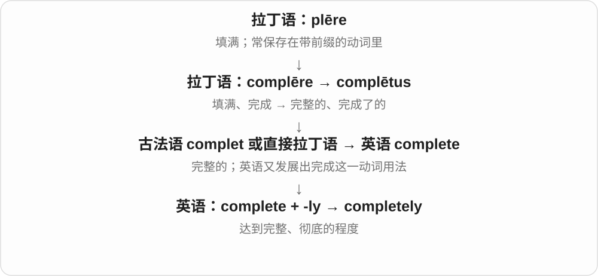

completely empty 是彻底空了；completely agree 是完全赞同。它常修饰一个可理解为有终点的状态，也常在口语中加强语气。

**常见搭配与例句**

completely different；completely forget；completely agree。

> I completely forgot about the meeting.

我把开会的事忘得一干二净。

> The two keys look similar but work completely differently.

两把钥匙看起来相似，作用却完全不同。

**别混淆**

almost completely 仍留一点；completely 本身不表示大部分。

### 3. completion — 完成；竣工；完成的时点

**音标**：英、美 /kəmˈpliːʃən/

**先抓住这个画面**

最后一道工序做完、最后一项打钩，整件事到达收尾处。

**怎么拆**

借自中世纪拉丁语 complētiō，来自 complēre；现代与 complete 配套，但名词并非必然在英语里现场加 -ion 形成。

**怎么变成今天的意思**

on completion 是一完成就；near completion 是快完工。也可用于句子、代码的补全，具体看补的对象。

**常见搭配与例句**

on completion；successful completion；near completion。

> Payment is due on completion of the work.

工作完成时应支付款项。

> The bridge is nearing completion.

这座桥即将竣工。

**别混淆**

completeness 看内容齐不齐；completion 看工作是否做完。

### 4. completeness — 完整性；齐全程度

**音标**：英、美 /kəmˈpliːtnəs/

**先抓住这个画面**

检查一套材料时，问的不是每一项好不好，而是“该交的都交齐了吗”。

**怎么拆**

complete + -ness，表示完整这一性质或状态。

**怎么变成今天的意思**

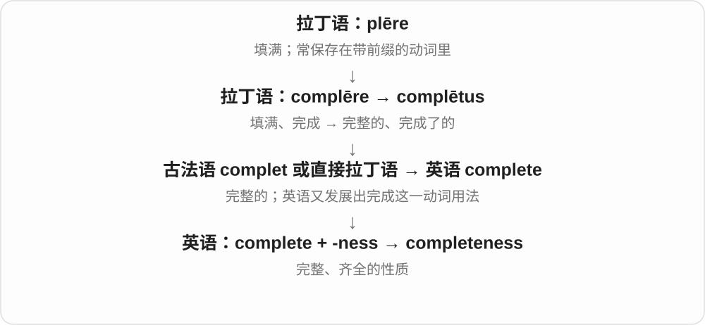

数据的 completeness 看该有的信息是否齐全；accuracy 看内容是否准确。for completeness 常表示为了交代完整，再补上一点。

**常见搭配与例句**

check for completeness；data completeness；for completeness。

> The assistant checked the application for completeness.

助理检查了申请材料是否齐全。

> For completeness, the report includes the unsuccessful trials.

为完整呈现情况，报告也列入了失败的试验。

**别混淆**

completion 是完成的过程或时点；completeness 是已有东西是否完整。

### 5. incomplete — 不完整的；未完成的

**音标**：英、美 /ˌɪnkəmˈpliːt/

**先抓住这个画面**

已经有了一部分，但还缺几块：可能缺内容，也可能工作还没做完。

**怎么拆**

后期拉丁语 incomplētus，in-“不” + complētus“完整的”，进入中古英语；现代可直观分析为 in- + complete。

**怎么变成今天的意思**

an incomplete address 可能缺门牌号；an incomplete task 是尚未做完的任务。它不等于错误，已有部分完全可能正确。

**常见搭配与例句**

incomplete information；an incomplete record；remain incomplete。

> The address is incomplete because the house number is missing.

地址不完整，因为缺了门牌号。

> The painting remained incomplete when the artist moved away.

画家搬走时，这幅画还没有完成。

**别混淆**

incorrect 是有错；incomplete 是有缺，两者可以分别出现。

### 6. incompleteness — 不完整；缺失的状态

**音标**：英、美 /ˌɪnkəmˈpliːtnəs/

**先抓住这个画面**

把“缺一块”本身拿出来谈：资料的空白会怎样影响判断。

**怎么拆**

incomplete + -ness。

**怎么变成今天的意思**

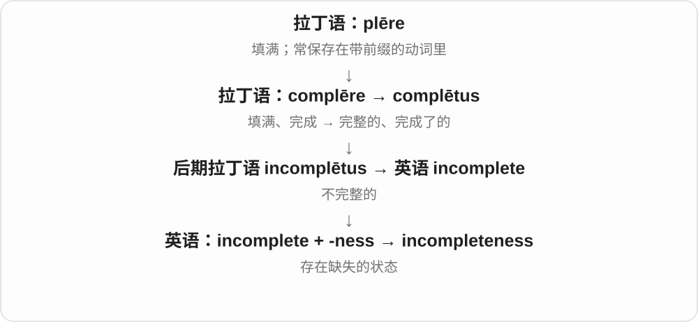

可以说记录、说明或知识的不完整；这是抽象性质，通常不可数。数学中的 incompleteness 有专门定义，不等于某位作者漏写几行。

**常见搭配与例句**

the incompleteness of the record；a sense of incompleteness。

> The incompleteness of the records makes comparison difficult.

记录不全，使比较变得困难。

> The final chapter leaves a deliberate sense of incompleteness.

最后一章刻意留下了一种未完的感觉。

**别混淆**

inaccuracy 是失准；incompleteness 是不全。缺页不一定意味着剩下的页写错了。

### 7. incompletely — 不完全地；未彻底地

**音标**：英、美 /ˌɪnkəmˈpliːtli/

**先抓住这个画面**

动作做过了，却没有做到全覆盖或收尾。

**怎么拆**

incomplete + -ly。

**怎么变成今天的意思**

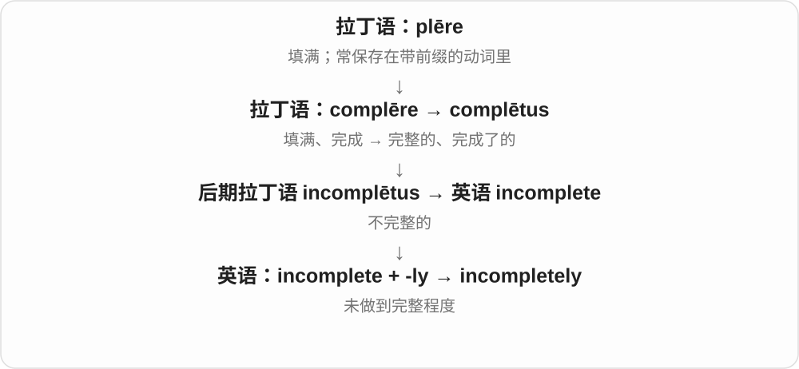

incompletely understood 是只了解一部分；incompletely filled 是尚未填满。偏书面，日常也可用 not fully。

**常见搭配与例句**

incompletely understood；incompletely documented；incompletely filled。

> The causes of the change are still incompletely understood.

人们对这一变化的原因仍只了解一部分。

> Several sections of the form were incompletely filled in.

表格的几个部分没有填写完整。

**别混淆**

partly 只说部分；incompletely 更容易暗示本来需要完整，却还差一点。

### 8. autocomplete — 自动补全；自动完成输入

**音标**：英 /ˈɔːtəʊkəmˌpliːt/；美 /ˈɑːtoʊkəmˌpliːt/

**先抓住这个画面**

你只打出开头，软件就猜出后面的字，帮你把这一段接完。

**怎么拆**

auto-“自动” + complete；现代英语技术构词，不是古代已有整个词。

**怎么变成今天的意思**

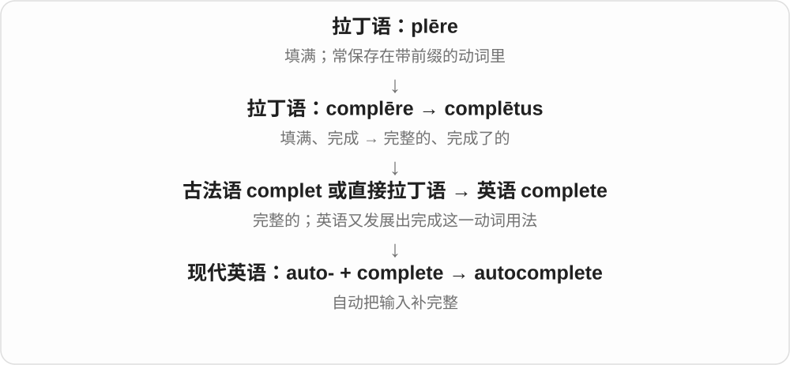

通常用作功能名，也能说 autocomplete an address“自动补全地址”。补出的词未必猜对，尤其姓名和地址要核对。

**常见搭配与例句**

autocomplete a word；an autocomplete feature；turn off autocomplete。

> The search box can autocomplete common place names.

搜索框可以自动补全常见地名。

> I turned off autocomplete while entering unfamiliar surnames.

输入不熟悉的姓氏时，我关闭了自动补全。

**别混淆**

autocorrect 重点改错；autocomplete 重点补后续内容。

### 9. supply — 供应；提供；供应量；物资〔supplies〕

**音标**：英、美 /səˈplaɪ/

**先抓住这个画面**

哪里缺东西，就把需要的东西送过去、补上去。名词则看你能提供多少，或者手边备了些什么。

**怎么拆**

拉丁语 sub-“从下补上” + plēre → supplēre；sub- 的 b 遇 p 同化。经古法语及拉丁语进入中古英语 supplien，后来写作 supply；名词由动词发展。

**怎么变成今天的意思**

supply someone with something 与 supply something to someone 都常用。a supply of water 是一批或一定量的水；supplies 常指食物、设备等物资。另有罕见副词 supply /ˈsʌpli/ 来自 supple，本页不混入。

**常见搭配与例句**

supply water to villages；supply someone with equipment；in short supply；school supplies。

> The company supplies local cafés with fresh bread.

这家公司向本地咖啡馆供应新鲜面包。

> We packed enough supplies for three days.

我们打包了足够三天使用的物资。

> Clean water was in short supply after the storm.

风暴过后，干净的水供应不足。

**别混淆**

provide 更广，可提供理由、机会；supply 常突出把所需物品持续或按需送到。

### 10. supplier — 供应商；供货者

**音标**：英 /səˈplaɪə/；美 /səˈplaɪər/

**先抓住这个画面**

你需要材料或商品时，负责把它供给你的那个人或公司。

**怎么拆**

supply + -er；拼写中 y 变 i。

**怎么变成今天的意思**

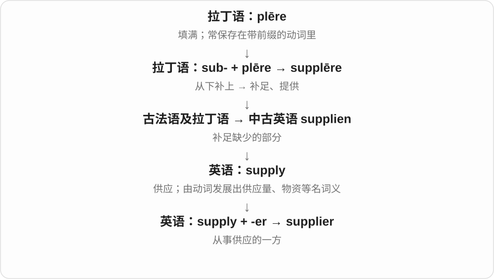

可以是零件供应商、食品供货商或能源供应商。supplier 不一定自己制造产品，也可能从别处进货再供应。

**常见搭配与例句**

a reliable supplier；a local supplier；a supplier of components。

> We asked the supplier to confirm the delivery date.

我们请供应商确认交货日期。

> The restaurant buys most of its vegetables from local suppliers.

这家餐馆的大部分蔬菜来自本地供应商。

**别混淆**

manufacturer 是制造商；supplier 是供应方，可能制造，也可能只是供货。

### 11. resupply — 重新补给；补给行动

**音标**：动词：英、美 /ˌriːsəˈplaɪ/；名词：英 /ˌriːsəˈplaɪ/，美常 /ˈriːsəˌplaɪ/

**先抓住这个画面**

已经出发或用了一阵子，吃的、燃料、设备快少了，再送一批过去接上。

**怎么拆**

re-“再一次” + supply；现代英语派生，可作动词，也可指一次补给。

**怎么变成今天的意思**

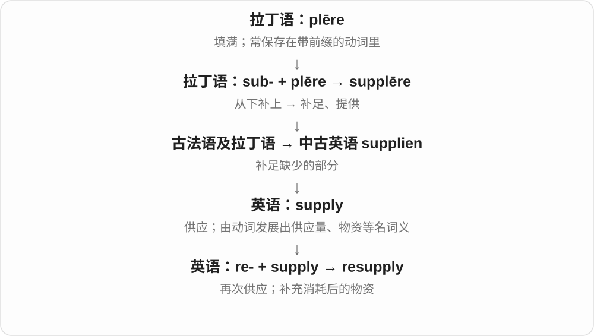

常见于远行、基地和运输语境。resupply the camp with food 是给营地补食品；a resupply mission 是补给任务。

**常见搭配与例句**

resupply a camp；a resupply mission；a resupply ship。

> A small boat arrived to resupply the island station with food.

一艘小船到来，给岛上的站点补充食品。

> The team planned a resupply halfway through the expedition.

团队计划在探险中途进行一次补给。

**别混淆**

replenish 更突出把存量补回来；resupply 常突出向某人、某地再次供应。

### 12. oversupply — 供应过多；供给过剩；过量供应

**音标**：英 /ˌəʊvəsəˈplaɪ/；美 /ˌoʊvərsəˈplaɪ/

**先抓住这个画面**

需要十箱，却运来了二十箱：不只是东西多，而是超过了所需的量。

**怎么拆**

over-“过度” + supply；英语名词与动词构词，名词记录较早。

**怎么变成今天的意思**

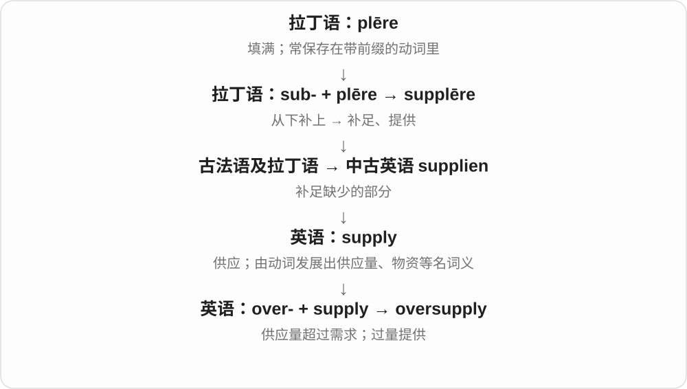

an oversupply of goods 是供过于求；be oversupplied with 是被提供了过多东西。过剩是相对需求而言，不等于这些东西永远没用。

**常见搭配与例句**

an oversupply of housing；oversupply the market；be oversupplied with…。

> An oversupply of tickets forced the organizers to lower the price.

门票供过于求，迫使主办方降价。

> The warehouse was oversupplied with boxes of the wrong size.

仓库里供应了过多尺寸不对的箱子。

**别混淆**

abundance 是丰富，可是好事；oversupply 明确带有超过需求、配置过量的意思。

### 13. undersupply — 供应不足；提供得不够

**音标**：英 /ˌʌndəsəˈplaɪ/

**先抓住这个画面**

每个人都需要一份，送来的却只够一半：问题在于供来的量跟不上需要。

**怎么拆**

under-“不足” + supply；可作名词与动词。

**怎么变成今天的意思**

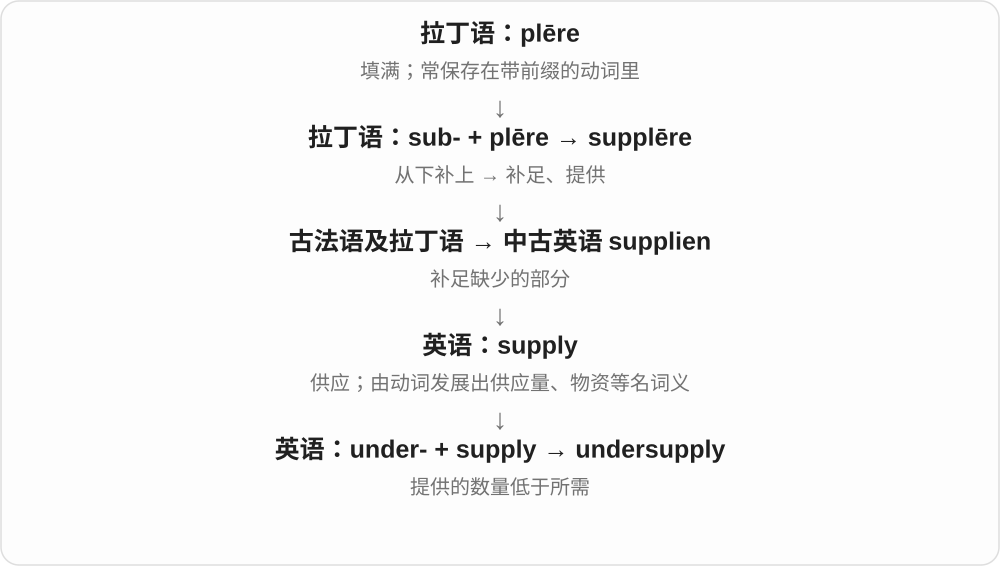

an undersupply of homes 是住房供应不足。与 oversupply 相对，常用于资源配置、市场供给分析。

**常见搭配与例句**

an undersupply of housing；undersupply an area；chronic undersupply。

> The town faces an undersupply of affordable homes.

这个镇面临可负担住房供应不足的问题。

> The planning error left several villages undersupplied with drinking water.

规划失误使几个村庄的饮用水供应不足。

**别混淆**

shortage 可以有多种原因；undersupply 特别把注意力放在提供得不够这一面。

### 14. implement — 实施；执行；工具、器具〔名词〕

**音标**：动词：英 /ˈɪmplɪment/，美 /ˈɪmpləment/；名词：英 /ˈɪmplɪmənt/，美 /ˈɪmpləmənt/

**先抓住这个画面**

计划写在纸上还不算：把它真正做起来，是 implement。作名词时，指干活所用的一件器具。

**怎么拆**

拉丁语 in-“入” + plēre“填满” → implēre → implēmentum“补足、履行”，先借入英语作名词。工具义与后来“履行、实施”的动词义是相关支线，不宜编成“先用工具，再执行”的必然历史。

**怎么变成今天的意思**

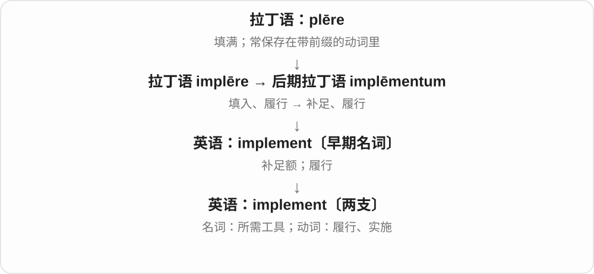

早期英语名词可指补足款项、履行；工具是做事所需的装备，动词则突出让要求落实。implement a policy 是实施政策；an agricultural implement 是农具。

**常见搭配与例句**

implement a plan；implement changes；agricultural implements。

> The school will implement the new timetable next term.

学校将在下学期实行新的课表。

> The museum displays wooden farming implements.

博物馆展示着木制农具。

**别混淆**

design a system 是设计系统；implement it 是把方案实现出来。announce a policy 也不等于 implement it。

### 15. implementation — 实施；落实；实现方案〔尤其软件〕

**音标**：英 /ˌɪmplɪmenˈteɪʃən/；美 /ˌɪmpləmenˈteɪʃən/

**先抓住这个画面**

从“我们准备这样做”走到“实际按这个办法运行”的整段工作。

**怎么拆**

implement〔动词〕 + -ation；英语派生。

**怎么变成今天的意思**

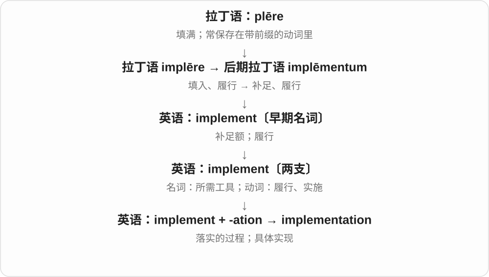

政策 implementation 可能包括培训、安排与检查；软件 an implementation 可以是按照某个思路写出的一套具体程序。同一算法能有多种实现。

**常见搭配与例句**

policy implementation；successful implementation；an implementation of an algorithm。

> The policy is simple, but its implementation will require careful training.

政策本身很简单，落实时却需要细致的培训。

> This implementation uses less memory than the earlier version.

这个实现方案比早先版本占用的内存更少。

**别混淆**

planning 是制定做法；implementation 是把做法落实。implementation 不自动意味着效果成功。

### 16. implementer — 实施者；执行机构；实现某方案的人

**音标**：英 /ˈɪmplɪmentə/；美 /ˈɪmpləmentər/

**先抓住这个画面**

有人提出方案，还有人负责把它真正装上、推开、运行起来，后者就是 implementer。

**怎么拆**

implement〔动词〕 + -er；也可拼作 implementor，核心意思相同。

**怎么变成今天的意思**

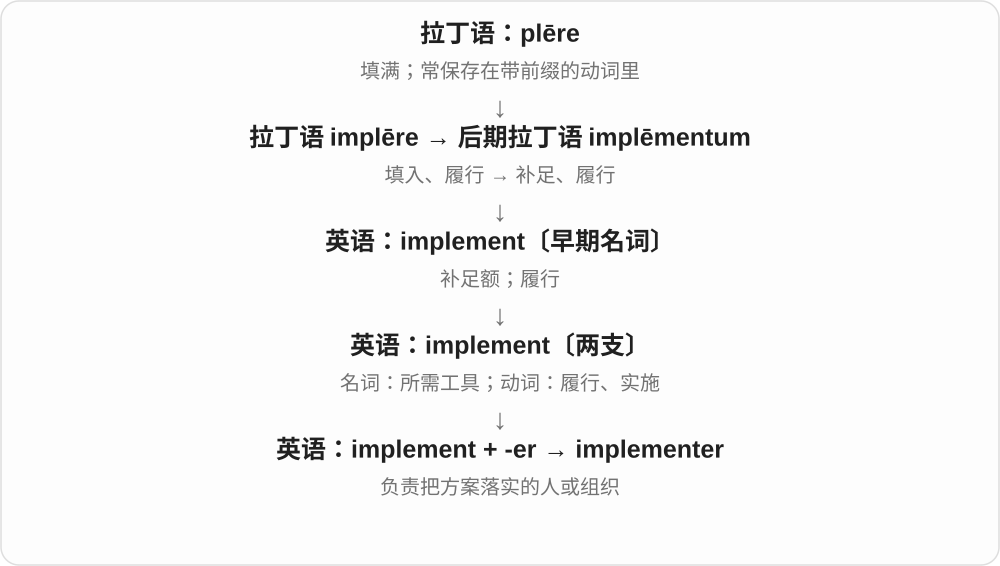

常用于项目、政策、技术工作，可以是一位工程师，也可以是承担执行工作的机构。并不暗示这个人没有参与设计。

**常见搭配与例句**

a policy implementer；the main implementer；software implementers。

> The implementers tested the plan in three schools before expanding it.

执行人员先在三所学校测试了方案，再扩大实施范围。

> The document gives implementers a clear description of the required behaviour.

文档向实现人员清楚说明了必须达到的功能表现。

**别混淆**

designer 突出设计；implementer 突出实现和执行，同一个人可以兼任。

### 17. comply — 遵守；按要求做；服从

**音标**：英、美 /kəmˈplaɪ/

**先抓住这个画面**

别人给了一条要求，你照着做到位：不只是点头，而是行动符合要求。

**怎么拆**

最终联系拉丁语 complēre“完成、履行”；中间可联系古法语 compli / complir，也有意大利语等罗曼语影响的解释。现代“遵从”义的发展不能凭拼写硬拆成 com- + ply“弯”。

**怎么变成今天的意思**

常用 comply with a rule / request。它是不及物动词，通常不能直接说 comply the rule。历史上的“履行”可以帮助理解今天的“把要求做到”。

**常见搭配与例句**

comply with regulations；comply with a request；refuse to comply。

> All entries must comply with the competition rules.

所有参赛作品都必须符合比赛规则。

> He was asked to lower his voice and immediately complied.

别人请他放低声音，他立刻照做了。

**别混淆**

agree 是同意；comply 是照办。心里不同意，也可能为了满足要求而 comply。

### 18. compliance — 遵从；合规；顺从；顺应性〔技术〕

**音标**：英、美 /kəmˈplaɪəns/

**先抓住这个画面**

把“有没有照着要求做”作为一种状态来看；在工作中，常指流程和行为符合规定。

**怎么拆**

comply + -ance；英语派生。

**怎么变成今天的意思**

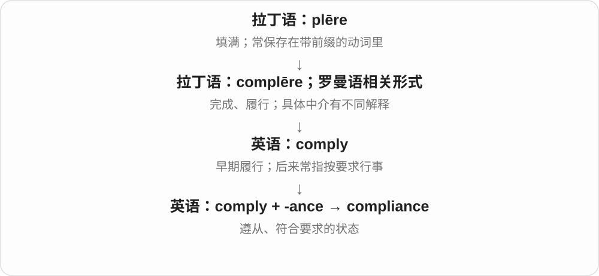

in compliance with 是按照、符合；a compliance check 是合规检查。工程等领域也用 compliance 表示受力时容易变形的程度，这不是说材料在心理上服从。

**常见搭配与例句**

in compliance with；ensure compliance；a compliance check。

> The team checked the design for compliance with the new standard.

团队检查了设计是否符合新标准。

> Her quiet compliance surprised everyone who had expected an argument.

她安静地照做了，这让原本以为会有争论的人都很意外。

**别混淆**

obedience 偏服从某人；compliance 也可以说设备、流程符合标准，不只用于人。

### 19. noncompliance — 不遵守；不符合要求

**音标**：英 /ˌnɒnkəmˈplaɪəns/；美 /ˌnɑːnkəmˈplaɪəns/

**先抓住这个画面**

要求已经在那里，实际行为或材料却没有达到它。

**怎么拆**

non-“不” + compliance；可连写，也常见带连字符拼法，此处收连写形式。

**怎么变成今天的意思**

noncompliance with the rules 可以是故意不照办，也可能是理解错误或遗漏。词本身没有自动判定动机。

**常见搭配与例句**

noncompliance with rules；instances of noncompliance；report noncompliance。

> The review found three instances of noncompliance with the reporting rules.

审查发现了三处不符合报告规则的情况。

> Noncompliance may result from misunderstanding rather than deliberate refusal.

不遵守要求可能源于误解，而非故意拒绝。

**别混淆**

defiance 突出公然反抗；noncompliance 只说没满足要求，不一定有反抗态度。

### 20. compliment — 赞美；称赞；礼貌的致意〔compliments〕

**音标**：名词：英 /ˈkɒmplɪmənt/，美 /ˈkɑːmplɪmənt/；动词：英 /ˈkɒmplɪment/，美 /ˈkɑːmplɪment/

**先抓住这个画面**

把对方的一个优点说出来，让对方知道你看到了：“这件事你做得真好。”

**怎么拆**

与 complēre“完成、履行”同族。罗曼语里的“履行礼节”发展成礼貌话；名词经法语 compliment 借入，更早联系意大利语 complimento，也有西班牙语影响的解释。动词经法语 complimenter。

**怎么变成今天的意思**

compliment someone on something 是就某事称赞人；pay someone a compliment 是给一句赞美。with our compliments 常表示奉送、敬赠，并不是要求你回夸。

**常见搭配与例句**

compliment someone on；pay a compliment；take it as a compliment。

> She complimented him on the clear presentation.

她称赞他的讲解很清楚。

> I took her question as a compliment to my work.

我把她的问题看作对自己工作的肯定。

**别混淆**

praise 可以正式表扬成就；compliment 常是一句针对优点的赞美。complaint“抱怨”来自另一个词族。

### 21. complimentary — 赞美的；免费赠送的

**音标**：英 /ˌkɒmplɪˈmentəri/；美 /ˌkɑːmplɪˈmentəri/

**先抓住这个画面**

要么是送上一句好话，要么是送上一份礼遇；两种都保留了友好致意的感觉。

**怎么拆**

compliment〔名词〕 + -ary；“敬赠”这层礼节义连到“免费提供”。

**怎么变成今天的意思**

a complimentary remark 是赞美话；complimentary breakfast 是免费早餐。后者不是“称赞早餐”，也不是 complementary“互补的早餐”。

**常见搭配与例句**

complimentary about someone；complimentary tickets；complimentary breakfast。

> The reviewer was complimentary about the young actor’s performance.

评论者对这位年轻演员的表演赞赏有加。

> The hotel offers complimentary tea in the lobby.

酒店在大堂提供免费茶水。

**别混淆**

free 只说明不收费；complimentary 常带商家或主办方作为礼遇赠送的意味。

### 22. compliant — 符合规定的；顺从的；易变形的〔技术〕

**音标**：英、美 /kəmˈplaɪənt/

**先抓住这个画面**

对要求能配合、对标准能达到。用在人身上可以是听话；用在产品上就是合乎规定。

**怎么拆**

comply + -ant，形成形容词。

**怎么变成今天的意思**

compliant with a standard 是符合标准。形容人时，有时带“太容易顺从”的评价；描述材料时还可指受力后较易变形。

**常见搭配与例句**

compliant with standards；a compliant child；a compliant material。

> The new equipment is compliant with the published safety standard.

新设备符合公布的安全标准。

> She was cooperative without being blindly compliant.

她愿意配合，但不会盲目顺从。

**别混淆**

compatible 是能相容、能一起使用；compliant 是满足某项要求。能兼容不等于已经合规。

### 23. noncompliant — 不符合要求的；未遵守的

**音标**：英 /ˌnɒnkəmˈplaɪənt/；美 /ˌnɑːnkəmˈplaɪənt/

**先抓住这个画面**

拿标准一对，发现有一项或几项没有达标。

**怎么拆**

non- + compliant；是符合要求与否的否定构词。

**怎么变成今天的意思**

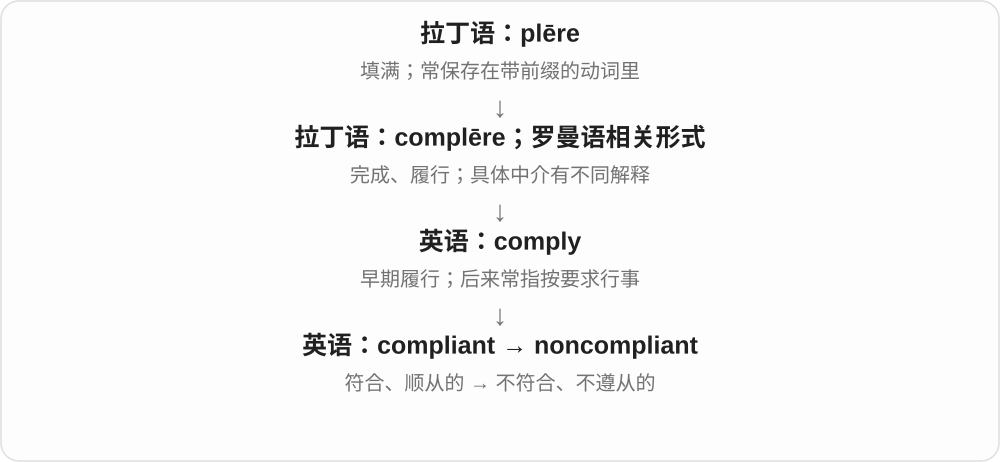

常形容设备、文件或做法。用来形容人时，最好说明对什么要求未遵从，不要把一次行为写成整个人的固定性格。

**常见搭配与例句**

noncompliant with requirements；noncompliant equipment；a noncompliant application。

> The application was returned because it was noncompliant with the formatting rules.

申请因格式不合规定而被退回。

> The team replaced the noncompliant equipment before the inspection.

团队在检查前更换了不符合要求的设备。

**别混淆**

noncompliant 说未达某标准；defective 说有缺陷。产品可能运转正常，却不符合指定格式。

### 24. accomplish — 完成；实现；办成

**音标**：英 /əˈkʌmplɪʃ/；美 /əˈkɑːmplɪʃ/

**先抓住这个画面**

不只是忙过一阵子，而是真的把想办的事办成了。

**怎么拆**

经古法语 acomplir 的扩展词干 acompliss- 借入，前身是联系拉丁语 complēre 的罗曼语构词。-ish 延续古法语词干变化，不是现代表示“有点儿”的后缀。

**怎么变成今天的意思**

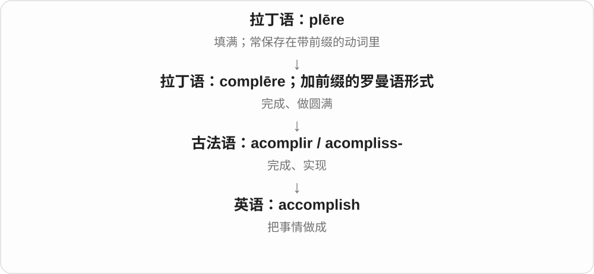

accomplish a task 是完成任务；accomplish a goal 是实现目标；accomplish nothing 是折腾一场却没办成事。通常接事情或目标，不接 to do。

**常见搭配与例句**

accomplish a task；accomplish a goal；accomplish a great deal。

> We accomplished more in one morning than we expected.

一个上午我们办成的事情比预想的还多。

> Arguing about blame will accomplish nothing.

争论该怪谁不会解决任何事情。

**别混淆**

finish 可只是活动结束；accomplish 更突出取得预期结果，常带努力后的完成感。

### 25. accomplished — 技艺精湛的；有造诣的；完成了的

**音标**：英 /əˈkʌmplɪʃt/；美 /əˈkɑːmplɪʃt/

**先抓住这个画面**

一个人经过训练，已经能把一门技艺做得很成熟，不再只是会一点。

**怎么拆**

accomplish + -ed；既是过去分词，也发展为形容词。历史上 accomplish 还有通过教育使人完善、熟练的用法。

**怎么变成今天的意思**

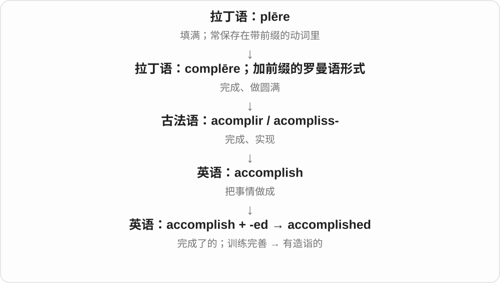

an accomplished pianist 是熟练出色的钢琴家；mission accomplished 是任务完成。人物形容词不表示这个人的人生已经结束。

**常见搭配与例句**

an accomplished musician；an accomplished writer；mission accomplished。

> She is an accomplished violinist as well as a careful teacher.

她既是技艺精湛的小提琴家，也是一位细心的老师。

> With the repairs finished, he could finally say, “Mission accomplished.”

维修结束后，他终于可以说：“任务完成。”

**别混淆**

talented 强调有天分；accomplished 强调已经展现出成熟的技艺。

### 26. accomplishment — 成就；完成；娴熟技能〔常用复数〕

**音标**：英 /əˈkʌmplɪʃmənt/；美 /əˈkɑːmplɪʃmənt/

**先抓住这个画面**

回头看见一件真的做成的事，心里有“我办到了”的实在感。

**怎么拆**

accomplish + -ment；英语词源也联系法语 accomplissement，不能排除借入或法语影响。

**怎么变成今天的意思**

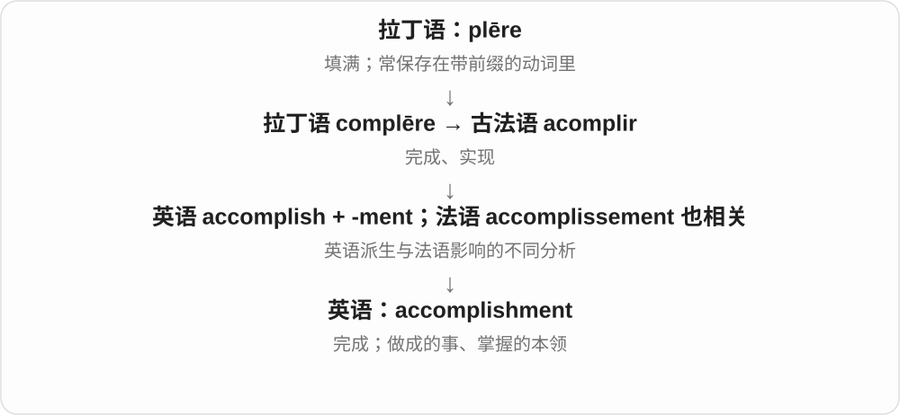

a sense of accomplishment 是完成后很踏实的成就感；a major accomplishment 是一项重要成果。旧式或正式语境 accomplishments 也指音乐、语言等练成的技能。

**常见搭配与例句**

a sense of accomplishment；a remarkable accomplishment；the accomplishment of a task。

> Finishing the first chapter gave her a sense of accomplishment.

写完第一章让她很有成就感。

> Restoring the damaged archive was a remarkable accomplishment.

修复受损档案是一项了不起的成就。

**别混淆**

achievement 与它常重叠；accomplishment 很适合谈做成某事后的满足感，也可指修习的才艺。

### 27. supplement — 补充物；增刊；补助；补充；另付的费用

**音标**：名词：英 /ˈsʌplɪmənt/，美 /ˈsʌpləmənt/；动词：英 /ˈsʌplɪment/，美 /ˈsʌpləment/

**先抓住这个画面**

主体已经在那里，再加一部分，让信息、收入或供应更够用。

**怎么拆**

拉丁语 supplēmentum“补上不足的东西”来自 supplēre；先作名词借入，英语后来用作动词。

**怎么变成今天的意思**

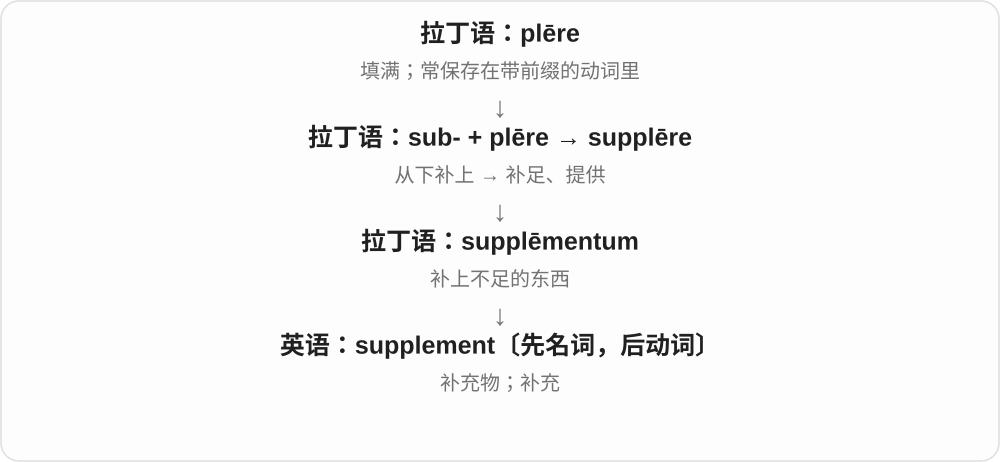

a supplement to a report 是报告补充材料；supplement your income 是增加一笔收入。饮食中的 supplement 指补充剂。旅馆等场景 a supplement 还可能是额外收费，具体看说明。

**常见搭配与例句**

supplement an income；a supplement to the report；a newspaper supplement。

> She supplements her income by teaching on Saturdays.

她通过周六授课增加收入。

> The book comes with a short supplement containing updated maps.

这本书附有一份简短的补充册，收录了更新的地图。

> A sea view is available for a small supplement.

付一小笔额外费用即可入住海景房。

**别混淆**

complement 侧重相配、合成完整整体；supplement 侧重额外补上一部分。两者有重叠，不能机械等同。

### 28. supplemental — 补充的；额外提供的

**音标**：英 /ˌsʌplɪˈmentəl/；美 /ˌsʌpləˈmentəl/

**先抓住这个画面**

主件之外再添一份，用来补不足或应付新增需要。

**怎么拆**

supplement + -al；英语派生。

**怎么变成今天的意思**

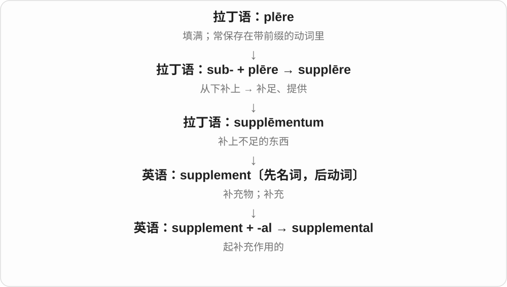

常见 supplemental funding、supplemental materials。与 supplementary 大量重叠，尤其在美式行政、教育语境常见，不能划出“一个必需、一个非必需”的硬界线。

**常见搭配与例句**

supplemental funding；supplemental materials；supplemental information。

> The project received supplemental funding for the final tests.

项目获得了一笔补充经费用于最后的测试。

> Supplemental reading materials are available online.

补充阅读材料可在网上获取。

**别混淆**

additional 只说另外加的；supplemental 更说明加来的东西为原有部分作补充。

### 29. supplementary — 补充的；附加的；互补的〔两角和为180°〕

**音标**：英 /ˌsʌplɪˈmentəri/；美 /ˌsʌpləˈmentəri/

**先抓住这个画面**

正文说完了，再给一张表或一段说明，把需要的内容补上。

**怎么拆**

supplement + -ary；与法语 supplémentaire 对应。

**怎么变成今天的意思**

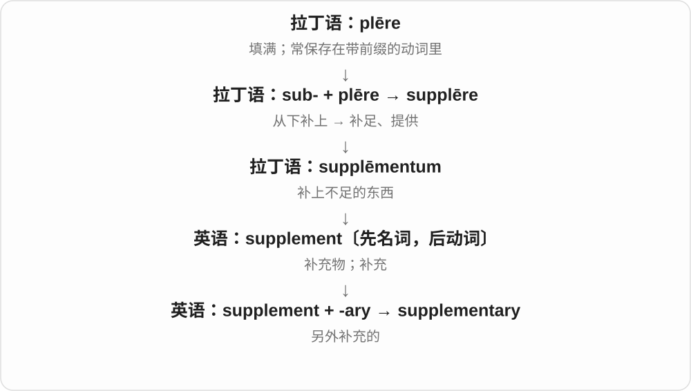

supplementary information 是补充信息。几何中 supplementary angles 的和为 180°，补成平角；与和为 90° 的 complementary angles 分开记。

**常见搭配与例句**

supplementary information；supplementary questions；supplementary angles。

> Please attach any supplementary information to your application.

请在申请中附上其他补充信息。

> Angles of seventy and one hundred ten degrees are supplementary.

七十度角和一百一十度角互为补角。

**别混淆**

supplemental 与 supplementary 通常近义；数学角度术语固定用 supplementary。

### 30. supplementation — 补充；增补的过程

**音标**：英 /ˌsʌplɪmenˈteɪʃən/；美 /ˌsʌpləmenˈteɪʃən/

**先抓住这个画面**

持续把缺的那一部分加进去，而不是另换一整套。

**怎么拆**

supplement〔动词〕 + -ation。

**怎么变成今天的意思**

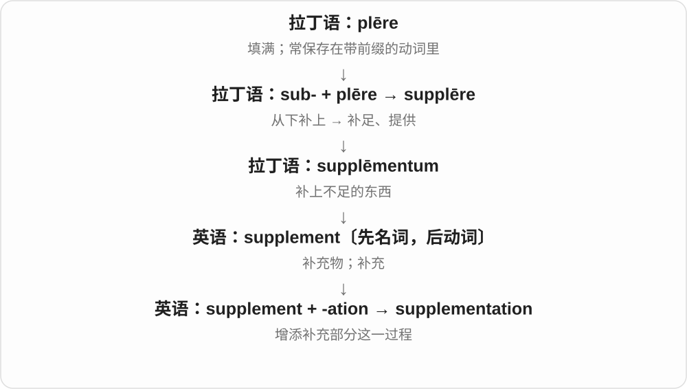

词较正式，营养研究中常见；也可谈数据、饲料等方面的补充。它只描述增加什么，不表示增加了就一定有益。

**常见搭配与例句**

dietary supplementation；supplementation with additional data。

> The report examines dietary supplementation among older adults.

报告考察了老年人使用膳食补充品的情况。

> Supplementation of the survey data with interviews revealed new concerns.

在问卷数据之外补入访谈材料，揭示了新的问题。

**别混淆**

supplement 是补充物或补充动作；supplementation 把补充作为过程来谈。

### 31. complement — 互补物；所需全数；补足、相配；补语〔语法〕

**音标**：名词：英 /ˈkɒmplɪmənt/，美 /ˈkɑːmplɪmənt/；动词：英 /ˈkɒmplɪment/，美 /ˈkɑːmplɪment/

**先抓住这个画面**

两样东西放在一起，恰好补上彼此欠的部分；像清爽的配菜让一顿浓重的饭更合适。

**怎么拆**

拉丁语 complēmentum 来自 complēre“补满”；经法语及拉丁语借入。英语动词来自名词；它不是 complete + ment 的简单拼写。

**怎么变成今天的意思**

complement a dish 是与菜相配；a full complement of staff 是所需人员全部到齐。语法中 complement 为句子补足所需内容，如 She is happy 里的 happy。集合的 complement 是给定全集中没有落入原集合的部分。

**常见搭配与例句**

complement each other；a complement to；a full complement of…。

> Her practical experience complements his theoretical knowledge.

她的实践经验与他的理论知识相互补充。

> The ship sailed with a full complement of crew.

这艘船在船员配齐后启航了。

**别混淆**

compliment 是称赞；complement 是补足或相配。两者同族，却不能因读音接近就混写。

### 32. complementary — 互补的；相配的；互余的〔角〕

**音标**：英 /ˌkɒmplɪˈmentəri/；美 /ˌkɑːmplɪˈmentəri/

**先抓住这个画面**

各有长处，凑到一起正好：一个会设计，一个善于把东西做出来。

**怎么拆**

complement + -ary；形容双方能补足彼此。

**怎么变成今天的意思**

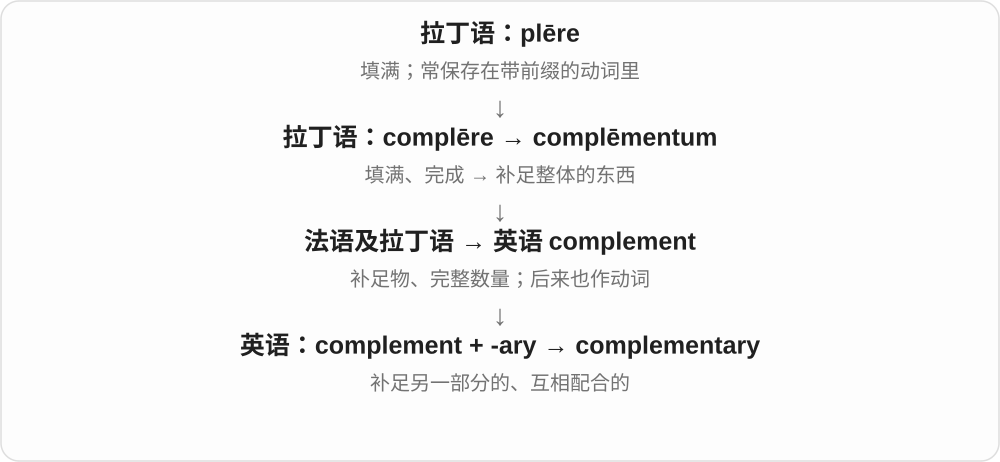

complementary skills 是互补技能，不必长得相像。几何中 complementary angles 两角之和为 90°，好像补成一个直角。

**常见搭配与例句**

complementary skills；complementary roles；complementary angles。

> The two researchers bring complementary skills to the project.

两位研究者为项目带来了互补的技能。

> A thirty-degree angle and a sixty-degree angle are complementary.

三十度角和六十度角互为余角。

**别混淆**

complimentary 可指称赞或免费赠送；complementary 强调互补。supplementary angles 合为 180°。

### 33. complementarity — 互补性；互相补足的关系

**音标**：英 /ˌkɒmplɪmenˈtærəti/；美 /ˌkɑːmplɪmenˈtærəti/

**先抓住这个画面**

把“两者搭在一起刚刚好”当作一种关系来研究，而不是只看各自有多强。

**怎么拆**

complementary + -ity；词尾 -ary 对应 -arity，表示互补这一性质。

**怎么变成今天的意思**

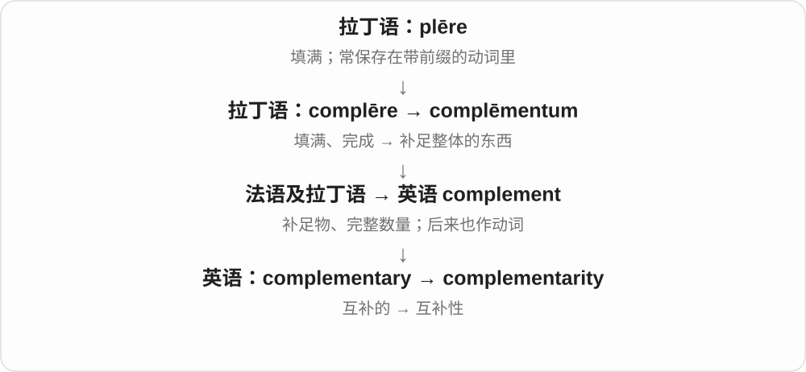

可以讨论技能、方法或资源的互补性。词较正式，常用于分析；具体领域还可能有更严格定义。

**常见搭配与例句**

complementarity between methods；the complementarity of skills。

> The team’s strength lies in the complementarity of its members’ skills.

团队的优势在于成员技能彼此互补。

> The study explores complementarity between interviews and survey data.

研究探讨访谈与问卷数据之间的互补性。

**别混淆**

similarity 是相像；complementarity 可能恰恰来自差异，因为差异让双方补上所缺。

### 34. deplete — 大量消耗；使减少、趋于耗尽

**音标**：英、美 /dɪˈpliːt/

**先抓住这个画面**

原来有一桶储备，舀出去的比补进来的多，水位越来越低。

**怎么拆**

最终来自拉丁语 dēplēre“排空”：de- 在这里反转“填满”。英语动词有从 depletion 反构的分析，也有直接联系拉丁语 dēplēt- 的解释，不能把名词一律放在动词之后。

**怎么变成今天的意思**

deplete resources 可以还没有用光，只是明显变少。常见被动 depleted supplies“已经消耗了很多的物资”。最早的医学背景后来扩展到资源、钱、体力等。

**常见搭配与例句**

deplete reserves；deplete resources；severely depleted。

> Several expensive repairs depleted our savings.

几次昂贵的维修花掉了我们大部分积蓄。

> The long hike had depleted the group’s energy.

长途徒步消耗了队伍的大量体力。

**别混淆**

exhaust 强调用尽；deplete 常指大量消耗，并不每次都剩零。

### 35. depletion — 大量消耗；损耗；储量下降

**音标**：英、美 /dɪˈpliːʃən/

**先抓住这个画面**

从仓库原来满满，到剩下不多，这个不断变少的过程。

**怎么拆**

来自后期拉丁语 dēplētiō，基于 dēplēre。英语名词早于现代 deplete 动词的常见记录，不能按现代词形倒写历史。

**怎么变成今天的意思**

常用于报告中的 water depletion、resource depletion。词本身表示减少过程，不能据此判断是否已经耗光。

**常见搭配与例句**

resource depletion；the depletion of reserves；rapid depletion。

> The report tracks the depletion of the region’s water reserves.

报告追踪了该地区水资源储量的下降。

> Repeated withdrawals led to a rapid depletion of the fund.

接连取款使这笔资金迅速减少。

**别混淆**

shortage 是不够用的状态；depletion 是存量被消耗、降低的过程，可能导致 shortage。

### 36. replete — 充满的；丰富具备的；吃饱的〔正式〕

**音标**：英、美 /rɪˈpliːt/

**先抓住这个画面**

往里看，到处都是这种东西：一本书满是细节，一个故事满是反转。

**怎么拆**

拉丁语 replētus 来自 replēre，经古法语或直接借入。re- 在这里可能加强“填满”，不能强行把所有 replete 都译成“重新装满”。

**怎么变成今天的意思**

常用 replete with。内容可以是优点也可以是错误；replete with errors 是满篇错误。饭后说 replete 是书面或略带幽默的“吃得很饱”。

**常见搭配与例句**

replete with details；replete with errors；feel replete。

> The diary is replete with vivid descriptions of village life.

日记里满是对乡村生活的生动描写。

> After the long lunch, we sat by the window, pleasantly replete.

吃过这顿悠长的午餐，我们饱足惬意地坐在窗边。

**别混淆**

complete 表示组成齐全；replete 表示充满某物，不保证整体无缺。

### 37. repletion — 充满；饱足；过饱〔正式〕

**音标**：英、美 /rɪˈpliːʃən/

**先抓住这个画面**

装满或吃饱之后的状态，尤其容易让人想到饭后“再也吃不下了”。

**怎么拆**

后期拉丁语 replētiō 来自 replēre，经法语及拉丁语借入；不是英语 replete 后来才加出来的唯一历史。

**怎么变成今天的意思**

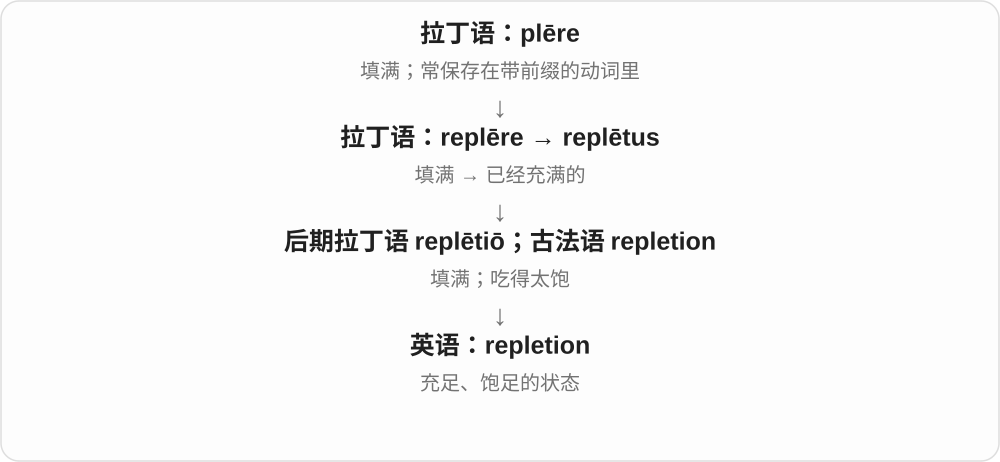

常见 eat to repletion，吃得很饱。医学文献也可用来表示把缺少的东西补足；日常谈食物更常用 fullness 或 feeling full。

**常见搭配与例句**

eat to repletion；a feeling of repletion。

> The guests ate to repletion and lingered over their tea.

客人们吃得很饱，慢慢喝着茶不急着走。

> The novel describes the quiet repletion that follows a generous meal.

小说描写了丰盛一餐之后安静满足的饱足感。

**别混淆**

replenishment 更常指补库存、补给的动作；repletion 往往着眼于补满、饱足这个状态。

### 38. expletive — 咒骂语；脏话；填补句法位置的成分〔语法〕

**音标**：英 /ɪkˈspliːtɪv/；美 /ˈeksplətɪv/

**先抓住这个画面**

日常听见它，多半是在说一句突然蹦出的骂人话；语法书里，它却可能只是把句子所需的位置占上。

**怎么拆**

拉丁语 ex-“出、充分” + plēre → explēre“填满”，形成 explētīvus“起填充作用的”；经法语及拉丁语进入英语。填充句子、诗行的旧义后来又用于感叹、咒骂。

**怎么变成今天的意思**

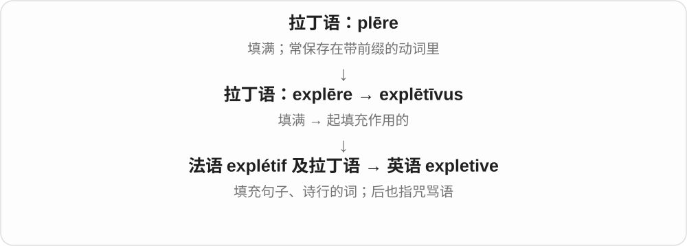

an expletive deleted 常是文字记录里表示脏话被删的标记。语法里的 expletive it，如 It is raining 的 it，不指某个具体东西，也绝不是脏话。

**常见搭配与例句**

utter an expletive；a string of expletives；expletive it。

> He muttered an expletive when the screen went blank.

屏幕突然黑掉时，他低声骂了一句。

> In “It is raining,” it is often described as an expletive subject.

在 It is raining 中，it 常被称为虚主语。

**别混淆**

insult 是侮辱内容；expletive 可只是愤怒时的一句咒骂，未必针对某个人。语法义需另看语境。

### 39. compleat — 完整的；全面精通的〔旧式或刻意仿古用法〕

**音标**：英、美 /kəmˈpliːt/

**先抓住这个画面**

像老书封面上郑重写着“全书”“通才”：带一点古风，强调样样通、样样全。

**怎么拆**

complete 的历史拼写变体；不是 com- + pleat“褶皱”。现代常刻意保留在书名或有文艺色彩的表达中。

**怎么变成今天的意思**

读音和 complete 一样。普通邮件或作业里用 complete；compleat 常让人想到某领域知识、技艺俱全的人。

**常见搭配与例句**

a compleat musician；the compleat guide。

> The review described her as a compleat musician, equally at home composing and performing.

评论称她是一位全能音乐家，作曲与演奏都得心应手。

> The old handbook used “compleat” on its title page.

那本旧手册的扉页使用了 compleat 这个旧拼法。

**别混淆**

complete 是日常标准写法；compleat 带古旧或刻意修辞色彩，不是新的程度等级。

### 40. compline — 寝前祷；终祷〔基督教礼仪〕

**音标**：英 /ˈkɒmplɪn/，也读 /ˈkɒmplaɪn/；美 /ˈkɑːmplən/

**先抓住这个画面**

一天的礼仪走到最后，以一段夜间祷告收尾，像给这一天画上句点。

**怎么拆**

来自古法语 complie，更早是中世纪拉丁语 completa〔hora〕，联系 complētus“完成的”；英语词中的 n 是后来出现的，不是另一个根。

**怎么变成今天的意思**

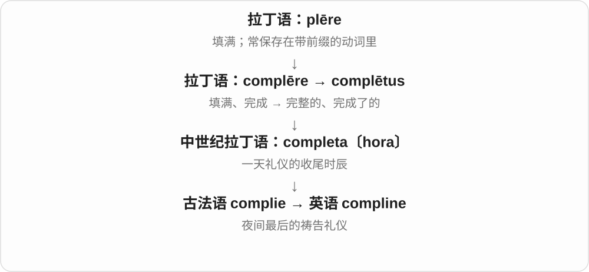

常见于教会礼仪与历史文章，可写作 Compline。它是特定的夜间礼仪名称，不能把每种 evening prayer 都自动叫 compline。

**常见搭配与例句**

say compline；attend compline；a service of Compline。

> The community gathered in the chapel for compline.

众人聚集在小教堂里参加终祷。

> A short silence followed the final prayer of Compline.

终祷的最后一段祷词之后，大家静默了片刻。

**别混淆**

vespers 通常指晚祷；compline 是终祷，传统上更接近就寝前的一次收尾礼仪。

### 41. suppletive — 异干互补的；由另一词干补位的

**音标**：美 /səˈpliːtɪv/，也读 /ˈsʌplɪtɪv/

**先抓住这个画面**

给 went 这类“换了词根来顶班”的形式贴上标签：它是 suppletive。

**怎么拆**

来自中世纪拉丁语 supplētīvus，与 supplēre 的分词词干 supplēt- 相连；现代与 suppletion 配套，但不宜只讲成英语名词随手换后缀。

**怎么变成今天的意思**

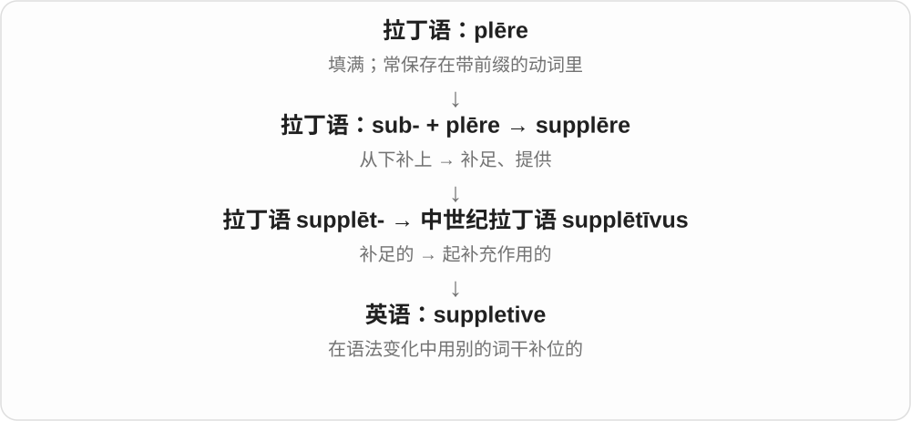

a suppletive past tense 是用不同词根补出的过去式。学习时看词的历史关联，不只看两个词形外表差得有多远。

**常见搭配与例句**

a suppletive form；a suppletive past tense；a suppletive paradigm。

> Went is the suppletive past tense of go.

went 是 go 的异干过去式。

> The lesson compares regular verb forms with suppletive forms.

这节课把规则动词形式与异干互补形式作了比较。

**别混淆**

supplementary 是一般的附加、补充；suppletive 常是语言学里更专门的“异干补位”。

### 42. suppletion — 异干互补；用另一词根补足屈折变化〔语言学〕

**音标**：英、美 /səˈpliːʃən/

**先抓住这个画面**

一个词自己缺某个变化形式，就借另一个词族的形式来顶班：go 的过去式没有按常规长出来，而由 went 接上。

**怎么拆**

中古英语已有 supplecioun“补充、补偿”，借自盎格鲁法语及中世纪拉丁语，更早可追到后期拉丁语 supplētiō；现代语言学专义也联系德语相关术语。根本画面仍是 supplēre“补足”，不是 supply 直接拼上 -tion。

**怎么变成今天的意思**

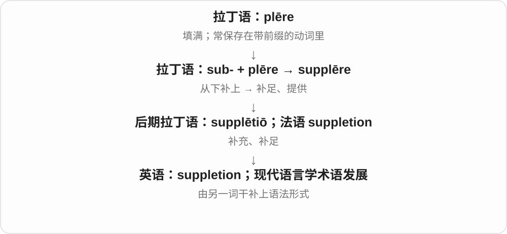

go 与 went、good 与 better 是典型例子；went 原是 wend 的过去式。不是所有不规则变化都叫 suppletion：sing、sang 的元音变化仍在同一个历史词族里。

**常见搭配与例句**

an example of suppletion；suppletion in a verb paradigm。

> The pair go and went illustrates suppletion.

go 与 went 这一对体现了异干互补。

> The teacher used good and better to explain suppletion.

老师用 good 与 better 来解释异干互补。

**别混淆**

irregular 只说不遵循常规形式；suppletion 特指用另一词根的形式补位，范围更窄。

## 这一组要分清什么

complement 是补足、相配；compliment 是赞美，它们同源而分工不同。complaint“抱怨”来自 plangere“捶击、哀叹”的另一族。supple“柔软”和 suppliant“恳求的”也不是“填满”词族。complete 不等于 perfect，deplete 也不保证已经耗到零。

## 串起来练习

用一个项目串起来：complete the form 是填好表；supply the materials 是供材料；implement the plan 是实行计划；comply with the rules 是按规则做；accomplish the goal 是最终把目标实现。不要只译成五个抽象汉语词，要想各自到底做了哪一步。
