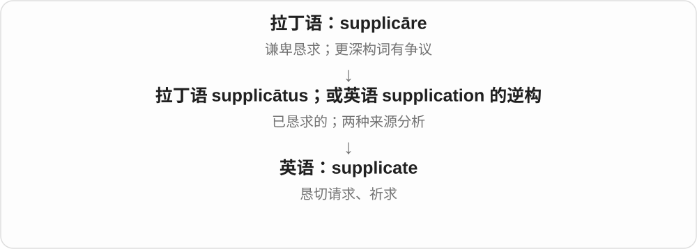

# 0239 · plic- — 折叠、弯折；贴合、卷入、展开和多重

[逐词精讲目录](../00_逐词精讲目录.md) · [总目录](../00_总目录_按常用程度.md)

## 核心词根与来源

拉丁语 plicare 是折叠，过去分词和相关词干有 plicat-、plic- 等形态。经法语，它有时变成 ply、ploy、plai- 等较难认的样子。apply、reply、employ、display 并不是含有无意义的字母巧合。plight 的困境义却还混合了古英语危险义，誓约义更是另一条日耳曼语路线，要分别看。

**一张纸折过去，会贴到另一面；卷起来，会把东西包在里面；展开，又把藏住的内容露出来。这几种动作串起 apply、imply、explicit。**

想象把纸贴到桌面、把纸条卷进折层、再把整张纸摊开。另把纸折成两层、三层，便能记住 duplicate 与 triplicate 的倍数支线。

- **贴到某处、把力量用上去**：apply, application, applicant, applicable, applicability, appliance, applicator, reapply, inapplicable
- **回应、折回、复制**：reply, replica, replicate, replication, replicator, replicative
- **卷在里面与直接展开**：imply, implicit, implicitly, implicate, implication, explicit, explicitly, explicate
- **缠在一起与共同参与**：complicate, complicated, complication, complicacy, complicity, complice
- **实际折褶、柔韧、张开**：ply, plait, pleat, pleated, pliable, pliant, splay, display
- **重复、倍数与纵向折合**：duplicate, duplication, reduplication, triplicate, triplicity, centuplicate, centuplication, conduplicate, conduplication, subduplicate
- **投入工作与雇用**：employ, employment, employee, employer, unemployed, unemployment
- **较旧和专业的施用词**：applicate, applicative, applicatory
- **祈求及同形分源对照**：supplicate, supplicant, supplication；plight

## 词形与演化规律

ad- 接 plicare 形成 applicare，in- 接它形成 implicare，ex- 接它形成 explicare，com- 接它形成 complicare。法语路径可产生 apply、imply、employ、ply；拉丁语较完整形式则保留在 implicate、explicate 等词中。-plex / -plic- 也用于双重、三重、百重的构词。

## 单词速览（常用到不常用）

| 单词 | 音标 | 核心意思 |
|---|---|---|
| [application](#w-1) | 英、美 /ˌæplɪˈkeɪʃən/ | 申请；应用；涂抹；应用程序；专心投入 |
| [apply](#w-2) | 英、美 /əˈplaɪ/ | 申请；应用；涂抹；适用；专心做 |
| [display](#w-3) | 英、美 /dɪˈspleɪ/ | 展示；显露；陈列；显示屏 |
| [employment](#w-4) | 英、美 /ɪmˈplɔɪmənt/ | 就业；受雇；使用 |
| [employee](#w-5) | 英、美 /ɪmˈplɔɪiː/，也读 /ˌemplɔɪˈiː/ | 雇员；员工 |
| [reply](#w-6) | 英、美 /rɪˈplaɪ/ | 回复；回答；答复 |
| [complicated](#w-7) | 英 /ˈkɒmplɪkeɪtɪd/；美 /ˈkɑːmplɪkeɪtɪd/ | 复杂的；关系难理清的 |
| [employer](#w-8) | 英 /ɪmˈplɔɪə/；美 /ɪmˈplɔɪər/ | 雇主；用人单位 |
| [unemployment](#w-9) | 英、美 /ˌʌnɪmˈplɔɪmənt/ | 失业；失业状况 |
| [applicable](#w-10) | 英、美 /əˈplɪkəbəl/，亦 /ˈæplɪkəbəl/ | 适用的；可以应用的 |
| [employ](#w-11) | 英、美 /ɪmˈplɔɪ/ | 雇用；运用 |
| [explicit](#w-12) | 英、美 /ɪkˈsplɪsɪt/ | 明确说出的；直白的；露骨的 |
| [explicitly](#w-13) | 英、美 /ɪkˈsplɪsɪtli/ | 明确地；直白地 |
| [unemployed](#w-14) | 英、美 /ˌʌnɪmˈplɔɪd/ | 失业的；未受雇的 |
| [imply](#w-15) | 英、美 /ɪmˈplaɪ/ | 暗示；意味着；蕴含 |
| [replica](#w-16) | 英、美 /ˈreplɪkə/ | 复制品；仿制品 |
| [applicant](#w-17) | 英、美 /ˈæplɪkənt/ | 申请人；求职者 |
| [duplicate](#w-18) | 英：名、形 /ˈdjuːplɪkət/，动 /ˈdjuːplɪkeɪt/；美：名、形 /ˈduːplɪkət/，动 /ˈduːplɪkeɪt/ | 副本；完全相同的；复制、重复 |
| [implication](#w-19) | 英、美 /ˌɪmplɪˈkeɪʃən/ | 暗示；可能的影响、后果；牵涉 |
| [replicate](#w-20) | 动词 /ˈreplɪkeɪt/；名词、形容词 /ˈreplɪkət/ | 复制；重复验证；重复样本 |
| [plight](#w-21) | 英、美 /plaɪt/ | 困境；郑重许诺〔旧式〕 |
| [implicit](#w-22) | 英、美 /ɪmˈplɪsɪt/ | 含蓄的；隐含的；完全的〔信任等〕 |
| [replication](#w-23) | 英、美 /ˌreplɪˈkeɪʃən/ | 复制；重复研究；重复实验 |
| [appliance](#w-24) | 英、美 /əˈplaɪəns/ | 家用电器；器具、装置 |
| [complication](#w-25) | 英 /ˌkɒmplɪˈkeɪʃən/；美 /ˌkɑːmplɪˈkeɪʃən/ | 复杂情况；麻烦；并发症 |
| [complicate](#w-26) | 英 /ˈkɒmplɪkeɪt/；美 /ˈkɑːmplɪkeɪt/ | 使复杂；使更难处理 |
| [implicitly](#w-27) | 英、美 /ɪmˈplɪsɪtli/ | 含蓄地；隐含地；毫无保留地 |
| [duplication](#w-28) | 英 /ˌdjuːplɪˈkeɪʃən/；美 /ˌduːplɪˈkeɪʃən/ | 复制；重复；重复劳动 |
| [ply](#w-29) | 英、美 /plaɪ/ | 层、股；经营、从事；不断提供；往返航行 |
| [complicity](#w-30) | 英、美 /kəmˈplɪsəti/ | 同谋；串通；参与不当行为 |
| [applicability](#w-31) | 英、美 /əˌplɪkəˈbɪləti/ | 适用性 |
| [implicate](#w-32) | 英、美 /ˈɪmplɪkeɪt/ | 牵涉；表明某人或某因素与坏事有关 |
| [pleated](#w-33) | 英、美 /ˈpliːtɪd/ | 有褶的；打褶的 |
| [reapply](#w-34) | 英、美 /ˌriːəˈplaɪ/ | 重新申请；再涂、再次施用 |
| [pliable](#w-35) | 英、美 /ˈplaɪəbəl/ | 易弯曲的；柔韧的；易受影响的 |
| [applicator](#w-36) | 英 /ˈæplɪkeɪtə/；美 /ˈæplɪkeɪtər/ | 涂敷器；施用装置 |
| [supplication](#w-37) | 英 /ˌsʌplɪˈkeɪʃən/；美 /ˌsʌpləˈkeɪʃən/ | 恳求；祈求；恳切的请求 |
| [plait](#w-38) | 英 /plæt/；美 /pleɪt/，也读 /plæt/ | 辫子；把头发、绳带等编成辫 |
| [triplicate](#w-39) | 英、美：名词、形容词 /ˈtrɪplɪkət/；动词 /ˈtrɪplɪkeɪt/ | 一式三份；三份中的一份；做成三份 |
| [replicator](#w-40) | 英 /ˈreplɪkeɪtə/；美 /ˈreplɪkeɪtər/ | 复制装置；复制者；能复制自身的信息单位 |
| [inapplicable](#w-41) | 英、美 /ˌɪnəˈplɪkəbəl/ | 不适用的 |
| [pleat](#w-42) | 英、美 /pliːt/ | 褶；给布料打褶 |
| [pliant](#w-43) | 英、美 /ˈplaɪənt/ | 柔韧的；顺从的；易受左右的 |
| [splay](#w-44) | 英、美 /spleɪ/ | 张开；向外展开；斜展面 |
| [reduplication](#w-45) | 英 /rɪˌdjuːplɪˈkeɪʃən/；美 /rɪˌduːplɪˈkeɪʃən/ | 重叠；重叠构词；再次加倍 |
| [supplicant](#w-46) | 英 /ˈsʌplɪkənt/；美 /ˈsʌplɪkənt/ | 恳求者；祈求者；恳求的 |
| [explicate](#w-47) | 英、美 /ˈeksplɪkeɪt/ | 详细解释；阐释 |
| [replicative](#w-48) | 美 /ˈreplɪˌkeɪtɪv/ | 复制的；与复制过程有关的 |
| [applicative](#w-49) | 英、美 /əˈplɪkətɪv/ | 应用的；施用的；应用格的 |
| [supplicate](#w-50) | 英 /ˈsʌplɪkeɪt/；美 /ˈsʌpləkeɪt/ | 恳求；祈求 |
| [applicate](#w-51) | 形容词、名词英 /ˈæplɪkət/；旧动词构词参考 /ˈæplɪkeɪt/ | 应用的〔旧〕；竖坐标、第三坐标〔旧术语〕；施用〔旧〕 |
| [applicatory](#w-52) | 美 /ˈæplɪkəˌtɔːri/，也读 /əˈplɪkəˌtɔːri/ | 可应用的；用于实际落实的〔少见〕 |
| [centuplicate](#w-53) | 美 /senˈtuːplɪkeɪt/，也读 /senˈtjuːplɪkeɪt/ | 使成为一百倍〔罕见〕 |
| [centuplication](#w-54) | 构词参考读法 /senˌtjuːplɪˈkeɪʃən/ | 百倍化；乘以一百〔罕见〕 |
| [complicacy](#w-55) | 英 /ˈkɒmplɪkəsi/；美 /ˈkɑːmplɪkəsi/ | 复杂性；复杂细节〔较少见〕 |
| [complice](#w-56) | 美 /ˈkɑːmpləs/，也读 /ˈkʌmpləs/ | 同谋；帮凶〔旧〕 |
| [conduplicate](#w-57) | 英 /kɒnˈdjuːplɪkət/；美 /ˌkɑːnˈduːplɪkət/ | 沿长度方向对折的〔植物学〕 |
| [conduplication](#w-58) | 构词参考读法：英 /ˌkɒndjuːplɪˈkeɪʃən/；美 /ˌkɑːnduːplɪˈkeɪʃən/ | 纵向对折；对折状态〔植物学〕 |
| [subduplicate](#w-59) | 英 /sʌbˈdjuːplɪkət/ | 平方根比的〔旧数学术语〕 |
| [triplicity](#w-60) | 英、美 /trɪˈplɪsəti/ | 三重性；三个一组；三分组〔占星术〕 |

## 逐词讲解

### 1. application — 申请；应用；涂抹；应用程序；专心投入

**音标**：英、美 /ˌæplɪˈkeɪʃən/

**先抓住这个画面**

把东西、知识或精力放到某个目标上。于是可以是把药膏涂上去、把方法用起来，或把请求递交给机构。

**怎么拆**

经古法语 aplicacion 借拉丁语 applicatio，基于 applicare；与 apply 的现代构词对应，不是简单在英语 apply 后面添字母。

**怎么变成今天的意思**

**拉丁语 plicare**  
折叠、使相接；与编织、弯曲一组词有更早联系

↓

**拉丁语 ad- + plicare → applicare**  
使贴到一起、连接；把力量用于某事

↓

**拉丁语 applicatio → 古法语 aplicacion → 中古英语 applicacioun**  
贴合、施用、投入

↓

**英语 application**  
应用、申请；后来指执行具体任务的软件

job application 是求职申请；practical application 是实际应用；software application 是应用程序。申请只是提出请求，不等于获准。

**常见搭配与例句**

an application for；submit an application；application of a method。

> Her application for the scholarship was successful.

她申请奖学金成功了。

> The course focuses on the practical application of statistics.

课程侧重统计学的实际应用。

> This application helps users organize their notes.

这个应用程序帮助用户整理笔记。

**别混淆**

applicant 是申请人；application 是申请、申请材料或应用过程，不能把人和文件混在一起。

### 2. apply — 申请；应用；涂抹；适用；专心做

**音标**：英、美 /əˈplaɪ/

**先抓住这个画面**

把某样东西贴近一个目标：药贴皮肤，方法贴实际问题，自己则把精力投入一件事。

**怎么拆**

拉丁语 ad-“朝向” + plicare“折、使相接”形成 applicare，经法语进入英语；ad- 在 p 前同化为 ap-。

**怎么变成今天的意思**

**拉丁语 plicare**  
折叠、使相接；与编织、弯曲一组词有更早联系

↓

**拉丁语 ad- + plicare → applicare**  
使贴到一起、连接；把力量用于某事

↓

**古法语 applier / aploier → 中古英语 aplien → apply**  
贴上、运用；后来也指申请

apply for a job 是申请职位；apply a rule to a case 是将规则用于案例；The rule applies to you 是规则适用于你。apply yourself to studying 是专心学习。

**常见搭配与例句**

apply for；apply to；apply something to；apply yourself。

> She applied for a job at the museum.

她申请了博物馆的一份工作。

> This discount does not apply to sale items.

这个折扣不适用于特价商品。

> Apply the paint in a thin, even layer.

把油漆涂成薄而均匀的一层。

**别混淆**

apply for 后接想得到的东西；apply to 后可接申请的机构或规则适用的对象。两种 to 要靠主语判断。

### 3. display — 展示；显露；陈列；显示屏

**音标**：英、美 /dɪˈspleɪ/

**先抓住这个画面**

把原来收着的东西展开，让别人看见。现代也可以是把信息放到屏幕上。

**怎么拆**

经古法语 despleier 来自拉丁语 displicare，dis- 表示分开，plicare 表示折叠；与英语 play“玩”无关。

**怎么变成今天的意思**

**拉丁语 plicare**  
折叠、使相接；与编织、弯曲一组词有更早联系

↓

**拉丁语 dis- + plicare → displicare**  
展开

↓

**古法语 despleier → 英语 display**  
展开给人看 → 展示

↓

**英语 display 的名词、技术用法**  
陈列；显示内容；显示装置

display goods 是展示商品；display patience 是表现耐心；a display 可以是展示活动，也可以是屏幕，要看实物与上下文。

**常见搭配与例句**

on display；a digital display；display information。

> The museum displays tools used by local craftspeople.

博物馆展示当地手艺人用过的工具。

> The display shows the remaining battery charge.

显示屏上显示剩余电量。

**别混淆**

exhibit 更常见于有组织的展览；display 还广泛用于行为、情绪和电子显示。

### 4. employment — 就业；受雇；使用

**音标**：英、美 /ɪmˈplɔɪmənt/

**先抓住这个画面**

一个人有工作并处于受雇状态；更正式的用法也能说某种方法被使用。

**怎么拆**

employ + -ment，英语名词后缀把雇用、运用这个动作或状态提出来。

**怎么变成今天的意思**

**拉丁语 plicare**  
折叠、使相接；与编织、弯曲一组词有更早联系

↓

**拉丁语 in- + plicare → implicare**  
卷进去、牵连在内

↓

**古法语 emploiier / employer → 英语 employ**  
使投入某种用途；运用、雇用

↓

**英语 employ + -ment → employment**  
受雇状态；雇用；使用

seek employment 是求职；employment opportunities 是就业机会。employment of a method 较正式，指方法的运用。

**常见搭配与例句**

employment opportunities；terms of employment；full employment。

> The training helped her find permanent employment.

培训帮助她找到了一份长期工作。

> The report discusses the employment of digital tools in teaching.

报告讨论了数字工具在教学中的运用。

**别混淆**

job 通常是一个具体职位；employment 多作为不可数名词说就业或雇用状态。

### 5. employee — 雇员；员工

**音标**：英、美 /ɪmˈplɔɪiː/，也读 /ˌemplɔɪˈiː/

**先抓住这个画面**

在雇用关系里接受工作安排、为雇主工作的一方。

**怎么拆**

借自法语 employé“受雇的人”，为 employer 的过去分词名词化；现代也可借 -ee 记作动作接受者。

**怎么变成今天的意思**

**拉丁语 plicare**  
折叠、使相接；与编织、弯曲一组词有更早联系

↓

**拉丁语 in- + plicare → implicare**  
卷进去、牵连在内

↓

**法语 employer → employé → 英语 employee**  
雇用 → 受雇的人

an employee of a company 是某公司的员工。具体法律认定因制度而异，日常不要把所有提供服务的人都自动当成员工。

**常见搭配与例句**

a company employee；employee benefits；an employee of。

> Each employee received a copy of the new handbook.

每名员工都收到了一本新手册。

> The survey asked employees about their working hours.

调查询问了员工的工作时长。

**别混淆**

employer 是雇人的一方；employee 是受雇的一方，两个词尾对应两个角色。

### 6. reply — 回复；回答；答复

**音标**：英、美 /rɪˈplaɪ/

**先抓住这个画面**

对方的话先过来，你把回应送回去。它的历史画面是折回、回转。

**怎么拆**

来自古法语 replier，追到拉丁语 replicare“折回、重复、回答”；名词由英语动词形成，与 replica、replicate 是同源的不同借入或发展路线。

**怎么变成今天的意思**

**拉丁语 plicare**  
折叠、使相接；与编织、弯曲一组词有更早联系

↓

**拉丁语 re- + plicare → replicare**  
折回；重复、回答

↓

**古法语 replier → 中古英语 replien → reply**  
把话回过去 → 回答；名词答复

reply to a message 要用 to；reply that 可以直接接回答内容。in reply to 是作为对……的答复。

**常见搭配与例句**

reply to；a quick reply；in reply to；reply that。

> I will reply to your message this evening.

我今晚会回复你的消息。

> Her reply answered all three questions.

她的答复回答了全部三个问题。

**别混淆**

answer 可直接接 answer a question；reply 通常用 reply to a question，不能照搬句法。

### 7. complicated — 复杂的；关系难理清的

**音标**：英 /ˈkɒmplɪkeɪtɪd/；美 /ˈkɑːmplɪkeɪtɪd/

**先抓住这个画面**

不是只有一步，而是许多条件互相牵动，想处理一处还得顾到别处。

**怎么拆**

complicate + -ed，原为过去分词，常用作形容词；保留拉丁语“折在一起”的形象。

**怎么变成今天的意思**

**拉丁语 plicare**  
折叠、使相接；与编织、弯曲一组词有更早联系

↓

**拉丁语 com- + plicare → complicare**  
折在一起、缠在一起

↓

**拉丁语 complicatus → 英语 complicate**  
缠在一起的 → 使复杂

↓

**英语 complicate + -ed → complicated**  
弄复杂了的 → 本身难处理的

a complicated relationship 不一定指争吵，可能是关系中有很多身份、顾虑或旧事。形容题目时则说步骤或条件复杂。

**常见搭配与例句**

a complicated procedure；a complicated relationship；more complicated than expected。

> The instructions are more complicated than the task itself.

说明比任务本身还复杂。

> Their relationship became complicated after they started working together.

他们开始一起工作后，彼此的关系变得复杂了。

**别混淆**

complex 常较中性地说多部分组成；complicated 更容易突出难懂、难办，但两词有重叠。

### 8. employer — 雇主；用人单位

**音标**：英 /ɪmˈplɔɪə/；美 /ɪmˈplɔɪər/

**先抓住这个画面**

为工作雇用别人的一方，可以是个人，也可以是一家公司或机构。

**怎么拆**

employ + -er，英语中常用 -er 表示做出动作的一方。

**怎么变成今天的意思**

**拉丁语 plicare**  
折叠、使相接；与编织、弯曲一组词有更早联系

↓

**拉丁语 in- + plicare → implicare**  
卷进去、牵连在内

↓

**古法语 emploiier / employer → 英语 employ**  
使投入某种用途；运用、雇用

↓

**英语 employ + -er → employer**  
雇用别人的一方

your employer 可能指签订雇用关系的公司，不必特指天天给你安排工作的直属上司。

**常见搭配与例句**

a prospective employer；a major employer；employer contributions。

> The hospital is the largest employer in the town.

这家医院是镇上最大的用人单位。

> She asked her employer about flexible working hours.

她向雇主询问了弹性工作时间的安排。

**别混淆**

boss 是老板或上司；employer 更强调雇用关系中的法律、组织角色。

### 9. unemployment — 失业；失业状况

**音标**：英、美 /ˌʌnɪmˈplɔɪmənt/

**先抓住这个画面**

有工作意愿却没有工作，这种个人处境或社会现象就是 unemployment。

**怎么拆**

un- 否定 + employment；不是说一个人“没有被使用”，而是就业状态的专门表达。

**怎么变成今天的意思**

**拉丁语 plicare**  
折叠、使相接；与编织、弯曲一组词有更早联系

↓

**拉丁语 in- + plicare → implicare**  
卷进去、牵连在内

↓

**古法语 emploiier / employer → 英语 employ**  
使投入某种用途；运用、雇用

↓

**英语 employ → employment → un- + employment**  
就业 → 失业

unemployment rate 是失业率；正式统计通常还有求职、可上岗等条件，并非把全部没工作的人都算进去。

**常见搭配与例句**

the unemployment rate；a period of unemployment；rising unemployment。

> Unemployment fell as new businesses opened.

随着新企业开业，失业情况有所改善。

> He returned to work after six months of unemployment.

失业六个月后，他重新开始工作。

**别混淆**

unemployment 是名词；unemployed 是形容词。退休或全日制学习不自动等于统计上的失业。

### 10. applicable — 适用的；可以应用的

**音标**：英、美 /əˈplɪkəbəl/，亦 /ˈæplɪkəbəl/

**先抓住这个画面**

这条规则、方法或条件能用到眼前这件事上，才叫 applicable。

**怎么拆**

来自法语 applicable、中世纪拉丁语 applicabilis，基于 applicare；并非现代英语直接把 apply 原拼写接上 -able。

**怎么变成今天的意思**

**拉丁语 plicare**  
折叠、使相接；与编织、弯曲一组词有更早联系

↓

**拉丁语 ad- + plicare → applicare**  
使贴到一起、连接；把力量用于某事

↓

**中世纪拉丁语 applicabilis → 法语 applicable → 英语 applicable**  
可以施用 → 适合当前情况

适用不等于已经采用，也不等于对所有对象通用。表格中的 not applicable 常缩写 N/A，表示该项与此人或情况无关。

**常见搭配与例句**

applicable to；where applicable；not applicable。

> These rules are applicable to all visitors.

这些规则适用于所有访客。

> Please provide a registration number where applicable.

如适用，请提供登记号码。

**别混淆**

available 是可以取得、可用；applicable 是与当前情况相适合，两者不是一回事。

### 11. employ — 雇用；运用

**音标**：英、美 /ɪmˈplɔɪ/

**先抓住这个画面**

把人或方法投入一项工作：人得到一份工作，方法则被拿来解决问题。

**怎么拆**

经古法语 emploiier / employer 来自拉丁语 implicare“卷入、牵连”。它与 imply 同源，但经过不同法语形式和语义发展。

**怎么变成今天的意思**

**拉丁语 plicare**  
折叠、使相接；与编织、弯曲一组词有更早联系

↓

**拉丁语 in- + plicare → implicare**  
卷进去、牵连在内

↓

**古法语 emploiier / employer → 英语 employ**  
使投入某种用途；运用、雇用

employ a designer 是雇设计师；employ a technique 是采用技术。并不是所有 employ 都有发薪水的意思。

**常见搭配与例句**

employ someone as；employ a method；be employed by。

> The studio employs three full-time designers.

这家工作室雇有三名全职设计师。

> The team employed a simpler method to check the results.

团队采用了更简单的方法来核对结果。

**别混淆**

hire 常说聘用这个动作；employ 也可说持续雇用关系，或正式地表示使用方法。

### 12. explicit — 明确说出的；直白的；露骨的

**音标**：英、美 /ɪkˈsplɪsɪt/

**先抓住这个画面**

把折在里面的意思摊开，不让读者或听者自己猜。

**怎么拆**

来自法语 explicite、拉丁语 explicitus，是 explicatus“展开的、讲清的”的变体；ex- 向外，plicare 折叠。

**怎么变成今天的意思**

**拉丁语 plicare**  
折叠、使相接；与编织、弯曲一组词有更早联系

↓

**拉丁语 ex- + plicare → explicare**  
展开、解开；解释

↓

**拉丁语 explicitus〔explicatus 的变体〕→ 法语 explicite → 英语 explicit**  
展开的 → 意思直接、明确的

explicit instructions 把步骤明确写出；explicit content 则常指性或暴力细节直白呈现。后一用法不是简单“画面清晰”。

**常见搭配与例句**

explicit permission；explicit instructions；sexually explicit content。

> The teacher gave explicit instructions for the experiment.

老师给出了明确的实验指令。

> The contract requires explicit permission before publication.

合同要求在出版前取得明确许可。

**别混淆**

implicit 是包含但未直接明说；explicit 是明白表达出来。具体、详细与明确相关，但不完全相同。

### 13. explicitly — 明确地；直白地

**音标**：英、美 /ɪkˈsplɪsɪtli/

**先抓住这个画面**

话已经摊在桌面上，不需要让别人靠猜测补出意思。

**怎么拆**

explicit + -ly；explicit 经法语连到拉丁语 explicitus“展开的”。

**怎么变成今天的意思**

**拉丁语 plicare**  
折叠、使相接；与编织、弯曲一组词有更早联系

↓

**拉丁语 ex- + plicare → explicare**  
展开、解开；解释

↓

**拉丁语 explicitus〔explicatus 的变体〕→ 法语 explicite → 英语 explicit**  
展开的 → 意思直接、明确的

↓

**英语 explicit + -ly → explicitly**  
直接明说地

explicitly state 是清楚写明或说出；explicitly forbid 是明确禁止。一个观点说得明确，并不保证它正确。

**常见搭配与例句**

explicitly state；explicitly mention；explicitly prohibit。

> The contract explicitly states the delivery date.

合同明确写出了交付日期。

> She explicitly asked us not to share the draft.

她明确要求我们不要分享草稿。

**别混淆**

implicitly 是通过背景或行为传达；explicitly 是直接表达。

### 14. unemployed — 失业的；未受雇的

**音标**：英、美 /ˌʌnɪmˈplɔɪd/

**先抓住这个画面**

目前没有工作岗位，但常带有需要工作或正在找工作的背景。

**怎么拆**

un- + employed；employed 为 employ 的过去分词，用来表示受雇状态。

**怎么变成今天的意思**

**拉丁语 plicare**  
折叠、使相接；与编织、弯曲一组词有更早联系

↓

**拉丁语 in- + plicare → implicare**  
卷进去、牵连在内

↓

**古法语 emploiier / employer → 英语 employ**  
使投入某种用途；运用、雇用

↓

**英语 employ → employed → unemployed**  
受雇的 → 没有工作的

be unemployed 是失业；the unemployed 可整体指失业者。正式统计中的资格条件需要另外看，词本身不能替代统计定义。

**常见搭配与例句**

become unemployed；currently unemployed；unemployed workers。

> She was unemployed for a few weeks between jobs.

换工作的间隙，她失业了几个星期。

> The program offers training to unemployed workers.

这个项目为失业劳动者提供培训。

**别混淆**

out of work 是常见口语说法；unemployed 更适合正式描述就业状态。

### 15. imply — 暗示；意味着；蕴含

**音标**：英、美 /ɪmˈplaɪ/

**先抓住这个画面**

话没有完全展开说，但里面已经包着另一层意思或后果。

**怎么拆**

由古法语 emplier 等传入，来自拉丁语 implicare；in- 在 p 前变成 im-，含折进去、牵连在内的画面。

**怎么变成今天的意思**

**拉丁语 plicare**  
折叠、使相接；与编织、弯曲一组词有更早联系

↓

**拉丁语 in- + plicare → implicare**  
卷进去、牵连在内

↓

**古法语 emplier → 中古英语 implien → imply**  
包含、牵连 → 间接表明

说话者 imply 某个意思，听者 infer 从话中推断。逻辑中 A implies B 可以指 A 成立就保证 B 成立，比日常含蓄暗示更严格。

**常见搭配与例句**

imply that；seem to imply；necessarily imply。

> Her tone implied that she was disappointed.

她的语气暗示她有些失望。

> A high price does not necessarily imply high quality.

价格高不一定意味着质量好。

**别混淆**

imply 是信息传出的暗示；infer 是接收者得出的推断。也不要把 implies 与 proves 处处画等号。

### 16. replica — 复制品；仿制品

**音标**：英、美 /ˈreplɪkə/

**先抓住这个画面**

原件在别处，眼前这个按它的样子重新做成，用来展示、使用或收藏。

**怎么拆**

借意大利语 replica“重复、复制”，来自 replicare，远源为拉丁语 replicare“折回、重复”；不是英语 reply 加一个 a。

**怎么变成今天的意思**

**拉丁语 plicare**  
折叠、使相接；与编织、弯曲一组词有更早联系

↓

**拉丁语 re- + plicare → replicare**  
折回；重复、回答

↓

**意大利语 replica → 英语 replica**  
重复制作的东西 → 复制品

a replica of a ship 可能按原大制作，也可能缩小比例；强调照着特定原物制作，并不自动指骗别人当真品。

**常见搭配与例句**

a replica of；a full-size replica；a replica model。

> The museum displays a replica of the original crown.

博物馆展示了原王冠的复制品。

> They built a small replica of the ship for the exhibition.

他们为展览制作了一艘该船的小比例复制模型。

**别混淆**

fake 常强调冒充真品、误导；replica 可以公开说明是复制品，用途正当。

### 17. applicant — 申请人；求职者

**音标**：英、美 /ˈæplɪkənt/

**先抓住这个画面**

把申请交上去、希望得到机会的人；是否录取还没有由这个词说明。

**怎么拆**

来自拉丁语 applicans / applicant-，是 applicare 的现在分词词干；英语中转为申请者名称。

**怎么变成今天的意思**

**拉丁语 plicare**  
折叠、使相接；与编织、弯曲一组词有更早联系

↓

**拉丁语 ad- + plicare → applicare**  
使贴到一起、连接；把力量用于某事

↓

**拉丁语 applicans / applicant- → 英语 applicant**  
把自己用于、提出请求的人 → 申请人

job applicant 是求职者，successful applicant 是申请成功者。与申请文件 application 配对记最直接。

**常见搭配与例句**

an applicant for；a job applicant；a successful applicant。

> Each applicant must submit a short personal statement.

每位申请人都必须提交一份简短的个人陈述。

> The panel interviewed six applicants for the position.

评审小组面试了这个职位的六位申请人。

**别混淆**

candidate 可指候选人或应试者，范围更宽；applicant 明确与提出申请有关。

### 18. duplicate — 副本；完全相同的；复制、重复

**音标**：英：名、形 /ˈdjuːplɪkət/，动 /ˈdjuːplɪkeɪt/；美：名、形 /ˈduːplɪkət/，动 /ˈduːplɪkeɪt/

**先抓住这个画面**

同样的东西又有一份。可以是有用的备用件，也可能是误存的重复记录。

**怎么拆**

来自拉丁语 duplicatus，基于 duplicare“使成双”；形容词、名词与动词发展成不同用法和词尾读音。

**怎么变成今天的意思**

**拉丁语 duplex / duplic-**  
两重、双倍；duo“二”与表示折、重的成分相合

↓

**拉丁语 duplicare / duplicatus**  
使成双、加倍

↓

**拉丁语 duplicatus → 英语 duplicate**  
双重的 → 相同副本；复制

a duplicate key 是配出的同样钥匙；duplicate work 是重复劳动。动词末尾读 /keɪt/，名词、形容词末尾读 /kət/。

**常见搭配与例句**

a duplicate copy；duplicate a file；remove duplicates。

> Keep a duplicate key somewhere safe.

把一把备用钥匙放在安全的地方。

> The software flags records that duplicate existing entries.

软件会标出与已有条目重复的记录。

**别混淆**

copy 最宽泛；duplicate 常强调与已有对象相同，尤其在系统里辨认重复项。

### 19. implication — 暗示；可能的影响、后果；牵涉

**音标**：英、美 /ˌɪmplɪˈkeɪʃən/

**先抓住这个画面**

一句话里卷着没明说的意思，一项决定里也卷着未来的后果。

**怎么拆**

来自拉丁语 implicatio，基于 implicare“卷入、纠缠”；与 imply、implicate 有共同历史基础，但不必经现代英语两个动词才能形成。

**怎么变成今天的意思**

**拉丁语 plicare**  
折叠、使相接；与编织、弯曲一组词有更早联系

↓

**拉丁语 in- + plicare → implicare**  
卷进去、牵连在内

↓

**拉丁语 implicatio → 英语 implication**  
牵连、包含 → 暗含意思及所带后果

the implication of a remark 常指言外之意；the implications of a policy 多指政策会带来的影响。逻辑中的 implication 是条件关系，要按相应逻辑规则理解。

**常见搭配与例句**

implications for；practical implications；by implication。

> What are the implications of the change for small businesses?

这一变化会对小企业产生哪些影响？

> I disliked the implication that I had been careless.

我不喜欢话里暗示我粗心的那层意思。

**别混淆**

inference 是听者推出来的结论；implication 是话语暗含的意思，或事情可能牵出的后果。

### 20. replicate — 复制；重复验证；重复样本

**音标**：动词 /ˈreplɪkeɪt/；名词、形容词 /ˈreplɪkət/

**先抓住这个画面**

照着再做一次，看看能否得到同样的东西或相近结果。

**怎么拆**

借拉丁语 replicatus，即 replicare 的过去分词；与经法语进入的 reply、经意大利语进入的 replica 同源，但不是从这两个现代英语词造出。

**怎么变成今天的意思**

**拉丁语 plicare**  
折叠、使相接；与编织、弯曲一组词有更早联系

↓

**拉丁语 re- + plicare → replicare**  
折回；重复、回答

↓

**拉丁语 replicatus → 英语 replicate**  
折回、重复 → 复制；重复验证

replicate a result 是通过重复研究得到相应结果。a replicate 在实验中可指一个重复样本或重复实验单位；形容词在植物形态旧用法中也可表示反折。

**常见搭配与例句**

replicate an experiment；replicate the findings；biological replicates。

> Another team was unable to replicate the result.

另一支团队未能重复得到这个结果。

> The analysis included three independent replicates.

分析包含三个独立重复样本。

**别混淆**

repeat 只说再做；replicate 在研究语境常强调验证原结果。重复做过却得出不同结果，仍可能是一次 replication attempt。

### 21. plight — 困境；郑重许诺〔旧式〕

**音标**：英、美 /plaɪt/

**先抓住这个画面**

最常见是一个人被困在不利处境里。这里既有“处在怎样的状态”这一法语来源，也受英语旧词“风险、危险”的影响。

**怎么拆**

困境义由法语 pleit / plit“折法、状态”一支与古英语 pliht“危险”发生混合；plight one’s troth 的许诺动词另来自古英语 plihtan，不能都归拉丁语折叠。

**怎么变成今天的意思**

**并行来源：拉丁语 plicare → 法语 pleit / plit；古英语 pliht / plihtan**  
折法、状态；危险、承担风险

↓

**中古英语 plit / plight 的交汇；另有 plighten 许诺**  
状态义受风险义影响；许诺动词保留日耳曼来源

↓

**英语 plight**  
常见名词困境；旧式动词郑重许诺

常说 the plight of refugees 等，突出难以摆脱、值得关注的处境。旧式 plight one’s troth 是许下婚姻誓约，现代日常很少这样说。

**常见搭配与例句**

the plight of；a desperate plight；plight one’s troth。

> The report drew attention to the plight of families without housing.

报告让人们关注无房可住家庭的困境。

> The rescue team understood the climbers’ plight.

救援队理解登山者所处的困境。

> In the old poem, the lovers plight their troth beneath a tree.

在那首古诗里，恋人在树下许下婚姻誓约。

**别混淆**

situation 可以中性；plight 通常是坏处境。它的许诺义与折叠词根只是同形交汇，不能硬编成“折起诺言”。

### 22. implicit — 含蓄的；隐含的；完全的〔信任等〕

**音标**：英、美 /ɪmˈplɪsɪt/

**先抓住这个画面**

意思包在话里、行为里或关系里，没有单独摊开说。

**怎么拆**

来自法语 implicite、拉丁语 implicitus，即 implicare 的分词；in- + plicare 是卷入、包含。

**怎么变成今天的意思**

**拉丁语 plicare**  
折叠、使相接；与编织、弯曲一组词有更早联系

↓

**拉丁语 in- + plicare → implicare**  
卷进去、牵连在内

↓

**拉丁语 implicitus → 法语 implicite → 英语 implicit**  
包含在内的 → 未明说、无保留的

an implicit promise 是未明说却让人理解到的承诺。implicit trust 是完全信任，不能机械译为“偷偷的信任”；这一固定用法强调无保留。

**常见搭配与例句**

implicit in；an implicit assumption；implicit trust。

> There was an implicit promise that the work would continue.

这其中有一个未明说的承诺：工作会继续。

> She has implicit trust in her oldest friend.

她完全信任自己相识最久的朋友。

**别混淆**

explicit 是直接说明；implicit 是内含、不明说。implicit trust 又有完全信任的专门搭配。

### 23. replication — 复制；重复研究；重复实验

**音标**：英、美 /ˌreplɪˈkeɪʃən/

**先抓住这个画面**

把原有结构、结果或做法再实现一次，关注的是复制或重复这一过程。

**怎么拆**

中古英语经法语 replicacion 借拉丁语 replicatio，早期有回答、法律答辩义；现代复制、实验与生物学意义后来发展，不是现代 replicate 动词之后才有这个名词。

**怎么变成今天的意思**

**拉丁语 plicare**  
折叠、使相接；与编织、弯曲一组词有更早联系

↓

**拉丁语 re- + plicare → replicare**  
折回；重复、回答

↓

**拉丁语 replicatio → 法语 replicacion → 中古英语 replicacioun**  
回复、反复；早期亦用于答辩

↓

**英语 replication**  
复制；重复研究；生物材料的复制过程

DNA replication 是 DNA 复制；replication of a study 是对研究再做验证。研究能否成功复现，是结果问题，不是词名本身保证的。

**常见搭配与例句**

DNA replication；independent replication；a replication study。

> The lesson explains the basic idea of DNA replication.

这节课解释 DNA 复制的基本概念。

> Independent replication increased confidence in the finding.

独立重复研究增强了人们对这一发现的信心。

**别混淆**

replica 是一个复制品；replication 是复制、重复的过程或一次研究。

### 24. appliance — 家用电器；器具、装置

**音标**：英、美 /əˈplaɪəns/

**先抓住这个画面**

把某种作用落实到一个能用的工具上；日常尤其指冰箱、洗衣机等家用设备。

**怎么拆**

英语 apply + -ance，早期有施用、运用义，后来具体指能为某种用途服务的器具。

**怎么变成今天的意思**

**拉丁语 plicare**  
折叠、使相接；与编织、弯曲一组词有更早联系

↓

**拉丁语 ad- + plicare → applicare**  
使贴到一起、连接；把力量用于某事

↓

**古法语 applier / aploier → 中古英语 aplien → apply**  
贴上、运用；后来也指申请

↓

**英语 apply + -ance → appliance**  
施用、运用 → 做特定工作的器具

household appliances 通常是家用电器。dental appliance 可以是牙科装置，并非所有 appliance 都必须插电。

**常见搭配与例句**

a kitchen appliance；household appliances；a dental appliance。

> The kitchen has several energy-efficient appliances.

厨房里有几件节能家电。

> The dentist explained how to clean the appliance.

牙医解释了如何清洁这个牙科装置。

**别混淆**

device 最宽泛；appliance 常是有特定实用功能的器具，家用设备是最熟悉的一类。

### 25. complication — 复杂情况；麻烦；并发症

**音标**：英 /ˌkɒmplɪˈkeɪʃən/；美 /ˌkɑːmplɪˈkeɪʃən/

**先抓住这个画面**

事情本来有一条处理路线，后来又缠进一个问题，使它更难处理。

**怎么拆**

来自法语 complication、拉丁语 complicatio，基于 complicare“折在一起、纠缠”；名词独立借入，不能只当英语 complicate 后加 -ion。

**怎么变成今天的意思**

**拉丁语 plicare**  
折叠、使相接；与编织、弯曲一组词有更早联系

↓

**拉丁语 com- + plicare → complicare**  
折在一起、缠在一起

↓

**拉丁语 complicatio → 法语 complication → 英语 complication**  
缠在一起 → 复杂情形、额外问题

旅行多出签证问题可以是 a complication。医学中的 complication 是疾病或治疗过程中出现的额外健康问题，不必等于医疗失误。

**常见搭配与例句**

an unexpected complication；further complications；medical complications。

> A missing document added another complication to the move.

缺少一份文件，给搬迁又添了一层麻烦。

> The report lists complications observed during recovery.

报告列出了恢复期间观察到的并发症。

**别混淆**

complexity 多说复杂程度；a complication 常指让事情更难的具体因素或并发问题。

### 26. complicate — 使复杂；使更难处理

**音标**：英 /ˈkɒmplɪkeɪt/；美 /ˈkɑːmplɪkeɪt/

**先抓住这个画面**

把本来较直的一条线，添上更多交叉和缠绕。

**怎么拆**

来自拉丁语 complicatus，过去分词基于 complicare；com- 一起，plicare 折叠。旧形容词 complicate 可读 /ˈkɒmplɪkət/，现代主要用动词。

**怎么变成今天的意思**

**拉丁语 plicare**  
折叠、使相接；与编织、弯曲一组词有更早联系

↓

**拉丁语 com- + plicare → complicare**  
折在一起、缠在一起

↓

**拉丁语 complicatus → 英语 complicate**  
缠在一起的 → 使复杂

主语可以是新规定、额外问题或某个人的决定。complicate matters 是“把事情弄复杂”，不一定含故意捣乱。

**常见搭配与例句**

complicate matters；complicate the process；further complicate。

> The new requirement complicates the application process.

新要求让申请流程更复杂了。

> Let us not complicate matters with unnecessary changes.

我们别用不必要的改动把事情弄复杂了。

**别混淆**

confuse 使人或信息混乱；complicate 使事情本身包含更多难处理的环节。

### 27. implicitly — 含蓄地；隐含地；毫无保留地

**音标**：英、美 /ɪmˈplɪsɪtli/

**先抓住这个画面**

有些意思没有明说却传到了；另一个常见用法是对人没有保留地信任。

**怎么拆**

implicit + -ly；同时继承 implicit 的隐含义和完全信任义。

**怎么变成今天的意思**

**拉丁语 plicare**  
折叠、使相接；与编织、弯曲一组词有更早联系

↓

**拉丁语 in- + plicare → implicare**  
卷进去、牵连在内

↓

**拉丁语 implicitus → 法语 implicite → 英语 implicit**  
包含在内的 → 未明说、无保留的

↓

**英语 implicit + -ly → implicitly**  
不明说地；无保留地

implicitly accept 是没有公开说接受，却通过行为表现出来；trust someone implicitly 是完全信任某人。

**常见搭配与例句**

implicitly assume；implicitly acknowledge；trust implicitly。

> By continuing the discussion, they implicitly accepted the new agenda.

他们继续讨论，实际上默许了新议程。

> He trusts his colleague implicitly.

他毫无保留地信任同事。

**别混淆**

explicitly 是直接明说；implicitly 的信任义不要误读成故意隐藏信任。

### 28. duplication — 复制；重复；重复劳动

**音标**：英 /ˌdjuːplɪˈkeɪʃən/；美 /ˌduːplɪˈkeɪʃən/

**先抓住这个画面**

同样的东西又出现一份，可能是需要的备份，也可能是没必要的重复。

**怎么拆**

经法语 duplication 借后期拉丁语 duplicatio，基于 duplicare“使成双”；名词不是只从现代英语 duplicate 才造出来。

**怎么变成今天的意思**

**拉丁语 duplex / duplic-**  
两重、双倍；duo“二”与表示折、重的成分相合

↓

**拉丁语 duplicare / duplicatus**  
使成双、加倍

↓

**后期拉丁语 duplicatio → 法语 duplication → 中古英语 duplicacioun**  
成双、加倍的过程

↓

**英语 duplication**  
复制；重复工作或重复内容

duplication of effort 是两边重复做同样的事，常暗示浪费。gene duplication 则是基因片段多出一份的生物学名称。

**常见搭配与例句**

avoid duplication；duplication of effort；data duplication。

> The shared calendar helps avoid duplication of effort.

共享日历有助于避免重复劳动。

> The audit found unnecessary duplication in the records.

审查发现记录中有不必要的重复内容。

**别混淆**

replication 常强调再现、重复验证；duplication 更容易直接指同一东西又多一份，具体学科另有约定。

### 29. ply — 层、股；经营、从事；不断提供；往返航行

**音标**：英、美 /plaɪ/

**先抓住这个画面**

一张材料叠一层，是一 ply；长期把手艺用在工作上，又是 ply a trade。两个常见用法通过不同路线来到英语。

**怎么拆**

层、股义来自法语 pli，连着 plier“折叠”；从事、不断供给等动词义通常看作 apply 的缩短形式。不可把所有义都讲成“折一下”。

**怎么变成今天的意思**

**拉丁语 plicare**  
折叠、使相接；与编织、弯曲一组词有更早联系

↓

**古法语 plier / pli**  
折叠；一道折、一层

↓

**英语 ply〔层、股、弯曲义〕**  
材料的一层或绳线的一股

↓

**另一支：英语 apply → 缩短为 ply**  
运用手艺；反复给、持续往返

plywood 的 ply 说板材层数；ply someone with questions 是接连问对方问题；船只 ply a route 是沿某条线往返。

**常见搭配与例句**

ply a trade；ply someone with questions；a single ply。

> Local craftspeople still ply their trade in the market.

当地手艺人仍在市场里靠手艺谋生。

> The rope consists of three plies twisted together.

这根绳由三股拧在一起。

> Small ferries ply the river throughout the day.

小渡船整天在河上往返。

**别混淆**

ply 的多义须靠搭配判断：丝线的股数、材料层数和熟练工作不是同一个中文义。

### 30. complicity — 同谋；串通；参与不当行为

**音标**：英、美 /kəmˈplɪsəti/

**先抓住这个画面**

事情不是你一个人干的，但你也卷在里面，帮了忙、配了合或明知而参与。

**怎么拆**

法语 complicité 来自 complice“同伙”；更早为后期拉丁语 complex、complic-，通常联系 complicare“折在一起”。

**怎么变成今天的意思**

**拉丁语 plicare**  
折叠、使相接；与编织、弯曲一组词有更早联系

↓

**拉丁语 com- + plicare → complicare**  
折在一起、缠在一起

↓

**后期拉丁语 complex / complic- → 法语 complice**  
牵连在一起的人；同伙

↓

**法语 complicité → 英语 complicity**  
同伙关系；参与不当行为

complicity in fraud 是参与欺诈。这通常带责备意味，不适合把正常合作夸成 complicity。

**常见搭配与例句**

complicity in；accuse someone of complicity；deny complicity。

> The inquiry examined his possible complicity in the fraud.

调查审查了他是否可能参与这场欺诈。

> She denied any complicity in the cover-up.

她否认参与了掩盖事实的行为。

**别混淆**

complication 是复杂问题；complicity 是对不当事情的共同参与，差几个字母，意思差很大。

### 31. applicability — 适用性

**音标**：英、美 /əˌplɪkəˈbɪləti/

**先抓住这个画面**

这条规则、这个方法，放到眼前情况里还管不管用？applicability 问的是适不适用。

**怎么拆**

applicable + -ity，-able 变为 -ability；根基是拉丁语 applicabilis“可施用的”。

**怎么变成今天的意思**

**拉丁语 plicare**  
折叠、使相接；与编织、弯曲一组词有更早联系

↓

**拉丁语 ad- + plicare → applicare**  
使贴到一起、连接；把力量用于某事

↓

**拉丁语 applicabilis → 法语 applicable → 英语 applicable**  
可以适用的

↓

**英语 applicable + -ity → applicability**  
适用的范围或性质

一种方法在实验室有效，不代表对所有现场都有 applicability。它谈范围和条件，不直接等于效果有多好。

**常见搭配与例句**

applicability to；limited applicability；general applicability。

> The study tests the applicability of the method to small firms.

这项研究检验该方法是否适用于小企业。

> The rule has limited applicability outside this setting.

这条规则在这种情境之外适用范围有限。

**别混淆**

application 是实际应用或申请；applicability 是能否适用。

### 32. implicate — 牵涉；表明某人或某因素与坏事有关

**音标**：英、美 /ˈɪmplɪkeɪt/

**先抓住这个画面**

把一个人或一个因素拉进事件的关系网里：线索指向它，说它可能参与或起了作用。

**怎么拆**

借自拉丁语 implicatus，来自 implicare“卷入、缠住”；与 imply 是不同借入路线，不是给现代 imply 添后缀。

**怎么变成今天的意思**

**拉丁语 plicare**  
折叠、使相接；与编织、弯曲一组词有更早联系

↓

**拉丁语 in- + plicare → implicare**  
卷进去、牵连在内

↓

**拉丁语 implicatus → 英语 implicate**  
卷入其中的 → 使牵连、指向责任

证据 can implicate a suspect；研究也可 implicate a mechanism，意思是提示某机制参与其中。这个词本身不等于已经判罪或彻底证明因果。

**常见搭配与例句**

implicate someone in；evidence implicates；be implicated in。

> The messages appeared to implicate a second employee.

这些消息似乎牵涉到另一名员工。

> Several pathways have been implicated in the response.

已有证据提示几条通路参与了这一反应。

**别混淆**

imply 暗示一层意思；implicate 把人或因素牵连到某事。

### 33. pleated — 有褶的；打褶的

**音标**：英、美 /ˈpliːtɪd/

**先抓住这个画面**

布料不是平铺一片，而是折出一排整齐的棱和谷。

**怎么拆**

pleat + -ed；pleat 是 plait 的历史变体，远源为拉丁语 plicare。

**怎么变成今天的意思**

**拉丁语 plicare**  
折叠、使相接；与编织、弯曲一组词有更早联系

↓

**拉丁语 plicatus → 古法语 pleit / ploit → 英语 plait**  
折叠、褶；编成的辫

↓

**英语 pleat〔plait 的变体〕**  
衣料上的一道折褶

↓

**英语 pleat + -ed → pleated**  
已经打出褶子的

a pleated skirt 是百褶或打褶裙。滤纸也能是 pleated：折褶使有限空间容纳更多表面积。

**常见搭配与例句**

a pleated skirt；pleated fabric；a pleated filter。

> She chose a pleated skirt for the performance.

她为演出选了一条打褶裙。

> The pleated filter provides a larger filtering surface.

褶皱式滤芯提供了更大的过滤表面积。

**别混淆**

wrinkled 多指不规则皱纹；pleated 常指有意做出的规则褶。

### 34. reapply — 重新申请；再涂、再次施用

**音标**：英、美 /ˌriːəˈplaɪ/

**先抓住这个画面**

再做一次 apply：申请没成再申请，涂层磨掉再涂一遍。

**怎么拆**

英语 re-“再” + apply；不是另一个古代拉丁语借词。

**怎么变成今天的意思**

**拉丁语 plicare**  
折叠、使相接；与编织、弯曲一组词有更早联系

↓

**拉丁语 ad- + plicare → applicare**  
使贴到一起、连接；把力量用于某事

↓

**古法语 applier / aploier → 中古英语 aplien → apply**  
贴上、运用；后来也指申请

↓

**英语 re- + apply → reapply**  
再次申请或施用

reapply for a position 与 reapply a coating 的宾语结构不同：申请对象前常用 for，直接涂的东西直接作宾语。

**常见搭配与例句**

reapply for；reapply next year；reapply a coating。

> Applicants who were unsuccessful may reapply next year.

未成功的申请人明年可以重新申请。

> The conservator reapplied a thin protective coating.

修复人员重新涂了一层薄薄的保护层。

**别混淆**

renew 常指延续原有效期；reapply 说重新提出申请或重新施用，不保证获准。

### 35. pliable — 易弯曲的；柔韧的；易受影响的

**音标**：英、美 /ˈplaɪəbəl/

**先抓住这个画面**

手一弯就能改变形状；用来形容人，就是立场或想法很容易被别人改变。

**怎么拆**

来自古法语 pliable / ploiable，基于 plier / ploier“弯折”，远源拉丁语 plicare。现代可联想 ply + -able，历史上却是法语词整体借入。

**怎么变成今天的意思**

**拉丁语 plicare**  
折叠、使相接；与编织、弯曲一组词有更早联系

↓

**古法语 plier / ploier → pliable / ploiable**  
可弯折的

↓

**英语 pliable**  
柔韧的；容易被影响的

软皮革可以 pliable；a pliable witness 则可能暗示证人容易受人操纵。人物义不一定是称赞。

**常见搭配与例句**

soft and pliable；pliable material；a pliable person。

> The leather became soft and pliable after treatment.

皮革处理后变得柔软易弯。

> They wanted a pliable leader who would accept every demand.

他们想要一个容易摆布、什么要求都肯答应的领导。

**别混淆**

flexible 用于人时常夸适应能力；pliable 用于人时更容易让人想到缺少主见。

### 36. applicator — 涂敷器；施用装置

**音标**：英 /ˈæplɪkeɪtə/；美 /ˈæplɪkeɪtər/

**先抓住这个画面**

帮你把液体、粉末或其他材料准确送到目标表面的工具。

**怎么拆**

由拉丁语 applicare 的词干 applicat- 加施事后缀 -or 构成；不宜误拆为 application + or。

**怎么变成今天的意思**

**拉丁语 plicare**  
折叠、使相接；与编织、弯曲一组词有更早联系

↓

**拉丁语 ad- + plicare → applicare**  
使贴到一起、连接；把力量用于某事

↓

**applicat- + -or → 英语 applicator**  
执行施用动作的人或器具；现代多指器具

刷头、滴涂头、滚轮都可做 applicator，具体长什么样由被涂材料决定。

**常见搭配与例句**

a foam applicator；an applicator tip；apply with an applicator。

> Use the small applicator to reach the narrow corners.

用小涂敷器处理狭窄的角落。

> The bottle comes with a sponge applicator.

瓶子配有一个海绵涂头。

**别混淆**

application 是施用这个动作；applicator 是帮助完成动作的工具。

### 37. supplication — 恳求；祈求；恳切的请求

**音标**：英 /ˌsʌplɪˈkeɪʃən/；美 /ˌsʌpləˈkeɪʃən/

**先抓住这个画面**

把心愿或困难以谦恭、急切的方式呈上，希望得到回应。

**怎么拆**

经古法语 suplicacion 或直接来自拉丁语 supplicātiō。英语名词较早，不简单画成英语 supplicate 先加 -ion；更深来源争议与 supplicate 同。

**怎么变成今天的意思**

常见 in supplication、a prayer of supplication，可指宗教祈祷，也可描写向人求情。

**常见搭配与例句**

raise hands in supplication；a plea of supplication。

> He clasped his hands in supplication.

他双手合拢，作出恳求的姿态。

> The letter ended with a supplication for forgiveness.

信的结尾恳切请求宽恕。

**别混淆**

supplication 比普通 request 更谦恭、郑重或急切，不是每个客服请求都用这个词。

### 38. plait — 辫子；把头发、绳带等编成辫

**音标**：英 /plæt/；美 /pleɪt/，也读 /plæt/

**先抓住这个画面**

把几股东西轮流交叉压过去，使它们合成一条有纹路的长带。

**怎么拆**

名词经古法语 pleit / ploit 来自拉丁语 plicatus“折叠的”；动词也联系古法语 pleir / ploier。现代的辫子是交叉折编的具体结果。

**怎么变成今天的意思**

**拉丁语 plicare**  
折叠、使相接；与编织、弯曲一组词有更早联系

↓

**拉丁语 plicatus → 古法语 pleit / ploit → 英语 plait**  
折叠、褶；交织成的辫

↓

**英语 plait；动词另承法语折编用法**  
辫子；编辫

英式英语常把发辫叫 plait，美式更常说 braid。plait the ribbons 是把丝带编在一起，不是把一根丝带随便折一下。

**常见搭配与例句**

wear a plait；plait her hair；plait three strands together。

> She wore her hair in a long plait.

她把头发梳成一条长辫子。

> We plaited the ribbons into a narrow band.

我们把丝带编成了一条窄带。

**别混淆**

pleat 是衣料折出的褶；plait 通常是几股交叉编成的辫。

### 39. triplicate — 一式三份；三份中的一份；做成三份

**音标**：英、美：名词、形容词 /ˈtrɪplɪkət/；动词 /ˈtrɪplɪkeɪt/

**先抓住这个画面**

不是只做一份，而是把同样的内容准备成总共三份。

**怎么拆**

来自拉丁语 triplicatus，基于 triplicare“使成三重”、triplex“三重”；tri- 是三，-plic- 属于折、重这一组。

**怎么变成今天的意思**

**拉丁语 triplex → triplicare → triplicatus**  
三重 → 使成三份

↓

**英语 triplicate**  
三份的；一式三份；做成三份

in triplicate 是常见固定表达。这里通常说总数三份，不是原件之外再加三份。

**常见搭配与例句**

submit in triplicate；a triplicate copy；triplicate a record。

> The form had to be submitted in triplicate.

表格必须一式三份提交。

> The clerk triplicated the record for the three offices.

办事员把记录做成三份，分给三个办公室。

**别混淆**

duplicate 常是成双或复制一份；triplicate 明确带三重、三份的概念。

### 40. replicator — 复制装置；复制者；能复制自身的信息单位

**音标**：英 /ˈreplɪkeɪtə/；美 /ˈreplɪkeɪtər/

**先抓住这个画面**

把复制这件事做出来的东西：可以是设备，也可以是某种能使自身信息延续的单位。

**怎么拆**

replicate + -or，以 replicat- 接后缀；是英语施事名词。

**怎么变成今天的意思**

**拉丁语 plicare**  
折叠、使相接；与编织、弯曲一组词有更早联系

↓

**拉丁语 re- + plicare → replicare**  
折回；重复、回答

↓

**拉丁语 replicatus → 英语 replicate**  
折回、重复 → 复制；重复验证

↓

**英语 replicat- + -or → replicator**  
实行复制或能自我复制的东西

技术语境常指复制装置；进化论讨论中的 replicator 强调信息能通过复制延续，并不一定是完整生物。科幻里的物质复制机是另一具体想象。

**常见搭配与例句**

a molecular replicator；a data replicator；a self-replicating system。

> The technician tested the disc replicator before production.

技术员在生产前测试了光盘复制设备。

> The model treats the sequence as a replicator.

这个模型把该序列视为一个复制单位。

**别混淆**

replica 是复制出的成品；replicator 是复制的执行者或被讨论的自我复制单位。

### 41. inapplicable — 不适用的

**音标**：英、美 /ˌɪnəˈplɪkəbəl/

**先抓住这个画面**

规则本身可能没错，只是它管的不是眼前这种情况。

**怎么拆**

否定前缀 in- + applicable；历史根基是 applicare“施用、贴合”。

**怎么变成今天的意思**

**拉丁语 plicare**  
折叠、使相接；与编织、弯曲一组词有更早联系

↓

**拉丁语 ad- + plicare → applicare**  
使贴到一起、连接；把力量用于某事

↓

**拉丁语 applicabilis → 法语、英语 applicable**  
可适用的

↓

**英语 in- + applicable → inapplicable**  
不适用于当前情况的

写 N/A 时可能表示 not applicable，也可能表示 not available，要看表格说明。inapplicable to 说明具体不适用的对象。

**常见搭配与例句**

inapplicable to；render a rule inapplicable；an inapplicable provision。

> This exception is inapplicable to online purchases.

这个例外不适用于网上购买。

> Several questions were marked inapplicable to the respondent.

几道题被标为不适用于该受访者。

**别混淆**

invalid 通常说无效或不成立；inapplicable 可以是有效规则在此不适用。

### 42. pleat — 褶；给布料打褶

**音标**：英、美 /pliːt/

**先抓住这个画面**

把布往回折，再固定下来，形成有规律的一道道折线。

**怎么拆**

是英语 plait 的历史变体；plait 经法语连到拉丁语 plicatus、plicare。后来 pleat 更专指衣料折褶。

**怎么变成今天的意思**

**拉丁语 plicare**  
折叠、使相接；与编织、弯曲一组词有更早联系

↓

**拉丁语 plicatus → 古法语 pleit / ploit → 英语 plait**  
折叠、褶；编成的辫

↓

**英语 pleat〔plait 的变体〕**  
衣料上的一道折褶

褶可以增加活动余量，也可以只是装饰。名词说一道褶，动词说做出褶的动作。

**常见搭配与例句**

a box pleat；pleat the fabric；press the pleats。

> A deep pleat at the back allows more movement.

后面一道较深的褶让活动更自如。

> She pleated the fabric before sewing the waistband.

她先给布料打褶，再缝腰头。

**别混淆**

fold 是宽泛的折；pleat 通常是有意留在布料或材料中的褶。

### 43. pliant — 柔韧的；顺从的；易受左右的

**音标**：英、美 /ˈplaɪənt/

**先抓住这个画面**

本来能保持形状，遇到力量又愿意弯过去；形容人时常暗示容易顺着别人。

**怎么拆**

来自古法语 pliant / ploiant，是 plier / ploier“弯折”的现在分词，远源 plicare。

**怎么变成今天的意思**

**拉丁语 plicare**  
折叠、使相接；与编织、弯曲一组词有更早联系

↓

**古法语 ploier → ploiant / pliant → 英语 pliant**  
正在弯折、可弯曲的 → 柔顺的

枝条可以 supple and pliant；a pliant administration 则可能暗示缺少独立判断。这个词比 flexible 更书面。

**常见搭配与例句**

pliant branches；a pliant material；a pliant official。

> The basket was made from young, pliant branches.

篮子用年轻柔韧的枝条编成。

> The board sought a more pliant spokesperson.

董事会想找一位更听话的发言人。

**别混淆**

pliable 和 pliant 很接近；用于人时二者都可能带容易被操纵的负面意味。

### 44. splay — 张开；向外展开；斜展面

**音标**：英、美 /spleɪ/

**先抓住这个画面**

几根手指或几条支腿不再平行靠拢，而是向外分散张开。

**怎么拆**

中古英语把 display 缩短为 splay；display 经古法语接拉丁语 displicare“展开”。

**怎么变成今天的意思**

**拉丁语 plicare**  
折叠、使相接；与编织、弯曲一组词有更早联系

↓

**拉丁语 dis- + plicare → displicare**  
展开

↓

**古法语 despleier → 英语 display**  
展开给人看 → 展示

↓

**中古英语缩短 display → splay**  
展开、向外岔开

splay your fingers 是张开手指。建筑中的 splay 也可指窗洞、门洞边向外斜展的面。

**常见搭配与例句**

splayed fingers；legs splayed out；a window splay。

> He pressed his palm down with his fingers splayed.

他张开手指，把手掌压下去。

> The chair legs splay outward for stability.

椅腿向外张开，以增加稳定性。

**别混淆**

spread 更广，液体、消息也能 spread；splay 常带向不同方向张开或斜展的形状。

### 45. reduplication — 重叠；重叠构词；再次加倍

**音标**：英 /rɪˌdjuːplɪˈkeɪʃən/；美 /rɪˌduːplɪˈkeɪʃən/

**先抓住这个画面**

把一个词或词里的一部分再说一遍，并让这个重复承担语言功能。

**怎么拆**

虽然现代可看成 re- + duplication，历史上有法语 réduplication 和中世纪拉丁语 reduplicatio 的独立借入路线，后者来自 reduplicare“加倍”。

**怎么变成今天的意思**

**拉丁语 duplex / duplic-**  
两重、双倍；duo“二”与表示折、重的成分相合

↓

**拉丁语 duplicare / duplicatus**  
使成双、加倍

↓

**拉丁语 re- + duplicare → reduplicare → 中世纪拉丁语 reduplicatio**  
再折回、加倍

↓

**法语 réduplication 与英语 reduplication**  
重复、重叠；后来用于语言学

语言学里既有完整重复，也有部分音节重复。它可以表示复数、程度或其他语法意义，具体作用由语言决定，不是任何口误重复都算重叠构词。

**常见搭配与例句**

full reduplication；partial reduplication；reduplication of a syllable。

> The chapter compares full and partial reduplication.

这一章比较完整重叠与部分重叠。

> In this language, reduplication can mark plurality.

在这种语言里，重叠可以表示复数。

**别混淆**

repetition 是一切重复；reduplication 在语言学里特别指有构词或语法作用的重叠模式。

### 46. supplicant — 恳求者；祈求者；恳求的

**音标**：英 /ˈsʌplɪkənt/；美 /ˈsʌplɪkənt/

**先抓住这个画面**

带着低姿态向有权力或能提供帮助的一方提出请求。

**怎么拆**

来自拉丁语 supplicāns，supplicāre“恳求”的现在分词。更早与 plācāre 或 plicāre 的关系有不同分析，图从可靠的拉丁词开始。

**怎么变成今天的意思**

常见于文学、历史或宗教语境。可以是具体求助者，也可比喻在强者面前被迫低头请求的一方。

**常见搭配与例句**

a humble supplicant；a supplicant at the door。

> A supplicant waited outside the ruler’s chamber.

一位恳求者等在统治者的房间外。

> She refused to approach the committee as a helpless supplicant.

她不愿以无助恳求者的姿态去找委员会。

**别混淆**

supplicant 比 applicant 更突出恳求姿态；applicant 通常只是提交申请的人。

### 47. explicate — 详细解释；阐释

**音标**：英、美 /ˈeksplɪkeɪt/

**先抓住这个画面**

把压在一起的意思一层层展开，让读者看见一句话、一段文本的细节和联系。

**怎么拆**

来自拉丁语 explicatus，基于 ex- + plicare → explicare“展开、解释”；不是现代 explicit 简单改词尾而来。

**怎么变成今天的意思**

**拉丁语 plicare**  
折叠、使相接；与编织、弯曲一组词有更早联系

↓

**拉丁语 ex- + plicare → explicare**  
展开、解开；解释

↓

**拉丁语 explicatus → 英语 explicate**  
展开 → 详细阐释

常用于文本、理论、论证的细读，比 explain 更书面，也更强调把隐藏结构讲出来。

**常见搭配与例句**

explicate a passage；explicate a theory；explicate the meaning。

> The lecturer explicated the final paragraph line by line.

讲师逐行阐释了最后一段。

> The essay explicates the assumptions behind the model.

这篇文章详细说明了模型背后的假设。

**别混淆**

explain 日常用途最广；explicate 常用于仔细分析文本或思想。

### 48. replicative — 复制的；与复制过程有关的

**音标**：美 /ˈreplɪˌkeɪtɪv/

**先抓住这个画面**

关注的是复制过程本身、它的能力或它带来的变化。

**怎么拆**

replicate + -ive；保留 replicat-，后缀把动作变成性质。

**怎么变成今天的意思**

**拉丁语 plicare**  
折叠、使相接；与编织、弯曲一组词有更早联系

↓

**拉丁语 re- + plicare → replicare**  
折回；重复、回答

↓

**拉丁语 replicatus → 英语 replicate**  
折回、重复 → 复制；重复验证

↓

**英语 replicate + -ive → replicative**  
有关复制过程的

replicative capacity 是复制能力；replicative errors 是复制过程中产生的错误。它在生物学和研究文献中较常见。

**常见搭配与例句**

replicative capacity；replicative errors；replicative activity。

> The study compared the replicative capacity of the two strains.

研究比较了这两个菌株的复制能力。

> The model includes errors introduced during replicative processes.

该模型包含了复制过程中引入的错误。

**别混淆**

replicable 表示能够被复制或复现；replicative 表示与复制过程有关，两者不是同一个判断。

### 49. applicative — 应用的；施用的；应用格的

**音标**：英、美 /əˈplɪkətɪv/

**先抓住这个画面**

把某个作用用到对象上；在专门领域，这个大方向又有各自精确的含义。

**怎么拆**

applicate + -ive；applicate 来自拉丁语 applicatus。现代形态保留 applicat-，不是在 apply 后直接添加字母。

**怎么变成今天的意思**

**拉丁语 plicare**  
折叠、使相接；与编织、弯曲一组词有更早联系

↓

**拉丁语 ad- + plicare → applicare**  
使贴到一起、连接；把力量用于某事

↓

**拉丁语 applicatus → 英语 applicate**  
施用的、应用的

↓

**英语 applicate + -ive → applicative**  
有关应用、施用的

一般义较少见。语言学中的 applicative construction 会把受益者、工具等引入或提升为宾语；编程中的 Applicative 则是特定的函数应用抽象，要按语言定义理解。

**常见搭配与例句**

an applicative construction；an applicative suffix；an applicative functor。

> The applicative suffix allows the beneficiary to appear as an object.

应用格后缀让受益者可以作为宾语出现。

> The tutorial introduces applicative functors through small examples.

教程用小例子介绍应用函子。

**别混淆**

applicable 问能否适用；applicative 是应用性质或特定术语，不能随意替换。

### 50. supplicate — 恳求；祈求

**音标**：英 /ˈsʌplɪkeɪt/；美 /ˈsʌpləkeɪt/

**先抓住这个画面**

把姿态放低，认真请求对方给予帮助、宽恕或回应。

**怎么拆**

可来自拉丁语 supplicātus，也可能从英语 supplication 逆构；两者都联系 supplicāre“谦卑恳求”。深层拆分存在不同词源分析。

**怎么变成今天的意思**

文学或宗教语体，普通对话更常用 beg、plead。可接请求对象，也可用 supplicate for mercy。

**常见搭配与例句**

supplicate for mercy；supplicate a ruler。

> The poem describes villagers supplicating for rain.

诗中描写了村民祈求降雨。

> The messenger supplicated the ruler for mercy.

信使向统治者恳求宽恕。

**别混淆**

supplicate 强调恳切低姿态；placate 是让对方平息不满，两种动作不完全一样。

### 51. applicate — 应用的〔旧〕；竖坐标、第三坐标〔旧术语〕；施用〔旧〕

**音标**：形容词、名词英 /ˈæplɪkət/；旧动词构词参考 /ˈæplɪkeɪt/

**先抓住这个画面**

它是 apply 家族里保留拉丁语外形的老词。普通文章中很少需要主动使用，旧数学书里却可能遇到。

**怎么拆**

来自拉丁语 applicatus；旧动词也承中古英语 applicaten，后来可能受 application 反向影响。名词有施用物、旧坐标名称等义。

**怎么变成今天的意思**

**拉丁语 plicare**  
折叠、使相接；与编织、弯曲一组词有更早联系

↓

**拉丁语 ad- + plicare → applicare**  
使贴到一起、连接；把力量用于某事

↓

**拉丁语 applicatus / applicat- → 英语 applicate**  
施用、贴上的；旧数学中用作一条坐标线或坐标名称

旧三维坐标术语中 applicate 可指 z 坐标；更早也可指圆锥曲线中从轴到曲线的垂线。现代日常应说 apply，数学通常直接说 z-coordinate 或 ordinate。

**常见搭配与例句**

the applicate of a point；the applicate coordinate〔旧术语〕。

> The old text calls the third coordinate the applicate.

这本旧书把第三坐标称为 applicate。

> In this diagram, the applicate is measured along the z-axis.

在这幅图中，第三坐标沿 z 轴量取。

**别混淆**

applicate 不是 application 的常用简称；遇到旧书时先确定它用的是哪一种坐标约定。

### 52. applicatory — 可应用的；用于实际落实的〔少见〕

**音标**：美 /ˈæplɪkəˌtɔːri/，也读 /əˈplɪkəˌtɔːri/

**先抓住这个画面**

理论讲完后，再转到“这要怎样落到实际事情上”，这种作用可称 applicatory。

**怎么拆**

借自新拉丁语 applicatorius，基于 applicare 加 -torius；不是为连接 application 与 -ory 临时插入字母。

**怎么变成今天的意思**

**拉丁语 plicare**  
折叠、使相接；与编织、弯曲一组词有更早联系

↓

**拉丁语 ad- + plicare → applicare**  
使贴到一起、连接；把力量用于某事

↓

**新拉丁语 applicatorius → 英语 applicatory**  
能够施用的；用于把道理落实的

可见于旧式宗教讲道、教育和学术文章，强调应用或实际落实。日常多用 practical、applied 或 relevant，具体选哪个看原意。

**常见搭配与例句**

an applicatory section；applicatory remarks；an applicatory use。

> The sermon ends with an applicatory section on daily conduct.

这篇讲道以一节落实到日常行为的内容结束。

> Her applicatory remarks connect the principle with classroom practice.

她关于实际应用的评述把原则与课堂实践联系起来。

**别混淆**

applicable 是适用于某情况；applicatory 常描述帮助落实、应用的部分，且明显较旧、较少见。

### 53. centuplicate — 使成为一百倍〔罕见〕

**音标**：美 /senˈtuːplɪkeɪt/，也读 /senˈtjuːplɪkeɪt/

**先抓住这个画面**

把原来的量乘以一百。它不是“多加一百”，而是整体放大到一百倍。

**怎么拆**

来自拉丁语 centuplicatus，基于 centuplicare、centuplex；centum 是百，-plex / -plic- 表示重、倍。

**怎么变成今天的意思**

**拉丁语 centum + -plex → centuplex**  
一百重、一百倍

↓

**拉丁语 centuplicare / centuplicatus → 英语 centuplicate**  
使成为一百倍

这是非常少见的正式或旧词。现代更自然地说 multiply by a hundred 或 increase a hundredfold。

**常见搭配与例句**

centuplicate a quantity；centuplicate the original amount。

> The hypothetical process would centuplicate the original quantity.

这个假设过程会使原有数量变为一百倍。

> To centuplicate two is to obtain two hundred.

把二增至一百倍，结果是二百。

**别混淆**

centuplicate 是一百倍；duplicate 是成双或复制，两者中间的 tu 不代表数字二。

### 54. centuplication — 百倍化；乘以一百〔罕见〕

**音标**：构词参考读法 /senˌtjuːplɪˈkeɪʃən/

**先抓住这个画面**

centuplicate 是把量变成一百倍，centuplication 则把这个动作当成一件事来谈。

**怎么拆**

对应 centuplicate 的动作名词，以 centuplicat- 接 -ion；更早基于拉丁语 centum 与 -plic- 的百倍概念。现有材料不足以确定英语首次借入的具体中介。

**怎么变成今天的意思**

**拉丁语 centum、centuplicare**  
百；使成百倍

↓

**英语 centuplicate 与动作名词 centuplication**  
百倍化；具体借入中介未定

几乎只在旧文献或词汇讨论中见到。数学表达通常直接写 multiplication by 100，意思最清楚。

**常见搭配与例句**

centuplication of a quantity；a process of centuplication。

> Centuplication changes a quantity of five into five hundred.

百倍化把数量五变为五百。

> The note describes a centuplication of the initial sum.

这段笔记描述了起始金额增至一百倍。

**别混淆**

centuplication 说倍数一百，不是把一个东西做出一百零一份。

### 55. complicacy — 复杂性；复杂细节〔较少见〕

**音标**：英 /ˈkɒmplɪkəsi/；美 /ˈkɑːmplɪkəsi/

**先抓住这个画面**

几个部分互相缠连，弄清一处还要追着别处走，这种繁复状态就是 complicacy。

**怎么拆**

由旧形容词 complicate 加 -acy，背后是拉丁语 complicatus；不是 complication 的随意缩写。

**怎么变成今天的意思**

**拉丁语 plicare**  
折叠、使相接；与编织、弯曲一组词有更早联系

↓

**拉丁语 com- + plicare → complicare**  
折在一起、缠在一起

↓

**拉丁语 complicatus → 英语 complicate**  
缠在一起的 → 使复杂

↓

**英语 complicate〔旧形容词〕+ -acy → complicacy**  
复杂这一性质或复杂之处

可描述情节、设计、论证的繁复。现代一般更常用 complexity；complicacy 带较书面、少见的色彩。

**常见搭配与例句**

the complicacy of a plot；unnecessary complicacy；technical complicacies。

> The novel rewards readers who enjoy the complicacy of its plot.

这部小说适合喜欢琢磨繁复情节的读者。

> The redesign reduced the complicacy of the mechanism.

重新设计降低了机械结构的复杂程度。

**别混淆**

complicity 是参与不当行为；complicacy 只是复杂，别把一个元音差异看漏。

### 56. complice — 同谋；帮凶〔旧〕

**音标**：美 /ˈkɑːmpləs/，也读 /ˈkʌmpləs/

**先抓住这个画面**

和别人卷在同一件坏事里的人，就是这条旧式表达中的 complice。

**怎么拆**

中古英语经盎格鲁法语借 complice，来自后期拉丁语 complex、complic-；通常联系 complicare“折在一起”。

**怎么变成今天的意思**

**拉丁语 plicare**  
折叠、使相接；与编织、弯曲一组词有更早联系

↓

**拉丁语 com- + plicare → complicare**  
折在一起、缠在一起

↓

**后期拉丁语 complex / complic- → 法语 complice**  
牵连在一起的人；同伙

↓

**盎格鲁法语 complice → 中古英语、英语 complice**  
共同参与者；同谋

阅读旧戏剧、历史记录可能遇到。今天说同谋通常用 accomplice；complice 则保留明显的古旧语气。

**常见搭配与例句**

his complice；a willing complice；complice in a plot。

> The old indictment names a second complice in the plot.

这份旧起诉书列出了阴谋中的第二名同谋。

> In the play, the servant becomes his master’s complice.

在这出戏里，仆人成了主人的帮凶。

**别混淆**

accomplice 是现代常用形式；complice 不是 complication 的人称形式。

### 57. conduplicate — 沿长度方向对折的〔植物学〕

**音标**：英 /kɒnˈdjuːplɪkət/；美 /ˌkɑːnˈduːplɪkət/

**先抓住这个画面**

把一片叶子沿中脉像合书一样合起来，两半面对面，这就是它要描述的形状。

**怎么拆**

拉丁语 conduplicatus 来自 conduplicare，由 com- 与 duplicare 相合；它是古代整词的后代，不是现代 duplicate 随意加 con-。

**怎么变成今天的意思**

**拉丁语 duplex / duplic-**  
两重、双倍；duo“二”与表示折、重的成分相合

↓

**拉丁语 duplicare / duplicatus**  
使成双、加倍

↓

**拉丁语 com- + duplicare → conduplicare / conduplicatus**  
折到一起、对折

↓

**英语 conduplicate**  
叶、花瓣等沿长轴折合的

常描述芽中叶片或花瓣的折叠姿态。沿长轴折合是关键，不等于向内卷成管。

**常见搭配与例句**

conduplicate leaves；conduplicate vernation；a conduplicate blade。

> The young leaf is conduplicate within the bud.

幼叶在芽内沿长轴对折。

> The diagram shows a conduplicate blade folded along its midrib.

图中展示了一片沿中脉对折的叶片。

**别混淆**

convolute 常涉及卷合；conduplicate 是沿长轴折成两半，形态不同。

### 58. conduplication — 纵向对折；对折状态〔植物学〕

**音标**：构词参考读法：英 /ˌkɒndjuːplɪˈkeɪʃən/；美 /ˌkɑːnduːplɪˈkeɪʃən/

**先抓住这个画面**

conduplicate 说叶片“对折着”，conduplication 把这种折法或状态作为名词来讲。

**怎么拆**

由 conduplicate 形成动作、状态名词，-ate 对应 -ation；远源为拉丁语 conduplicare。

**怎么变成今天的意思**

**拉丁语 duplex / duplic-**  
两重、双倍；duo“二”与表示折、重的成分相合

↓

**拉丁语 duplicare / duplicatus**  
使成双、加倍

↓

**拉丁语 conduplicare / conduplicatus → 英语 conduplicate**  
折合、沿长度对折的

↓

**英语 conduplicate → conduplication**  
纵向对折的过程或状态

植物形态描述会用它区分叶片的不同折叠安排；不要泛译成任意复制。

**常见搭配与例句**

conduplication of a leaf；leaf conduplication；the degree of conduplication。

> Conduplication brings the two halves of the blade together.

纵向对折使叶片的两半合在一起。

> The botanist recorded the degree of conduplication in each bud.

植物学家记录了每个芽内叶片纵向折合的程度。

**别混淆**

duplication 常是复制或加倍；conduplication 在植物学中重点是空间上的折合。

### 59. subduplicate — 平方根比的〔旧数学术语〕

**音标**：英 /sʌbˈdjuːplɪkət/

**先抓住这个画面**

把一个正比值开平方：9:4 对应的 subduplicate ratio 是 3:2。

**怎么拆**

sub- + duplicate；旧比例术语中 duplicate ratio 指平方比，subduplicate 指其逆向的平方根关系。不能照日常 duplicate 猜成“次级复制品”。

**怎么变成今天的意思**

**拉丁语 duplex / duplic-**  
两重、双倍；duo“二”与表示折、重的成分相合

↓

**拉丁语 duplicare / duplicatus**  
使成双、加倍

↓

**英语 duplicate ratio〔旧数学〕**  
将比值平方所得的比

↓

**英语 sub- + duplicate → subduplicate**  
对应的平方根比

常见于旧几何、比例理论。理解时把“比值取平方根”写出来，远比逐字翻译可靠。

**常见搭配与例句**

a subduplicate ratio；in a subduplicate ratio。

> The ratio 3:2 is the subduplicate ratio of 9:4.

3:2 是 9:4 的平方根比。

> The old proof states the relation in a subduplicate ratio.

这份旧证明用平方根比表述该关系。

**别混淆**

subduplicate 的 sub- 在这里不是减一，也不是把比值除以二。

### 60. triplicity — 三重性；三个一组；三分组〔占星术〕

**音标**：英、美 /trɪˈplɪsəti/

**先抓住这个画面**

一个结构分成三部分，或三个东西组成一组，强调的是“三重”这个组织方式。

**怎么拆**

连到拉丁语 triplicitas、triplex“三重”，也有法语 triplicité 对应形式；现代形式与 triplicate + -ity 相应。

**怎么变成今天的意思**

**拉丁语 triplex / triplic- → triplicitas**  
三重 → 三重性质

↓

**法语 triplicité；英语 triplicity**  
三重性；三个一组的体系

一般义较少见。占星术把同一元素下的三个星座组成一组也叫 triplicity，这属于其分类术语。

**常见搭配与例句**

the triplicity of a structure；a fire triplicity；the four triplicities。

> The critic explores the triplicity of the poem’s structure.

评论者探讨了这首诗结构上的三重性。

> The chart groups the zodiac signs into four triplicities.

这张表把黄道十二星座分为四个三分组。

**别混淆**

trinity 常指三位一体或三个构成的整体；triplicity 更突出三重性质或既定的三分组。

## 这一组要分清什么

imply 是暗示，implicate 是牵连；complicity 是同谋，complication 是复杂问题。plicare 不是英语 play“玩”。duplication、application 等名词常有独立的古法语或拉丁语借入史，不能一律当作现代动词加后缀。

## 串起来练习

用 apply for a job、an employer、an employee 连起求职场景；再用 imply a criticism、state it explicitly 分清暗示与明说。最后拿一张纸折褶，区分 pleat、plait、duplicate 三种不同概念。
