# 0285 · sent-, sens- — 感觉到；察觉；由感受进入判断与意见

[逐词精讲目录](../00_逐词精讲目录.md) · [总目录](../00_总目录_按常用程度.md)

## 核心词根与来源

**sent-/sens-** 来自拉丁语 **sentīre**“感到、察觉、认为”。它不只管五官：感受到是 sense，容易受触动是 sensitive，能作实际判断是 sensible。大家想法一致是 consent、consensus；想法分开则是 dissent。

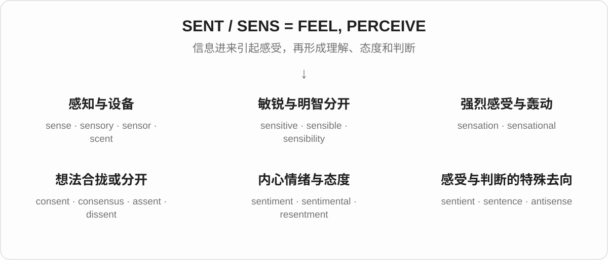

## 词形与演化规律

**sent-** 见 sentient、sentence、sentiment；**sens-** 与拉丁语 sēnsus 等形式有关，见 sense、sensation。经法语变化还有 scent、resent。**scent** 的 c 是后加的拼写，不能当成一个额外词根。send 的过去式 sent 虽同形，不从这条拉丁语路径来。

## 单词速览（常用到不常用）

| 单词 | 音标 | 核心意思 |
|---|---|---|
| [sense](#w-1) | /sens/ | 感觉；意义；判断力；察觉 |
| [sentence](#w-2) | /ˈsentəns/ | 句子；判决；判处 |
| [sensitive](#w-3) | /ˈsensətɪv/ | 敏感的；体贴的；需谨慎处理的 |
| [consent](#w-4) | /kənˈsent/ | 同意；许可；表示同意 |
| [nonsense](#w-5) | 英 /ˈnɒnsəns/；美 /ˈnɑːnsens/ | 胡说；无意义的话；荒唐事 |
| [consensus](#w-6) | /kənˈsensəs/ | 共识；普遍一致的意见 |
| [sentiment](#w-7) | /ˈsentɪmənt/ | 感情；看法；情绪倾向；温情 |
| [sensible](#w-8) | /ˈsensəbəl/ | 明智的；合乎实际的；另有能感知的旧式义 |
| [sensitivity](#w-9) | /ˌsensəˈtɪvəti/ | 敏感程度；灵敏度；体贴 |
| [sensor](#w-10) | 英 /ˈsensə/；美 /ˈsensər/ | 传感器；感应装置 |
| [sensation](#w-11) | /senˈseɪʃən/ | 感觉；轰动；引起轰动的人或事 |
| [scent](#w-12) | /sent/ | 气味；香味；嗅出 |
| [sensory](#w-13) | 英 /ˈsensəri/；美 /ˈsensəri/ | 感官的；感觉系统的 |
| [resentment](#w-14) | /rɪˈzentmənt/ | 怨恨；积在心里的不满 |
| [dissent](#w-15) | /dɪˈsent/ | 异议；不赞同；表达不同意见 |
| [sentimental](#w-16) | /ˌsentɪˈmentəl/ | 感伤的；怀旧的；感情用事的 |
| [sensational](#w-17) | /senˈseɪʃənəl/ | 轰动的；耸人听闻的；极出色的 |
| [insensitive](#w-18) | /ɪnˈsensətɪv/ | 不体贴的；感觉不灵敏的；不受某因素影响的 |
| [resent](#w-19) | /rɪˈzent/ | 怨恨；因觉得受了委屈而不满 |
| [senseless](#w-20) | /ˈsensləs/ | 无意义的；不明智的；失去知觉的 |
| [consensual](#w-21) | /kənˈsenʃuəl/ | 经各方同意的；基于共同认可的 |
| [sensibility](#w-22) | /ˌsensəˈbɪləti/ | 感受力；审美或情感上的敏锐；容易被触动的感情 |
| [sentient](#w-23) | 常见 /ˈsenʃənt/，也读 /ˈsentiənt/ | 有感知能力的；能有主观感受的 |
| [assent](#w-24) | /əˈsent/ | 赞同；认可；表示同意 |
| [resentful](#w-25) | /rɪˈzentfəl/ | 心怀不满的；怨愤的 |
| [sensibly](#w-26) | /ˈsensəbli/ | 明智地；合理地；合乎实际地 |
| [sentimentality](#w-27) | /ˌsentɪmenˈtæləti/ | 多愁善感；过度感伤；煽情 |
| [insensitivity](#w-28) | /ɪnˌsensəˈtɪvəti/ | 不体贴；不敏感；对某因素缺少反应 |
| [sensationalism](#w-29) | /senˈseɪʃənəlɪzəm/ | 追求轰动；煽情、夸张的报道方式 |
| [sensitively](#w-30) | /ˈsensətɪvli/ | 体贴地；细腻地；敏感地 |
| [hypersensitive](#w-31) | 英 /ˌhaɪpəˈsensətɪv/；美 /ˌhaɪpərˈsensətɪv/ | 高度敏感的；反应过强的 |
| [sensationalist](#w-32) | /senˈseɪʃənəlɪst/ | 追求轰动者；煽情的 |
| [sensitization](#w-33) | 英 /ˌsensətaɪˈzeɪʃən/；美 /ˌsensətəˈzeɪʃən/ | 敏化；使反应增强或意识提高的过程 |
| [sentience](#w-34) | 常见 /ˈsenʃəns/，也读 /ˈsentiəns/ | 感知能力；具有主观体验的能力 |
| [photosensitive](#w-35) | 英 /ˌfəʊtəʊˈsensətɪv/；美 /ˌfoʊtoʊˈsensətɪv/ | 光敏的；对光产生反应的 |
| [dissenter](#w-36) | 英 /dɪˈsentə/；美 /dɪˈsentər/ | 持异议者；历史上的不从国教者 |
| [antisense](#w-37) | /ˌæntiˈsens/ | 反义的；反义核酸序列 |
| [somatosensory](#w-38) | 英 /ˌsəʊmətəʊˈsensəri/；美 /ˌsoʊmətoʊˈsensəri/ | 躯体感觉的 |
| [sensitize](#w-39) | 英 /ˈsensətaɪz/；美 /ˈsensətaɪz/ | 使敏感；使更能注意到 |
| [unsentimental](#w-40) | /ˌʌnsentɪˈmentəl/ | 不感情用事的；不煽情的 |
| [oversensitive](#w-41) | 英 /ˌəʊvəˈsensətɪv/；美 /ˌoʊvərˈsensətɪv/ | 过于敏感的 |

## 逐词讲解

### 1. sense — 感觉；意义；判断力；察觉

**音标**：/sens/

**先抓住这个画面**

外界信息进来，你不只接收到，还开始理解：闻到气味、感觉不对、听懂一句话，sense 都能参与。

**怎么拆**

主要经法语 sens 来自拉丁语 sēnsus，与 sentīre“感受”相连；法语词义还受到日耳曼语“理解、方向”词族影响。

**怎么变成今天的意思**

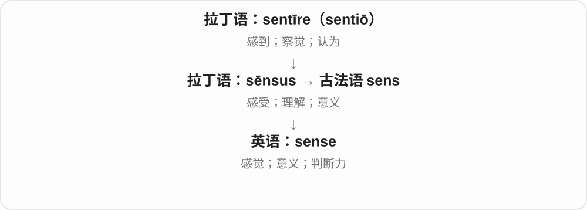

“感受到”扩展为理解和判断，因此 make sense 是说得通，common sense 是常识判断。不要每次都只译成感官感觉。

**常见搭配与例句**

a sense of smell；make sense；common sense；sense danger。

> This explanation makes sense to me.

这个解释我能理解，也觉得说得通。

> She sensed that something was wrong.

她察觉到有些不对劲。

**别混淆**

sensation 更像一次具体感受；sense 还可以是能力、意义或理智判断。

### 2. sentence — 句子；判决；判处

**音标**：/ˈsentəns/

**先抓住这个画面**

一句话把想法表达完整；法官把判断正式说出，则形成判决。两条意思都能追到“表达出来的看法”。

**怎么拆**

拉丁语 sententia“想法、意见、判断”来自 sentīre 的相关形式，经法语进入英语。与 send 的过去式 sent 无关。

**怎么变成今天的意思**

英语早期有权威判断义，后来语法用法把一段完整表达称为 sentence。动词 sentence 则专门说作出刑罚判决。

**常见搭配与例句**

write a sentence；a complete sentence；pass sentence；sentence someone to…。

> Rewrite the idea in one clear sentence.

把这个想法改写成一句清楚的话。

> The judge sentenced him to two years in prison.

法官判处他两年监禁。

**别混淆**

verdict 常是有罪与否等裁断；sentence 常说处罚判决。语法的 sentence 不一定是陈述，也可以是问题或命令。

### 3. sensitive — 敏感的；体贴的；需谨慎处理的

**音标**：/ˈsensətɪv/

**先抓住这个画面**

一点变化就能感觉到，或一点刺激就会受到影响：仪器、皮肤、人心都可以 sensitive。

**怎么拆**

来自中世纪拉丁语 sēnsitīvus，经法语 sensitif 传入，不是现代英语 sense 随便加 -tive。

**怎么变成今天的意思**

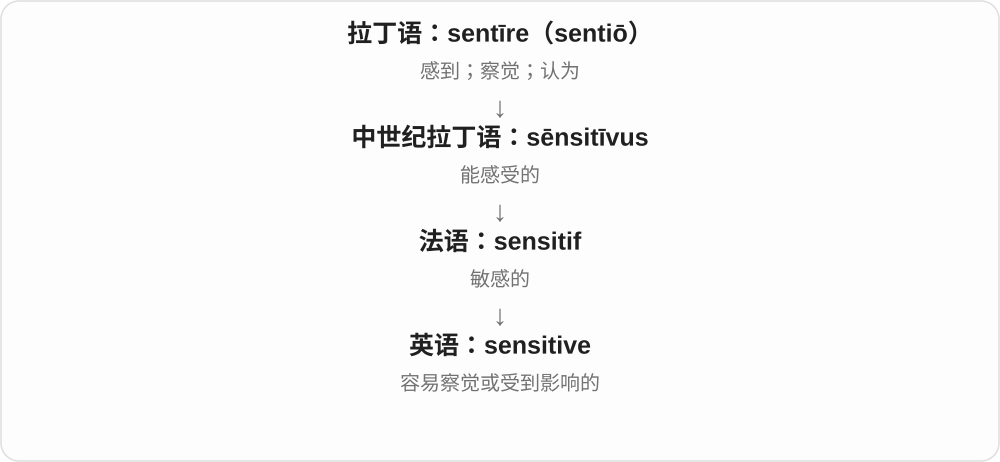

感知细，能表示体贴；容易受触动，也可能表示易受伤。敏感信息或话题则是处理稍有不当就会造成影响。

**常见搭配与例句**

sensitive to light；sensitive skin；a sensitive issue；sensitive to someone’s needs。

> The camera is sensitive to small changes in light.

这台相机能感知很小的光线变化。

> She was sensitive to the needs of the new students.

她很体贴新同学的需要。

**别混淆**

sensitive 是敏感、体贴；sensible 是明智、合乎实际。a sensitive person 不一定总作出 sensible decisions。

### 4. consent — 同意；许可；表示同意

**音标**：/kənˈsent/

**先抓住这个画面**

事情涉及你，别人不能只替你决定；你表达“我愿意、我允许”，就是 consent。

**怎么拆**

拉丁语 con-（一起）+ sentīre（感到、认为）形成 cōnsentīre，经法语进入英语。

**怎么变成今天的意思**

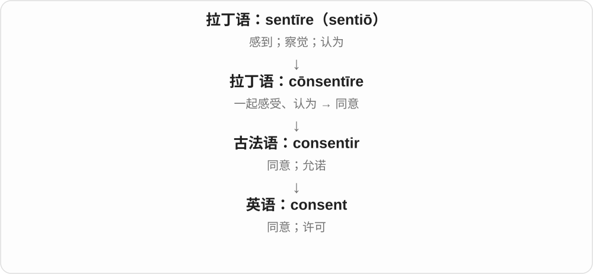

从想法相合走向允许某事发生。名词常不可数，动词常接 to；具体什么算有效同意要看相应场景。

**常见搭配与例句**

give consent；with someone’s consent；consent to a proposal；written consent。

> She consented to the interview.

她同意接受采访。

> Do not share the photograph without his consent.

未经他同意，不要分享这张照片。

**别混淆**

consent 常强调当事人的允许；consensus 是多人形成共识。群体有共识并不自动等于某个个人已经同意。

### 5. nonsense — 胡说；无意义的话；荒唐事

**音标**：英 /ˈnɒnsəns/；美 /ˈnɑːnsens/

**先抓住这个画面**

话说了一大堆，却拼不成能成立的意思或理由，听者会把它判断为 nonsense。

**怎么拆**

non-（无、不）+ sense（意义、道理）。

**怎么变成今天的意思**

可以批评荒唐说法，也可指故意玩语言的无意义文学。并不是所有含糊、暂时听不懂的话就一定没有意义。

**常见搭配与例句**

talk nonsense；complete nonsense；nonsense verse；no more nonsense。

> That excuse is complete nonsense.

那个借口完全是胡说。

> The children enjoyed the playful nonsense poem.

孩子们很喜欢那首充满语言游戏的无意义诗。

**别混淆**

nonsense 通常不可数；不说 a nonsense 来泛指一句胡话。a piece of nonsense 更合适。

### 6. consensus — 共识；普遍一致的意见

**音标**：/kənˈsensəs/

**先抓住这个画面**

许多人的想法逐渐靠拢，形成大家大体能接受的一条意见。

**怎么拆**

直接借自拉丁语 cōnsēnsus，与 cōnsentīre“共同认为”相关；不是英语 consent 加 us。

**怎么变成今天的意思**

它强调群体的广泛一致。日常使用未必意味着每个人赞成每个细节；正式决策里的具体标准由规则决定。

**常见搭配与例句**

reach a consensus；a broad consensus；consensus on an issue。

> The team reached a consensus on the main goal.

团队就主要目标达成了共识。

> There is a broad consensus that the process needs to change.

大家普遍认为这个流程需要改变。

**别混淆**

unanimity 明确强调全体一致；consensus 更常是形成可共同接受的意见。不要用多数票的数量机械定义这个词。

### 7. sentiment — 感情；看法；情绪倾向；温情

**音标**：/ˈsentɪmənt/

**先抓住这个画面**

不仅是冷冰冰地算事实，还包括人心里对这件事的态度和感受，这就是 sentiment。

**怎么拆**

经古法语 sentement 来自拉丁语感受词族，相关形式 sentimentum。

**怎么变成今天的意思**

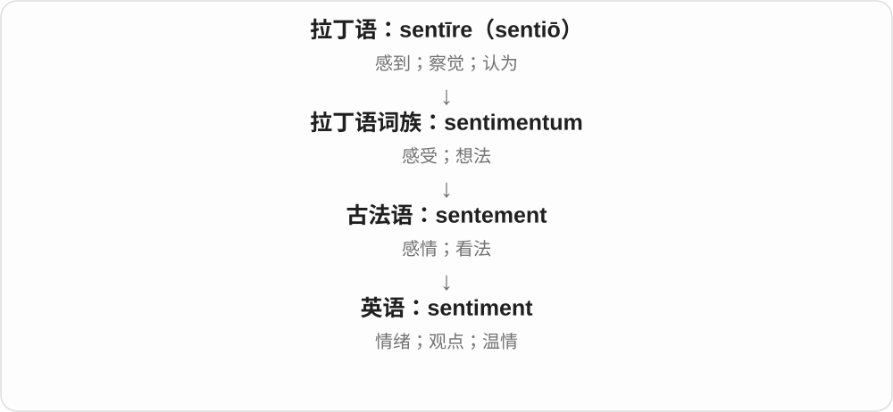

public sentiment 是社会情绪或倾向；I share your sentiments 是赞同你的想法；too much sentiment 则可批评温情太多。

**常见搭配与例句**

public sentiment；market sentiment；share someone’s sentiments；sentiment towards…。

> Public sentiment began to shift after the announcement.

公告之后，公众态度开始变化。

> I agree with the sentiment, but not with the wording.

我赞同这个意思，但不赞同这种措辞。

**别混淆**

sentiment 可以含观点与情绪；sensation 更偏直接感觉。不是每个 sentiment 都是伤感。

### 8. sensible — 明智的；合乎实际的；另有能感知的旧式义

**音标**：/ˈsensəbəl/

**先抓住这个画面**

有感受还不够，要能判断什么做法行得通。带伞、早点出门、量力而行，都可能是 sensible choices。

**怎么拆**

来自拉丁语 sēnsibilis“能感知、能被感知的”，与 sentīre 相连，后来发展出有判断力的意思。

**怎么变成今天的意思**

从有感觉、能理解，转向能作合理判断。现代日常主要是“明智实际”，而不是“情绪敏感”。

**常见搭配与例句**

a sensible decision；sensible shoes；It is sensible to…。

> It would be sensible to leave before the traffic gets heavy.

在交通拥堵前出发比较明智。

> Wear sensible shoes for the long walk.

长途步行要穿合脚实用的鞋。

**别混淆**

sensible 明智；sensitive 敏感。sensible shoes 是适合实际穿用的鞋，不是能感觉到你脚步的鞋。

### 9. sensitivity — 敏感程度；灵敏度；体贴

**音标**：/ˌsensəˈtɪvəti/

**先抓住这个画面**

把“多小的变化就会有反应”当成一个可讨论的程度，这就是 sensitivity；对人也可谈体察他人感受的能力。

**怎么拆**

sensitive + -ity，变成性质名词，重音随词尾变化。

**怎么变成今天的意思**

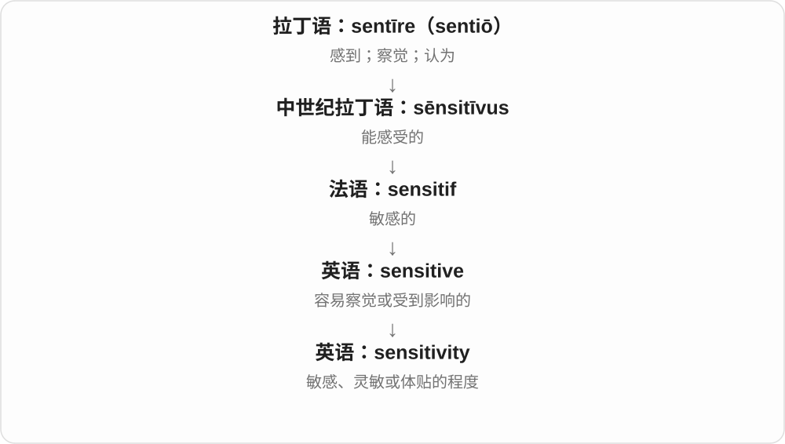

可以评价传感器，也可以评价谈话方式。高 sensitivity 不自动等于总体性能或性格更好，要看讨论的是哪种反应。

**常见搭配与例句**

light sensitivity；sensor sensitivity；show sensitivity；cultural sensitivity。

> The technician adjusted the sensitivity of the sensor.

技术人员调整了传感器的灵敏度。

> The situation needs to be handled with sensitivity.

这种情况需要体贴、谨慎地处理。

**别混淆**

sensibility 常偏感受和审美能力；sensitivity 也常是可测的灵敏度或对刺激的反应程度。

### 10. sensor — 传感器；感应装置

**音标**：英 /ˈsensə/；美 /ˈsensər/

**先抓住这个画面**

机器也需要“感觉器官”：把光、温度、运动等变化接进来，转换成可以处理的信号。

**怎么拆**

现代利用拉丁语 sentīre、sēns- 词族和施事词尾形成，可联系 sense + -or。

**怎么变成今天的意思**

一个 sensor 负责感知特定量，不一定同时解释它为什么变化；解释常由后续系统完成。

**常见搭配与例句**

a temperature sensor；a motion sensor；sensor data。

> A sensor turns on the light when someone enters.

有人进入时，感应器会打开灯。

> The temperature sensor sends a reading every minute.

温度传感器每分钟发送一次读数。

**别混淆**

sensor 是设备；censor 是审查者或审查，读音接近但来源和含义不同。

### 11. sensation — 感觉；轰动；引起轰动的人或事

**音标**：/senˈseɪʃən/

**先抓住这个画面**

身体或心里收到一股鲜明感受；如果一个表演让许多人同时产生强烈反应，它也能成为 a sensation。

**怎么拆**

来自中世纪拉丁语 sensātiō，经法语传入，与 sēnsus“感受”相关。

**怎么变成今天的意思**

一支保留身体感受，如刺痛、温暖；另一支从强烈反应变成轰动及制造轰动的对象。

**常见搭配与例句**

a warm sensation；a sensation of falling；cause a sensation；an overnight sensation。

> I felt a strange sensation in my fingertips.

我的指尖有一种奇怪的感觉。

> Her first performance caused a sensation.

她的首场演出引起了轰动。

**别混淆**

feeling 很广，可包括态度；sensation 常突出一次直接感受。a singing sensation 则是引起轰动的歌手。

### 12. scent — 气味；香味；嗅出

**音标**：/sent/

**先抓住这个画面**

空气里有一条鼻子能抓住的线索：花留下香气，人或动物也会留下可追踪的气味。

**怎么拆**

古法语 sentir“感觉、闻到”来自拉丁语 sentīre。英语早期写 sent，字母 c 后来才加入，不代表多了一块词根。

**怎么变成今天的意思**

从广泛感知缩到嗅觉这一支。scent 不只说香水；狗追踪的气味也叫 scent。

**常见搭配与例句**

the scent of flowers；follow a scent；scented soap；scent danger。

> The garden was filled with the scent of roses.

花园里满是玫瑰香气。

> The dog picked up the scent near the gate.

狗在大门附近嗅到了踪迹。

**别混淆**

scent、sent、cent 常同音，却分别是气味、send 的过去式、货币单位。不要靠读音判同源。

### 13. sensory — 感官的；感觉系统的

**音标**：英 /ˈsensəri/；美 /ˈsensəri/

**先抓住这个画面**

这不是评价人聪不聪明，而是标记信息从感觉通道进入：看到、听到、摸到等。

**怎么拆**

来自拉丁语 sēnsōrius，与 sēnsus“感觉”相连；现代可用 sense 与 -ory 帮助记忆，但英语 sense 不是这条借入链的必经祖先。

**怎么变成今天的意思**

常修饰 information、experience、system。sensory experience 可把光线、声音、味道等一起考虑。

**常见搭配与例句**

sensory information；sensory experience；sensory input。

> The exhibition offers a rich sensory experience.

这场展览提供了丰富的感官体验。

> The brain combines sensory information from different sources.

大脑把不同来源的感觉信息结合起来。

**别混淆**

sensory 说明属于感官领域；sensitive 说明容易察觉或受到影响。sensory system 不等于这个系统一定特别灵敏。

### 14. resentment — 怨恨；积在心里的不满

**音标**：/rɪˈzentmənt/

**先抓住这个画面**

委屈没有消散，而是在心里留下了一笔账，这股持续的不满就是 resentment。

**怎么拆**

与 resent + -ment 对应，并有法语 ressentiment 的历史影响；它有自己的借入与形成背景。

**怎么变成今天的意思**

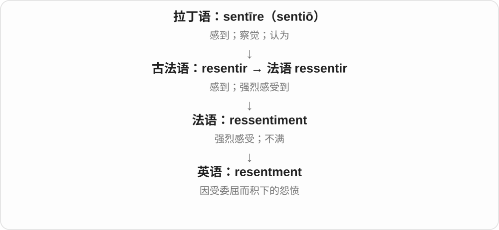

可以针对人、待遇或事件，常比一时生气更持久。不能靠词源判断一个人的不满是否合理。

**常见搭配与例句**

resentment towards someone；deep resentment；feel resentment。

> The unequal workload caused resentment within the team.

工作量分配不均在团队内部引起了不满。

> He still felt resentment towards his former employer.

他对前雇主仍心存怨气。

**别混淆**

anger 可以是突然爆发的愤怒；resentment 常强调被亏待后的持续不满。

### 15. dissent — 异议；不赞同；表达不同意见

**音标**：/dɪˈsent/

**先抓住这个画面**

大家的想法朝一个方向走，你认为不对，清楚地走向另一个判断，这就是 dissent。

**怎么拆**

拉丁语 dis-（分开）+ sentīre（认为）形成 dissentīre，进入英语。

**怎么变成今天的意思**

可表示公开不同意某项观点、决定或权威意见。它不必表现为粗暴争吵；冷静写出理由也可以是 dissent。

**常见搭配与例句**

express dissent；dissent from a view；a dissenting opinion。

> Several members expressed dissent during the meeting.

几位成员在会上表达了异议。

> She dissented from the committee’s conclusion.

她不赞同委员会的结论。

**别混淆**

descent 是下降；dissent 是异议。两者常同音，但前者并非“思想往下掉”。

### 16. sentimental — 感伤的；怀旧的；感情用事的

**音标**：/ˌsentɪˈmentəl/

**先抓住这个画面**

一件旧东西本身不值钱，却把过去的人和事一下带回来，让你舍不得丢，这就是 sentimental 的典型场景。

**怎么拆**

sentiment + -al。

**怎么变成今天的意思**

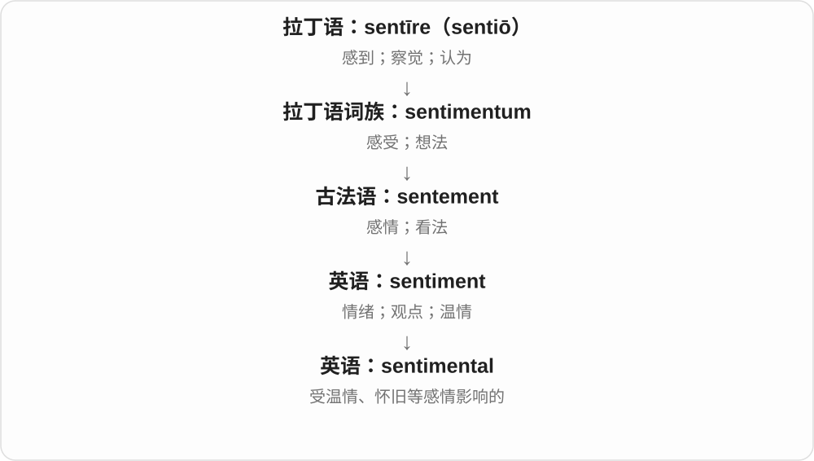

可温和地说有感情价值，也可批评作品或判断过分依赖温情。a sentimental person 并不表示身体感官特别灵敏。

**常见搭配与例句**

sentimental value；feel sentimental；a sentimental story。

> The watch has great sentimental value for me.

这只表对我有很大的感情价值。

> The film becomes too sentimental in its final scenes.

电影最后几场戏煽情过头了。

**别混淆**

emotional 广泛说有情绪或情绪强烈；sentimental 常偏温情、怀旧、感伤，有时带过度之意。

### 17. sensational — 轰动的；耸人听闻的；极出色的

**音标**：/senˈseɪʃənəl/

**先抓住这个画面**

它能一下子抓住大家的感觉：可能是真的精彩，也可能故意夸张刺激，让人忍不住点进去。

**怎么拆**

sensation + -al，表示会引起强烈感受或轰动的。

**怎么变成今天的意思**

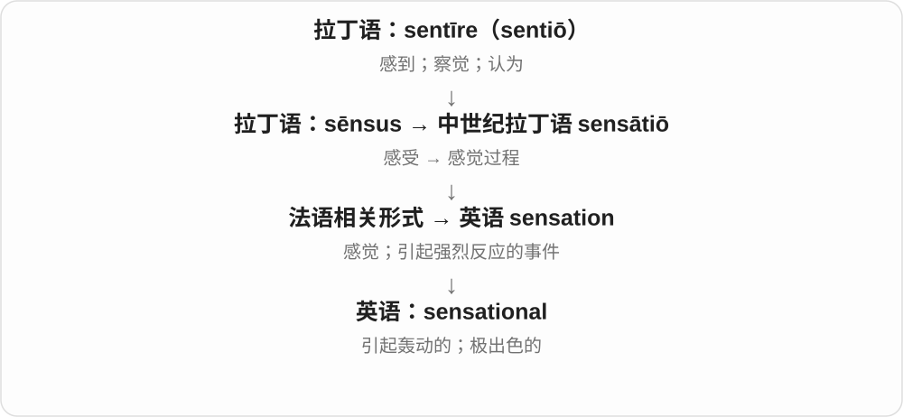

a sensational performance 常是称赞；a sensational headline 可能批评靠刺激吸引眼球。不能只背一个“耸人听闻”。

**常见搭配与例句**

a sensational performance；sensational news；a sensational headline。

> The singer gave a sensational performance.

这位歌手的演出精彩极了。

> The article used a sensational headline to attract readers.

文章用耸动的标题吸引读者。

**别混淆**

sensational 的评价取决于对象；sensitive 则是接收刺激敏锐，不是制造轰动。

### 18. insensitive — 不体贴的；感觉不灵敏的；不受某因素影响的

**音标**：/ɪnˈsensətɪv/

**先抓住这个画面**

该留意的变化或感受没有被接住：对人可能是说话不顾别人，对设备可能是对某种输入不作明显反应。

**怎么拆**

in-（不）+ sensitive。

**怎么变成今天的意思**

人际义常含批评；技术义可以中性，甚至是需要的性质，例如测量不受温度变化影响。

**常见搭配与例句**

insensitive remarks；insensitive to criticism；insensitive to temperature changes。

> His joke sounded insensitive after what she had been through.

考虑到她经历的事，他的玩笑显得很不体贴。

> The instrument is relatively insensitive to changes in humidity.

这个仪器受湿度变化的影响相对较小。

**别混淆**

insensitive 是缺少相应感受或顾及；senseless 则常是无意义、无理性，不能直接互换。

### 19. resent — 怨恨；因觉得受了委屈而不满

**音标**：/rɪˈzent/

**先抓住这个画面**

不是单纯不喜欢，而是心里有一句“凭什么这样对我”：觉得待遇不公平，便生出不满。

**怎么拆**

来自法语 ressentir，re- 在这里可能加强感受，sentir 是感觉；不能把现代怨恨义机械说成“再感觉一次”。

**怎么变成今天的意思**

历史上可泛指强烈感受，甚至曾有感激义；现代集中到觉得受到伤害或冒犯的不满。resent 后直接接对象或动名词。

**常见搭配与例句**

resent being ignored；resent someone’s success；resent the implication。

> She resented being left out of the discussion.

她对自己被排除在讨论之外感到不满。

> I resent the suggestion that I did not try.

暗示我没有努力，让我很不满。

**别混淆**

resent 不一定 openly hate；不满可能压在心里。resent doing 常见，不说 resent to do。

### 20. senseless — 无意义的；不明智的；失去知觉的

**音标**：/ˈsensləs/

**先抓住这个画面**

有两幅画面：行为找不到合理理由，或一个人暂时失去了感觉与知觉。

**怎么拆**

sense + -less（没有），分别否定 sense 的道理义与知觉义。

**怎么变成今天的意思**

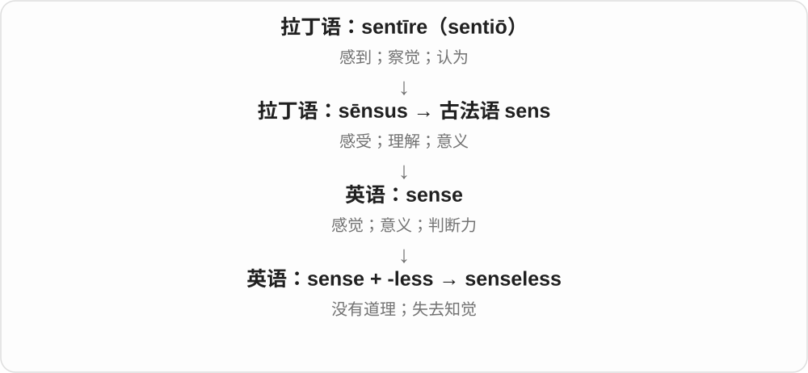

senseless waste 说浪费没有意义；knocked senseless 则是被打得失去知觉。不要把后者解释成“变笨了”。

**常见搭配与例句**

senseless violence；a senseless waste；knock someone senseless。

> The damage was a senseless waste of public resources.

这种破坏是对公共资源毫无意义的浪费。

> The blow knocked him senseless.

那一击把他打得失去了知觉。

**别混淆**

insensitive 常是不顾别人感受；senseless 常是行为无道理或失去知觉，否定的对象不同。

### 21. consensual — 经各方同意的；基于共同认可的

**音标**：/kənˈsenʃuəl/

**先抓住这个画面**

相关各方不是被迫配合，而是对这项安排表达了共同认可。

**怎么拆**

由拉丁语 cōnsēnsus“同意”的词干 cōnsēnsu- 加 -al 形成；它在英语中出现早于 consensus，不能画成英语 consensus 再生出 consensual。

**怎么变成今天的意思**

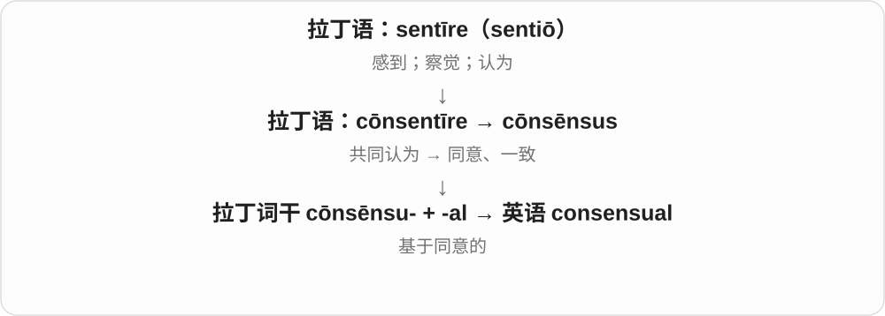

常形容决定、安排或关系，重点是同意这一基础。不能只因为没有公开争吵就自动称为 consensual。

**常见搭配与例句**

a consensual decision；a consensual approach；a consensual arrangement。

> The committee preferred a consensual decision.

委员会倾向于作出各方认可的决定。

> They reached a consensual arrangement about the shared space.

他们就共用空间达成了双方认可的安排。

**别混淆**

consensual 描述有同意基础；consensus 是共识本身。二者词性和所指对象不同。

### 22. sensibility — 感受力；审美或情感上的敏锐；容易被触动的感情

**音标**：/ˌsensəˈbɪləti/

**先抓住这个画面**

同一幅画，有人只看见颜色，有人会细腻地感到气氛与情绪；这种感受方式和能力是 sensibility。

**怎么拆**

晚期拉丁语 sēnsibilitās 经法语 sensibilité 进入英语，与 sēnsibilis 同族。现代虽与 sensible 对应，意思不只等于理智。

**怎么变成今天的意思**

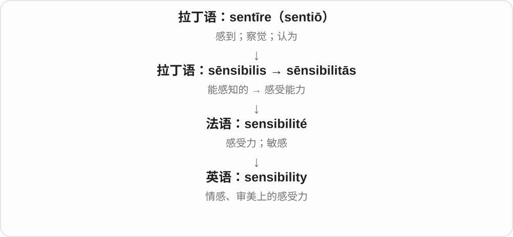

单数可说一个人的艺术感受方式；复数 sensibilities 常说容易被冒犯或触动的感情与价值感。

**常见搭配与例句**

an artistic sensibility；offend someone’s sensibilities；a modern sensibility。

> The designer has a distinctive visual sensibility.

这位设计师有独特的视觉审美。

> The joke offended her sensibilities.

那个玩笑冒犯了她的感情和价值感。

**别混淆**

sensibility 不是 sensibleness“明智”简单替换词。小说标题 Sense and Sensibility 正利用理智与感性之间的张力。

### 23. sentient — 有感知能力的；能有主观感受的

**音标**：常见 /ˈsenʃənt/，也读 /ˈsentiənt/

**先抓住这个画面**

不只是对输入作出反应，而是讨论一个存在者能不能感受到痛苦、愉快等体验。

**怎么拆**

来自拉丁语 sentiēns“正在感受的”，是 sentīre 的相关形式。

**怎么变成今天的意思**

哲学、伦理和动物讨论中常用。能执行复杂任务与是否有感受不是同一问题，不能只凭聪明表现就直接下结论。

**常见搭配与例句**

a sentient being；sentient animals；the idea of sentient machines。

> The debate concerns how we should treat sentient animals.

这场讨论关注我们应该怎样对待有感知能力的动物。

> The story imagines a sentient planet.

这个故事设想了一个有感知能力的星球。

**别混淆**

intelligent 强调认知、解决问题的能力；sentient 重点是感知和体验。两者不能简单互换。

### 24. assent — 赞同；认可；表示同意

**音标**：/əˈsent/

**先抓住这个画面**

听完一个观点或提议，你点头表示“这个我认可”，就是 assent。

**怎么拆**

拉丁语 ad-（朝向）在 s 前变成 as-，与 sentīre 构成 assentīre，经法语传入。

**怎么变成今天的意思**

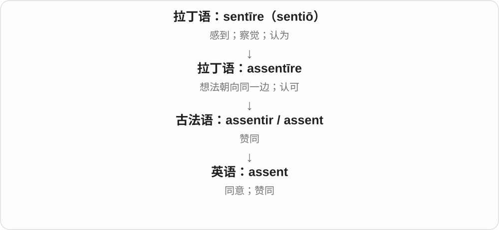

较正式，常强调对提议、说法的认可；既可作名词，也可作动词。

**常见搭配与例句**

assent to a proposal；give assent；a nod of assent。

> She nodded her assent.

她点头表示赞同。

> The members assented to the revised proposal.

成员们同意了修改后的提案。

**别混淆**

assent 是赞同；ascent 是上升，两者同音但不同来源。consent 更常强调允许涉及自己的行动。

### 25. resentful — 心怀不满的；怨愤的

**音标**：/rɪˈzentfəl/

**先抓住这个画面**

嘴上可能没有争吵，表情和语气却带着“我被亏待了”的不满。

**怎么拆**

resent + -ful，表示充满相应情绪。

**怎么变成今天的意思**

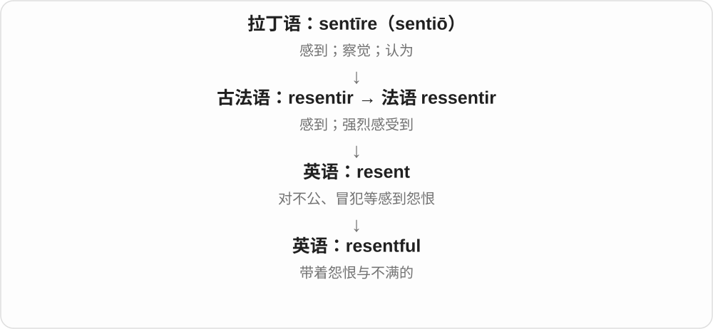

形容人、目光、语气或态度。它指出情绪状态，不自动说明对方正在采取报复行动。

**常见搭配与例句**

feel resentful；a resentful glance；resentful of someone。

> He sounded resentful about the extra work.

说起额外工作时，他的语气带着不满。

> She grew resentful of always having to apologize first.

总是要她先道歉，让她越来越不满。

**别混淆**

revengeful 更指想报复；resentful 可以只是心中怨愤而没有报复计划。

### 26. sensibly — 明智地；合理地；合乎实际地

**音标**：/ˈsensəbli/

**先抓住这个画面**

做决定时把现实情况放进来，不冲动、不做明显行不通的事。

**怎么拆**

sensible + -ly，词尾 -le 改成 -ly。

**怎么变成今天的意思**

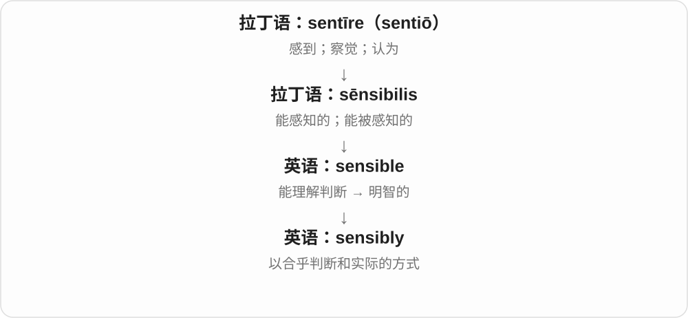

可描述花钱、安排时间、穿着和讨论方式，强调做法合理。

**常见搭配与例句**

spend sensibly；dress sensibly；plan sensibly。

> She sensibly saved a copy before editing the file.

她编辑文件前先保存了副本，这很明智。

> We need to discuss the problem calmly and sensibly.

我们需要冷静、理智地讨论这个问题。

**别混淆**

sensibly 是明智地；sensitively 是体贴细腻地。回答问题可以很理智，却不够体贴。

### 27. sentimentality — 多愁善感；过度感伤；煽情

**音标**：/ˌsentɪmenˈtæləti/

**先抓住这个画面**

情绪被铺得很满，甚至盖过了真实人物与事实，这种过分温情或感伤常被叫作 sentimentality。

**怎么拆**

sentimental + -ity，将性质转成名词。

**怎么变成今天的意思**

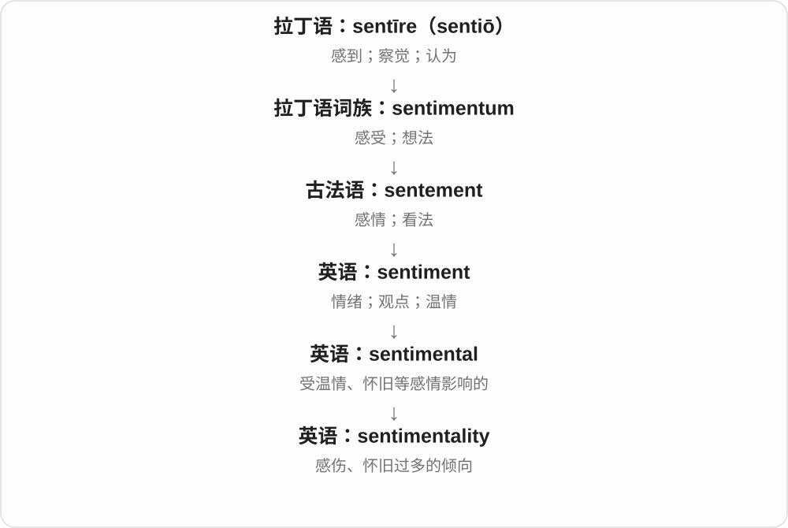

通常比 sentimental value 带更明显的批评，评价的是感情的处理方式，不是否定一切真诚情感。

**常见搭配与例句**

avoid sentimentality；excessive sentimentality；without sentimentality。

> The novel describes loss without sentimentality.

这部小说描写失落，却不刻意煽情。

> The speech was weakened by excessive sentimentality.

演讲因过分感伤而削弱了力量。

**别混淆**

emotion 是感情本身；sentimentality 常暗示处理得过甜、过满或不够真实。

### 28. insensitivity — 不体贴；不敏感；对某因素缺少反应

**音标**：/ɪnˌsensəˈtɪvəti/

**先抓住这个画面**

把没有接住别人的感受、或没有对刺激作反应的状态单独拿出来谈。

**怎么拆**

in-（不）+ sensitivity，也可从 insensitive 对应的名词形式理解。

**怎么变成今天的意思**

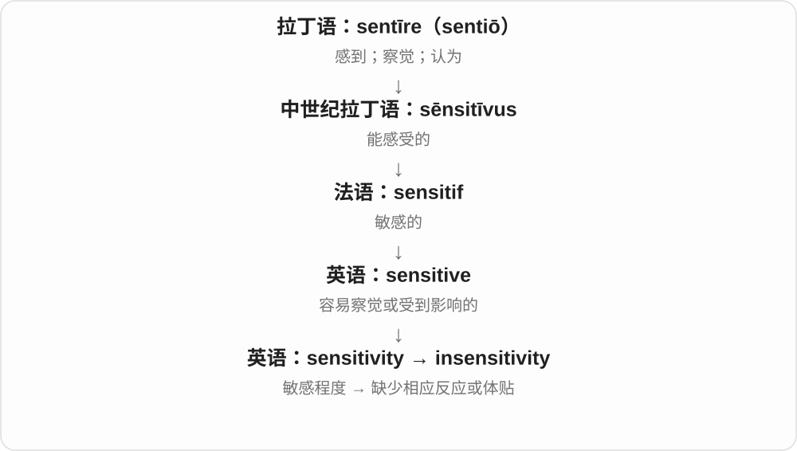

人际场景常批评漠视；技术场景只说明反应较弱。其好坏不能脱离后面的 to 什么。

**常见搭配与例句**

insensitivity to others；show insensitivity；insensitivity to noise。

> She was upset by his insensitivity to her concerns.

他不顾她的忧虑，让她很难过。

> The design’s insensitivity to electrical noise is useful.

这种设计不易受电噪声影响，这一点很有用。

**别混淆**

indifference 是不关心；insensitivity 是不易察觉或不顾及。有时人想帮忙，却因缺少体察而表现出 insensitivity。

### 29. sensationalism — 追求轰动；煽情、夸张的报道方式

**音标**：/senˈseɪʃənəlɪzəm/

**先抓住这个画面**

本来可以平实地讲，偏要把最刺激的部分放大，让人震惊或愤怒；这种做法是 sensationalism。

**怎么拆**

sensational + -ism，给一种表达倾向或做法命名。

**怎么变成今天的意思**

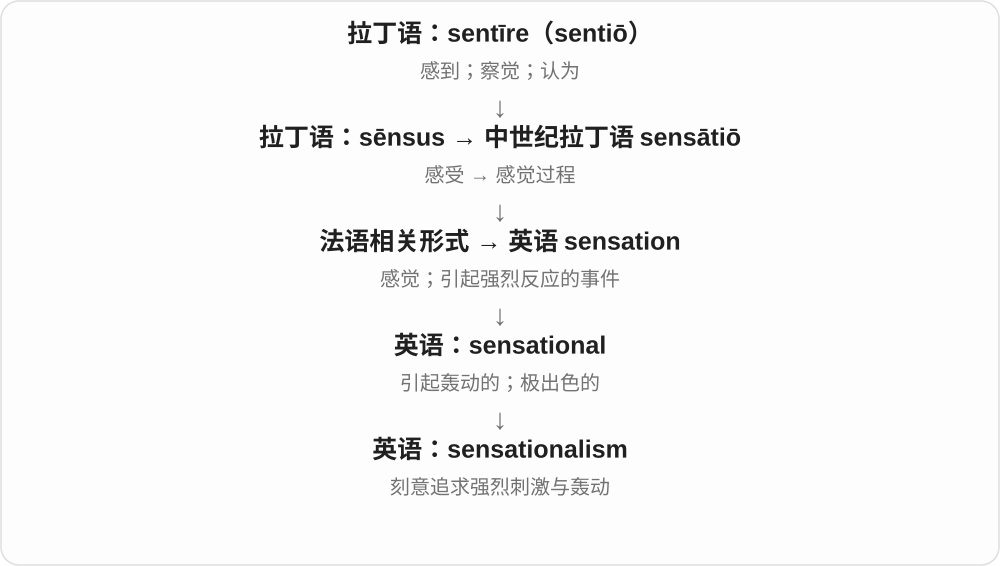

常用于批评媒体为了吸引注意而夸张或选择性突出内容。它不要求每个细节都造假，也可能是呈现方式失衡。

**常见搭配与例句**

media sensationalism；avoid sensationalism；accusations of sensationalism。

> The editor wanted accurate reporting without sensationalism.

编辑希望报道准确，不刻意制造轰动。

> Critics accused the programme of sensationalism.

批评者指责这个节目刻意煽情。

**别混淆**

an exciting report 可以事实充分又精彩；sensationalism 则通常批评把刺激性放在准确或分寸之前。

### 30. sensitively — 体贴地；细腻地；敏感地

**音标**：/ˈsensətɪvli/

**先抓住这个画面**

说话前先留意对方会怎样感受，处理时避开不必要的伤害，这样做就是 sensitively。

**怎么拆**

sensitive + -ly。

**怎么变成今天的意思**

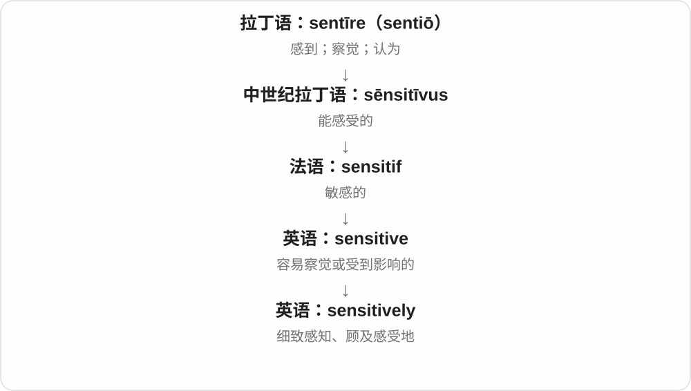

常描述谈话、表演、报道或处理问题的方式，不只是神经容易激动。

**常见搭配与例句**

handle sensitively；respond sensitively；portray sensitively。

> The teacher handled the complaint sensitively.

老师体贴而谨慎地处理了这次投诉。

> The film portrays grief sensitively.

这部电影细腻地表现了悲痛。

**别混淆**

sensibly 是明智、实际地；sensitively 是细腻、体贴地。一种处理可以同时具备二者。

### 31. hypersensitive — 高度敏感的；反应过强的

**音标**：英 /ˌhaɪpəˈsensətɪv/；美 /ˌhaɪpərˈsensətɪv/

**先抓住这个画面**

别人几乎没注意到的一点变化，在这里却引起很强反应；hyper- 把敏感程度往上推。

**怎么拆**

hyper-（超过通常程度）+ sensitive。

**怎么变成今天的意思**

可说人对批评的反应，也可在技术、生理语境说对某种刺激特别敏感。是否属于异常要看具体语境。

**常见搭配与例句**

hypersensitive to criticism；a hypersensitive detector；hypersensitive skin。

> He became hypersensitive to even mild criticism.

他变得连轻微批评也难以承受。

> The experiment required a hypersensitive detector.

这个实验需要一个高度灵敏的探测器。

**别混淆**

sensitive 未必过头；hypersensitive 常强调程度异常高。不要把它当成夸人特别体贴的常规词。

### 32. sensationalist — 追求轰动者；煽情的

**音标**：/senˈseɪʃənəlɪst/

**先抓住这个画面**

sensationalism 是做法，sensationalist 是采用这种做法的人，也能直接形容报道或标题。

**怎么拆**

sensational + -ist，形成从事者或倾向名称。

**怎么变成今天的意思**

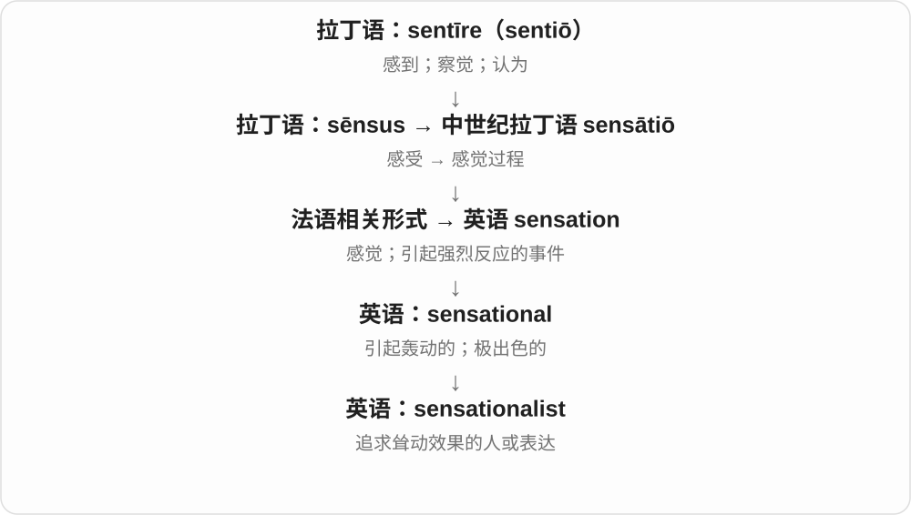

这个词通常带批评，不是“感觉特别敏锐的研究者”。新闻评论中常见 sensationalist coverage。

**常见搭配与例句**

a sensationalist newspaper；sensationalist reporting；a sensationalist writer。

> She refused to work for a sensationalist newspaper.

她不愿为一家靠耸动报道吸引读者的报纸工作。

> The documentary was criticized for its sensationalist style.

这部纪录片因煽情的风格受到批评。

**别混淆**

sensational 可以单纯夸精彩；sensationalist 大多指刻意制造轰动，不是普通赞美。

### 33. sensitization — 敏化；使反应增强或意识提高的过程

**音标**：英 /ˌsensətaɪˈzeɪʃən/；美 /ˌsensətəˈzeɪʃən/

**先抓住这个画面**

它把“越来越能感觉到、越来越容易起反应”当成一个变化过程。

**怎么拆**

sensitize + -ation，去掉词尾 e 后构成名词；英式也写 sensitisation。

**怎么变成今天的意思**

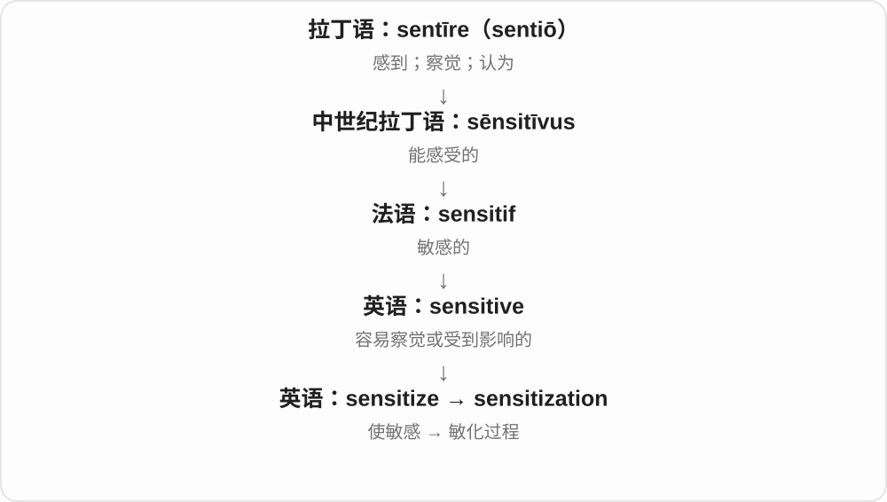

在材料、生理和社会教育语境可有不同专门含义。先看是什么对象对什么变得敏感，再翻译。

**常见搭配与例句**

sensitization to light；a sensitization process；public sensitization。

> The paper describes the sensitization of the photographic material.

论文描述了这种照相材料的敏化过程。

> The training includes sensitization to cultural differences.

培训包含帮助学员认识文化差异的内容。

**别混淆**

sensitivity 是当下敏感程度；sensitization 是敏感程度或意识发生变化的过程。

### 34. sentience — 感知能力；具有主观体验的能力

**音标**：常见 /ˈsenʃəns/，也读 /ˈsentiəns/

**先抓住这个画面**

sentient 说某个存在者能感受；sentience 把“能不能有这种感受”本身拿出来讨论。

**怎么拆**

sentient 对应的性质名词，词尾 -ent 变为 -ence。

**怎么变成今天的意思**

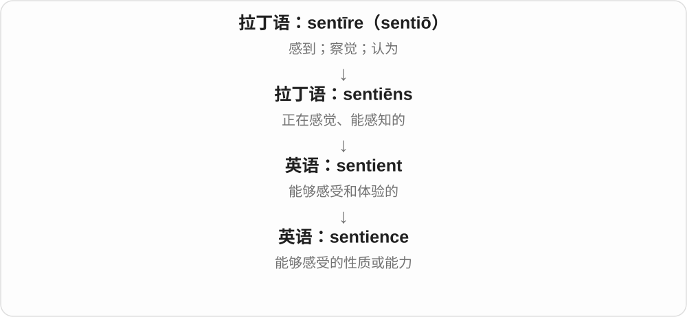

常用于哲学与动物认知讨论，判断标准本身也可能有争论。这里的词义不等于简单探测信号。

**常见搭配与例句**

animal sentience；evidence of sentience；questions about sentience。

> The seminar explored different definitions of sentience.

研讨会探讨了感知能力的不同定义。

> The article distinguishes sentience from intelligence.

文章区分了感知能力与智力。

**别混淆**

sensitivity 可以只是设备对输入灵敏；sentience 常涉及体验，传感器读数不等于体验证据。

### 35. photosensitive — 光敏的；对光产生反应的

**音标**：英 /ˌfəʊtəʊˈsensətɪv/；美 /ˌfoʊtoʊˈsensətɪv/

**先抓住这个画面**

把光照上去，材料或装置就发生反应；photo- 指定了它特别能感受到的东西是光。

**怎么拆**

photo-（光）+ sensitive（敏感的）。

**怎么变成今天的意思**

可描述胶片、感光材料，也可在生理语境描述对光敏感。单看词不说明具体反应机制。

**常见搭配与例句**

photosensitive material；a photosensitive layer；photosensitive paper。

> The paper has a photosensitive coating.

这种纸带有一层感光涂层。

> Keep the photosensitive material away from bright light.

把感光材料放在强光照不到的地方。

**别混淆**

photogenic 是上镜好看；photosensitive 是对光反应，不能用它夸人的照片好看。

### 36. dissenter — 持异议者；历史上的不从国教者

**音标**：英 /dɪˈsentə/；美 /dɪˈsentər/

**先抓住这个画面**

在人群共同意见中，有人明确说“我不同意”，这个人就是 dissenter。

**怎么拆**

dissent + -er。

**怎么变成今天的意思**

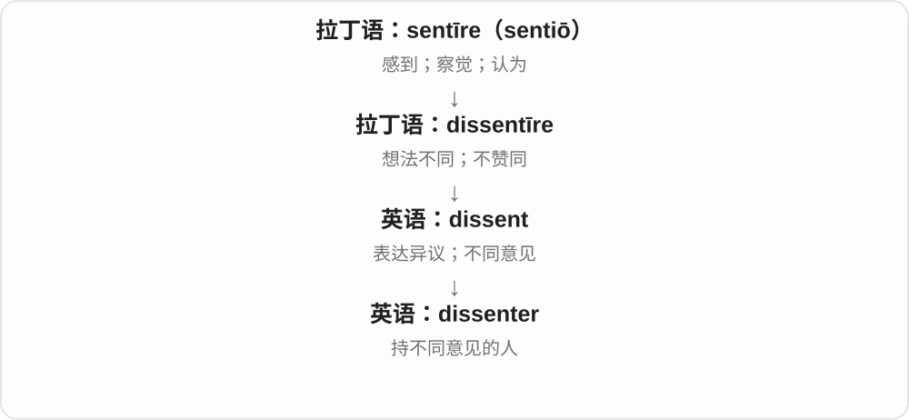

泛指异议者；英国历史中的大写 Dissenters 还可指不接受国教某些规定的宗教群体，需要按历史语境读。

**常见搭配与例句**

a lone dissenter；listen to dissenters；religious dissenters。

> Only one dissenter spoke against the proposal.

只有一位持异议者发言反对这项提案。

> The chapter discusses religious dissenters in early modern England.

这一章讨论近代早期英格兰不从国教的宗教群体。

**别混淆**

dissenter 不等于 troublemaker“惹事者”；一个人可以有充分理由提出异议。

### 37. antisense — 反义的；反义核酸序列

**音标**：/ˌæntiˈsens/

**先抓住这个画面**

在核酸语境里，想象两条能按配对规则互相对应的序列；antisense 指相对于对应正义序列互补的那一条。

**怎么拆**

anti-（相对、相反）+ sense；这里 sense 用的是遗传信息方向、编码关系的专业义。

**怎么变成今天的意思**

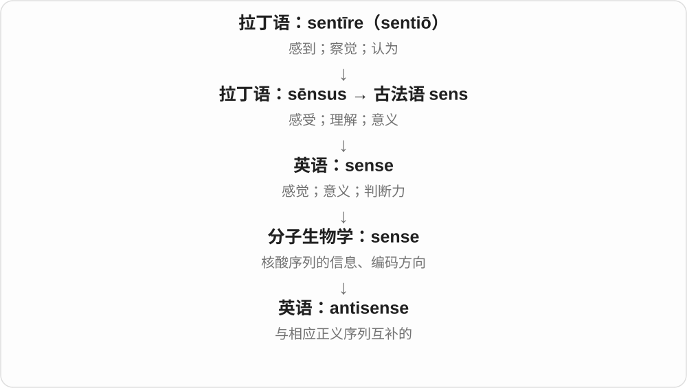

这不是日常“反对常识”，也不是两个单词互为反义词。要结合具体链、RNA 和编码语境识别它指哪个互补对象。

**常见搭配与例句**

antisense RNA；an antisense strand；an antisense sequence。

> The diagram labels the sense and antisense strands.

图中标出了正义链和反义链。

> The paper discusses how antisense RNA can pair with a complementary sequence.

论文讨论了反义 RNA 如何与互补序列配对。

**别混淆**

antonym 是语言中的反义词；antisense 是分子生物学术语，不能互换。

### 38. somatosensory — 躯体感觉的

**音标**：英 /ˌsəʊmətəʊˈsensəri/；美 /ˌsoʊmətoʊˈsensəri/

**先抓住这个画面**

闭上眼仍知道手臂在哪里，也能感觉皮肤被碰到：身体表面和内部位置等传来的感觉属于这里。

**怎么拆**

somato-（身体，来自希腊语 sōma）+ sensory（感觉的），现代术语组合。

**怎么变成今天的意思**

它特别关注触觉、温度、疼痛、位置等来自身体的感觉，而不是把视觉、听觉全部笼统塞进来。

**常见搭配与例句**

the somatosensory system；somatosensory information；somatosensory cortex。

> The diagram shows how somatosensory information reaches the brain.

图中展示了躯体感觉信息怎样到达大脑。

> The lesson compares visual and somatosensory signals.

这一课比较视觉信号与躯体感觉信号。

**别混淆**

sensory 范围广；somatosensory 给它加上“躯体”范围。motor 侧重运动输出，方向不同。

### 39. sensitize — 使敏感；使更能注意到

**音标**：英 /ˈsensətaɪz/；美 /ˈsensətaɪz/

**先抓住这个画面**

原来没注意到的变化，现在能察觉；原来不理解的处境，现在开始有感受，sensitize 就是让这根感受线更灵。

**怎么拆**

sensitive 的词干 + -ize，构成使发生变化的动词；英式也常写 sensitise。

**怎么变成今天的意思**

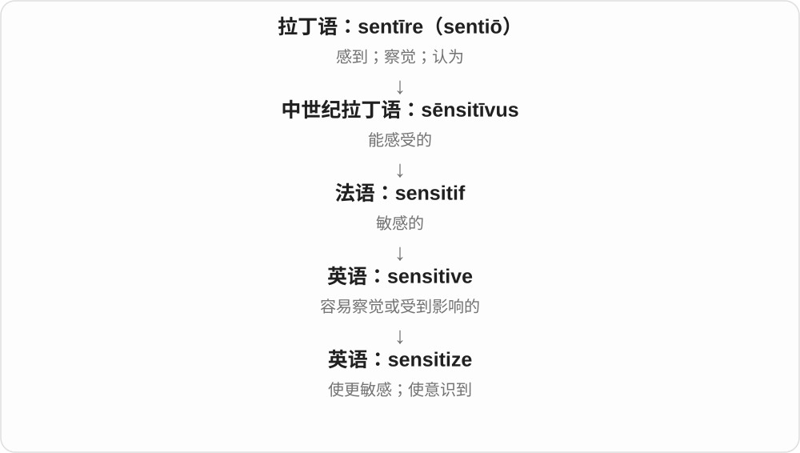

可以说培训让人更理解他人需求，也可在专业语境说材料或身体对刺激的反应改变。两种场景不能硬套同一机制。

**常见搭配与例句**

sensitize someone to an issue；sensitize material to light。

> The workshop aims to sensitize staff to accessibility barriers.

工作坊旨在让员工更能意识到无障碍方面的障碍。

> The process sensitizes the film to light.

这个过程使胶片具备感光能力。

**别混淆**

sensitive 是已有性质；sensitize 是改变性质的过程。desensitize 则朝降低反应的方向走。

### 40. unsentimental — 不感情用事的；不煽情的

**音标**：/ˌʌnsentɪˈmentəl/

**先抓住这个画面**

看见事实的重量，不急着用温情把它包起来；仍可有感情，但表达或判断比较克制。

**怎么拆**

un-（不）+ sentimental。

**怎么变成今天的意思**

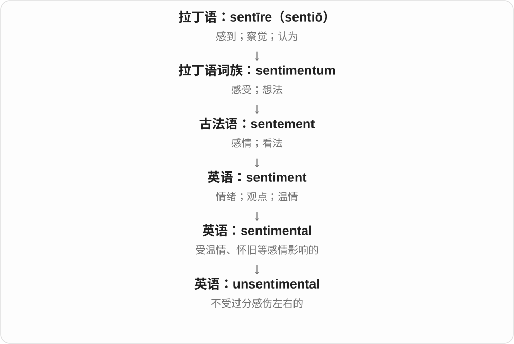

可以赞赏作品诚实、克制，也可以描述决策果断。它不必等于冷酷或缺乏同情。

**常见搭配与例句**

an unsentimental account；an unsentimental view；an unsentimental decision。

> She gives an unsentimental account of her childhood.

她对童年的叙述很克制，没有刻意煽情。

> He took an unsentimental view of the business decision.

他冷静地看待这项商业决定，没有感情用事。

**别混淆**

insensitive 是不顾别人感受；unsentimental 只是不过分感伤，一个人可以既体贴又冷静。

### 41. oversensitive — 过于敏感的

**音标**：英 /ˌəʊvəˈsensətɪv/；美 /ˌoʊvərˈsensətɪv/

**先抓住这个画面**

反应超过说话人认为合适的程度，例如把一句普通提醒听成严重指责。

**怎么拆**

over-（过度）+ sensitive。

**怎么变成今天的意思**

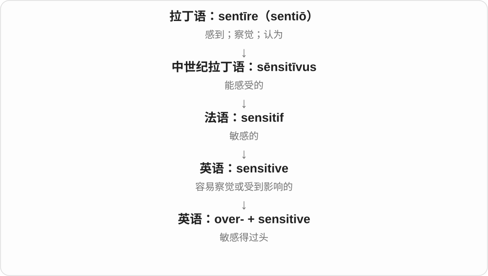

它包含评价，尤其形容人时可能显得在否定对方感受。理解词义时要看是谁认为“过度”。

**常见搭配与例句**

be oversensitive about something；an oversensitive response。

> He worries that he is oversensitive about his accent.

他担心自己对口音问题太敏感。

> The alarm is oversensitive and reacts to passing insects.

警报器过于敏感，连飞过的昆虫都会触发它。

**别混淆**

sensitive 可以是优点；oversensitive 明确带“太过”的判断，不能当作中性同义词。

## 这一组要分清什么

**sensible / sensitive / sensory**：明智的 / 敏感或体贴的 / 与感官相关的。

**sentimental / sentimentality**：有感情，不代表一定过度煽情。sentimental value 通常是温和的感情价值，sentimentality 常批评过度感伤。

**consent / consensus / assent**：当事人同意或许可 / 群体共识 / 对观点或提议表示认可。

**sensation / sentiment**：一次直接感受或轰动 / 更持续的情绪、态度与看法。

## 串起来练习

**A sensible reply can also be sensitive: acknowledge the concern without making a sensational claim.**

明智的回复也可以很体贴：承认对方的顾虑，同时不作耸动断言。sensible 是判断合理，sensitive 是顾及感受，sensational 是制造强烈反应。
