# 0290 · maj- — 更大；更主要；地位更高

[逐词精讲目录](../00_逐词精讲目录.md) · [总目录](../00_总目录_按常用程度.md)

## 核心词根与来源

maj- 这一组来自拉丁语 maior / maius“更大”，是 magnus“大”的比较级。它不只是物理尺寸：数量、重要性、地位都可以比较。

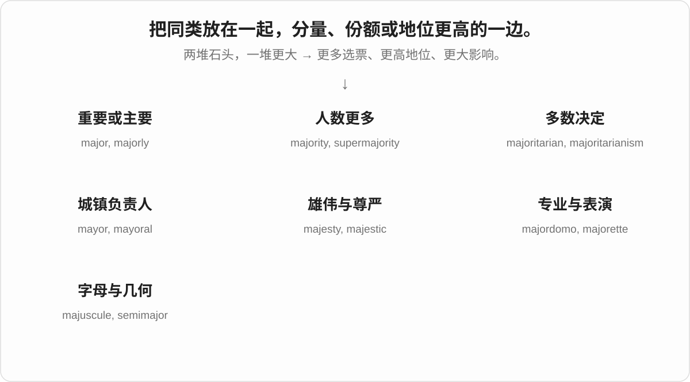

## 词形与演化规律

maior / maius：拉丁语的不同形式，英语常写成 major。

mayor：经法语 maire 传入，词形变了，仍与 major 同源。

maiestas → majesty：从更大、尊贵发展为庄严与尊号。

majuscul-：稍大的字母，进入大写体术语。

## 单词速览（按词族由简到繁）

同一基础词的相关扩展放在一起，先读基础形式，再读扩展；各组之间优先读常用的。具体词源关系见各词讲解。

| 单词 | 音标 | 核心意思 |
|---|---|---|
| [major](#w-1) | 英 /ˈmeɪdʒə/；美 /ˈmeɪdʒər/ | 重大的；主要的；主修；专业；少校；大调的 |
| [majority](#w-2) | 英 /məˈdʒɒrəti/；美 /məˈdʒɔːrəti/ | 多数；多数票；领先票数；成年身份 |
| [majoritarian](#w-11) | 英 /məˌdʒɒrɪˈteəriən/；美 /məˌdʒɔːrɪˈteriən/ | 多数决定的；主张多数统治的；多数派主义者 |
| [majoritarianism](#w-16) | 英 /məˌdʒɒrɪˈteəriənɪzəm/；美 /məˌdʒɔːrɪˈteriənɪzəm/ | 多数派主义；以多数决定为核心的主张 |
| [supermajority](#w-9) | 英 /ˌsuːpəməˈdʒɒrəti/；美 /ˌsuːpərməˈdʒɔːrəti/ | 超多数；达到较高门槛的多数票 |
| [majorly](#w-7) | 英 /ˈmeɪdʒəli/；美 /ˈmeɪdʒərli/ | 非常；严重地；大大地〔口语〕 |
| [majorette](#w-14) | 英 /ˌmeɪdʒəˈret/；美 /ˌmeɪdʒəˈret/ | 行进乐队的女领队或持杖舞表演者 |
| [semimajor](#w-15) | 英 /ˌsemiˈmeɪdʒə/；美 /ˌsemiˈmeɪdʒər/ | 半长轴的；较重要但未达主要级别的 |
| [mayor](#w-3) | 英 /meə/；美 /ˈmeɪər/ | 市长；城镇的行政或礼仪负责人 |
| [mayoral](#w-6) | 英 /ˈmeərəl/；美 /ˈmeɪərəl/ | 市长的；与市长职位有关的 |
| [mayoralty](#w-10) | 英 /ˈmeərəlti/；美 /ˈmeɪərəlti/ | 市长职位；市长任期 |
| [mayoress](#w-12) | 英 /meəˈres/；美 /ˈmeɪərəs/ | 女市长；某些传统中的市长夫人或礼仪女伴 |
| [majesty](#w-4) | /ˈmædʒəsti/ | 雄伟；庄严；陛下 |
| [majestic](#w-5) | /məˈdʒestɪk/ | 雄伟的；庄严壮丽的 |
| [majestically](#w-8) | /məˈdʒestɪkli/ | 庄严地；气势雄伟地 |
| [majordomo](#w-13) | 英 /ˌmeɪdʒəˈdəʊməʊ/；美 /ˌmeɪdʒərˈdoʊmoʊ/ | 大管家；负责统筹事务的人 |
| [majuscule](#w-17) | /ˈmædʒəskjuːl/；也读 /məˈdʒʌskjuːl/ | 大写字母；大写体；大写体的 |
| [majuscular](#w-18) | 英 /məˈdʒʌskjʊlə/；美 /məˈdʒʌskjələr/ | 大写体的；用大写字母书写的〔专业〕 |

## 逐词讲解

### 1. major — 重大的；主要的；主修；专业；少校；大调的

**音标**：英 /ˈmeɪdʒə/；美 /ˈmeɪdʒər/

**先抓住这个画面**

把同类东西摆在一起，major 是分量更重、影响更大的一边。a major problem 是不能轻轻带过的大问题。

**怎么拆**

来自拉丁语 maior“更大”，是 magnus“大”的比较级。英语形容词直接借入；军衔名词另经法语 major，是 sergent-major 的简化；大学专业义由“主要学习领域”发展。

**怎么变成今天的意思**

major in physics 是“主修物理”；a physics major 可以指物理专业学生。音乐里 major 指大调或大音程，不是说声音更响。几个意思共享“较大、较主要”的底色，专业义并不是从少校变来的。

**常见搭配与例句**

a major concern；major in history；a biology major；C major。

> The storm caused major damage to the roof.

暴风雨严重损坏了屋顶。

> She majored in physics but now works in publishing.

她大学主修物理，现在从事出版工作。

> The piece begins in C major.

这首曲子从C大调开始。

**别混淆**

big 常说体积大；major 常说重要性高。major problem 对应 minor problem；major in 后接专业名称。

### 2. majority — 多数；多数票；领先票数；成年身份

**音标**：英 /məˈdʒɒrəti/；美 /məˈdʒɔːrəti/

**先抓住这个画面**

先把一群人分边，majority 是人数占优势的那边。严格说“过半数”时，100票里的51票才过线。

**怎么拆**

经法语 majorité 来自中世纪拉丁语 māiōritās，根在 maior“更大”。现代可看出 major 与 -ity 的关系，但它不是英语临时拼出的名词。

**怎么变成今天的意思**

a majority 常指过半数；英式选举报道里的 a majority of 20 votes 也会指比对手多20票。另一个常见搭配 age of majority 指法律上的成年年龄，具体年龄由相关制度规定。

**常见搭配与例句**

a large majority；the majority of students；win by a narrow majority；reach majority。

> A majority of the members voted to keep the library open.

过半数成员投票支持让图书馆继续开放。

> The proposal passed by a narrow majority.

提案以微弱多数获得通过。

> The form asks whether the applicant has reached the age of majority.

表格询问申请人是否已达到法定成年年龄。

**别混淆**

若票数是40、35、25，40最多，却没有过半；严格区分时，英语用 plurality 表示这种“相对最多”。不要把新闻中的领先票数和总得票比例混起来。

### 3. majoritarian — 多数决定的；主张多数统治的；多数派主义者

**音标**：英 /məˌdʒɒrɪˈteəriən/；美 /məˌdʒɔːrɪˈteriən/

**先抓住这个画面**

一群人意见不同，规则是“人数更多的一边说了算”。majoritarian 描述这种安排或主张。

**怎么拆**

majorit(y) + -arian；先有 majority“多数”，再形成表示相关制度或主张的词。

**怎么变成今天的意思**

a majoritarian system 强调多数意见在作决定时的地位。它是制度描述，不等于说每一个多数决定都正确，也不自动说明少数权益怎样安排。

**常见搭配与例句**

majoritarian rule；a majoritarian approach；majoritarian democracy。

> The club adopted a majoritarian approach to choosing its activities.

俱乐部决定由多数成员的意见来选择活动。

> The essay compares majoritarian rule with decision making by consensus.

这篇文章比较了多数决定和协商达成共识两种方式。

**别混淆**

majority 是人数或票数；majoritarian 是对“如何作决定”的描述。

### 4. majoritarianism — 多数派主义；以多数决定为核心的主张

**音标**：英 /məˌdʒɒrɪˈteəriənɪzəm/；美 /məˌdʒɔːrɪˈteriənɪzəm/

**先抓住这个画面**

不只是这一次举手表决，而是把“多数人的决定应起主导作用”当成一套原则。

**怎么拆**

majoritarian + -ism，-ism 把相关形容词或立场变成一种主张、制度观念的名字。

**怎么变成今天的意思**

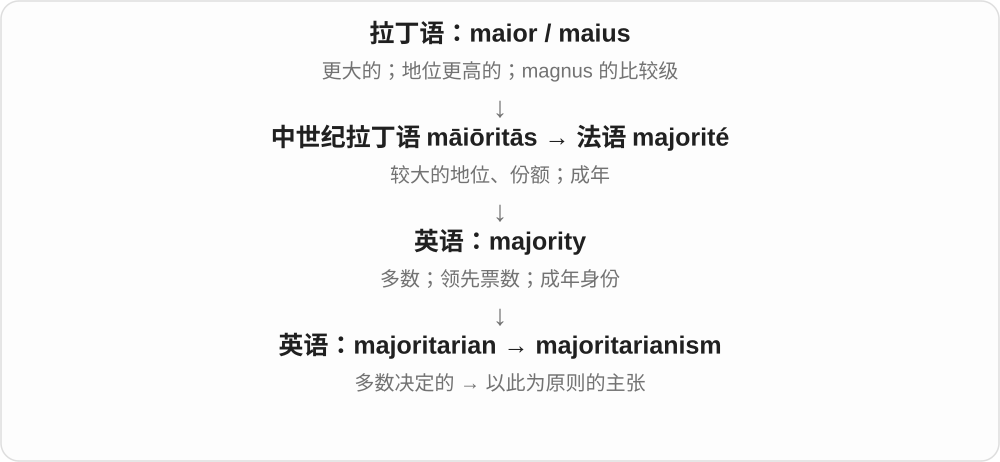

常见于政治和制度讨论。理解时问两件事：谁算多数，以及多数的权力受到哪些规则约束；这个单词本身并没有回答这两件事。

**常见搭配与例句**

pure majoritarianism；a critique of majoritarianism；limits on majoritarianism。

> The seminar examined the strengths and limits of majoritarianism.

研讨课讨论了多数派主义的优点和局限。

> Her essay asks how majoritarianism can coexist with protections for minorities.

她的文章探讨多数决定如何与保护少数群体并存。

**别混淆**

majority 指人数关系；majoritarianism 指如何让这种人数关系参与治理的理念。

### 5. supermajority — 超多数；达到较高门槛的多数票

**音标**：英 /ˌsuːpəməˈdʒɒrəti/；美 /ˌsuːpərməˈdʒɔːrəti/

**先抓住这个画面**

普通过半就能通过的门槛被抬高了，例如要求三分之二同意。这种更高的多数就是 supermajority。

**怎么拆**

super- 超过 + majority 多数，是现代英语合成。super- 不是在夸票数“超级棒”，而是在说门槛更高。

**怎么变成今天的意思**

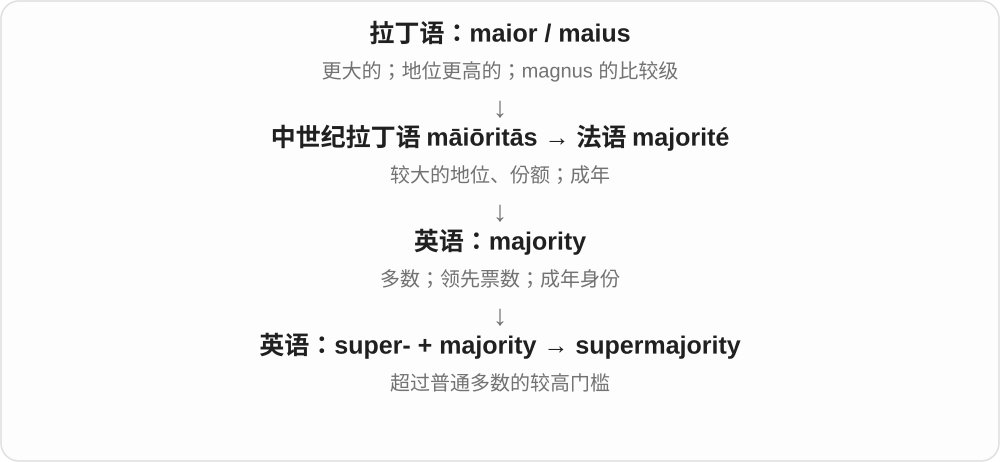

具体比例看相应规则，可以是三分之二、四分之三或其他高于简单多数的门槛。别把 supermajority 固定记成三分之二。

**常见搭配与例句**

a supermajority requirement；a two-thirds supermajority；require a supermajority。

> Changing the club’s rules requires a two-thirds supermajority.

修改俱乐部规则，需要三分之二的超多数同意。

> The proposal won a majority but fell short of the required supermajority.

提案获得了多数支持，但没达到规定的超多数门槛。

**别混淆**

51比49可能达到普通多数；若要求三分之二，51票还不够。supermajority 不是“领先第二名很多”的同义词。

### 6. majorly — 非常；严重地；大大地〔口语〕

**音标**：英 /ˈmeɪdʒəli/；美 /ˈmeɪdʒərli/

**先抓住这个画面**

聊天时把程度旋钮拧高：majorly disappointed 就是“失望透了”，语气比正式文字更随意。

**怎么拆**

major + -ly，由“程度很大”形成加强语气的副词。

**怎么变成今天的意思**

主要学习非常、严重这个口语义，常见于美式英语。词典也收“主要地”的用法，但想清楚表达“主要”时，mainly 通常更自然。

**常见搭配与例句**

majorly upset；majorly impressed；mess up majorly。

> I was majorly disappointed when the concert was cancelled.

演唱会取消时，我失望极了。

> We majorly underestimated how long the repairs would take.

我们严重低估了维修需要的时间。

**别混淆**

majorly 是语气较随意的 very/extremely；不要把所有 mainly 都替换成 majorly。

### 7. majorette — 行进乐队的女领队或持杖舞表演者

**音标**：英 /ˌmeɪdʒəˈret/；美 /ˌmeɪdʒəˈret/

**先抓住这个画面**

想象游行乐队前面，一位表演者随着节奏转动指挥杖、做动作。majorette 常指这类传统上由女性担任的角色。

**怎么拆**

英语 drum majorette 的缩短形式，由 drum major“鼓乐队领队”加传统女性后缀 -ette。词看着很法语，但英语这个用法不是直接从现代法语借来的。

**怎么变成今天的意思**

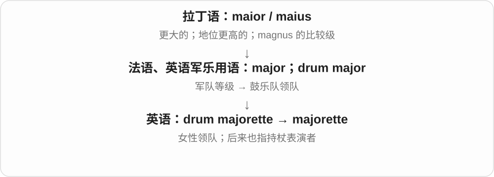

现在可以指与行进乐队一起或单独表演的持杖舞者；不一定真负责指挥全队。名词可数：a majorette、several majorettes。

**常见搭配与例句**

a troupe of majorettes；a majorette routine。

> The majorettes practised their routine before the parade.

持杖舞表演者在游行前练习了整套动作。

> She joined the marching band as a majorette.

她加入行进乐队，担任持杖表演者。

**别混淆**

majorette 偏游行、持杖表演；cheerleader 偏为比赛助威。两者可有舞蹈动作，但不是同一个职位。

### 8. semimajor — 半长轴的；较重要但未达主要级别的

**音标**：英 /ˌsemiˈmeɪdʒə/；美 /ˌsemiˈmeɪdʒər/

**先抓住这个画面**

最值得记的是 semimajor axis：在一个椭圆里，找到最长的那条直径，再取一半。

**怎么拆**

semi- 一半 + major 较大的；在几何搭配中 major 修饰较长的轴。英语也偶尔用 semimajor 表示“有一定重要性，但还不算主要”。

**怎么变成今天的意思**

椭圆长轴全长若是10厘米，半长轴就是5厘米。它从中心量到长轴端点，不是从焦点量；天文学也用它描述椭圆轨道的尺度。

**常见搭配与例句**

the semimajor axis；a semimajor role〔较少见〕。

> The ellipse has a semimajor axis of five centimetres.

这个椭圆的半长轴长五厘米。

> The diagram labels the semimajor axis with the letter a.

图中用字母a标出了半长轴。

**别混淆**

semimajor axis 是半长轴，semiminor axis 是半短轴；两个 semi- 都指各自轴长的一半。

### 9. mayor — 市长；城镇的行政或礼仪负责人

**音标**：英 /meə/；美 /ˈmeɪər/

**先抓住这个画面**

把一座城的事务交给一个居首的人，mayor 就是这个职位的名称。不同地方的市长，实际权力可能差很多。

**怎么拆**

古法语 maire 来自后期拉丁语作名词用的 maior“较高者、负责人”。它和 major 同源，但走过法语这条路，拼写和发音变了。

**怎么变成今天的意思**

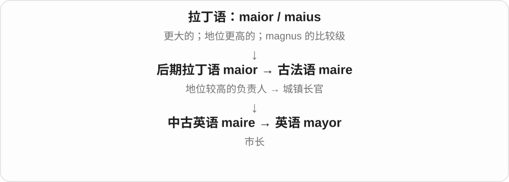

日常直接说 the mayor 或 Mayor + 姓氏。mayor 本身不限定性别；不能靠“更大”的词根推断这个职位一定权力最大。

**常见搭配与例句**

the mayor of a city；elect a mayor；the mayor’s office。

> The mayor opened the new public library.

市长为新公共图书馆揭幕。

> Residents sent a letter to the mayor about the bus service.

居民们就公交服务给市长写了一封信。

**别混淆**

mayor 是市长，major 可指少校；前者通常没有 /dʒ/ 音。词形接近，职位完全不同。

### 10. mayoral — 市长的；与市长职位有关的

**音标**：英 /ˈmeərəl/；美 /ˈmeɪərəl/

**先抓住这个画面**

在一个事情前贴上“这是市长那一层面的”标签：选市长的选举，就是 a mayoral election。

**怎么拆**

这里讲常用英语形容词：mayor + -al。另有借自西班牙语的少见同形名词，不是这里的“市长的”。

**怎么变成今天的意思**

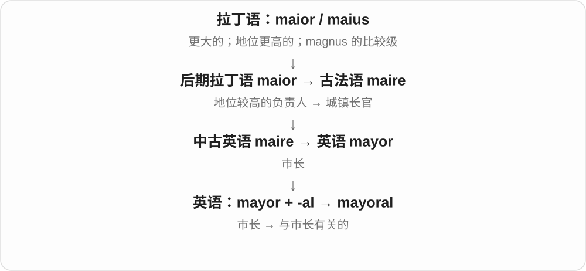

通常放在名词前，修饰 election、candidate、office、duties。它说事情属于哪个职位，不表示“像市长一样威风”。

**常见搭配与例句**

a mayoral candidate；mayoral duties；the mayoral election。

> Three mayoral candidates attended the debate.

三位市长候选人参加了辩论。

> She balanced her mayoral duties with family life.

她兼顾市长职责和家庭生活。

**别混淆**

mayor 是担任职位的人；mayoral 是形容词；mayoralty 是职位或任职时期。

### 11. mayoralty — 市长职位；市长任期

**音标**：英 /ˈmeərəlti/；美 /ˈmeɪərəlti/

**先抓住这个画面**

把镜头从“那位市长”移到“他占据的职位或任职那段时间”。这就是 mayoralty。

**怎么拆**

中古英语 mairaltee 经法语 mairalté 等形式借入，法语里已经有表示职位的名词；不能只把它当现代英语 mayor 拼上 -alty。

**怎么变成今天的意思**

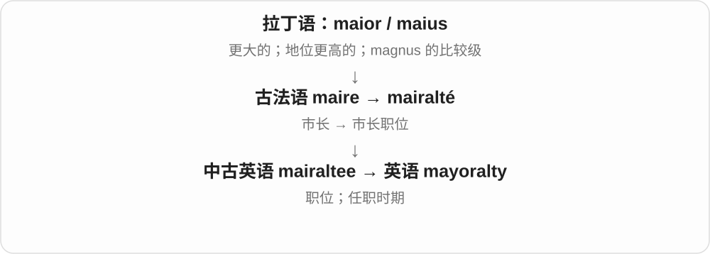

during her mayoralty 是“在她担任市长期间”。这个词比 time as mayor 正式，常见于历史介绍和政务报道。

**常见搭配与例句**

win the mayoralty；during his mayoralty；seek the mayoralty。

> The museum opened during her mayoralty.

这家博物馆在她担任市长期间开放。

> He announced his intention to seek the mayoralty.

他宣布有意竞选市长。

**别混淆**

mayoral 是“市长的”；mayoralty 才能作为名词说一个职位或一段任期。

### 12. mayoress — 女市长；某些传统中的市长夫人或礼仪女伴

**音标**：英 /meəˈres/；美 /ˈmeɪərəs/

**先抓住这个画面**

这是在 mayor 后加女性称呼的旧式做法。但看到 mayoress，先看上下文：她可能自己任职，也可能陪市长出席礼仪活动。

**怎么拆**

mayor + -ess，-ess 是传统女性称呼后缀。早期可指市长妻子，后来也指女性市长；一些地方还保留陪同市长参加礼仪活动的称呼。

**怎么变成今天的意思**

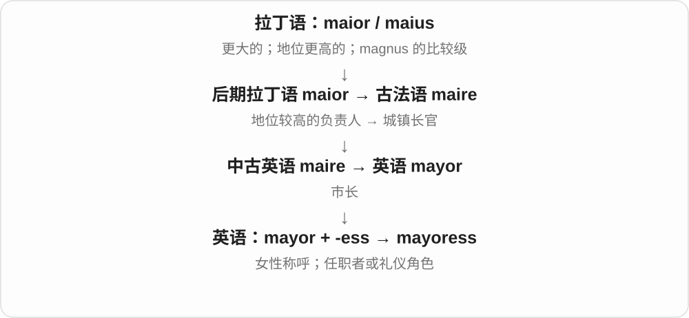

现在 mayor 本身可指任何性别。mayoress 仍会出现在历史文字或一些地方的礼仪称呼里，不能一律理解成“市长夫人”，也不能一律理解成实任市长。

**常见搭配与例句**

a former mayoress；the mayor and mayoress。

> The biography describes her election as mayoress in the 1930s.

这本传记写到她在20世纪30年代当选女市长。

> The programme listed the mayor and mayoress as guests of honour.

活动单把市长和市长礼仪女伴列为贵宾。

**别混淆**

如果想明确说她本人是市长，用 mayor 即可；mayoress 的身份要从文章中判断。

### 13. majesty — 雄伟；庄严；陛下

**音标**：/ˈmædʒəsti/

**先抓住这个画面**

站在雪山、宫殿或大瀑布前，你会觉得自己很小，眼前事物很有气势。majesty 就是这种令人肃然的宏大感。

**怎么拆**

古法语 majesté 来自拉丁语 māiestās“伟大、尊严”，与 maior“更大”的词干相关。maj- 后面不是现代英语的独立小词。

**怎么变成今天的意思**

the majesty of the mountains 说群山的雄伟；Your Majesty 是当面对君主的尊称，His/Her Majesty 用于提及。它既能写景，也能用于礼仪。

**常见搭配与例句**

natural majesty；the majesty of the sea；Your Majesty。

> We stopped to admire the majesty of the mountains.

我们停下来，欣赏群山的雄伟。

> The actor bowed and said, “Your Majesty.”

演员鞠躬说：“陛下。”

**别混淆**

majesty 说气势或尊号；majesty 的形容词是 majestic。size 只说尺寸，不自动带敬畏感。

### 14. majestic — 雄伟的；庄严壮丽的

**音标**：/məˈdʒestɪk/

**先抓住这个画面**

大，而且有一种从容、庄重的气势。山峰、建筑，甚至一只缓缓走过的鹿，都可以 majestic。

**怎么拆**

英语 majesty + -ic，换成形容词时词形与重音发生变化：MAJesty → maJEStic。

**怎么变成今天的意思**

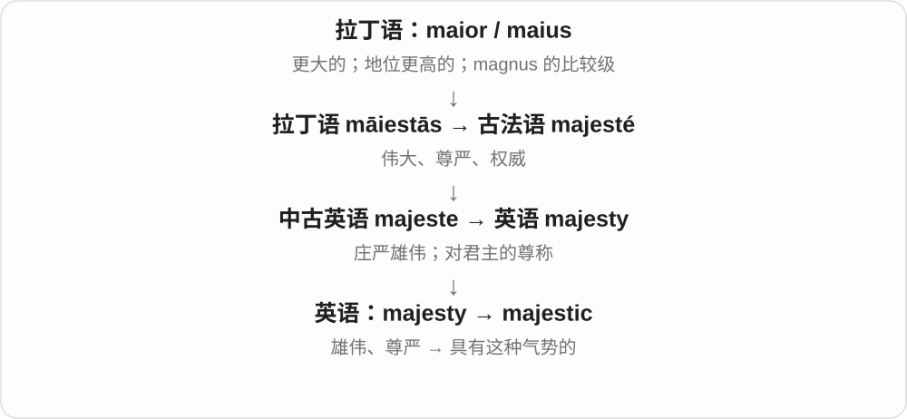

不是看到大东西就用 majestic。它强调大气、优美或威严，让人愿意停下来欣赏；一堆巨大垃圾通常只有 huge，没有这种赞美。

**常见搭配与例句**

majestic mountains；a majestic building；a majestic animal。

> A majestic eagle glided above the valley.

一只雄鹰威风凛凛地滑翔过山谷上空。

> The hall looked majestic in the morning light.

大厅在晨光中显得庄严壮丽。

**别混淆**

magnificent 泛指极出色、壮观；majestic 更集中在庄严的气势。

### 15. majestically — 庄严地；气势雄伟地

**音标**：/məˈdʒestɪkli/

**先抓住这个画面**

把 majestic 的气势放在动作上：缓缓升起、从容前行，或高高矗立。

**怎么拆**

majestic + -ally；常见读法中 -ically 是 /ɪkli/，不必读成每个字母一个音节。

**怎么变成今天的意思**

rise majestically 可以写山峰、建筑或徐徐升空的物体。它描述旁观者感受到的气势，不是速度单位。

**常见搭配与例句**

rise majestically；move majestically；stand majestically。

> The castle rose majestically above the river.

城堡气势雄伟地矗立在河岸上方。

> The ship moved majestically out of the harbour.

大船气势非凡地驶出港口。

**别混淆**

slowly 只是慢；majestically 常有从容感，但核心是庄严、壮观。

### 16. majordomo — 大管家；负责统筹事务的人

**音标**：英 /ˌmeɪdʒəˈdəʊməʊ/；美 /ˌmeɪdʒərˈdoʊmoʊ/

**先抓住这个画面**

一座大宅里，很多人分别做饭、清洁、接待；majordomo 是把这些人和事务统筹起来的大管家。

**怎么拆**

经意大利语 maggiordomo 或西班牙语 mayordomo，来自中世纪拉丁语 maior domūs：maior 居首者 + domūs 房子的。不是 major + 英语 dome“圆顶”。

**怎么变成今天的意思**

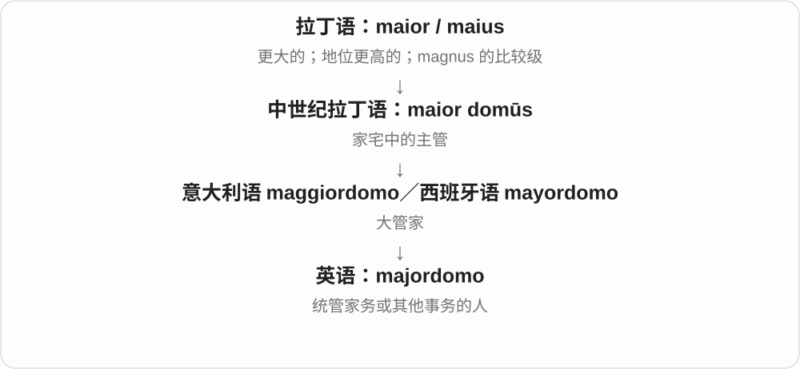

常见于历史、小说或较正式的比喻。现代也可借指一个组织里负责协调具体事务的人，语气有时带一点戏谑。

**常见搭配与例句**

the household majordomo；serve as majordomo。

> The majordomo arranged rooms for all the guests.

大管家为所有客人安排了房间。

> In the novel, the majordomo knows every secret in the house.

小说里，大管家知道这座宅子里的每个秘密。

**别混淆**

butler 常是宅邸管家；majordomo 更突出统管一整套人员和事务。具体职责仍取决于背景。

### 17. majuscule — 大写字母；大写体；大写体的

**音标**：/ˈmædʒəskjuːl/；也读 /məˈdʒʌskjuːl/

**先抓住这个画面**

把 a 写成 A：你看到的是大写字母。majuscule 是书写和古文字研究里比较专业的叫法。

**怎么拆**

法语 majuscule 来自拉丁语 māiuscula littera“稍大一些的字母”；māiusculus 是 maior 的指小形式，意思是“略大”，不是“比大写还小”。

**怎么变成今天的意思**

在古抄本研究中，它也指整套大写体书写，不只是今天句首的那个大写字母。日常说 capital letter 或 uppercase letter 更常见。

**常见搭配与例句**

a majuscule letter；majuscule script；written in majuscules。

> The inscription was written entirely in majuscules.

这段铭文全部用大写字母写成。

> The guide explains the difference between majuscule and minuscule scripts.

指南解释了大写体和小写体的区别。

**别混淆**

majuscule 与 minuscule 对应大写体与小写体；muscle“肌肉”与这个词没有这种拆分关系。

### 18. majuscular — 大写体的；用大写字母书写的〔专业〕

**音标**：英 /məˈdʒʌskjʊlə/；美 /məˈdʒʌskjələr/

**先抓住这个画面**

这是给一种书写样式贴标签：它用的是 majuscule 那套大写字形。

**怎么拆**

majuscule 的形容词派生形式，以 majuscul- 词干接 -ar。属于文字研究用语，不是 major + muscular，更不表示肌肉发达。

**怎么变成今天的意思**

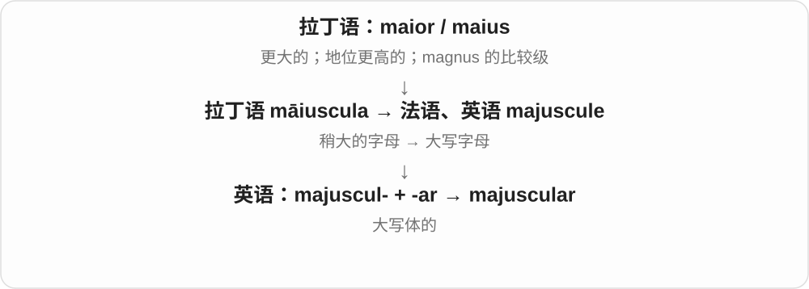

可以修饰 script、lettering、forms。majuscule 本身也能作形容词，因此这个更长的形式不是必需；读古文字学材料时能认出即可。

**常见搭配与例句**

majuscular script；majuscular lettering。

> The catalogue describes the lettering as majuscular.

目录将这种字形描述为大写体。

> Students compared majuscular forms with later minuscule writing.

学生们把大写体字形与较晚的小写体作了比较。

**别混淆**

majuscular 讲字形；muscular 才讲肌肉。不要因为末尾像，就想成“很有力量的”。

## 这一组要分清什么

major / mayor 同源，但 major 不是 mayor 的现代词根拆分。

major 的专业、军衔和音乐义不是一个接一个串起来的故事。

majority 的过半数、领先票数、成年身份要按搭配区分。

maj- 不能把所有 ma- 开头的单词都拉进来；muscular 是肌肉，不是这一组。

## 串起来练习

用 major problem 写一件重要的事，用 majority 写一次表决，再用 majestic 写一处景色，比较“更大”在三处怎样变化。
