# 0293 · stru-, struct- — 堆叠、安排、搭建；结构与拆解

[逐词精讲目录](../00_逐词精讲目录.md) · [总目录](../00_总目录_按常用程度.md)

## 核心词根与来源

从**把积木一块块搭起来**开始。拉丁语 struere 是堆叠、排列、建造，structus 是它的分词形式。construct 把东西合起来搭，structure 看搭成的整体怎样组织；obstruct 在前面堆出障碍；destroy 则把原先搭好的拆毁。instruct 走过“安排、装备”的意思，后来成为教导。砖块换成知识、规则、证据，这个词族就能从工地一直用到课堂、写作和程序设计。

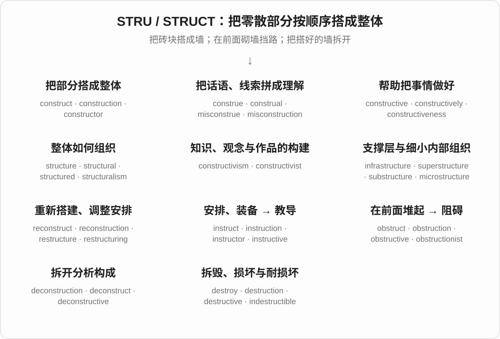

## 词形与演化规律

**stru- 与 struct- 是同一拉丁动词不同词形留下的痕迹**，并不是英语里随意增删 ct。**construe / construct** 是同源异形词：一条专门发展了语法分析、解释的用法，另一条保留更显眼的 struct。**destroy** 经法语传播，外形已经变化；**destruction、destructive、destructor** 各有自己的借入路线。现代英语里的 **re-、micro-、sub-、super-** 又在借词上继续造词。图示呈现具体来源；积木、墙和骨架是理解现代词义的联想。

## 单词速览（常用到不常用）

| 单词 | 音标 | 核心意思 |
|---|---|---|
| [construction](#w-1) | /kənˈstrʌkʃən/ | 建造；建筑工程；构造；语法结构；理解方式 |
| [structure](#w-2) | 英 /ˈstrʌktʃə/；美 /ˈstrʌktʃər/ | 结构；构造物；组织、安排 |
| [destroy](#w-3) | /dɪˈstrɔɪ/ | 摧毁；毁掉；使失去作用或基础 |
| [infrastructure](#w-4) | 英 /ˈɪnfrəstrʌktʃə/；美 /ˈɪnfrəstrʌktʃər/ | 基础设施；支持日常运转的基础系统 |
| [destruction](#w-5) | /dɪˈstrʌkʃən/ | 毁灭；摧毁；严重破坏 |
| [structural](#w-6) | /ˈstrʌktʃərəl/ | 结构的；影响整体基础或组织方式的 |
| [instruction](#w-7) | /ɪnˈstrʌkʃən/ | 教学；指示；说明步骤；计算机指令 |
| [instructor](#w-8) | 英 /ɪnˈstrʌktə/；美 /ɪnˈstrʌktər/ | 教练；指导员；讲师 |
| [construct](#w-9) | 动词 /kənˈstrʌkt/；名词英 /ˈkɒnstrʌkt/，美 /ˈkɑːnstrʌkt/ | 建造；构建；构想出的概念或模型 |
| [reconstruction](#w-10) | /ˌriːkənˈstrʌkʃən/ | 重建；复原过程；复原物或情景 |
| [destructive](#w-11) | /dɪˈstrʌktɪv/ | 破坏性的；有害的 |
| [structured](#w-12) | 英 /ˈstrʌktʃəd/；美 /ˈstrʌktʃərd/ | 有条理的；有明确安排的；结构化的 |
| [constructive](#w-13) | /kənˈstrʌktɪv/ | 有建设性的；有助改进的；法律上推定的 |
| [restructuring](#w-14) | 英 /ˌriːˈstrʌktʃərɪŋ/；美 /ˌriːˈstrʌktʃərɪŋ/ | 重组；结构调整 |
| [obstruction](#w-15) | /əbˈstrʌkʃən/ | 障碍物；堵塞；阻挠 |
| [instructional](#w-16) | /ɪnˈstrʌkʃənəl/ | 教学用的；提供操作指导的 |
| [destroyer](#w-17) | 英 /dɪˈstrɔɪə/；美 /dɪˈstrɔɪər/ | 破坏者；毁灭性事物；驱逐舰 |
| [instruct](#w-18) | /ɪnˈstrʌkt/ | 教导；指导；指示、命令 |
| [reconstruct](#w-19) | /ˌriːkənˈstrʌkt/ | 重建；根据线索还原 |
| [structurally](#w-20) | /ˈstrʌktʃərəli/ | 在结构上；从组织方式看 |
| [obstruct](#w-21) | /əbˈstrʌkt/ | 挡住；堵塞；阻挠 |
| [indestructible](#w-22) | /ˌɪndɪˈstrʌktəbəl/ | 不可摧毁的；非常结实耐用的 |
| [restructure](#w-23) | 英 /ˌriːˈstrʌktʃə/；美 /ˌriːˈstrʌktʃər/ | 重组；重新安排结构 |
| [instructive](#w-24) | /ɪnˈstrʌktɪv/ | 有启发性的；能让人学到东西的 |
| [obstructive](#w-25) | /əbˈstrʌktɪv/ | 阻挠的；妨碍通行的；阻塞性的 |
| [constructor](#w-26) | 英 /kənˈstrʌktə/；美 /kənˈstrʌktər/ | 建造者；制造者；构造函数 |
| [destruct](#w-27) | /dɪˈstrʌkt/ | 使毁坏；毁灭；自行毁坏（较专门） |
| [superstructure](#w-28) | 英 /ˈsuːpəstrʌktʃə/；美 /ˈsuːpərstrʌktʃər/ | 上部结构；上层建筑 |
| [deconstruction](#w-29) | /ˌdiːkənˈstrʌkʃən/ | 拆解；解构；揭示内部假设的分析 |
| [reconstructive](#w-30) | /ˌriːkənˈstrʌktɪv/ | 重建的；修复性的 |
| [constructively](#w-31) | /kənˈstrʌktɪvli/ | 建设性地；有助解决问题地 |
| [unstructured](#w-32) | 英 /ʌnˈstrʌktʃəd/；美 /ʌnˈstrʌktʃərd/ | 没有固定安排的；非结构化的 |
| [infrastructural](#w-33) | 英 /ˌɪnfrəˈstrʌktʃərəl/；美 /ˌɪnfrəˈstrʌktʃərəl/ | 基础设施方面的 |
| [deconstruct](#w-34) | /ˌdiːkənˈstrʌkt/ | 拆解；细致分析；解构 |
| [microstructure](#w-35) | 英 /ˈmaɪkrəʊˌstrʌktʃə/；美 /ˈmaɪkroʊˌstrʌktʃər/ | 微观结构；显微组织 |
| [constructivist](#w-36) | /kənˈstrʌktɪvɪst/ | 建构主义者；建构主义的；构成主义艺术的 |
| [constructivism](#w-37) | /kənˈstrʌktɪvɪzəm/ | 建构主义；构成主义艺术 |
| [construe](#w-38) | /kənˈstruː/ | 把……理解为；解释、分析句意 |
| [structuralism](#w-39) | /ˈstrʌktʃərəlɪzəm/ | 结构主义 |
| [substructure](#w-40) | 英 /ˈsʌbstrʌktʃə/；美 /ˈsʌbstrʌktʃər/ | 下部结构；基础部分；子结构 |
| [obstructionist](#w-41) | /əbˈstrʌkʃənɪst/ | 阻挠者；采取阻挠策略的 |
| [destructor](#w-42) | 英 /dɪˈstrʌktə/；美 /dɪˈstrʌktər/ | 销毁装置；垃圾焚烧炉；析构函数 |
| [structuralist](#w-43) | /ˈstrʌktʃərəlɪst/ | 结构主义者；结构主义的 |
| [destructively](#w-44) | /dɪˈstrʌktɪvli/ | 破坏性地；以造成损害的方式 |
| [destructiveness](#w-45) | /dɪˈstrʌktɪvnəs/ | 破坏性；毁坏能力或倾向 |
| [misconstrue](#w-46) | /ˌmɪskənˈstruː/ | 误解；错误地解释 |
| [microstructural](#w-47) | 英 /ˌmaɪkrəʊˈstrʌktʃərəl/；美 /ˌmaɪkroʊˈstrʌktʃərəl/ | 微观结构的；显微组织方面的 |
| [destructible](#w-48) | /dɪˈstrʌktəbəl/ | 可毁坏的；会被破坏的 |
| [constructional](#w-49) | /kənˈstrʌkʃənəl/ | 建造方面的；构造上的 |
| [deconstructive](#w-50) | /ˌdiːkənˈstrʌktɪv/ | 解构的；以拆解方式分析的 |
| [construal](#w-51) | /kənˈstruːəl/ | 理解方式；解释；对事物的认知呈现 |
| [deconstructionist](#w-52) | /ˌdiːkənˈstrʌkʃənɪst/ | 解构主义者；解构主义的 |
| [indestructibility](#w-53) | /ˌɪndɪˌstrʌktəˈbɪləti/ | 不可摧毁性；极其牢固耐用的性质 |
| [constructiveness](#w-54) | /kənˈstrʌktɪvnəs/ | 建设性；有助改进的程度或特质 |
| [misconstruction](#w-55) | /ˌmɪskənˈstrʌkʃən/ | 误解；错误解释；错误构造 |
| [obstructively](#w-56) | /əbˈstrʌktɪvli/ | 故意妨碍地；百般刁难地 |

## 逐词讲解

### 1. construction — 建造；建筑工程；构造；语法结构；理解方式

**音标**：/kənˈstrʌkʃən/

**先抓住这个画面**

construction 既能指“正在搭”，也能指“是怎样搭起来的”。

**怎么拆**

经古法语 construction 来自拉丁 constructio；与 construct 是同源借词。现代可按 construct + -ion 理解，但历史上并非先有英语动词再统一加后缀。

**怎么变成今天的意思**

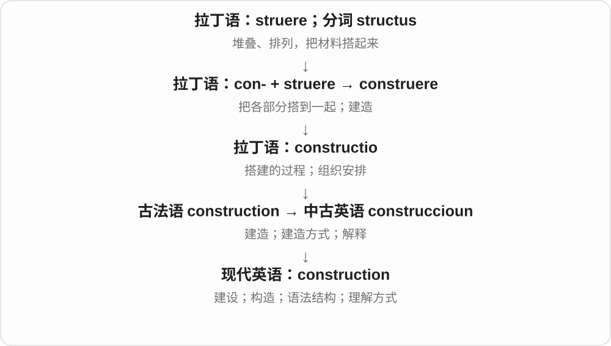

under construction 是正在施工；the construction of a sentence 是句子的组织方式。put a different construction on something 较正式，表示给某件事另一种解释，像把同一批线索拼出不同理解。

**常见搭配与例句**

under construction；the construction industry；sentence construction；put a construction on。

> The new library is still under construction.

新图书馆仍在施工。

> The teacher explained the construction of the sentence.

老师解释了这个句子的结构。

**别混淆**

construction 偏建造过程或组织方式；structure 偏已经形成的整体及其内部关系。

### 2. structure — 结构；构造物；组织、安排

**音标**：英 /ˈstrʌktʃə/；美 /ˈstrʌktʃər/

**先抓住这个画面**

structure 不只是有哪些零件，更是零件彼此怎么连起来，最后撑成一个整体。

**怎么拆**

经法语 structure 借自拉丁 structura，来自 struere 的 struct- 词干；英语随后把名词转用为动词“安排结构”。

**怎么变成今天的意思**

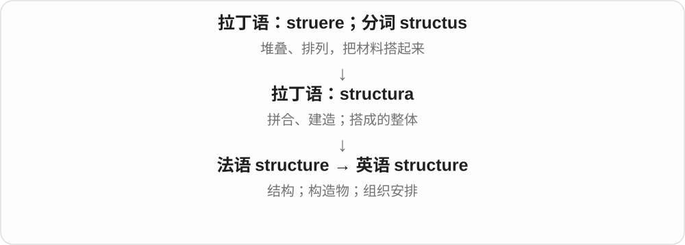

可谈建筑、文章、公司甚至分子的 structure。动词 structure a talk 是给讲话排出层次，不是替讲话造一栋房子。

**常见搭配与例句**

the structure of an essay；a steel structure；structure a lesson。

> The report has a clear structure.

这份报告的结构很清楚。

> She structured the lesson around three practical problems.

她围绕三个实际问题组织了这堂课。

**别混淆**

content 是装进去的内容；structure 是内容或部件怎样组织。内容丰富，也可能缺少清楚的结构。

### 3. destroy — 摧毁；毁掉；使失去作用或基础

**音标**：/dɪˈstrɔɪ/

**先抓住这个画面**

destroy 像把搭好的房子拆到立不住：东西可能还剩碎片，但原来的整体已经没了。

**怎么拆**

拉丁 de- 撤去、拆下 + struere 建造，形成 destruere；经通俗拉丁、古法语 destruire 和中古英语 destroyen，变成今天的 destroy。

**怎么变成今天的意思**

可毁掉房屋、文件，也可毁掉信任、机会或名声。destroy confidence 通常是很强的说法，不只是让人有一点失望。

**常见搭配与例句**

destroy a building；destroy evidence；destroy confidence；destroy a reputation。

> The fire destroyed the empty warehouse.

火灾烧毁了那座空仓库。

> Repeated broken promises destroyed their trust.

一次次失信毁掉了他们之间的信任。

**别混淆**

damage 是损坏，程度可轻可重；destroy 通常意味着原有功能、整体或价值遭到根本破坏。

### 4. infrastructure — 基础设施；支持日常运转的基础系统

**音标**：英 /ˈɪnfrəstrʌktʃə/；美 /ˈɪnfrəstrʌktʃər/

**先抓住这个画面**

infrastructure 像城市藏在生活背后的底盘：道路送人，水管送水，电网供电，网络传信息。

**怎么拆**

借自法语 infrastructure；法语由 infra- 在下面 + structure 构成。不是英语先把两个现成词拼起来再传给法语。

**怎么变成今天的意思**

它不只指地下设施；桥梁、学校、通信网络等是否归入，要看讨论范围。公司也可说 digital infrastructure，指支持业务的数字系统。

**常见搭配与例句**

public infrastructure；transport infrastructure；digital infrastructure；invest in infrastructure。

> The flood damaged roads and other essential infrastructure.

洪水损坏了道路和其他重要基础设施。

> The company is improving its digital infrastructure.

公司正在改善数字基础设施。

**别混淆**

infrastructure 强调支持系统运作的基础条件；a structure 可以只是某一座构造物。

### 5. destruction — 毁灭；摧毁；严重破坏

**音标**：/dɪˈstrʌkʃən/

**先抓住这个画面**

destruction 把镜头放在“被毁掉”这件事和留下的结果上：原先完整的东西成了废墟或失去价值。

**怎么拆**

拉丁 destructio 经古法语 destrucion 等路线借入；destruct- 来自 destruere 的分词词干。它与 destroy 同源，但不是把英语 destroy 按规则改成 destruct。

**怎么变成今天的意思**

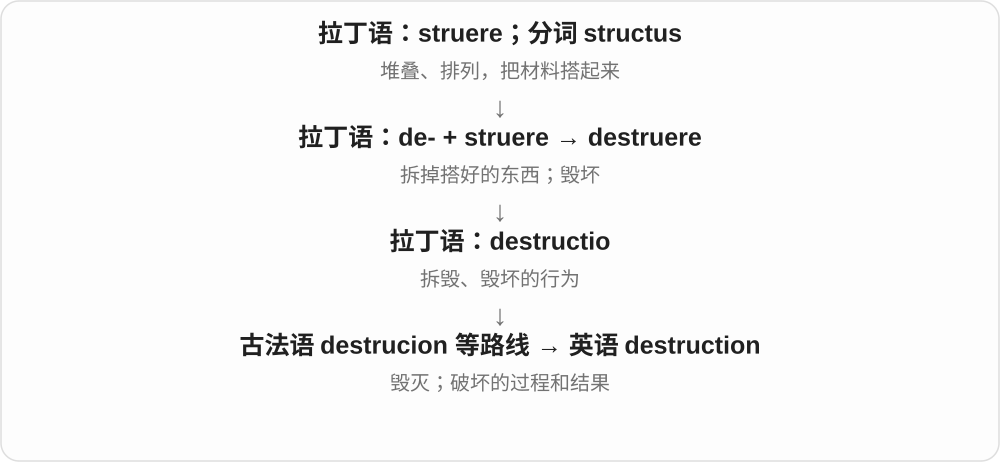

通常不可数。the destruction of a habitat 是栖息地遭到破坏；document destruction 则可能是有计划地销毁文件，具体好坏由语境决定。

**常见搭配与例句**

widespread destruction；the destruction of habitats；cause destruction。

> The storm left widespread destruction along the coast.

暴风雨给沿海地区留下了大范围破坏。

> The report describes the destruction of several historic buildings.

报告描述了几座历史建筑遭到毁坏的情况。

**别混淆**

destruction 强调毁坏；demolition 常指有计划地拆除建筑。并非所有 destruction 都是失控事故。

### 6. structural — 结构的；影响整体基础或组织方式的

**音标**：/ˈstrʌktʃərəl/

**先抓住这个画面**

structural 像房子的梁柱，或公司里“谁管谁、钱怎么流”的安排：说的是支撑整体的组织方式。

**怎么拆**

structure + -al，英语中形成表示“与结构有关”的形容词。

**怎么变成今天的意思**

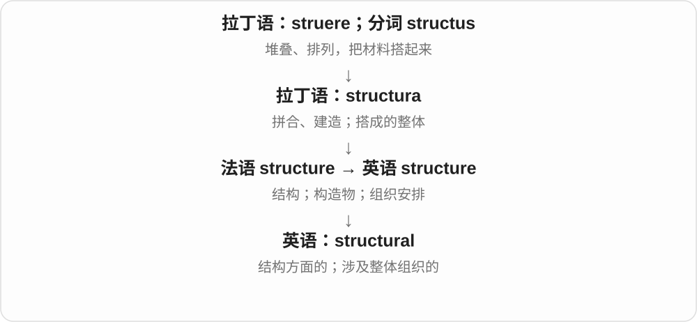

structural damage 可能影响建筑支撑；structural problems 也可指制度、组织造成的问题，不是换一个人或补一个小洞就能解决。

**常见搭配与例句**

structural damage；structural change；structural problems；structural engineering。

> The survey found no structural damage to the house.

勘查没有发现房屋结构受损。

> The company needs structural changes to reduce repeated delays.

公司需要调整组织结构，才能减少反复出现的延误。

**别混淆**

structural 强调内部安排或支撑；superficial 强调表面。结构问题未必肉眼立刻可见。

### 7. instruction — 教学；指示；说明步骤；计算机指令

**音标**：/ɪnˈstrʌkʃən/

**先抓住这个画面**

instruction 是把“该怎么做”说清楚；几条 instructions 放在一起，就成了可照着走的步骤。

**怎么拆**

经古法语 instruccion 来自拉丁 instructio；现代与 instruct + -ion 对应，历史上是名词自己的借入路线。

**怎么变成今天的意思**

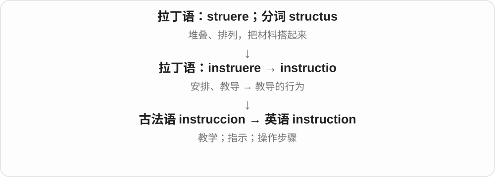

教学义常不可数，如 receive instruction；操作说明通常用复数 instructions。a machine instruction 是计算机可以执行的一条指令。

**常见搭配与例句**

follow the instructions；clear instructions；instruction in a subject；a machine instruction。

> Read the instructions before assembling the shelf.

组装书架前先阅读说明步骤。

> The course provides instruction in basic photography.

这门课程教授摄影基础知识。

**别混淆**

information 只是提供信息；instructions 通常明确告诉你怎样做或要求你做什么。

### 8. instructor — 教练；指导员；讲师

**音标**：英 /ɪnˈstrʌktə/；美 /ɪnˈstrʌktər/

**先抓住这个画面**

instructor 通常是站在旁边示范、纠正，带你把某种技能练会的人。

**怎么拆**

来自拉丁 instructor“安排者、教导者”，与 instruere 同源；现代可分析成 instruct + -or，但历史上有独立的拉丁名词。

**怎么变成今天的意思**

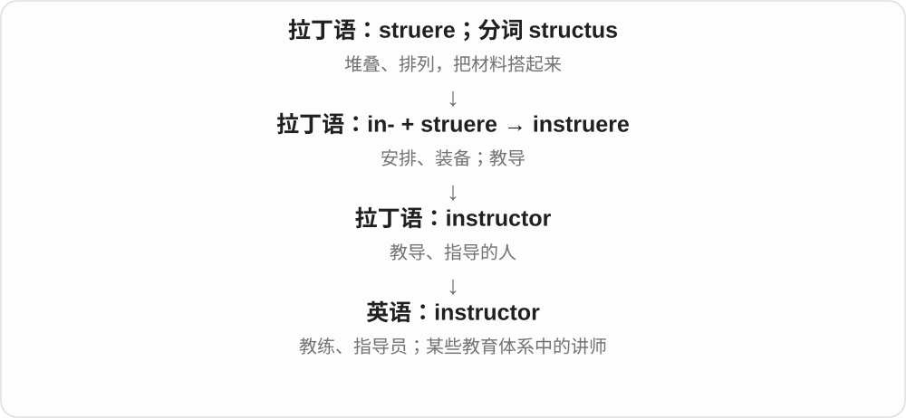

driving instructor、ski instructor 都很常见。大学中的 Instructor 也可是一种具体职称，其等级和职责取决于学校制度。

**常见搭配与例句**

a driving instructor；a fitness instructor；a course instructor。

> My driving instructor taught me how to park on a hill.

我的驾驶教练教我如何在坡道上停车。

> Ask the course instructor before changing your project topic.

更改项目题目前，先问问课程老师。

**别混淆**

teacher 是最广泛的教师称呼；instructor 常突出具体技能或课程的指导。professor 不能自动与它互换。

### 9. construct — 建造；构建；构想出的概念或模型

**音标**：动词 /kənˈstrʌkt/；名词英 /ˈkɒnstrʌkt/，美 /ˈkɑːnstrʌkt/

**先抓住这个画面**

construct 就像一块块搭积木：材料可以是砖，也可以是证据、规则和想法。

**怎么拆**

动词借自拉丁分词 constructus，来自 con- 一起 + struere 堆叠、建造；名词后来在英语中由相关动词或形容词转用，重音随之区分。

**怎么变成今天的意思**

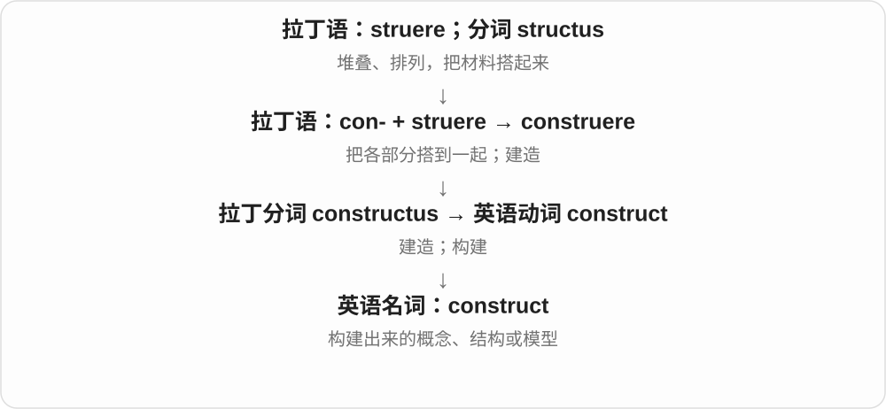

construct a bridge 是建桥，construct an argument 是把理由组织成论证。名词 a construct 指人为组织出来的概念，例如研究中的“智力”构念；这不等于说它没有实际意义。名词重音在前，动词在后。

**常见搭配与例句**

construct a model；construct an argument；a social construct。

> The students constructed a bridge from wooden sticks.

学生用木条搭了一座桥。

> The researchers treated intelligence as a complex construct.

研究者把智力视为一个复杂的理论构念。

**别混淆**

build 更日常，适用范围很广；construct 常强调有计划地把部分组织成整体。

### 10. reconstruction — 重建；复原过程；复原物或情景

**音标**：/ˌriːkənˈstrʌkʃən/

**先抓住这个画面**

reconstruction 可以是灾后重新盖起来的过程，也可以是博物馆里根据遗迹复原出来的场景。

**怎么拆**

英语 reconstruct 的对应动作名词，也能看成 re- + construction；并非必须经一个另造的拉丁单词才进入英语。

**怎么变成今天的意思**

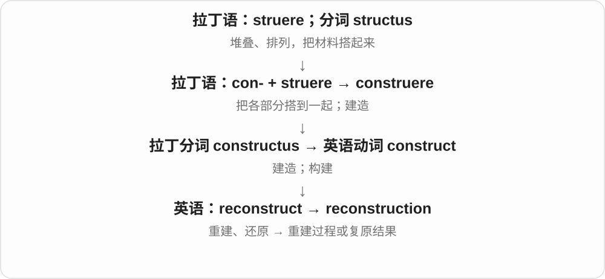

the reconstruction of a town 是城镇重建；a reconstruction of an ancient house 是古屋的复原模型。美国历史中的大写 Reconstruction 特指内战后的重建时期。

**常见搭配与例句**

postwar reconstruction；a digital reconstruction；reconstruction of the events。

> Reconstruction of the station took three years.

车站重建用了三年。

> The exhibition includes a digital reconstruction of the palace.

展览包含一份宫殿的数字复原模型。

**别混淆**

reconstruction 可能根据有限证据补足形状；an original 是原物，不能把复原物当成完全保存下来的原件。

### 11. destructive — 破坏性的；有害的

**音标**：/dɪˈstrʌktɪv/

**先抓住这个画面**

destructive 像一边做事一边拆掉脚下的台阶：让原来能运转、能信任的东西逐渐坏掉。

**怎么拆**

拉丁 destructivus 经法语 destructif 进入英语；现代可看到 destruct- + -ive，但不能据此断言先有现代英语 destruct。

**怎么变成今天的意思**

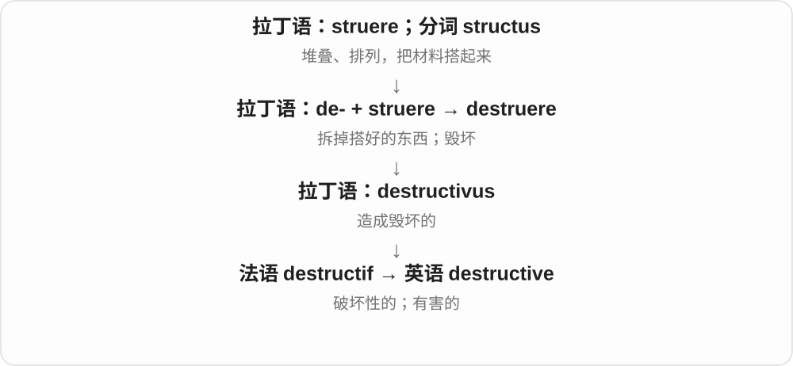

可说 destructive storms，也可说 destructive habits。destructive criticism 只顾打击、不能帮助改善；技术里的 destructive testing 则通过使样品损坏来检验性能，不是说测试本身不正当。

**常见搭配与例句**

destructive behaviour；destructive criticism；destructive testing。

> The argument had become destructive rather than helpful.

争论开始造成伤害，已经无助于解决问题。

> The laboratory used destructive testing on a small sample.

实验室对一小份样品进行了破坏性测试。

**别混淆**

constructive 帮助改善；destructive 造成损害。但技术术语中的 destructive 有时只是说明会损伤样品。

### 12. structured — 有条理的；有明确安排的；结构化的

**音标**：英 /ˈstrʌktʃəd/；美 /ˈstrʌktʃərd/

**先抓住这个画面**

structured 像桌上有编号的格子：先做什么、信息放哪儿，都有明确位置。

**怎么拆**

structure 的过去分词加形容词用法；-ed 表示已经组织安排好的状态。

**怎么变成今天的意思**

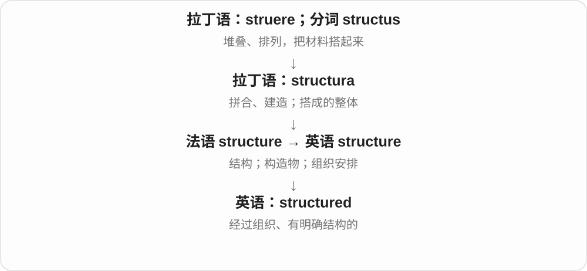

a structured interview 按预设的问题和流程进行；structured data 则按明确字段或模式组织，比如姓名、日期各占一列。

**常见搭配与例句**

a structured course；a structured interview；structured data。

> The course offers structured practice every morning.

课程每天上午安排有步骤的练习。

> The records were converted into structured data.

这些记录被转换成了结构化数据。

**别混淆**

structural 是与结构有关；structured 是已经安排出明确结构。structured 并不必然死板。

### 13. constructive — 有建设性的；有助改进的；法律上推定的

**音标**：/kənˈstrʌktɪv/

**先抓住这个画面**

constructive 的日常画面是：指出哪里不行，还帮忙把下一步搭起来。

**怎么拆**

经法语 constructif 或直接来自中世纪拉丁 constructivus；现代可分析成 construct + -ive。英语早期有“经解释推定”的用法，后来发展出促进改进的常用义。

**怎么变成今天的意思**

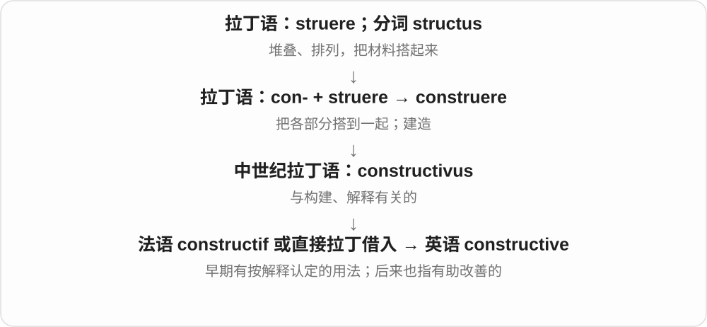

constructive criticism 不要求只说好话，关键是批评能帮助改善。法律术语里的 constructive 则可能表示依法推定或视为，不能照译成“有益的”。

**常见搭配与例句**

constructive criticism；constructive feedback；a constructive discussion。

> Her criticism was direct but constructive.

她的批评很直接，但有助于改进。

> We had a constructive discussion about the delays.

我们就延误问题进行了有建设性的讨论。

**别混淆**

positive 可以只是态度积极；constructive 更看是否帮助解决问题。constructional 则多谈建造或构造本身。

### 14. restructuring — 重组；结构调整

**音标**：英 /ˌriːˈstrʌktʃərɪŋ/；美 /ˌriːˈstrʌktʃərɪŋ/

**先抓住这个画面**

restructuring 是把原来的格局重新排一遍的过程：谁负责什么，资源放在哪里，都可能改变。

**怎么拆**

restructure + -ing，动词去掉末尾不发音 e 后接 -ing，形成过程名词。

**怎么变成今天的意思**

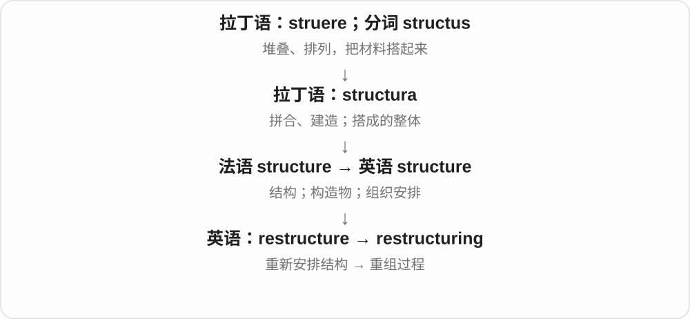

通常是不可数名词，a restructuring 也可指一次具体重组。corporate restructuring 是公司重组，不应把它一律翻成裁员。

**常见搭配与例句**

corporate restructuring；debt restructuring；undergo restructuring。

> The restructuring brought the two support teams together.

这次重组把两个支持团队合在了一起。

> Staff received weekly updates during the restructuring.

重组期间，员工每周都会收到进展通报。

**别混淆**

restructuring 强调整体安排改变；reorganization 与它接近，具体差异多由语境决定。

### 15. obstruction — 障碍物；堵塞；阻挠

**音标**：/əbˈstrʌkʃən/

**先抓住这个画面**

obstruction 可以是挡在那里的东西，也可以是“让通道或事情过不去”这一状态。

**怎么拆**

来自拉丁 obstructio，与 obstruere 相连；现代可与 obstruct + -ion 对应。

**怎么变成今天的意思**

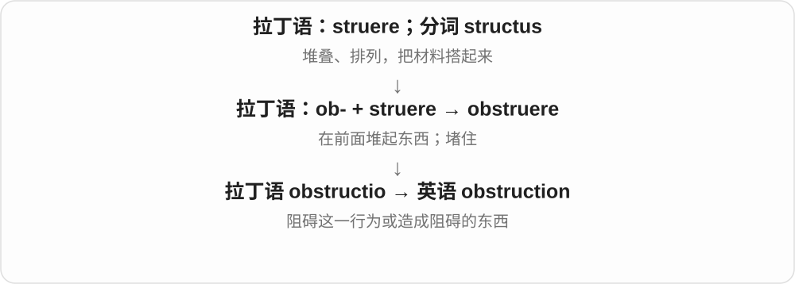

clear an obstruction 是移走障碍；deliberate obstruction 是故意阻挠。a pipe obstruction 则是管道内部堵住，不一定能从外面看出来。

**常见搭配与例句**

remove an obstruction；an obstruction in a pipe；deliberate obstruction。

> Workers removed an obstruction from the drain.

工人清除了排水管里的堵塞物。

> The project faced months of deliberate obstruction.

这个项目遭到持续数月的蓄意阻挠。

**别混淆**

obstacle 常是需要克服的一项困难；obstruction 更突出挡住、堵住或阻挠的作用。

### 16. instructional — 教学用的；提供操作指导的

**音标**：/ɪnˈstrʌkʃənəl/

**先抓住这个画面**

instructional 像视频里一边做、一边指出下一步：它本来就是为了教会你。

**怎么拆**

instruction + -al，表示与教学、指导有关。

**怎么变成今天的意思**

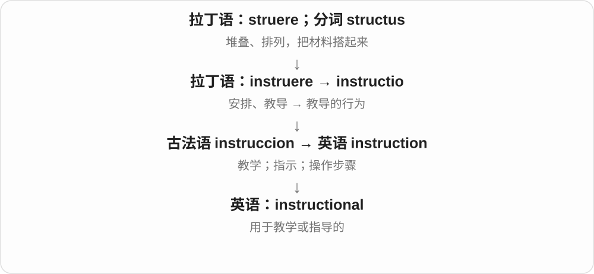

instructional materials 包括课件、示范视频、练习说明等。这个词主要说明用途，不能单凭它判断材料是否真讲得好。

**常见搭配与例句**

an instructional video；instructional materials；instructional design。

> She made an instructional video about repairing bicycle brakes.

她制作了一段讲解自行车刹车维修的教学视频。

> The teacher adapted the instructional materials for younger learners.

老师调整了教学材料，使其适合年纪更小的学生。

**别混淆**

instructional 强调用于教学；instructive 强调看完或经历后让人学到东西。事故也可能 instructive，却不是为教学设计的。

### 17. destroyer — 破坏者；毁灭性事物；驱逐舰

**音标**：英 /dɪˈstrɔɪə/；美 /dɪˈstrɔɪər/

**先抓住这个画面**

destroyer 本来就是造成毁坏的那个人或东西；舰艇名称则来自一种早期“对付鱼雷艇的舰船”。

**怎么拆**

现代看作 destroy + -er；中古英语已有对应施事名词，亦受古法语同源形式影响。舰种名后来由 torpedo-boat destroyer 缩短而来。

**怎么变成今天的意思**

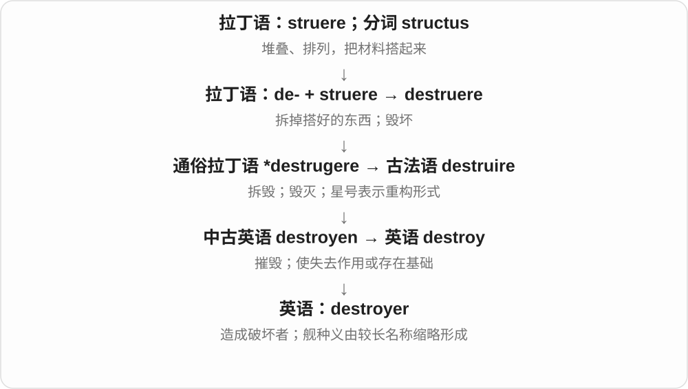

a destroyer of trust 可以是毁掉信任的行为或人。军舰义是舰种名称，不能根据字面推断某艘舰的具体装备、规模或任务都一样。

**常见搭配与例句**

a destroyer of habitats；a naval destroyer；a destroyer escorting other ships。

> Unchecked pollution can be a destroyer of fragile habitats.

未受控制的污染会毁掉脆弱的栖息地。

> The destroyer entered the harbour at dawn.

驱逐舰在黎明时驶入港口。

**别混淆**

destructor 常指装置或程序中的析构函数；destroyer 的常见专门义是驱逐舰，两者不是拼写变体。

### 18. instruct — 教导；指导；指示、命令

**音标**：/ɪnˈstrʌkt/

**先抓住这个画面**

instruct 可以想成给人搭好做事的步骤，让他知道该怎么动手。

**怎么拆**

来自拉丁 instructus，是 instruere 的分词；历史构词 in- 在上、向内 + struere。拉丁词已从安排、装备发展到教导，不是英语发明了“往脑子里建房”的字面说法。

**怎么变成今天的意思**

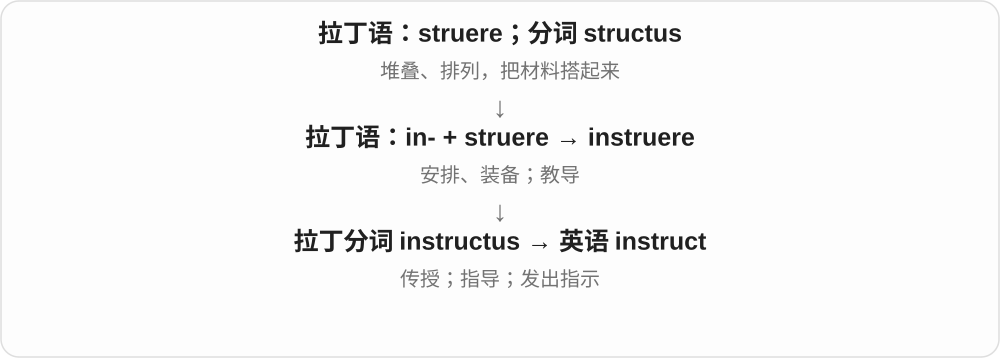

instruct someone in a skill 是传授技能；instruct someone to do something 常是正式指示。语气往往比普通 tell 更有明确的职责或权威感。

**常见搭配与例句**

instruct someone in first aid；instruct someone to wait；be instructed how to。

> The coach instructed us in the basic movements.

教练教了我们基本动作。

> Staff were instructed to keep the entrance clear.

员工被要求保持入口畅通。

**别混淆**

teach 侧重让人学会；instruct 既能教，也能直接下达做事指示。

### 19. reconstruct — 重建；根据线索还原

**音标**：/ˌriːkənˈstrʌkt/

**先抓住这个画面**

reconstruct 像捡起散落的积木再搭一次，也像拿碎片、照片和证词把过去拼回来。

**怎么拆**

re- 重新 + construct，是英语内部形成的派生词。

**怎么变成今天的意思**

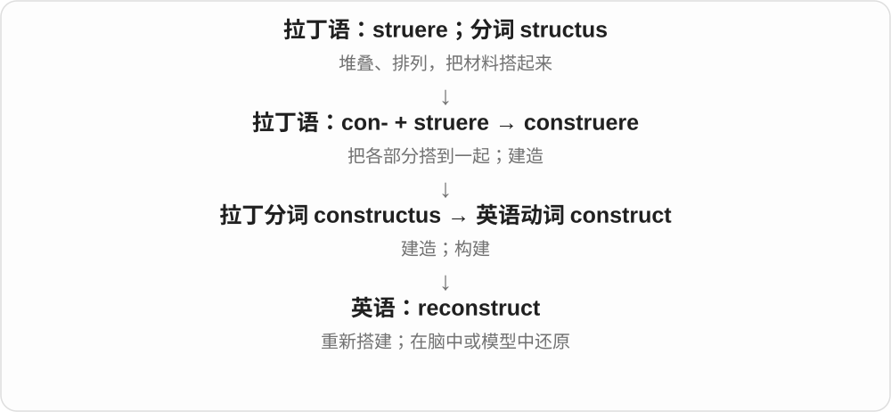

reconstruct a building 可以重建建筑；reconstruct the events 则是根据材料还原发生经过，不必真的重演。

**常见搭配与例句**

reconstruct a building；reconstruct the sequence of events；reconstruct a face。

> The team reconstructed the vase from dozens of fragments.

团队用几十块碎片复原了花瓶。

> Investigators reconstructed the events from camera recordings.

调查人员根据录像还原了事件经过。

**别混淆**

rebuild 常指实际重建；reconstruct 还很适合从证据恢复过去的形状、过程或情景。

### 20. structurally — 在结构上；从组织方式看

**音标**：/ˈstrʌktʃərəli/

**先抓住这个画面**

structurally 是暂时不看颜色、题材或包装，只看里面的骨架怎么搭。

**怎么拆**

structural + -ly，限定比较、判断所针对的方面。

**怎么变成今天的意思**

structurally sound 是结构可靠、稳固；structurally similar 说明组成关系相似，即使外观看起来不一样。

**常见搭配与例句**

structurally sound；structurally similar；structurally different。

> The old barn is still structurally sound.

这座旧谷仓的结构仍然稳固。

> The two arguments are structurally similar.

这两个论证在结构上很相似。

**别混淆**

visually similar 说看起来像；structurally similar 说内部安排像，两个判断可以不同。

### 21. obstruct — 挡住；堵塞；阻挠

**音标**：/əbˈstrʌkt/

**先抓住这个画面**

obstruct 像在路中间堆起一堵墙：人走不过去，光看不过去，事情也推进不了。

**怎么拆**

借自拉丁 obstructus，来自 ob- 对着、在前 + struere 堆起，合成 obstruere“堵住”。

**怎么变成今天的意思**

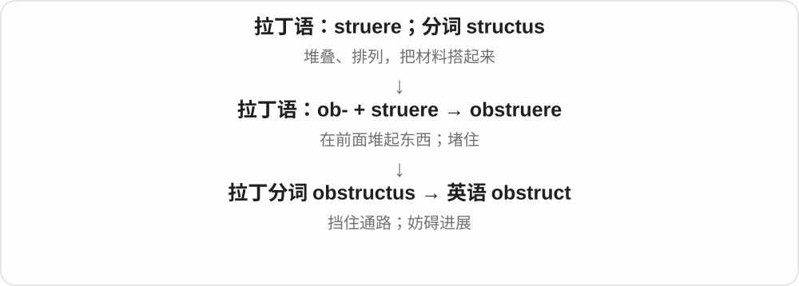

既可挡住道路、视线，也可妨碍调查或合作。并非每次都出于故意：倒树同样能 obstruct a road。

**常见搭配与例句**

obstruct the entrance；obstruct the view；obstruct an investigation。

> A fallen branch obstructed the narrow path.

一根倒下的树枝挡住了狭窄的小路。

> The tall fence obstructs our view of the river.

高围栏挡住了我们看河的视线。

**别混淆**

block 更日常；obstruct 较正式，既指实体挡路，也强调对过程的妨碍。

### 22. indestructible — 不可摧毁的；非常结实耐用的

**音标**：/ˌɪndɪˈstrʌktəbəl/

**先抓住这个画面**

indestructible 像怎么折腾都还好好的旧玩具，也可以形容困难打不垮的信心或关系。

**怎么拆**

可分析为否定 in- + destructible；destruct- 追溯到拉丁 destruere。这里 in- 是“不”，与 instruct 中表示位置的 in- 不同。

**怎么变成今天的意思**

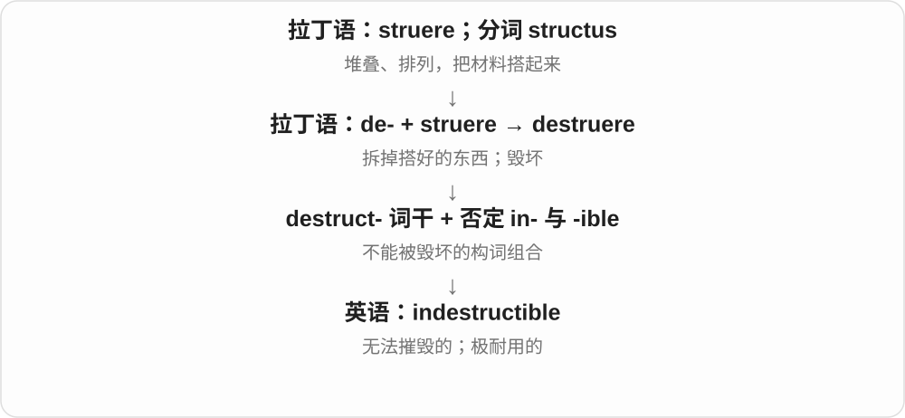

日常经常是夸张说法，virtually indestructible 表示几乎弄不坏，而不是经过论证的绝对无敌。也能说 an indestructible bond，牢不可破的联系。

**常见搭配与例句**

virtually indestructible；an indestructible bond；seem indestructible。

> That old toy truck seems virtually indestructible.

那辆旧玩具卡车简直怎么也弄不坏。

> Their friendship appeared indestructible.

他们的友谊似乎牢不可破。

**别混淆**

durable 是经久耐用；indestructible 的语气更强。现实产品里的这个词常应按语境理解为极其结实。

### 23. restructure — 重组；重新安排结构

**音标**：英 /ˌriːˈstrʌktʃə/；美 /ˌriːˈstrʌktʃər/

**先抓住这个画面**

restructure 像不换全部积木，而把分组、连接和层次重新安排。

**怎么拆**

re- 重新 + structure 动词；英语内部构词。

**怎么变成今天的意思**

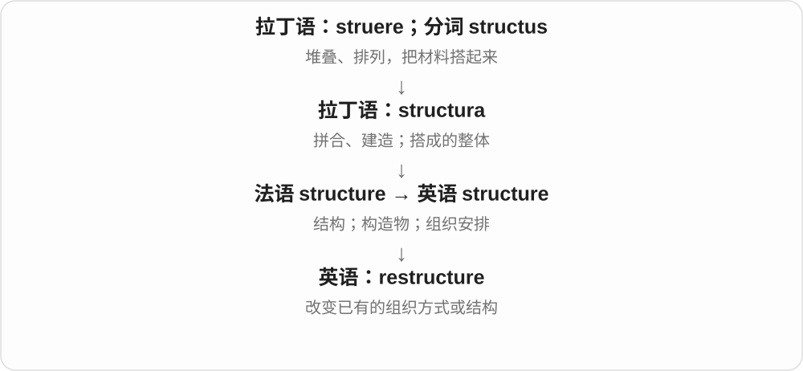

可重组公司部门、调整课程安排，也可重新安排债务条件。它说的是结构改变，未必意味着裁员，也不只是把名称改掉。

**常见搭配与例句**

restructure a company；restructure a course；restructure debt。

> The school restructured the course into shorter modules.

学校把课程重新组织成较短的模块。

> The company plans to restructure its regional offices.

公司计划重组各地区办事处。

**别混淆**

reconstruct 重在重建、还原；restructure 重在调整已有各部分的关系和安排。

### 24. instructive — 有启发性的；能让人学到东西的

**音标**：/ɪnˈstrʌktɪv/

**先抓住这个画面**

instructive 像看别人把一个错误走完，你一下明白了“原来问题出在这里”。

**怎么拆**

instruct + -ive，表示能起到教导、启发作用。

**怎么变成今天的意思**

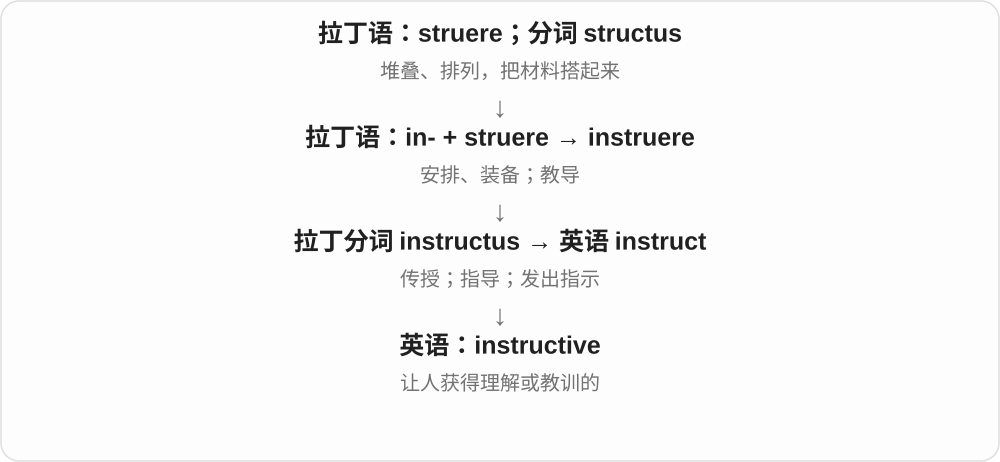

an instructive example 是能说明问题的例子；it is instructive to compare… 表示把两者比较一下会很有收获。失败也可以很 instructive。

**常见搭配与例句**

an instructive example；an instructive comparison；it is instructive to。

> Comparing the two drafts was surprisingly instructive.

比较这两份草稿出乎意料地让人受益。

> The failed experiment provided an instructive example of the problem.

这次失败的实验提供了一个很能说明问题的例子。

**别混淆**

informative 强调提供有用信息；instructive 常进一步强调帮助理解规律、方法或教训。

### 25. obstructive — 阻挠的；妨碍通行的；阻塞性的

**音标**：/əbˈstrʌktɪv/

**先抓住这个画面**

obstructive 描写“老是在前面挡一下”的人、做法或状况。

**怎么拆**

obstruct + -ive，表示造成阻碍的。

**怎么变成今天的意思**

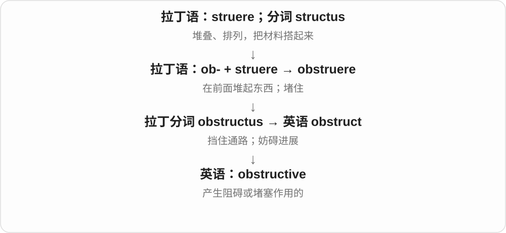

说一个人 obstructive，通常在批评他故意不配合。医学术语中的 obstructive 则表示某条通道受到阻塞，没有道德评价。

**常见搭配与例句**

obstructive behaviour；an obstructive attitude；obstructive measures。

> His obstructive attitude made a simple task much harder.

他处处阻挠的态度让一件简单任务难了许多。

> The chair asked members to stop using obstructive tactics.

主席要求成员停止采取阻挠手段。

**别混淆**

critical 可以提出必要的批评；obstructive 带“妨碍事情正常进行”的负面判断，不能把一切不同意见都叫 obstructive。

### 26. constructor — 建造者；制造者；构造函数

**音标**：英 /kənˈstrʌktə/；美 /kənˈstrʌktər/

**先抓住这个画面**

constructor 是负责把东西组织成形的那一方；程序里则是让新对象准备好使用的环节。

**怎么拆**

有从中世纪拉丁 constructor 借入的分析，远源是拉丁 construere；也有按英语 construct + -or 分析的词典。现代形式都容易看出“建造者”。

**怎么变成今天的意思**

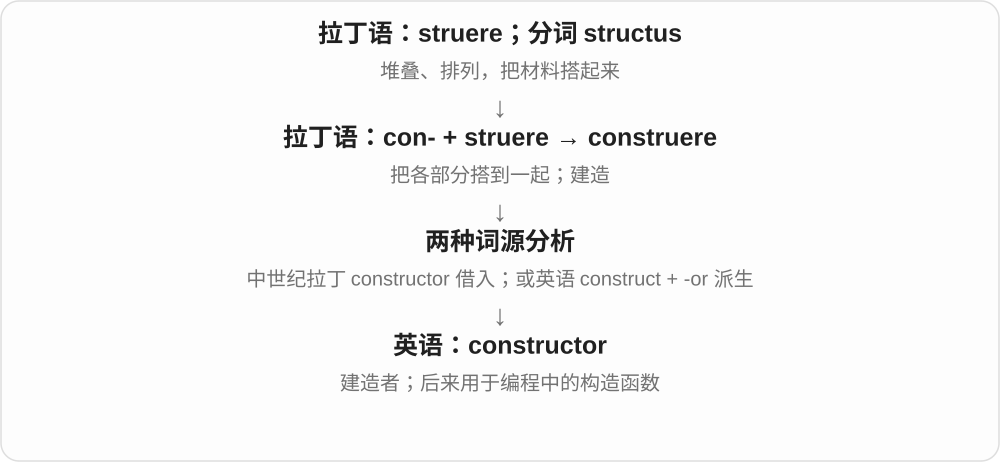

普通义可指制造者、建造者。C++ 中 constructor 用于初始化对象，例如设置最初的数据；不要把它简单理解成“分配内存”这一个动作。

**常见搭配与例句**

a vehicle constructor；a default constructor；call a constructor。

> The constructor built the prototype from lightweight materials.

制造者用轻质材料制作了原型。

> The constructor initializes the object’s name.

构造函数初始化对象的名称。

**别混淆**

constructor 负责对象开始使用时的初始化；destructor 负责对象结束时的清理。普通盖房子的人更常叫 builder。

### 27. destruct — 使毁坏；毁灭；自行毁坏（较专门）

**音标**：/dɪˈstrʌkt/

**先抓住这个画面**

destruct 常像设备或故事里的东西被设定为“到某个时候就毁掉”，带一点技术或科幻语感。

**怎么拆**

现代用法常分析为从 destruction 去掉 -ion 反构出来；历史上也记录过与拉丁分词 destructus 有关的较早用例。它不是 destroy 的正常过去式。

**怎么变成今天的意思**

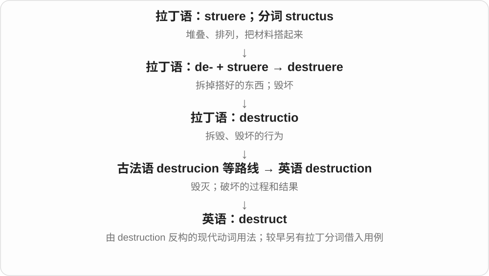

可以及物，也可以不及物。普通日常表达里 destroy 更自然；destruct 常出现在技术语境或其派生表达中。

**常见搭配与例句**

a device designed to destruct；destruct automatically。

> In the film, the robot destructs after delivering its final message.

影片里，机器人传达最后一条信息后自行毁灭了。

> An accidental signal caused the device to destruct.

一个意外信号导致设备自行毁坏。

**别混淆**

destroy 是通用动词；destruct 语域较窄。destruction 的存在不意味着所有场合都该把 destroy 换成 destruct。

### 28. superstructure — 上部结构；上层建筑

**音标**：英 /ˈsuːpəstrʌktʃə/；美 /ˈsuːpərstrʌktʃər/

**先抓住这个画面**

superstructure 是在底座之上再搭起来的那一层：有下面的支撑，它才能立住。

**怎么拆**

super- 在上面 + structure；这里 super- 主要表示位置，并不是“超级厉害”。

**怎么变成今天的意思**

可指船舶主甲板之上的建筑部分，或建筑的上部结构。社会理论中的 superstructure 则借这个画面谈建立在经济基础之上的制度、观念等。

**常见搭配与例句**

a ship’s superstructure；the steel superstructure；base and superstructure。

> Workers repaired the ship’s superstructure.

工人修复了船的上层建筑。

> The steel superstructure rests on concrete supports.

钢制上部结构支承在混凝土支座上。

**别混淆**

substructure 是下部支撑；superstructure 是其上的部分。infrastructure 更常指支持社会或系统运转的一整套设施。

### 29. deconstruction — 拆解；解构；揭示内部假设的分析

**音标**：/ˌdiːkənˈstrʌkʃən/

**先抓住这个画面**

deconstruction 像把一个看似天经地义的说法拆开，检查它靠哪些词、对立和默认前提才站起来。

**怎么拆**

现代解构理论用语经法语 déconstruction 传播，与德里达的作品有关；英语更早也有建筑拆解义。可见成分是 de- 拆开 + construction 构造，不能把所有用法都说成由更晚的英语 deconstruct 加 -ion。

**怎么变成今天的意思**

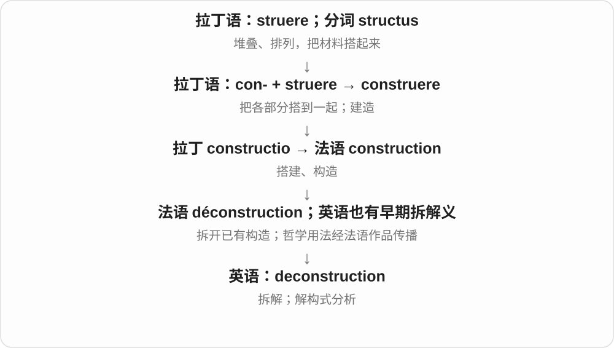

文学、哲学中的解构会检查文本怎样建立对立或高低关系，以及文本自身怎样使这些关系不稳定。广义用法则可以是深入拆析论点；建筑语境仍可指拆解以回收材料。

**常见搭配与例句**

a deconstruction of an argument；literary deconstruction；careful deconstruction of a building。

> Her essay offers a deconstruction of the novel’s sharp division between nature and culture.

她的论文解构了小说中自然与文化之间截然分开的界线。

> Careful deconstruction allowed most of the timber to be reused.

细致拆解使大部分木料得以重新使用。

**别混淆**

destruction 强调毁坏；deconstruction 可以为了看清内部关系或回收部件。理论中的解构也不是随便宣布“什么都没有意义”。

### 30. reconstructive — 重建的；修复性的

**音标**：/ˌriːkənˈstrʌktɪv/

**先抓住这个画面**

reconstructive 强调把受损、缺失的部分重新搭好，让形态或功能得到恢复。

**怎么拆**

reconstruct + -ive，表示以重建为作用或目的。

**怎么变成今天的意思**

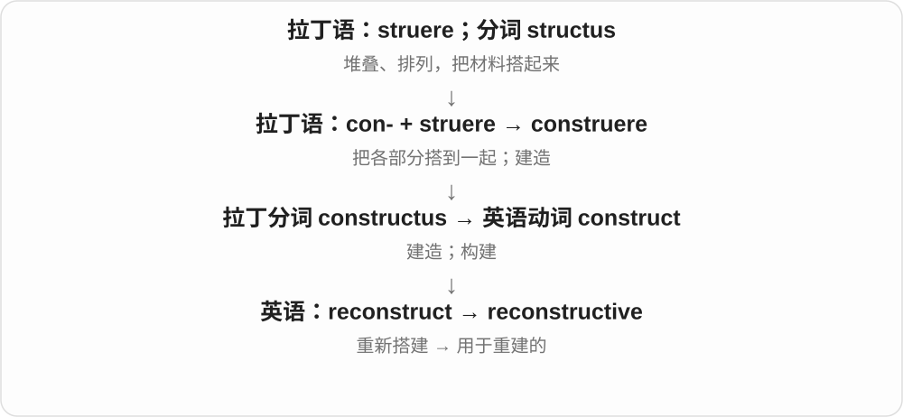

常见 reconstructive surgery，即修复身体结构、功能的外科手术；也可以谈 reconstructive work，重建工作。这里只是在解释用途，不等于保证能完全恢复原样。

**常见搭配与例句**

reconstructive surgery；reconstructive work；reconstructive techniques。

> She underwent reconstructive surgery after the accident.

事故后，她接受了修复重建手术。

> The museum documented every stage of the reconstructive work.

博物馆记录了重建工作的每个阶段。

**别混淆**

constructive 是有建设性的；reconstructive 多强调对已有损伤或缺失进行重建。

### 31. constructively — 建设性地；有助解决问题地

**音标**：/kənˈstrʌktɪvli/

**先抓住这个画面**

constructively 是把不满变成可用的建议，让讨论能往前走。

**怎么拆**

constructive + -ly，描写回应、讨论、处理问题的方式。

**怎么变成今天的意思**

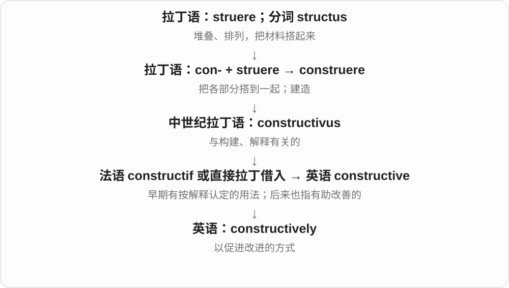

respond constructively 可以包括明确反对，只要说明理由并推动改进；并不是一味顺着别人。

**常见搭配与例句**

respond constructively；work constructively；deal constructively with。

> She responded constructively to the negative feedback.

她以有助于改进的方式回应了负面反馈。

> The two teams worked constructively despite their differences.

两个团队虽然有分歧，仍以解决问题的态度合作。

**别混淆**

politely 只说明礼貌；constructively 说明这番话或这个做法有助于把事情做好。

### 32. unstructured — 没有固定安排的；非结构化的

**音标**：英 /ʌnˈstrʌktʃəd/；美 /ʌnˈstrʌktʃərd/

**先抓住这个画面**

unstructured 像留出一块空地，让活动自己长出来，没有事先画好每一步的格子。

**怎么拆**

un- 否定 + structured。

**怎么变成今天的意思**

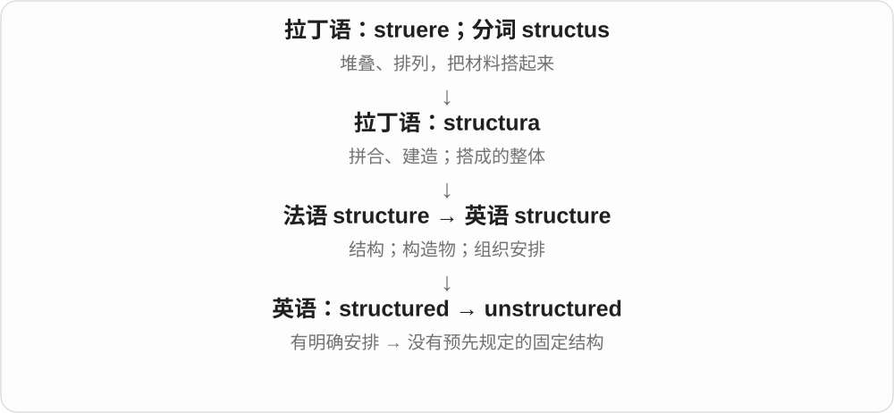

unstructured play 是孩子自由开展的游戏。unstructured data 多指不按固定字段模式组织的文字、图像等；不等于完全没有任何内部规律。

**常见搭配与例句**

unstructured play；unstructured interviews；unstructured data。

> The children had an hour of unstructured play.

孩子们有一个小时的自由游戏时间。

> The system searches unstructured text from old reports.

这个系统搜索旧报告中的非结构化文本。

**别混淆**

unstructured 说没有预定格式；disorganized 往往批评混乱、安排差。自由活动可以 unstructured 而很有价值。

### 33. infrastructural — 基础设施方面的

**音标**：英 /ˌɪnfrəˈstrʌktʃərəl/；美 /ˌɪnfrəˈstrʌktʃərəl/

**先抓住这个画面**

infrastructural 把问题指向那套底层支撑：路通不通，电够不够，网络稳不稳。

**怎么拆**

infrastructure + -al，表示与基础设施有关；重音通常转到 struc 音节。

**怎么变成今天的意思**

infrastructural investment 是投向这类支撑系统的投入；infrastructural constraints 则是道路、电力等条件形成的限制。

**常见搭配与例句**

infrastructural development；infrastructural investment；infrastructural constraints。

> The region faces serious infrastructural constraints.

这个地区受到严重的基础设施条件限制。

> The proposal includes several infrastructural improvements.

提案包括几项基础设施改进。

**别混淆**

infrastructural 说明涉及基础设施；structural 的范围更广，可以只是某个组织或物体的内部结构。

### 34. deconstruct — 拆解；细致分析；解构

**音标**：/ˌdiːkənˈstrʌkt/

**先抓住这个画面**

deconstruct 就像揭开成品的接缝，看看各部分怎样共同制造出一个效果或说法。

**怎么拆**

可按 de- 撤开 + construct 理解现代形式；词史通常把它分析为从 deconstruction 反构出的动词，即先有相关名词，再提炼出动词。

**怎么变成今天的意思**

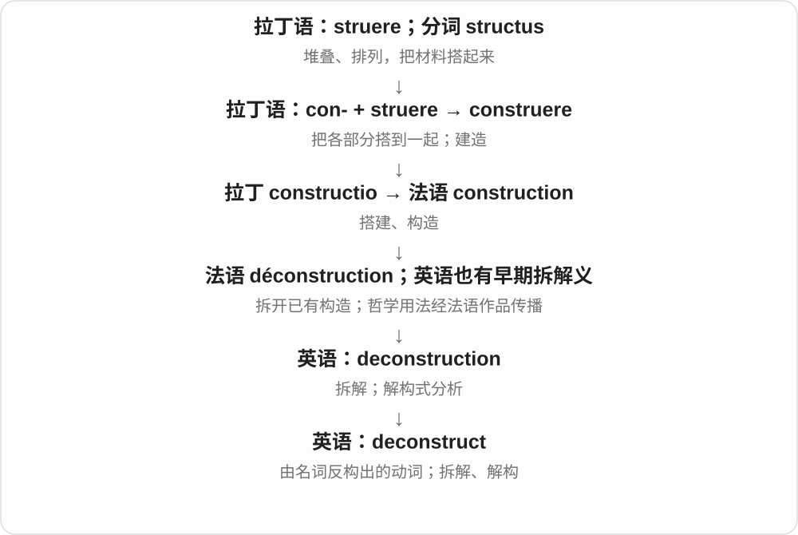

deconstruct an argument 可以逐项检查理由和假设。文艺评论里的 deconstruct 还可能是揭示作品如何颠覆某种熟悉模式；不是一律指实际砸碎东西。

**常见搭配与例句**

deconstruct an argument；deconstruct a myth；deconstruct a scene。

> The class deconstructed the advertisement to see how it created a sense of urgency.

课堂上，大家拆解这则广告，分析它怎样制造紧迫感。

> The critic deconstructed the film’s image of the perfect hero.

评论者拆解了影片塑造的完美英雄形象。

**别混淆**

analyse 是广泛的分析；deconstruct 常突出把看似整体、自然的安排拆开，检查隐藏关系或前提。

### 35. microstructure — 微观结构；显微组织

**音标**：英 /ˈmaɪkrəʊˌstrʌktʃə/；美 /ˈmaɪkroʊˌstrʌktʃər/

**先抓住这个画面**

microstructure 像把金属放到显微镜下：肉眼看是一块，放大后才看见颗粒、边界和排列。

**怎么拆**

micro- 微小 + structure；micro- 来自希腊语 mikros“小”。

**怎么变成今天的意思**

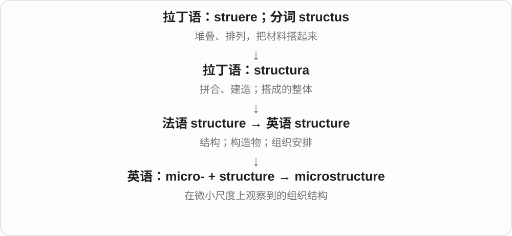

在材料学中尤其常见。材料成分相近，内部晶粒、相的排列不同，性质仍可能不同。也可用于其他对象的细小内部组织。

**常见搭配与例句**

the microstructure of steel；examine the microstructure；changes in microstructure。

> The microscope revealed the metal’s microstructure.

显微镜显示出了金属的微观组织。

> Heating changed the microstructure of the sample.

加热改变了样品的微观结构。

**别混淆**

composition 问由什么组成；microstructure 问这些成分在微观尺度上怎样排列。

### 36. constructivist — 建构主义者；建构主义的；构成主义艺术的

**音标**：/kənˈstrʌktɪvɪst/

**先抓住这个画面**

constructivist 的具体画面取决于场景：课堂里可能让学生亲自形成理解，美术馆里可能指几何材料构成的作品。

**怎么拆**

可分析为 constructive + -ist，与 constructivism 对应；艺术用法需连同俄语来源的运动名称理解，不能把所有义项都当成同一学派。

**怎么变成今天的意思**

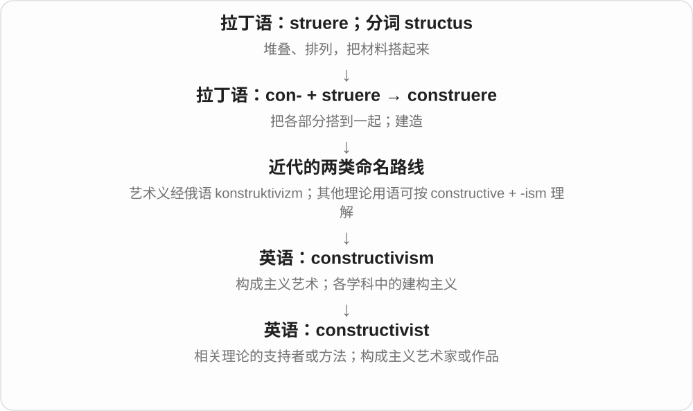

a constructivist approach to learning 关注学习者主动建立知识；a Constructivist sculpture 则谈艺术风格。名词 a constructivist 指支持相关理论或艺术取向的人。

**常见搭配与例句**

a constructivist approach；constructivist teaching；a Constructivist artist。

> The teacher used a constructivist approach to the lesson.

老师采用建构主义取向来组织这堂课。

> The gallery displayed several Constructivist sculptures.

画廊展出了几件构成主义雕塑。

**别混淆**

constructive 是有助改善的日常评价；constructivist 是理论、方法或艺术流派标签，不是更长的“建设性”。

### 37. constructivism — 建构主义；构成主义艺术

**音标**：/kənˈstrʌktɪvɪzəm/

**先抓住这个画面**

constructivism 抓住“搭建”这件事：有的理论谈人怎样搭起理解，有的艺术则直接用材料、几何形体搭出作品。

**怎么拆**

一般构词可看 constructive + -ism；俄国艺术运动名称则经俄语 konstruktivizm 借入。教育、数学、国际关系等领域的同名理论不能全部画成俄国艺术运动的后代。

**怎么变成今天的意思**

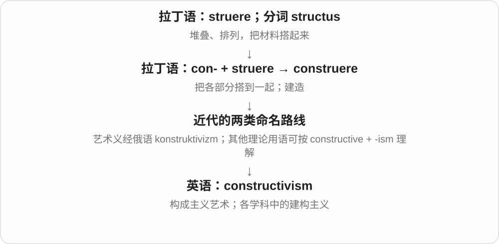

教育中的建构主义强调学习者通过经验主动形成理解；数学中的用法重视构造来确立存在；国际关系中关注身份、规范如何形成。艺术里的 Constructivism 通常译为构成主义，强调几何组织和现代材料。

**常见搭配与例句**

constructivism in education；social constructivism；Russian Constructivism。

> The course discusses constructivism as a theory of learning.

这门课把建构主义作为一种学习理论来讨论。

> The exhibition traces the influence of Russian Constructivism on design.

展览追溯了俄国构成主义对设计的影响。

**别混淆**

structuralism 偏向从关系系统理解现象；constructivism 各支更强调某种对象、知识或意义怎样被构建。必须先看学科再翻译。

### 38. construe — 把……理解为；解释、分析句意

**音标**：/kənˈstruː/

**先抓住这个画面**

construe 是把一句话、一个动作的线索拼在一起，然后得出“他是这个意思”。

**怎么拆**

来自后期拉丁 construere 的语法解释义，经中古英语 construen 演变；和 construct 是同源异形词，不是把 construct 随意删掉 ct。

**怎么变成今天的意思**

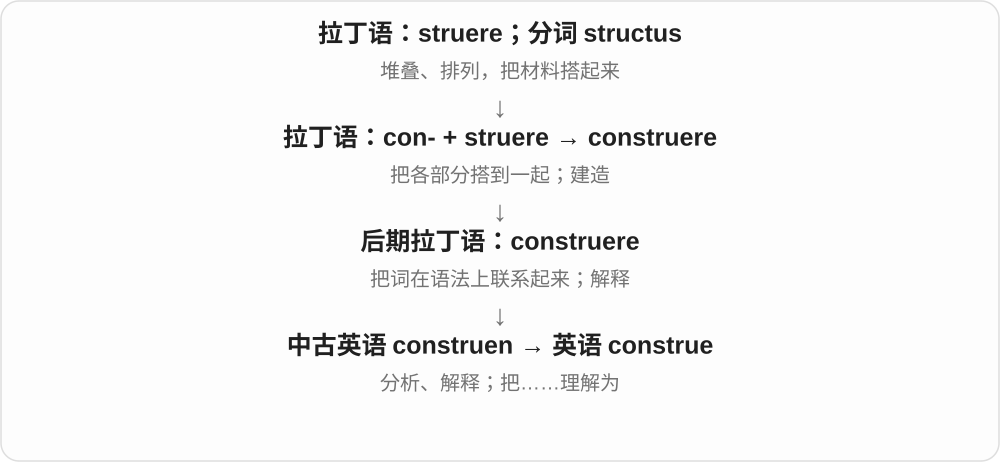

最实用的是 construe A as B。比如沉默可以被理解为同意，也可以被理解为犹豫。旧式语言教学中，它还指分析、翻译拉丁或希腊句子。

**常见搭配与例句**

construe something as criticism；be construed as consent；construe a passage。

> Please do not construe my silence as agreement.

请不要把我的沉默理解为同意。

> Her remark was construed as a criticism of the plan.

她的话被理解成了对方案的批评。

**别混淆**

construct 是把东西或论证搭起来；construe 是把现有话语或行为解释成某种意思。

### 39. structuralism — 结构主义

**音标**：/ˈstrʌktʃərəlɪzəm/

**先抓住这个画面**

structuralism 像看一盘棋：不只看一枚棋子本身，还看它在规则和其他棋子之间占什么位置。

**怎么拆**

structural + -ism，表示重视结构关系的一类理论取向；不同学科里的具体理论并不完全一样。

**怎么变成今天的意思**

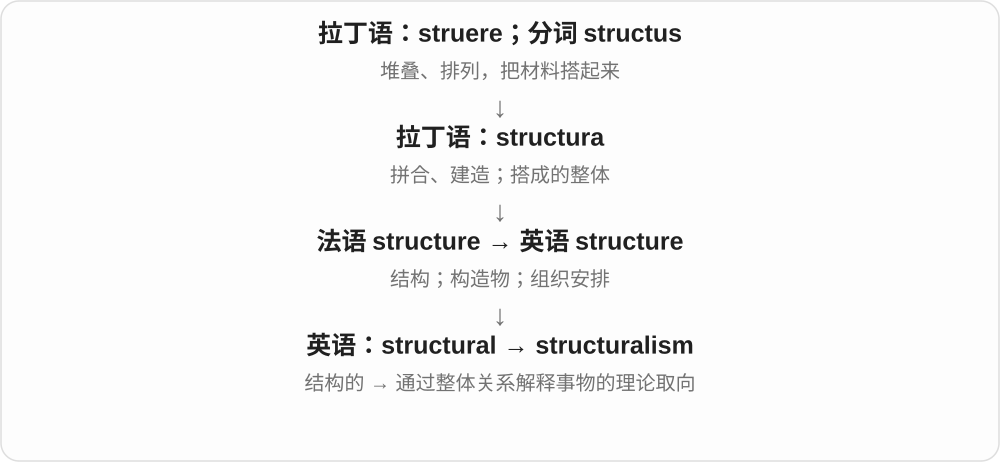

在语言、文化或文学研究中，常把单个现象放进关系系统来理解。这个画面帮助入门，但不能把各领域的 structuralism 当成一个细节完全相同的学说。

**常见搭配与例句**

linguistic structuralism；structuralism in anthropology；a study of structuralism。

> The seminar introduced structuralism in the study of language.

研讨课介绍了语言研究中的结构主义。

> Her essay compares structuralism with later approaches to literature.

她的论文比较了结构主义和后来的文学研究方法。

**别混淆**

structure 是对象的结构；structuralism 是一种研究取向，不是“凡有结构都叫结构主义”。

### 40. substructure — 下部结构；基础部分；子结构

**音标**：英 /ˈsʌbstrʌktʃə/；美 /ˈsʌbstrʌktʃər/

**先抓住这个画面**

substructure 像桥面下面的墩台：平时不一定显眼，却在下面承托。

**怎么拆**

sub- 在下面、下一级 + structure。

**怎么变成今天的意思**

工程里常指支撑上部结构的下部部分；抽象或技术语境也可指一个大结构内部的较小结构。

**常见搭配与例句**

the bridge substructure；a concrete substructure；a substructure within a larger system。

> Engineers inspected the bridge’s substructure.

工程师检查了桥梁的下部结构。

> The model contains several repeating substructures.

模型包含几个反复出现的子结构。

**别混淆**

foundation 常指地基、基础；substructure 可包括更广的下部支撑，具体范围依专业语境而定。

### 41. obstructionist — 阻挠者；采取阻挠策略的

**音标**：/əbˈstrʌkʃənɪst/

**先抓住这个画面**

obstructionist 不只是偶尔说“不”，而是被描述为不断拖延、设卡，想让行动无法推进的人。

**怎么拆**

obstruction + -ist，形成施行某种做法的人，也可转作形容词。

**怎么变成今天的意思**

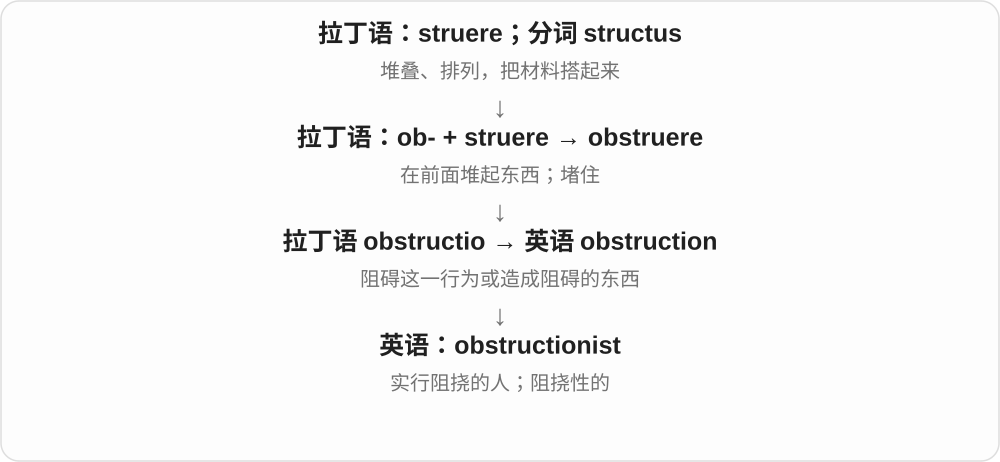

常出现在议会、委员会或谈判语境。obstructionist tactics 是有意拖住进程的策略；这个标签通常是对方带批评地使用。

**常见搭配与例句**

an obstructionist；obstructionist tactics；an obstructionist minority。

> Critics called him an obstructionist after he delayed the vote again.

他再次拖延投票后，批评者称他为阻挠者。

> The committee struggled to overcome obstructionist tactics.

委员会费力应对各种阻挠手段。

**别混淆**

opponent 只是反对者；obstructionist 进一步强调使用阻挠手段，不是中性的同义词。

### 42. destructor — 销毁装置；垃圾焚烧炉；析构函数

**音标**：英 /dɪˈstrʌktə/；美 /dɪˈstrʌktər/

**先抓住这个画面**

destructor 是负责让某物结束、清理掉的东西；程序里常像对象离场前的收尾人员。

**怎么拆**

借自后期拉丁 destructor“毁坏者”，由 destructus 的词干及 -or 构成。现代可以联想 destruct + -or，但不要把整个词的起源都归到后来的英语动词。

**怎么变成今天的意思**

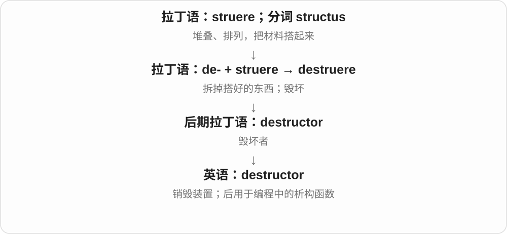

旧资料中可指垃圾焚烧炉。C++ 的 destructor 在对象销毁时承担清理工作，例如关闭其管理的文件；析构与释放对象存储空间不是同一个概念，不能一概等同。

**常见搭配与例句**

a refuse destructor；a class destructor；call a destructor。

> The old report describes a refuse destructor built outside the town.

旧报告描述了一座建在城外的垃圾焚烧炉。

> The destructor closes the file owned by the object.

析构函数关闭该对象所管理的文件。

**别混淆**

constructor 初始化对象；destructor 做结束时的清理。两者名称中的“建设／拆除”是技术借喻。

### 43. structuralist — 结构主义者；结构主义的

**音标**：/ˈstrʌktʃərəlɪst/

**先抓住这个画面**

structuralist 会追问：“这个元素为什么有这个意义？它和整个系统里的其他元素是什么关系？”

**怎么拆**

structural + -ist，与 structuralism 对应，可指采用这种研究取向的人，也可作形容词。

**怎么变成今天的意思**

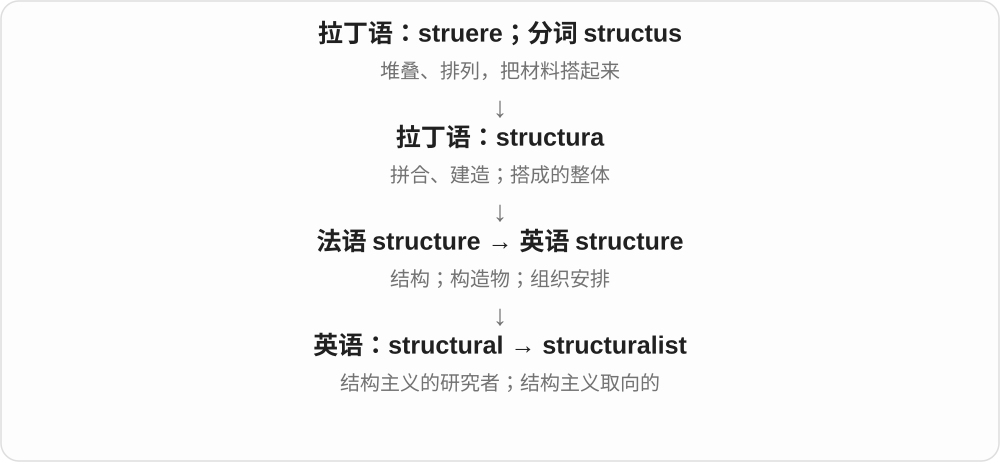

a structuralist reading 是以结构关系为重点的解读；a structuralist 可以指相关理论的支持者或研究者。

**常见搭配与例句**

a structuralist approach；a structuralist analysis；a structuralist reading。

> The structuralist examined the relationships among the symbols.

这位结构主义者研究了各个符号之间的关系。

> The chapter offers a structuralist reading of the myth.

这一章从结构主义角度解读了这个神话。

**别混淆**

structural engineer 是研究结构安全与设计的工程师；structuralist 通常是理论取向标签，两者不是同一种职业称谓。

### 44. destructively — 破坏性地；以造成损害的方式

**音标**：/dɪˈstrʌktɪvli/

**先抓住这个画面**

destructively 说的是一个动作怎样进行：做完后，某种关系、材料或原始信息受损了。

**怎么拆**

destructive + -ly。

**怎么变成今天的意思**

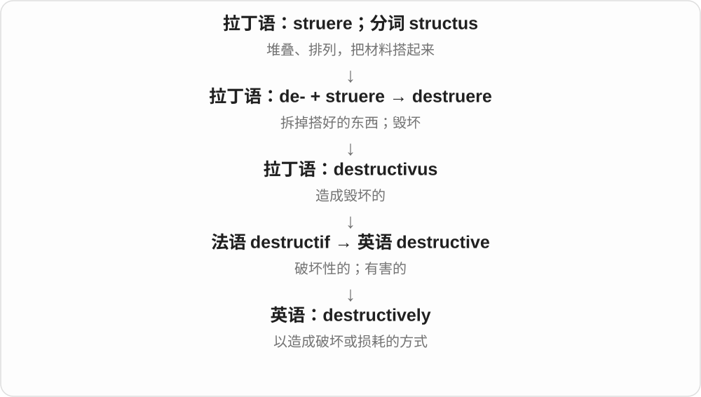

可描写人的反应，也可描述直接改坏原始材料或数据的操作。用在不同领域，破坏的对象并不一样。

**常见搭配与例句**

act destructively；react destructively；edit destructively。

> He reacted destructively by tearing up the shared plan.

他的反应充满破坏性，把共同制订的方案撕掉了。

> Editing destructively can make the original data difficult to recover.

破坏性编辑可能使原始数据难以恢复。

**别混淆**

aggressively 强调强硬、猛烈；destructively 强调造成损害。动作很强硬不必然有破坏性。

### 45. destructiveness — 破坏性；毁坏能力或倾向

**音标**：/dɪˈstrʌktɪvnəs/

**先抓住这个画面**

destructiveness 看的不是动静多大，而是能够毁掉多少、伤害多深。

**怎么拆**

destructive + -ness，把“破坏性的”变成可描述、比较的性质。

**怎么变成今天的意思**

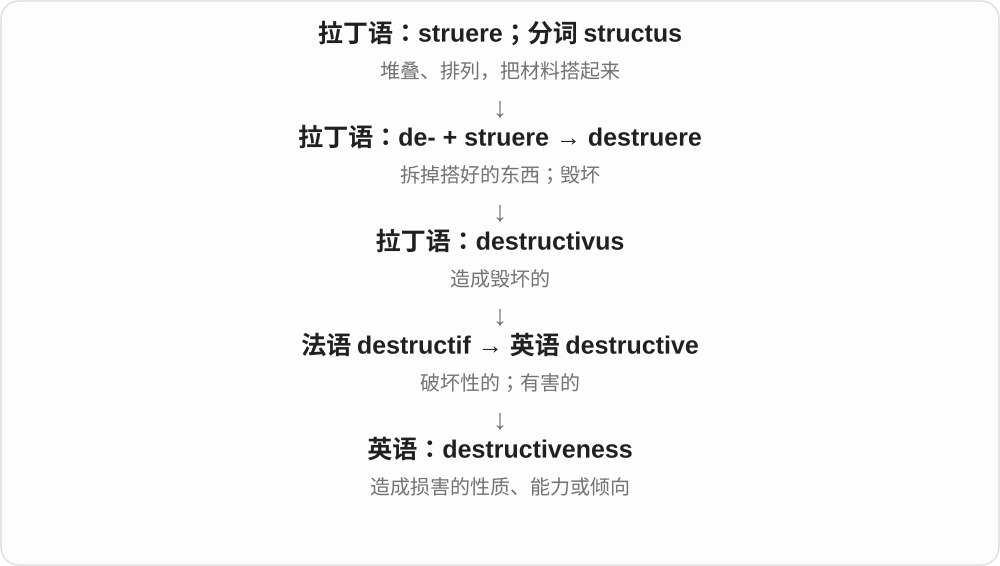

可讨论风暴的破坏力，也可说嫉妒、习惯或冲突的破坏性。它通常是不可数名词。

**常见搭配与例句**

the destructiveness of a storm；the destructiveness of jealousy。

> The photographs show the destructiveness of the storm.

照片显示了这场风暴的破坏力。

> The novel explores the destructiveness of unchecked jealousy.

小说探讨了放任嫉妒发展所带来的破坏性。

**别混淆**

destruction 是破坏的行为或结果；destructiveness 是造成破坏的性质，某种东西尚未实际毁坏也可能具有这种性质。

### 46. misconstrue — 误解；错误地解释

**音标**：/ˌmɪskənˈstruː/

**先抓住这个画面**

misconstrue 像把别人的话拼错了图：对方本想表达关心，你却读成了责备。

**怎么拆**

mis- 错误 + construe；中古英语已有 misconstruen，延续到今天。

**怎么变成今天的意思**

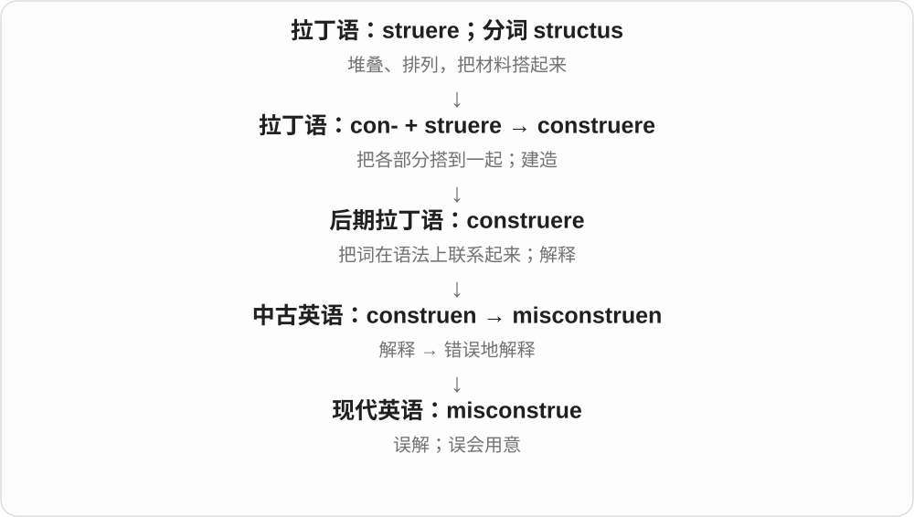

常涉及话语、意图、沉默或举动；误解可能是无意的，不必带“故意歪曲”的指责。

**常见搭配与例句**

misconstrue a remark；misconstrue someone’s intentions；be misconstrued as。

> He misconstrued her concern as distrust.

他把她的关心理解成了不信任。

> A short message is easy to misconstrue.

简短的信息很容易让人误解。

**别混淆**

misunderstand 更日常、更宽泛；misconstrue 更强调解释话语或行为时把意思读偏了。

### 47. microstructural — 微观结构的；显微组织方面的

**音标**：英 /ˌmaɪkrəʊˈstrʌktʃərəl/；美 /ˌmaɪkroʊˈstrʌktʃərəl/

**先抓住这个画面**

microstructural 把注意力放到内部微小排列的变化，例如晶粒变大、边界发生变化。

**怎么拆**

microstructure + -al，形成表示微观结构方面的形容词。

**怎么变成今天的意思**

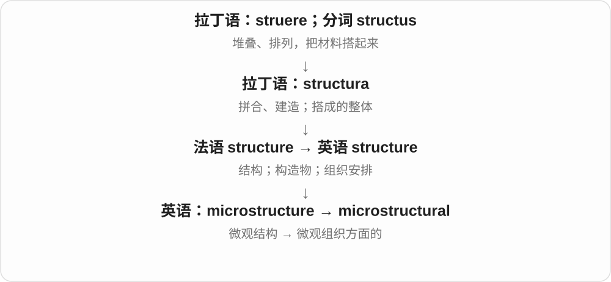

microstructural analysis 是分析细小内部组织；microstructural changes 可能不改变样品的外形，却影响材料表现。

**常见搭配与例句**

microstructural analysis；microstructural changes；microstructural features。

> The researchers compared the samples’ microstructural features.

研究人员比较了样品的微观组织特征。

> Cooling produced visible microstructural changes under the microscope.

冷却使样品出现了在显微镜下可见的微观结构变化。

**别混淆**

microscopic 强调很小或需要显微镜观察；microstructural 进一步明确是在谈内部组织结构。

### 48. destructible — 可毁坏的；会被破坏的

**音标**：/dɪˈstrʌktəbəl/

**先抓住这个画面**

destructible 是东西承受破坏的那一面：它不是永远固定的背景，受到作用后会损坏或消失。

**怎么拆**

借自后期拉丁 destructibilis，由 destruct- + -ibilis“可被……的”构成；现代看作 destruct- + -ible。

**怎么变成今天的意思**

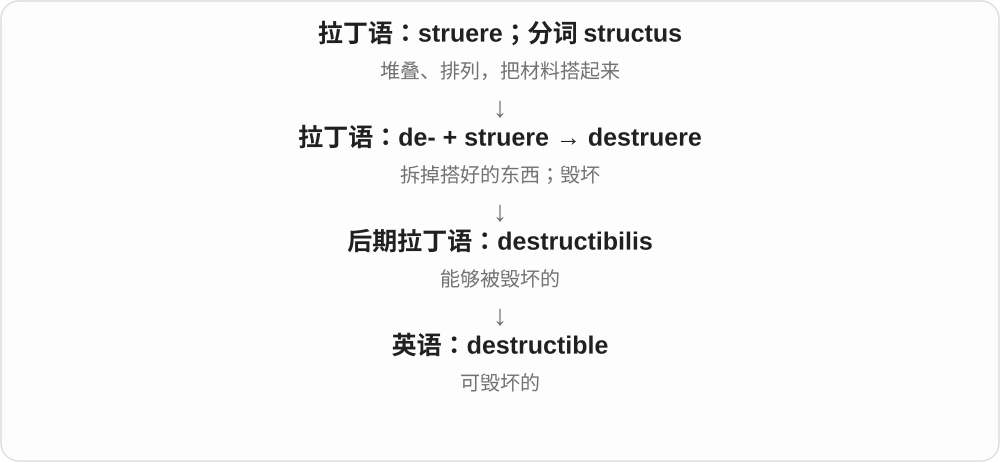

游戏中的 destructible environments 指场景物体可以被破坏，改变通路或外观。也可一般地说明材料、物体并非不可摧毁。

**常见搭配与例句**

destructible objects；destructible environments；destructible walls。

> The game features destructible walls and bridges.

这款游戏中的墙壁和桥梁可以被破坏。

> The display model is made from easily destructible materials.

展示模型使用容易毁坏的材料制成。

**别混淆**

destructive 是会造成破坏的；destructible 是会被破坏的，一个偏施加作用，一个偏承受作用。

### 49. constructional — 建造方面的；构造上的

**音标**：/kənˈstrʌkʃənəl/

**先抓住这个画面**

constructional 把镜头对准“怎么造、怎么接、怎么组成”，不在评价态度好不好。

**怎么拆**

construction + -al，表示与建造、构造相关；也有专门的解释义、地质义。

**怎么变成今天的意思**

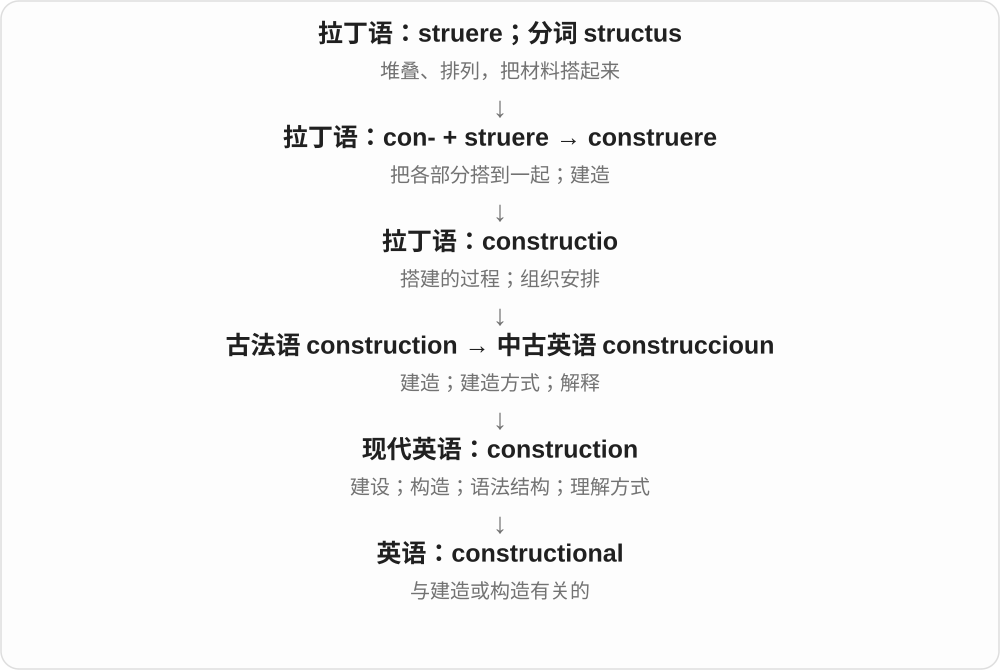

constructional details 可以是房梁如何连接、材料怎样组合。语言学中也可谈 constructional patterns，即构式方面的模式。

**常见搭配与例句**

constructional details；constructional methods；constructional features。

> The drawings show the constructional details of the roof.

这些图纸展示了屋顶的具体构造。

> The museum explains the bridge’s unusual constructional features.

博物馆介绍了这座桥不同寻常的构造特点。

**别混淆**

constructional drawings 是施工构造图；constructive comments 是有助改进的评论。两个形容词不能只因中文都有“建设”就互换。

### 50. deconstructive — 解构的；以拆解方式分析的

**音标**：/ˌdiːkənˈstrʌktɪv/

**先抓住这个画面**

deconstructive 描写一种阅读动作：把看起来牢固的概念接缝打开，检查它怎么成立。

**怎么拆**

构词可分析为 de- + constructive；现代意义与 deconstruct、deconstruction 紧密相连，不能简单翻成“没有建设性的”。

**怎么变成今天的意思**

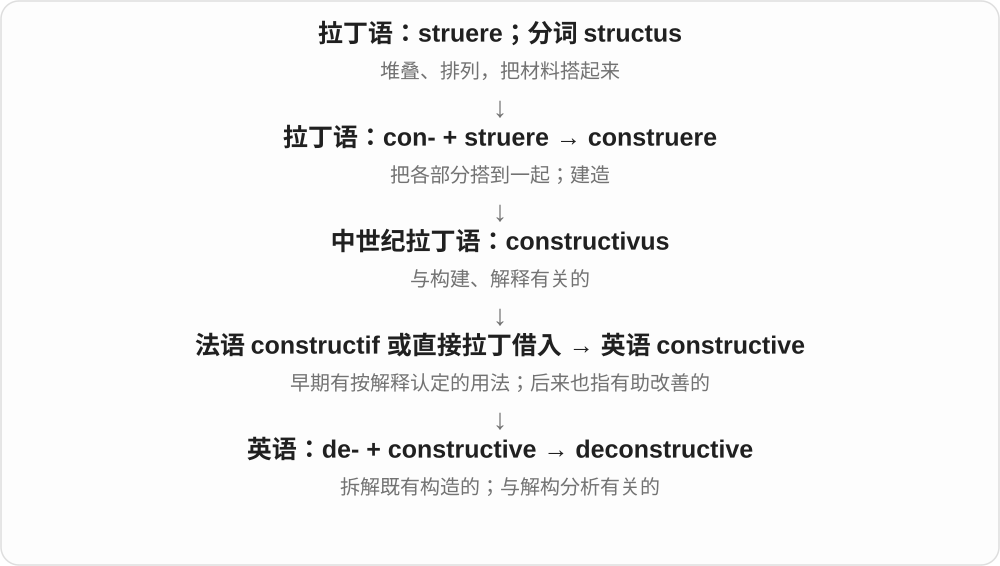

deconstructive analysis 常指揭示概念安排、隐含前提和内部张力的分析。用这个词不等于说分析者存心破坏作品。

**常见搭配与例句**

deconstructive analysis；a deconstructive reading；deconstructive techniques。

> The article uses deconstructive analysis to question the apparent opposition.

文章运用解构分析，质疑那个表面上的对立。

> Her deconstructive reading revealed tensions in the narrator’s claims.

她的解构式阅读揭示了叙述者说法中的内在冲突。

**别混淆**

destructive 是造成破坏的；deconstructive 指解构取向，两者的目的和评价不能混为一谈。

### 51. construal — 理解方式；解释；对事物的认知呈现

**音标**：/kənˈstruːəl/

**先抓住这个画面**

construal 像给同一件事选不同镜头：一个人把批评看成攻击，另一个人把它看成帮助。

**怎么拆**

construe + 名词后缀 -al，末尾 e 去掉；这个 -al 不是把词变成形容词。

**怎么变成今天的意思**

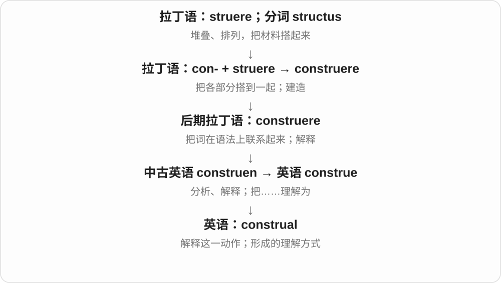

常见于学术讨论，a construal of a situation 指某种理解情境的方式。强调人的解释角度，不等于那就是唯一客观描述。

**常见搭配与例句**

a construal of the text；an alternative construal；different construals of an event。

> The two readers offered different construals of the same passage.

两位读者对同一段文字给出了不同理解。

> Her construal of the delay as rejection made her anxious.

她把这次延迟理解为拒绝，因此感到焦虑。

**别混淆**

interpretation 更普遍；construal 较学术，常突出人如何把材料组织成一种理解。

### 52. deconstructionist — 解构主义者；解构主义的

**音标**：/ˌdiːkənˈstrʌkʃənɪst/

**先抓住这个画面**

deconstructionist 会追问：文本表面上把两件事分得很清楚，细读时却有没有互相依赖、自相矛盾的地方？

**怎么拆**

deconstruction + -ist，表示支持、采用解构理论的人，也作形容词。

**怎么变成今天的意思**

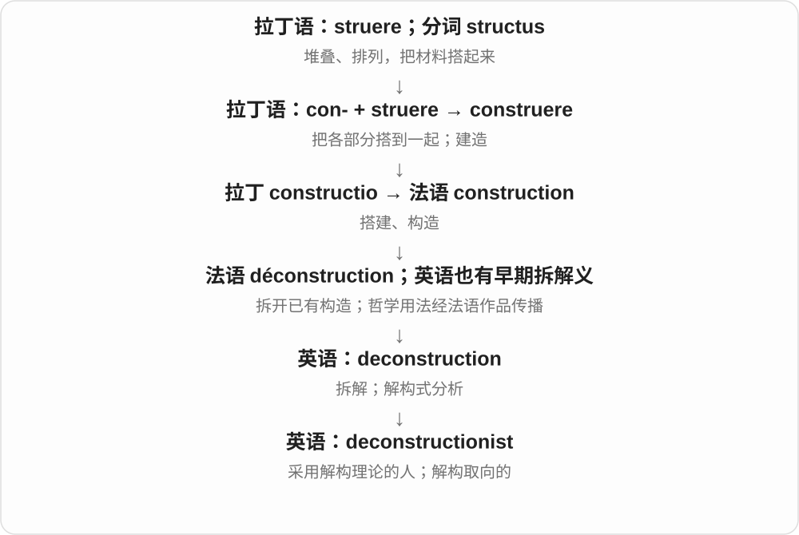

a deconstructionist reading 是这种理论取向的解读；名词则指相关研究者或支持者。它是思想方法标签，不是拆房工人的职业名。

**常见搭配与例句**

a deconstructionist critic；a deconstructionist reading；a deconstructionist approach。

> The deconstructionist focused on contradictions within the text.

这位解构主义者关注文本内部的矛盾。

> The lecture presented a deconstructionist reading of the poem.

讲座从解构主义角度解读了这首诗。

**别混淆**

structuralist 通常重视系统内的结构关系；deconstructionist 更会追问这些关系看似稳定的前提如何发生动摇。

### 53. indestructibility — 不可摧毁性；极其牢固耐用的性质

**音标**：/ˌɪndɪˌstrʌktəˈbɪləti/

**先抓住这个画面**

indestructibility 把“怎么也打不坏”当作一种性质来谈，常见于讨论、论证或夸张描述。

**怎么拆**

indestructible + -ity；-ible 变为 -ibility，主重音移到 bil 音节。

**怎么变成今天的意思**

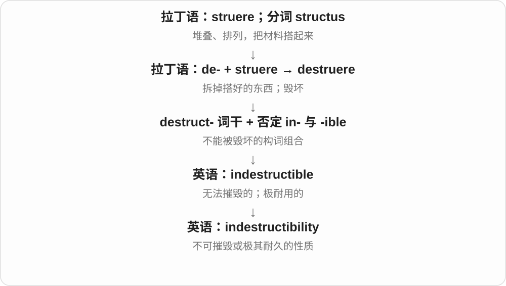

可谈产品宣传中的 indestructibility，也可用于文学里精神、希望的不可摧毁性。谈这种性质不等于已经证明某物绝对不会坏。

**常见搭配与例句**

a claim of indestructibility；apparent indestructibility；the indestructibility of hope。

> The tests challenged the manufacturer’s claim of indestructibility.

测试对厂家所谓“不可毁坏”的宣传提出了质疑。

> The story celebrates the apparent indestructibility of hope.

这个故事赞颂了希望仿佛无法被摧毁的力量。

**别混淆**

indestructible 是形容词，直接修饰东西；indestructibility 是名词，把这个特点本身拿出来讨论。

### 54. constructiveness — 建设性；有助改进的程度或特质

**音标**：/kənˈstrʌktɪvnəs/

**先抓住这个画面**

constructiveness 看一场讨论结束后，大家手里有没有多一点能用的办法。

**怎么拆**

constructive + -ness，把“有助改进”变成可讨论的性质。

**怎么变成今天的意思**

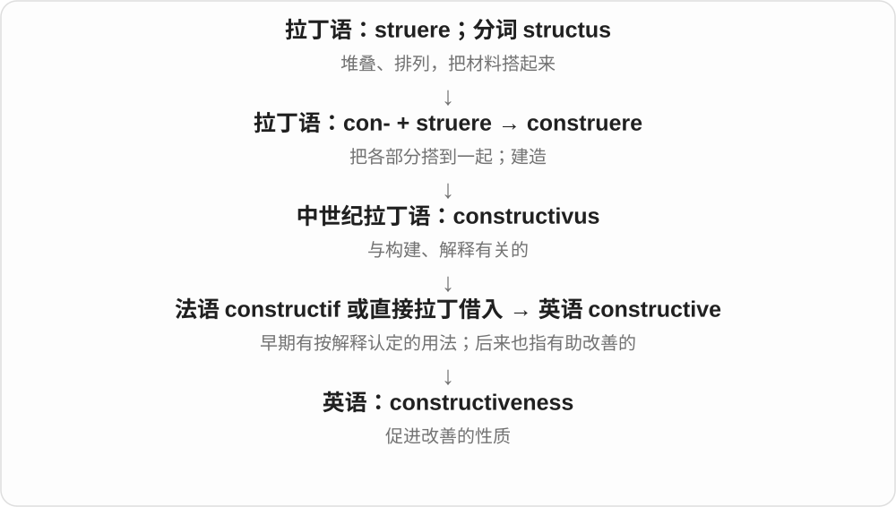

可评价评论、合作或批评的建设性。通常是不可数抽象名词，日常也常直接说 how constructive something is。

**常见搭配与例句**

the constructiveness of feedback；assess constructiveness。

> The editor valued the constructiveness of her comments.

编辑看重她的评论能切实帮助改进。

> We judged the feedback by its clarity and constructiveness.

我们根据反馈是否清楚、是否有建设性来评价它。

**别混淆**

creativity 看有没有新点子；constructiveness 看能否帮助解决眼前问题，两者可以同时具备。

### 55. misconstruction — 误解；错误解释；错误构造

**音标**：/ˌmɪskənˈstrʌkʃən/

**先抓住这个画面**

misconstruction 是那幅“拼错的意思图”，强调已经形成的错误理解。

**怎么拆**

mis- 错误 + construction；这里 construction 常用“解释、理解方式”义，与 misconstrue 相对应。

**怎么变成今天的意思**

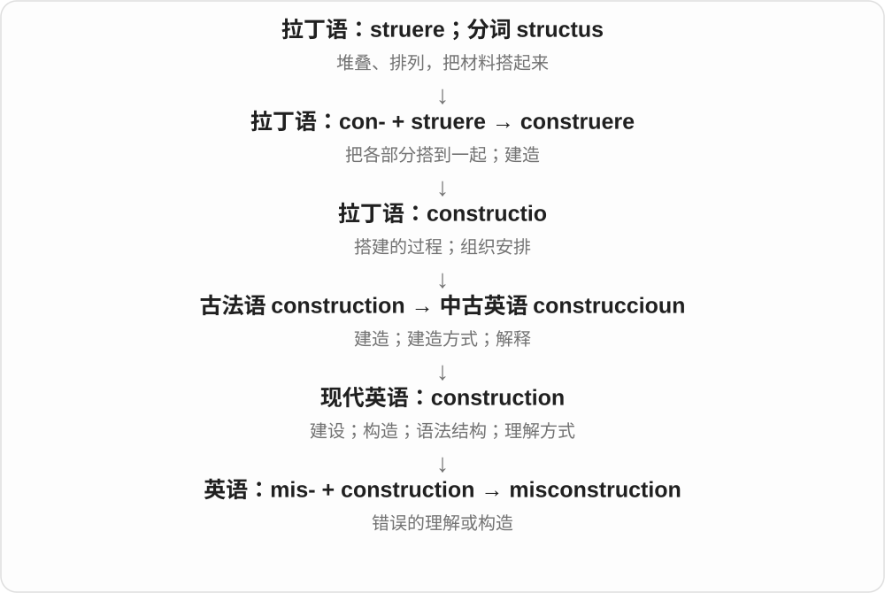

a misconstruction of my words 是对我的话的误解。这个词也可用于不恰当的语法构造等场景，但普通读物里先掌握“错误解释”最有用。

**常见搭配与例句**

a misconstruction of someone’s words；avoid misconstruction；grammatical misconstruction。

> Her reply was based on a misconstruction of my question.

她的回答建立在对我问题的误解上。

> I added a final sentence to avoid any misconstruction.

我在末尾加了一句话，以免意思被误解。

**别混淆**

misconstruction 是较书面的名词；日常说 a misunderstanding 通常更自然。

### 56. obstructively — 故意妨碍地；百般刁难地

**音标**：/əbˈstrʌktɪvli/

**先抓住这个画面**

obstructively 像每当别人快往前一步，就临时搬个障碍过来。

**怎么拆**

obstructive + -ly，描述行动方式。

**怎么变成今天的意思**

常与 behave、act 连用，通常带批评意味。用它评价某人时，已经在说其做法阻碍了进展。

**常见搭配与例句**

behave obstructively；act obstructively；respond obstructively。

> He behaved obstructively whenever the team tried to reach a decision.

每当团队试图作出决定，他就从中作梗。

> She denied acting obstructively during the negotiations.

她否认自己在谈判中蓄意制造障碍。

**别混淆**

cautiously 是小心谨慎；obstructively 是造成妨碍。审核认真不自动等于故意刁难。

## 这一组要分清什么

**construct / construe**：建造或构建 / 把话语、行为理解成某种意思。不能用 construct my silence as agreement。

**construction / structure**：搭建过程或构造方式 / 形成的整体及其内部关系。construction 还可指语法结构和解释。

**constructive / constructional / structural / structured**：有助改进 / 建造构造相关 / 结构方面的 / 已按明确条理安排的。

**instructive / instructional**：能让人学到东西 / 用于教学。一个失败案例可以很有启发，但并非为了教学而发生。

**reconstruct / restructure**：重建或还原 / 重新安排已有部分之间的关系。

**destructive / destructible / indestructible**：有破坏性的 / 可被破坏的 / 不可摧毁或极耐用的。

**deconstruct / destroy**：拆开分析 / 毁坏。解构分析不等于把讨论对象全部否定。

**constructor / destructor**：编程里分别与对象的初始化、销毁时清理有关；不要把这对术语直接简化成申请内存、释放内存。

## 串起来练习

**The instructor gave constructive feedback on how to structure the report, and we reconstructed the events from the available evidence.**

老师对如何组织报告提出了有助改进的反馈，我们又根据现有证据还原了事件经过。instructor 带着人学；constructive 帮助改善；structure 安排材料的层次；reconstruct 把过去的经过重新拼回来。
