# 0296 · cor-, cord- — 心；心意；由内心引申为勇气、记忆与一致

[逐词精讲目录](../00_逐词精讲目录.md) · [总目录](../00_总目录_按常用程度.md)

## 核心词根与来源

**cor-/cord-** 来自拉丁语 **cor**“心”，变化形式里出现 **cord-**。这里的心不仅是器官，也承载记忆、意志和情感：把事情放回心里是 record 的历史起点；给人勇气是 encourage；心意走到一起是 concord，分开则是 discord。

**COR / CORD = HEART**

心里有勇气，心意能相合，也能把事情记在心中

- **记在心中**：record
- **勇气增减**：courage · encourage · discourage
- **心意相合**：accord · concord · concordance
- **心意不合**：discord · discordant
- **发自内心的友好**：cordial · cordially · cordiality
- **心的外形与怜悯**：cordate · obcordate · misericord
- **record → records：记录、唱片；记录下来**：record · records
- **record → recorded：回放到记忆与把信息留下**：record · recorded
- **record → recorded → recording：记住与保存声音、内容**：record · recorded · recording
- **encourage → encouraged：把勇气放进去**：encourage · encouraged
- **record → recording → recordings：保存与录制品**：record · recording · recordings
- **recorder 的记录器与竖笛两条近源**：record · recorder · recorders
- **record 的再次、提前录制与 camcorder 混成**：record · rerecord · rerecords · rerecorded · rerecording · prerecord · prerecords · prerecorded · prerecording · recorder · camcorder · camcorders
- **courage 的心、胆量进入鼓励与劝阻**：encourage · encourages · discourage · discourages · discouraged

## 词形与演化规律

**cor** 的属格是 **cordis**，所以不是英语随意给 cor 加上 d。经法语的 corage 留下 courage，相关动词留下 encourage、discourage。**core** 的早期来源有争议，本页保留为辨析词，图从已知的中古英语开始，不能拿它证明所有 core 都来自 cor。

心形词更直接：cordate 与 cordiform 描述心形；obcordate 则把与叶柄相接的方向倒过来。

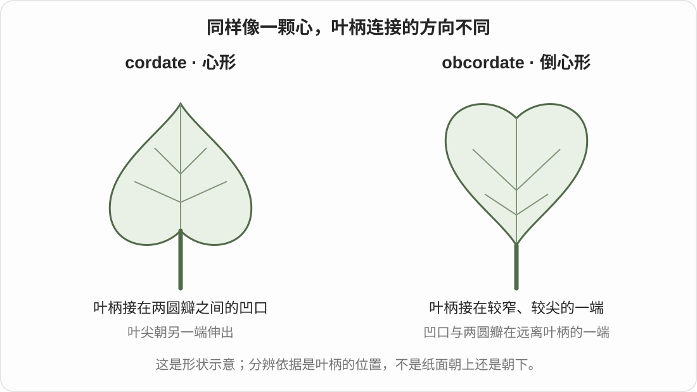

record 接拉丁 recordārī 记住，历史 re- 与 cord- 心相关；records 名词、动词通常靠重音区分。

回想、记住的词族，经记录扩展到文字、声音、影像；动词后重。

拉丁心与记忆的历史比喻，经法语发展为记录，录音义后来形成。

法语 en 与 corage 胆量，连到拉丁心的词族。

拉丁心、记住材料经法语；录制过程转可数成果。

记忆、记录支有法语 recordour 等借入史，后来有仪器义；竖笛名接旧 record 练唱、重复曲调，不从现代录音机倒推。

rerecord、prerecord 在已经固定的录制动词上添前缀；camcorder 混合 camera、recorder，不把 camera 也解释成心的来源。

古法语 corage 接心的词族，encourage 使有勇气，discourage 使失勇气、劝阻；不把 discourage 拆成 dis- 加完整 encourage。

## 单词速览（按词族由简到繁）

同一基础词的相关扩展放在一起，先读基础形式，再读扩展；各组之间优先读常用的。具体词源关系见各词讲解。

| 单词 | 音标 | 核心意思 |
|---|---|---|
| [record](#w-1) | 名词：英 /ˈrekɔːd/、美 /ˈrekərd/；动词：英 /rɪˈkɔːd/、美 /rɪˈkɔːrd/ | 记录；纪录；唱片；记录下来 |
| [records](#w-30) | 名词：英 /ˈrekɔːdz/、美 /ˈrekərdz/；动词：英 /rɪˈkɔːdz/、美 /rɪˈkɔːrdz/ | 记录、档案；纪录、唱片；记录、录制〔动词形式〕 |
| [recorded](#w-31) | 英 /rɪˈkɔːdɪd/；美 /rɪˈkɔːrdɪd/ | 记录下了；录音、录像了；已录制的 |
| [recording](#w-32) | 英 /rɪˈkɔːdɪŋ/；美 /rɪˈkɔːrdɪŋ/ | 记录、录音、录像〔现在分词、动名词〕；录制品 |
| [recordings](#w-34) | 英 /rɪˈkɔːdɪŋz/；美 /rɪˈkɔːrdɪŋz/ | 录音、录像、录制品〔复数〕 |
| [recorder](#w-35) | 英 /rɪˈkɔːdə/；美 /rɪˈkɔːrdər/ | 录音机、记录仪；记录者；竖笛 |
| [recorders](#w-36) | 英 /rɪˈkɔːdəz/；美 /rɪˈkɔːrdərz/ | 录音机、记录仪、记录者；竖笛〔复数〕 |
| [rerecord](#w-40) | 英 /ˌriːrɪˈkɔːd/；美 /ˌriːrɪˈkɔːrd/ | 重新录制 |
| [rerecorded](#w-41) | 英 /ˌriːrɪˈkɔːdɪd/；美 /ˌriːrɪˈkɔːrdɪd/ | 重新录制了；重录的 |
| [rerecording](#w-42) | 英 /ˌriːrɪˈkɔːdɪŋ/；美 /ˌriːrɪˈkɔːrdɪŋ/ | 正在重录；重录过程、重录版本 |
| [rerecords](#w-46) | 英 /ˌriːrɪˈkɔːdz/；美 /ˌriːrɪˈkɔːrdz/ | 重新录制〔第三人称单数〕 |
| [prerecord](#w-43) | 英 /ˌpriːrɪˈkɔːd/；美 /ˌpriːrɪˈkɔːrd/ | 预先录制 |
| [prerecorded](#w-38) | 英 /ˌpriːrɪˈkɔːdɪd/；美 /ˌpriːrɪˈkɔːrdɪd/ | 预先录制的；预录了 |
| [prerecords](#w-45) | 英 /ˌpriːrɪˈkɔːdz/；美 /ˌpriːrɪˈkɔːrdz/ | 预先录制〔第三人称单数〕 |
| [prerecording](#w-44) | 英 /ˌpriːrɪˈkɔːdɪŋ/；美 /ˌpriːrɪˈkɔːrdɪŋ/ | 正在预录；预先录制的过程、内容 |
| [core](#w-2) | 英 /kɔː/；美 /kɔːr/ | 核心；果核；中心部分 |
| [courage](#w-4) | 英 /ˈkʌrɪdʒ/；美 /ˈkɜːrɪdʒ/ | 勇气；胆量 |
| [courageous](#w-9) | /kəˈreɪdʒəs/ | 勇敢的；有胆量的 |
| [courageously](#w-15) | /kəˈreɪdʒəsli/ | 勇敢地 |
| [encourage](#w-3) | 英 /ɪnˈkʌrɪdʒ/；美 /ɪnˈkɜːrɪdʒ/ | 鼓励；支持；促使 |
| [encouraged](#w-33) | 英 /ɪnˈkʌrɪdʒd/；美 /ɪnˈkɜːrɪdʒd/ | 鼓励了；促使了；受到鼓舞的〔过去式、过去分词〕 |
| [encouraging](#w-5) | 英 /ɪnˈkʌrɪdʒɪŋ/；美 /ɪnˈkɜːrɪdʒɪŋ/ | 令人鼓舞的；让人更有希望的 |
| [encourages](#w-47) | 英 /ɪnˈkʌrɪdʒɪz/；美 /ɪnˈkɜːrɪdʒɪz/ | 鼓励、支持；促进〔第三人称单数〕 |
| [encouragement](#w-8) | 英 /ɪnˈkʌrɪdʒmənt/；美 /ɪnˈkɜːrɪdʒmənt/ | 鼓励；支持；令人有信心的事 |
| [discouraged](#w-48) | 英 /dɪsˈkʌrɪdʒd/；美 /dɪsˈkɜːrɪdʒd/ | 劝阻了；泄气的、灰心的 |
| [discourage](#w-10) | 英 /dɪsˈkʌrɪdʒ/；美 /dɪsˈkɜːrɪdʒ/ | 使泄气；劝阻；使不愿做 |
| [discouraging](#w-13) | 英 /dɪsˈkʌrɪdʒɪŋ/；美 /dɪsˈkɜːrɪdʒɪŋ/ | 令人泄气的；使信心下降的 |
| [discourages](#w-49) | 英 /dɪsˈkʌrɪdʒɪz/；美 /dɪsˈkɜːrɪdʒɪz/ | 使泄气；劝阻、减少……的发生〔第三人称单数〕 |
| [discouragement](#w-18) | 英 /dɪsˈkʌrɪdʒmənt/；美 /dɪsˈkɜːrɪdʒmənt/ | 泄气；挫折感；劝阻 |
| [accord](#w-7) | 英 /əˈkɔːd/；美 /əˈkɔːrd/ | 一致；协议；给予；符合 |
| [accordance](#w-6) | 英 /əˈkɔːdəns/；美 /əˈkɔːrdəns/ | 一致；符合；依照 |
| [accordant](#w-25) | 英 /əˈkɔːdənt/；美 /əˈkɔːrdənt/ | 一致的；相符的；协调的 |
| [concord](#w-11) | 英 /ˈkɒŋkɔːd/；美 /ˈkɑːŋkɔːrd/ | 和睦；一致；语法一致 |
| [concordant](#w-21) | 英 /kənˈkɔːdənt/；美 /kənˈkɔːrdənt/ | 相符的；一致的；协调的 |
| [concordance](#w-19) | 英 /kənˈkɔːdəns/；美 /kənˈkɔːrdəns/ | 一致性；词语索引；语境索引 |
| [discord](#w-12) | 英 /ˈdɪskɔːd/；美 /ˈdɪskɔːrd/ | 不和；分歧；不协和声 |
| [discordant](#w-17) | 英 /dɪsˈkɔːdənt/；美 /dɪsˈkɔːrdənt/ | 不协调的；不一致的；刺耳的 |
| [discordance](#w-24) | 英 /dɪsˈkɔːdəns/；美 /dɪsˈkɔːrdəns/ | 不一致；不协调 |
| [cordial](#w-14) | 英 /ˈkɔːdiəl/；美 /ˈkɔːrdʒəl/ | 热诚友好的；果味甜饮；甜酒 |
| [cordially](#w-16) | 英 /ˈkɔːdiəli/；美 /ˈkɔːrdʒəli/ | 热诚地；友好地 |
| [cordiality](#w-23) | 英 /ˌkɔːdiˈæləti/；美 /ˌkɔːrdʒiˈæləti/ | 热诚；友好 |
| [camcorder](#w-37) | 英 /ˈkæmkɔːdə/；美 /ˈkæmkɔːrdər/ | 便携式摄录机 |
| [camcorders](#w-39) | 英 /ˈkæmkɔːdəz/；美 /ˈkæmkɔːrdərz/ | 便携摄像机、录像摄像设备〔复数〕 |
| [concordat](#w-20) | 英 /kənˈkɔːdæt/；美 /kənˈkɔːrdæt/ | 政教协定；正式协议 |
| [cordate](#w-22) | 英 /ˈkɔːdeɪt/；美 /ˈkɔːrdeɪt/ | 心形的；基部呈心形的 |
| [obcordate](#w-28) | 英 /ɒbˈkɔːdeɪt/；美 /ɑːbˈkɔːrdeɪt/ | 倒心形的 |
| [cordiform](#w-26) | 英 /ˈkɔːdɪfɔːm/；美 /ˈkɔːrdəfɔːrm/ | 心形的 |
| [misericord](#w-27) | 英 /mɪˈzerɪkɔːd/；美 /mɪˈzerɪkɔːrd/ | 教堂站立支托；历史上的怜悯短剑 |
| [scordatura](#w-29) | 英 /ˌskɔːdəˈtʊərə/；美 /ˌskɔːrdəˈtʊrə/ | 变格定弦；非常规定弦 |

## 逐词讲解

### 1. record — 记录；纪录；唱片；记录下来

**音标**：名词：英 /ˈrekɔːd/、美 /ˈrekərd/；动词：英 /rɪˈkɔːd/、美 /rɪˈkɔːrd/

**先抓住这个画面**

让一件事不会随着时间消失：先记在心里，后来写在纸上、录在介质里，留给以后重新查看。

**怎么拆**

拉丁语 re-（再次、回来）+ cor/cord-（心）形成 recordārī“想起、记住”，经古法语 recorder 传入。

**怎么变成今天的意思**

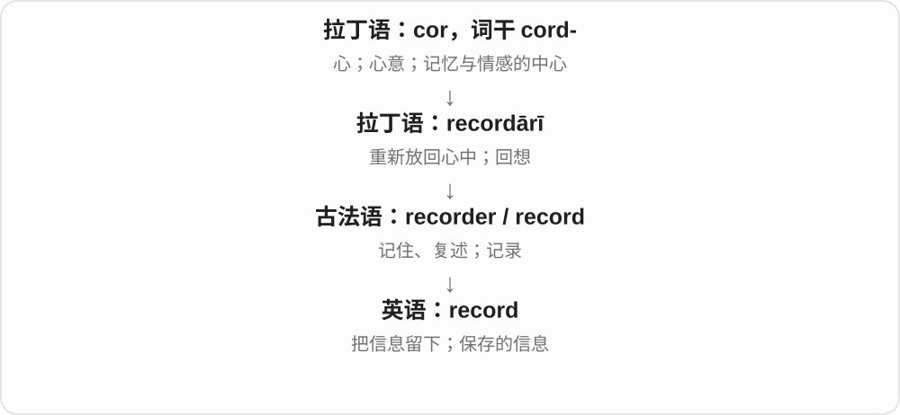

从记忆与复述走向持久保存。唱片是保存声音的载体；比赛纪录是已被记载、供后来比较的最佳成绩。

**常见搭配与例句**

keep a record；record a conversation；break a record；a vinyl record。

> Please keep a record of every payment.

请把每一笔付款都记录下来。

> We recorded the interview so we could check it later.

我们录下了采访，以便之后核对。

**别混淆**

名词重音在前，动词重音在后。a record 可以是档案或唱片；recording 更突出一次录制的内容或过程。

### 2. records — 记录、档案；纪录、唱片；记录、录制〔动词形式〕

**音标**：名词：英 /ˈrekɔːdz/、美 /ˈrekərdz/；动词：英 /rɪˈkɔːdz/、美 /rɪˈkɔːrdz/

**先抓住这个画面**

让信息留下来、以后还能查，是 record。留下的档案是 records；成绩中最好的一项也叫纪录；记录声音的载体又形成唱片义。

**怎么拆**

record + -s。名词通常重读第一音节，动词通常重读第二音节。经法语接拉丁 recordārī 想起、记住，历史 re- 回、再与 cor／cord- 心相关。

**怎么变成今天的意思**

**拉丁 re- + cor／cord- 相关材料 → recordārī → 法语 recorder → record**  
使记起、记住 → 记下、留下记录

↓

**record 名词、动词 + -s → records**  
多份记录、唱片、纪录；单数主语记录、录制

keep records 保存记录；school records 学籍、校方记录；break records 打破纪录；vinyl records 黑胶唱片；records the temperature 记录温度。

**常见搭配与例句**

check the records；records every meeting。

> The archive keeps records of every performance.

档案馆保存每场演出的记录。

> The small device records the temperature every hour.

这个小设备每小时记录一次温度。

**别混淆**

the records 中常是名词，she records 中常是动词，重音也常随词性变。a record 是一份记录或一个纪录，recording 常指录制过程或录下的内容。

### 3. recorded — 记录下了；录音、录像了；已录制的

**音标**：英 /rɪˈkɔːdɪd/；美 /rɪˈkɔːrdɪd/

**先抓住这个画面**

让信息不只停在当时，而是能留下来再看、再听，就是 recorded；写记录、录声音、拍下过程都可用。

**怎么拆**

record + -ed，/d/ 后增加 /ɪd/。这里来自后面重读的动词 record，经法语 recorder 接拉丁 recordārī 回想、记住，较早含 re- 与 cor／cord- 心，记忆被联系到心。

**怎么变成今天的意思**

**拉丁 cor／cord-、recordārī → 法语 recorder → record**  
心、记忆 → 回想、记录

↓

**record + -ed → recorded**  
记录过；录制、保存下来的

recorded the temperature 记录温度；recorded a song 录了一首歌；a recorded message 预录信息；recorded history 有文字记录的历史。

**常见搭配与例句**

was recorded live；previously recorded。

> She recorded the temperature every hour.

她每小时记录一次温度。

> The concert was recorded for later broadcast.

音乐会录制了下来，供之后播放。

**别混淆**

动词 recorded 保留后重的 /rɪˈkɔːd/ 词基，名词 record 常前重。recorded live 可以说现场录制；录下的内容以后播放时，仍是已经录制的材料。

### 4. recording — 记录、录音、录像〔现在分词、动名词〕；录制品

**音标**：英 /rɪˈkɔːdɪŋ/；美 /rɪˈkɔːrdɪŋ/

**先抓住这个画面**

为了以后还能回看、回听，把当时的内容保存下来，就是 recording；保存好的那份声音或影像，也可以数成 a recording。

**怎么拆**

record + -ing。拉丁 recordārī 记住、想起含 re- 与 cor、cord- 心，是把心当记忆中心的古老比喻；经法语 recorder 进入，后发展书面记录和录音录像义。

**怎么变成今天的意思**

**拉丁 recordārī → 法语 recorder → record**  
想起、记住 → 写下保存；后来保存声音影像

↓

**record + -ing → recording**  
正在记录；一份录制内容的名词

recording a conversation 录下谈话；a live recording 现场录音；recording equipment 录音设备。

**常见搭配与例句**

a recording of the concert；recording the results in a notebook。

> They are recording the concert for the school archive.

他们正在录下音乐会，留作学校档案。

> We listened to a recording of her speech.

我们听了她演讲的录音。

**别混淆**

record 作为记录名词通常前重音，但 recording 作录音名词仍通常后重音。a recording of... 指录下哪一场、哪一段内容。

### 5. recordings — 录音、录像、录制品〔复数〕

**音标**：英 /rɪˈkɔːdɪŋz/；美 /rɪˈkɔːrdɪŋz/

**先抓住这个画面**

声音或画面已经被保存下来，之后可以重听、重看，一份份这样的内容就是 recordings。它们是成果，不只是在录制这个动作。

**怎么拆**

record 经法语 recorder 接拉丁 recordari 记住，连 cor、cord- 心的旧记忆比喻。record 加完整 -ing 形成过程及成果名词；recording 再加复数 -s，尾 /ŋz/。

**怎么变成今天的意思**

**拉丁 recordari → 法语 recorder → record**  
记住 → 记载、保存声音影像

↓

**record + -ing → recording；再加 -s → recordings**  
录制过程 → 多份录制内容

audio recordings 录音；video recordings 录像；old recordings 旧录制品。

**常见搭配与例句**

listen to the recordings 听录音；recordings of interviews 访谈录音、录像。

> We listened to recordings of the interviews.

我们听了访谈录音。

> The archive contains several early video recordings.

档案中保存着几份早期录像。

**别混淆**

recordings 是可数录制内容；recording 泛说录制过程时常不数。一份 recording 也不一定对应一张实体光盘。

### 6. recorder — 录音机、记录仪；记录者；竖笛

**音标**：英 /rɪˈkɔːdə/；美 /rɪˈkɔːrdər/

**先抓住这个画面**

把声音、数据留下的设备是 recorder；音乐课里的竖笛也叫 recorder，名称却接 record 旧时练唱曲调的用法。

**怎么拆**

现代可认 record + -er。记录者一支早经法语 recordour 等接拉丁 recordari 记住；竖笛名则接旧时英语 record 反复唱、练曲调，不能从近代录音机推出来。

**怎么变成今天的意思**

**recordari 记住 → 法语记录者材料；英语 record 的旧义也可练唱**  
同族记录与重复曲调的不同近处用途

↓

**recorder 的记录器／竖笛名称**  
现代记录设备；更早的管乐器名

a voice recorder 录音机；a data recorder 数据记录仪；play the recorder 吹竖笛。

**常见搭配与例句**

a digital recorder 数字记录设备；a wooden recorder 木竖笛。

> She used a recorder to save the interview.

她用录音机保存了访谈。

> The child played a simple tune on the recorder.

孩子用竖笛吹了一段简单曲调。

**别混淆**

recorder 的器具义未必是录音设备；play、music 常选出竖笛，record、data 常选出记录设备。

### 7. recorders — 录音机、记录仪、记录者；竖笛〔复数〕

**音标**：英 /rɪˈkɔːdəz/；美 /rɪˈkɔːrdərz/

**先抓住这个画面**

几台记录声音、数据的设备，是 recorders；几支课堂管乐器也可能是 recorders，需看使用动作。

**怎么拆**

recorder + -s，读 /z/。近源两支分别接记录角色、仪器与 record 的旧练唱用途。

**怎么变成今天的意思**

**recorder 的记录设备与乐器名**  
同族基础的不同用途，不按现代录音先后硬合并

↓

**recorder + -s → recorders**  
多台记录设备、多支竖笛等

digital recorders 数字记录设备；wooden recorders 木竖笛。

**常见搭配与例句**

test the recorders 测试录音机；play recorders 吹竖笛。

> The team tested three voice recorders.

团队测试了三台录音机。

> The pupils played recorders in the music lesson.

学生们在音乐课上吹竖笛。

**别混淆**

记录器与竖笛共用读音、拼写，器物形态和动词搭配能帮你辨认。

### 8. rerecord — 重新录制

**音标**：英 /ˌriːrɪˈkɔːd/；美 /ˌriːrɪˈkɔːrd/

**先抓住这个画面**

前一次已经录过，现在再录一次，叫 rerecord。可能为了改错、改善效果，也可能重新诠释。

**怎么拆**

现代 re- 再次 + record 录制。record 本身是拉丁、法语借词，在已固定的录制义上再添英语可用前缀。

**怎么变成今天的意思**

**record 的录制义 + re- → rerecord**  
再次把声音、影像录下

↓

**现代影视、音乐用途**  
重新制作一次录音、录影

rerecord the dialogue 重录对白；rerecord a song 重录歌曲。

**常见搭配与例句**

have to rerecord 必须重录；rerecord the introduction 重录开场。

> We need to rerecord the introduction.

我们需要重录开场部分。

> She decided to rerecord the song with a smaller band.

她决定用较小编制的乐队重录这首歌。

**别混淆**

rerecord 再录，remix 重新处理已有录音；制作一版新作品可以包含其中一种或两种。

### 9. rerecorded — 重新录制了；重录的

**音标**：英 /ˌriːrɪˈkɔːdɪd/；美 /ˌriːrɪˈkɔːrdɪd/

**先抓住这个画面**

原来已有一次录制，现在另一遍也做过了，是 rerecorded。

**怎么拆**

rerecord + -ed，/d/ 后读 /ɪd/；现代 re- 再次 + record 组成基础词。

**怎么变成今天的意思**

**re- + record → rerecord**  
重新录制

↓

**rerecord + -ed → rerecorded**  
过去重录；重录后的版本

a rerecorded version 重录版；rerecorded the vocals 重录了人声。

**常见搭配与例句**

rerecorded the introduction 重录了开场；rerecorded in the studio 在录音室重录的。

> She rerecorded the vocals the next morning.

她第二天早上重录了人声。

> The rerecorded version had a slower tempo.

重录版的速度较慢。

**别混淆**

重录意味着再发生录制动作；只重新调已有声轨，通常说 remixed。

### 10. rerecording — 正在重录；重录过程、重录版本

**音标**：英 /ˌriːrɪˈkɔːdɪŋ/；美 /ˌriːrɪˈkɔːrdɪŋ/

**先抓住这个画面**

以前录过的内容还在重新录，这个过程叫 rerecording；名词也可说重新录下的那一版。

**怎么拆**

rerecord + -ing，保留基础拼写；re- 再次在完整 record 上起作用。

**怎么变成今天的意思**

**re- + record → rerecord**  
再录一次

↓

**rerecord + -ing → rerecording**  
重录的进行、过程或结果名

rerecording the scene 重录场景；a rerecording of the song 歌曲重录版。

**常见搭配与例句**

finish rerecording 重录完；rerecording the narration 重录旁白。

> The actors are rerecording the dialogue.

演员们正在重录对白。

> The album includes a rerecording of her first single.

专辑中有她首支单曲的重录版。

**别混淆**

rerecording 可以是活动，也可以是一份重录作品，a、the 等结构常帮助判断。

### 11. rerecords — 重新录制〔第三人称单数〕

**音标**：英 /ˌriːrɪˈkɔːdz/；美 /ˌriːrɪˈkɔːrdz/

**先抓住这个画面**

他把已经录过的内容再录一遍，是 rerecords。

**怎么拆**

re- + record → rerecord，加 -s，/d/ 后读 /z/。词首两个 re 的材料属于不同历史层次，现代先认完整 record。

**怎么变成今天的意思**

**现代 re- + record → rerecord**  
在完整录制动词上加再次

↓

**rerecord + -s → rerecords**  
它重新录制

rerecords the dialogue 重录对白；rerecords the song 重录歌曲。

**常见搭配与例句**

rerecords each section 重录每节；rerecords the narration 重录旁白。

> She rerecords any section with unclear speech.

她会重录说话不清楚的段落。

> The band rerecords the old song for the new album.

乐队为新专辑重录老歌。

**别混淆**

record 自己有记住、记录的借词史；rerecord 在完整 record 上再加 re-，先理解录制，再理解再录。

### 12. prerecord — 预先录制

**音标**：英 /ˌpriːrɪˈkɔːd/；美 /ˌpriːrɪˈkɔːrd/

**先抓住这个画面**

要等到之后才播、才用，现在先把声音、画面录好，叫 prerecord。

**怎么拆**

pre- 提前、在前 + record 录制。现代英语组合，用已固定的技术动词表达先录后用。

**怎么变成今天的意思**

**pre- + record → prerecord**  
在正式使用、播送之前录好

↓

**媒体、教学等用途**  
预制供稍后播放的声音、画面

prerecord a lecture 预录讲座；prerecord the announcement 预录通知。

**常见搭配与例句**

prerecord before the event 活动前预录；prerecord the narration 预录旁白。

> She will prerecord the lecture before travelling.

她会在出行前预录讲座。

> They plan to prerecord the announcement.

他们计划提前录好通知。

**别混淆**

prerecord 强调时间先后，rerecord 强调再做一次；一段内容可以既预录、又因错误而重录。

### 13. prerecorded — 预先录制的；预录了

**音标**：英 /ˌpriːrɪˈkɔːdɪd/；美 /ˌpriːrɪˈkɔːrdɪd/

**先抓住这个画面**

现在听、看的内容是之前录好的，就是 prerecorded。时间上的先录后放是关键。

**怎么拆**

prerecord + -ed，/d/ 后读 /ɪd/；pre- 在前与 record 录制形成基础动词。

**怎么变成今天的意思**

**pre- + record → prerecord**  
正式使用前先录

↓

**prerecord + -ed → prerecorded**  
已经预录；预先录好的内容

a prerecorded message 预录消息；prerecorded lessons 预录课程。

**常见搭配与例句**

prerecorded music 预录音乐；prerecorded the introduction 预录了开场。

> The phone played a prerecorded message.

电话播放了一段预录消息。

> The course includes prerecorded lessons.

课程包含预先录好的课。

**别混淆**

prerecorded 与 live 对照先录、实时呈现；直播中也可以插播一段预录材料。

### 14. prerecords — 预先录制〔第三人称单数〕

**音标**：英 /ˌpriːrɪˈkɔːdz/；美 /ˌpriːrɪˈkɔːrdz/

**先抓住这个画面**

他先把稍后要用的内容录下来，是 prerecords。pre 把动作放到正式播送之前。

**怎么拆**

pre- + record → prerecord，加 -s，/d/ 后读 /z/。

**怎么变成今天的意思**

**pre- + record → prerecord**  
先录好供后用

↓

**prerecord + -s → prerecords**  
它预先录制

prerecords the lessons 预录课程；prerecords the message 预录消息。

**常见搭配与例句**

prerecords at home 在家预录；prerecords the introduction 预录开场。

> She prerecords the lessons before each term.

她每学期开始前预录课程。

> The station prerecords some weekend programmes.

电台预录部分周末节目。

**别混淆**

预录可以在家、录音室等不同地方完成，pre 限定的是先后，不是场所。

### 15. prerecording — 正在预录；预先录制的过程、内容

**音标**：英 /ˌpriːrɪˈkɔːdɪŋ/；美 /ˌpriːrɪˈkɔːrdɪŋ/

**先抓住这个画面**

把稍后要用的节目、声音先录下来，这项准备工作叫 prerecording；名词也可说预录内容。

**怎么拆**

prerecord + -ing，基础词不改；pre- 提前 + record。

**怎么变成今天的意思**

**pre- + record → prerecord**  
先录后用

↓

**prerecord + -ing → prerecording**  
预录的进行、过程或结果

prerecording the lecture 预录讲座；a prerecording of the speech 讲话预录内容。

**常见搭配与例句**

finish prerecording 预录完；prerecording at the studio 在录音室预录。

> She is prerecording next week’s lecture.

她正在预录下周的讲座。

> The broadcast used a prerecording of the speech.

节目使用了讲话的预录内容。

**别混淆**

prerecording 可是尚在进行的工作，也可是已经录下的内容；句子时态、冠词帮助区分。

### 16. core — 核心；果核；中心部分

**音标**：英 /kɔː/；美 /kɔːr/

**先抓住这个画面**

把苹果外面的果肉吃掉，剩下里面那一块；把问题的外层细节拿掉，剩下最关键的部分。这两者都可叫 core。

**怎么拆**

现代英语承接中古英语 core/kore“果心”，更早来源不确定。有学者联系法语 cuer“心”或其他词，但不能确定画成 Latin cor → core。

**怎么变成今天的意思**

具体的中心部分扩展为组织、问题或价值观中最关键的一层。它与“心”在意义上很接近，历史上是否直接同源则不能说死。

**常见搭配与例句**

the core of the problem；core values；an apple core；a processor core。

> We need to get to the core of the problem.

我们需要抓住问题的核心。

> She removed the apple core before slicing the fruit.

她先去掉苹果核，再把果肉切片。

**别混淆**

core 是中心或关键部分；cor- 是本页确定的拉丁词根。拼写相近只能提示线索，不能代替词源证据。

### 17. courage — 勇气；胆量

**音标**：英 /ˈkʌrɪdʒ/；美 /ˈkɜːrɪdʒ/

**先抓住这个画面**

心里明明知道有风险，仍然站住、愿意面对，这份内在力量就是 courage。

**怎么拆**

古法语 corage 源于拉丁语 cor“心”的词族；历史上“心意、精神”逐渐集中为胆量。

**怎么变成今天的意思**

“心”在这里是精神与意志的所在，不是心脏大小。勇气可以表现在承认错误、说真话，也不只是打仗或冒险。

**常见搭配与例句**

have the courage to；take courage；show courage；lose courage。

> It took courage to admit that she was wrong.

承认自己错了，需要勇气。

> He found the courage to speak in front of the group.

他鼓起勇气，在大家面前发言。

**别混淆**

courage 不是完全没有害怕；即使害怕仍面对困难，也可以有 courage。recklessness 则是鲁莽，忽略风险。

### 18. courageous — 勇敢的；有胆量的

**音标**：/kəˈreɪdʒəs/

**先抓住这个画面**

困难摆在眼前，这个人仍选择承担；courageous 是把 courage 放到人的行动和选择上。

**怎么拆**

来自古法语 corageus，基础 corage 是胆量；现代与 courage + -ous 对应，但读音和重音改变。

**怎么变成今天的意思**

它赞赏面对困难的精神。一个很安静、很小的决定，也可能是 courageous，不必有壮烈场面。

**常见搭配与例句**

a courageous decision；a courageous person；a courageous stand。

> Leaving the unsafe job was a courageous decision.

离开那份不安全的工作，是一个勇敢的决定。

> The witnesses were praised for their courageous stand.

证人们因勇敢表明立场而受到赞扬。

**别混淆**

courageous 与 brave 接近，常更正式；aggressive 是好斗或强势，并不自动等于勇敢。

### 19. courageously — 勇敢地

**音标**：/kəˈreɪdʒəsli/

**先抓住这个画面**

不只说一个人有勇气，而是说他怎样面对、发言或采取行动。

**怎么拆**

courageous + -ly。

**怎么变成今天的意思**

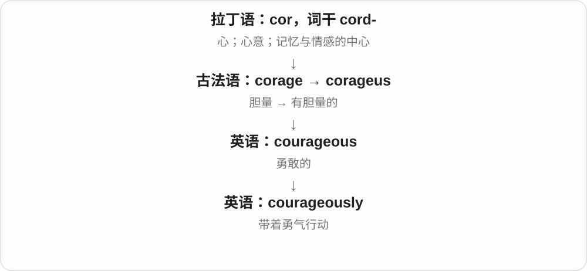

常修饰应对困难、捍卫观点等行动。它表达赞赏，但不表示结果一定成功。

**常见搭配与例句**

speak courageously；act courageously；face something courageously。

> She spoke courageously about the mistakes in the project.

她勇敢地谈到了项目中的错误。

> The team faced the setback courageously.

团队勇敢地面对了挫折。

**别混淆**

boldly 可以指风格大胆、动作鲜明；courageously 更突出面对困难或恐惧时的勇气。

### 20. encourage — 鼓励；支持；促使

**音标**：英 /ɪnˈkʌrɪdʒ/；美 /ɪnˈkɜːrɪdʒ/

**先抓住这个画面**

别人心里那点勇气快熄了，你添一把火，让他愿意再试；规则也能通过奖励让某种行为更容易发生。

**怎么拆**

古法语 en- 与 corage“胆量”组成 encoragier，进入英语。现代能看出 en- + courage。

**怎么变成今天的意思**

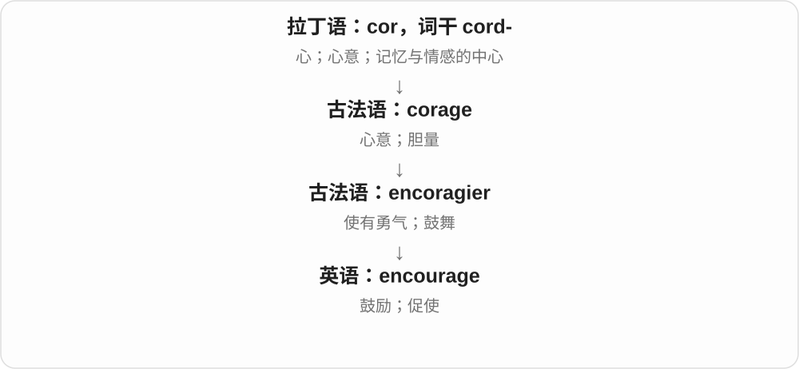

“给勇气”扩展为给予支持、让某事更可能发生。encourage cycling 可以靠修自行车道，而不只是对骑车人说加油。

**常见搭配与例句**

encourage someone to do；encourage participation；encourage growth。

> My teacher encouraged me to ask more questions.

老师鼓励我多提问。

> The new paths encourage people to cycle to work.

新修的道路让更多人愿意骑车上班。

**别混淆**

encourage 是推动、支持；force 是强迫。被鼓励的人通常仍有选择空间。

### 21. encouraged — 鼓励了；促使了；受到鼓舞的〔过去式、过去分词〕

**音标**：英 /ɪnˈkʌrɪdʒd/；美 /ɪnˈkɜːrɪdʒd/

**先抓住这个画面**

让一个人多一些敢做的心气，就是 encouraged。看到好进展，人也会觉得心里有底、更有信心。

**怎么拆**

encourage + -d，/dʒ/ 后读 /d/。古法语 encoragier 含 en- 与 corage 胆量，后者接心的拉丁词族；英语借入后作规则过去变化。

**怎么变成今天的意思**

**法语 en + corage → encourage**  
使有胆量、心气 → 鼓励、促进

↓

**encourage 去 e + -ed → encouraged**  
过去鼓励；受到鼓舞、信心增加

encouraged her to try 鼓励她尝试；encouraged by the results 因结果而受鼓舞；encouraged discussion 促进讨论。

**常见搭配与例句**

felt encouraged 受到鼓舞；encouraged participation 鼓励参与。

> The teacher encouraged her to ask more questions.

老师鼓励她多提问。

> We were encouraged by the early results.

初步结果让我们受到鼓舞。

**别混淆**

encourage somebody to do 是鼓励某人做；was encouraged by something 则说明什么让人获得信心。也可说政策、条件促成某种活动。

### 22. encouraging — 令人鼓舞的；让人更有希望的

**音标**：英 /ɪnˈkʌrɪdʒɪŋ/；美 /ɪnˈkɜːrɪdʒɪŋ/

**先抓住这个画面**

进度还没到终点，但出现了一个好信号，让人愿意相信继续努力值得。

**怎么拆**

encourage + -ing，用来描述能让别人得到鼓舞的人、事或迹象。

**怎么变成今天的意思**

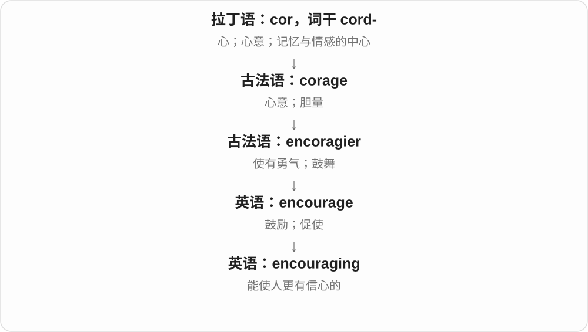

可以是支持的语气，也可以是不说话的实验结果。encouraging signs 只是好迹象，不保证最后一定成功。

**常见搭配与例句**

encouraging results；an encouraging smile；an encouraging sign。

> The first test produced encouraging results.

第一次测试得到的结果令人鼓舞。

> She gave me an encouraging smile.

她给了我一个鼓励的微笑。

**别混淆**

encouraging 让人受鼓舞；encouraged 是人已经受到鼓舞，感受方向相反。

### 23. encourages — 鼓励、支持；促进〔第三人称单数〕

**音标**：英 /ɪnˈkʌrɪdʒɪz/；美 /ɪnˈkɜːrɪdʒɪz/

**先抓住这个画面**

有人犹豫，你告诉他“可以试试，我支持你”，这是 encourages。制度、环境让某种做法更容易发生，也能用它。

**怎么拆**

encourage + -s，保留 e，/dʒ/ 后读 /ɪz/。基础词借法语 en- 与 courage 的心气、勇气材料。

**怎么变成今天的意思**

**拉丁 cor、词干 cord- → 古法语 corage**  
心 → 心气、胆量、勇气

↓

**古法语 encoragier、descouragier → encourage、discourage**  
使有勇气；使失去勇气、劝阻

↓

**encourage + -s → encourages**  
他、她鼓励；它促进

encourages someone to do 是鼓励某人做事；encourages discussion 是促进讨论。

**常见搭配与例句**

encourages her to try 鼓励她试试；encourages cooperation 促进合作。

> She encourages the children to ask questions.

她鼓励孩子们提问。

> The open layout encourages discussion.

开放的布局有利于大家讨论。

**别混淆**

encourage 可以只是给支持、创造有利条件；persuade 常突出用理由劝得对方接受，不必每次都交换使用。

### 24. encouragement — 鼓励；支持；令人有信心的事

**音标**：英 /ɪnˈkʌrɪdʒmənt/；美 /ɪnˈkɜːrɪdʒmənt/

**先抓住这个画面**

一句“你已经进步了”，或有人愿意陪你试一次，都能成为让你继续的那份支持。

**怎么拆**

来自法语 encoragement；现代与 encourage + -ment 对应，属于同一个鼓舞词族。

**怎么变成今天的意思**

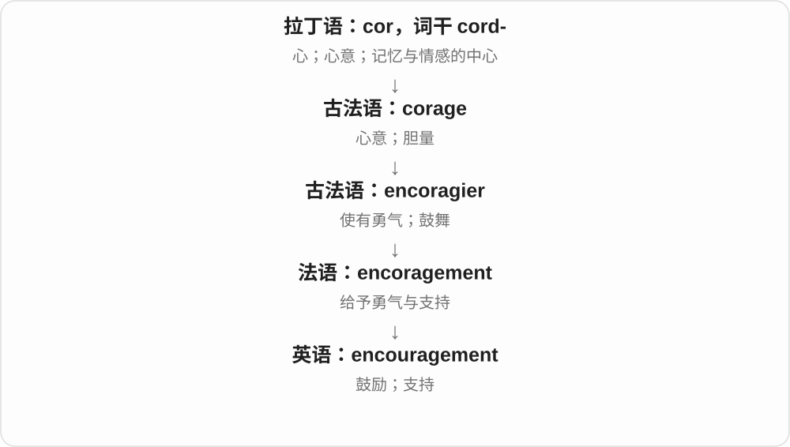

常作不可数名词表示支持；a great encouragement 则可指某件特别令人振作的事。

**常见搭配与例句**

words of encouragement；give encouragement；with encouragement from…。

> Your encouragement helped me finish the course.

你的鼓励帮助我完成了课程。

> The early results were a great encouragement to the team.

初步结果让团队备受鼓舞。

**别混淆**

praise 常表扬已做出的表现；encouragement 还可以在尚未成功时给予支持。

### 25. discouraged — 劝阻了；泄气的、灰心的

**音标**：英 /dɪsˈkʌrɪdʒd/；美 /dɪsˈkɜːrɪdʒd/

**先抓住这个画面**

试过几次都不成，心里那股劲弱了，可以说 felt discouraged；有人被劝得不去做，也可用被动结构。

**怎么拆**

discourage 去 e，加完整 -ed；/dʒ/ 后接 /d/，不增加 /ɪd/ 音节。

**怎么变成今天的意思**

**拉丁 cor、词干 cord- → 古法语 corage**  
心 → 心气、胆量、勇气

↓

**古法语 encoragier、descouragier → encourage、discourage**  
使有勇气；使失去勇气、劝阻

↓

**discourage + -ed → discouraged〔去 e〕**  
过去劝阻；失去信心的状态

felt discouraged by the result 是因结果灰心；was discouraged from applying 是受到劝阻不去申请。

**常见搭配与例句**

deeply discouraged 很灰心的；discouraged by the slow progress 因进展慢而泄气。

> She felt discouraged after several unsuccessful attempts.

几次尝试没成功后，她有些灰心。

> We were discouraged from taking the narrow path.

有人劝我们不要走那条窄路。

**别混淆**

discouraged 描写人失去干劲的状态，discouraging 描写让人产生这种状态的消息、经历。

### 26. discourage — 使泄气；劝阻；使不愿做

**音标**：英 /dɪsˈkʌrɪdʒ/；美 /dɪsˈkɜːrɪdʒ/

**先抓住这个画面**

把心里的劲泄掉，让人觉得不想继续；也可通过提醒或设置条件，让某种行为少发生。

**怎么拆**

古法语 des- + corage 形成 descouragier，现代可看成 dis- + courage。

**怎么变成今天的意思**

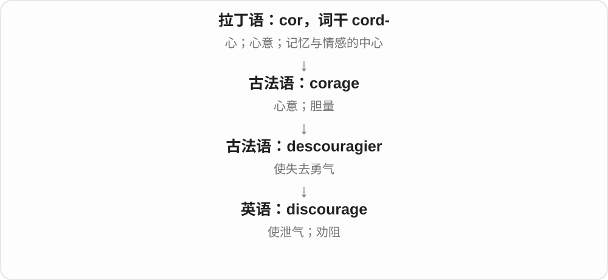

对人可以是打击信心；对不好的行为可以是合理劝阻。discourage littering 并不是让垃圾泄气，而是让人少乱扔垃圾。

**常见搭配与例句**

discourage someone from doing；discourage waste；feel discouraged。

> The cost discouraged us from buying a second car.

费用让我们打消了买第二辆车的念头。

> Do not let one mistake discourage you.

不要因为一次错误就泄气。

**别混淆**

discourage 不必是禁止；ban 才明确禁掉。劝阻后别人仍可能去做。

### 27. discouraging — 令人泄气的；使信心下降的

**音标**：英 /dɪsˈkʌrɪdʒɪŋ/；美 /dɪsˈkɜːrɪdʒɪŋ/

**先抓住这个画面**

看到一个结果，心里冒出“可能做不下去了”，这个结果就有 discouraging 的效果。

**怎么拆**

discourage + -ing，形容造成泄气感的事物。

**怎么变成今天的意思**

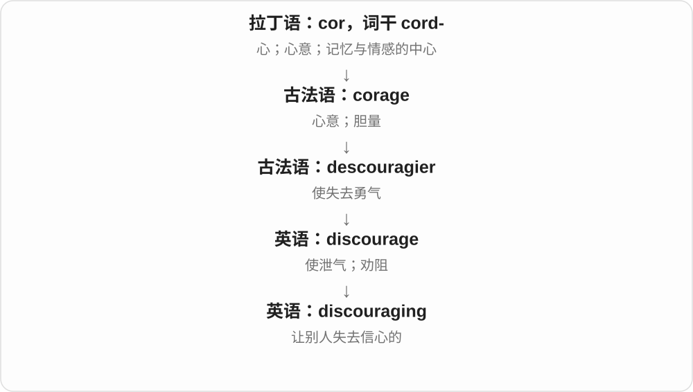

可以形容消息、数字、语气等。它说结果对人的影响，不等于客观上完全没有希望。

**常见搭配与例句**

discouraging news；a discouraging result；a discouraging comment。

> The slow progress was discouraging.

缓慢的进展让人泄气。

> She ignored the discouraging comments and kept practising.

她没有理会那些打击信心的话，继续练习。

**别混淆**

discouraging 是令人泄气；discouraged 是感到泄气。可以说 the news is discouraging，I feel discouraged。

### 28. discourages — 使泄气；劝阻、减少……的发生〔第三人称单数〕

**音标**：英 /dɪsˈkʌrɪdʒɪz/；美 /dɪsˈkɜːrɪdʒɪz/

**先抓住这个画面**

一句冷话让人没了干劲，是 discourages；增加麻烦、提出劝阻，让人不去做某事，也是这个词。

**怎么拆**

discourage + -s，/dʒ/ 后读 /ɪz/。历史接法语 des- 与 corage，而不是 dis- 加完整英语 encourage。

**怎么变成今天的意思**

**拉丁 cor、词干 cord- → 古法语 corage**  
心 → 心气、胆量、勇气

↓

**古法语 encoragier、descouragier → encourage、discourage**  
使有勇气；使失去勇气、劝阻

↓

**discourage + -s → discourages**  
使人泄气；阻止某种做法

discourages him from trying 是使他不想、或劝他不要尝试；discourages waste 是减少浪费的动机、机会。

**常见搭配与例句**

discourages visitors from parking here 劝阻访客在此停车；discourages experimentation 使人不敢尝试。

> Constant criticism discourages people from trying new things.

不断的批评会让人不敢尝试新事物。

> The sign discourages visitors from feeding the birds.

这块牌子劝阻访客喂鸟。

**别混淆**

discourage 通常是降低意愿、劝阻，forbid 是直接禁止；劝阻的力度不必然等于禁止。

### 29. discouragement — 泄气；挫折感；劝阻

**音标**：英 /dɪsˈkʌrɪdʒmənt/；美 /dɪsˈkɜːrɪdʒmənt/

**先抓住这个画面**

事情反复碰壁，心里那股想继续的劲降下来，这种状态是 discouragement。

**怎么拆**

discourage + -ment，把使泄气的行为或泄气的状态名词化。

**怎么变成今天的意思**

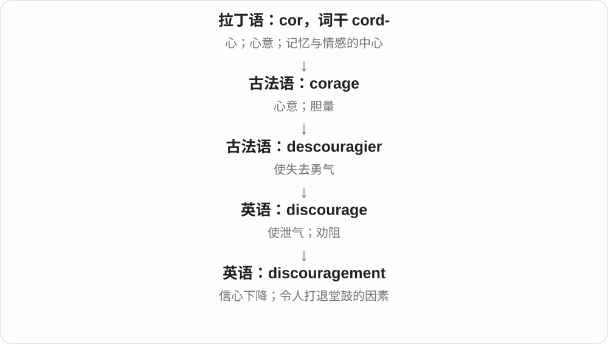

既可说情绪，也可说导致退缩的因素。它不必严重到彻底放弃。

**常见搭配与例句**

a feeling of discouragement；overcome discouragement；a source of discouragement。

> After several rejections, she felt deep discouragement.

几次被拒绝后，她感到很泄气。

> Support from friends helped him overcome his discouragement.

朋友的支持帮助他摆脱了挫败感。

**别混淆**

disappointment 是期待落空；discouragement 更强调继续尝试的信心受到影响。

### 30. accord — 一致；协议；给予；符合

**音标**：英 /əˈkɔːd/；美 /əˈkɔːrd/

**先抓住这个画面**

两边的心意调到同一个方向，能对得上；由此既可以有一致状态，也可以有谈成的协议。

**怎么拆**

经古法语 acorder、acort 来自重建的通俗拉丁语 *accordāre，与 cor/cord- 和“使一致”有关。

**怎么变成今天的意思**

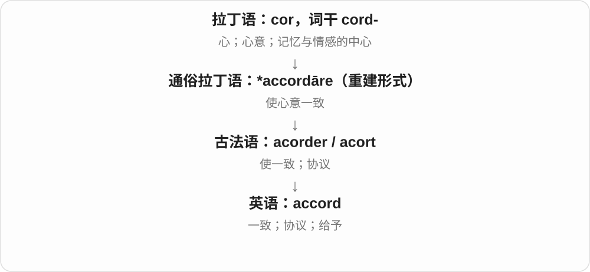

in accord 是相合；an accord 是协议。动词 accord someone respect 则是把适合的尊重给予对方。of one’s own accord 是出于自己意愿。

**常见搭配与例句**

in accord with；a peace accord；accord respect；of her own accord。

> The two groups signed an accord.

两个团体签署了一份协议。

> She left of her own accord.

她是自愿离开的。

**别混淆**

accord 作动词可以是给予，不要每处都译成达成协议。agreement 更日常，accord 作为协议名词常较正式。

### 31. accordance — 一致；符合；依照

**音标**：英 /əˈkɔːdəns/；美 /əˈkɔːrdəns/

**先抓住这个画面**

拿实际行动与规定对齐，两条线能合上，就是 in accordance with。

**怎么拆**

经古法语 acordance 传入；现代对应 accord + -ance。

**怎么变成今天的意思**

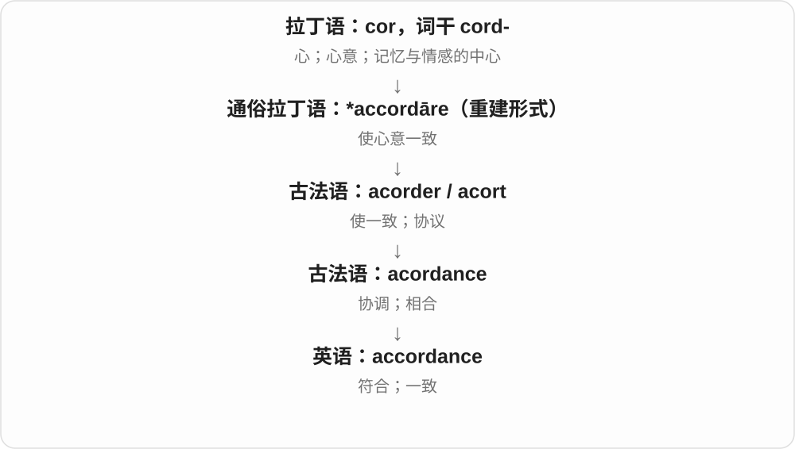

最常见的是 in accordance with，表示依照规则、协议或意愿行事。通常不单独说 an accordance。

**常见搭配与例句**

in accordance with the rules；in accordance with someone’s wishes。

> The work was completed in accordance with the plan.

工作按照计划完成了。

> The documents were stored in accordance with the instructions.

文件按要求存放了。

**别混淆**

according to 可以引述某人的说法；in accordance with 更强调行动符合规则或要求。

### 32. accordant — 一致的；相符的；协调的

**音标**：英 /əˈkɔːdənt/；美 /əˈkɔːrdənt/

**先抓住这个画面**

两种说法或两组声音互相对得上，没有彼此打架，这种性质可用 accordant。

**怎么拆**

经古法语 acordant 来自中世纪拉丁语 accordāns，是 accordāre“相合”的分词；现代可联系 accord + -ant，但不是英语动词新造出的唯一历史。

**怎么变成今天的意思**

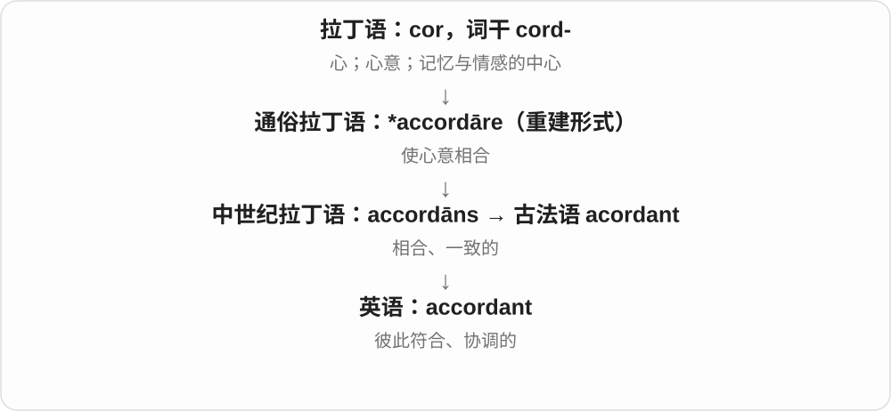

这是较书面的词，常用 with 接相合的对象。日常更常说 consistent with 或 in agreement with。

**常见搭配与例句**

accordant with the evidence；accordant views；accordant sounds。

> The conclusion is accordant with the available evidence.

这个结论与现有证据相符。

> The two accounts are broadly accordant.

两份叙述大体一致。

**别混淆**

accordant 描述相合状态；accordance 多出现在 in accordance with 这个名词短语里。

### 33. concord — 和睦；一致；语法一致

**音标**：英 /ˈkɒŋkɔːd/；美 /ˈkɑːŋkɔːrd/

**先抓住这个画面**

con- 把几颗“心”放到一起，大家不是互相拉扯，而是能协调相处。

**怎么拆**

拉丁语 con-（一起）+ cor/cord-（心）形成 concors、concordia，经法语进入英语。

**怎么变成今天的意思**

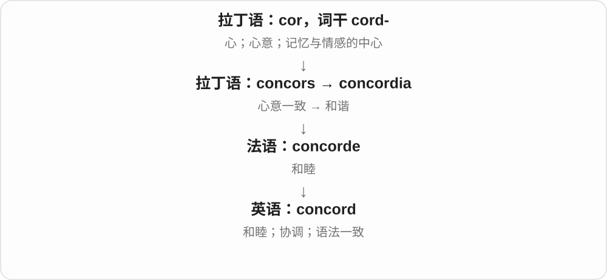

人际上是和睦，声音上是协调，语法上则是主语和动词等形式彼此配合。

**常见搭配与例句**

live in concord；social concord；subject–verb concord。

> The communities lived in concord for many years.

这些社区多年来和睦相处。

> The lesson explains subject–verb concord.

这一课解释主谓一致。

**别混淆**

concord 常说和谐、一致的状态；an accord 更常是一份谈成的协议。

### 34. concordant — 相符的；一致的；协调的

**音标**：英 /kənˈkɔːdənt/；美 /kənˈkɔːrdənt/

**先抓住这个画面**

几项独立得到的观察指向同一方向，像不同声部唱得合拍，就是 concordant。

**怎么拆**

拉丁语 concordāns 是 concordāre“相合”的相关形式，经法语进入英语。

**怎么变成今天的意思**

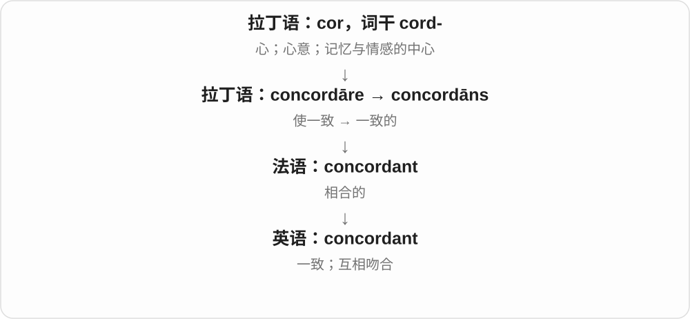

常见于研究、统计或专业讨论，描述结果或特征相符。相符本身不证明两者之间有因果。

**常见搭配与例句**

concordant results；concordant findings；concordant with。

> The two methods produced concordant findings.

两种方法得出了相符的发现。

> Her account was concordant with the written record.

她的叙述与书面记录一致。

**别混淆**

concordant 强调对应一致；identical 是完全相同。两项结论相符，不代表每个数字都一样。

### 35. concordance — 一致性；词语索引；语境索引

**音标**：英 /kənˈkɔːdəns/；美 /kənˈkɔːrdəns/

**先抓住这个画面**

一方面是两组信息对得上；另一方面，把同一个词在不同地方出现的句子排在一起，便于一一查对。

**怎么拆**

来自晚期拉丁语 concordantia，经古法语 concordance 传入。

**怎么变成今天的意思**

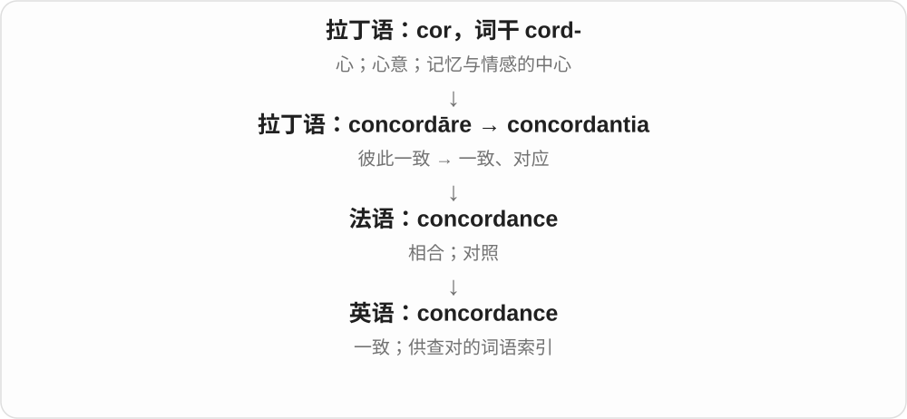

文本索引义把分散出现的相同词集中，显示各处语境。它不只是给一个词一个释义，而是帮助比较实际用法。

**常见搭配与例句**

concordance between results；a concordance of a text；concordance lines。

> There was strong concordance between the two sets of results.

两组结果高度一致。

> The researcher used a concordance to compare the word’s different contexts.

研究者用语境索引比较这个词的不同上下文。

**别混淆**

dictionary 给词义等信息；concordance 重点列出词在指定文本中的出现位置和上下文。

### 36. discord — 不和；分歧；不协和声

**音标**：英 /ˈdɪskɔːd/；美 /ˈdɪskɔːrd/

**先抓住这个画面**

大家的心意往两边拉，或声音彼此顶撞，合不到一起，这就是 discord。

**怎么拆**

拉丁语 dis-（分开）+ cor/cord-（心）形成 discors、discordia，经法语进入英语。

**怎么变成今天的意思**

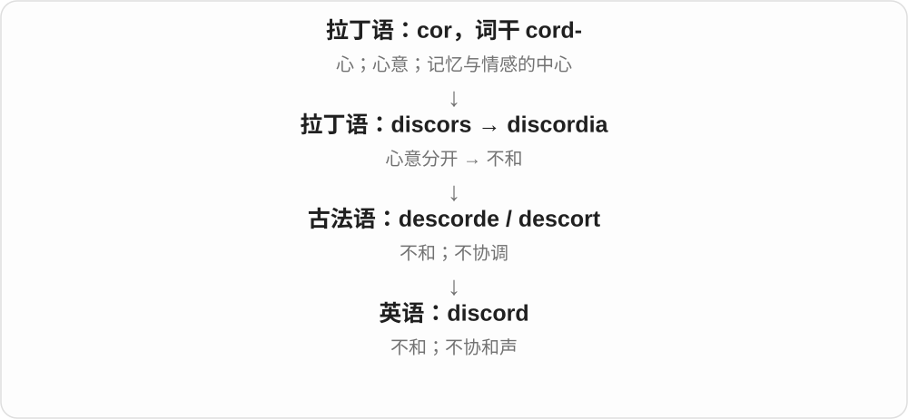

可以指人际冲突，也可以指音乐中的不协和。音乐里的不协和有时是有意的表现手段，不必是演奏错误。

**常见搭配与例句**

sow discord；family discord；a note of discord。

> The decision sowed discord within the group.

这个决定在团体内部引起了不和。

> A harsh discord interrupted the gentle melody.

一个刺耳的不协和音打断了柔和旋律。

**别混淆**

disagreement 可以是平静的意见不同；discord 更突出不和、冲突或失去协调。

### 37. discordant — 不协调的；不一致的；刺耳的

**音标**：英 /dɪsˈkɔːdənt/；美 /dɪsˈkɔːrdənt/

**先抓住这个画面**

几种声音或说法挤到一起，彼此对不上，听起来或看起来像在打架。

**怎么拆**

拉丁语 discordāre“相互不合”经法语相关分词形式进入英语；现代可联系 discord + -ant。

**怎么变成今天的意思**

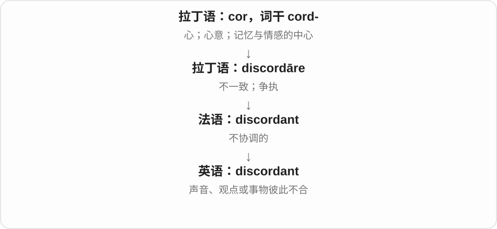

它既可形容音响，也可形容与整体气氛不搭的言行。a discordant note 可以是一句破坏和谐的话。

**常见搭配与例句**

discordant sounds；discordant views；strike a discordant note。

> Discordant music came from the next room.

隔壁传来不协调的音乐声。

> His cheerful remark struck a discordant note at the serious meeting.

在严肃的会议上，他轻快的评论显得很不合时宜。

**别混淆**

different 只说不同；discordant 常说不同到难以协调或相互冲突。

### 38. discordance — 不一致；不协调

**音标**：英 /dɪsˈkɔːdəns/；美 /dɪsˈkɔːrdəns/

**先抓住这个画面**

把两个应当对应的结果并排放，发现它们明显对不上；这种不合就是 discordance。

**怎么拆**

来自古法语 discordance 与中世纪拉丁语相关名词路线，根在 discordāre“不一致”；现代可联系 discord 与 -ance。

**怎么变成今天的意思**

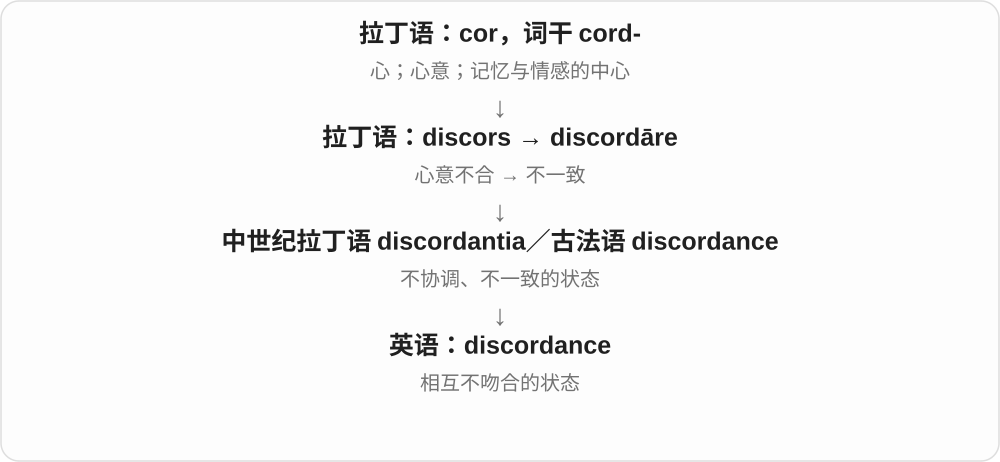

常用于专业或较正式的比较，比简单说“有差别”更强调结果或关系不一致。

**常见搭配与例句**

discordance between results；a degree of discordance；explain the discordance。

> The team investigated the discordance between the two measurements.

团队调查了两次测量结果不一致的原因。

> There is a clear discordance between his words and actions.

他的言语和行动明显不一致。

**别混淆**

discord 常指关系不和；discordance 更适合把不一致作为可分析的现象讨论。

### 39. cordial — 热诚友好的；果味甜饮；甜酒

**音标**：英 /ˈkɔːdiəl/；美 /ˈkɔːrdʒəl/

**先抓住这个画面**

面对人时，是从心里拿出友好；饮品义则保留了过去“让心和身体振作”的用法。

**怎么拆**

中世纪拉丁语 cordiālis“与心有关”经法语进入英语。这里 cord- 是心，不是英语 cord“绳子”。

**怎么变成今天的意思**

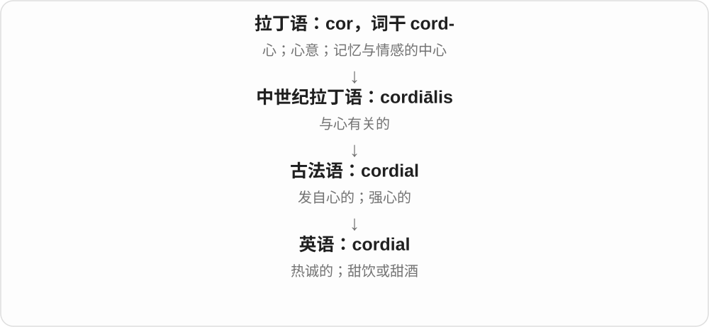

形容词常说礼貌而温暖的交往；英式名词常指需加水稀释的甜饮料，美式可指甜利口酒，点饮料时要看地区。

**常见搭配与例句**

a cordial welcome；cordial relations；fruit cordial。

> They gave us a cordial welcome.

他们热情友好地欢迎了我们。

> She mixed the elderflower cordial with water.

她把接骨木花浓缩甜饮兑了水。

**别混淆**

cordial 可以是友好而保持距离，不一定亲密。cordial drink 的传统名称也不代表现代医学功效。

### 40. cordially — 热诚地；友好地

**音标**：英 /ˈkɔːdiəli/；美 /ˈkɔːrdʒəli/

**先抓住这个画面**

见面时主动握手、认真欢迎，对方感到受尊重；cordially 描述这种有礼而温暖的方式。

**怎么拆**

cordial + -ly。

**怎么变成今天的意思**

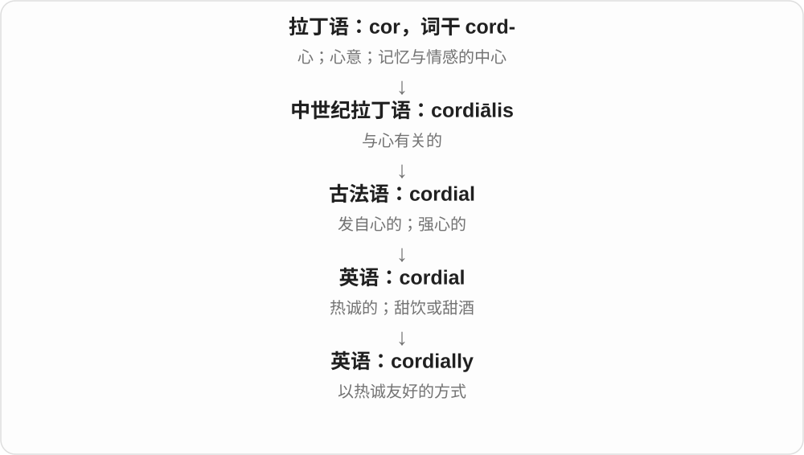

邀请函中 You are cordially invited 是礼貌郑重的欢迎。它未必表示双方已经非常熟悉。

**常见搭配与例句**

greet cordially；cordially invited；speak cordially。

> You are cordially invited to the opening ceremony.

诚挚邀请您出席开幕式。

> The two neighbours greeted each other cordially.

两位邻居友好地互相问候。

**别混淆**

cordially 偏友好而礼貌；intimately 强调亲密，不能仅因邀请热情就换成后者。

### 41. cordiality — 热诚；友好

**音标**：英 /ˌkɔːdiˈæləti/；美 /ˌkɔːrdʒiˈæləti/

**先抓住这个画面**

不只看有没有说礼貌用语，还看相处中是否能感到温暖、真诚的欢迎，这种气氛是 cordiality。

**怎么拆**

cordial + -ity，形容词变成性质名词，重音后移。

**怎么变成今天的意思**

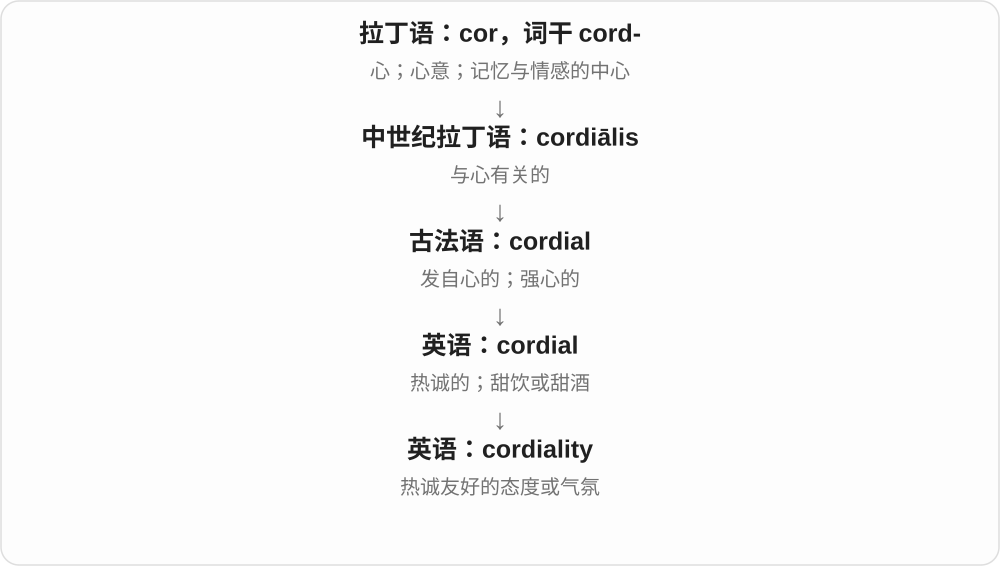

常形容接待、交往或关系中的友善。它不保证意见完全一致，双方可以友好地讨论分歧。

**常见搭配与例句**

with cordiality；genuine cordiality；an atmosphere of cordiality。

> We appreciated the cordiality of our hosts.

我们很感谢主人们的热情友好。

> The meeting ended in an atmosphere of cordiality.

会议在友好的气氛中结束。

**别混淆**

cordiality 说待人友好；concord 说关系协调一致。彼此有分歧仍可保持 cordiality。

### 42. camcorder — 便携式摄录机

**音标**：英 /ˈkæmkɔːdə/；美 /ˈkæmkɔːrdər/

**先抓住这个画面**

把拍摄和录像装在同一台可拿着走的机器里。

**怎么拆**

camera 与 recorder 的混成词：取 cam- 和 -corder。20世纪80年代随一体化便携摄录设备普及。

**怎么变成今天的意思**

**古希腊语 kamara → 拉丁语 camera**  
有拱顶的空间、房间；更早来源未定

↓

**新拉丁语 camera obscura；英语简称 camera**  
暗室成像装置

↓

**英语 camera 的摄影、摄像义**  
暗箱式成像装置 → 拍照或录影设备

↓

**英语 camera + recorder → camcorder**  
摄像机 + 录像机 → 便携摄录一体机

传统 camcorder 让人想到手持、肩扛的专用录像设备；它可以使用磁带，也可以用数字存储，不是词里藏着必须用哪种介质。

**常见搭配与例句**

a digital camcorder；record with a camcorder。

> He recorded the school play on a small camcorder.

他用一台小型摄录机录下了学校的演出。

> The old camcorder still has a tape inside it.

那台旧摄录机里还留着一盘磁带。

**别混淆**

camera 是更广的拍摄设备名；camcorder 突出摄像和记录功能合一的专用器材。

### 43. camcorders — 便携摄像机、录像摄像设备〔复数〕

**音标**：英 /ˈkæmkɔːdəz/；美 /ˈkæmkɔːrdərz/

**先抓住这个画面**

既把画面拍进来，又把内容录下来，camera 与 recorder 两种作用合到一起，名称混成 camcorders。

**怎么拆**

camera + recorder → camcorder，混成后再加 -s，读 /z/。保留各词的一段，不是把 camera 与 recorder 全部拼上。

**怎么变成今天的意思**

**camera + recorder → camcorder**  
拍摄与录制用途混成设备名

↓

**camcorder + -s → camcorders**  
多台便携摄像录制设备

digital camcorders 数码摄像机；old camcorders 旧便携摄像机。

**常见搭配与例句**

compare camcorders 比较摄像机；camcorders in the exhibition 展览里的摄像机。

> The exhibition showed early digital camcorders.

展览展示了早期数码摄像机。

> The team used two camcorders to record the interview.

团队用两台摄像机录制访谈。

**别混淆**

camera 范围更广，可拍静态照片；camcorder 明确摄像录制设备这个类别。

### 44. concordat — 政教协定；正式协议

**音标**：英 /kənˈkɔːdæt/；美 /kənˈkɔːrdæt/

**先抓住这个画面**

双方把共同认可的安排落成一份正式文件，尤其常用于国家与教会之间的安排。

**怎么拆**

法语 concordat 来自拉丁语 concordātum“已达成一致的东西”，属于 concordāre 词族。

**怎么变成今天的意思**

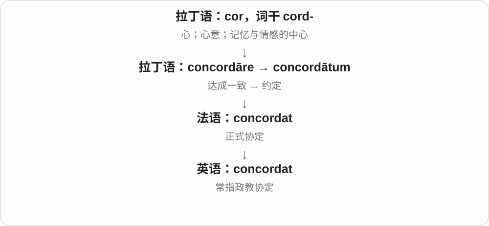

词根解释的是双方意愿协调；具体协定规定什么，需要看文件本身。较少用于普通私人约定。

**常见搭配与例句**

sign a concordat；a concordat between church and state。

> The book examines a concordat between the state and the church.

这本书考察国家与教会之间的一份协定。

> The concordat set out the responsibilities of both parties.

协定列明了双方的职责。

**别混淆**

concord 是和睦状态；concordat 是一份正式约定，特别有历史与制度语境。

### 45. cordate — 心形的；基部呈心形的

**音标**：英 /ˈkɔːdeɪt/；美 /ˈkɔːrdeɪt/

**先抓住这个画面**

想象常见爱心轮廓：一端有两个圆瓣，中间凹下去，另一端收尖。植物描述中常用 cordate 说明这种形状或心形基部。

**怎么拆**

拉丁语 cord-（心）+ -ate（具有相应性质或形态）。

**怎么变成今天的意思**

植物学说叶片或基部 cordate 时，通常叶柄接在两个圆瓣之间的凹处。这里说形状，不说植物有情感。

**常见搭配与例句**

a cordate leaf；a cordate base；cordate leaf blades。

> The plant has broad leaves with a cordate base.

这种植物的叶子宽大，基部呈心形。

> The guide illustrates the difference between cordate and oval leaves.

图鉴展示了心形叶和椭圆形叶的区别。

**别混淆**

cordate 是心形；obcordate 是方向倒过来的心形，连接叶柄的位置不同。

### 46. obcordate — 倒心形的

**音标**：英 /ɒbˈkɔːdeɪt/；美 /ɑːbˈkɔːrdeɪt/

**先抓住这个画面**

把心形叶反过来：细的一端接叶柄，远端较宽并有凹口。这就是 obcordate。

**怎么拆**

ob- 在这里表示倒置、反向，加 cordate（心形的）。

**怎么变成今天的意思**

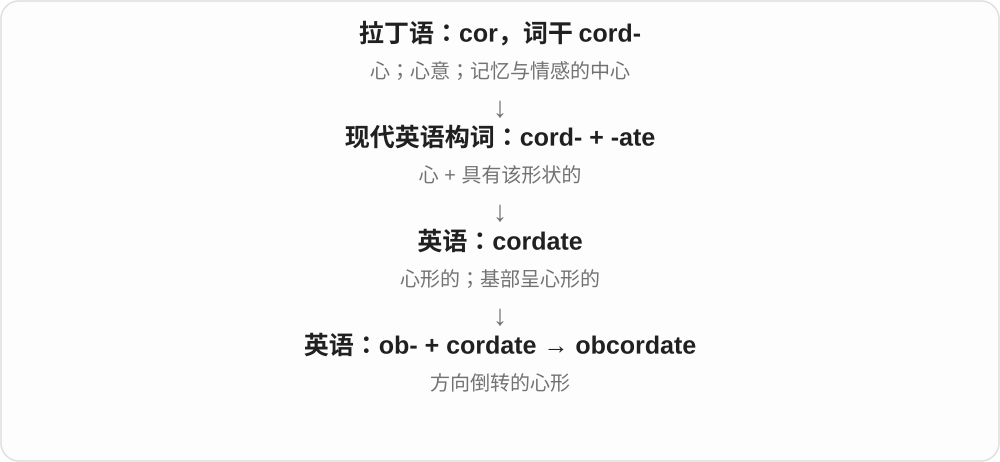

记忆关键是叶柄接在哪里，不能只看纸面图案朝上还是朝下。图转个方向，不会改变植物的形态名称。

**常见搭配与例句**

an obcordate leaf；obcordate leaflets；an obcordate outline。

> The leaflet is obcordate, with the stalk attached to the narrow end.

小叶呈倒心形，叶柄接在较窄的一端。

> The botanist noted the plant’s obcordate leaflets.

植物学家记录了这种植物倒心形的小叶。

**别混淆**

cordate 的凹处通常在靠叶柄的一端；obcordate 的凹处在远离叶柄的宽端。

### 47. cordiform — 心形的

**音标**：英 /ˈkɔːdɪfɔːm/；美 /ˈkɔːrdəfɔːrm/

**先抓住这个画面**

直接把物体外轮廓看成一颗爱心：它可以是叶片、石头或其他形状。

**怎么拆**

拉丁语 cord-（心）+ -iform（形状像……的，与 form 有关）。

**怎么变成今天的意思**

这是形态描述词，强调整体外形。有些植物学规范把 cordate 更常用于基部、cordiform 用于整体，阅读时依该书术语习惯。

**常见搭配与例句**

a cordiform outline；a cordiform leaf；a cordiform object。

> The drawing shows a cordiform outline.

这幅图画出了一个心形轮廓。

> The specimen has a distinctly cordiform shape.

这个标本具有明显的心形外观。

**别混淆**

cordial 是热诚的；cordiform 是心形的。一个描述人际态度，另一个描述外形。

### 48. misericord — 教堂站立支托；历史上的怜悯短剑

**音标**：英 /mɪˈzerɪkɔːd/；美 /mɪˈzerɪkɔːrd/

**先抓住这个画面**

长时间站立很累，教堂折叠座椅下面留一小块托板，让人稍微倚住。这个“小小的怜悯”是词的一条历史用途。

**怎么拆**

拉丁语 misericordia“怜悯”与 miser“可怜、受苦”和 cor“心”相关，经古法语进入英语。

**怎么变成今天的意思**

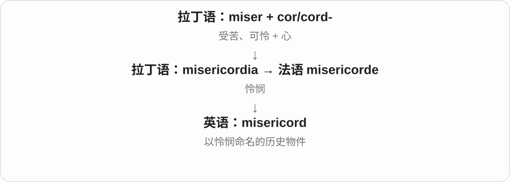

教堂托板是减轻久站负担的装置。另一历史义是用于结束重伤者生命的短剑，名称来自当时所谓“怜悯一击”的观念，不是现代赞同这种做法。

**常见搭配与例句**

a carved misericord；a medieval misericord；choir-stall misericords。

> The church has a beautifully carved wooden misericord.

这座教堂有一块雕刻精美的木制站立支托。

> The museum labels the medieval dagger as a misericord.

博物馆把那把中世纪短剑标为 misericord。

**别混淆**

它不是普通 cushion“坐垫”，而是特定历史构件；看到武器语境也不能译成教堂托板。

### 49. scordatura — 变格定弦；非常规定弦

**音标**：英 /ˌskɔːdəˈtʊərə/；美 /ˌskɔːrdəˈtʊrə/

**先抓住这个画面**

弦乐器通常有一套标准调弦，但演奏这首曲子时，故意把某些弦调到别的音，以得到特别音色或更合适的指法。

**怎么拆**

借自意大利语 scordatura，来自 scordare“失去通常调和”，与拉丁语 discordāre“不和谐”相连。

**怎么变成今天的意思**

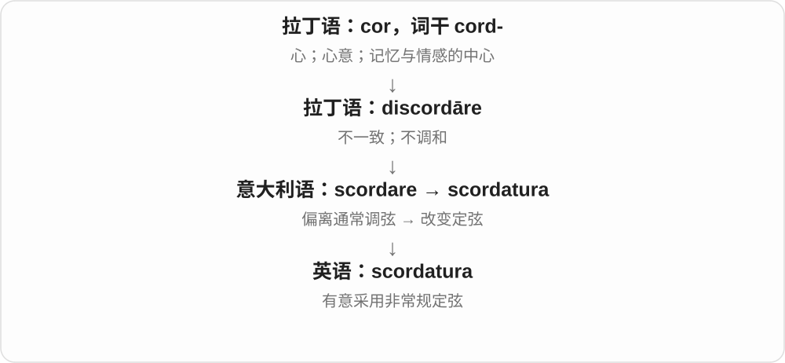

历史词形含“不调和”，现代音乐术语却常表示有计划的特殊调弦，不等于演奏者没调准。

**常见搭配与例句**

scordatura tuning；use scordatura；a piece requiring scordatura。

> The violinist used scordatura for this piece.

小提琴家演奏这首曲子时采用了变格定弦。

> The score explains the required scordatura before the first movement.

乐谱在第一乐章前说明了所需的特殊定弦。

**别混淆**

out of tune 是音准不对；scordatura 是主动改变定弦方案，演奏仍可以非常准确。

## 这一组要分清什么

**encourage / discourage**：给人信心或促进行为 / 使人泄气或劝阻。

**accord / concord**：都与一致相连；accord 常指协议或符合，concord 更突出和睦、协调。

**cordial / cordiality / cordiform**：热诚的 / 热诚 / 心形的。

**record** 名词重音在前，动词重音在后。现代录音技术出现得晚，词本身的记忆历史很早。

**core** 意义上像“中心、心脏”，但远源不确定；同形近义不等于已经证实同源。

## 串起来练习

**Her cordial words encouraged him to record the disagreement without creating discord.**

她友好的话鼓励他把分歧记录下来，同时不制造不和。cordial 发自友好的心，encourage 给勇气，record 留下记忆，discord 是心意不合。
