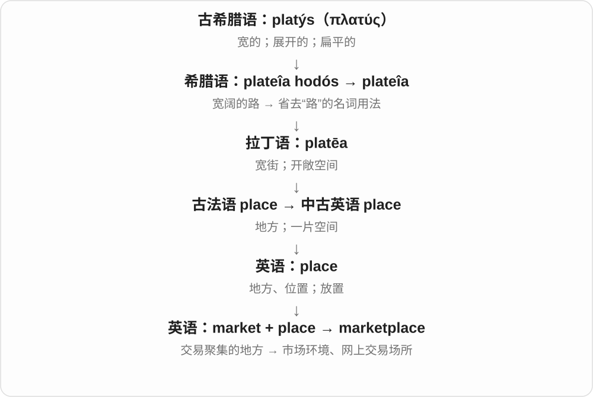

# 0306 · merc- — 货物、交易；报酬，进而有恩惠和怜悯

[逐词精讲目录](../00_逐词精讲目录.md) · [总目录](../00_总目录_按常用程度.md)

## 核心词根与来源

拉丁语 merx 指货物，属格 mercis 露出 merc-。mercari 是做买卖，merces 是酬劳、奖赏。英语经法语、意大利语等多条路线吸收这一族，所以同源词的拼写可以变成 market、merchant、commerce、mercy。更早的 merx 来源不明确，不强行接一条确定的史前路线。

**一条线跟着货物去市场，一条线跟着报酬走向奖赏和恩惠。先认清分岔，才不会把 mercy 硬译成买卖。**

merx 是货物，mercari 是交易，merces 是报酬；前两条通向 market 和 merchant，后一条经恩惠发展到 mercy。

- **买卖与市场**：market, commerce, commercial, merchant, merchandise
- **商店与销售阶段**：supermarket, hypermarket, upmarket, aftermarket, premarket
- **市场吸引力与经营**：marketable, marketability, marketer, commercialize, commercialization
- **报酬与商业取向**：mercenary, mercantile, mercantilism, commercialism
- **恩惠与宽宥**：mercy, merciful, merciless, amercement
- **marketing：把产品带到买家面前**：market · marketing
- **market → markets：交易场所与买卖范围**：market · markets
- **merchandise → merch：商品、周边的短称**：merchandise · merch
- **Mercury 名称与 mercury 汞的历史联系**：mercury
- **merchant → merchants：贸易者的名称**：merchants
- **commerce → commercial → commercials 广告**：commercials
- **merc- 买卖 → market → marketed**：marketed

## 词形与演化规律

merc- 在 commerce、mercantile、mercenary 中较明显；经法语后可见 merch- 和 market 的 mark-。mercy 来自 merces 的奖赏、恩惠支线，mercenary 仍接报酬；二者不是现代英语互相派生。

market 来自拉丁交易词族；marketing 为动词 -ing 名词，现代营销义覆盖认识需求、定位、推广等市场活动。

拉丁交易名词经法语等进入，现代动词表示面向买家推广。

merch 缩略 merchandise，现代常说音乐人、作品、品牌等周边商品。merchandise 经法语商业、货物词线，较远接拉丁交易、商品词族；缩略没有另造一个 -ch 后缀。

汞名接中世纪拉丁 mercurius，连到 Mercury 行星、神名的炼金术命名背景。神名更远常联系 merx 商品、交易材料，也有其他来源分析，不能说贸易动作直接变成金属。

merchant 经法语接拉丁贸易动词相关分词材料，远连 merx 商品词族；复数 -s 在 /t/ 后读 /s/。

commercial 对应 commerce + -al，广播、电视商业广告名词从形容词用法发展，现代加 -s。commercials 不能直接译成商业的很多东西。

market 经法语、拉丁 mercatus 买卖接 merx 商品词族，动词后加完整 -ed，/t/ 后读 /ɪd/，推向市场与宣传定位皆可。

## 单词速览（按词族由简到繁）

同一基础词的相关扩展放在一起，先读基础形式，再读扩展；各组之间优先读常用的。具体词源关系见各词讲解。

| 单词 | 音标 | 核心意思 |
|---|---|---|
| [market](#w-1) | 英 /ˈmɑːkɪt/；美 /ˈmɑːrkɪt/ | 市场；交易范围；推销 |
| [marketing](#w-28) | 英 /ˈmɑːkɪtɪŋ/；美 /ˈmɑːrkɪtɪŋ/ | 营销；市场推广；market 的 -ing 形式 |
| [markets](#w-29) | 英 /ˈmɑːkɪts/；美 /ˈmɑːrkɪts/ | 市场、集市；买卖范围〔复数〕；推销、营销〔第三人称单数〕 |
| [marketplace](#w-7) | 英 /ˈmɑːkɪtpleɪs/；美 /ˈmɑːrkɪtpleɪs/ | 集市；市场；交易平台 |
| [marketed](#w-34) | 英 /ˈmɑːkɪtɪd/；美 /ˈmɑːrkɪtɪd/ | 推销、推广了；以某种定位推向市场的 |
| [marketable](#w-13) | 英 /ˈmɑːkɪtəbl/；美 /ˈmɑːrkɪtəbl/ | 适销的；有销路的；具备市场吸引力的 |
| [marketability](#w-22) | 英 /ˌmɑːkɪtəˈbɪləti/；美 /ˌmɑːrkɪtəˈbɪləti/ | 适销性；市场吸引力；就业市场竞争力 |
| [marketer](#w-17) | 英 /ˈmɑːkɪtə/；美 /ˈmɑːrkɪtər/ | 营销人员；销售推广者；营销公司 |
| [supermarket](#w-8) | 英 /ˈsuːpəˌmɑːkɪt/；美 /ˈsuːpɚˌmɑːrkɪt/ | 超级市场；超市 |
| [aftermarket](#w-15) | 英 /ˈɑːftəˌmɑːkɪt/；美 /ˈæftɚˌmɑːrkɪt/ | 售后市场；原产品售出后的配件和服务市场 |
| [upmarket](#w-19) | 英 /ˌʌpˈmɑːkɪt/；美 /ˌʌpˈmɑːrkɪt/ | 高档的；面向较高消费层次的；向高端市场 |
| [premarket](#w-23) | 英 /ˌpriːˈmɑːkɪt/；美 /ˌpriːˈmɑːrkɪt/ | 上市前的；常规交易开盘前的 |
| [hypermarket](#w-24) | 英 /ˈhaɪpəˌmɑːkɪt/；美 /ˈhaɪpɚˌmɑːrkɪt/ | 大型综合超市；大卖场 |
| [commerce](#w-3) | 英 /ˈkɒmɜːs/；美 /ˈkɑːmɜːrs/ | 商业；贸易；买卖往来 |
| [commercial](#w-2) | 英 /kəˈmɜːʃəl/；美 /kəˈmɜːrʃəl/ | 商业的；营利性的；商业广告 |
| [commercials](#w-33) | 英 /kəˈmɜːʃəlz/；美 /kəˈmɜːrʃəlz/ | 广播、电视等商业广告〔复数〕 |
| [commercially](#w-9) | 英 /kəˈmɜːʃəli/；美 /kəˈmɜːrʃəli/ | 商业上；以商业方式；在市场上 |
| [commercialism](#w-20) | 英 /kəˈmɜːʃəlɪzəm/；美 /kəˈmɜːrʃəlɪzəm/ | 商业主义；过分追求商业利益的风气 |
| [commercialize](#w-21) | 英 /kəˈmɜːʃəlaɪz/；美 /kəˈmɜːrʃəlaɪz/ | 使商业化；把……推向商业应用 |
| [commercialization](#w-16) | 英 /kəˌmɜːʃəlaɪˈzeɪʃən/；美 /kəˌmɜːrʃələˈzeɪʃən/ | 商业化；商品化 |
| [noncommercial](#w-18) | 英 /ˌnɒnkəˈmɜːʃəl/；美 /ˌnɑːnkəˈmɜːrʃəl/ | 非商业的；非商业用途的 |
| [mercy](#w-4) | 英 /ˈmɜːsi/；美 /ˈmɜːrsi/ | 怜悯；宽恕；慈悲 |
| [merciful](#w-10) | 英 /ˈmɜːsɪfəl/；美 /ˈmɜːrsɪfəl/ | 仁慈的；宽恕人的；令人少受苦的 |
| [merciless](#w-14) | 英 /ˈmɜːsɪləs/；美 /ˈmɜːrsɪləs/ | 毫不留情的；残酷的；猛烈难熬的 |
| [merchant](#w-5) | 英 /ˈmɜːtʃənt/；美 /ˈmɜːrtʃənt/ | 商人；批发商；商业交易中的卖方 |
| [merchandise](#w-6) | 名词：英 /ˈmɜːtʃəndaɪs/，美 /ˈmɜːrtʃəndaɪs/；动词：英 /ˈmɜːtʃəndaɪz/，美 /ˈmɜːrtʃəndaɪz/ | 商品；销售、陈列推广商品 |
| [merch](#w-30) | 英 /mɜːtʃ/；美 /mɝtʃ/ | 商品；周边商品〔非正式〕 |
| [merchants](#w-32) | 英 /ˈmɜːtʃənts/；美 /ˈmɜːrtʃənts/ | 商人，贸易商〔复数〕 |
| [mercury](#w-31) | 英 /ˈmɜːkjəri/；美 /ˈmɜːrkjəri/ | 汞，水银；温度计读数、气温〔借代〕 |
| [mercenary](#w-11) | 英 /ˈmɜːsənəri/；美 /ˈmɜːrsəneri/ | 雇佣兵；只图钱的 |
| [mercantile](#w-12) | 英 /ˈmɜːkəntaɪl/；美 /ˈmɜːrkəntaɪl/，也 /ˈmɜːrkəntiːl/ | 商业的；商贸的 |
| [mercantilism](#w-25) | 英 /ˈmɜːkəntɪlɪzəm/；美 /ˈmɜːrkəntɪlɪzəm/ | 重商主义；商贸至上的取向〔较少见〕 |
| [amercement](#w-26) | 英 /əˈmɜːsmənt/；美 /əˈmɜːrsmənt/ | 由法庭酌定的罚金〔历史法律用语〕 |
| [mercery](#w-27) | 英 /ˈmɜːsəri/；美 /ˈmɜːrsəri/，也可省中间弱元音 | 绸布等商品；绸布商的店铺或行业〔主要英式历史用语〕 |

## 逐词讲解

### 1. market — 市场；交易范围；推销

**音标**：英 /ˈmɑːkɪt/；美 /ˈmɑːrkɪt/

**先抓住这个画面**

原先是一群人带着货物来买卖的地方，后来把看不见的买家、卖家和需求也叫作市场。

**怎么拆**

经古法语与晚期古英语形式接拉丁语 mercatus，来自 mercari“交易”。英语动词由名词转用，表示把东西推向买家。

**怎么变成今天的意思**

**拉丁语 merx，属格 mercis**  
货物、商品

↓

**拉丁语 mercari**  
做买卖、交易

↓

**拉丁语 mercatus → 北部古法语 market / 古法语 marchiet**  
交易；市场

↓

**中古英语 market〔也承接晚期古英语形式〕**  
集市；买卖的范围

↓

**英语名词 → 动词 market**  
市场 → 推销、面向市场销售

a street market 看得见摊位；the housing market 看的是住房买卖；a market for something 是有人愿意买它。

**常见搭配与例句**

the job market；market a product；a market for…。

> We bought fresh bread at the market.

我们在集市买了新鲜面包。

> The company markets the app to small businesses.

公司面向小企业推广这款应用。

**别混淆**

shop 常指一家店；market 可以是一片交易场所，也可以是整类交易和需求。

### 2. marketing — 营销；市场推广；market 的 -ing 形式

**音标**：英 /ˈmɑːkɪtɪŋ/；美 /ˈmɑːrkɪtɪŋ/

**先抓住这个画面**

做出了东西，还要弄明白谁需要它、怎样让人知道并愿意买。这一整套把产品与买家接起来的工作，是 marketing。

**怎么拆**

market + -ing，由市场买卖相关动词形成名词。更早 market 经法语等接拉丁 mercatus 交易、市场；现代商业营销义在旧买卖活动义上进一步专门化。

**怎么变成今天的意思**

**拉丁 mercatus → market**  
交易、市场；后来作动词推向市场

↓

**market + -ing → marketing**  
市场活动 → 现代营销领域

a marketing team 营销团队；market research 市场调研；digital marketing 数字营销；a marketing campaign 一轮营销活动。广告是常见手段之一。

**常见搭配与例句**

work in marketing；a marketing strategy。

> She works in marketing for a small food company.

她在一家小食品公司做营销。

> The marketing team interviewed customers before the launch.

上市前，营销团队采访了顾客。

**别混淆**

marketing 范围通常比 advertising 广，既要考虑对象和产品怎样匹配，也可包括定价、渠道、推广；sales 更直接关心把交易做成。

### 3. markets — 市场、集市；买卖范围〔复数〕；推销、营销〔第三人称单数〕

**音标**：英 /ˈmɑːkɪts/；美 /ˈmɑːrkɪts/

**先抓住这个画面**

买卖双方汇到一起，是 markets 的市场画面；它可以是实际摊位，也可以是某类产品面向的买卖范围。把产品推向这些买家，动词也用 market。

**怎么拆**

market + -s，/t/ 后读 /s/。拉丁 mercārī 交易形成 mercātus，经古法语与晚期古英语等形式进入英语；现代动词由名词发展。

**怎么变成今天的意思**

**拉丁 mercārī、mercātus → 法语、英语 market**  
交易 → 买卖的场所、范围

↓

**market + -s → markets；名词转动词**  
多个市场；单数主语面向买家推广

local markets 当地集市；overseas markets 海外市场；markets the product 推销产品。

**常见搭配与例句**

markets selling fresh food；markets for different services。

> Local markets sell fresh vegetables and fruit.

当地集市出售新鲜蔬菜和水果。

> The company markets its products overseas.

这家公司向海外推销产品。

**别混淆**

markets 不一定都有实际摊位：the market for software 说软件买卖的需求、客户范围。markets software 作动词则说把软件介绍、销售给买家。

### 4. marketplace — 集市；市场；交易平台

**音标**：英 /ˈmɑːkɪtpleɪs/；美 /ˈmɑːrkɪtpleɪs/

**先抓住这个画面**

买东西的人和卖东西的人聚到一起，交换货物、价格和信息。后来这个“地方”也能搬到网上。

**怎么拆**

market 市场 + place 地方。

**怎么变成今天的意思**

既可指街上的集市，也可说 online marketplace；the global marketplace 强调整体竞争与交易环境。

**常见搭配与例句**

an online marketplace；compete in the marketplace；a crowded marketplace。

> The marketplace was full of stalls selling fresh produce.

集市上满是卖新鲜农产品的摊位。

> The website connects buyers and sellers in an online marketplace.

网站通过一个线上市场连接买家和卖家。

**别混淆**

marketplace 通常强调买卖双方聚集交易；一家公司自己的单一商品页面未必体现这个含义。

### 5. marketed — 推销、推广了；以某种定位推向市场的

**音标**：英 /ˈmɑːkɪtɪd/；美 /ˈmɑːrkɪtɪd/

**先抓住这个画面**

让潜在买家看见、了解一件产品，并用某种形象介绍它，是 marketed。marketed as 后面就常接商家给它安排的定位。

**怎么拆**

market + 完整 -ed → marketed，/t/ 后读 /ɪd/。market 经法语接拉丁 mercatus 买卖、市场，关联 mercari 交易与 merx 商品；名词又形成市场经营动词。

**怎么变成今天的意思**

**拉丁 merx 商品、mercari 交易 → market 市场**  
从买卖活动、场所发展成市场概念

↓

**market 动词推销、经营 + -ed → marketed**  
现代常说产品怎样被宣传、面向谁销售

marketed as 是以某种形象宣传、销售；marketed to families 是面向家庭推广；widely marketed 是被广泛推广的。

**常见搭配与例句**

marketed as；marketed to；widely marketed。

> The game was marketed as a family adventure.

这款游戏被定位为适合全家玩的冒险游戏进行推广。

> The publisher marketed the book to new readers through short videos.

出版社通过短视频向新读者推广这本书。

**别混淆**

marketed as 描述宣传定位，本身没有验证宣传是否准确。sold 强调售出、销售，marketed 则把注意力放在推向市场的做法。

### 6. marketable — 适销的；有销路的；具备市场吸引力的

**音标**：英 /ˈmɑːkɪtəbl/；美 /ˈmɑːrkɪtəbl/

**先抓住这个画面**

拿到市场上，会有人愿意考虑买；说技能时，就是有人愿意为你的能力付钱。

**怎么拆**

market + -able，英语构词，表示能够销售或具有市场需求。

**怎么变成今天的意思**

**拉丁语 merx，属格 mercis**  
货物、商品

↓

**拉丁语 mercari**  
做买卖、交易

↓

**拉丁语 mercatus → 北部古法语 market / 古法语 marchiet**  
交易；市场

↓

**中古英语 market〔也承接晚期古英语形式〕**  
集市；买卖的范围

↓

**英语 market + -able → marketable**  
适合出售；具有市场吸引力

marketable skills 是找工作时有需求的技能。用于货物时，也可能强调品相或条件已经适合出售。

**常见搭配与例句**

marketable skills；a marketable product。

> The course helped her develop marketable skills.

这门课帮助她掌握了有就业市场需求的技能。

> Only the undamaged fruit was considered marketable.

只有没有损坏的水果被认为适合出售。

**别混淆**

available 是可以取得；marketable 强调具备销售条件或吸引买家的能力。

### 7. marketability — 适销性；市场吸引力；就业市场竞争力

**音标**：英 /ˌmɑːkɪtəˈbɪləti/；美 /ˌmɑːrkɪtəˈbɪləti/

**先抓住这个画面**

不是问“它是什么”，而是问“拿出去，有多少人愿意要”。

**怎么拆**

marketable + -ity，-able 对应变为 -ability；英语名词构词。

**怎么变成今天的意思**

**拉丁语 merx，属格 mercis**  
货物、商品

↓

**拉丁语 mercari**  
做买卖、交易

↓

**拉丁语 mercatus → 北部古法语 market / 古法语 marchiet**  
交易；市场

↓

**中古英语 market〔也承接晚期古英语形式〕**  
集市；买卖的范围

↓

**英语 marketable → marketability**  
有销路的 → 具有销路的程度或性质

产品、方案、作品和个人技能都可以谈 marketability。好卖与质量优秀可能有关，但不是同一个判断。

**常见搭配与例句**

improve marketability；the marketability of a product。

> The new packaging improved the product’s marketability.

新包装提高了产品的市场吸引力。

> Learning another language may improve her marketability to employers.

学会另一门语言可能提高她在雇主眼中的竞争力。

**别混淆**

profitability 是能否盈利；marketability 主要是能否吸引购买或获得市场接受。

### 8. marketer — 营销人员；销售推广者；营销公司

**音标**：英 /ˈmɑːkɪtə/；美 /ˈmɑːrkɪtər/

**先抓住这个画面**

研究谁可能需要某件东西，再想办法让这些人了解并愿意选择它。

**怎么拆**

英语 market 作推销、销售的动词，再加表示从事者的 -er。

**怎么变成今天的意思**

**拉丁语 merx，属格 mercis**  
货物、商品

↓

**拉丁语 mercari**  
做买卖、交易

↓

**拉丁语 mercatus → 北部古法语 market / 古法语 marchiet**  
交易；市场

↓

**中古英语 market〔也承接晚期古英语形式〕**  
集市；买卖的范围

↓

**英语 market〔动词〕+ -er → marketer**  
进行销售推广的人或机构

a digital marketer 可以研究受众、产品定位、传播渠道和效果，不只负责写广告。商品生产者与 marketer 也未必是同一家企业。

**常见搭配与例句**

a digital marketer；a skilled marketer。

> The marketer interviewed customers before planning the campaign.

营销人员先采访了顾客，再规划推广活动。

> The firm is a major marketer of household products.

这家公司是家用产品的重要营销商。

**别混淆**

seller 是卖方；marketer 重点在面向市场组织销售和推广。

### 9. supermarket — 超级市场；超市

**音标**：英 /ˈsuːpəˌmɑːkɪt/；美 /ˈsuːpɚˌmɑːrkɪt/

**先抓住这个画面**

把许多日常食品和用品放进一家较大的自选商店，顾客自己拿货，最后一起结账。

**怎么拆**

super- 大型、超过一般 + market，英语合成；不是“特别优秀的市场”的随意评价。

**怎么变成今天的意思**

**拉丁语 merx，属格 mercis**  
货物、商品

↓

**拉丁语 mercari**  
做买卖、交易

↓

**拉丁语 mercatus → 北部古法语 market / 古法语 marchiet**  
交易；市场

↓

**中古英语 market〔也承接晚期古英语形式〕**  
集市；买卖的范围

↓

**英语 super- + market → supermarket**  
大型食品和日用品自选商店

这个词说一种零售商店形式。它可能很大，也可能是城市里的较紧凑门店，不必按某个固定面积才配使用。

**常见搭配与例句**

a supermarket chain；the supermarket checkout。

> I stopped at the supermarket to buy milk.

我顺路去超市买了牛奶。

> The supermarket has moved its bakery near the entrance.

超市把烘焙区移到了入口附近。

**别混淆**

market 可以是露天集市或抽象市场；supermarket 通常指具体的自选商店。

### 10. aftermarket — 售后市场；原产品售出后的配件和服务市场

**音标**：英 /ˈɑːftəˌmɑːkɪt/；美 /ˈæftɚˌmɑːrkɪt/

**先抓住这个画面**

车或机器已经卖出去了，但换零件、加装和维修的买卖还会继续。

**怎么拆**

after + market，英语合成；after 指原产品出售以后形成的交易环节。

**怎么变成今天的意思**

**拉丁语 merx，属格 mercis**  
货物、商品

↓

**拉丁语 mercari**  
做买卖、交易

↓

**拉丁语 mercatus → 北部古法语 market / 古法语 marchiet**  
交易；市场

↓

**中古英语 market〔也承接晚期古英语形式〕**  
集市；买卖的范围

↓

**英语 after + market → aftermarket**  
首次销售之后的配件、升级和服务市场

aftermarket parts 常说车辆售出后用于维修或改装的配件，尤其常与原车配件作对照。它不等于假货，也不保证适合每种车型。

**常见搭配与例句**

aftermarket parts；aftermarket accessories。

> He bought an aftermarket roof rack for the car.

他给汽车买了一个后装车顶行李架。

> The company supplies replacement filters to the aftermarket.

这家公司向售后市场供应替换滤芯。

**别混淆**

secondhand market 卖二手物品；aftermarket 里的配件可以完全是新制造的。

### 11. upmarket — 高档的；面向较高消费层次的；向高端市场

**音标**：英 /ˌʌpˈmɑːkɪt/；美 /ˌʌpˈmɑːrkɪt/

**先抓住这个画面**

把商品定位往较高价格、较高消费层次挪，而不是单纯增加销量。

**怎么拆**

up + market，英语合成；up 借空间的“往上”比喻消费档次提高。

**怎么变成今天的意思**

**拉丁语 merx，属格 mercis**  
货物、商品

↓

**拉丁语 mercari**  
做买卖、交易

↓

**拉丁语 mercatus → 北部古法语 market / 古法语 marchiet**  
交易；市场

↓

**中古英语 market〔也承接晚期古英语形式〕**  
集市；买卖的范围

↓

**英语 up + market → upmarket**  
面向更高消费层次

an upmarket restaurant 是高档餐厅；move upmarket 是调整产品或品牌定位，去争取更高价位的客户。

**常见搭配与例句**

an upmarket hotel；move upmarket。

> The street is now lined with upmarket restaurants.

这条街现在两旁都是高档餐厅。

> The brand moved upmarket with a new range of leather bags.

品牌推出新系列皮包，转向更高端的市场。

**别混淆**

股价或市场指数上涨不叫 upmarket；通常说 the market rose。美式相近词是 upscale。

### 12. premarket — 上市前的；常规交易开盘前的

**音标**：英 /ˌpriːˈmɑːkɪt/；美 /ˌpriːˈmɑːrkɪt/

**先抓住这个画面**

正式进入市场活动之前，先有一个准备、评估或提前交易的阶段。

**怎么拆**

pre- 在前 + market，英语合成；“在什么之前”取决于具体领域。

**怎么变成今天的意思**

**拉丁语 merx，属格 mercis**  
货物、商品

↓

**拉丁语 mercari**  
做买卖、交易

↓

**拉丁语 mercatus → 北部古法语 market / 古法语 marchiet**  
交易；市场

↓

**中古英语 market〔也承接晚期古英语形式〕**  
集市；买卖的范围

↓

**英语 pre- + market → premarket**  
进入市场前；常规开盘前

产品语境可说 premarket research，即上市前研究；证券新闻里 premarket trading 指常规交易时段开始前的交易。两种“前”参照点不同。

**常见搭配与例句**

premarket research；premarket trading。

> Premarket research revealed a problem with the packaging.

上市前研究发现了包装上的一个问题。

> The news report described price movements during premarket trading.

新闻报道描述了盘前交易时的价格变化。

**别混淆**

aftermarket 常指产品售出后的配件服务市场；不应机械地当成所有 premarket 的反义词。

### 13. hypermarket — 大型综合超市；大卖场

**音标**：英 /ˈhaɪpəˌmɑːkɪt/；美 /ˈhaɪpɚˌmɑːrkɪt/

**先抓住这个画面**

把买菜、买日用品和买许多百货合在一个特别大的卖场里。

**怎么拆**

hyper- 超过通常规模 + market；英语形式仿法语 hypermarché，法语 marché 也属于 market 这一族。

**怎么变成今天的意思**

**拉丁语 merx，属格 mercis**  
货物、商品

↓

**拉丁语 mercari**  
做买卖、交易

↓

**拉丁语 mercatus → 北部古法语 market / 古法语 marchiet**  
交易；市场

↓

**中古英语 market〔也承接晚期古英语形式〕**  
集市；买卖的范围

↓

**法语 hypermarché → 英语仿译 hypermarket**  
超大型综合零售商店

通常比一般食品超市商品种类更广，可能同时卖家电、衣物和食品。重点是大规模综合经营，不必死记一种全球统一面积线。

**常见搭配与例句**

a suburban hypermarket；a hypermarket chain。

> The hypermarket sells groceries, clothing, and electrical appliances.

这家大卖场出售食品、服装和电器。

> A new hypermarket opened on the edge of town.

镇边开了一家新的大型综合超市。

**别混淆**

supermarket 主要让人想到食品与日常用品；hypermarket 往往把更多百货也合进大卖场。

### 14. commerce — 商业；贸易；买卖往来

**音标**：英 /ˈkɒmɜːs/；美 /ˈkɑːmɜːrs/

**先抓住这个画面**

不是一次付钱拿货，而是人们、城市或国家之间持续进行的买卖往来。

**怎么拆**

法语 commerce 来自拉丁语 commercium，com- 一起 + merx 商品。早期还有交往义，现代主要落在商业贸易上。

**怎么变成今天的意思**

**拉丁语 merx，属格 mercis**  
货物、商品

↓

**拉丁语 com- + merx → commercium**  
相互买卖、交往

↓

**法语 commerce → 英语 commerce**  
贸易、商业往来

electronic commerce 是电子商务；a chamber of commerce 是商会。这个词常说一个地区或行业的商业活动整体。

**常见搭配与例句**

international commerce；a chamber of commerce。

> The river helped commerce grow between the two cities.

这条河促进了两座城市之间的商业往来。

> Electronic commerce changed how the shop reached its customers.

电子商务改变了这家店接触顾客的方式。

**别混淆**

trade 可说具体贸易、行业或一次交换；commerce 通常更偏整体商业往来。

### 15. commercial — 商业的；营利性的；商业广告

**音标**：英 /kəˈmɜːʃəl/；美 /kəˈmɜːrʃəl/

**先抓住这个画面**

把事情放进买卖和收入这本账：用于经营、面向顾客，或指望从中赚钱。

**怎么拆**

可分析为 commerce + -al；也有经法语 commercial 接后期拉丁语 commercialis 的借入分析。广告名词来自英语形容词的转用。

**怎么变成今天的意思**

**拉丁语 merx，属格 mercis**  
货物、商品

↓

**拉丁语 commercium；后期拉丁语 commercialis**  
商业往来；商业的

↓

**法语 commerce → 英语 commerce；另一分析经法语 commercial 借入**  
英语 commerce + -al 与法语形容词借入两种分析

↓

**英语 commercial**  
商业的；以营利为目的的

↓

**英语 a commercial**  
广播、电视等商业广告

commercial flight 是商业运营的航班；commercial success 说市场表现；a commercial 是一则广告。形容词并不总带“唯利是图”的批评。

**常见搭配与例句**

commercial activity；commercial success；a television commercial。

> The building has both residential and commercial space.

这栋楼既有住宅空间，也有商业空间。

> A short commercial interrupted the program.

一则短广告打断了节目。

**别混淆**

financial 重点在资金与财务；commercial 重点在商业活动与经营目的。

### 16. commercials — 广播、电视等商业广告〔复数〕

**音标**：英 /kəˈmɜːʃəlz/；美 /kəˈmɜːrʃəlz/

**先抓住这个画面**

节目中间插进一段宣传商品、服务的内容，就是 commercials 的典型用法。这里数的是广告，不是商业活动本身。

**怎么拆**

commercial + -s → commercials，/l/ 后读 /z/。commercial 可对应 commerce 商业 + -al 性质，广告名词后来由商业的形容词用法发展。

**怎么变成今天的意思**

**commerce 商业 + -al → commercial 商业的**  
远接拉丁商品、贸易材料

↓

**商业广播等相关用法 → commercial 广告 → commercials**  
名词化后指一条条广播、电视广告等

TV commercials 是电视广告；radio commercials 是广播广告；a break for commercials 是插播广告的间歇。

**常见搭配与例句**

TV commercials；radio commercials；watch commercials。

> The show paused for commercials.

节目暂停，开始插播广告。

> She remembers the songs from old television commercials.

她记得旧电视广告里的歌曲。

**别混淆**

commercial 作形容词可泛说商业的；commercials 作名词复数最常说广告，不直接等于 companies 公司。

### 17. commercially — 商业上；以商业方式；在市场上

**音标**：英 /kəˈmɜːʃəli/；美 /kəˈmɜːrʃəli/

**先抓住这个画面**

问的不是能不能做出来，而是能不能进入经营、销售和收入的实际环节。

**怎么拆**

commercial + -ly，英语副词。根据搭配，可强调商业利益、商业运作或市场供应。

**怎么变成今天的意思**

**拉丁语 merx，属格 mercis**  
货物、商品

↓

**拉丁语 commercium；后期拉丁语 commercialis**  
商业往来；商业的

↓

**法语 commerce → 英语 commerce；另一分析经法语 commercial 借入**  
英语 commerce + -al 与法语形容词借入两种分析

↓

**英语 commercial**  
商业的；以营利为目的的

↓

**英语 commercial + -ly → commercially**  
从商业角度；以商业方式

commercially available 是市场上买得到；commercially viable 是经营上有可行性。后者并不保证每次投资都会成功。

**常见搭配与例句**

commercially available；commercially successful。

> The material is now commercially available.

这种材料现在已经上市供应。

> The film was praised by critics but performed poorly commercially.

影片获得了影评人的赞扬，但商业表现不好。

**别混淆**

technically possible 只说技术上做得到；commercially viable 还要看成本、需求等经营条件。

### 18. commercialism — 商业主义；过分追求商业利益的风气

**音标**：英 /kəˈmɜːʃəlɪzəm/；美 /kəˈmɜːrʃəlɪzəm/

**先抓住这个画面**

不管谈文化、体育还是节庆，最后都绕回“怎样卖更多、赚更多”。

**怎么拆**

commercial + -ism，英语构词；把商业取向说成一种风气、原则或倾向。

**怎么变成今天的意思**

**拉丁语 merx，属格 mercis**  
货物、商品

↓

**拉丁语 commercium；后期拉丁语 commercialis**  
商业往来；商业的

↓

**法语 commerce → 英语 commerce；另一分析经法语 commercial 借入**  
英语 commerce + -al 与法语形容词借入两种分析

↓

**英语 commercial**  
商业的；以营利为目的的

↓

**英语 commercial + -ism → commercialism**  
商业取向；商业利益至上的风气

常带批评色彩，认为商业目的挤占了其他价值。不是只要开店、经营就一定属于被批评的 commercialism。

**常见搭配与例句**

excessive commercialism；resist commercialism。

> The artist criticized the commercialism of the awards ceremony.

艺术家批评了颁奖典礼过重的商业气息。

> The festival tries to balance tourism with resistance to excessive commercialism.

节庆活动力图在发展旅游和避免过度商业化之间取得平衡。

**别混淆**

commerce 中性说商业活动；commercialism 常评价商业利益在其中占得过多。

### 19. commercialize — 使商业化；把……推向商业应用

**音标**：英 /kəˈmɜːʃəlaɪz/；美 /kəˈmɜːrʃəlaɪz/

**先抓住这个画面**

让原先只是研究、创作或公共活动的东西，进入可以出售、经营和获取收入的环节。

**怎么拆**

commercial + -ize“使成为”，英语动词构词；英式也拼 commercialise。

**怎么变成今天的意思**

**拉丁语 merx，属格 mercis**  
货物、商品

↓

**拉丁语 commercium；后期拉丁语 commercialis**  
商业往来；商业的

↓

**法语 commerce → 英语 commerce；另一分析经法语 commercial 借入**  
英语 commerce + -al 与法语形容词借入两种分析

↓

**英语 commercial**  
商业的；以营利为目的的

↓

**英语 commercial + -ize → commercialize**  
使具有商业用途或经营形式

commercialize a discovery 可以是中性地把发现做成产品；commercialize a tradition 可能带把传统拿来赚钱的批评。要看对象和语气。

**常见搭配与例句**

commercialize technology；commercialize a discovery。

> The university helped the researchers commercialize their new sensor.

大学帮助研究人员把新传感器推向商业应用。

> Some residents opposed plans to commercialize the annual celebration.

一些居民反对把年度庆典商业化的计划。

**别混淆**

monetize 强调获得收入的办法；commercialize 更广，可包含产品化、生产、销售和市场推广。

### 20. commercialization — 商业化；商品化

**音标**：英 /kəˌmɜːʃəlaɪˈzeɪʃən/；美 /kəˌmɜːrʃələˈzeɪʃən/

**先抓住这个画面**

把想法、技术或活动接到实际销售和收入上，让它能够作为生意运转。

**怎么拆**

commercialize 与 -ation 对应，也可看作 commercial + -ization；英语名词构词。英式也拼 commercialisation。

**怎么变成今天的意思**

**拉丁语 merx，属格 mercis**  
货物、商品

↓

**拉丁语 commercium；后期拉丁语 commercialis**  
商业往来；商业的

↓

**法语 commerce → 英语 commerce；另一分析经法语 commercial 借入**  
英语 commerce + -al 与法语形容词借入两种分析

↓

**英语 commercial**  
商业的；以营利为目的的

↓

**英语 commercialize → commercialization**  
使商业化 → 商业化过程

技术 commercialization 常是从研究成果走向产品和服务；节日的 commercialization 则可能是在批评商业利益占得太多。

**常见搭配与例句**

the commercialization of research；rapid commercialization。

> The team is preparing the invention for commercialization.

团队正在为把这项发明投入商业应用做准备。

> Residents worried about the commercialization of the traditional festival.

居民担心传统节日变得过于商业化。

**别混淆**

invention 是发明出来；commercialization 还要解决产品、客户、生产和经营等问题。

### 21. noncommercial — 非商业的；非商业用途的

**音标**：英 /ˌnɒnkəˈmɜːʃəl/；美 /ˌnɑːnkəˈmɜːrʃəl/

**先抓住这个画面**

这件事的用途或目的不在商业买卖这一边。

**怎么拆**

non- 非 + commercial，英语构词；否定的是商业性质。

**怎么变成今天的意思**

**拉丁语 merx，属格 mercis**  
货物、商品

↓

**拉丁语 commercium；后期拉丁语 commercialis**  
商业往来；商业的

↓

**法语 commerce → 英语 commerce；另一分析经法语 commercial 借入**  
英语 commerce + -al 与法语形容词借入两种分析

↓

**英语 commercial**  
商业的；以营利为目的的

↓

**英语 non- + commercial → noncommercial**  
不以商业用途为主的

常修饰活动、广播、项目和用途。某份许可怎样界定 noncommercial，要看那份许可的具体文字；这个词自身并不等于“任何人随便免费使用”。

**常见搭配与例句**

noncommercial use；a noncommercial project。

> The photographs were taken for a noncommercial community project.

这些照片是为一个非商业社区项目拍摄的。

> The station broadcasts noncommercial educational programs.

这家电台播放非商业教育节目。

**别混淆**

nonprofit 主要说组织或活动的非营利性质；noncommercial 说用途或活动是否具有商业性质，两者不能在所有场合互换。

### 22. mercy — 怜悯；宽恕；慈悲

**音标**：英 /ˈmɜːsi/；美 /ˈmɜːrsi/

**先抓住这个画面**

你有能力让对方受苦，却愿意少追究一点、留一条活路。

**怎么拆**

拉丁语 merces 原是报酬、奖赏，经后期拉丁语与法语发展出恩惠、恩典和怜悯义。不是现代英语把“商品”直接变成“慈悲”。

**怎么变成今天的意思**

**拉丁语 merx，属格 mercis**  
货物、商品

↓

**拉丁语 merces，宾格 mercedem**  
报酬、酬劳；奖赏

↓

**后期拉丁语与法语 merci**  
恩惠、恩典；怜悯

↓

**中古英语 merci → mercy**  
宽恕、慈悲、怜悯

show mercy 是手下留情；at the mercy of 是自己无法控制局面，只能任由对方或外部条件摆布。法语 merci“谢谢”与它同源，现代意思已分开。

**常见搭配与例句**

show mercy；beg for mercy；at the mercy of…。

> The victorious king showed mercy to the prisoners.

获胜的国王宽恕了俘虏。

> Without shelter, the hikers were at the mercy of the weather.

徒步者没有遮蔽处，只能任由天气摆布。

**别混淆**

pity 是怜惜的感受；mercy 尤其突出有能力惩罚或伤害时选择宽宥。

### 23. merciful — 仁慈的；宽恕人的；令人少受苦的

**音标**：英 /ˈmɜːsɪfəl/；美 /ˈmɜːrsɪfəl/

**先抓住这个画面**

有机会把事情做得很残酷，却愿意缓一缓、放过对方。

**怎么拆**

mercy + -ful，拼写 y 变 i；中古英语已有这一构词。-ful 在这里表示具有这种品质。

**怎么变成今天的意思**

**拉丁语 merx，属格 mercis**  
货物、商品

↓

**拉丁语 merces，宾格 mercedem**  
报酬、酬劳；奖赏

↓

**后期拉丁语与法语 merci**  
恩惠、恩典；怜悯

↓

**中古英语 merci → mercy**  
宽恕、慈悲、怜悯

↓

**中古英语 merci + -ful → merciful**  
有慈悲心的

a merciful judge 强调愿意从轻、宽宥；a merciful release 可说某种结束使人免于继续受苦。语气常比 kind 庄重。

**常见搭配与例句**

a merciful ruler；be merciful to…。

> The story describes a merciful ruler who forgave his enemies.

故事描写了一位宽恕敌人的仁慈统治者。

> The rain brought a merciful end to the unbearable heat.

这场雨总算结束了难以忍受的酷热。

**别混淆**

kind 泛说友善；merciful 常含对方处于弱势或正在受苦的背景。

### 24. merciless — 毫不留情的；残酷的；猛烈难熬的

**音标**：英 /ˈmɜːsɪləs/；美 /ˈmɜːrsɪləs/

**先抓住这个画面**

一点缓和、一点放过都没有，压力直直地落在你身上。

**怎么拆**

mercy + -less“没有”，y 变 i；英语形容词构词。

**怎么变成今天的意思**

**拉丁语 merx，属格 mercis**  
货物、商品

↓

**拉丁语 merces，宾格 mercedem**  
报酬、酬劳；奖赏

↓

**后期拉丁语与法语 merci**  
恩惠、恩典；怜悯

↓

**中古英语 merci → mercy**  
宽恕、慈悲、怜悯

↓

**英语 mercy + -less → merciless**  
没有怜悯的

可以说人的残酷，也可把严酷天气、猛烈批评拟人化：a merciless sun 是毒辣的太阳。

**常见搭配与例句**

merciless criticism；the merciless heat。

> The team faced merciless criticism after the defeat.

球队失利后遭到了毫不留情的批评。

> They walked for hours under the merciless sun.

他们在毒辣的太阳下走了好几个小时。

**别混淆**

cruel 常强调造成痛苦；merciless 强调不留情、不减轻压力。

### 25. merchant — 商人；批发商；商业交易中的卖方

**音标**：英 /ˈmɜːtʃənt/；美 /ˈmɜːrtʃənt/

**先抓住这个画面**

他靠把货物买进来、再卖出去经营生意，而不是只偶尔卖掉一件自己的旧物。

**怎么拆**

经法语 marcheant / marchaunt 接拉丁语 mercari“交易”。常见分析经过重构的通俗拉丁语 *mercatans；中间形式不是有实物记录的英语词。

**怎么变成今天的意思**

**拉丁语 merx，属格 mercis**  
货物、商品

↓

**拉丁语 mercari**  
做买卖、交易

↓

**通俗拉丁语 \*mercatare → \*mercatans〔重构形式〕**  
做买卖 → 做买卖的人

↓

**古法语 marcheant；盎格鲁法语 marchaunt**  
商人

↓

**中古英语 merchant**  
商人

旧故事里常见跨地区贩货的 merchant；现代支付系统中的 merchant 则可以是接受付款的商户，不一定是大批发商。

**常见搭配与例句**

a wine merchant；a merchant account；merchant ships。

> The merchant bought wool from several villages.

商人从几个村庄收购羊毛。

> The payment page displays the merchant’s name.

付款页面显示商户名称。

**别混淆**

customer 是买方；merchant 在交易里通常站在卖货、收款的一侧。

### 26. merchandise — 商品；销售、陈列推广商品

**音标**：名词：英 /ˈmɜːtʃəndaɪs/，美 /ˈmɜːrtʃəndaɪs/；动词：英 /ˈmɜːtʃəndaɪz/，美 /ˈmɜːrtʃəndaɪz/

**先抓住这个画面**

看商店里那批准备卖给顾客的货；作动词时则是想办法把这批货摆好、包装好、卖出去。

**怎么拆**

英语名词借自盎格鲁法语 marchaundise、古法语 marcheandise；法语内部由商人词加后缀形成。英语动词后来由名词转用。

**怎么变成今天的意思**

**拉丁语 merx，属格 mercis**  
货物、商品

↓

**拉丁语 mercari**  
做买卖、交易

↓

**古法语 marcheant → marcheandise；盎格鲁法语 marchaundise**  
商人 → 货物、买卖

↓

**英语 merchandise〔名词 → 动词〕**  
商品 → 销售和推广商品

常作不可数名词，some merchandise 可以是一整批货。乐队、影视和球队语境中常指带品牌或形象的周边产品；并非这个词的唯一意思。

**常见搭配与例句**

display merchandise；official merchandise。

> The shop keeps expensive merchandise behind the counter.

店里把贵重商品放在柜台后面。

> The team sells official merchandise at every game.

球队在每场比赛时销售官方周边商品。

**别混淆**

product 可数，指一种或一件产品；merchandise 把待售商品整体看。名词也有末音 /z/ 的变读。

### 27. merch — 商品；周边商品〔非正式〕

**音标**：英 /mɜːtʃ/；美 /mɝtʃ/

**先抓住这个画面**

演出现场卖的乐队 T 恤、海报等，口语常叫 merch。它把长长的“商品”一词缩得很利落。

**怎么拆**

merchandise 缩略 → merch；merchandise 经法语商业、商品词线，较远接拉丁交易相关材料。现代口语尤其常在品牌、音乐、作品周边语境中出现。

**怎么变成今天的意思**

**法语商业、货物词线 → 英语 merchandise**  
商品名词与 merchant 商人远同族

↓

**merchandise → merch**  
日常短称，周边商品是常见现代场景

band merch 是乐队周边；official merch 是官方周边；a merch stall 是周边商品摊位。

**常见搭配与例句**

band merch；official merch；a merch stall。

> We bought some band merch after the concert.

演唱会后，我们买了些乐队周边。

> The merch stall was next to the entrance.

周边商品摊位就在入口旁。

**别混淆**

merch 通常按不可数商品整体用，three items of merch 数三件商品；它的词义不限于衣服。

### 28. merchants — 商人，贸易商〔复数〕

**音标**：英 /ˈmɜːtʃənts/；美 /ˈmɜːrtʃənts/

**先抓住这个画面**

买进商品再卖出去，或专门做某类商品生意的人，可以叫 merchants。核心围绕商品交易，不只是在商店里站柜台。

**怎么拆**

merchant + -s → merchants，/t/ 后读 /s/。merchant 经法语 marchaunt、marcheant 接拉丁贸易动词的分词材料，远连 merx 商品与 mercari 交易。

**怎么变成今天的意思**

**拉丁 merx 商品、mercari 交易 → 相关分词名物材料**  
做贸易的人

↓

**法语 marchaunt 等 → 英语 merchant → merchants**  
现代复数加 -s，词尾 /nts/

local merchants 是当地商人；wine merchants 是葡萄酒商；merchants selling cloth 是卖布的商人。

**常见搭配与例句**

local merchants；wine merchants；cloth merchants。

> Local merchants sold cloth and spices at the market.

当地商人在市场卖布料和香料。

> The port attracted merchants from many regions.

那个港口吸引了许多地区的贸易商。

**别混淆**

merchant 的复数在数经营交易的人、机构角色；customer 是买家角色，两者在同一笔交易里的位置不同。

### 29. mercury — 汞，水银；温度计读数、气温〔借代〕

**音标**：英 /ˈmɜːkjəri/；美 /ˈmɜːrkjəri/

**先抓住这个画面**

常温下呈银白色液态的金属叫 mercury。旧温度计用汞柱显示温度，所以新闻里 the mercury fell 还可以是在说气温降了。

**怎么拆**

金属名接中世纪拉丁 mercurius，联系 Mercury 行星、神名的炼金术命名背景；温度用法则来自汞在旧温度计里的用途。神名更远来源有商品、交易词族等不同分析。

**怎么变成今天的意思**

**Mercury 名称 → 中世纪拉丁 mercurius 金属名**  
旧天体、金属相配的命名传统，具体联想常联系流动性

↓

**英语 mercury → 汞；汞柱 → 温度读数的借代**  
从物质名称转指旧仪器显示的气温

liquid mercury 是液态汞；a mercury thermometer 是汞温度计；the mercury fell 是气温下降，不是每次都在说一滴金属掉下去。

**常见搭配与例句**

liquid mercury；a mercury thermometer；the mercury fell。

> The textbook describes mercury as a liquid metal at room temperature.

教材将汞描述为常温下呈液态的金属。

> By evening, the mercury had fallen below zero.

到傍晚，气温已降到零度以下。

**别混淆**

元素名 mercury 通常小写；行星或神名 Mercury 通常大写。符号 Hg 接另一条希腊水、银名称材料，不是 mercury 的首字母。

### 30. mercenary — 雇佣兵；只图钱的

**音标**：英 /ˈmɜːsənəri/；美 /ˈmɜːrsəneri/

**先抓住这个画面**

一条线是拿报酬受雇作战；另一条线是做决定时眼里主要盯着钱。

**怎么拆**

经中古英语接拉丁语 mercenarius“受雇的”，来自 merces“报酬”。这里接的是报酬支线，不是 mercy“慈悲”加词尾。

**怎么变成今天的意思**

**拉丁语 merx，属格 mercis**  
货物、商品

↓

**拉丁语 merces → mercenarius**  
报酬 → 受雇、为报酬工作的

↓

**中古英语 mercenarie → mercenary**  
雇佣的；雇佣兵；唯利是图的

名词在普通叙述中指受雇作战的人；形容词批评动机受金钱支配。正常领取工资的人并不因此都叫 mercenary。

**常见搭配与例句**

a mercenary army；mercenary motives。

> The novel follows a mercenary hired to guard a remote fortress.

小说讲述了一名受雇守卫偏远堡垒的雇佣兵的经历。

> She rejected the offer because she disliked his mercenary attitude.

她拒绝了提议，因为她不喜欢他一切向钱看的态度。

**别混淆**

merciful 是仁慈；mercenary 是受雇作战或只图钱。相近拼写不能代替现代意思。

### 31. mercantile — 商业的；商贸的

**音标**：英 /ˈmɜːkəntaɪl/；美 /ˈmɜːrkəntaɪl/，也 /ˈmɜːrkəntiːl/

**先抓住这个画面**

把目光放在商人、货物和贸易网络上，常有港口、商行、远途买卖的画面。

**怎么拆**

经法语、意大利语接中世纪拉丁语 mercantilis，远接 mercari“交易”。不是英语 merchant 后面直接换一个词尾。

**怎么变成今天的意思**

**拉丁语 merx，属格 mercis**  
货物、商品

↓

**拉丁语 mercari**  
做买卖、交易

↓

**拉丁语 mercans / mercant- → 中世纪拉丁语 mercantilis**  
做买卖的 → 商业的

↓

**意大利语 mercantile → 法语 mercantile → 英语 mercantile**  
商贸的

a mercantile city 是以商贸活动兴盛的城市。现代语气较正式，历史和经济描述中尤其常见。

**常见搭配与例句**

mercantile activity；a mercantile community。

> The port grew into an important mercantile center.

这个港口发展成了重要的商贸中心。

> The archive records the family’s mercantile activities overseas.

档案记录了这个家族在海外的商贸活动。

**别混淆**

commercial 很通用，广告和现代产品也常用；mercantile 往往更突出商人和贸易活动。

### 32. mercantilism — 重商主义；商贸至上的取向〔较少见〕

**音标**：英 /ˈmɜːkəntɪlɪzəm/；美 /ˈmɜːrkəntɪlɪzəm/

**先抓住这个画面**

把国家看成要积累财富、争取贸易优势的经营者，于是用政策推动出口、限制某些进口。

**怎么拆**

经法语 mercantilisme 进入英语，结构对应 mercantile + -ism；法语名词有自己的形成路线，不能画成先有英语名词再回到法语。

**怎么变成今天的意思**

**拉丁语 merx，属格 mercis**  
货物、商品

↓

**拉丁语 mercari**  
做买卖、交易

↓

**拉丁语 mercans / mercant- → 中世纪拉丁语 mercantilis**  
做买卖的 → 商业的

↓

**意大利语 mercantile；法语 mercantile → mercantilisme**  
商业的 → 商业取向、重商主义

↓

**英语 mercantilism**  
重商主义；早期也泛指商业精神

历史课里通常指近代早期欧洲的一组经济思想与政策，常重视金银积累、贸易优势和国家干预。具体国家与时期做法不同，不是“凡做贸易就是重商主义”。

**常见搭配与例句**

mercantilism in early modern Europe；mercantilist policies。

> The chapter explains how mercantilism shaped colonial trade.

这一章解释了重商主义如何影响殖民贸易。

> Under mercantilism, governments often tried to encourage exports.

在重商主义影响下，政府常设法鼓励出口。

**别混淆**

commerce 是商业活动；mercantilism 是有关国家财富与贸易政策的一套历史思路。

### 33. amercement — 由法庭酌定的罚金〔历史法律用语〕

**音标**：英 /əˈmɜːsmənt/；美 /əˈmɜːrsmənt/

**先抓住这个画面**

犯错后，罚多少交给法庭裁量：你处在它的“处置之下”。

**怎么拆**

经盎格鲁法语 amercier 与 -ment 接法语 à merci“任凭处置”。中古拉丁语也有拉丁化形式；不能拆成 a- 否定 mercy。

**怎么变成今天的意思**

**拉丁语 merx，属格 mercis**  
货物、商品

↓

**拉丁语 merces，宾格 mercedem**  
报酬、酬劳；奖赏

↓

**后期拉丁语与法语 merci**  
恩惠、恩典；怜悯

↓

**古法语 à merci → 盎格鲁法语 amercier / amerciment**  
任凭处置 → 处以酌定罚金

↓

**中古英语 amercement**  
酌定罚金

常见于中世纪法律史，说罚款数额由法庭裁量。这里的 mercy 保留“任凭对方处置”的背景，不是说罚款本身特别慈善。

**常见搭配与例句**

impose an amercement；a record of amercements。

> The medieval record lists an amercement for failing to appear in court.

中世纪记录列出了一笔因未出庭而被处以的罚金。

> The historian compared the amercements imposed in neighboring villages.

历史学家比较了相邻村庄受到的酌定罚款。

**别混淆**

现代普通罚款用 fine 更自然；amercement 是带特定历史背景的术语。

### 34. mercery — 绸布等商品；绸布商的店铺或行业〔主要英式历史用语〕

**音标**：英 /ˈmɜːsəri/；美 /ˈmɜːrsəri/，也可省中间弱元音

**先抓住这个画面**

走进旧时经营精细布料、丝绸等货物的商店：这个词既能说货，也能说这门生意。

**怎么拆**

借自法语 mercerie，与 mercier“商人、百货或布料商”相关，最终接拉丁 merx。不是 mercury“汞、水星”的省写。

**怎么变成今天的意思**

**拉丁语 merx，属格 mercis**  
货物、商品

↓

**法语 mercier → mercerie**  
经营货物的商人 → 店铺、商品、行业

↓

**英语 mercery**  
绸布等货品；相关商店和行业

各时期商人的经营范围不同，不能把历史上的 mercery 全部限定为一种布。读英国行业史、商人公会资料时更容易遇到。

**常见搭配与例句**

a mercery shop；the mercery trade。

> The account book records purchases of silk and other mercery.

账簿记录了丝绸和其他绸布类商品的购入。

> Her research traces the town’s mercery trade in the seventeenth century.

她的研究追溯了该镇十七世纪的绸布贸易。

**别混淆**

merchandise 是通用的商品；mercery 的范围较窄，且有旧时行业背景。

## 这一组要分清什么

commerce 是商业，commercialism 常批评过分商业化，mercantilism 是特定历史经济思路。mercenary 接报酬，merciful 接怜悯。marketable 是有市场吸引力，commercially available 是已经能在市场取得。amercement 中 a- 不是否定前缀。

## 串起来练习

读到 merc- 先问走哪条线：货物与买卖，报酬与受雇，还是奖赏演化出的恩惠？再看具体搭配，例如 marketable skills 看就业需求，at the mercy of the weather 看谁掌握局面。
