# 0325 · cor-, cord- — 心；心意；由内心引申为勇气、记忆与一致

[逐词精讲目录](../00_逐词精讲目录.md) · [总目录](../00_总目录_按常用程度.md)

## 核心词根与来源

**cor-/cord-** 来自拉丁语 **cor**“心”，变化形式里出现 **cord-**。这里的心不仅是器官，也承载记忆、意志和情感：把事情放回心里是 record 的历史起点；给人勇气是 encourage；心意走到一起是 concord，分开则是 discord。

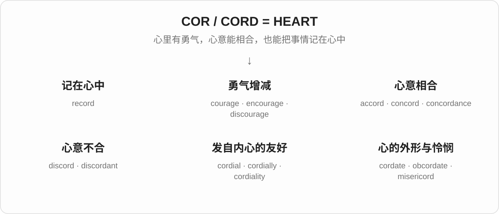

## 词形与演化规律

**cor** 的属格是 **cordis**，所以不是英语随意给 cor 加上 d。经法语的 corage 留下 courage，相关动词留下 encourage、discourage。**core** 的早期来源有争议，本页保留为辨析词，图从已知的中古英语开始，不能拿它证明所有 core 都来自 cor。

心形词更直接：cordate 与 cordiform 描述心形；obcordate 则把与叶柄相接的方向倒过来。

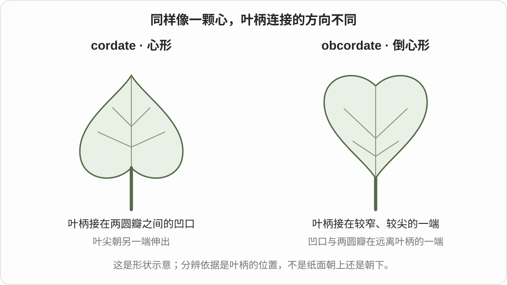

## 单词速览（常用到不常用）

| 单词 | 音标 | 核心意思 |
|---|---|---|
| [record](#w-1) | 名词：英 /ˈrekɔːd/、美 /ˈrekərd/；动词：英 /rɪˈkɔːd/、美 /rɪˈkɔːrd/ | 记录；纪录；唱片；记录下来 |
| [core](#w-2) | 英 /kɔː/；美 /kɔːr/ | 核心；果核；中心部分 |
| [encourage](#w-3) | 英 /ɪnˈkʌrɪdʒ/；美 /ɪnˈkɜːrɪdʒ/ | 鼓励；支持；促使 |
| [courage](#w-4) | 英 /ˈkʌrɪdʒ/；美 /ˈkɜːrɪdʒ/ | 勇气；胆量 |
| [encouraging](#w-5) | 英 /ɪnˈkʌrɪdʒɪŋ/；美 /ɪnˈkɜːrɪdʒɪŋ/ | 令人鼓舞的；让人更有希望的 |
| [accordance](#w-6) | 英 /əˈkɔːdəns/；美 /əˈkɔːrdəns/ | 一致；符合；依照 |
| [accord](#w-7) | 英 /əˈkɔːd/；美 /əˈkɔːrd/ | 一致；协议；给予；符合 |
| [encouragement](#w-8) | 英 /ɪnˈkʌrɪdʒmənt/；美 /ɪnˈkɜːrɪdʒmənt/ | 鼓励；支持；令人有信心的事 |
| [courageous](#w-9) | /kəˈreɪdʒəs/ | 勇敢的；有胆量的 |
| [discourage](#w-10) | 英 /dɪsˈkʌrɪdʒ/；美 /dɪsˈkɜːrɪdʒ/ | 使泄气；劝阻；使不愿做 |
| [concord](#w-11) | 英 /ˈkɒŋkɔːd/；美 /ˈkɑːŋkɔːrd/ | 和睦；一致；语法一致 |
| [discord](#w-12) | 英 /ˈdɪskɔːd/；美 /ˈdɪskɔːrd/ | 不和；分歧；不协和声 |
| [discouraging](#w-13) | 英 /dɪsˈkʌrɪdʒɪŋ/；美 /dɪsˈkɜːrɪdʒɪŋ/ | 令人泄气的；使信心下降的 |
| [cordial](#w-14) | 英 /ˈkɔːdiəl/；美 /ˈkɔːrdʒəl/ | 热诚友好的；果味甜饮；甜酒 |
| [courageously](#w-15) | /kəˈreɪdʒəsli/ | 勇敢地 |
| [cordially](#w-16) | 英 /ˈkɔːdiəli/；美 /ˈkɔːrdʒəli/ | 热诚地；友好地 |
| [discordant](#w-17) | 英 /dɪsˈkɔːdənt/；美 /dɪsˈkɔːrdənt/ | 不协调的；不一致的；刺耳的 |
| [discouragement](#w-18) | 英 /dɪsˈkʌrɪdʒmənt/；美 /dɪsˈkɜːrɪdʒmənt/ | 泄气；挫折感；劝阻 |
| [concordance](#w-19) | 英 /kənˈkɔːdəns/；美 /kənˈkɔːrdəns/ | 一致性；词语索引；语境索引 |
| [concordat](#w-20) | 英 /kənˈkɔːdæt/；美 /kənˈkɔːrdæt/ | 政教协定；正式协议 |
| [concordant](#w-21) | 英 /kənˈkɔːdənt/；美 /kənˈkɔːrdənt/ | 相符的；一致的；协调的 |
| [cordate](#w-22) | 英 /ˈkɔːdeɪt/；美 /ˈkɔːrdeɪt/ | 心形的；基部呈心形的 |
| [cordiality](#w-23) | 英 /ˌkɔːdiˈæləti/；美 /ˌkɔːrdʒiˈæləti/ | 热诚；友好 |
| [discordance](#w-24) | 英 /dɪsˈkɔːdəns/；美 /dɪsˈkɔːrdəns/ | 不一致；不协调 |
| [accordant](#w-25) | 英 /əˈkɔːdənt/；美 /əˈkɔːrdənt/ | 一致的；相符的；协调的 |
| [cordiform](#w-26) | 英 /ˈkɔːdɪfɔːm/；美 /ˈkɔːrdəfɔːrm/ | 心形的 |
| [misericord](#w-27) | 英 /mɪˈzerɪkɔːd/；美 /mɪˈzerɪkɔːrd/ | 教堂站立支托；历史上的怜悯短剑 |
| [obcordate](#w-28) | 英 /ɒbˈkɔːdeɪt/；美 /ɑːbˈkɔːrdeɪt/ | 倒心形的 |
| [scordatura](#w-29) | 英 /ˌskɔːdəˈtʊərə/；美 /ˌskɔːrdəˈtʊrə/ | 变格定弦；非常规定弦 |

## 逐词讲解

### 1. record — 记录；纪录；唱片；记录下来

**音标**：名词：英 /ˈrekɔːd/、美 /ˈrekərd/；动词：英 /rɪˈkɔːd/、美 /rɪˈkɔːrd/

**先抓住这个画面**

让一件事不会随着时间消失：先记在心里，后来写在纸上、录在介质里，留给以后重新查看。

**怎么拆**

拉丁语 re-（再次、回来）+ cor/cord-（心）形成 recordārī“想起、记住”，经古法语 recorder 传入。

**怎么变成今天的意思**

从记忆与复述走向持久保存。唱片是保存声音的载体；比赛纪录是已被记载、供后来比较的最佳成绩。

**常见搭配与例句**

keep a record；record a conversation；break a record；a vinyl record。

> Please keep a record of every payment.

请把每一笔付款都记录下来。

> We recorded the interview so we could check it later.

我们录下了采访，以便之后核对。

**别混淆**

名词重音在前，动词重音在后。a record 可以是档案或唱片；recording 更突出一次录制的内容或过程。

### 2. core — 核心；果核；中心部分

**音标**：英 /kɔː/；美 /kɔːr/

**先抓住这个画面**

把苹果外面的果肉吃掉，剩下里面那一块；把问题的外层细节拿掉，剩下最关键的部分。这两者都可叫 core。

**怎么拆**

现代英语承接中古英语 core/kore“果心”，更早来源不确定。有学者联系法语 cuer“心”或其他词，但不能确定画成 Latin cor → core。

**怎么变成今天的意思**

具体的中心部分扩展为组织、问题或价值观中最关键的一层。它与“心”在意义上很接近，历史上是否直接同源则不能说死。

**常见搭配与例句**

the core of the problem；core values；an apple core；a processor core。

> We need to get to the core of the problem.

我们需要抓住问题的核心。

> She removed the apple core before slicing the fruit.

她先去掉苹果核，再把果肉切片。

**别混淆**

core 是中心或关键部分；cor- 是本页确定的拉丁词根。拼写相近只能提示线索，不能代替词源证据。

### 3. encourage — 鼓励；支持；促使

**音标**：英 /ɪnˈkʌrɪdʒ/；美 /ɪnˈkɜːrɪdʒ/

**先抓住这个画面**

别人心里那点勇气快熄了，你添一把火，让他愿意再试；规则也能通过奖励让某种行为更容易发生。

**怎么拆**

古法语 en- 与 corage“胆量”组成 encoragier，进入英语。现代能看出 en- + courage。

**怎么变成今天的意思**

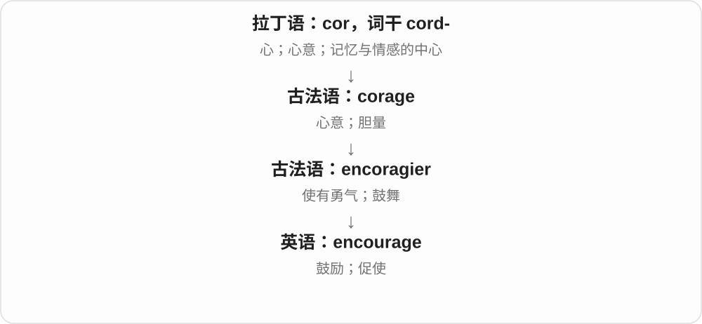

“给勇气”扩展为给予支持、让某事更可能发生。encourage cycling 可以靠修自行车道，而不只是对骑车人说加油。

**常见搭配与例句**

encourage someone to do；encourage participation；encourage growth。

> My teacher encouraged me to ask more questions.

老师鼓励我多提问。

> The new paths encourage people to cycle to work.

新修的道路让更多人愿意骑车上班。

**别混淆**

encourage 是推动、支持；force 是强迫。被鼓励的人通常仍有选择空间。

### 4. courage — 勇气；胆量

**音标**：英 /ˈkʌrɪdʒ/；美 /ˈkɜːrɪdʒ/

**先抓住这个画面**

心里明明知道有风险，仍然站住、愿意面对，这份内在力量就是 courage。

**怎么拆**

古法语 corage 源于拉丁语 cor“心”的词族；历史上“心意、精神”逐渐集中为胆量。

**怎么变成今天的意思**

“心”在这里是精神与意志的所在，不是心脏大小。勇气可以表现在承认错误、说真话，也不只是打仗或冒险。

**常见搭配与例句**

have the courage to；take courage；show courage；lose courage。

> It took courage to admit that she was wrong.

承认自己错了，需要勇气。

> He found the courage to speak in front of the group.

他鼓起勇气，在大家面前发言。

**别混淆**

courage 不是完全没有害怕；即使害怕仍面对困难，也可以有 courage。recklessness 则是鲁莽，忽略风险。

### 5. encouraging — 令人鼓舞的；让人更有希望的

**音标**：英 /ɪnˈkʌrɪdʒɪŋ/；美 /ɪnˈkɜːrɪdʒɪŋ/

**先抓住这个画面**

进度还没到终点，但出现了一个好信号，让人愿意相信继续努力值得。

**怎么拆**

encourage + -ing，用来描述能让别人得到鼓舞的人、事或迹象。

**怎么变成今天的意思**

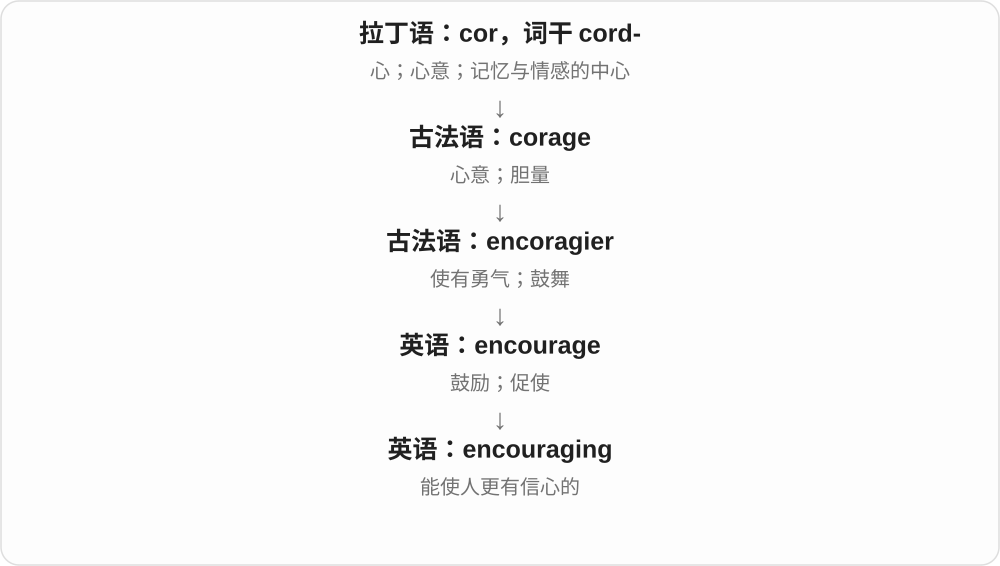

可以是支持的语气，也可以是不说话的实验结果。encouraging signs 只是好迹象，不保证最后一定成功。

**常见搭配与例句**

encouraging results；an encouraging smile；an encouraging sign。

> The first test produced encouraging results.

第一次测试得到的结果令人鼓舞。

> She gave me an encouraging smile.

她给了我一个鼓励的微笑。

**别混淆**

encouraging 让人受鼓舞；encouraged 是人已经受到鼓舞，感受方向相反。

### 6. accordance — 一致；符合；依照

**音标**：英 /əˈkɔːdəns/；美 /əˈkɔːrdəns/

**先抓住这个画面**

拿实际行动与规定对齐，两条线能合上，就是 in accordance with。

**怎么拆**

经古法语 acordance 传入；现代对应 accord + -ance。

**怎么变成今天的意思**

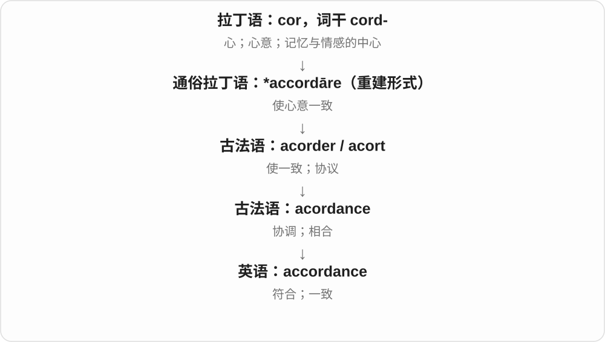

最常见的是 in accordance with，表示依照规则、协议或意愿行事。通常不单独说 an accordance。

**常见搭配与例句**

in accordance with the rules；in accordance with someone’s wishes。

> The work was completed in accordance with the plan.

工作按照计划完成了。

> The documents were stored in accordance with the instructions.

文件按要求存放了。

**别混淆**

according to 可以引述某人的说法；in accordance with 更强调行动符合规则或要求。

### 7. accord — 一致；协议；给予；符合

**音标**：英 /əˈkɔːd/；美 /əˈkɔːrd/

**先抓住这个画面**

两边的心意调到同一个方向，能对得上；由此既可以有一致状态，也可以有谈成的协议。

**怎么拆**

经古法语 acorder、acort 来自重建的通俗拉丁语 *accordāre，与 cor/cord- 和“使一致”有关。

**怎么变成今天的意思**

in accord 是相合；an accord 是协议。动词 accord someone respect 则是把适合的尊重给予对方。of one’s own accord 是出于自己意愿。

**常见搭配与例句**

in accord with；a peace accord；accord respect；of her own accord。

> The two groups signed an accord.

两个团体签署了一份协议。

> She left of her own accord.

她是自愿离开的。

**别混淆**

accord 作动词可以是给予，不要每处都译成达成协议。agreement 更日常，accord 作为协议名词常较正式。

### 8. encouragement — 鼓励；支持；令人有信心的事

**音标**：英 /ɪnˈkʌrɪdʒmənt/；美 /ɪnˈkɜːrɪdʒmənt/

**先抓住这个画面**

一句“你已经进步了”，或有人愿意陪你试一次，都能成为让你继续的那份支持。

**怎么拆**

来自法语 encoragement；现代与 encourage + -ment 对应，属于同一个鼓舞词族。

**怎么变成今天的意思**

常作不可数名词表示支持；a great encouragement 则可指某件特别令人振作的事。

**常见搭配与例句**

words of encouragement；give encouragement；with encouragement from…。

> Your encouragement helped me finish the course.

你的鼓励帮助我完成了课程。

> The early results were a great encouragement to the team.

初步结果让团队备受鼓舞。

**别混淆**

praise 常表扬已做出的表现；encouragement 还可以在尚未成功时给予支持。

### 9. courageous — 勇敢的；有胆量的

**音标**：/kəˈreɪdʒəs/

**先抓住这个画面**

困难摆在眼前，这个人仍选择承担；courageous 是把 courage 放到人的行动和选择上。

**怎么拆**

来自古法语 corageus，基础 corage 是胆量；现代与 courage + -ous 对应，但读音和重音改变。

**怎么变成今天的意思**

它赞赏面对困难的精神。一个很安静、很小的决定，也可能是 courageous，不必有壮烈场面。

**常见搭配与例句**

a courageous decision；a courageous person；a courageous stand。

> Leaving the unsafe job was a courageous decision.

离开那份不安全的工作，是一个勇敢的决定。

> The witnesses were praised for their courageous stand.

证人们因勇敢表明立场而受到赞扬。

**别混淆**

courageous 与 brave 接近，常更正式；aggressive 是好斗或强势，并不自动等于勇敢。

### 10. discourage — 使泄气；劝阻；使不愿做

**音标**：英 /dɪsˈkʌrɪdʒ/；美 /dɪsˈkɜːrɪdʒ/

**先抓住这个画面**

把心里的劲泄掉，让人觉得不想继续；也可通过提醒或设置条件，让某种行为少发生。

**怎么拆**

古法语 des- + corage 形成 descouragier，现代可看成 dis- + courage。

**怎么变成今天的意思**

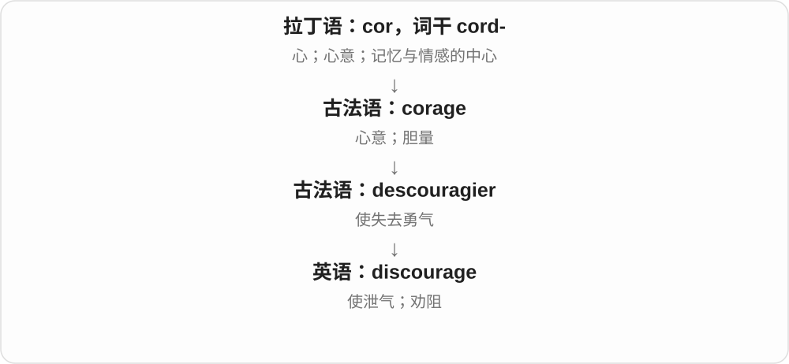

对人可以是打击信心；对不好的行为可以是合理劝阻。discourage littering 并不是让垃圾泄气，而是让人少乱扔垃圾。

**常见搭配与例句**

discourage someone from doing；discourage waste；feel discouraged。

> The cost discouraged us from buying a second car.

费用让我们打消了买第二辆车的念头。

> Do not let one mistake discourage you.

不要因为一次错误就泄气。

**别混淆**

discourage 不必是禁止；ban 才明确禁掉。劝阻后别人仍可能去做。

### 11. concord — 和睦；一致；语法一致

**音标**：英 /ˈkɒŋkɔːd/；美 /ˈkɑːŋkɔːrd/

**先抓住这个画面**

con- 把几颗“心”放到一起，大家不是互相拉扯，而是能协调相处。

**怎么拆**

拉丁语 con-（一起）+ cor/cord-（心）形成 concors、concordia，经法语进入英语。

**怎么变成今天的意思**

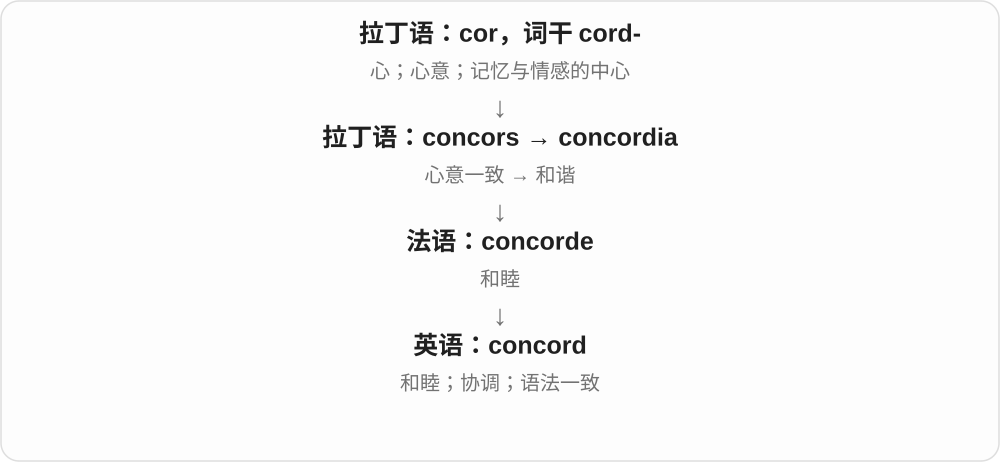

人际上是和睦，声音上是协调，语法上则是主语和动词等形式彼此配合。

**常见搭配与例句**

live in concord；social concord；subject–verb concord。

> The communities lived in concord for many years.

这些社区多年来和睦相处。

> The lesson explains subject–verb concord.

这一课解释主谓一致。

**别混淆**

concord 常说和谐、一致的状态；an accord 更常是一份谈成的协议。

### 12. discord — 不和；分歧；不协和声

**音标**：英 /ˈdɪskɔːd/；美 /ˈdɪskɔːrd/

**先抓住这个画面**

大家的心意往两边拉，或声音彼此顶撞，合不到一起，这就是 discord。

**怎么拆**

拉丁语 dis-（分开）+ cor/cord-（心）形成 discors、discordia，经法语进入英语。

**怎么变成今天的意思**

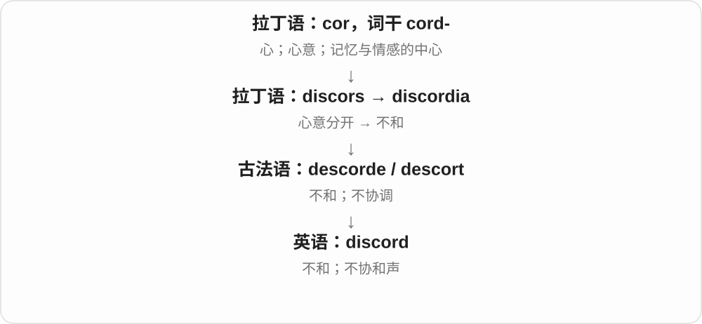

可以指人际冲突，也可以指音乐中的不协和。音乐里的不协和有时是有意的表现手段，不必是演奏错误。

**常见搭配与例句**

sow discord；family discord；a note of discord。

> The decision sowed discord within the group.

这个决定在团体内部引起了不和。

> A harsh discord interrupted the gentle melody.

一个刺耳的不协和音打断了柔和旋律。

**别混淆**

disagreement 可以是平静的意见不同；discord 更突出不和、冲突或失去协调。

### 13. discouraging — 令人泄气的；使信心下降的

**音标**：英 /dɪsˈkʌrɪdʒɪŋ/；美 /dɪsˈkɜːrɪdʒɪŋ/

**先抓住这个画面**

看到一个结果，心里冒出“可能做不下去了”，这个结果就有 discouraging 的效果。

**怎么拆**

discourage + -ing，形容造成泄气感的事物。

**怎么变成今天的意思**

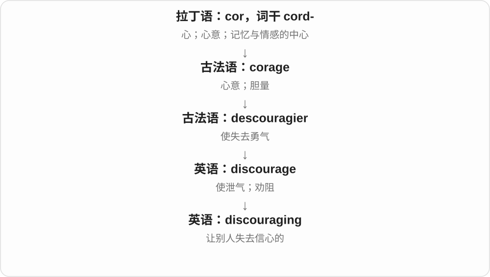

可以形容消息、数字、语气等。它说结果对人的影响，不等于客观上完全没有希望。

**常见搭配与例句**

discouraging news；a discouraging result；a discouraging comment。

> The slow progress was discouraging.

缓慢的进展让人泄气。

> She ignored the discouraging comments and kept practising.

她没有理会那些打击信心的话，继续练习。

**别混淆**

discouraging 是令人泄气；discouraged 是感到泄气。可以说 the news is discouraging，I feel discouraged。

### 14. cordial — 热诚友好的；果味甜饮；甜酒

**音标**：英 /ˈkɔːdiəl/；美 /ˈkɔːrdʒəl/

**先抓住这个画面**

面对人时，是从心里拿出友好；饮品义则保留了过去“让心和身体振作”的用法。

**怎么拆**

中世纪拉丁语 cordiālis“与心有关”经法语进入英语。这里 cord- 是心，不是英语 cord“绳子”。

**怎么变成今天的意思**

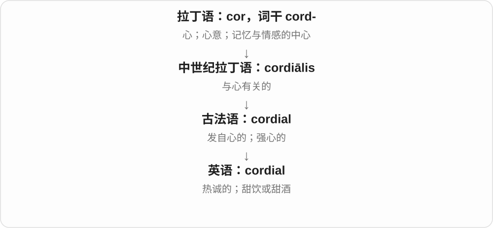

形容词常说礼貌而温暖的交往；英式名词常指需加水稀释的甜饮料，美式可指甜利口酒，点饮料时要看地区。

**常见搭配与例句**

a cordial welcome；cordial relations；fruit cordial。

> They gave us a cordial welcome.

他们热情友好地欢迎了我们。

> She mixed the elderflower cordial with water.

她把接骨木花浓缩甜饮兑了水。

**别混淆**

cordial 可以是友好而保持距离，不一定亲密。cordial drink 的传统名称也不代表现代医学功效。

### 15. courageously — 勇敢地

**音标**：/kəˈreɪdʒəsli/

**先抓住这个画面**

不只说一个人有勇气，而是说他怎样面对、发言或采取行动。

**怎么拆**

courageous + -ly。

**怎么变成今天的意思**

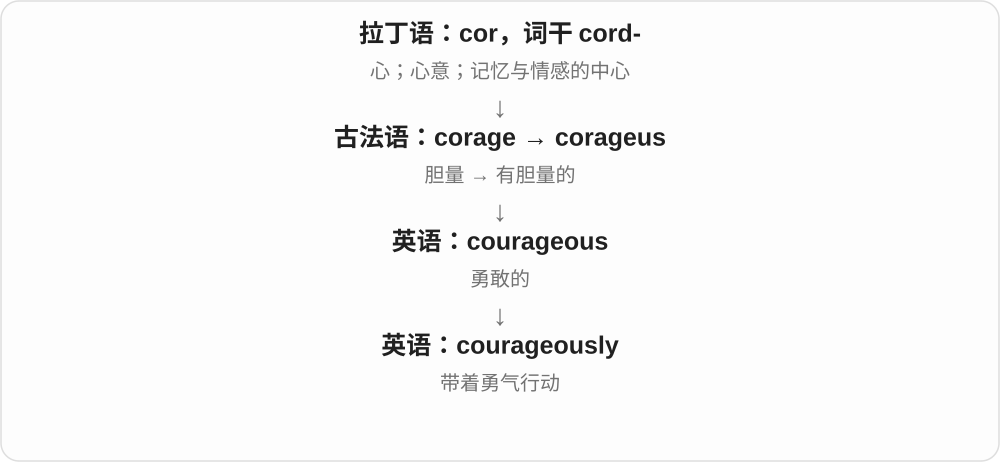

常修饰应对困难、捍卫观点等行动。它表达赞赏，但不表示结果一定成功。

**常见搭配与例句**

speak courageously；act courageously；face something courageously。

> She spoke courageously about the mistakes in the project.

她勇敢地谈到了项目中的错误。

> The team faced the setback courageously.

团队勇敢地面对了挫折。

**别混淆**

boldly 可以指风格大胆、动作鲜明；courageously 更突出面对困难或恐惧时的勇气。

### 16. cordially — 热诚地；友好地

**音标**：英 /ˈkɔːdiəli/；美 /ˈkɔːrdʒəli/

**先抓住这个画面**

见面时主动握手、认真欢迎，对方感到受尊重；cordially 描述这种有礼而温暖的方式。

**怎么拆**

cordial + -ly。

**怎么变成今天的意思**

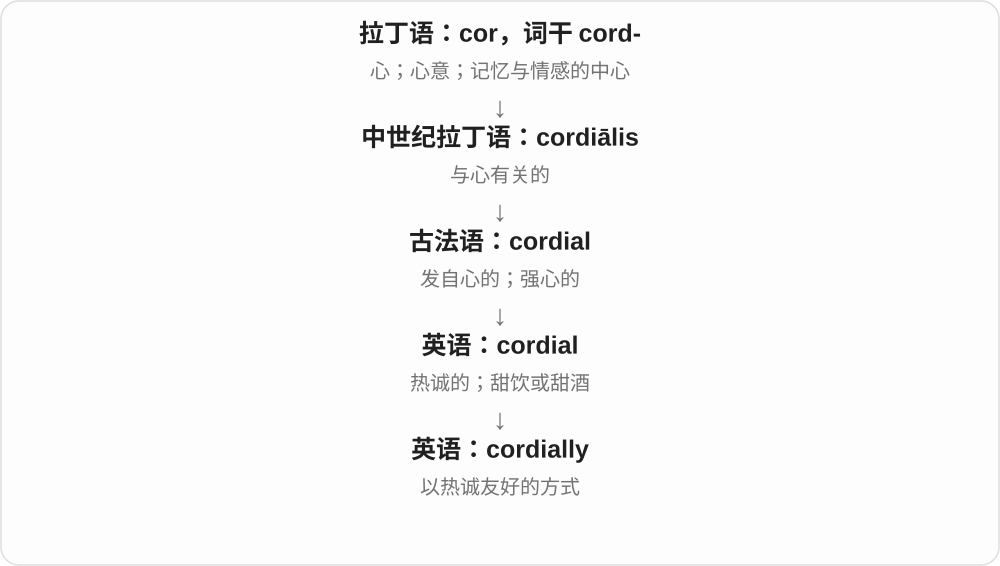

邀请函中 You are cordially invited 是礼貌郑重的欢迎。它未必表示双方已经非常熟悉。

**常见搭配与例句**

greet cordially；cordially invited；speak cordially。

> You are cordially invited to the opening ceremony.

诚挚邀请您出席开幕式。

> The two neighbours greeted each other cordially.

两位邻居友好地互相问候。

**别混淆**

cordially 偏友好而礼貌；intimately 强调亲密，不能仅因邀请热情就换成后者。

### 17. discordant — 不协调的；不一致的；刺耳的

**音标**：英 /dɪsˈkɔːdənt/；美 /dɪsˈkɔːrdənt/

**先抓住这个画面**

几种声音或说法挤到一起，彼此对不上，听起来或看起来像在打架。

**怎么拆**

拉丁语 discordāre“相互不合”经法语相关分词形式进入英语；现代可联系 discord + -ant。

**怎么变成今天的意思**

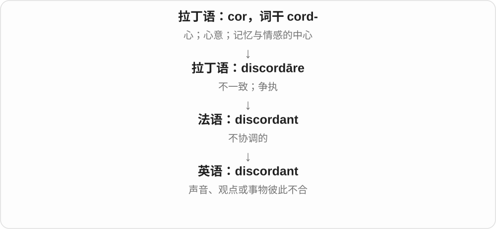

它既可形容音响，也可形容与整体气氛不搭的言行。a discordant note 可以是一句破坏和谐的话。

**常见搭配与例句**

discordant sounds；discordant views；strike a discordant note。

> Discordant music came from the next room.

隔壁传来不协调的音乐声。

> His cheerful remark struck a discordant note at the serious meeting.

在严肃的会议上，他轻快的评论显得很不合时宜。

**别混淆**

different 只说不同；discordant 常说不同到难以协调或相互冲突。

### 18. discouragement — 泄气；挫折感；劝阻

**音标**：英 /dɪsˈkʌrɪdʒmənt/；美 /dɪsˈkɜːrɪdʒmənt/

**先抓住这个画面**

事情反复碰壁，心里那股想继续的劲降下来，这种状态是 discouragement。

**怎么拆**

discourage + -ment，把使泄气的行为或泄气的状态名词化。

**怎么变成今天的意思**

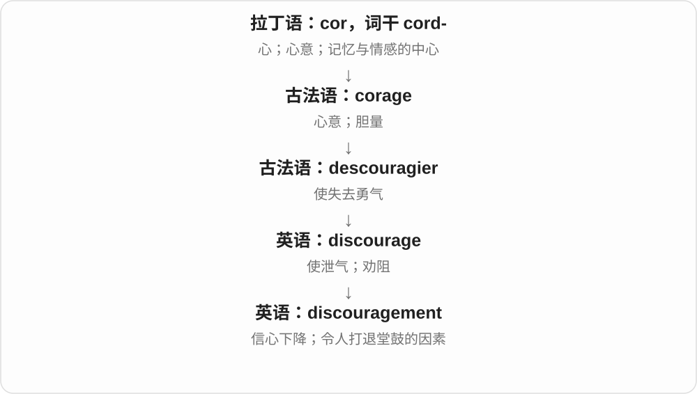

既可说情绪，也可说导致退缩的因素。它不必严重到彻底放弃。

**常见搭配与例句**

a feeling of discouragement；overcome discouragement；a source of discouragement。

> After several rejections, she felt deep discouragement.

几次被拒绝后，她感到很泄气。

> Support from friends helped him overcome his discouragement.

朋友的支持帮助他摆脱了挫败感。

**别混淆**

disappointment 是期待落空；discouragement 更强调继续尝试的信心受到影响。

### 19. concordance — 一致性；词语索引；语境索引

**音标**：英 /kənˈkɔːdəns/；美 /kənˈkɔːrdəns/

**先抓住这个画面**

一方面是两组信息对得上；另一方面，把同一个词在不同地方出现的句子排在一起，便于一一查对。

**怎么拆**

来自晚期拉丁语 concordantia，经古法语 concordance 传入。

**怎么变成今天的意思**

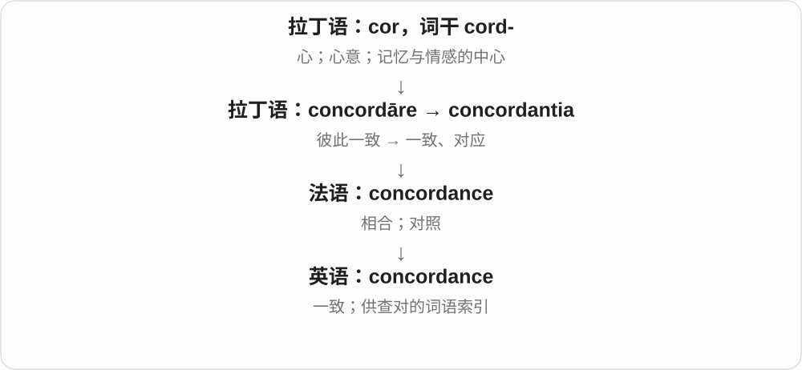

文本索引义把分散出现的相同词集中，显示各处语境。它不只是给一个词一个释义，而是帮助比较实际用法。

**常见搭配与例句**

concordance between results；a concordance of a text；concordance lines。

> There was strong concordance between the two sets of results.

两组结果高度一致。

> The researcher used a concordance to compare the word’s different contexts.

研究者用语境索引比较这个词的不同上下文。

**别混淆**

dictionary 给词义等信息；concordance 重点列出词在指定文本中的出现位置和上下文。

### 20. concordat — 政教协定；正式协议

**音标**：英 /kənˈkɔːdæt/；美 /kənˈkɔːrdæt/

**先抓住这个画面**

双方把共同认可的安排落成一份正式文件，尤其常用于国家与教会之间的安排。

**怎么拆**

法语 concordat 来自拉丁语 concordātum“已达成一致的东西”，属于 concordāre 词族。

**怎么变成今天的意思**

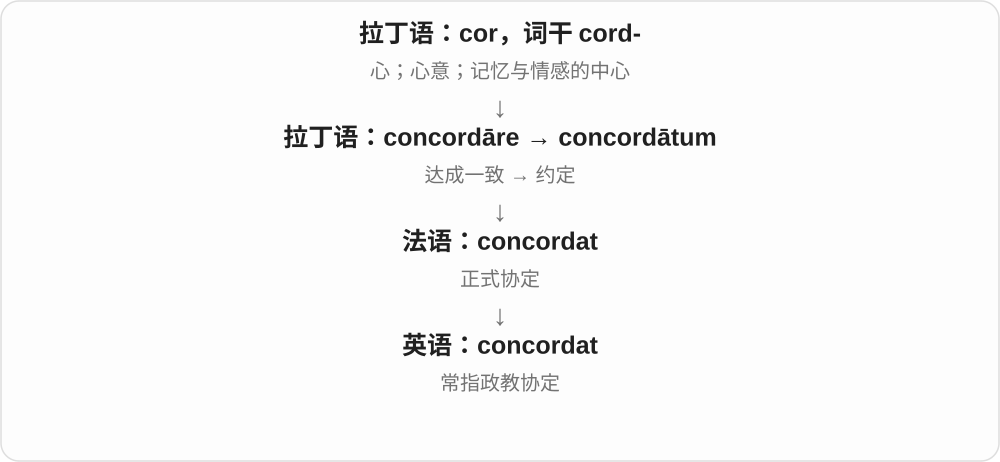

词根解释的是双方意愿协调；具体协定规定什么，需要看文件本身。较少用于普通私人约定。

**常见搭配与例句**

sign a concordat；a concordat between church and state。

> The book examines a concordat between the state and the church.

这本书考察国家与教会之间的一份协定。

> The concordat set out the responsibilities of both parties.

协定列明了双方的职责。

**别混淆**

concord 是和睦状态；concordat 是一份正式约定，特别有历史与制度语境。

### 21. concordant — 相符的；一致的；协调的

**音标**：英 /kənˈkɔːdənt/；美 /kənˈkɔːrdənt/

**先抓住这个画面**

几项独立得到的观察指向同一方向，像不同声部唱得合拍，就是 concordant。

**怎么拆**

拉丁语 concordāns 是 concordāre“相合”的相关形式，经法语进入英语。

**怎么变成今天的意思**

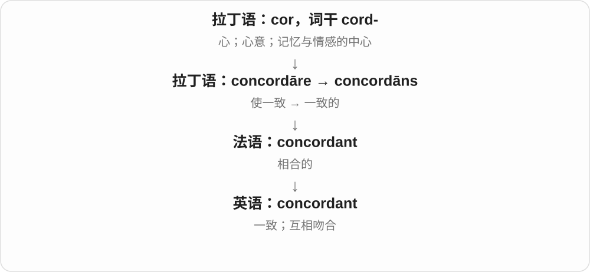

常见于研究、统计或专业讨论，描述结果或特征相符。相符本身不证明两者之间有因果。

**常见搭配与例句**

concordant results；concordant findings；concordant with。

> The two methods produced concordant findings.

两种方法得出了相符的发现。

> Her account was concordant with the written record.

她的叙述与书面记录一致。

**别混淆**

concordant 强调对应一致；identical 是完全相同。两项结论相符，不代表每个数字都一样。

### 22. cordate — 心形的；基部呈心形的

**音标**：英 /ˈkɔːdeɪt/；美 /ˈkɔːrdeɪt/

**先抓住这个画面**

想象常见爱心轮廓：一端有两个圆瓣，中间凹下去，另一端收尖。植物描述中常用 cordate 说明这种形状或心形基部。

**怎么拆**

拉丁语 cord-（心）+ -ate（具有相应性质或形态）。

**怎么变成今天的意思**

植物学说叶片或基部 cordate 时，通常叶柄接在两个圆瓣之间的凹处。这里说形状，不说植物有情感。

**常见搭配与例句**

a cordate leaf；a cordate base；cordate leaf blades。

> The plant has broad leaves with a cordate base.

这种植物的叶子宽大，基部呈心形。

> The guide illustrates the difference between cordate and oval leaves.

图鉴展示了心形叶和椭圆形叶的区别。

**别混淆**

cordate 是心形；obcordate 是方向倒过来的心形，连接叶柄的位置不同。

### 23. cordiality — 热诚；友好

**音标**：英 /ˌkɔːdiˈæləti/；美 /ˌkɔːrdʒiˈæləti/

**先抓住这个画面**

不只看有没有说礼貌用语，还看相处中是否能感到温暖、真诚的欢迎，这种气氛是 cordiality。

**怎么拆**

cordial + -ity，形容词变成性质名词，重音后移。

**怎么变成今天的意思**

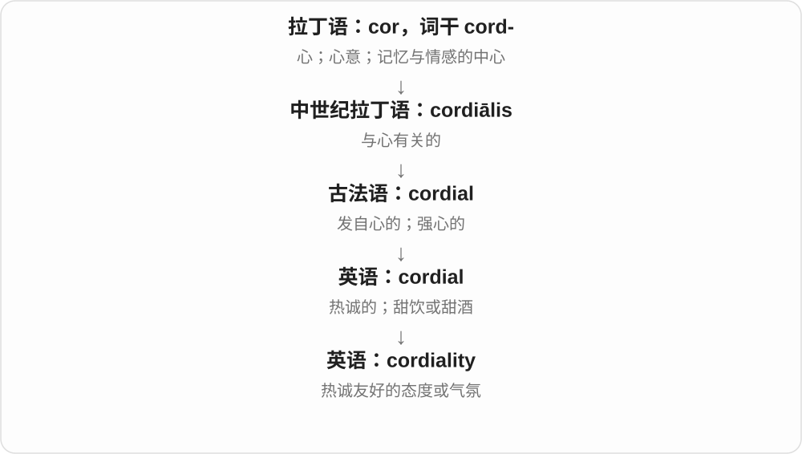

常形容接待、交往或关系中的友善。它不保证意见完全一致，双方可以友好地讨论分歧。

**常见搭配与例句**

with cordiality；genuine cordiality；an atmosphere of cordiality。

> We appreciated the cordiality of our hosts.

我们很感谢主人们的热情友好。

> The meeting ended in an atmosphere of cordiality.

会议在友好的气氛中结束。

**别混淆**

cordiality 说待人友好；concord 说关系协调一致。彼此有分歧仍可保持 cordiality。

### 24. discordance — 不一致；不协调

**音标**：英 /dɪsˈkɔːdəns/；美 /dɪsˈkɔːrdəns/

**先抓住这个画面**

把两个应当对应的结果并排放，发现它们明显对不上；这种不合就是 discordance。

**怎么拆**

来自古法语 discordance 与中世纪拉丁语相关名词路线，根在 discordāre“不一致”；现代可联系 discord 与 -ance。

**怎么变成今天的意思**

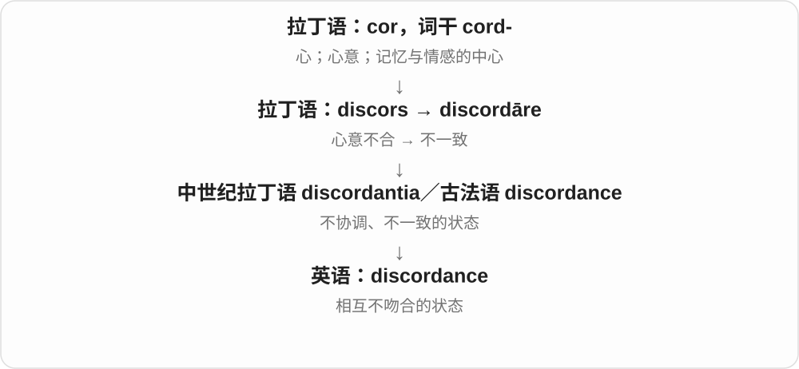

常用于专业或较正式的比较，比简单说“有差别”更强调结果或关系不一致。

**常见搭配与例句**

discordance between results；a degree of discordance；explain the discordance。

> The team investigated the discordance between the two measurements.

团队调查了两次测量结果不一致的原因。

> There is a clear discordance between his words and actions.

他的言语和行动明显不一致。

**别混淆**

discord 常指关系不和；discordance 更适合把不一致作为可分析的现象讨论。

### 25. accordant — 一致的；相符的；协调的

**音标**：英 /əˈkɔːdənt/；美 /əˈkɔːrdənt/

**先抓住这个画面**

两种说法或两组声音互相对得上，没有彼此打架，这种性质可用 accordant。

**怎么拆**

经古法语 acordant 来自中世纪拉丁语 accordāns，是 accordāre“相合”的分词；现代可联系 accord + -ant，但不是英语动词新造出的唯一历史。

**怎么变成今天的意思**

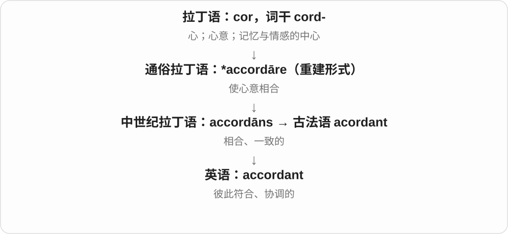

这是较书面的词，常用 with 接相合的对象。日常更常说 consistent with 或 in agreement with。

**常见搭配与例句**

accordant with the evidence；accordant views；accordant sounds。

> The conclusion is accordant with the available evidence.

这个结论与现有证据相符。

> The two accounts are broadly accordant.

两份叙述大体一致。

**别混淆**

accordant 描述相合状态；accordance 多出现在 in accordance with 这个名词短语里。

### 26. cordiform — 心形的

**音标**：英 /ˈkɔːdɪfɔːm/；美 /ˈkɔːrdəfɔːrm/

**先抓住这个画面**

直接把物体外轮廓看成一颗爱心：它可以是叶片、石头或其他形状。

**怎么拆**

拉丁语 cord-（心）+ -iform（形状像……的，与 form 有关）。

**怎么变成今天的意思**

这是形态描述词，强调整体外形。有些植物学规范把 cordate 更常用于基部、cordiform 用于整体，阅读时依该书术语习惯。

**常见搭配与例句**

a cordiform outline；a cordiform leaf；a cordiform object。

> The drawing shows a cordiform outline.

这幅图画出了一个心形轮廓。

> The specimen has a distinctly cordiform shape.

这个标本具有明显的心形外观。

**别混淆**

cordial 是热诚的；cordiform 是心形的。一个描述人际态度，另一个描述外形。

### 27. misericord — 教堂站立支托；历史上的怜悯短剑

**音标**：英 /mɪˈzerɪkɔːd/；美 /mɪˈzerɪkɔːrd/

**先抓住这个画面**

长时间站立很累，教堂折叠座椅下面留一小块托板，让人稍微倚住。这个“小小的怜悯”是词的一条历史用途。

**怎么拆**

拉丁语 misericordia“怜悯”与 miser“可怜、受苦”和 cor“心”相关，经古法语进入英语。

**怎么变成今天的意思**

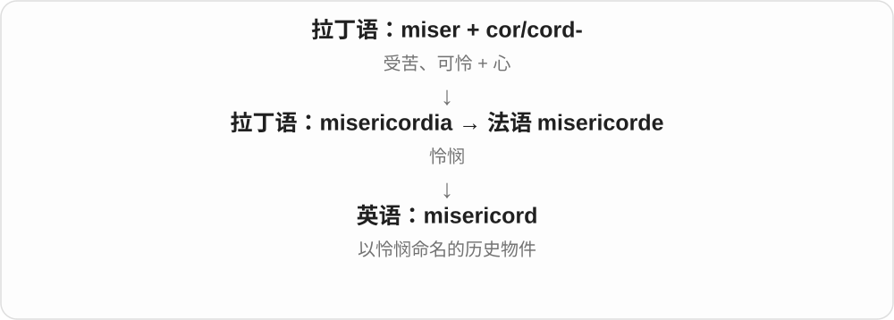

教堂托板是减轻久站负担的装置。另一历史义是用于结束重伤者生命的短剑，名称来自当时所谓“怜悯一击”的观念，不是现代赞同这种做法。

**常见搭配与例句**

a carved misericord；a medieval misericord；choir-stall misericords。

> The church has a beautifully carved wooden misericord.

这座教堂有一块雕刻精美的木制站立支托。

> The museum labels the medieval dagger as a misericord.

博物馆把那把中世纪短剑标为 misericord。

**别混淆**

它不是普通 cushion“坐垫”，而是特定历史构件；看到武器语境也不能译成教堂托板。

### 28. obcordate — 倒心形的

**音标**：英 /ɒbˈkɔːdeɪt/；美 /ɑːbˈkɔːrdeɪt/

**先抓住这个画面**

把心形叶反过来：细的一端接叶柄，远端较宽并有凹口。这就是 obcordate。

**怎么拆**

ob- 在这里表示倒置、反向，加 cordate（心形的）。

**怎么变成今天的意思**

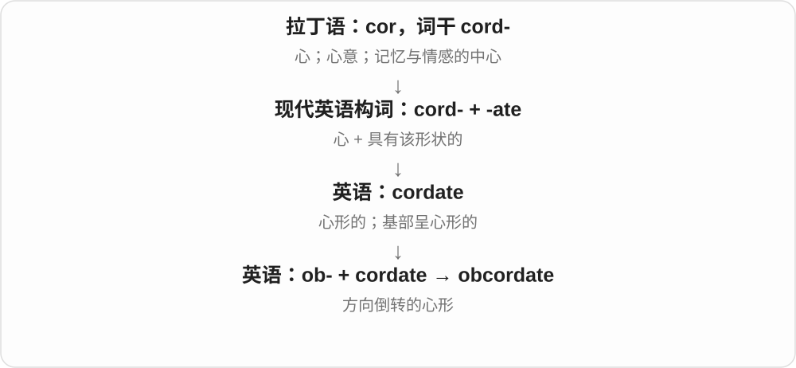

记忆关键是叶柄接在哪里，不能只看纸面图案朝上还是朝下。图转个方向，不会改变植物的形态名称。

**常见搭配与例句**

an obcordate leaf；obcordate leaflets；an obcordate outline。

> The leaflet is obcordate, with the stalk attached to the narrow end.

小叶呈倒心形，叶柄接在较窄的一端。

> The botanist noted the plant’s obcordate leaflets.

植物学家记录了这种植物倒心形的小叶。

**别混淆**

cordate 的凹处通常在靠叶柄的一端；obcordate 的凹处在远离叶柄的宽端。

### 29. scordatura — 变格定弦；非常规定弦

**音标**：英 /ˌskɔːdəˈtʊərə/；美 /ˌskɔːrdəˈtʊrə/

**先抓住这个画面**

弦乐器通常有一套标准调弦，但演奏这首曲子时，故意把某些弦调到别的音，以得到特别音色或更合适的指法。

**怎么拆**

借自意大利语 scordatura，来自 scordare“失去通常调和”，与拉丁语 discordāre“不和谐”相连。

**怎么变成今天的意思**

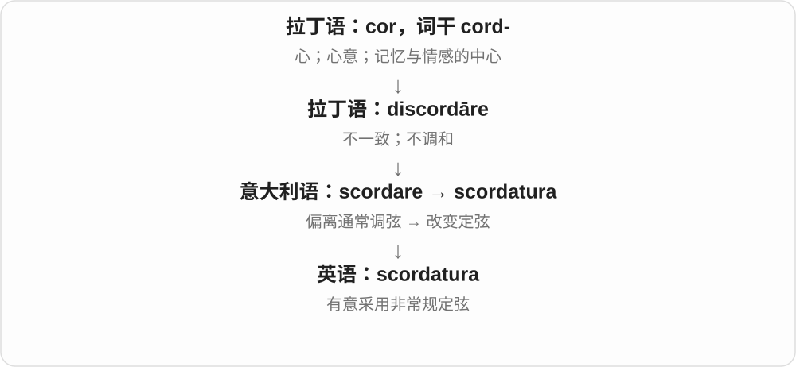

历史词形含“不调和”，现代音乐术语却常表示有计划的特殊调弦，不等于演奏者没调准。

**常见搭配与例句**

scordatura tuning；use scordatura；a piece requiring scordatura。

> The violinist used scordatura for this piece.

小提琴家演奏这首曲子时采用了变格定弦。

> The score explains the required scordatura before the first movement.

乐谱在第一乐章前说明了所需的特殊定弦。

**别混淆**

out of tune 是音准不对；scordatura 是主动改变定弦方案，演奏仍可以非常准确。

## 这一组要分清什么

**encourage / discourage**：给人信心或促进行为 / 使人泄气或劝阻。

**accord / concord**：都与一致相连；accord 常指协议或符合，concord 更突出和睦、协调。

**cordial / cordiality / cordiform**：热诚的 / 热诚 / 心形的。

**record** 名词重音在前，动词重音在后。现代录音技术出现得晚，词本身的记忆历史很早。

**core** 意义上像“中心、心脏”，但远源不确定；同形近义不等于已经证实同源。

## 串起来练习

**Her cordial words encouraged him to record the disagreement without creating discord.**

她友好的话鼓励他把分歧记录下来，同时不制造不和。cordial 发自友好的心，encourage 给勇气，record 留下记忆，discord 是心意不合。
