# 0328 · lig- — 绑住；连接；使受到约束

[逐词精讲目录](../00_逐词精讲目录.md) · [总目录](../00_总目录_按常用程度.md)

## 核心词根与来源

lig- 来自拉丁动词 **ligāre**“绑、系、连接”。绑在一起的可以是骨骼、材料，也可以是国家、信任或责任。这个词根的价值正在于：同一个具体动作，在不同语境中形成了不同的抽象关系。

**LIG = BIND**

从物理上的绑，到人与人之间的联系和责任

- **实物连接**：ligament · ligature · alloy
- **群体联合**：ally · alliance · league
- **依靠与信任**：rely · reliable · reliance
- **责任与约束**：oblige · obligation · liable
- **科学中的结合**：ligation · ligand · ligase
- **把音符连在一起**：legato

## 词形与演化规律

**lig- 并不总以原拼写留在英语里。** ligāmentum → ligament 保留得较明显；alligāre 经法语形成 ally；religāre 经 relier 形成 rely；obligāre 经法语形成 oblige，而另一条借入路线保留 obligate。古代前缀同化、法语音变与英语派生要分别看，不能总结成一个“lig 随时可变成 ly”的规则。

## 单词速览（按词族由简到繁）

同一基础词的相关扩展放在一起，先读基础形式，再读扩展；各组之间优先读常用的。具体词源关系见各词讲解。

| 单词 | 音标 | 核心意思 |
|---|---|---|
| [league](#w-1) | /liːɡ/ | 联盟；体育联赛 |
| [ally](#w-7) | 名词 /ˈælaɪ/；动词常读 /əˈlaɪ/ | 盟友；与……结盟 |
| [alliance](#w-2) | /əˈlaɪəns/ | 联盟；同盟关系 |
| [allied](#w-8) | /ˈælaɪd/；也读 /əˈlaɪd/ | 结盟的；相关的 |
| [rally](#w-3) | /ˈræli/ | 召集；重新振作；集会；回升 |
| [rely](#w-5) | /rɪˈlaɪ/ | 依靠；信赖 |
| [reliable](#w-4) | /rɪˈlaɪəbəl/ | 可靠的；可信赖的 |
| [reliability](#w-10) | /rɪˌlaɪəˈbɪləti/ | 可靠性；信度 |
| [unreliable](#w-16) | /ˌʌnrɪˈlaɪəbəl/ | 不可靠的；不稳定的 |
| [unreliability](#w-27) | /ˌʌnrɪˌlaɪəˈbɪləti/ | 不可靠性；不稳定性 |
| [reliance](#w-12) | /rɪˈlaɪəns/ | 依赖；信赖 |
| [reliant](#w-18) | /rɪˈlaɪənt/ | 依赖……的 |
| [liable](#w-11) | /ˈlaɪəbəl/ | 负有责任的；易于……的 |
| [liability](#w-6) | /ˌlaɪəˈbɪləti/ | 责任；负债；累赘 |
| [oblige](#w-21) | /əˈblaɪdʒ/ | 使有义务；帮忙；使感激 |
| [obligation](#w-9) | 英 /ˌɒblɪˈɡeɪʃən/；美 /ˌɑːblɪˈɡeɪʃən/ | 义务；责任；承诺 |
| [obliged](#w-13) | /əˈblaɪdʒd/ | 有义务的；感激的 |
| [obliging](#w-24) | /əˈblaɪdʒɪŋ/ | 乐于助人的；热心帮忙的 |
| [obligate](#w-25) | 动词 /ˈɑːblɪɡeɪt/；形容词 /ˈɑːblɪɡət/ | 使负有义务；专性的 |
| [obligated](#w-17) | /ˈɑːblɪɡeɪtɪd/ | 负有义务的；被要求的 |
| [obligatory](#w-19) | 英 /əˈblɪɡətri/；美 /əˈblɪɡətɔːri/ | 必须的；强制性的；惯例性的 |
| [alloy](#w-14) | 名词 /ˈælɔɪ/；动词也读 /əˈlɔɪ/ | 合金；使混合 |
| [liaison](#w-15) | 英 /liˈeɪzɒn/；美 /ˈliːeɪzɑːn/ | 联络；协调；联络人 |
| [ligament](#w-20) | /ˈlɪɡəmənt/ | 韧带 |
| [ligand](#w-22) | /ˈlɪɡənd/；也读 /ˈlaɪɡənd/ | 配体 |
| [ligature](#w-23) | 英 /ˈlɪɡətʃə/；美 /ˈlɪɡətʃər/ | 结扎线；绑扎；连字 |
| [ligation](#w-26) | /lɪˈɡeɪʃən/ | 结扎；连接；配位结合 |
| [ligase](#w-29) | 英 /ˈlɪɡeɪz/；美 /ˈlaɪɡeɪz/ | 连接酶 |
| [legato](#w-28) | 英 /lɪˈɡɑːtəʊ/；美 /lɪˈɡɑːtoʊ/ | 连奏的；连贯地演奏 |

## 逐词讲解

### 1. league — 联盟；体育联赛

**音标**：/liːɡ/

**先抓住这个画面**

league 的核心是为共同活动组织起来的团体。体育 league 把球队纳入共同赛制，因此既可译“联盟”，也常译“联赛”。

**怎么拆**

这一义经法语 ligue、意大利语 lega 追溯到 ligāre。末尾 -gue 在现代词中整体读 /ɡ/，不是一个可拆的后缀。

**怎么变成今天的意思**

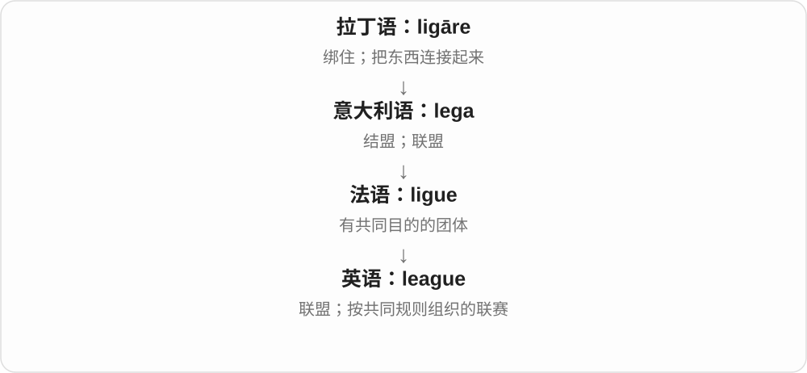

联系不是“绑住球”，而是把多个参与者组织在一起。由国家或群体的联合扩展到球队组织，才容易理解 sports league。in league with 也保留了结成一伙的意思。

**常见搭配与例句**

join a league（加入联赛）；a league match（联赛比赛）；in league with…（与……勾结或联合）。

> Our team joined a local basketball league.

我们队加入了当地的篮球联赛。

> The towns formed a league to protect the river.

这些城镇组成联盟，共同保护这条河。

**别混淆**

league 还有旧长度单位“里格”，那是另一条源自高卢语的词源，不属于“绑”的词族。tournament 通常突出一场或一届竞赛，league 常突出持续运行的组织和赛制。

### 2. ally — 盟友；与……结盟

**音标**：名词 /ˈælaɪ/；动词常读 /əˈlaɪ/

**先抓住这个画面**

把 ally 想成在某件事上与你站在同一阵线的人。彼此可以没有私人友谊，甚至在其他问题上有分歧；只要围绕共同目标相互支持，就可以成为 allies。这个词既能指国家，也能指同事、组织或支持某个群体的人。

**怎么拆**

历史上是 ad-（朝向、附着）+ ligāre（绑）。ad- 遇到 l 时发生同化，成为 al-，形成 alligāre。现代 ally 已经过法语和英语的变化，不能拆成 al + 副词后缀 -ly。名词复数是 allies，词尾读 /z/。

**怎么变成今天的意思**

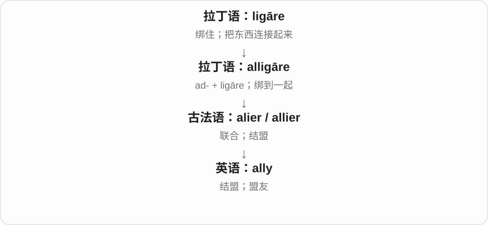

词形经过法语发生了较大变化，所以英语里已看不到完整的 lig。理解词义时，可以把“将东西系到一起”联系到“让人或团体形成共同关系”；历史上这个词也用于婚姻和亲属联合，后来广泛用于政治与军事结盟。名词 ally 指参与这种联合的人。

**常见搭配与例句**

a close ally（紧密盟友）；an ally in the fight against…（在反对……的行动中的盟友）；ally oneself with…（与……结盟）。

> The two groups became allies in their campaign for cleaner water.

这两个团体在争取更清洁水源的行动中成为盟友。

> She allied herself with colleagues who wanted to change the policy.

她与希望改变这项政策的同事联合起来。

**别混淆**

friend 强调感情，partner 强调共同参与，ally 强调共同立场和支持。ally 与 alien、alienate 的开头相似，但后两者来自 alius“别的”，不是 ligāre 这一支。

### 3. alliance — 联盟；同盟关系

**音标**：/əˈlaɪəns/

**先抓住这个画面**

alliance 指人或团体为了共同目的形成的合作关系，也可指结成的联盟组织。它比一次临时帮忙更有持续合作的意味，但未必需要正式条约。

**怎么拆**

可与 ally + -ance 联系记忆，-ance 常形成表示状态或关系的名词。不过英语 alliance 是经法语 aliance 借入，不能把现代英语的组合分析当成它第一次产生的过程。

**怎么变成今天的意思**

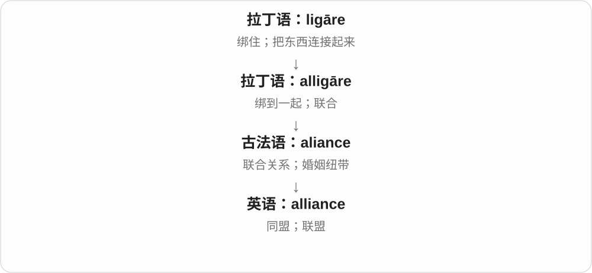

“绑在一起”在这里落到关系本身。它曾用于婚姻联合，继而用于家族、国家和其他组织的合作。ally 是关系中的参与者，alliance 是参与者之间形成的关系或组织。

**常见搭配与例句**

form / build an alliance（建立联盟）；a strategic alliance（战略联盟）；an alliance between A and B（A 与 B 的联盟）。

> The two universities formed an alliance to share research facilities.

两所大学结成联盟，共享研究设施。

> Their alliance lasted long after the election.

选举结束很久以后，他们的联盟仍然存在。

**别混淆**

alliance 不等于 merger：前者可以让各方保持独立，后者通常指组织或企业合并。

### 4. allied — 结盟的；相关的

**音标**：/ˈælaɪd/；也读 /əˈlaɪd/

**先抓住这个画面**

allied 一方面描述已经联合起来的人或国家，另一方面形容与某领域关系密切的事物，如 allied industries“相关行业”。后一义不涉及政治结盟。

**怎么拆**

ally + -ed。拼写中辅音字母后的 y 变 i，再加 -ed，得到 allied。它既可作过去分词，也可作形容词；词尾的 -ed 在这里读 /d/。

**怎么变成今天的意思**

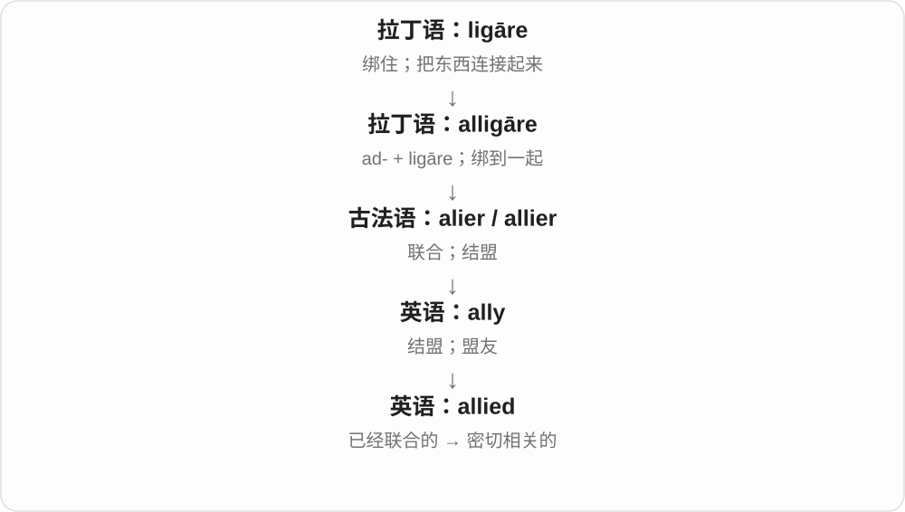

“被联合起来”自然可以描述同盟关系；当这种联系从国家和团体扩展到知识与行业，就有“相关的、相邻领域的”意思。allied health professions 指与医疗服务密切相关的专业，不是“结盟的健康职业”。

**常见搭配与例句**

allied countries（盟国）；allied industries（相关产业）；be closely allied to…（与……密切相关）。

> The allied countries agreed to share information.

这些盟国同意共享信息。

> The course covers engineering and allied subjects.

这门课程涵盖工程学及相关学科。

**别混淆**

allied 的“相关”义通常比 related 更正式。Allied 首字母大写时，常指特定历史语境中的盟国；小写不自动具有这一专名意义。

### 5. rally — 召集；重新振作；集会；回升

**音标**：/ˈræli/

**先抓住这个画面**

rally 往往带有“原本分散或减弱，现在重新聚拢、恢复力量”的动态感。可以召集支持者，也可以描述一个人振作起来、球队追回局面或价格回升。

**怎么拆**

历史上来自法语 rallier，与 re-（再）+ alier（联合）相关。不能按现代拼写解释为一个独立的 rall 加后缀 y。

**怎么变成今天的意思**

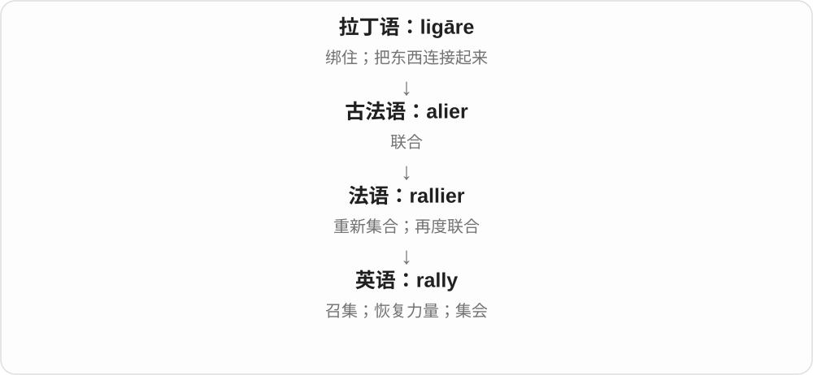

先从“把散开的人重新集合”理解，再把注意力转向集合后的力量恢复。体育中的一轮连续对打、政治集会和病后振作并非完全相同的情景，但都可以围绕聚拢或重新投入来理解。

**常见搭配与例句**

rally support for…（为……争取支持）；rally around someone（团结在某人周围）；a protest rally（抗议集会）。

> The volunteers rallied support for the new library.

志愿者为新图书馆争取到了支持。

> After a difficult first half, the team rallied and won.

经历艰难的上半场后，球队重振旗鼓，赢得了比赛。

**别混淆**

rally 与 recover 都可表达恢复，但 rally 常突出经过低落后的一次振作或反弹，不保证已经完全恢复。

### 6. rely — 依靠；信赖

**音标**：/rɪˈlaɪ/

**先抓住这个画面**

rely 描述把事情的成败、需要或期待托付给某个人或事物。You can rely on me 不只是“你喜欢我”，而是说需要我兑现承诺时，我靠得住。

**怎么拆**

历史上与 re- + ligāre 有关，这里的 re- 可加强“绑牢”的意思。词经古法语 relier 进入英语；不是 re- + lie“再次躺下”。过去式 relied，进行时 relying。

**怎么变成今天的意思**

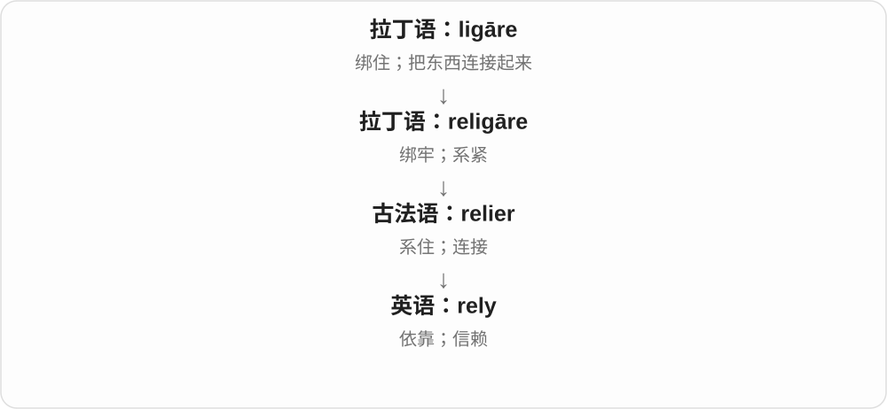

早期词义包含连接、聚集，后来发展为依附和信赖。把“将自己的信任系在某人身上”当作理解这层抽象意义的画面很有帮助；但它是解释语感的比喻，不意味着现代人使用 rely 时想到绳子。

**常见搭配与例句**

rely on / upon someone；rely on someone to do something；rely on doing something。

> You can rely on Maya to keep her promise.

你可以相信玛雅会遵守承诺。

> The village relies on the river for drinking water.

这个村庄依靠河流获取饮用水。

**别混淆**

depend on 更容易中性地说明条件关系；rely on 常包含依赖或信任。不能说 rely someone，通常需要 on 或 upon。

### 7. reliable — 可靠的；可信赖的

**音标**：/rɪˈlaɪəbəl/

**先抓住这个画面**

reliable 描述在需要的时候表现稳定、能够让人放心依靠的对象。人、消息来源、设备和服务都可以 reliable。一次表现很好，不一定就证明长期可靠。

**怎么拆**

rely + -able；y 在派生中变 i。这里 -able 表示“可以被依靠的”，不是简单给 rely 加“能够”就译成“能够依靠别人的”。

**怎么变成今天的意思**

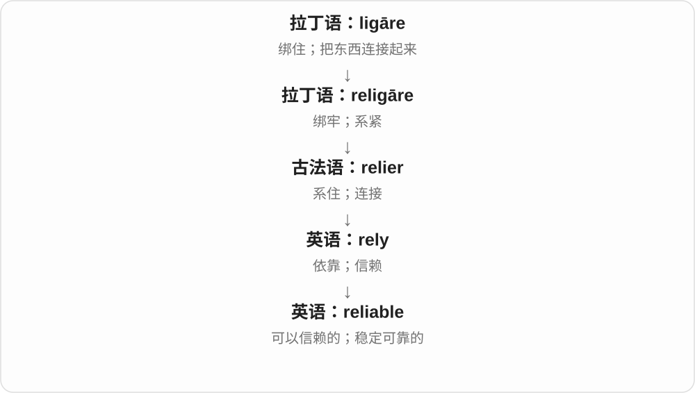

rely 是“依靠”的动作，reliable 把目光转向依靠的对象：它是否值得被信任。英语在本土构词阶段形成这个形容词，不能把整词当作拉丁语直接借词。

**常见搭配与例句**

a reliable source（可靠来源）；a reliable car（可靠的汽车）；reliable information（可信的信息）。

> We need a reliable source before publishing the story.

刊发这则报道前，我们需要可靠的消息来源。

> This old car is still surprisingly reliable.

这辆旧车仍然出人意料地可靠。

**别混淆**

reliable 强调可依赖的表现；accurate 强调具体内容准确。一把每次都偏同样数值的尺可能重复性好，却不准确。

### 8. reliability — 可靠性；信度

**音标**：/rɪˌlaɪəˈbɪləti/

**先抓住这个画面**

reliability 把“可靠”变成可以讨论、比较或衡量的性质。工程语境关心系统能否稳定工作；测量语境关心结果能否一致复现。

**怎么拆**

reliable + -ity，-able 在这类名词中对应 -ability。不要把它误读成 rely + ability“依赖的能力”；重点是被评价对象的可靠程度。

**怎么变成今天的意思**

这一步发生在英语派生层面：由形容词描述对象，转为名词讨论这种属性。重音移到 -bil- 所在音节，说明派生不仅改变词性，也可能改变读音。

**常见搭配与例句**

improve reliability（提高可靠性）；system reliability（系统可靠性）；the reliability of the results（结果的可靠程度）。

> The upgrade improved the reliability of the network.

这次升级提高了网络的可靠性。

> The researchers checked the reliability of the questionnaire.

研究人员检验了这份问卷的信度。

**别混淆**

reliability 与 validity 不同：前者看结果是否稳定一致，后者看测量或判断是否真正符合所要测的对象。

### 9. unreliable — 不可靠的；不稳定的

**音标**：/ˌʌnrɪˈlaɪəbəl/

**先抓住这个画面**

unreliable 指你不能放心依靠某人或某物，因为其表现、信息或承诺不够稳定。它不必意味着对方有意欺骗。

**怎么拆**

un-（否定）+ reliable。否定的是“可依赖”这一性质，属于英语内部派生。

**怎么变成今天的意思**

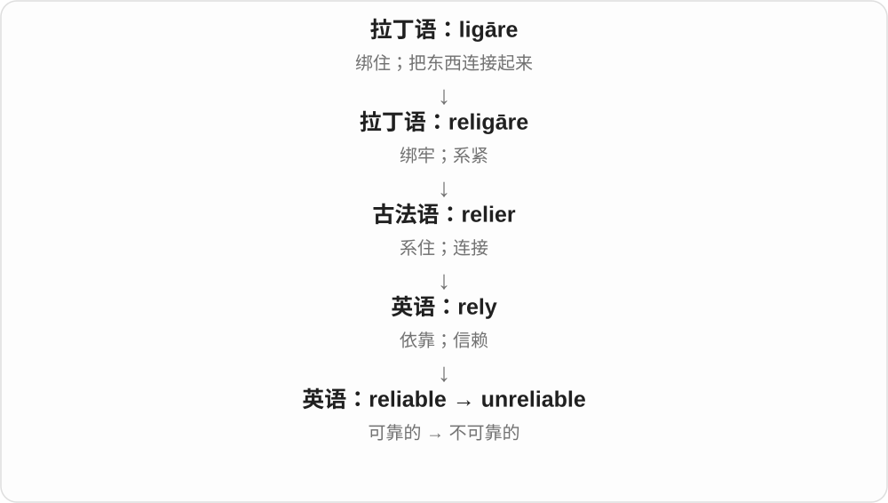

一个 reliable 系统在需要时通常能发挥作用；un- 把这种信任基础否定。消息也可以 unreliable，因为来源不稳或证据不足，而不只是因为已经证实为假。

**常见搭配与例句**

an unreliable witness（不可靠的证人）；unreliable data（不可靠的数据）；an unreliable service（不稳定的服务）。

> The internet connection is too unreliable for video calls.

网络连接太不稳定，无法可靠地进行视频通话。

> We excluded the unreliable measurements from the analysis.

我们在分析中排除了不可靠的测量结果。

**别混淆**

unreliable 与 dishonest 不同：前者说“靠不住”，后者说“不诚实”。一个经常忘事的人可能不可靠，但并非有意撒谎。

### 10. unreliability — 不可靠性；不稳定性

**音标**：/ˌʌnrɪˌlaɪəˈbɪləti/

**先抓住这个画面**

unreliability 指反复出现的靠不住这一性质，适合解释为什么某个系统或来源难以被信任。

**怎么拆**

un- + reliability，也可从 unreliable 对应到性质名词 -ability。两种现代分析描述同一词族关系，不需要虚构两条古代借入路线。

**怎么变成今天的意思**

加上名词后缀后，讨论对象从“这个设备不可靠”转为“这个设备的不可靠性造成了什么影响”。词的抽象程度提高，但核心意义没有另起炉灶。

**常见搭配与例句**

the unreliability of…；concerns about unreliability；persistent unreliability。

> The unreliability of the service drove customers away.

服务的不稳定使顾客流失。

> The report discusses the unreliability of human memory.

这份报告讨论了人类记忆的不可靠性。

**别混淆**

unreliability 指整体性质，failure 可以指一次具体故障。一次失败不必然证明长期不可靠，反复失败才更有说服力。

### 11. reliance — 依赖；信赖

**音标**：/rɪˈlaɪəns/

**先抓住这个画面**

reliance 指正在依靠某人或某物的关系和状态，特别适合讨论依赖程度。它把焦点放在“依赖者”，而 reliability 评价“被依赖者”。

**怎么拆**

rely + -ance，y 变 i，-ance 构成状态名词。它与 alliance 的结尾相同，但前面的历史词形和现代意义不同。

**怎么变成今天的意思**

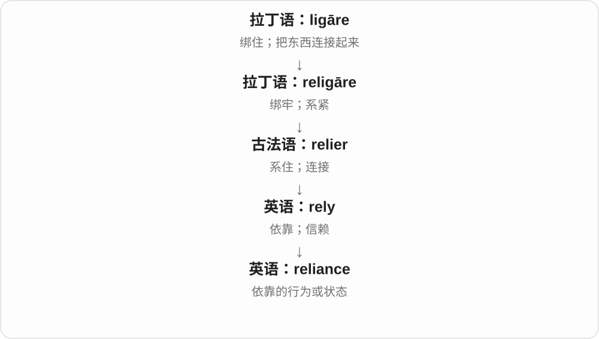

由“我依靠它”转成“我对它的依赖”，句子里的动作就变成可讨论的名词。常用的 on 也随之保留下来：rely on → reliance on。

**常见搭配与例句**

heavy reliance on…（高度依赖……）；reduce reliance on…（减少对……的依赖）。

> The city wants to reduce its reliance on private cars.

这座城市希望减少对私家车的依赖。

> Her reliance on the team grew as the project became more complex.

随着项目变得更复杂，她对团队的依赖增加了。

**别混淆**

reliance 可以是中性的，也可以暗示依赖过多；reliability 通常直接评价可靠程度。不要把 reliance on technology 译成“技术的可靠性”。

### 12. reliant — 依赖……的

**音标**：/rɪˈlaɪənt/

**先抓住这个画面**

reliant 描述一个人或系统需要某种支持才能运行的状态。它通常和 on 连用，后面交代依赖什么。

**怎么拆**

rely + -ant；-ant 构成表示状态的形容词。与 reliable 的方向不同：reliant 是“依靠别人的”，reliable 是“可让别人依靠的”。

**怎么变成今天的意思**

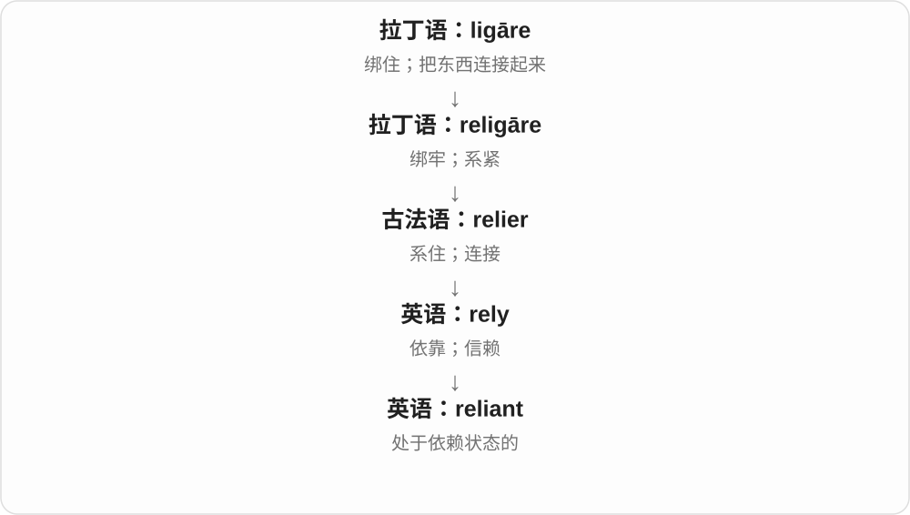

词义仍围绕依靠，只是从动作变为主语的状态。a country reliant on imports 就是一个依赖进口的国家，不表示这个国家本身值得信赖。

**常见搭配与例句**

be reliant on…；heavily reliant on…；less reliant on outside help。

> The business is heavily reliant on one supplier.

这家企业高度依赖一家供应商。

> She became less reliant on others as her confidence grew.

随着信心增强，她对他人的依赖减少了。

**别混淆**

reliant ≠ reliable。可以把两者放在一句话里理解：一个 reliant on others 的人，依赖的是 reliable people。

### 13. liable — 负有责任的；易于……的

**音标**：/ˈlaɪəbəl/

**先抓住这个画面**

liable 有两条常用线索：一是受到责任约束，如 liable for damage；二是有发生某种情况的倾向，如 liable to break。后一义通常用于不希望发生的事。

**怎么拆**

来自古法语 lier“绑、约束”的相关形式，最终联系到 ligāre。不能拆成 lie + able，也不能用“会撒谎的”来记。

**怎么变成今天的意思**

从“被某种关系约束”容易理解“必须承担后果”；从“受某事影响或支配”又可理解“容易遭遇”。这两义在现代用法中分别常跟 for 和 to，但真正判断仍要看整句。

**常见搭配与例句**

be liable for…（对……负责任）；be liable to do…（容易做……）；be liable to a penalty（可能受到处罚）。

> The agreement states who is liable for damage to the equipment.

协议说明了谁对设备损坏承担责任。

> These old pipes are liable to leak in cold weather.

这些旧管道在寒冷天气里容易漏水。

**别混淆**

likely 主要说概率；liable 往往额外带有责任或不利后果的意味。liable for 与 liable to 的搭配不能简单互换。

### 14. liability — 责任；负债；累赘

**音标**：/ˌlaɪəˈbɪləti/

**先抓住这个画面**

liability 可以指必须承担的责任或债务，也可以比喻一个给你带来风险和负担的人或事物。财务报表中的 liabilities 通常译作负债。

**怎么拆**

liable + -ity，形成性质或事项名词。-able 对应 -ability 的形态与 reliable → reliability 相似。

**怎么变成今天的意思**

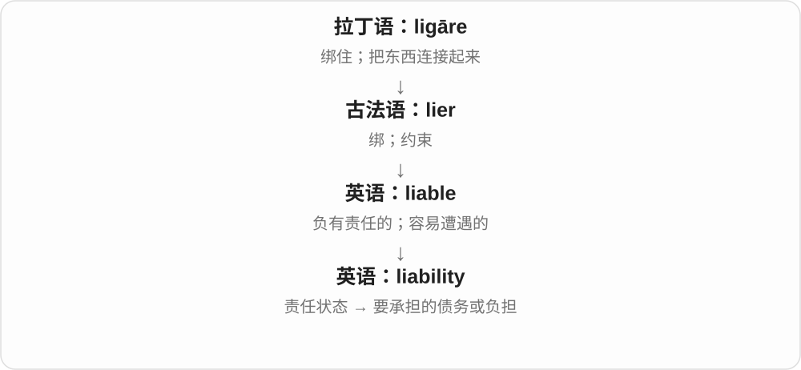

“被责任约束”名词化后，可以指约束本身，也可以指具体必须履行的债务。如果一个人持续让团队承担后果，他就可能被比喻成 a liability。这个比喻通常相当负面。

**常见搭配与例句**

legal liability（法律责任）；assets and liabilities（资产与负债）；become a liability（成为负担）。

> The accountant reviewed the company’s assets and liabilities.

会计审查了公司的资产和负债。

> His refusal to cooperate became a liability for the team.

他拒绝合作，成了团队的负担。

**别混淆**

liability 是需要承担的一方；asset 是有价值、能带来好处的一方。两词既可谈财务，也可用于评价团队成员或个人条件。

### 15. oblige — 使有义务；帮忙；使感激

**音标**：/əˈblaɪdʒ/

**先抓住这个画面**

oblige 一边表示“使某人不得不做”，另一边表示“应请求帮忙”。这两个意思看似相反，却都与人与人之间形成的责任关系有关。

**怎么拆**

ob-（朝向、施加到）+ ligāre（绑住），形成 obligāre。经过古法语后成为 oblige。末尾发 /dʒ/；不能据此认为所有 lig 都读成 /laɪdʒ/。

**怎么变成今天的意思**

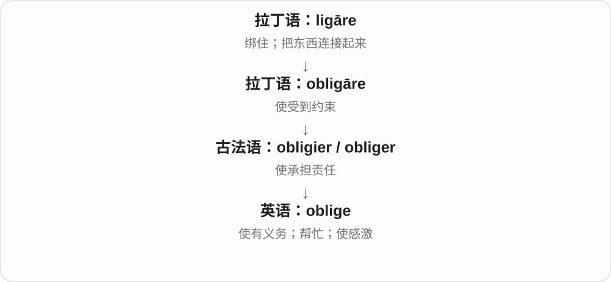

“把人绑定到某项责任上”对应使有义务；替别人做事，又会让接受帮助者产生欠人情、感激的感觉，于是词义延伸到帮忙和使感激。具体句型决定你面对的是哪一义。

**常见搭配与例句**

oblige someone to do…（迫使或要求某人做……）；oblige someone with…（应某人要求提供……）；be happy to oblige（乐意帮忙）。

> The rules oblige every visitor to sign in.

规定要求每位访客登记。

> I asked for a glass of water, and the waiter was happy to oblige.

我要了一杯水，服务员很乐意帮忙。

**别混淆**

oblige to do 的被动句常表示义务；much obliged 常表达感谢。不要把 I’m happy to oblige 理解为“我高兴地强迫别人”。

### 16. obligation — 义务；责任；承诺

**音标**：英 /ˌɒblɪˈɡeɪʃən/；美 /ˌɑːblɪˈɡeɪʃən/

**先抓住这个画面**

obligation 是某种规则、承诺、关系或道德判断让你觉得应该履行的事。它不只来自法律，也可能来自对家人、朋友或自己作出的承诺。

**怎么拆**

历史上是 obligāre 的名词词族，经拉丁语 obligātiō、古法语 obligacion 进入英语。可用 oblig- + -ation 联系记忆，但不是把现代 oblige 直接照读后加 tion。

**怎么变成今天的意思**

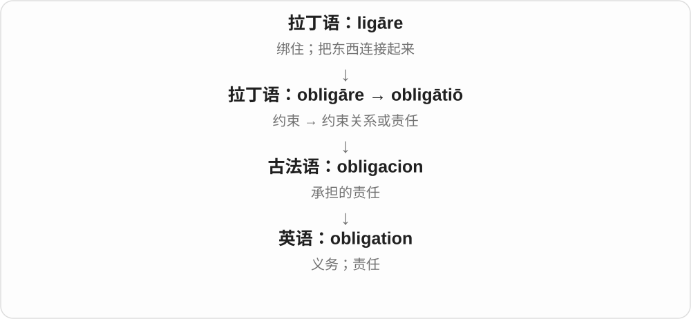

把“绳子约束身体”与“承诺约束行动”作对照，就能理解它的抽象意义。obligation 是让行动具有“应当如此”约束的责任；因此 have no obligation to do something 表示没有必须这样做的义务。

**常见搭配与例句**

an obligation to do…；fulfil an obligation（履行义务）；a sense of obligation（责任感）；under no obligation（没有义务）。

> I felt an obligation to tell her the truth.

我觉得自己有责任告诉她真相。

> You are under no obligation to accept the offer.

你没有义务接受这个提议。

**别混淆**

obligation 强调应履行的约束；opportunity 是可以把握的机会。责任感也不等于愉快与否：人可能自愿承担义务，也可能勉强履行。

### 17. obliged — 有义务的；感激的

**音标**：/əˈblaɪdʒd/

**先抓住这个画面**

obliged 描述由 oblige 造成的状态：受到要求而必须行动，或因为别人帮忙而心存感激。

**怎么拆**

oblige + -ed，词末已有 e，拼写只加 d。末尾 /dʒd/ 不需要再补一个额外元音。

**怎么变成今天的意思**

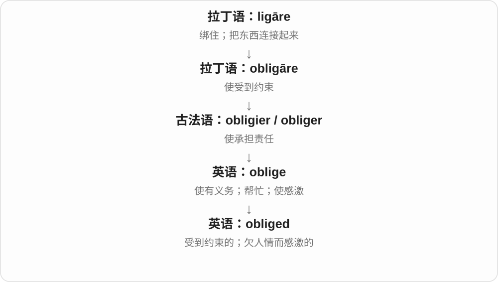

两个现代意义都继承自 oblige。be obliged to do something 多指必须做某事；be obliged to someone for something 则多指因某事感谢某人。

**常见搭配与例句**

be obliged to do…；be much obliged to someone；I’d be obliged if…（如能……我将感激不尽，较正式）。

> We were obliged to leave before the roads closed.

道路封闭前，我们不得不离开。

> I’m much obliged to you for your help.

非常感谢你的帮助。

**别混淆**

obliged 与 obliging 方向相反：前者是受到义务或恩惠影响的人，后者常指愿意帮别人的人。

### 18. obliging — 乐于助人的；热心帮忙的

**音标**：/əˈblaɪdʒɪŋ/

**先抓住这个画面**

形容词 obliging 称赞一个人愿意响应他人的请求、帮别人把事情做好。它通常不是“强迫别人的”。

**怎么拆**

oblige + -ing；加 -ing 时去掉末尾不发音的 e。由分词形式发展成描述性格或态度的形容词。

**怎么变成今天的意思**

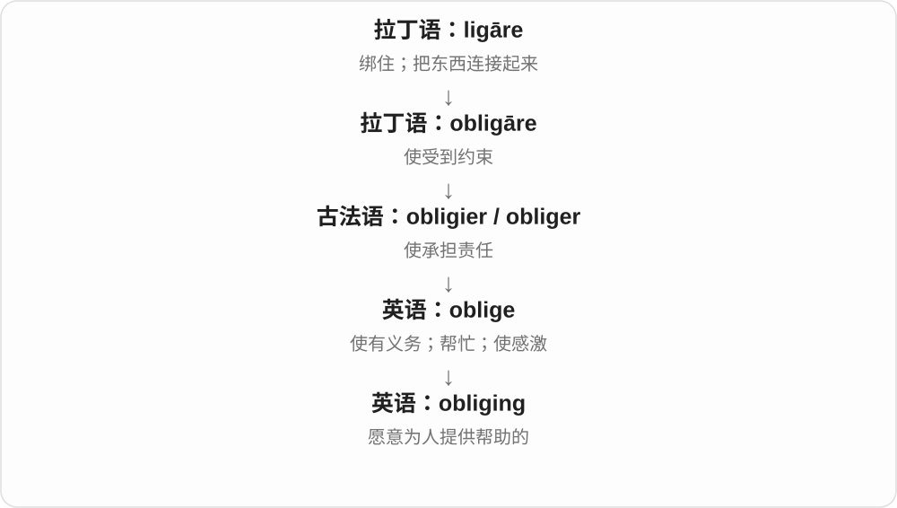

这里选取 oblige 的“应请求帮忙”义，而不是“使有义务”义。派生词不会平均保留词基的所有义项，因此不能只背一个中文“迫使”再机械套到 obliging。

**常见搭配与例句**

an obliging assistant（热心帮忙的助理）；be very obliging；an obliging manner（乐于帮忙的态度）。

> An obliging neighbor helped us carry the boxes upstairs.

一位热心邻居帮我们把箱子搬上楼。

> The hotel staff were friendly and obliging.

酒店员工友好而且乐于帮忙。

**别混淆**

obliging 接近 helpful、accommodating；obedient 是服从命令的，二者对人的主动性评价不同。

### 19. obligate — 使负有义务；专性的

**音标**：动词 /ˈɑːblɪɡeɪt/；形容词 /ˈɑːblɪɡət/

**先抓住这个画面**

动词 obligate 比 oblige 更常出现在正式责任和承诺的语境中。生物学中的形容词 obligate 则指必须依靠某种条件或生活方式的，如 obligate parasite“专性寄生物”。

**怎么拆**

来自拉丁语 obligātus，保留了 -gat- 词形。动词末尾 -ate 通常读 /eɪt/，形容词常读弱化的 /ət/ 或 /ɪt/。

**怎么变成今天的意思**

oblige 经法语变化后形成一种英语词形，obligate 则较直接地借用拉丁语的分词词干。它们因此同源却不同形。专业形容词把“受约束”用于生活条件上的必需性。

**常见搭配与例句**

obligate someone to do…；be legally obligated；an obligate parasite。

> The agreement obligates both parties to keep the records confidential.

协议要求双方对这些记录保密。

> The article describes a fungus that is an obligate parasite.

这篇文章描述了一种专性寄生真菌。

**别混淆**

oblige 的“帮忙”义较日常，obligate 通常突出使承担责任。生物学中的 obligate 与 facultative“兼性的、可选择的”相对。

### 20. obligated — 负有义务的；被要求的

**音标**：/ˈɑːblɪɡeɪtɪd/

**先抓住这个画面**

obligated 表示一个人因承诺、约定或其他要求而负有责任，常见于美式英语。它也可以描述主观上觉得自己应当做某事。

**怎么拆**

obligate + -ed。词干末尾 /t/ 后的 -ed 读 /ɪd/，因此比 obligate 多一个音节。

**怎么变成今天的意思**

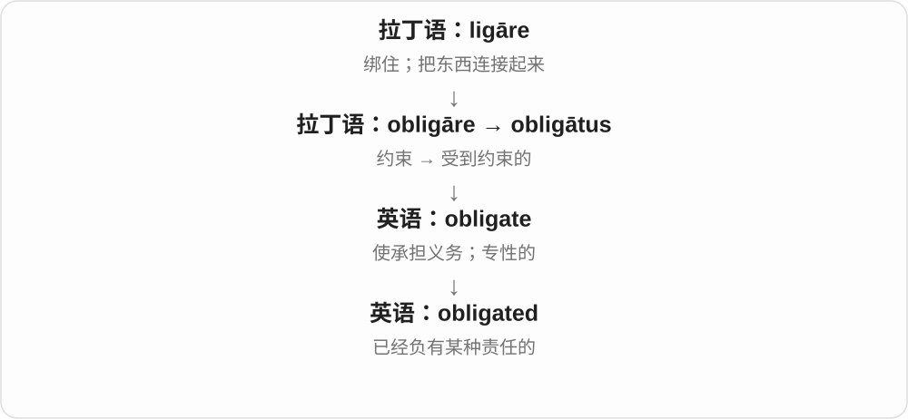

过去分词把“使承担义务”转为“处在承担义务的状态”。在感受和社会压力的语境中，feel obligated to 并不自动说明真的有法律义务。

**常见搭配与例句**

be obligated to do…；feel obligated to…；contractually obligated（按合同负有义务的）。

> I felt obligated to help after making that promise.

作出那个承诺之后，我觉得自己有责任帮忙。

> The supplier is obligated to replace damaged parts.

供应商有义务更换损坏的零件。

**别混淆**

obligated 与 obliged 在义务这一义上常能替换，但表达礼貌感谢时 much obliged 更固定、更自然。

### 21. obligatory — 必须的；强制性的；惯例性的

**音标**：英 /əˈblɪɡətri/；美 /əˈblɪɡətɔːri/

**先抓住这个画面**

obligatory 描述某件事受到规则、职责或惯例要求。它既可严肃地表示必须，也可略带幽默地表示“照例总要来一下”。

**怎么拆**

来自拉丁语 obligātōrius，属于 obligāre 词族；可把 -ory 联系到形容词功能。不要把发音照搬成 oblige 的 /əˈblaɪdʒ/。

**怎么变成今天的意思**

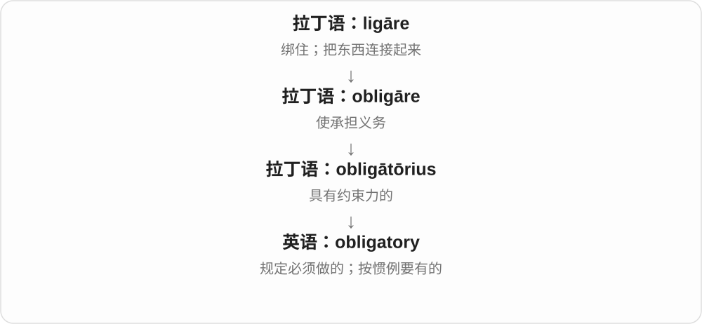

由“约束住行动”转向“某个行动本身是必须的”。a compulsory course 和 an obligatory course 都可能表示必修课；the obligatory group photo 常是在说集体活动之后少不了那张合影。

**常见搭配与例句**

be obligatory for…；obligatory training；the obligatory introduction。

> Attendance at the safety briefing is obligatory.

必须参加安全说明会。

> After the ceremony, we took the obligatory group photo.

仪式结束后，我们照例拍了集体照。

**别混淆**

obligatory 形容事情必须做；obliging 形容人愿意帮忙。两词不是程度不同，而是所描述的对象和意义不同。

### 22. alloy — 合金；使混合

**音标**：名词 /ˈælɔɪ/；动词也读 /əˈlɔɪ/

**先抓住这个画面**

alloy 通常指由两种或更多元素组成、具有金属性质的材料，其中至少一种成分是金属。它保留了“把不同东西结合起来”的核心画面。

**怎么拆**

经法语 aloi、alloy 等形式，与 alligāre“绑在一起”相关。不是 all + oy。它与 ally 同源，但借入的词形和使用领域不同。

**怎么变成今天的意思**

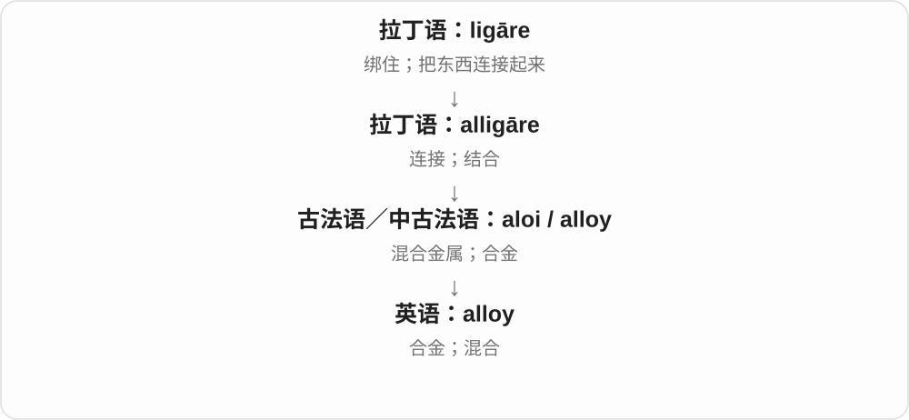

把“结合”用到材料上，得到的不是盟友，而是不同成分结合后的金属材料。英语还可用 unalloyed joy 表达“毫无杂质的快乐”，把材料的纯与混合转为情感比喻。

**常见搭配与例句**

an aluminium alloy（铝合金）；alloy steel（合金钢）；alloy one metal with another（把一种金属与另一种熔合）。

> The frame is made from a lightweight alloy.

框架由一种轻质合金制成。

> Copper is alloyed with tin to make bronze.

铜与锡熔合制成青铜。

**别混淆**

alloy 与 mixture 不同：mixture 是范围更广的混合物。不要把所有合金都定义成“只由金属与金属混合”，钢中的碳就不是金属。

### 23. liaison — 联络；协调；联络人

**音标**：英 /liˈeɪzɒn/；美 /ˈliːeɪzɑːn/

**先抓住这个画面**

liaison 强调在两个群体之间保持信息和合作的连接。它既可指联络活动，也可指负责这种连接的人；在另一语境中还可指恋情。

**怎么拆**

直接借自法语 liaison，最终来自拉丁语 ligātiō“绑、连接”。法语的变化使现代拼写里不再直接出现 lig-。

**怎么变成今天的意思**

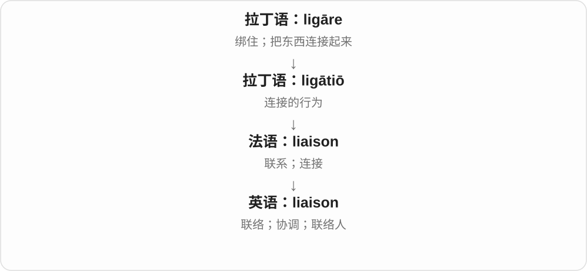

一个 liaison officer 的工作就是把两个原本独立的部门连接起来。语言学中的 liaison“连音”同样是声音之间的连接。恋情义则把连接用于人际关系，须由具体语境判断。

**常见搭配与例句**

act as a liaison between…（担任……之间的联络人）；liaison with…；a liaison officer。

> She acts as a liaison between the designers and the engineers.

她负责设计师与工程师之间的联络。

> Close liaison with local residents helped the project succeed.

与当地居民保持密切联系帮助项目取得了成功。

**别混淆**

liaison 不只是一次 contact“接触”，通常涉及持续协调。与 ligation 同源，但后者主要用于医学和科学中的结合、结扎。

### 24. ligament — 韧带

**音标**：/ˈlɪɡəmənt/

**先抓住这个画面**

ligament 常指连接骨与骨、帮助稳定关节的坚韧组织。这里“绑、连接”的词源意象仍然非常具体：两块骨之间需要连接和约束。

**怎么拆**

拉丁语 ligāre + 名词构词成分形成 ligāmentum，再进入英语。可用 lig- 与 -ment 记忆，但历史上的完整词是在拉丁语阶段形成的。

**怎么变成今天的意思**

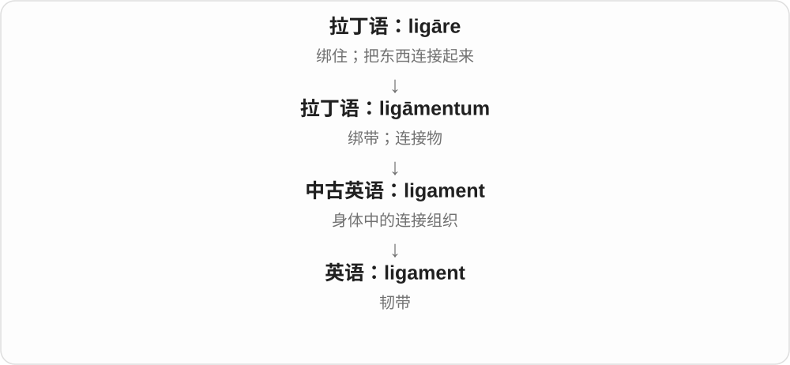

语义从一般的绑带或连接物专化为身体组织。理解“既连接又限制活动范围”，比只把词根译成宽泛的 connect 更接近关节韧带的功能。

**常见搭配与例句**

a torn ligament（撕裂的韧带）；knee ligaments（膝部韧带）；ligament damage（韧带损伤）。

> She tore a ligament in her knee during the match.

比赛中，她撕裂了膝部的一条韧带。

> The diagram shows how the ligaments help stabilize the joint.

这张图展示了韧带如何帮助稳定关节。

**别混淆**

ligament 通常连接骨与骨；tendon“肌腱”通常连接肌肉与骨。二者都与运动有关，但不是同一种结构。

### 25. ligand — 配体

**音标**：/ˈlɪɡənd/；也读 /ˈlaɪɡənd/

**先抓住这个画面**

ligand 是能够与某个中心或靶点结合的原子、离子或分子。化学中常谈与金属中心结合，生物学中常谈与受体或其他蛋白质结合。

**怎么拆**

来自拉丁语 ligandus，是 ligāre 词族中带有“要被绑定”意义的形式。不能根据现代词尾 -and 推出所有相似结尾词都是同一种结构。

**怎么变成今天的意思**

术语保留了“结合”的核心，而具体结合方式由专业语境决定。把 ligand 想成参与结合的一方，有助于与催化连接反应的 ligase 区分。

**常见搭配与例句**

a receptor ligand（受体配体）；ligand binding（配体结合）；a metal–ligand complex（金属配合物）。

> The ligand binds to a receptor on the cell surface.

这个配体与细胞表面的受体结合。

> The model shows six ligands surrounding the metal ion.

模型显示六个配体围绕着这个金属离子。

**别混淆**

ligand 是参与结合的对象，不自动是酶；ligase 是催化连接反应的一类酶。

### 26. ligature — 结扎线；绑扎；连字

**音标**：英 /ˈlɪɡətʃə/；美 /ˈlɪɡətʃər/

**先抓住这个画面**

ligature 可以是绑住东西的线或带，也可以是字体中连在一起的字母。医学和排版看似不相干，却共享“把原本分开的部分连接起来”的画面。

**怎么拆**

来自拉丁语 ligātūra，再经法语进入英语。可识别 lig- 与名词性结尾 -ature 的关系，不宜把现代 -ature 一律当作自由可加的后缀。

**怎么变成今天的意思**

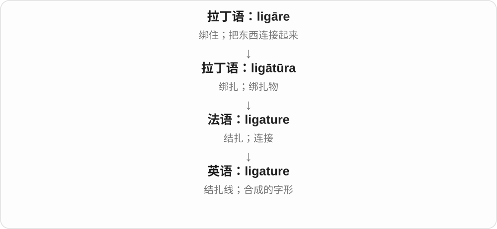

在医学里，它可以指把血管等扎住的线；在字体设计里，两个字母可以合成一个连贯字形，如某些字体中的 fi。名称来自连接方式，而不是两个领域偶然同音。

**常见搭配与例句**

a surgical ligature（外科结扎线）；a typographic ligature（排版连字）；enable ligatures（启用连字）。

> The surgeon placed a ligature around the small vessel.

外科医生在那条小血管周围放置了结扎线。

> This font uses a ligature for the letters f and i.

这种字体会将字母 f 和 i 合成一个连字。

**别混淆**

ligament 是身体组织；ligature 通常是实施绑扎的材料、动作或连字。不要因为都以 lig- 开头就混译成韧带。

### 27. ligation — 结扎；连接；配位结合

**音标**：/lɪˈɡeɪʃən/

**先抓住这个画面**

ligation 主要指进行绑定或连接的过程。医学中常译“结扎”，分子生物学中可译“连接”，化学中则可谈配体与中心的结合。

**怎么拆**

借自晚期拉丁语 ligātiō，属于 ligāre 的动作名词词族。现代也可与动词 ligate 对照理解为“进行 ligate 的过程”。

**怎么变成今天的意思**

重点由“用来绑的东西”转向“绑或连接的动作”。同源的 liaison 经法语发生词形和应用领域的变化；ligation 更保留科学术语的形态。

**常见搭配与例句**

DNA ligation（DNA 连接）；vessel ligation（血管结扎）；a ligation reaction（连接反应）。

> The paper describes a method for DNA ligation.

这篇论文介绍了一种 DNA 连接方法。

> The report records the ligation of a small blood vessel.

报告记录了对一条小血管的结扎。

**别混淆**

ligature 常指结扎线或连接物，ligation 指过程。词形相近，不代表句中可以互换。

### 28. ligase — 连接酶

**音标**：英 /ˈlɪɡeɪz/；美 /ˈlaɪɡeɪz/

**先抓住这个画面**

ligase 是催化两个分子连接的一类酶。学习时抓住“帮助连接发生的酶”即可，不能把它直接当作被连接的那个分子。

**怎么拆**

以 ligation 的 lig- 相关词干加酶名后缀 -ase 形成。-ase 在许多生化酶名中出现，如 lactase、amylase。

**怎么变成今天的意思**

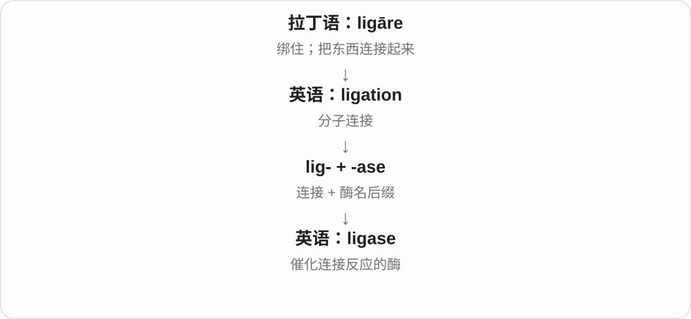

这是现代科学命名利用古典词根造词的例子，不是古罗马人已经有了现代连接酶概念。旧词根提供“绑”的画面，新后缀和专业定义确定现代对象。

**常见搭配与例句**

DNA ligase（DNA 连接酶）；ligase activity（连接酶活性）；add ligase to a reaction（向反应体系加入连接酶）。

> DNA ligase helps join adjacent DNA fragments.

DNA 连接酶帮助连接相邻的 DNA 片段。

> The experiment measured ligase activity at different temperatures.

实验测量了不同温度下的连接酶活性。

**别混淆**

-ase 提示这是一种酶；ligand 没有这个后缀，指参与结合的一方。只背中文“连接”会丢掉两者的角色差别。

### 29. legato — 连奏的；连贯地演奏

**音标**：英 /lɪˈɡɑːtəʊ/；美 /lɪˈɡɑːtoʊ/

**先抓住这个画面**

让相邻音符像连着的一条线，不在它们之间留下明显的断口。

**怎么拆**

借自意大利语 legato“绑在一起的”，是 legare 的过去分词，远源为拉丁语 ligāre“捆绑、连接”；它属于 lig-，不属于 lēgāre“委派”这一根。

**怎么变成今天的意思**

**拉丁语 ligāre**  
捆绑、连接

↓

**意大利语 legare → legato → 英语音乐词 legato**  
连在一起的 → 音与音连贯地演奏

乐谱中的 legato 要求连贯的发音效果；具体用手指、弓法还是气息做到，取决于乐器。它不自动要求把速度放慢，也不等于所有音都拖得很长。

**常见搭配与例句**

play legato；a legato phrase；smooth legato。

> Play the melody legato, keeping the notes smoothly connected.

把旋律连贯地演奏，让音符之间平滑衔接。

> The teacher asked for a more natural legato in the second phrase.

老师要求第二个乐句的连奏更自然一些。

**别混淆**

staccato 强调短促分离；legato 强调音与音之间的连贯。

## 这一组要分清什么

**ally 与 alienate**：前者属于“绑在一起”，后者来自 alius“别的”，虽然意义可以作对比，却不是同一个词根。

**release** 表示释放，可帮助联想“解除约束”，但它追溯到拉丁语 relaxāre，不能放在 ligāre 的直系演化图里。

**religion** 与 religāre 的关系存在词源争议，另有与 relegere 联系的传统分析；不要把“重新把人绑到神身上”当作已经确定的历史。

**league** 的“联盟、联赛”义属于本组；旧长度单位“里格”属于另一条来源。

## 串起来练习

试着连起来理解：**A reliable ally can help an alliance fulfil its obligations.**

一个可靠的盟友能帮助联盟履行其义务。这里 reliable 是“值得依靠”，ally 是“联合的一员”，alliance 是“联合关系”，obligations 是“受到约束而应履行的责任”。
