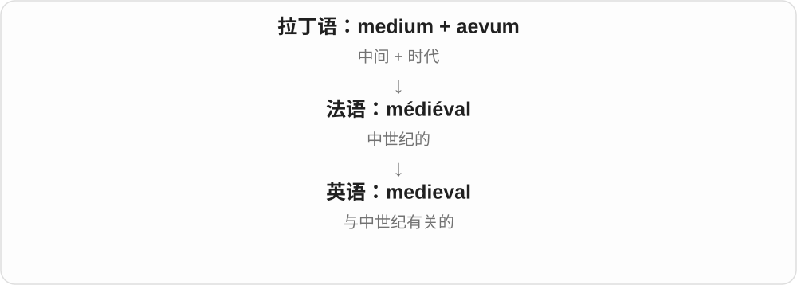

# 0332 · aev-, ev- — 一生；年龄；时代；长久时间

[逐词精讲目录](../00_逐词精讲目录.md) · [总目录](../00_总目录_按常用程度.md)

## 核心词根与来源

拉丁 aevum 可以说一生、时代和长久时间。age 经 aetas 与法语等历史变化走到今天；eternal 走向永恒；longevity 把“长”与生命结合。eon 来自同源的希腊 aiōn，是旁边的一条亲属路线，并不是拉丁词改几个字母直接变来。

**把生命和世界放在时间的长线上看**

一条时间线上，有一个人的年龄，也有远古时代与延伸到看不到尽头的时间。

- **年龄与变化**：age、aged、aging、ager、teenage、teenager、underage、overage、ageless
- **年龄偏见**：ageism、ageist
- **时间长度与同期**：eternal、eternally、eternity、longevity、coeval
- **远古与时代分段**：primeval、medieval；希腊亲属 eon

## 词形与演化规律

aev-、ev- 在 coeval、primeval 等词中仍可见；etern- 经拉丁 aeviternus 缩合为 aeternus。age 的形状变化较大，要记实际传承，不硬按今天字母拆。

## 单词速览（常用到不常用）

| 单词 | 音标 | 核心意思 |
|---|---|---|
| [age](#w-1) | /eɪdʒ/ | 年龄；时代；变老；使熟成 |
| [aged](#w-2) | 表示岁数或熟成 /eɪdʒd/；表示年老的常读 /ˈeɪdʒɪd/ | ……岁的；经过熟成的；年老的 |
| [teenage](#w-3) | /ˈtiːneɪdʒ/ | 十三至十九岁的；青少年时期的 |
| [eternal](#w-4) | 英 /ɪˈtɜːnəl/；美 /ɪˈtɜːrnəl/ | 永恒的；无休无止的 |
| [teenager](#w-5) | 英 /ˈtiːneɪdʒə/；美 /ˈtiːneɪdʒər/ | 十三至十九岁的青少年 |
| [medieval](#w-6) | 英 /ˌmediˈiːvəl/；美 /ˌmiːdiˈiːvəl/ | 中世纪的 |
| [aging](#w-7) | /ˈeɪdʒɪŋ/ | 衰老；老化；熟成；逐渐变老的 |
| [eternity](#w-8) | 英 /ɪˈtɜːnəti/；美 /ɪˈtɜːrnəti/ | 永恒；仿佛无穷无尽的时间 |
| [longevity](#w-9) | 英 /lɒnˈdʒevəti/；美 /lɑːnˈdʒevəti/ | 长寿；持久存在；寿命长度 |
| [underage](#w-10) | 形容词 /ˌʌndərˈeɪdʒ/；名词英 /ˈʌndərɪdʒ/、美 /ˈʌndərɪdʒ/ | 未达到规定年龄的；短缺量〔名词〕 |
| [eternally](#w-11) | 英 /ɪˈtɜːnəli/；美 /ɪˈtɜːrnəli/ | 永远；始终；没完没了地 |
| [primeval](#w-12) | /praɪˈmiːvəl/ | 远古的；原始时代的 |
| [eon](#w-13) | 英 /ˈiːən/；美 /ˈiːɑːn/ | 极漫长的时期；宙〔地质〕 |
| [ageless](#w-14) | /ˈeɪdʒləs/ | 不显老的；不受时代限制的 |
| [ageism](#w-15) | /ˈeɪdʒɪzəm/ | 年龄歧视；年龄偏见 |
| [ager](#w-16) | 英 /ˈeɪdʒə/；美 /ˈeɪdʒər/ | 使东西熟成的人或装置；适宜陈年的酒〔较少见〕 |
| [overage](#w-17) | 形容词英 /ˌəʊvərˈeɪdʒ/、美 /ˌoʊvərˈeɪdʒ/；名词英 /ˈəʊvərɪdʒ/、美 /ˈoʊvərɪdʒ/ | 超龄的；超额部分〔名词〕 |
| [ageist](#w-18) | /ˈeɪdʒɪst/ | 有年龄偏见的；持年龄偏见者 |
| [coeval](#w-19) | 英 /kəʊˈiːvəl/；美 /koʊˈiːvəl/ | 同一时代的；同龄的 |

## 逐词讲解

### 1. age — 年龄；时代；变老；使熟成

**音标**：/eɪdʒ/

**先抓住这个画面**

看一个人或东西已经走过多长时间，也可以看整段时间属于哪个阶段。

**怎么拆**

age 经古法语进入英语，远接拉丁 aevum 与 aetās 一族；现代动词沿名词发展。

**怎么变成今天的意思**

**拉丁 aevum；相关的 aetās、aetāt-**  
一生、时代；年龄

↓

**通俗拉丁 \*aetāticum〔重建形式〕 → 古法语 aage / eage**  
年龄、生命阶段

↓

**中古英语及现代英语 age**  
年龄；时代；变老或熟成

问 How old 是在问年龄；at the age of ten 是“十岁时”。the digital age 把一段历史看成一个时代。age 作动词不一定是变坏：奶酪和酒可以随着熟成发展风味。

**常见搭配与例句**

at the age of；people of all ages；the digital age；age well。

> She learned to swim at the age of seven.

她七岁时学会了游泳。

> The cheese is aged in a cool room.

奶酪在凉爽的房间里熟成。

> The internet has changed how people work in the digital age.

互联网改变了数字时代人们的工作方式。

**别混淆**

old 是老、旧的状态；age 可以说年龄这个数，也可以说时间作用下的变化。

### 2. aged — ……岁的；经过熟成的；年老的

**音标**：表示岁数或熟成 /eɪdʒd/；表示年老的常读 /ˈeɪdʒɪd/

**先抓住这个画面**

既能说明过了多少年，也能说明时间已留下老年或成熟的状态。

**怎么拆**

age + -ed；相同拼写在常见词义中保留一音节与两音节读法。

**怎么变成今天的意思**

**拉丁 aevum；相关的 aetās、aetāt-**  
一生、时代；年龄

↓

**通俗拉丁 \*aetāticum〔重建形式〕 → 古法语 aage / eage**  
年龄、生命阶段

↓

**中古英语及现代英语 age**  
年龄；时代；变老或熟成

↓

**英语 age + -ed → aged**  
有某年龄；经熟成；年老的

children aged six 中 aged 读一个音节；an aged relative 中常读两个音节。the aged 是较旧式的老人统称，日常常说 older people。aged cheese 仍读一个音节，说熟成奶酪。

**常见搭配与例句**

children aged five；an aged relative；aged cheese。

> The activity is suitable for children aged six and above.

这项活动适合六岁及以上的儿童。

> She visited an aged relative who lived nearby.

她去探望住在附近的一位年老亲戚。

> The shop sells aged cheese with a strong flavour.

这家店出售风味浓郁的熟成奶酪。

**别混淆**

elderly 专指年长；aged 还可以直接接数字，或谈奶酪等熟成状态。

### 3. teenage — 十三至十九岁的；青少年时期的

**音标**：/ˈtiːneɪdʒ/

**先抓住这个画面**

年龄数字以 -teen 结尾的那几年。

**怎么拆**

teen 指 thirteen 到 nineteen 这一组年龄，和 age 组成 teenage。

**怎么变成今天的意思**

**拉丁 aevum；相关的 aetās、aetāt-**  
一生、时代；年龄

↓

**通俗拉丁 \*aetāticum〔重建形式〕 → 古法语 aage / eage**  
年龄、生命阶段

↓

**中古英语及现代英语 age**  
年龄；时代；变老或熟成

↓

**英语 teen + age → teenage**  
处在十三至十九岁阶段的

a teenage student 是十三到十九岁的学生；teenage years 是这段年龄。不应把 teenage 机械等同于“所有未成年人”：十八、十九岁也在 teens 中。

**常见搭配与例句**

teenage years；a teenage daughter；teenage readers。

> The novel is popular with teenage readers.

这部小说很受青少年读者欢迎。

> He began writing songs during his teenage years.

他在十三到十九岁那几年开始写歌。

**别混淆**

adolescent 指青春期阶段，边界不必与十三至十九岁完全相同；teenage 的字面年龄范围更明确。

### 4. eternal — 永恒的；无休无止的

**音标**：英 /ɪˈtɜːnəl/；美 /ɪˈtɜːrnəl/

**先抓住这个画面**

把时间一直延长，看不到终点。

**怎么拆**

拉丁 aevum 一族形成 aeternus，晚期拉丁 aeternālis 又经法语及拉丁影响进入英语。

**怎么变成今天的意思**

**拉丁 aevum → aeviternus → aeternus**  
生命、时代 → 长存的；形式发生缩合

↓

**晚期拉丁 aeternālis → 古法语及中古英语 eternal**  
永恒的

↓

**现代英语 eternal**  
永恒；持续不休的

宗教、哲学或文学里，eternal 可认真说永恒；日常的 eternal complaints 常是夸张：抱怨没完没了。不是每次都在谈无限时间。

**常见搭配与例句**

eternal life；eternal love；an eternal problem。

> The poem presents love as an eternal force.

诗把爱描写成永恒的力量。

> I am tired of their eternal arguments about the schedule.

他们没完没了地争论日程，真让我厌烦。

**别混淆**

permanent 强调安排或状态不打算改变；eternal 更突出时间没有尽头，语气也更强。

### 5. teenager — 十三至十九岁的青少年

**音标**：英 /ˈtiːneɪdʒə/；美 /ˈtiːneɪdʒər/

**先抓住这个画面**

把年龄处在 teens 的人单独叫出来。

**怎么拆**

teenage + -er；这里 -er 表示处于这一类的人，不是执行某个动作的人。

**怎么变成今天的意思**

**拉丁 aevum；相关的 aetās、aetāt-**  
一生、时代；年龄

↓

**通俗拉丁 \*aetāticum〔重建形式〕 → 古法语 aage / eage**  
年龄、生命阶段

↓

**中古英语及现代英语 age**  
年龄；时代；变老或熟成

↓

**英语 teen + age → teenage → teenager**  
十三至十九岁 → 处在这一年龄段的人

a teenager 的字面范围包括十九岁。中文“少年”“青少年”的边界未必一致，遇到统计或活动年龄要求时，应按英文具体数字理解。

**常见搭配与例句**

as a teenager；teenagers aged thirteen to nineteen；a group of teenagers。

> She started volunteering as a teenager.

她从青少年时期就开始做志愿者。

> The workshop is designed for teenagers aged thirteen to nineteen.

这个工作坊面向十三至十九岁的青少年。

**别混淆**

teenage 常放在名词前作形容词；teenager 自己就是人，通常不能说 a teenager student。

### 6. medieval — 中世纪的

**音标**：英 /ˌmediˈiːvəl/；美 /ˌmiːdiˈiːvəl/

**先抓住这个画面**

这里的“中间”说历史分期：在欧洲传统分期里，古代与近代之间的时代。

**怎么拆**

来自法语 médiéval，利用拉丁语 medium“中间”和 aevum“时代”构成。后半不是 evil“邪恶”。

**怎么变成今天的意思**

最基本是历史标签，可形容城堡、手稿、社会。口语里也有人拿它夸张形容落后残酷，但这不能代替严谨的历史评价。

**常见搭配与例句**

a medieval castle；medieval history；a medieval manuscript。

> The town is famous for its medieval castle.

这座城镇以其中世纪城堡闻名。

> She studies medieval manuscripts.

她研究中世纪手稿。

**别混淆**

medieval 不是泛指一切古老事物；古埃及金字塔不能只因年代久远就叫 medieval。

### 7. aging — 衰老；老化；熟成；逐渐变老的

**音标**：/ˈeɪdʒɪŋ/

**先抓住这个画面**

时间在持续作用，让身体、材料或风味慢慢改变。

**怎么拆**

age + -ing；英式拼写也常用 ageing。

**怎么变成今天的意思**

**拉丁 aevum；相关的 aetās、aetāt-**  
一生、时代；年龄

↓

**通俗拉丁 \*aetāticum〔重建形式〕 → 古法语 aage / eage**  
年龄、生命阶段

↓

**中古英语及现代英语 age**  
年龄；时代；变老或熟成

↓

**英语 age + -ing → aging / ageing**  
变老、老化或熟成的过程；处于该过程的

an aging population 说人口年龄结构变老；aging equipment 说设备逐渐老旧。食品中的 aging 可以是有意安排的熟成，不能每次都译成损坏。

**常见搭配与例句**

an aging population；aging infrastructure；the aging process。

> The town is adapting its services to an aging population.

这座小镇正调整服务，以适应人口老龄化。

> The engineers replaced the aging control system.

工程师更换了逐渐老旧的控制系统。

**别混淆**

aged 常说已经有某个年龄或已经熟成；aging 更突出变化仍在进行。

### 8. eternity — 永恒；仿佛无穷无尽的时间

**音标**：英 /ɪˈtɜːnəti/；美 /ɪˈtɜːrnəti/

**先抓住这个画面**

想象时钟一直走，始终没有“到此为止”。

**怎么拆**

借古法语 eternité，接拉丁 aeternitās；它在拉丁语里就已有名词形式，不是英语先有 eternal 再简单换尾巴。

**怎么变成今天的意思**

**拉丁 aevum → aeviternus → aeternus**  
生命、时代 → 长存的；形式发生缩合

↓

**拉丁 aeternitās → 古法语 eternité → 中古英语 eternyte**  
永恒、无尽时间

↓

**英语 eternity**  
永恒；夸张地说极长的等待

宗教、哲学中的 eternity 可指无限延续，也可指超越通常时间的状态。日常 an eternity 常只是“等得像过了一辈子”。

**常见搭配与例句**

for eternity；an eternity of；wait an eternity。

> The philosopher asked what it would mean to exist outside time, in eternity.

哲学家追问：存在于时间之外的永恒之中意味着什么。

> The ten-minute delay felt like an eternity.

十分钟的延误感觉漫长得像没有尽头。

**别混淆**

eternal 是形容词；eternity 是名词。口语中的 an eternity 不必真的有无限长。

### 9. longevity — 长寿；持久存在；寿命长度

**音标**：英 /lɒnˈdʒevəti/；美 /lɑːnˈdʒevəti/

**先抓住这个画面**

不是只出现一下，而是活得久、用得久或持续得久。

**怎么拆**

拉丁 longus“长” + aevum“生命”形成 longaevus，再派生 longaevitās，英语借入。

**怎么变成今天的意思**

**拉丁 longus + aevum → longaevus**  
长 + 一生 → 长寿的

↓

**拉丁 longaevitās → 英语 longevity**  
长寿；长期存在的能力或时间

可谈人的寿命，也可谈产品、职业生涯或一段成功的持续时间。the longevity of a battery 强调能用多久，不是电池有多长。

**常见搭配与例句**

human longevity；the longevity of；career longevity。

> The study explores factors associated with human longevity.

这项研究探讨与人类长寿有关的因素。

> Good maintenance can improve the longevity of the equipment.

良好维护可以延长设备的使用寿命。

**别混淆**

length 是一般的长度；longevity 把“长”放在生命或有效使用的时间轴上。

### 10. underage — 未达到规定年龄的；短缺量〔名词〕

**音标**：形容词 /ˌʌndərˈeɪdʒ/；名词英 /ˈʌndərɪdʒ/、美 /ˈʌndərɪdʒ/

**先抓住这个画面**

常用义是在年龄门槛下面；另一个名词却是在说数量不够。

**怎么拆**

形容词是 under- + age“年龄”；少见名词是 under + 名词后缀 -age，属于另一种构词，不能共用年龄解释。

**怎么变成今天的意思**

**拉丁 aevum；相关的 aetās、aetāt-**  
一生、时代；年龄

↓

**通俗拉丁 \*aetāticum〔重建形式〕 → 古法语 aage / eage**  
年龄、生命阶段

↓

**中古英语及现代英语 age**  
年龄；时代；变老或熟成

↓

**英语 under- + age → underage〔形容词〕**  
年龄未到规定门槛

↓

**另一路：under + 后缀 -age → underage〔名词〕**  
短缺额；不接 age“年龄”

underage 通常相对于某项活动的年龄规定，并不处处等于同一个岁数。账目或存货中的 an underage 则是短缺额，读音也变了。

**常见搭配与例句**

underage participants；underage drinking；an inventory underage〔专业〕。

> The club checked identification to keep underage applicants out of the adult competition.

俱乐部核验身份证明，防止未达到年龄要求的报名者参加成人比赛。

> The audit revealed an underage in the cash drawer.

审计发现收银抽屉里的现金有短缺。

**别混淆**

underage 与 overage 的年龄义相对；名词 underage 与 shortage 接近，要靠语境和读音分开。

### 11. eternally — 永远；始终；没完没了地

**音标**：英 /ɪˈtɜːnəli/；美 /ɪˈtɜːrnəli/

**先抓住这个画面**

把“永恒”变成事情持续的方式。

**怎么拆**

eternal + -ly；中古英语已有相应副词形式。

**怎么变成今天的意思**

**拉丁 aevum → aeviternus → aeternus**  
生命、时代 → 长存的；形式发生缩合

↓

**晚期拉丁 aeternālis → 古法语及中古英语 eternal**  
永恒的

↓

**中古英语 eternally / eternaly → 现代英语 eternally**  
永远；持续不断地

eternally grateful 通常是非常感激、会一直记着的客气强语。eternally arguing 也可以带抱怨，说总在争吵。

**常见搭配与例句**

eternally grateful；eternally young；eternally optimistic。

> I will be eternally grateful for your help.

我会一直感激你的帮助。

> In the story, the garden remains eternally green.

故事里，那座花园永远常绿。

**别混淆**

forever 更日常；eternally 往往更庄重、感情更强，或用于夸张。

### 12. primeval — 远古的；原始时代的

**音标**：/praɪˈmiːvəl/

**先抓住这个画面**

把时间往前翻，翻到非常早的那一页。

**怎么拆**

拉丁 prīmus“最初的” + aevum“时代”组成 prīmaevus，英语接 -al 形成 primeval。

**怎么变成今天的意思**

**拉丁 prīmus + aevum → prīmaevus**  
最初的 + 时代 → 属于早期的

↓

**英语 primeval**  
远古的；仿佛来自世界早期的

primeval forest 常唤起古老、原始森林的画面；primeval fear 把恐惧说得像很古老的本能。词尾是 -eval“时代”这条线，不是 evil“邪恶”。

**常见搭配与例句**

primeval forest；primeval landscape；primeval fear。

> The valley was covered in dense primeval forest.

山谷覆盖着茂密的原始森林。

> The sudden roar awakened a primeval fear in him.

突如其来的吼声唤起了他一种原始的恐惧。

**别混淆**

primitive 可说技术或发展程度简单；primeval 首先把读者带到极早的时代。

### 13. eon — 极漫长的时期；宙〔地质〕

**音标**：英 /ˈiːən/；美 /ˈiːɑːn/

**先抓住这个画面**

把时间尺拉到足以容纳许多时代。

**怎么拆**

经晚期拉丁 aeōn 借自希腊 aiṓn“一生、长久时间”；希腊词与拉丁 aevum 是远源亲属，不是从 aevum 借来的。

**怎么变成今天的意思**

**希腊 aiṓn；与拉丁 aevum 远源相关**  
一生；长久时间

↓

**晚期拉丁 aeōn → 英语 eon / aeon**  
极长时间；地质年代中的宙

日常说 for eons 往往是夸张的“好久好久”。地质学中 eon 是正式的“宙”，下面可划分 era“代”；它不是固定等于十亿年的计量单位。

**常见搭配与例句**

for eons；the Phanerozoic Eon；eons of time。

> It felt as though we had been waiting for eons.

感觉我们已经等了无数年。

> The Cenozoic Era is part of the Phanerozoic Eon.

新生代属于显生宙。

**别混淆**

era 是时代，在地质层级中“代”小于“宙”；不能把 eon 与 billion years 当作精确同义词。

### 14. ageless — 不显老的；不受时代限制的

**音标**：/ˈeɪdʒləs/

**先抓住这个画面**

时间一直走，却仿佛没有在它身上留下过时的痕迹。

**怎么拆**

age + -less，字面“没有年龄”，常用来赞美外观或持久魅力。

**怎么变成今天的意思**

**拉丁 aevum；相关的 aetās、aetāt-**  
一生、时代；年龄

↓

**通俗拉丁 \*aetāticum〔重建形式〕 → 古法语 aage / eage**  
年龄、生命阶段

↓

**中古英语及现代英语 age**  
年龄；时代；变老或熟成

↓

**英语 age + -less → ageless**  
仿佛不变老；始终有吸引力

an ageless face 说面容不显老；an ageless story 说故事隔了很久仍打动人。通常不是字面宣称人不会衰老。

**常见搭配与例句**

ageless beauty；an ageless story；ageless appeal。

> Her ageless style never seems to go out of fashion.

她的穿衣风格仿佛永不过时。

> The tale has an ageless appeal for children and adults.

这个故事对孩子和成人都有历久不衰的吸引力。

**别混淆**

timeless 常说作品、风格不易过时；ageless 也常直接形容人看不出年龄。

### 15. ageism — 年龄歧视；年龄偏见

**音标**：/ˈeɪdʒɪzəm/

**先抓住这个画面**

还没看一个人能做什么，就先按岁数给他下结论。

**怎么拆**

age + -ism，把围绕年龄形成的偏见或歧视概括成一个名称。

**怎么变成今天的意思**

**拉丁 aevum；相关的 aetās、aetāt-**  
一生、时代；年龄

↓

**通俗拉丁 \*aetāticum〔重建形式〕 → 古法语 aage / eage**  
年龄、生命阶段

↓

**中古英语及现代英语 age**  
年龄；时代；变老或熟成

↓

**英语 age + -ism → ageism**  
基于年龄的偏见、歧视或不公平对待

常见讨论是对年长者的成见，也可以针对年轻人。关键不是提到了年龄，而是仅凭年龄作出刻板判断或不公平对待。

**常见搭配与例句**

ageism in employment；challenge ageism；ageism against younger people。

> The campaign challenges ageism in the workplace.

这项活动反对职场中的年龄歧视。

> Assuming that every young employee is unreliable is a form of ageism.

认定每个年轻员工都不可靠，也是一种年龄偏见。

**别混淆**

aging 是变老的过程；ageism 是人们怎样因为年龄评价、对待他人的社会问题。

### 16. ager — 使东西熟成的人或装置；适宜陈年的酒〔较少见〕

**音标**：英 /ˈeɪdʒə/；美 /ˈeɪdʒər/

**先抓住这个画面**

围绕 age“熟成、变老”给执行者或对象起名字。

**怎么拆**

英语 age + -er；不是拉丁 ager“田地”，虽然书写恰好相同。

**怎么变成今天的意思**

**拉丁 aevum；相关的 aetās、aetāt-**  
一生、时代；年龄

↓

**通俗拉丁 \*aetāticum〔重建形式〕 → 古法语 aage / eage**  
年龄、生命阶段

↓

**中古英语及现代英语 age**  
年龄；时代；变老或熟成

↓

**英语 age + -er → ager**  
促使熟成者；也指适合陈年的酒等

a cheese ager 可以是负责奶酪熟成的人；a good ager 可以说适合放置陈年的葡萄酒。这个词比较少见，要根据被熟成的东西理解，别一概译成老人。

**常见搭配与例句**

a cheese ager；a good ager〔葡萄酒〕。

> The cheese ager checks the temperature and humidity each morning.

奶酪熟成师每天早晨检查温度和湿度。

> The winemaker described the red wine as a good ager.

酿酒师说这款红葡萄酒很适合陈年。

**别混淆**

aged 说已经经过时间作用；ager 给相关的人、装置或适合陈年的东西命名。

### 17. overage — 超龄的；超额部分〔名词〕

**音标**：形容词英 /ˌəʊvərˈeɪdʒ/、美 /ˌoʊvərˈeɪdʒ/；名词英 /ˈəʊvərɪdʒ/、美 /ˈoʊvərɪdʒ/

**先抓住这个画面**

常用形容词说年龄越过上限；名词说数量超过额度。

**怎么拆**

年龄义是 over- + age；超额名词是 over + 后缀 -age，是另一条构词路线。

**怎么变成今天的意思**

**拉丁 aevum；相关的 aetās、aetāt-**  
一生、时代；年龄

↓

**通俗拉丁 \*aetāticum〔重建形式〕 → 古法语 aage / eage**  
年龄、生命阶段

↓

**中古英语及现代英语 age**  
年龄；时代；变老或熟成

↓

**英语 over- + age → overage〔形容词〕**  
超过适用年龄；动词也可说老化、熟成过度

↓

**另一路：over + 后缀 -age → overage〔名词〕**  
超过限额的部分；不接年龄名词 age

an overage player 是超过某组年龄限制的运动员。overage charges 却是超出套餐或额度的费用，名词尾部读 /ɪdʒ/，与年龄无关。

**常见搭配与例句**

an overage player；overage charges；a data overage。

> The player was overage for the junior tournament.

这名球员超过了少年组锦标赛的年龄限制。

> The phone plan includes a fee for each data overage.

这个手机套餐对每次超额使用数据流量收费。

**别混淆**

underage 的年龄义是还没达到要求；overage 是超出适用年龄。二者另有数量名词义，要分开读。

### 18. ageist — 有年龄偏见的；持年龄偏见者

**音标**：/ˈeɪdʒɪst/

**先抓住这个画面**

只因为年龄，就预先判定别人不行、不懂或不值得重视。

**怎么拆**

age + -ist，与 ageism 配成描述态度及持有者的一组词。

**怎么变成今天的意思**

**拉丁 aevum；相关的 aetās、aetāt-**  
一生、时代；年龄

↓

**通俗拉丁 \*aetāticum〔重建形式〕 → 古法语 aage / eage**  
年龄、生命阶段

↓

**中古英语及现代英语 age**  
年龄；时代；变老或熟成

↓

**英语 age + -ist → ageist**  
持有年龄偏见的人；带这种偏见的

ageist 可作形容词说言论、招聘方式，也可作名词说有这种偏见的人。讨论具体言行时，通常比只给人贴标签更清楚。

**常见搭配与例句**

an ageist remark；ageist assumptions；ageist attitudes。

> The article challenged ageist assumptions about older workers.

文章反驳了对年长员工带有年龄偏见的假设。

> She asked him to explain why he thought the joke was ageist.

她请他解释为什么认为这个笑话带有年龄偏见。

**别混淆**

age-related 只是与年龄有关；ageist 含有偏见与不公平的批评，不是所有年龄区分都叫 ageist。

### 19. coeval — 同一时代的；同龄的

**音标**：英 /kəʊˈiːvəl/；美 /koʊˈiːvəl/

**先抓住这个画面**

放在同一条时间线上，两者来自同一个时期。

**怎么拆**

晚期拉丁 coaevus“同龄”由 co- + aevum 构成，英语接 -al。

**怎么变成今天的意思**

**拉丁 co- + aevum → 晚期拉丁 coaevus**  
共同 + 时代 → 同龄、同时代

↓

**英语 coeval**  
同一时期存在或形成的

常用于历史、考古和地质写作。two coeval civilizations 是同时代的两种文明；coeval rocks 是同一时期形成的岩石，不必要求精确到同一秒。

**常见搭配与例句**

coeval with；coeval deposits；coeval civilizations。

> The two settlements were roughly coeval.

这两处聚落大致属于同一时期。

> The fossils were found in rocks coeval with those across the valley.

化石出现在与山谷对面岩层同时期的岩石中。

**别混淆**

contemporary 更常见，也可指当代；coeval 比较书面，强调时间上的同期关系。

## 这一组要分清什么

aged 的两个读法随词义分开；overage、underage 的超额或短缺名词中，-age 是后缀，不是年龄词。teenage 是十三至十九岁；medieval 是中世纪的，primeval 才把时间推向远古。

## 串起来练习

分别用 age、aging、aged 描述年龄、正在老化和已经熟成。再用 eternal 与 an eternity 写一句认真谈永恒的话和一句夸张说等得很久的话。
