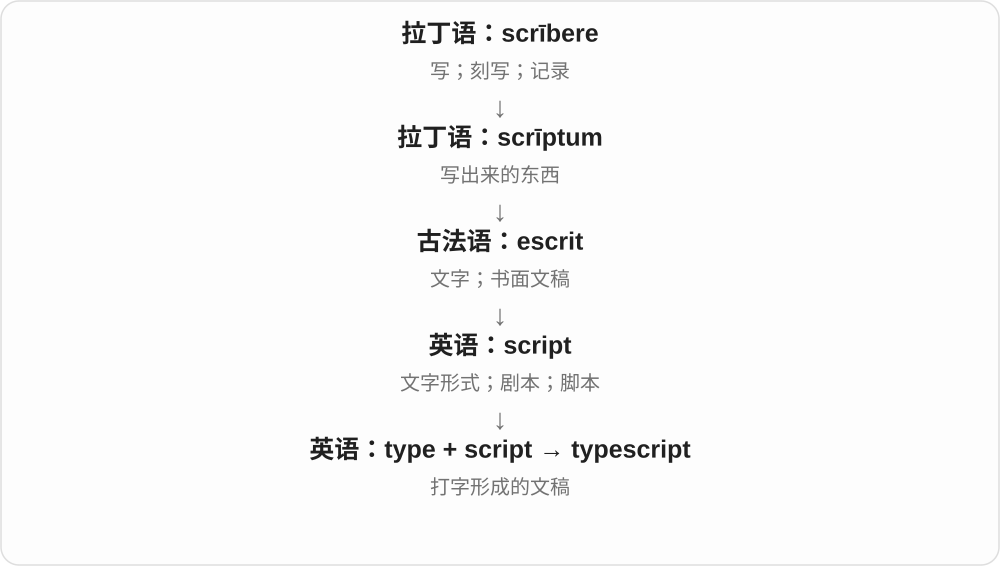

# 0371 · typ- (ΤΥΠ) — 敲出的印记；形状、样式；类型；字模

[逐词精讲目录](../00_逐词精讲目录.md) · [总目录](../00_总目录_按常用程度.md)

## 核心词根与来源

希腊 typos 原有敲击、印痕和形状等意思，联系 typtein / typtō“敲打”。它经拉丁及法语等路径进入英语，又作为构词材料参加现代科学和技术词的形成。每条支线看清 type 究竟是类型、印迹、字模还是命名参照，就不必硬背一串抽象中文。

**先想一块印章压在软泥上：一下敲压留下一个形状。这个形状能成为样式、模型，也能成为分辨种类的依据。**

印下的样子走向 type 类型；可重复印字的模子走向打字与排印；先做的样子是 prototype；固定印版反复复制的比喻形成 stereotype。

- **日常类型与典型**：type, typical, typically, atypical, atypically, typify, typification, subtype, typology, typological
- **原型、模板与刻板印象**：prototype, prototypical, archetype, archetypal, ectype, stereotype, stereotypical, stereotyped, stereotyping, typecast
- **打字与文字排印**：typing, typist, typewriter, typewritten, typescript, typeface, typeset, typography, typographic, typographical, typographer, linotype, monotype, teletype, logotype
- **性状与类型关系**：phenotype, phenotypic, ecotype, monotypic, heterotypic, homotypic, heterotype, homotype, homeotypic, schizotypic
- **名称与标本参照**：holotype, isotype, paratype, syntype, lectotype, paralectotype, neotype, epitype, allotype, ergatotype

## 词形与演化规律

type 保留 /taɪp/，typical、typify 及许多 -typic 词中常见 /tɪp/。-type、typ-、typo- 可与其他构件组合。古代已成整词的 prototype 与现代科技构词 ecotype 的历史层次不同，不能都画成现代英语 type 先加前缀。

## 单词速览（常用到不常用）

| 单词 | 音标 | 核心意思 |
|---|---|---|
| [type](#w-1) | /taɪp/ | 类型；字模、印刷字体；打字；模式〔生物命名〕 |
| [typically](#w-2) | /ˈtɪpɪkli/，亦 /ˈtɪpɪkəli/ | 通常；典型地；一贯如此地 |
| [typical](#w-3) | /ˈtɪpɪkəl/ | 典型的；通常的；有某人一贯特点的 |
| [typing](#w-4) | /ˈtaɪpɪŋ/ | 打字；键入；分型；类型标注〔计算机等〕 |
| [prototype](#w-5) | 英 /ˈprəʊtətaɪp/；美 /ˈproʊtəˌtaɪp/ | 原型；试制模型；制作原型 |
| [stereotype](#w-6) | 英 /ˈsteriətaɪp/；美 /ˈsteriəˌtaɪp/ | 刻板印象；固定模式；按刻板印象看待 |
| [typewriter](#w-7) | 英 /ˈtaɪpraɪtə/；美 /ˈtaɪpraɪtər/ | 打字机 |
| [stereotypical](#w-8) | /ˌsteriəˈtɪpɪkəl/ | 刻板印象式的；符合固定俗套的 |
| [atypical](#w-9) | /eɪˈtɪpɪkəl/ | 不典型的；不合通常模式的 |
| [phenotype](#w-10) | 英 /ˈfiːnəʊtaɪp/；美 /ˈfiːnoʊˌtaɪp/ | 表型；可观察的性状；测定表型 |
| [typography](#w-11) | 英 /taɪˈpɒɡrəfi/；美 /taɪˈpɑːɡrəfi/ | 文字排印；字体编排；排版效果 |
| [archetype](#w-12) | 英 /ˈɑːkɪtaɪp/；美 /ˈɑːrkɪtaɪp/ | 原型；经典模式；某类事物的典型 |
| [stereotyping](#w-13) | 英 /ˈsteriətaɪpɪŋ/；美 /ˈsteriəˌtaɪpɪŋ/ | 套用刻板印象；把人定型的做法 |
| [archetypal](#w-14) | 英 /ˌɑːkɪˈtaɪpəl/；美 /ˌɑːrkɪˈtaɪpəl/，亦首音节重读 | 原型的；极有代表性的 |
| [typeface](#w-15) | /ˈtaɪpˌfeɪs/ | 字体设计；字样体系 |
| [subtype](#w-16) | 英、美 /ˈsʌbtaɪp/ | 亚型；子类型 |
| [stereotyped](#w-17) | 英 /ˈsteriətaɪpt/；美 /ˈsteriəˌtaɪpt/ | 被定型的；模式化的；刻板重复的 |
| [typographical](#w-18) | /ˌtaɪpəˈɡræfɪkəl/ | 排印的；文字编排的；打字造成的 |
| [holotype](#w-19) | 英 /ˈhɒlətaɪp/；美 /ˈhɑːləˌtaɪp/，亦 /ˈhoʊləˌtaɪp/ | 正模；最初确定的名称参照标本 |
| [phenotypic](#w-20) | 英 /ˌfiːnəʊˈtɪpɪk/；美 /ˌfiːnoʊˈtɪpɪk/ | 表型的；涉及可观察性状的 |
| [typology](#w-21) | 英 /taɪˈpɒlədʒi/；美 /taɪˈpɑːlədʒi/ | 类型学；类型分类体系；预表解释〔神学〕 |
| [typist](#w-22) | /ˈtaɪpɪst/ | 打字员；打字的人 |
| [typescript](#w-23) | /ˈtaɪpskrɪpt/ | 打字稿 |
| [prototypical](#w-24) | 英 /ˌprəʊtəˈtɪpɪkəl/；美 /ˌproʊtəˈtɪpɪkəl/ | 原型的；最具代表性的；典型的 |
| [typecast](#w-25) | 英 /ˈtaɪpkɑːst/；美 /ˈtaɪpkæst/ | 让演员反复演同类角色；把人定型；强制类型转换〔计算机〕 |
| [typographic](#w-26) | 英 /ˌtaɪpəˈɡræfɪk/；美 /ˌtaɪpəˈɡræfɪk/ | 排印的；文字编排的 |
| [linotype](#w-27) | 英 /ˈlaɪnətaɪp/；美 /ˈlaɪnəˌtaɪp/ | 莱诺整行铸排机；整行铸排的字条；用该机排字 |
| [monotype](#w-28) | 英 /ˈmɒnətaɪp/；美 /ˈmɑːnoʊˌtaɪp/ | 独幅版画；单字铸排机；单型分类群 |
| [teletype](#w-29) | /ˈtelɪtaɪp/ | 电传打字机；电传打字；用电传打字机发送 |
| [typeset](#w-30) | /ˈtaɪpset/ | 排版；用字模或软件编排文字；已排版的 |
| [typewritten](#w-31) | 英 /ˈtaɪpˌrɪtən/；美 /ˈtaɪpˌrɪtən/ | 打字机打出的；打字形成的 |
| [typological](#w-32) | 英 /ˌtaɪpəˈlɒdʒɪkəl/；美 /ˌtaɪpəˈlɑːdʒɪkəl/ | 类型学的；按类型比较的；预表解释的 |
| [typify](#w-33) | /ˈtɪpɪfaɪ/ | 成为……的典型；集中体现；用形象代表 |
| [atypically](#w-34) | /eɪˈtɪpɪkli/，亦 /eɪˈtɪpɪkəli/ | 一反常态地；不典型地 |
| [isotype](#w-35) | /ˈaɪsətaɪp/ | 等模〔植物命名〕；同种型、抗体类别〔免疫学〕 |
| [logotype](#w-36) | 英 /ˈləʊɡəʊtaɪp/；美 /ˈloʊɡoʊˌtaɪp/ | 文字标志；标识；连字字模〔印刷史〕 |
| [monotypic](#w-37) | 英 /ˌmɒnəʊˈtɪpɪk/；美 /ˌmɑːnoʊˈtɪpɪk/ | 单型的；只含一个下级分类单元的 |
| [paratype](#w-38) | /ˈpærətaɪp/ | 副模；原始模式系列中正模以外的标本〔动物命名〕 |
| [typographer](#w-39) | 英 /taɪˈpɒɡrəfə/；美 /taɪˈpɑːɡrəfər/ | 文字排印师；排版设计者；排字工 |
| [lectotype](#w-40) | /ˈlektətaɪp/ | 选模；后来从原始材料中选定的名称参照 |
| [ecotype](#w-41) | 英 /ˈiːkətaɪp/；美 /ˈiːkəˌtaɪp/，亦首音节 /ek/ | 生态型；适应特定环境的种内群体 |
| [heterotypic](#w-42) | 英 /ˌhetərəʊˈtɪpɪk/；美 /ˌhetəroʊˈtɪpɪk/ | 异型的；不同类型之间的；异模的〔命名〕 |
| [syntype](#w-43) | /ˈsɪntaɪp/ | 总模；共同承担名称参照的一组原始标本中的任一件 |
| [homotypic](#w-44) | 英 /ˌhəʊməˈtɪpɪk/；美 /ˌhoʊməˈtɪpɪk/ | 同型的；同模的〔命名〕 |
| [neotype](#w-45) | 英 /ˈniːəʊtaɪp/；美 /ˈniːəˌtaɪp/ | 新模；原有名称参照材料不存在时另指定的模式 |
| [typification](#w-46) | /ˌtɪpɪfɪˈkeɪʃən/ | 典型化；用类型来认识事物；模式指定〔生物命名〕 |
| [allotype](#w-47) | /ˈælətaɪp/ | 配模、异性模式〔动物学〕；同种异型〔免疫学〕 |
| [ectype](#w-48) | /ˈektaɪp/ | 摹本；复制品；印模印出的形象〔少用〕 |
| [epitype](#w-49) | /ˈepɪtaɪp/〔按 epi- 与 type 的读音组合〕 | 附加解释模式、附加模式〔植物命名〕 |
| [ergatotype](#w-50) | 英 /ˈɜːɡətətaɪp/；美 /ˈɜːrɡətəˌtaɪp/〔按 ergato- 与 type 的读音组合〕 | 工级型标本；用于展示工蚁等工级形态的标本〔少用〕 |
| [heterotype](#w-51) | 英 /ˈhetərəʊtaɪp/；美 /ˈhetəroʊˌtaɪp/〔按 hetero- 与 type 的读音组合〕 | 异型；减数第一次分裂的旧称或相关阶段〔少用〕 |
| [homeotypic](#w-52) | 英 /ˌhəʊmɪəʊˈtɪpɪk/；美 /ˌhoʊmiəˈtɪpɪk/ | 同型分裂的；减数第二次分裂的〔旧细胞学〕 |
| [homotype](#w-53) | 英 /ˈhɒmətaɪp/，亦 /ˈhəʊmətaɪp/；美 /ˈhoʊməˌtaɪp/ | 同型结构；基本构造相对应的部分〔少用〕 |
| [paralectotype](#w-54) | 英 /ˌpærəˈlektətaɪp/；美 /ˌpærəˈlektəˌtaɪp/〔按 para- 与 lectotype 的读音组合〕 | 副选模；选定选模后剩余的原总模〔动物命名〕 |
| [schizotypic](#w-55) | /ˌskɪtsəˈtɪpɪk/〔按 schizo- 与 typic 的读音组合〕 | 分裂型的；与分裂型特质有关的〔心理、精神医学〕 |

## 逐词讲解

### 1. type — 类型；字模、印刷字体；打字；模式〔生物命名〕

**音标**：/taɪp/

**先抓住这个画面**

印模压下去会留下一个样子；由这个样子，我们可以认出它属于哪一类。印刷则直接用小字模留下文字。

**怎么拆**

希腊 typos“敲出的印记、样式”经拉丁 typus 进入英语；现代打字动词由名词延伸。不能把所有技术义都缩成“典型例子”。

**怎么变成今天的意思**

**古希腊 typtein / typtō → typos**  
敲击 → 打出的印记；形状、样式

↓

**拉丁 typus → 中古英语 type → 英语 type**  
形象、象征 → 类型；印刷字模；后有打字动词

a type of music 一类音乐；type a message 输入消息；large type 大字号。数据类型约束可用的值或操作。生物命名的 type 是名称的参照依据，不保证是长得最典型的个体。

**常见搭配与例句**

a type of；blood type；type on a keyboard；not my type。

> What type of music do you listen to?

你平时听哪类音乐？

> Please type your name in the box.

请在框中输入你的名字。

> The leaflet uses large type for easier reading.

传单采用大字号，方便阅读。

**别混淆**

kind 与 type 都可指种类；type 还连接印刷和技术分类。文本统计中 type 数不同词形，token 数实际出现次数。

### 2. typically — 通常；典型地；一贯如此地

**音标**：/ˈtɪpɪkli/，亦 /ˈtɪpɪkəli/

**先抓住这个画面**

先有一个熟悉的样子，再说事情通常按这个样子发生，或某次表现很符合一个人的一贯作风。

**怎么拆**

英语 typical + -ly；形容词变副词，常把中间弱读元音省去。

**怎么变成今天的意思**

**古希腊 typtein / typtō → typos**  
敲击 → 打出的印记；形状、样式

↓

**希腊 typikos → 后期拉丁 typicus → 中世纪 typicalis**  
与类型、象征有关的

↓

**英语 typical**  
典型的、有代表性的；通常的

↓

**英语 typical + -ly → typically**  
典型的 → 通常；有典型特点地

The trip typically takes an hour 是通常耗时一小时；typically generous 是一贯慷慨。放句首还可评论某人的作风，有时带欣赏，有时带抱怨。

**常见搭配与例句**

typically takes；typically found in；typically generous。

> The museum is typically quiet on weekday mornings.

这家博物馆在工作日上午通常很安静。

> In a typically generous gesture, she paid for everyone’s lunch.

她一如既往地慷慨，付了大家的午餐费。

**别混淆**

always 表每次都如此；typically 保留例外。normally 更侧重平常状态，typically 也能强调辨识度很高的特点。

### 3. typical — 典型的；通常的；有某人一贯特点的

**音标**：/ˈtɪpɪkəl/

**先抓住这个画面**

看到这个例子，就能想到这一类通常是什么样，或者某个人一向会怎么做。

**怎么拆**

经中世纪拉丁 typicalis，接 typicus 与希腊 typikos。现代看得出 type + -ical 的关系，历史上形容词有独立拉丁借入链。

**怎么变成今天的意思**

**古希腊 typtein / typtō → typos**  
敲击 → 打出的印记；形状、样式

↓

**希腊 typikos → 后期拉丁 typicus → 中世纪 typicalis**  
与类型、象征有关的

↓

**英语 typical**  
典型的、有代表性的；通常的

typical of the region 是当地的典型特征；It’s typical of him to help 是这很符合他一贯乐于助人的作风。单说 Typical! 也可带“果然又这样”的抱怨。

**常见搭配与例句**

typical of；a typical example；a typical day。

> The house is typical of local architecture.

这栋房子很能代表当地建筑风格。

> It is typical of her to check every detail.

她一向如此，会检查每一个细节。

**别混淆**

average 可指数值平均或水平一般；typical 说有代表性，不要求恰好等于平均数。

### 4. typing — 打字；键入；分型；类型标注〔计算机等〕

**音标**：/ˈtaɪpɪŋ/

**先抓住这个画面**

手指把字一个个送进机器，是打字；把对象放进明确类别，则是技术语境的分型。

**怎么拆**

英语 type + -ing；type 的打字义和分类义各形成自己的名词、分词用法，不要只记一个中文义。

**怎么变成今天的意思**

**古希腊 typtein / typtō → typos**  
敲击 → 打出的印记；形状、样式

↓

**拉丁 typus → 中古英语 type → 英语 type**  
形象、象征 → 类型；印刷字模；后有打字动词

↓

**英语 type + -ing → typing**  
打字过程；确定类型的过程

typing speed 是打字速度；blood typing 是血型鉴定；static typing 是计算机语言中的静态类型机制。这些都借 type，但“键盘敲得静态”当然不是 static typing 的意思。

**常见搭配与例句**

typing speed；touch typing；blood typing；static typing。

> Regular practice improved her typing speed.

经常练习提高了她的打字速度。

> The tutorial explains static typing with a few small programs.

教程用几个小程序解释静态类型机制。

**别混淆**

typesetting 是安排页面文字版式；typing 常是输入文字。技术义要看所分的究竟是什么类型。

### 5. prototype — 原型；试制模型；制作原型

**音标**：英 /ˈprəʊtətaɪp/；美 /ˈproʊtəˌtaɪp/

**先抓住这个画面**

先做出一个能供观察、尝试和改动的样子，再据此决定后面的成品怎么做。

**怎么拆**

希腊 prōtos 最初 + typos 样式，经后期拉丁或法语借入。现代可拆 proto- + type；不是任何旧东西都叫 prototype。

**怎么变成今天的意思**

**古希腊 typtein / typtō → typos**  
敲击 → 打出的印记；形状、样式

↓

**希腊 prōtos“最初” + typos → prōtotypos / prōtotypon**  
最初的样式、原型

↓

**后期拉丁 prototypon／法语 prototype → 英语 prototype**  
原型、最初模型；后用于试制模型

工程中的 prototype 可以只试一个关键功能，不必像成品那样齐全。心理与语言研究也可用它说某类别最有代表性的例子；动词 prototype 表制作原型。

**常见搭配与例句**

build a prototype；a working prototype；prototype an interface。

> The team built a prototype to test the folding mechanism.

团队制作了一个原型来测试折叠机构。

> We prototyped the interface before writing the full application.

我们先制作界面原型，再编写完整应用。

**别混淆**

archetype 常说深层、经典模式；prototype 在设计语境常是一件可测试的早期模型。

### 6. stereotype — 刻板印象；固定模式；按刻板印象看待

**音标**：英 /ˈsteriətaɪp/；美 /ˈsteriəˌtaɪp/

**先抓住这个画面**

像一整块印版反复印同一张图，把不同的人也当成会复制出同一种样子的模板。

**怎么拆**

借法语 stéréotype，stereo- 接希腊 stereos“坚固”，type 是字模。先指整块印版及其印刷，再引申不变的形象和对群体的简化看法。

**怎么变成今天的意思**

**古希腊 typtein / typtō → typos**  
敲击 → 打出的印记；形状、样式

↓

**希腊 stereos“坚固” + 法语 type → stéréotype**  
固定成整块的印版

↓

**英语 stereotype〔名词，后转动词〕**  
整版印刷 → 不变的形象 → 刻板看法、按定型看待

可以是职业、年龄或其他群体的刻板形象，也可能是看似夸奖的笼统看法。重点是忽略个体差异、把固定描述套上去；并非所有概括都自动等于 stereotype。

**常见搭配与例句**

challenge a stereotype；a stereotype about；stereotype someone as。

> The novel challenges the stereotype of the absent-minded scientist.

小说挑战了科学家总是心不在焉的刻板形象。

> She did not want to be stereotyped as someone who disliked change.

她不想被定型为一个讨厌改变的人。

**别混淆**

archetype 是用来讨论基本模式的概念；stereotype 常批评模式被机械地套到具体人身上。

### 7. typewriter — 打字机

**音标**：英 /ˈtaɪpraɪtə/；美 /ˈtaɪpraɪtər/

**先抓住这个画面**

按一个键，让对应字形通过机械或电动装置印到纸上，文字一行行出现。

**怎么拆**

英语 type 字模、印刷字符 + writer 写字者或装置。writer 在组合中变成替人写字的机器。

**怎么变成今天的意思**

**古希腊 typtein / typtō → typos**  
敲击 → 打出的印记；形状、样式

↓

**拉丁 typus → 中古英语 type → 英语 type**  
形象、象征 → 类型；印刷字模；后有打字动词

↓

**英语 type + writer → typewriter**  
用字模写字的装置 → 打字机

传统打字机直接在纸上留下字，改错方式与文字处理软件不同。旧文偶尔也用来指打字的人，但现代通常指机器。

**常见搭配与例句**

a manual typewriter；a typewriter ribbon；a portable typewriter。

> The novelist kept an old typewriter on her desk.

小说家在桌上保留了一台旧打字机。

> He replaced the ribbon in the typewriter.

他更换了打字机的色带。

**别混淆**

keyboard 是输入用的键盘部件；typewriter 是整台把文字打到纸上的机器。

### 8. stereotypical — 刻板印象式的；符合固定俗套的

**音标**：/ˌsteriəˈtɪpɪkəl/

**先抓住这个画面**

一个人物或描述像照着大家熟悉的固定模板做出来，复杂的个性被压成几条标签。

**怎么拆**

英语 stereotype + -ical；固定印版的比喻经 stereotype 进入这一形容词。

**怎么变成今天的意思**

**古希腊 typtein / typtō → typos**  
敲击 → 打出的印记；形状、样式

↓

**希腊 stereos“坚固” + 法语 type → stéréotype**  
固定成整块的印版

↓

**英语 stereotype〔名词，后转动词〕**  
整版印刷 → 不变的形象 → 刻板看法、按定型看待

↓

**英语 stereotype + -ical → stereotypical**  
刻板印象的；符合刻板模式的

a stereotypical villain 可以是脸谱化反派；stereotypical assumptions 是带着固定成见的假定。说它常表示简化和俗套，不只表示具有代表性。

**常见搭配与例句**

a stereotypical image；a stereotypical portrayal；stereotypical assumptions。

> The writer replaced the stereotypical villain with a more complex character.

作者把脸谱化的反派改成了更复杂的人物。

> The campaign questioned stereotypical ideas about retirement.

这项活动质疑了人们对退休生活的刻板观念。

**别混淆**

typical 可以中性地说典型；stereotypical 额外让人想到固定、简化、重复套用的模式。

### 9. atypical — 不典型的；不合通常模式的

**音标**：/eɪˈtɪpɪkəl/

**先抓住这个画面**

你原本以为这一类通常长这样、会这样做，眼前这个却偏离了那个惯常样子。

**怎么拆**

否定 a- + typical，不是冠词 a 和后面的词偶然连写。

**怎么变成今天的意思**

**古希腊 typtein / typtō → typos**  
敲击 → 打出的印记；形状、样式

↓

**希腊 typikos → 后期拉丁 typicus → 中世纪 typicalis**  
与类型、象征有关的

↓

**英语 typical**  
典型的、有代表性的；通常的

↓

**英语 a- + typical → atypical**  
不符合通常类型的

an atypical response 是不常见的反应，可能好也可能不好。用它时应有比较背景：对哪个人、哪种环境、哪类事物而言不典型。

**常见搭配与例句**

atypical of；an atypical example；an atypical pattern。

> Such a long silence was atypical of him.

他很少像这样沉默这么久。

> The survey year was atypical because of the unusually wet summer.

调查的那一年因夏季格外多雨而不具代表性。

**别混淆**

unusual 泛指不常见；atypical 更明确地对照某个群体或惯常模式。它本身不等于错误。

### 10. phenotype — 表型；可观察的性状；测定表型

**音标**：英 /ˈfiːnəʊtaɪp/；美 /ˈfiːnoʊˌtaɪp/

**先抓住这个画面**

遗传信息与环境共同作用，最终表现出来的身高、颜色、代谢或其他可测特征。

**怎么拆**

现代遗传学词：德语 Phänotypus 经英语采用，希腊来源 pheno- 表显现，-type 表型。不是古希腊已有现代遗传学的同名概念。

**怎么变成今天的意思**

**古希腊 typtein / typtō → typos**  
敲击 → 打出的印记；形状、样式

↓

**希腊来源 pheno-“显现” + typus → 德语 Phänotypus**  
显现出来的性状类型；Johannsen 的遗传学术语

↓

**英语 phenotype**  
可观察、可测量的生物性状

“可观察”包括通过仪器测量，不限于肉眼外貌；血型、酶活性也可属于表型。动词 phenotype 可说测定、描述样品的相关性状。

**常见搭配与例句**

a visible phenotype；phenotypic traits；phenotype the samples。

> The plants had similar genotypes but different phenotypes under different growing conditions.

这些植物的基因型相近，却在不同生长条件下表现出不同表型。

> The researchers recorded leaf colour as one aspect of the phenotype.

研究人员把叶片颜色记录为表型的一个方面。

**别混淆**

genotype 说遗传构成；phenotype 说表现出来的性状，不能把环境因素完全拿掉。

### 11. typography — 文字排印；字体编排；排版效果

**音标**：英 /taɪˈpɒɡrəfi/；美 /taɪˈpɑːɡrəfi/

**先抓住这个画面**

决定文字用什么字形、多大、行间隔多少、怎样排，让读者能顺着文字看下去。

**怎么拆**

经法语 typographie 接中世纪拉丁 typographia，以希腊 typos 与写字成分 -grapheia 构成。现代可看 type + -o- + -graphy，但不是英语临时把三块拼出。

**怎么变成今天的意思**

**古希腊 typtein / typtō → typos**  
敲击 → 打出的印记；形状、样式

↓

**希腊 typos + 写字成分 -grapheia → 中世纪拉丁 typographia**  
字模、印刷文字的编排

↓

**法语 typographie → 英语 typography**  
文字排印的技艺、效果

网页、书籍和海报都涉及 typography；它不限于挑一个好看的字体，还包括层级、间距、对齐和阅读节奏。

**常见搭配与例句**

clear typography；typography design；the typography of a page。

> Clear typography makes the instructions easier to follow.

清晰的文字编排让说明更容易读懂。

> She adjusted the spacing to improve the page’s typography.

她调整了间距，改善页面的排版效果。

**别混淆**

typeface 是一套字形设计；typography 是如何选择和组织文字，范围更广。

### 12. archetype — 原型；经典模式；某类事物的典型

**音标**：英 /ˈɑːkɪtaɪp/；美 /ˈɑːrkɪtaɪp/

**先抓住这个画面**

许多故事或事物背后仿佛共享一个基本模子，比如引导主人公的导师、踏上旅程的英雄。

**怎么拆**

希腊 archē 起源 + typos 样式 → archetypon，经拉丁及法语路径进入英语。arch- 在这里不是拱形，也不是考古学的随意缩写。

**怎么变成今天的意思**

**古希腊 typtein / typtō → typos**  
敲击 → 打出的印记；形状、样式

↓

**希腊 archē“起源” + typos → archetypon**  
原初样式、模型

↓

**拉丁 archetypum；亦经法语 architipe → 英语 archetype**  
原型、典型模式

文学里可讨论人物模式，普通语境也可说某人体现一类事物的典型。荣格心理学中的原型属于其集体无意识理论，不应直接写成所有心理学已证实的共同事实。

**常见搭配与例句**

the archetype of；a literary archetype；the hero archetype。

> The wise guide is a familiar archetype in adventure stories.

智慧的引路者是冒险故事中常见的原型。

> Critics describe the building as an archetype of the modern museum.

评论家把这栋建筑描述为现代博物馆的典型范式。

**别混淆**

prototype 常是先做来测试的具体模型；archetype 常是其他实例反复表现出来的基础模式。

### 13. stereotyping — 套用刻板印象；把人定型的做法

**音标**：英 /ˈsteriətaɪpɪŋ/；美 /ˈsteriəˌtaɪpɪŋ/

**先抓住这个画面**

还没认真了解眼前这个人，就把脑中的群体模板盖到他身上；这个盖模板的过程就是 stereotyping。

**怎么拆**

英语 stereotype + -ing，指正在做的动作或把该动作作为一件事讨论；历史印刷语境也可保留铸造整版的过程义。

**怎么变成今天的意思**

**古希腊 typtein / typtō → typos**  
敲击 → 打出的印记；形状、样式

↓

**希腊 stereos“坚固” + 法语 type → stéréotype**  
固定成整块的印版

↓

**英语 stereotype〔名词，后转动词〕**  
整版印刷 → 不变的形象 → 刻板看法、按定型看待

↓

**英语 stereotype + -ing → stereotyping**  
按固定印象看待的过程；旧印刷工艺过程

avoid stereotyping 是提醒人留意个体差异。研究可以讨论这种思考习惯如何形成和影响判断；词本身不意味着只有负面标签才会成为刻板印象。

**常见搭配与例句**

avoid stereotyping；age stereotyping；stereotyping in the media。

> The workshop used individual stories to challenge age stereotyping.

工作坊用个人故事挑战按年龄定型的做法。

> Good interviewing requires listening carefully and avoiding stereotyping.

好的访谈需要认真倾听，避免把人套进刻板印象。

**别混淆**

stereotype 可以指脑中的固定看法；stereotyping 说形成或套用这些看法的过程。

### 14. archetypal — 原型的；极有代表性的

**音标**：英 /ˌɑːkɪˈtaɪpəl/；美 /ˌɑːrkɪˈtaɪpəl/，亦首音节重读

**先抓住这个画面**

某个人或故事像把这一类最核心的特点集中到了一起，一看就让人想到那个基本模式。

**怎么拆**

英语 archetype + -al，名词变成相关形容词；不是希腊语先有这个英语结尾。

**怎么变成今天的意思**

**古希腊 typtein / typtō → typos**  
敲击 → 打出的印记；形状、样式

↓

**希腊 archē“起源” + typos → archetypon**  
原初样式、模型

↓

**拉丁 archetypum；亦经法语 architipe → 英语 archetype**  
原型、典型模式

↓

**英语 archetype + -al → archetypal**  
原型 → 原型性的、很有代表性的

an archetypal hero 可说具备经典英雄模式的人物；the archetypal village pub 强调很符合人们对乡村酒馆的典型想象。

**常见搭配与例句**

an archetypal character；an archetypal example。

> The film presents an archetypal journey from home into the unknown.

电影呈现了一段从家园走向未知世界的经典旅程模式。

> The cottage is an archetypal example of the region’s rural architecture.

这间村舍是当地乡村建筑极有代表性的例子。

**别混淆**

typical 通常说常见或有代表性；archetypal 常更强调浓缩、经典的基本模式。

### 15. typeface — 字体设计；字样体系

**音标**：/ˈtaɪpˌfeɪs/

**先抓住这个画面**

把一套字母放在一起看，它们的笔画粗细、衬线和比例有同一家族的风格，这套设计是 typeface。

**怎么拆**

type（印刷字模、字）+ face（正面），最初联系印刷字模呈现字形的那一面。

**怎么变成今天的意思**

金属字模的印刷面带出字符样貌，后来指整套字形设计。数字环境保留了这个名称。

**常见搭配与例句**

a serif typeface；choose a typeface；a readable typeface。

> The designer chose a simple typeface for the signs.

设计师为标牌选择了一套简洁字体。

> This typeface remains readable at small sizes.

这套字体在小字号下仍然容易辨认。

**别混淆**

严格区分时 typeface 是设计，font 是其具体字体实例或文件；日常两词常混用。

### 16. subtype — 亚型；子类型

**音标**：英、美 /ˈsʌbtaɪp/

**先抓住这个画面**

先归到一个大类型，再按更细的特点分出一种。

**怎么拆**

sub- + type“类型”，英语构词。

**怎么变成今天的意思**

**拉丁语：sub**  
在下面；从下向上；靠近

↓

**英语前缀：sub-**  
下方；下一级；低于某个标准

↓

**英语：sub- + type → subtype**  
某类型内部更细的分类

可以用于疾病、语言或程序设计。医学亚型按某种特征划分；编程中的子类型有具体兼容规则，不能只靠名字相似认定。

**常见搭配与例句**

a rare subtype；a subtype of…。

> The study focused on one subtype of the disease.

研究聚焦于这种疾病的一个亚型。

> The documentation explains how each subtype differs from the base type.

文档说明了每个子类型与基础类型的差别。

**别混淆**

subgroup 是群体中的分组；subtype 强调分类标准下的类型。

### 17. stereotyped — 被定型的；模式化的；刻板重复的

**音标**：英 /ˈsteriətaɪpt/；美 /ˈsteriəˌtaɪpt/

**先抓住这个画面**

某个人被反复贴上同一标签，或一种表达一次次重复，像从同一块印版压出来。

**怎么拆**

英语 stereotype 的过去式、过去分词与相关形容词，-ed 在 /p/ 后读 /t/。

**怎么变成今天的意思**

**古希腊 typtein / typtō → typos**  
敲击 → 打出的印记；形状、样式

↓

**希腊 stereos“坚固” + 法语 type → stéréotype**  
固定成整块的印版

↓

**英语 stereotype〔名词，后转动词〕**  
整版印刷 → 不变的形象 → 刻板看法、按定型看待

↓

**英语 stereotype + -ed → stereotyped**  
被按固定形象看待；固定重复的

be stereotyped as 强调被别人定型；a stereotyped reply 是缺少变化、像套话的答复。两者都能联系固定模板，却不必都在谈群体偏见。

**常见搭配与例句**

be stereotyped as；a stereotyped response；stereotyped roles。

> She felt stereotyped as the quiet member of the team.

她觉得自己被固定看成团队中沉默的那个人。

> The official gave a stereotyped reply that answered none of the questions.

那位官员给了一个套话式答复，一个问题也没回答。

**别混淆**

stereotypical 常形容符合某刻板印象；stereotyped 更容易突出被定型的结果或机械重复。

### 18. typographical — 排印的；文字编排的；打字造成的

**音标**：/ˌtaɪpəˈɡræfɪkəl/

**先抓住这个画面**

问题出在文字被怎样打出、排出、显示出来，或设计有意利用这些形式。

**怎么拆**

历史接新拉丁 typographicus + -al，与 typographic 对应；现代也可看 typographic + -al，但较长词并不因此必定在英语中出现更晚。

**怎么变成今天的意思**

**古希腊 typtein / typtō → typos**  
敲击 → 打出的印记；形状、样式

↓

**希腊来源 typ- + graph- → 新拉丁 typographicus**  
印刷、排印的

↓

**英语 typographical〔-al 形容词形式〕**  
与文字排印有关的

typographical error 常简称 typo，例如把字母顺序打反。也可说 typographical conventions，指排印惯例；并非这个形容词本身就表示错误。

**常见搭配与例句**

a typographical error；typographical conventions；typographical design。

> A typographical error changed the year from 2016 to 2061.

一个打字错误把年份从 2016 变成了 2061。

> The journal follows strict typographical conventions for equations.

这本期刊对公式采用严格的排印规范。

**别混淆**

typographic 与 typographical 大体同义；typographical error 是非常常见的固定搭配。

### 19. holotype — 正模；最初确定的名称参照标本

**音标**：英 /ˈhɒlətaɪp/；美 /ˈhɑːləˌtaɪp/，亦 /ˈhoʊləˌtaɪp/

**先抓住这个画面**

发表一个新物种名称时，确定这一件标本作为名称的固定参照，后来有争议便回来看它。

**怎么拆**

现代科学构词 holo- 全、完整 + type 模式；词义由命名规则限定，不是“身体必须完整的标本”。

**怎么变成今天的意思**

**古希腊 typtein / typtō → typos**  
敲击 → 打出的印记；形状、样式

↓

**科学构词 holo- + -type → holotype**  
名称原始发表时固定的单一模式

动物命名中，它是在名称建立时固定的单件标本；可能只是保存下来的骨骼或其他部分。它的作用是固定名称，不是证明这一件在体型、颜色上最有代表性。

**常见搭配与例句**

designate a holotype；the holotype specimen；the holotype is deposited in。

> The author designated one preserved beetle as the holotype.

作者指定了一只保存的甲虫作为正模。

> The museum keeps the holotype in a specially labelled drawer.

博物馆把正模保存在专门标注的抽屉里。

**别混淆**

paratype 可辅助展示原始材料的差异；holotype 承担名称参照的关键身份。

### 20. phenotypic — 表型的；涉及可观察性状的

**音标**：英 /ˌfiːnəʊˈtɪpɪk/；美 /ˌfiːnoʊˈtɪpɪk/

**先抓住这个画面**

讨论的是生物实际表现出的特征，比如叶片形状变化，而不是只比较 DNA 的字母排列。

**怎么拆**

phenotype + -ic，构成形容词；重音移到 -typ-，type 的 /aɪ/ 也变为 /ɪ/。

**怎么变成今天的意思**

**古希腊 typtein / typtō → typos**  
敲击 → 打出的印记；形状、样式

↓

**希腊来源 pheno-“显现” + typus → 德语 Phänotypus**  
显现出来的性状类型；Johannsen 的遗传学术语

↓

**英语 phenotype**  
可观察、可测量的生物性状

↓

**英语 phenotype + -ic → phenotypic**  
表型 → 表型方面的

phenotypic variation 是表型差异；phenotypic plasticity 指同一基因型在不同环境中能表现出不同性状。差异可能与遗传、环境或其相互作用有关。

**常见搭配与例句**

phenotypic variation；phenotypic traits；phenotypic plasticity。

> The study measured phenotypic differences in leaf shape.

这项研究测量了叶片形状的表型差异。

> The species shows phenotypic plasticity in response to light.

这个物种会随光照变化表现出表型可塑性。

**别混淆**

genotypic 聚焦基因型；phenotypic 聚焦表现出来、测量得到的性状。

### 21. typology — 类型学；类型分类体系；预表解释〔神学〕

**音标**：英 /taɪˈpɒlədʒi/；美 /taɪˈpɑːlədʒi/

**先抓住这个画面**

找出事物重复出现的结构，再按这些结构分组；另一条宗教用法则研究早期形象如何预示后来的事。

**怎么拆**

英语 type + -ology“研究”，早期神学里 type 有象征、预表义；后来扩展为按类型研究和分类。

**怎么变成今天的意思**

**古希腊 typtein / typtō → typos**  
敲击 → 打出的印记；形状、样式

↓

**拉丁 typus → 中古英语 type → 英语 type**  
形象、象征 → 类型；印刷字模；后有打字动词

↓

**英语 type + -ology → typology**  
类型或预表的研究 → 分类研究、类型体系

linguistic typology 按语言结构特征比较，不等同于按祖先语言分家族。基督教神学中的 typology 常把旧约人物、事件与新约内容联系为预表。

**常见搭配与例句**

linguistic typology；a typology of housing；biblical typology。

> The article proposes a typology of urban public spaces.

文章提出了一套城市公共空间的类型分类。

> Linguistic typology compares the structural features of languages.

语言类型学比较语言的结构特征。

**别混淆**

taxonomy 多强调分类原则和类别体系，尤其生物分类；typology 常强调按特征组织出的类型模式。

### 22. typist — 打字员；打字的人

**音标**：/ˈtaɪpɪst/

**先抓住这个画面**

把口述、手稿或其他文字转成键盘输入的人，职业名称与一般能力描写都能用。

**怎么拆**

英语 type + -ist，表示从事这项工作的人；远源的印记在这里已走到打字活动。

**怎么变成今天的意思**

**古希腊 typtein / typtō → typos**  
敲击 → 打出的印记；形状、样式

↓

**拉丁 typus → 中古英语 type → 英语 type**  
形象、象征 → 类型；印刷字模；后有打字动词

↓

**英语 type + -ist → typist**  
打字的人、打字员

a fast typist 打字快的人；touch typist 能不看键盘打字的人。并不保证这个人负责文字内容的创作。

**常见搭配与例句**

a skilled typist；a touch typist；a copy typist。

> She became a fast typist through daily practice.

通过每天练习，她打字变得很快。

> The office hired a typist to prepare the handwritten reports.

办公室雇了一位打字员，将手写报告录成文稿。

**别混淆**

writer 可以是作者；typist 主要说输入、誊打的角色。

### 23. typescript — 打字稿

**音标**：/ˈtaɪpskrɪpt/

**先抓住这个画面**

typescript 是用打字方式形成的稿子。想象作者把手写草稿重新打成整齐的页面交给编辑。

**怎么拆**

type（打字）+ script（写成的文本），是英语复合词。

**怎么变成今天的意思**

在出版史、档案和文献研究中，这个词能说明文本的物理形式：是打出来的稿，而不是手写原件或正式印刷本。

**常见搭配与例句**

an original typescript（原始打字稿）；a corrected typescript（带修改的打字稿）；a typescript of a novel（小说打字稿）。

> The archive holds the corrected typescript of the novel.

档案馆保存着这部小说带修改的打字稿。

> She compared the typescript with the handwritten notes.

她把打字稿与手写笔记作了比较。

**别混淆**

manuscript 在现代出版中可泛指稿件；typescript 明确强调打字形式。首字母大写的 TypeScript 还可作编程语言名称。

### 24. prototypical — 原型的；最具代表性的；典型的

**音标**：英 /ˌprəʊtəˈtɪpɪkəl/；美 /ˌproʊtəˈtɪpɪkəl/

**先抓住这个画面**

可以是最初用来照着做的样子，也可以是你一想到某类事物就浮现的代表。

**怎么拆**

英语 prototype + -ical；名词 type 的读音在形容词中变为 /tɪp/，与 typical 相似。

**怎么变成今天的意思**

**古希腊 typtein / typtō → typos**  
敲击 → 打出的印记；形状、样式

↓

**希腊 prōtos“最初” + typos → prōtotypos / prōtotypon**  
最初的样式、原型

↓

**后期拉丁 prototypon／法语 prototype → 英语 prototype**  
原型、最初模型；后用于试制模型

↓

**英语 prototype + -ical → prototypical**  
原型 → 原型性的、代表性的

a prototypical example 往往指特别能代表一类的例子，不一定是年代最早。设计研究里还可讨论真正的原型构造。

**常见搭配与例句**

a prototypical example；a prototypical design。

> For many speakers, a robin is a prototypical bird.

对许多说话者来说，知更鸟是很典型的鸟。

> The paper examines a prototypical design for a compact shelter.

论文考察了一种紧凑型庇护所的原型设计。

**别混淆**

prototype 常是名词具体模型；prototypical 可以形容具有该模型或典型特征。

### 25. typecast — 让演员反复演同类角色；把人定型；强制类型转换〔计算机〕

**音标**：英 /ˈtaɪpkɑːst/；美 /ˈtaɪpkæst/

**先抓住这个画面**

选角时认准一个演员“就适合这种人”，以后不断让他重复；计算里则把值按另一种类型处理。

**怎么拆**

英语 type 类型 + cast；戏剧中 cast 是分配角色，计算中 cast 是转换类型的术语。过去式和过去分词仍为 typecast。

**怎么变成今天的意思**

**古希腊 typtein / typtō → typos**  
敲击 → 打出的印记；形状、样式

↓

**拉丁 typus → 中古英语 type → 英语 type**  
形象、象征 → 类型；印刷字模；后有打字动词

↓

**英语 type + cast → typecast**  
按类型选角、固定角色；计算机中转换类型

be typecast as a villain 是总被安排演反派。计算机中的转换行为和是否改变底层值取决于语言、类型与操作，不宜一概理解成只改标签。

**常见搭配与例句**

be typecast as；avoid being typecast；typecast a value。

> After two detective films, he feared being typecast.

演过两部侦探片后，他担心自己被固定在这类角色中。

> The example typecasts the result to an integer.

例子把结果转换为整数类型。

**别混淆**

stereotype 是广泛地套固定印象；typecast 的演员用法更具体。计算义不涉及性格评价。

### 26. typographic — 排印的；文字编排的

**音标**：英 /ˌtaɪpəˈɡræfɪk/；美 /ˌtaɪpəˈɡræfɪk/

**先抓住这个画面**

把注意力放到字怎样呈现：字形、字号、字距或排印错误都属于这一层。

**怎么拆**

现代可对照 typography 与 -ic；历史词源也追到中世纪拉丁 typographicus，来自 typographus，以希腊 typos 与 graph- 写构成。

**怎么变成今天的意思**

**古希腊 typtein / typtō → typos**  
敲击 → 打出的印记；形状、样式

↓

**希腊来源 typ- + graph- → 中世纪拉丁 typographus / typographicus**  
印刷、印刷的

↓

**英语 typographic〔另可按 typography + -ic 分析〕**  
与排印、字形编排有关的

typographic hierarchy 用字号、粗细等区分标题与正文。typographic error 指打字或排印造成的错误，未必是作者不知道事实。

**常见搭配与例句**

typographic design；typographic hierarchy；a typographic error。

> The designer used a clear typographic hierarchy for the report.

设计师为报告安排了清晰的文字层级。

> The second edition corrected several typographic errors.

第二版改正了几处排印错误。

**别混淆**

typical 是典型的；typographic 是排印的，词形相近但不可换用。

### 27. linotype — 莱诺整行铸排机；整行铸排的字条；用该机排字

**音标**：英 /ˈlaɪnətaɪp/；美 /ˈlaɪnəˌtaɪp/

**先抓住这个画面**

把一行字一次铸成一条金属字条，排版时按整行组织，而不逐个摆放松散字粒。

**怎么拆**

商标 Linotype 通用化，名称联系 line o’ type，即 line of type“一行铅字”；现代也可看 line + -o- + type。

**怎么变成今天的意思**

**古希腊 typtein / typtō → typos**  
敲击 → 打出的印记；形状、样式

↓

**拉丁 typus → 中古英语 type → 英语 type**  
形象、象征 → 类型；印刷字模；后有打字动词

↓

**英语 line of type → 商标 Linotype → 通用 linotype**  
一行字 → 整行铸排机及其字条

历史印刷设备名称，名词既可说机器也可说铸出的字条。动词 linotype 表用这种方法排字，现代日常较少见。

**常见搭配与例句**

a linotype machine；a linotype operator。

> The museum demonstrated how a linotype machine casts a line of type.

博物馆演示了整行铸排机如何铸出一行铅字。

> The newspaper once employed several linotype operators.

这家报社曾雇用多名整行铸排机操作员。

**别混淆**

monotype 铸排设备通常逐字铸造；linotype 的关键在整行铸成一条。

### 28. monotype — 独幅版画；单字铸排机；单型分类群

**音标**：英 /ˈmɒnətaɪp/；美 /ˈmɑːnoʊˌtaɪp/

**先抓住这个画面**

艺术里，一次把板上的颜料转到纸上，主要得到一张独特印迹；铸字机里则强调一个一个地铸字。

**怎么拆**

mono- 一 + type 印迹、字模或类型；艺术名称强调单次印迹，Monotype 铸排机另有商标路线，生物学又用单一类型义。

**怎么变成今天的意思**

**古希腊 typtein / typtō → typos**  
敲击 → 打出的印记；形状、样式

↓

**拉丁 typus → 中古英语 type → 英语 type**  
形象、象征 → 类型；印刷字模；后有打字动词

↓

**英语 mono- + type → monotype〔多条专门用法〕**  
一次主要印迹；单字铸排；单一类型

版画通常只有一次主要清晰印迹，残余颜料仍可印出较淡的第二张，不能说绝不可能再印。生物分类中 a monotype 可指只含一个下级单元的分类群。

**常见搭配与例句**

a monotype print；a Monotype machine；make a monotype。

> The artist made a monotype from ink brushed onto a smooth plate.

艺术家把油墨刷在光滑版面上，制作了一张独幅版画。

> Unlike the linotype, this Monotype machine casts separate characters.

与整行铸排机不同，这台单字铸排机铸造独立字粒。

**别混淆**

linotype 铸整行；Monotype 系统铸单字。monoprint 与 monotype 的艺术用法也有区别，不宜只按“单张”混用。

### 29. teletype — 电传打字机；电传打字；用电传打字机发送

**音标**：/ˈtelɪtaɪp/

**先抓住这个画面**

你在一端敲字，远端机器把收到的信号变回纸上的字，让打字跨越距离。

**怎么拆**

tele- 远距离 + type 打字；美国用法还与 Teletype 商标通用化相连。tele- 说距离，不是必须使用电视。

**怎么变成今天的意思**

**古希腊 typtein / typtō → typos**  
敲击 → 打出的印记；形状、样式

↓

**拉丁 typus → 中古英语 type → 英语 type**  
形象、象征 → 类型；印刷字模；后有打字动词

↓

**英语 tele- + type；Teletype 商标通用化 → teletype**  
远距离传送并打印文字的机器、方式

既可指设备，也能作动词。早期新闻、通信与计算机终端常见这种机器；现代系统里的 tty 名称保留了相关历史。

**常见搭配与例句**

a teletype machine；a teletype message；teletype terminal。

> News reports arrived on the office teletype.

新闻报道通过办公室的电传打字机传来。

> The operator teletyped a short message to the remote station.

操作员向远端站点电传了一条短消息。

**别混淆**

typewriter 通常在本机纸上打字；teletype 能把文字编码信号传给另一端。

### 30. typeset — 排版；用字模或软件编排文字；已排版的

**音标**：/ˈtaɪpset/

**先抓住这个画面**

把一串文字变成准备呈现在页面上的行和段，安排它们的位置与间隔。

**怎么拆**

英语 type 印刷字模 + set 放置、排好；由摆放字粒走到数字文字排版。过去式和过去分词也是 typeset。

**怎么变成今天的意思**

**古希腊 typtein / typtō → typos**  
敲击 → 打出的印记；形状、样式

↓

**拉丁 typus → 中古英语 type → 英语 type**  
形象、象征 → 类型；印刷字模；后有打字动词

↓

**英语 type + set → typeset**  
排列印刷字模 → 编排文字版面

typeset a book 是排一本书的版，不只是把内容键入电脑。电子排版仍需处理换行、字距、页边距等细节。

**常见搭配与例句**

typeset a manuscript；professionally typeset；typeset text。

> The publisher hired a specialist to typeset the book.

出版社聘请了一位专业人员为这本书排版。

> The equations were carefully typeset to avoid ambiguity.

这些公式经过仔细排版，以免产生歧义。

**别混淆**

type 是输入文字；typeset 是把文字组织成可呈现的版面。

### 31. typewritten — 打字机打出的；打字形成的

**音标**：英 /ˈtaɪpˌrɪtən/；美 /ˈtaɪpˌrɪtən/

**先抓住这个画面**

纸上是一行行由机器字形组成的文字，而不是手写笔迹。

**怎么拆**

英语 type + written，written 是 write 的过去分词；也可对应动词 typewrite 的分词。

**怎么变成今天的意思**

**古希腊 typtein / typtō → typos**  
敲击 → 打出的印记；形状、样式

↓

**拉丁 typus → 中古英语 type → 英语 type**  
形象、象征 → 类型；印刷字模；后有打字动词

↓

**英语 type + written / typewrite 的分词 → typewritten**  
以打字方式写成的

常见于档案、旧信和文稿描述。通常让人想到打字机成稿；现代数字文件常直接说 typed。

**常见搭配与例句**

a typewritten letter；a typewritten manuscript。

> The archive contains several typewritten letters from the expedition.

档案中保存了几封探险队的打字信件。

> She compared the typewritten draft with the author’s handwritten corrections.

她把打字稿与作者的手写修改作了对照。

**别混淆**

handwritten 是手写的；typewritten 强调机器打字形成的文字。

### 32. typological — 类型学的；按类型比较的；预表解释的

**音标**：英 /ˌtaɪpəˈlɒdʒɪkəl/；美 /ˌtaɪpəˈlɑːdʒɪkəl/

**先抓住这个画面**

研究时先看结构像哪一类、各类如何不同；宗教语境则关心早期形象与后续应验的对应。

**怎么拆**

英语 typology + -ical，对应类型学或预表解释的形容词。

**怎么变成今天的意思**

**古希腊 typtein / typtō → typos**  
敲击 → 打出的印记；形状、样式

↓

**拉丁 typus → 中古英语 type → 英语 type**  
形象、象征 → 类型；印刷字模；后有打字动词

↓

**英语 type + -ology → typology → typological**  
类型或预表研究 → 相关的

typological comparison of languages 比较语言结构类型；不意味着这些语言一定同源。typological interpretation of Scripture 是另一神学专义。

**常见搭配与例句**

typological analysis；typological comparison；typological interpretation。

> The study makes a typological comparison of word order across languages.

研究对不同语言的语序作类型学比较。

> The theologian offered a typological interpretation of the passage.

神学家对这段文字作了预表式解释。

**别混淆**

genealogical 语言分类侧重共同来源；typological 分类侧重结构特征。

### 33. typify — 成为……的典型；集中体现；用形象代表

**音标**：/ˈtɪpɪfaɪ/

**先抓住这个画面**

用一个具体的人或事，把某种特点端到眼前，让人看到这个例子就能明白那类特点。

**怎么拆**

以 type / 拉丁 typus 的类型、象征义加 -fy；-fy 接法语与拉丁“使成、制作”词缀。早期表用形象象征，后来常说成为典型例子。

**怎么变成今天的意思**

**古希腊 typtein / typtō → typos**  
敲击 → 打出的印记；形状、样式

↓

**拉丁 typus／英语 type + -fy → typify**  
用形象代表、象征

↓

**英语 typify 的常见现代义**  
体现某种典型特征

This delay typifies the problem 是这次拖延把问题的特点显露出来；主语通常是能代表更广情况的具体实例，不要求它是最常见的一个。

**常见搭配与例句**

typify an attitude；typify a problem；be typified by。

> The delayed repair typifies the building’s maintenance problems.

这次拖延的维修典型地反映了这栋楼的维护问题。

> Her careful notes typify her approach to research.

她细致的笔记集中体现了她做研究的方式。

**别混淆**

classify 把对象分入类别；typify 是对象把一类特点体现出来，两者动作方向不同。

### 34. atypically — 一反常态地；不典型地

**音标**：/eɪˈtɪpɪkli/，亦 /eɪˈtɪpɪkəli/

**先抓住这个画面**

平时的表现已有一个底色，这一次的速度、情绪或做法却与它不一样。

**怎么拆**

英语 atypical + -ly；a- 否定，typical 典型，-ly 改成副词。

**怎么变成今天的意思**

**古希腊 typtein / typtō → typos**  
敲击 → 打出的印记；形状、样式

↓

**希腊 typikos → 后期拉丁 typicus → 中世纪 typicalis**  
与类型、象征有关的

↓

**英语 typical**  
典型的、有代表性的；通常的

↓

**英语 a- + typical → atypical → atypically**  
不合常态的 → 一反常态地

atypically quiet 可以形容平时健谈的人今天异常安静。它说偏离惯常情况，不会自动说明为什么发生变化。

**常见搭配与例句**

atypically quiet；atypically high；behave atypically。

> He was atypically quiet during the meeting.

他在会上反常地安静。

> The river level remained atypically low throughout the month.

整个月河流水位都反常地偏低。

**别混淆**

typically 是通常如此；atypically 是这一次偏离那个常态。unexpectedly 强调出乎预料，未必已有长期模式可比。

### 35. isotype — 等模〔植物命名〕；同种型、抗体类别〔免疫学〕

**音标**：/ˈaɪsətaɪp/

**先抓住这个画面**

植物标本里是同一次采集材料留下的另一份；免疫学里则是抗体按共同结构分出的类别。

**怎么拆**

iso- 接希腊 isos“相同” + type 类型。不同学科各自给“相同”设了范围：同份采集材料，或同类抗体结构。

**怎么变成今天的意思**

**古希腊 typtein / typtō → typos**  
敲击 → 打出的印记；形状、样式

↓

**科学构词 iso- + -type → isotype**  
植物正模的重复份；免疫球蛋白的类别

植物等模是正模的重复标本，关联同一次采集，不等于随便找一株长得相同的植物。抗体语境中 IgG、IgM 等属于不同类别；同类抗体也并非所有细节都一样。

**常见搭配与例句**

an isotype specimen；an antibody isotype；isotype switching。

> An isotype from the same gathering is held in another herbarium.

同次采集材料中的一份等模保存在另一家植物标本馆。

> The assay identified the antibody’s isotype as IgG.

检测确定这种抗体的同种型为 IgG。

**别混淆**

allotype 在免疫学中涉及同一物种内部的遗传变体；isotype 主要区分类别，二者层级不同。

### 36. logotype — 文字标志；标识；连字字模〔印刷史〕

**音标**：英 /ˈləʊɡəʊtaɪp/；美 /ˈloʊɡoʊˌtaɪp/

**先抓住这个画面**

把几个字母当成一个整体形象，让人一眼认出某个名称；印刷史里也曾是把多个字母铸在一起。

**怎么拆**

logo- 接希腊 logos“词语” + type 字模。早期整块词语字模的名称，后来走向机构和品牌标识；不是一开始就来自现代缩写 logo。

**怎么变成今天的意思**

**古希腊 typtein / typtō → typos**  
敲击 → 打出的印记；形状、样式

↓

**希腊来源 logo-“词语” + 英语 type → logotype**  
合在一个字模上的字母、词

↓

**英语 logotype → 缩略形式 logo**  
标识；设计中常指文字形式的标志

设计中常用 logotype 强调经过设计的品牌文字；一般词典中也可更宽泛指标识。logo 是后来缩略出的常见词，不能倒画成 logo 先产生 logotype。

**常见搭配与例句**

a company logotype；redesign a logotype；a letter-based logotype。

> The designer adjusted the spacing in the company’s logotype.

设计师调整了公司文字标志中的字距。

> The new logotype keeps the original name but uses simpler letterforms.

新文字标志保留原名，采用了更简洁的字形。

**别混淆**

logomark 常说图形标记，logotype 常说文字标志；实际行业用词有重叠，logo 是更通用的称呼。

### 37. monotypic — 单型的；只含一个下级分类单元的

**音标**：英 /ˌmɒnəʊˈtɪpɪk/；美 /ˌmɑːnoʊˈtɪpɪk/

**先抓住这个画面**

打开一个分类文件夹，里面在所讨论的下一层只有一个分组，例如一个属只收一个种。

**怎么拆**

mono- 一 + typic 类型的，现代科学组合词；也可与 monotype 对照理解。

**怎么变成今天的意思**

**古希腊 typtein / typtō → typos**  
敲击 → 打出的印记；形状、样式

↓

**科学构词 mono- + typic → monotypic**  
只有一个下级类型的

a monotypic genus 是单种属，不是这个属在世界上只剩一只动物。分类修订后它是否仍属单型也可能变化；需看作者采用的分类范围。

**常见搭配与例句**

a monotypic genus；a monotypic family；remain monotypic。

> The genus is monotypic in the classification used here.

在这里采用的分类体系中，该属是单种属。

> A monotypic genus may contain millions of individual organisms.

一个单种属可以包含数百万个生物个体。

**别混淆**

monophyletic 说一个类群由共同祖先及其全部后代组成；monotypic 说下级单元的数量，不能互换。

### 38. paratype — 副模；原始模式系列中正模以外的标本〔动物命名〕

**音标**：/ˈpærətaɪp/

**先抓住这个画面**

首次描述时作者还看了其他几件标本，它们留下来帮助比较，但没有顶替正模的位置。

**怎么拆**

para- 在旁 + type 模式，现代命名术语；“旁边”帮助记忆辅助身份，正式范围仍由命名规则决定。

**怎么变成今天的意思**

**古希腊 typtein / typtō → typos**  
敲击 → 打出的印记；形状、样式

↓

**科学构词 para- + -type → paratype**  
正模之外的原始参照材料

在动物命名中，已经固定正模时，模式系列的其他标本是副模。它们可展示性别、大小等变化。植物命名有自己更细的材料范围，不能直接照搬动物定义。

**常见搭配与例句**

a paratype specimen；holotype and paratypes；examine the paratypes。

> The description lists a holotype and three paratypes.

描述列出了一件正模和三件副模。

> The researcher compared the wing patterns of the paratypes.

研究人员比较了几件副模的翅膀花纹。

**别混淆**

动物副模不会因正模丢失自动升为 lectotype；lectotype 要从 syntypes 中选。

### 39. typographer — 文字排印师；排版设计者；排字工

**音标**：英 /taɪˈpɒɡrəfə/；美 /taɪˈpɑːɡrəfər/

**先抓住这个画面**

不只把字打进去，而是熟练安排字形、间距和层级，让整页文字有清楚的阅读秩序。

**怎么拆**

英语 typography 对应 -er 人物名词，去掉词尾 -y；typograph- 连接字模与书写。

**怎么变成今天的意思**

**古希腊 typtein / typtō → typos**  
敲击 → 打出的印记；形状、样式

↓

**希腊 typos + 写字成分 -grapheia → 中世纪拉丁 typographia**  
字模、印刷文字的编排

↓

**法语 typographie → 英语 typography**  
文字排印的技艺、效果

↓

**英语 typograph(y) + -er → typographer**  
从事或精通文字排印的人

历史上可指排字、印刷专业人员；现代设计语境常指精通文字编排者。有人同时设计字体，但这个词不要求每个人都从零画字体。

**常见搭配与例句**

a skilled typographer；a book typographer；work with a typographer。

> The typographer chose a wider line spacing for the children’s book.

排版师为这本童书选择了更大的行距。

> The publisher asked a typographer to review the sample pages.

出版社请一位文字排印师检查样张。

**别混淆**

typist 主要输入文字；typographer 处理文字呈现的技艺。type designer 专门设计字形，可与它的工作重叠。

### 40. lectotype — 选模；后来从原始材料中选定的名称参照

**音标**：/ˈlektətaɪp/

**先抓住这个画面**

老文献留下了一组原始材料，却没有一个清楚固定的单一参照；后来从合适材料中选出一件，明确名称指向。

**怎么拆**

lecto- 联系希腊 lektos“选出的”，来自 legein 选择 + type 模式。不是 lecture 的讲课义。

**怎么变成今天的意思**

**古希腊 typtein / typtō → typos**  
敲击 → 打出的印记；形状、样式

↓

**希腊来源 lecto-“选出” + -type → lectotype**  
后来选定的模式

动物命名中从 syntypes 里指定一件；植物命名的可选原始材料范围更广。重点是从名称原始材料中后来选择，不是重新去野外随便采一件。

**常见搭配与例句**

designate a lectotype；lectotype designation；select a lectotype from。

> The revision selected one of the original syntypes as the lectotype.

修订研究从原来的几件总模中选定了一件选模。

> The paper explains why this specimen was chosen as the lectotype.

论文解释了为什么选这件标本作为选模。

**别混淆**

holotype 在原始发表时固定；lectotype 是后来选择；neotype 通常是在相关原始材料已不存在时另指定。

### 41. ecotype — 生态型；适应特定环境的种内群体

**音标**：英 /ˈiːkətaɪp/；美 /ˈiːkəˌtaɪp/，亦首音节 /ek/

**先抓住这个画面**

同一物种在不同地方长期生活，逐渐形成适合当地条件的遗传特点，像同一型号出现不同环境版本。

**怎么拆**

eco- 接希腊 oikos“住处”，经生态学用法表示环境 + type 类型。Turesson 在二十世纪早期发展这一生态学概念；不是古希腊已有的整词。

**怎么变成今天的意思**

**古希腊 typtein / typtō → typos**  
敲击 → 打出的印记；形状、样式

↓

**生态学 eco- + type → ecotype**  
与特定环境相适应的种内群体

通常强调有遗传基础的地方适应，不能把一株植物被风吹矮了就直接叫新生态型。生态型与正式亚种名称也不必一一对应。

**常见搭配与例句**

a coastal ecotype；local ecotypes；ecotype differentiation。

> The experiment compared coastal and inland ecotypes of the grass.

实验比较了这种草的海岸生态型与内陆生态型。

> The two ecotypes retained different growth patterns in the same garden.

两个生态型在同一园圃中仍保留了不同的生长模式。

**别混淆**

phenotype 指表现出来的性状；ecotype 指适应某环境的群体，不是 phenotype 的通用同义词。

### 42. heterotypic — 异型的；不同类型之间的；异模的〔命名〕

**音标**：英 /ˌhetərəʊˈtɪpɪk/；美 /ˌhetəroʊˈtɪpɪk/

**先抓住这个画面**

两边并非同一种类型：可以是不同细胞的接触，也可以是两个名称背后靠着不同的模式标本。

**怎么拆**

hetero- 不同、另一种 + typic 类型的。具体“异”在哪里，要随学科判断。

**怎么变成今天的意思**

**古希腊 typtein / typtō → typos**  
敲击 → 打出的印记；形状、样式

↓

**科学构词 hetero- + typic → heterotypic**  
不同类型的、涉及不同类型的

heterotypic cell interaction 是不同类型细胞的相互作用。heterotypic synonyms 指基于不同模式而被认为属于同一分类群的异名；旧细胞学中也称减数第一次分裂为 heterotypic division。

**常见搭配与例句**

heterotypic interactions；heterotypic synonyms；heterotypic division。

> The study examined heterotypic contacts between the two cell populations.

研究考察了两类细胞群之间的异型接触。

> The revision treated the two names as heterotypic synonyms.

修订将这两个名称作为异模异名处理。

**别混淆**

homotypic 强调相同类型或同一命名模式；heterotypic 强调不同。旧分裂术语不能仅按字面拿来命名任意异常分裂。

### 43. syntype — 总模；共同承担名称参照的一组原始标本中的任一件

**音标**：/ˈsɪntaɪp/

**先抓住这个画面**

最初没有单独选出一件正模，而是一组标本共同承担名称的参照，组里的每一件都是 syntype。

**怎么拆**

syn- 一起 + type 模式；现代科学词，抓住共同承担参照这一点。

**怎么变成今天的意思**

**古希腊 typtein / typtō → typos**  
敲击 → 打出的印记；形状、样式

↓

**科学构词 syn- + -type → syntype**  
共同构成原始命名参照的标本

动物名称未固定正模、后来也未选定选模时，原始总模共同具名称承载身份。它不是副模的另一种随便叫法；后来从中选定 lectotype 后，剩余者成为 paralectotypes。

**常见搭配与例句**

a series of syntypes；one of the syntypes；original syntypes。

> The old description was based on five syntypes.

旧描述依据的是五件总模。

> The curator located two syntypes in a previously unexamined drawer.

馆员在一个此前未查看的抽屉里找到了两件总模。

**别混淆**

paratype 是已有正模时模式系列中的其他材料；syntypes 则没有一个独占该位置的正模。

### 44. homotypic — 同型的；同模的〔命名〕

**音标**：英 /ˌhəʊməˈtɪpɪk/；美 /ˌhoʊməˈtɪpɪk/

**先抓住这个画面**

看起来有两个名字或两个相互作用的对象，背后的类型却相同：同一模式，或同一类细胞。

**怎么拆**

homo- 同一 + typic 类型的；homo- 在此接希腊 homos，不是拉丁 homo“人”。

**怎么变成今天的意思**

**古希腊 typtein / typtō → typos**  
敲击 → 打出的印记；形状、样式

↓

**科学构词 homo- + typic → homotypic**  
同一类型的；基于同一命名模式的

homotypic synonyms 是同一个模式支撑的不同名称，例如改换属名后产生的名称组合。homotypic cell adhesion 则指同类细胞之间的黏附，和标本命名不是同一个技术定义。

**常见搭配与例句**

homotypic synonyms；homotypic adhesion；homotypic interactions。

> These two botanical names are homotypic synonyms.

这两个植物名称是同模异名。

> The experiment measured homotypic adhesion among the cells.

实验测量了这些同类细胞之间的黏附。

**别混淆**

heterotypic synonyms 基于不同模式；homotypic synonyms 的名称参照相同。homeotypic 的 homeo- 原义是相似，拼写和历史不要完全混同。

### 45. neotype — 新模；原有名称参照材料不存在时另指定的模式

**音标**：英 /ˈniːəʊtaɪp/；美 /ˈniːəˌtaɪp/

**先抓住这个画面**

原来的参照材料已经找不到，为了让旧名称仍有明确落点，按规则另指定一件。

**怎么拆**

neo- 新 + type 模式；新的是参照标本身份，不表示发现了一个新物种。

**怎么变成今天的意思**

**古希腊 typtein / typtō → typos**  
敲击 → 打出的印记；形状、样式

↓

**科学构词 neo- + -type → neotype**  
重新指定的名称模式

通常在有关原始模式已不存在或失踪、确有澄清名称需要时指定，不能因为新标本更漂亮就替换旧标本。具体要求需看动物或植物的相应命名规则。

**常见搭配与例句**

designate a neotype；neotype designation；a proposed neotype。

> After an extensive search found no original types, the author proposed a neotype.

广泛查找仍未发现原始模式后，作者提出指定新模。

> The neotype was deposited in a public museum.

新模存放在了一家公共博物馆。

**别混淆**

lectotype 从合适的原始材料中选择；neotype 处理原有参照材料无法继续提供依据的情形。

### 46. typification — 典型化；用类型来认识事物；模式指定〔生物命名〕

**音标**：/ˌtɪpɪfɪˈkeɪʃən/

**先抓住这个画面**

日常理解中，把杂乱经验归成“某类人、某类事”；命名学中，则给名称固定一个可回查的参照。

**怎么拆**

英语 typify 按 -ify → -ification 的常见模式形成名词，类似 purify / purification；不是先假定有一个拉丁整词再借入。

**怎么变成今天的意思**

**古希腊 typtein / typtō → typos**  
敲击 → 打出的印记；形状、样式

↓

**英语 type / 拉丁 typus + -fy → typify**  
用形象、类型代表

↓

**英语 typify → typification**  
典型化；命名模式的固定

社会学讨论 typification，常研究人如何借类型理解互动；分类命名中的 typification 是确定名称模式的工作。两种语境都涉及参照，但不是同一个具体步骤。

**常见搭配与例句**

social typification；the typification of a name；a typification study。

> The sociologist examined typification in everyday encounters.

社会学家研究了日常交往中人们如何按类型理解对方。

> The paper resolves the typification of an old plant name.

论文解决了一个旧植物名称的模式指定问题。

**别混淆**

stereotyping 常强调僵化地套用群体印象；typification 可是较中性的形成类型。命名学用法还与印象判断无关。

### 47. allotype — 配模、异性模式〔动物学〕；同种异型〔免疫学〕

**音标**：/ˈælətaɪp/

**先抓住这个画面**

一个学科补看另一性别的样子，另一个学科区分同类抗体的遗传版本，两个用法都抓住“另一种”。

**怎么拆**

allo- 接希腊 allos“另一” + type 类型；动物标本用语与免疫学用语是不同的专门化。

**怎么变成今天的意思**

**古希腊 typtein / typtō → typos**  
敲击 → 打出的印记；形状、样式

↓

**科学构词 allo- + -type → allotype**  
另一种模式：异性标本；免疫球蛋白遗传变体

动物学常指与正模性别相反的指定标本，这个称呼本身不赋予名称承载身份。免疫学中说同一物种个体间、同类免疫球蛋白上与等位基因有关的差异。

**常见搭配与例句**

an allotype specimen；immunoglobulin allotypes；allotype differences。

> The female was labelled as the allotype because the holotype was male.

因为正模是雄性，这件雌性标本被标注为配模。

> The study compared immunoglobulin allotypes among the donors.

研究比较了供者之间的免疫球蛋白同种异型。

**别混淆**

isotype 区分类别，例如 IgG 与 IgM；allotype 看类别内部的遗传差异，不是另一种动物的抗体。

### 48. ectype — 摹本；复制品；印模印出的形象〔少用〕

**音标**：/ˈektaɪp/

**先抓住这个画面**

原型像模子，ectype 是照着它形成的那一份，可以是印章留下的印迹，也可以是抽象的对应物。

**怎么拆**

接希腊 ek- 向外与 typos 印迹；词源分析可联系 ektypos“浮雕的”，也有按 ec- + -type、仿 archetype 构成的分析。

**怎么变成今天的意思**

**古希腊 typtein / typtō → typos**  
敲击 → 打出的印记；形状、样式

↓

**希腊 ek-“向外” + typos；相关形式 ektypos**  
凸出、印出的形象

↓

**英语 ectype〔亦按 ec- + -type 分析〕**  
原型的摹本、印迹；哲学中的对应物

现代多见于艺术史或哲学讨论。作者说现实对象是某理想的 ectype，是在自己的理论中把它看作理想的实现或摹本；并非一个日常购买复印件的常用词。

**常见搭配与例句**

an ectype of；archetype and ectype；a faithful ectype。

> The philosopher treats the visible object as an ectype of an ideal form.

这位哲学家把可见物体看作理想形式的摹本。

> The catalogue describes the relief as an ectype of an earlier design.

目录把这件浮雕描述为较早设计的摹本。

**别混淆**

archetype 是原初模型；ectype 是依据它形成的对应物。copy 是日常更常用的说法。

### 49. epitype — 附加解释模式、附加模式〔植物命名〕

**音标**：/ˈepɪtaɪp/〔按 epi- 与 type 的读音组合〕

**先抓住这个画面**

旧模式还在，却看不清决定身份的关键特征，于是增加一份解释参照，帮大家理解旧名称究竟指什么。

**怎么拆**

epi- 在上、附加 + type 模式，现代植物命名构词；这里的“附加”不是把原模式撤换。

**怎么变成今天的意思**

**古希腊 typtein / typtō → typos**  
敲击 → 打出的印记；形状、样式

↓

**科学构词 epi- + -type → epitype**  
为已有但无法明确鉴定的模式提供解释的材料

例如旧材料缺少必要微观特征而无法明确应用名称，符合规则时可以指定 epitype，并说明它支持哪一个原有模式。它和所解释的模式保持联系。

**常见搭配与例句**

designate an epitype；an epitype supporting the holotype。

> The authors designated an epitype to clarify the identity of the old name.

作者指定了一份附加解释模式，以澄清旧名称所指。

> The epitype supports the interpretation of the original specimen rather than replacing it.

附加模式帮助解释原标本，而不替代它。

**别混淆**

neotype 通常解决原材料不存在的问题；epitype 解决现有参照含混、难以判定的问题。

### 50. ergatotype — 工级型标本；用于展示工蚁等工级形态的标本〔少用〕

**音标**：英 /ˈɜːɡətətaɪp/；美 /ˈɜːrɡətəˌtaɪp/〔按 ergato- 与 type 的读音组合〕

**先抓住这个画面**

同种社会性昆虫里，工蚁与有翅繁殖个体外形可能很不一样；这个旧术语特别拿出工级的样子作参照。

**怎么拆**

ergato- 来自希腊 ergatēs“劳动者” + -type；工蚁等承担劳动的阶级因而得名。

**怎么变成今天的意思**

**古希腊 typtein / typtō → typos**  
敲击 → 打出的印记；形状、样式

↓

**希腊来源 ergato-“劳动者” + -type → ergatotype**  
用于展示工级形态的模式性标本

见于多型膜翅目昆虫的旧分类术语。标签说明所展示的是工级形态，本身不是现代动物命名规则中新增的一类名称承载模式；要另查这件标本真正的模式地位。

**常见搭配与例句**

an ergatotype specimen；a specimen labelled ergatotype。

> The old catalogue lists a worker ant as an ergatotype.

旧目录把一只工蚁列为工级型标本。

> The researcher checked the original description before interpreting the ergatotype label.

研究人员先核查原始描述，再解释工级型标本这一标签。

**别混淆**

holotype 明确名称参照身份；ergatotype 侧重工级形态，两个称呼回答的问题不同。

### 51. heterotype — 异型；减数第一次分裂的旧称或相关阶段〔少用〕

**音标**：英 /ˈhetərəʊtaɪp/；美 /ˈhetəroʊˌtaɪp/〔按 hetero- 与 type 的读音组合〕

**先抓住这个画面**

旧细胞学把第一次减数分裂看成一种不同于普通有丝分裂的分裂形式，于是用“异型”来称呼。

**怎么拆**

hetero- 不同 + type 类型；与 heterotypic 同一组现代科学构件，实际用法须看学科和年代。

**怎么变成今天的意思**

**古希腊 typtein / typtō → typos**  
敲击 → 打出的印记；形状、样式

↓

**科学构词 hetero- + -type → heterotype**  
不同的类型；旧细胞学的异型分裂阶段

读旧文时，它可指第一次减数分裂相关阶段，此时同源染色体分离，染色体组数减少。旧命名文献还曾用它说混合了不同物种特征的类型，不能当成现行通用模式身份。

**常见搭配与例句**

the heterotype division〔旧用〕；the heterotype stage〔旧用〕。

> The historical paper uses heterotype for the first meiotic division.

这篇历史论文用 heterotype 指第一次减数分裂。

> The editor explained the obsolete term heterotype in a footnote.

编辑在脚注中解释了 heterotype 这个旧术语。

**别混淆**

现代教材通常直接说 meiosis I。heterotypic 是形容词，heterotype 可作名词，不能在所有位置机械互换。

### 52. homeotypic — 同型分裂的；减数第二次分裂的〔旧细胞学〕

**音标**：英 /ˌhəʊmɪəʊˈtɪpɪk/；美 /ˌhoʊmiəˈtɪpɪk/

**先抓住这个画面**

第二次减数分裂中姐妹染色单体分开，过程在这一点上像普通有丝分裂，所以用“相似类型”来命名。

**怎么拆**

homeo- 接希腊 homoios“相似” + typic，亦拼 homoeotypic。这里不是 home 家。

**怎么变成今天的意思**

**古希腊 typtein / typtō → typos**  
敲击 → 打出的印记；形状、样式

↓

**希腊来源 homeo-“相似” + typic → homeotypic**  
与普通分裂形式相似的；旧称减数第二次分裂

通常遇于旧细胞学或术语史，不是今天描述所有相同细胞的通用形容词。记住第一次主要分同源染色体，第二次分姐妹染色单体，旧名称才有落点。

**常见搭配与例句**

homeotypic division；the homeotypic stage。

> The old textbook calls the second meiotic division homeotypic.

这本旧教材把第二次减数分裂称为同型分裂。

> The lecturer compared homeotypic division with ordinary mitosis.

讲师比较了同型分裂与普通有丝分裂。

**别混淆**

heterotypic division 旧指第一次减数分裂；homeotypic 指第二次。homotypic 虽在旧文中也有相关用法，但构件原义是同一，不是相似。

### 53. homotype — 同型结构；基本构造相对应的部分〔少用〕

**音标**：英 /ˈhɒmətaɪp/，亦 /ˈhəʊmətaɪp/；美 /ˈhoʊməˌtaɪp/

**先抓住这个画面**

两个部分位置或大小未必完全相同，却能在基本结构上找到对应，像同一结构方案的不同实例。

**怎么拆**

homo- 同一 + -type 基本形态，接希腊 homos 与 typos；不从英语 home“家”派生。

**怎么变成今天的意思**

**古希腊 typtein / typtō → typos**  
敲击 → 打出的印记；形状、样式

↓

**科学构词 homo- + -type → homotype**  
具有相同基本结构类型的对应物

属于较旧或专业的结构比较词。理解时要看作者拿什么与什么相比，不能仅凭外形有点像就断言有同一种生物学关系。

**常见搭配与例句**

a homotype of；structural homotypes。

> The anatomist described one repeated structure as a homotype of another.

解剖学家把一种重复结构描述为另一结构的同型对应物。

> The diagram pairs the homotypes to make their basic structure easier to compare.

示意图将同型结构配对，方便比较其基本构造。

**别混淆**

homotype 指对应的对象，homotypic 描述同型关系；homologue 是更常见的相关术语，但其严格含义也依比较层级而定。

### 54. paralectotype — 副选模；选定选模后剩余的原总模〔动物命名〕

**音标**：英 /ˌpærəˈlektətaɪp/；美 /ˌpærəˈlektəˌtaɪp/〔按 para- 与 lectotype 的读音组合〕

**先抓住这个画面**

原来几件标本共同站在参照位置上，后来其中一件被选为主参照，剩下那些就有了这个名字。

**怎么拆**

para- 在旁 + lectotype 选模；lecto- 接希腊“选出”，-type 接希腊“模式”。

**怎么变成今天的意思**

**古希腊 typtein / typtō → typos**  
敲击 → 打出的印记；形状、样式

↓

**lecto- + -type → lectotype；para- + lectotype → paralectotype**  
选模旁的原总模；副选模

动物命名中，一旦从总模中选定 lectotype，其余原总模成为 paralectotypes，不再共同承担名称参照身份。它们仍有重要的历史与研究价值。

**常见搭配与例句**

a paralectotype specimen；lectotype and paralectotypes。

> After one syntype became the lectotype, the remaining specimens became paralectotypes.

一件总模被选为选模后，其余标本成为副选模。

> The museum updated the labels on the two paralectotypes.

博物馆更新了两件副选模的标签。

**别混淆**

paratype 在固定正模的原始系列中；paralectotype 在后来选模后产生身份变化，时间关系不同。

### 55. schizotypic — 分裂型的；与分裂型特质有关的〔心理、精神医学〕

**音标**：/ˌskɪtsəˈtɪpɪk/〔按 schizo- 与 typic 的读音组合〕

**先抓住这个画面**

用于描述一组特定的思维、知觉和人际体验特点；重点是研究中的特质模式，不是日常说一个人古怪。

**怎么拆**

schizo- 接希腊“分开”，在现代术语中关联 schizophrenia 词族 + typic 类型的。不能照字面解释成一个人有几个人格。

**怎么变成今天的意思**

**古希腊 typtein / typtō → typos**  
敲击 → 打出的印记；形状、样式

↓

**现代精神医学 schizo- + typic → schizotypic**  
与分裂型特质或相应临床概念有关的

可见 schizotypic traits，涉及不寻常的信念或知觉体验等；具体研究会规定测量范围。临床人格障碍的常见名称用 schizotypal，特质分数不等于已经得到某种诊断。

**常见搭配与例句**

schizotypic traits；schizotypic characteristics。

> The study measured schizotypic traits with a validated questionnaire.

研究用经过验证的问卷测量分裂型特质。

> The authors distinguished schizotypic traits from a clinical diagnosis.

作者区分了分裂型特质与临床诊断。

**别混淆**

schizotypic / schizotypal 与 schizophrenia 有概念联系，但不是“就是精神分裂症”的同义表达。

## 这一组要分清什么

type 在生物命名中是固定名称的参照，不是最具代表性的个体。holotype 最初固定，lectotype 后来从合适的原始材料中选定，neotype 处理原参照材料不存在的情况，epitype 为含混的现有参照补充解释。typical 代表常见模式，stereotypical 常带固定俗套意味；typist 输入文字，typographer 专长在文字呈现。

## 串起来练习

The typographer typed a note about the prototype. 排印师输入了一条关于原型的说明。typographer 是人，typed 是动作，prototype 是要讨论的早期模型；它们有共同的印记、样式背景，眼前却在做不同的事。
