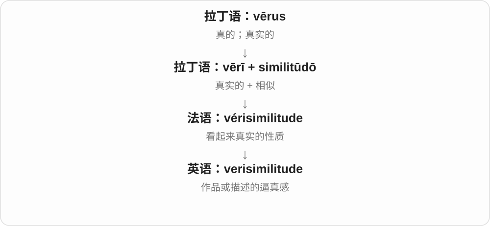
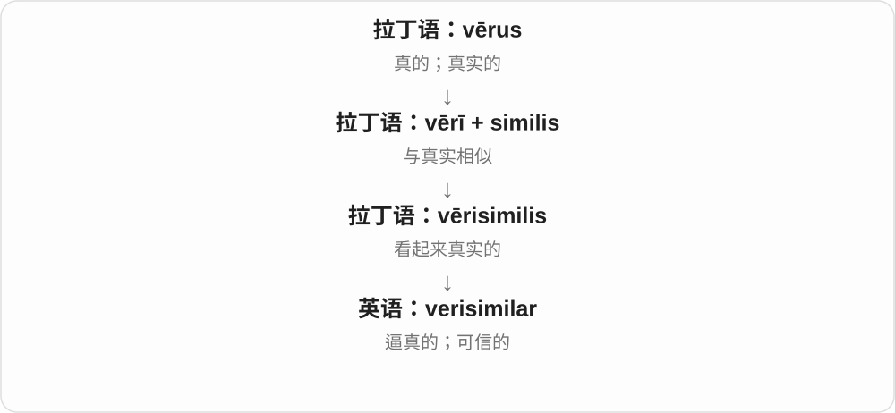

# 0387 · simil-, simul- — 相像；使相像；一起、同时

[逐词精讲目录](../00_逐词精讲目录.md) · [总目录](../00_总目录_按常用程度.md)

## 核心词根与来源

这一族有两条紧邻的拉丁支线：similis 是相像，simul 是一起、同时。simulāre 把“相像”变成“做出相似样子”，于是能走向科学模拟，也能走向假装。经法语演变又出现 resemble、semblance、assemble；不是每一个词都从现代 similar 直接拼出来。

**把东西看成同一类、做成相似样子，或放到一起**

两张图相像是 similar；按真图做一个替代场景是 simulate；几个人一起表演是 ensemble；两件事落在同一时间是 simultaneous。

- **相似与比较**：similar、similarly、similarity、dissimilar、resemble、resemblance、simile、similitude、verisimilar、verisimilitude
- **模拟与形象**：simulate、simulation、simulator、simulacrum、semblance、simular
- **集合与吸收**：assemble、assembly、disassemble、reassemble、assimilate、assimilation
- **掩饰与趋异〔意义须区分〕**：dissemble、dissimulate、dissimulation；dissimilate 表示趋异
- **一起及同时**：ensemble、simultaneous、simultaneously、simulcast

## 词形与演化规律

simil- 见 similar、assimilation；simul- 见 simulate、simulacrum，也在 simultaneous 中接“同时”。法语路线常变成 sembl-。ad- 在 s 前同化为 as-，见 assimilate / assemble。

## 单词速览（常用到不常用）

| 单词 | 音标 | 核心意思 |
|---|---|---|
| [similar](#w-1) | 英 /ˈsɪmələ/；美 /ˈsɪmələr/ | 相似的；类似的；相似〔几何〕 |
| [assembly](#w-2) | /əˈsembli/ | 集会；大会；装配；组件 |
| [similarly](#w-3) | 英 /ˈsɪmələli/；美 /ˈsɪmələrli/ | 相似地；同样地 |
| [simultaneously](#w-4) | 英 /ˌsɪmlˈteɪniəsli/；美 /ˌsaɪmlˈteɪniəsli/ | 同时地 |
| [simulation](#w-5) | /ˌsɪmjəˈleɪʃən/ | 模拟；仿真；模拟场景；假装 |
| [resemble](#w-6) | /rɪˈzembəl/ | 像；与……相似 |
| [ensemble](#w-7) | 英 /ɒnˈsɒmbəl/；美 /ɑːnˈsɑːmbəl/ | 合奏团；全体演出者；成套服装；协调的整体 |
| [assemble](#w-8) | /əˈsembəl/ | 集合；召集；组装 |
| [simulator](#w-9) | 英 /ˈsɪmjəleɪtə/；美 /ˈsɪmjəleɪtər/ | 模拟器；模拟设备；假装者〔较旧〕 |
| [resemblance](#w-10) | /rɪˈzembləns/ | 相像；相似之处 |
| [similarity](#w-11) | 英 /ˌsɪməˈlærəti/；美 /ˌsɪməˈlærəti/ | 相似性；相似之处 |
| [simultaneous](#w-12) | 英 /ˌsɪmlˈteɪniəs/；美 /ˌsaɪmlˈteɪniəs/ | 同时的；同时发生的；联立的〔方程〕 |
| [simulate](#w-13) | /ˈsɪmjəleɪt/；旧形容词 /ˈsɪmjələt/ | 模拟；模仿；假装；伪装的〔旧形容词〕 |
| [assimilation](#w-14) | /əˌsɪməˈleɪʃən/ | 吸收、消化；同化；语音同化 |
| [semblance](#w-15) | /ˈsembləns/ | 外表；表面样子；些许模样 |
| [assimilate](#w-16) | 英、美 /əˈsɪmɪleɪt/ | 吸收、消化；融入；使同化 |
| [dissimilar](#w-17) | 英 /dɪˈsɪmələ/；美 /dɪˈsɪmələr/ | 不相似的；差别明显的 |
| [disassemble](#w-18) | /ˌdɪsəˈsembəl/ | 拆卸；把整体拆成部件 |
| [reassemble](#w-19) | /ˌriːəˈsembəl/ | 重新组装；重新集合 |
| [simulcast](#w-20) | 英 /ˈsɪməlkɑːst/；美 /ˈsɪməlkæst/ | 同步播出；联播；同步播出的节目 |
| [simile](#w-21) | /ˈsɪməli/ | 明喻；直接作出的比喻 |
| [verisimilitude](#w-22) | /ˌverɪsɪˈmɪlɪtjuːd/ | 逼真感；像真的一样的程度 |
| [simulacrum](#w-23) | /ˌsɪmjəˈleɪkrəm/ | 仿像；形象；徒具外表的复制物 |
| [dissemble](#w-24) | /dɪˈsembəl/ | 掩饰；隐瞒真实意图或感受 |
| [similitude](#w-25) | 英 /sɪˈmɪlɪtjuːd/；美 /sɪˈmɪlɪtuːd/ | 相似；相似之处；比喻、寓言〔书面或旧用〕 |
| [dissimulation](#w-26) | /dɪˌsɪmjəˈleɪʃən/ | 掩饰；隐瞒真情的行为 |
| [simular](#w-27) | 英 /ˈsɪmjʊlə/；美 /ˈsɪmjələr/ | 假装者；伪装的、假冒的〔古旧〕 |
| [dissimulate](#w-28) | /dɪˈsɪmjuleɪt/ | 掩饰；隐瞒；装作没有某种感受 |
| [dissimilate](#w-29) | /dɪˈsɪməleɪt/ | 使变得不同；发生异化〔尤指语音〕 |
| [verisimilar](#w-30) | 英 /ˌverɪˈsɪmələ/；美 /ˌverɪˈsɪmələr/ | 貌似真实的；逼真的 |

## 逐词讲解

### 1. similar — 相似的；类似的；相似〔几何〕

**音标**：英 /ˈsɪmələ/；美 /ˈsɪmələr/

**先抓住这个画面**

不是同一个东西，但放在一起比较，有些特点很像。

**怎么拆**

法语 similaire 接中世纪拉丁 similāris，再接拉丁 similis“相像”；不是英语 sim 加一个能独立解释的 ilar。

**怎么变成今天的意思**

**拉丁 similis**  
相像、同类；与 simul“一起、同时”同族

↓

**中世纪拉丁 similāris → 法语 similaire → 英语 similar**  
具有相同或相近特点的

a similar problem 是类似问题，仍可能有关键差别。几何中的 similar shapes 是形状相同、对应长度按同一比例变化，不要求大小一致。

**常见搭配与例句**

similar to；similar in size；a similar approach。

> The two bags look similar, but one is much lighter.

两个包看着相似，但其中一个轻得多。

> The smaller triangle is similar to the larger one.

小三角形与大三角形相似。

**别混淆**

same 是同一个或相同的；similar 只是相似。常说 similar to，不说 similar with。

### 2. assembly — 集会；大会；装配；组件

**音标**：/əˈsembli/

**先抓住这个画面**

可以是聚起来的一群人，也可以是装到一起的一组零件。

**怎么拆**

借古法语 assemblée，原是 assembler 的分词名词化；英语名词并非只在现代 assemble 后加 -y。

**怎么变成今天的意思**

**拉丁 similis**  
相像、同类；与 simul“一起、同时”同族

↓

**拉丁 assimulāre → 古法语 assembler**  
使相似、合到一起 → 聚集

↓

**古法语 assembler → assemblée → 中古英语 assemblee**  
集合 → 集会、一群聚集者

↓

**现代英语 assembly**  
集会、议事机构；装配过程及装好的组件

school assembly 是学校集会；assembly instructions 是组装说明；a motor assembly 可以是装好的电机组件。assembly language 是汇编语言，属于计算机专门用法。

**常见搭配与例句**

a school assembly；assembly instructions；an assembly line；a brake assembly。

> The head teacher spoke at the morning assembly.

校长在晨会上讲话。

> Check the assembly instructions before tightening the screws.

拧紧螺丝前先查看组装说明。

**别混淆**

meeting 更宽泛，几个人开会也适用；assembly 常是一群人为共同目的聚集，也有组装和组件义。

### 3. similarly — 相似地；同样地

**音标**：英 /ˈsɪmələli/；美 /ˈsɪmələrli/

**先抓住这个画面**

前面那种方式或道理，在这里也有相近的表现。

**怎么拆**

similar + -ly。

**怎么变成今天的意思**

**拉丁 similis**  
相像、同类；与 simul“一起、同时”同族

↓

**中世纪拉丁 similāris → 法语 similaire → 英语 similar**  
具有相同或相近特点的

↓

**英语 similar + -ly → similarly**  
以相似方式；用来连接相近情况

similarly dressed 是穿着相似；句首 Similarly,... 把后一情况与前面联系起来。它不是说两件事完全一致，而是指出可类比的一点。

**常见搭配与例句**

similarly sized；similarly affected；similarly, ...。

> The two rooms are similarly decorated.

两个房间的装饰风格相似。

> Young trees need protection from strong wind; similarly, seedlings need shelter.

幼树需要防强风；同样，幼苗也需要遮护。

**别混淆**

likewise 可表示同样，也常用于简短回应；similarly 更明确指出方式或特点相似。

### 4. simultaneously — 同时地

**音标**：英 /ˌsɪmlˈteɪniəsli/；美 /ˌsaɪmlˈteɪniəsli/

**先抓住这个画面**

两条时间线在这一刻叠到一起，没有先后等待。

**怎么拆**

simultaneous + -ly；这里 simul- 的重点是同一时间，而不是外观相像。

**怎么变成今天的意思**

**拉丁 simul**  
一起、同时；与 similis“相像”同族

↓

**中世纪拉丁 simultāneus → 英语 simultaneous**  
同时的；后半词形形成方式有不同分析

↓

**英语 simultaneous + -ly → simultaneously**  
同时发生或进行地

同时按两个按钮、同时听见两种声音，都可用它。不要求两个动作的内容相同，只要求时间重合。

**常见搭配与例句**

occur simultaneously；operate simultaneously；simultaneously with。

> Both alarms sounded simultaneously.

两个警报同时响起。

> The software displays the original text and the translation simultaneously.

软件同时显示原文和译文。

**别混淆**

successively 是接连发生；simultaneously 是同时发生。separately 说分开，分开的动作也可能同时进行。

### 5. simulation — 模拟；仿真；模拟场景；假装

**音标**：/ˌsɪmjəˈleɪʃən/

**先抓住这个画面**

做出一个替代场景，让它在关键方面像真实情况。

**怎么拆**

拉丁 simulātiō，经古法语及拉丁借入中古英语；英语名词早于现代 simulate 动词，不能把历史只画成动词加 -ion。

**怎么变成今天的意思**

**拉丁 similis**  
相像、同类；与 simul“一起、同时”同族

↓

**拉丁 simulāre → simulātiō → 古法语 simulation / simulacion → 中古英语**  
模仿、假装 → 模拟或假象

↓

**现代英语 simulation**  
训练、试验用的模拟；也可指假装

飞行模拟保留重要操作，却不把飞机真开上天。模拟能帮助理解和训练，但它的结论取决于模型保留了什么、简化了什么；不是现实的自动复制品。

**常见搭配与例句**

run a simulation；a computer simulation；a training simulation。

> The team ran a simulation of traffic through the new junction.

团队模拟了车辆通过新路口的情况。

> The emergency drill used a realistic simulation of a power failure.

应急演练逼真地模拟了一次停电。

**别混淆**

imitation 常看外观或动作是否像；simulation 常让一个过程或系统按设定运行，观察其反应。

### 6. resemble — 像；与……相似

**音标**：/rɪˈzembəl/

**先抓住这个画面**

两个东西放在一起，有足够相像的地方让人联系起来。

**怎么拆**

经盎格鲁法语 resembler，re- 加 sembler“看起来像”；sembler 远接拉丁 similis 词族。这里 re- 不要求再像一次。

**怎么变成今天的意思**

**拉丁 similis**  
相像、同类；与 simul“一起、同时”同族

↓

**拉丁 simulāre → 晚期拉丁 similāre → 古法语 sembler**  
使相像 → 看起来像

↓

**盎格鲁法语 resembler → 中古英语 resemblen → resemble**  
与另一个人或物相像

She resembles her father 是她像父亲，直接接对象，不加 to。resemble 通常描述已有的相似，不暗示谁故意模仿谁。

**常见搭配与例句**

closely resemble；resemble somebody in；resemble the shape of。

> The leaf resembles a small open hand.

这片叶子像一只张开的小手。

> Her handwriting closely resembles her mother’s.

她的字迹很像她母亲的。

**别混淆**

imitate 是主动模仿；resemble 是相像，树叶 resemble a hand 不表示树叶有意模仿手。

### 7. ensemble — 合奏团；全体演出者；成套服装；协调的整体

**音标**：英 /ɒnˈsɒmbəl/；美 /ɑːnˈsɑːmbəl/

**先抓住这个画面**

各个部分各有角色，放在一起组成一个配合良好的整体。

**怎么拆**

借法语 ensemble，远接晚期拉丁 in- + simul 形成的 insimul“一起”；不是英语 en- 加 assemble 的缩写。

**怎么变成今天的意思**

**拉丁 simul → 晚期拉丁 insimul → 法语 ensemble**  
一起、同时 → 作为整体

↓

**英语 ensemble**  
演出团体、合奏整体；配套服装等

a string ensemble 是弦乐合奏团；a matching ensemble 可以是一套搭配好的衣装。重点不是成员长得相似，而是组合后协调。

**常见搭配与例句**

a chamber ensemble；an ensemble cast；a matching ensemble。

> A small ensemble performed music for strings and flute.

一支小型合奏团演奏了弦乐与长笛作品。

> Her jacket and trousers formed a simple, elegant ensemble.

她的外套和长裤组成了一套简洁优雅的搭配。

**别混淆**

band 常指特定类型乐队；ensemble 范围更广，也可用于舞蹈、戏剧团队或整套搭配。

### 8. assemble — 集合；召集；组装

**音标**：/əˈsembəl/

**先抓住这个画面**

把散开的成员、材料或零件带到一处，组成一个整体。

**怎么拆**

拉丁 assimulāre 经古法语 assembler 进入中古英语；与 assimilate 远源相同，却沿法语路线发展出聚集、组装义。

**怎么变成今天的意思**

**拉丁 similis**  
相像、同类；与 simul“一起、同时”同族

↓

**拉丁 assimulāre → 古法语 assembler → 中古英语 assemblen**  
使相似、合到一起 → 聚集

↓

**现代英语 assemble**  
集合；组装零件

人可以 assemble outside，集合到外面；你也可以 assemble a desk，把桌子零件装起来。被动句 The desk is assembled 说已经装好，不是桌子自己去集合。

**常见搭配与例句**

assemble a team；assemble furniture；assemble at；assemble evidence。

> The volunteers assembled outside the community centre.

志愿者在社区中心外集合。

> It took us an hour to assemble the bookshelf.

我们花了一小时组装书架。

**别混淆**

collect 只是收集；assemble 往往还把各部分组织成整体。assimilate 则强调吸收、趋同。

### 9. simulator — 模拟器；模拟设备；假装者〔较旧〕

**音标**：英 /ˈsɪmjəleɪtə/；美 /ˈsɪmjəleɪtər/

**先抓住这个画面**

把真实环境的关键反应做出来，让人能够在替代环境里练习或测试。

**怎么拆**

有拉丁 simulātor“模仿者”的借入分析，也可按 simulate + -or 理解；设备义由执行模拟的人或物扩展而来。

**怎么变成今天的意思**

**拉丁 similis**  
相像、同类；与 simul“一起、同时”同族

↓

**拉丁 simulāre → simulātor → 英语 simulator**  
模仿、假装 → 模仿者

↓

**英语设备用法**  
用来模拟环境或系统的设备、程序

驾驶模拟器可以再现仪表和路况；它不必把每个细节都复制。游戏里的 simulator 也强调模拟体验，逼真程度仍取决于设计。

**常见搭配与例句**

a flight simulator；a driving simulator；train on a simulator。

> The trainee practised an emergency landing in a flight simulator.

学员在飞行模拟器中练习紧急降落。

> The simulator lets engineers test the control system without using the real machine.

模拟器让工程师无需使用真机就能测试控制系统。

**别混淆**

simulation 是模拟活动或场景；simulator 是执行模拟的设备、软件或系统。

### 10. resemblance — 相像；相似之处

**音标**：/rɪˈzembləns/

**先抓住这个画面**

把“看起来像”这件事作为一个特点拿出来说。

**怎么拆**

借盎格鲁法语 resemblance，接 resembler；现代可按 resemble + -ance 理解，历史上名词有法语来源。

**怎么变成今天的意思**

**拉丁 similis**  
相像、同类；与 simul“一起、同时”同族

↓

**拉丁 simulāre → 晚期拉丁 similāre → 古法语 sembler**  
使相像 → 看起来像

↓

**盎格鲁法语 resembler → resemblance → 英语 resemblance**  
相像 → 相似状态、相似之处

a resemblance to someone 是与某人相像；bear a resemblance 是具有相似之处。相似本身不能证明有亲属关系或存在抄袭。

**常见搭配与例句**

bear a resemblance to；a striking resemblance；a family resemblance。

> The sisters bear a striking resemblance to each other.

姐妹俩长得非常像。

> The new design has little resemblance to the original sketch.

新设计与最初草图已经不太相像。

**别混淆**

similarity 范围较宽，可谈统计结构、机制等；resemblance 常强调外观或整体给人的相像感觉。

### 11. similarity — 相似性；相似之处

**音标**：英 /ˌsɪməˈlærəti/；美 /ˌsɪməˈlærəti/

**先抓住这个画面**

从两件不同的东西里找出共同特点，比较它们有多接近。

**怎么拆**

可由英语 similar + -ity 形成，也有借法语 similarité 的分析，两条解释都接 similis 词族。

**怎么变成今天的意思**

**拉丁 similis**  
相像、同类；与 simul“一起、同时”同族

↓

**中世纪拉丁 similāris → 法语 similaire / 英语 similar**  
相像的

↓

**英语 similar + -ity，或法语 similarité 借入 → similarity**  
相似状态、相似之处

the similarity between A and B 是两者的相似；similarities 常指一项项共同点。几何里还有按比例缩放而保形的相似关系，不是只凭肉眼觉得差不多。

**常见搭配与例句**

similarity between；similarity to；striking similarities；structural similarity。

> The researchers noticed a similarity between the two patterns.

研究人员注意到这两种图案之间有一处相似。

> Despite their similarities, the two tools serve different purposes.

尽管有相似之处，这两种工具的用途不同。

**别混淆**

identity 在完全相同义上比 similarity 强；很多相似之处也不等于两个对象毫无差别。

### 12. simultaneous — 同时的；同时发生的；联立的〔方程〕

**音标**：英 /ˌsɪmlˈteɪniəs/；美 /ˌsaɪmlˈteɪniəs/

**先抓住这个画面**

不同的事情放到同一时间点或同一组条件里看。

**怎么拆**

接拉丁 simul“同时”。有中世纪拉丁 simultāneus 的借入分析；其后半形式又有 simultim 扩展或类比其他形容词词尾等解释。

**怎么变成今天的意思**

**拉丁 simul**  
一起、同时；与 similis“相像”同族

↓

**中世纪拉丁 simultāneus → 英语 simultaneous**  
同时的；后半词形形成方式有不同分析

simultaneous events 是同时发生的事件。simultaneous equations 是要由同一组未知数值一起满足的方程，不是“要求你同时写出两行字”。

**常见搭配与例句**

simultaneous release；simultaneous interpretation；simultaneous equations。

> The cameras recorded simultaneous views from opposite sides of the room.

摄像机同时记录了房间两侧的画面。

> The same values of x and y must satisfy both simultaneous equations.

同一组 x 和 y 的值必须同时满足这两个联立方程。

**别混淆**

similar 说特点相像；simultaneous 说时间重合。两个完全不同的事件也能 simultaneous。

### 13. simulate — 模拟；模仿；假装；伪装的〔旧形容词〕

**音标**：/ˈsɪmjəleɪt/；旧形容词 /ˈsɪmjələt/

**先抓住这个画面**

不直接使用原来的东西，而是做出与它相似的样子或反应。

**怎么拆**

拉丁 simulāre“使相像、模仿”的分词 simulātus 可解释英语借词；也有从更早的 simulation 逆构动词的分析。

**怎么变成今天的意思**

**拉丁 similis**  
相像、同类；与 simul“一起、同时”同族

↓

**拉丁 simulāre / simulātus**  
做出相似外观、模仿、假装

↓

**英语 simulate**  
借拉丁分词，或由较早的 simulation 逆构；模拟、假装

simulate rainfall 是模拟降雨；simulate interest 是装出有兴趣。前者可以是公开的科学试验，后者可能在掩饰真实感受，所以不能一看到 simulate 就翻成欺骗。

**常见搭配与例句**

simulate conditions；simulate a process；simulate interest。

> The chamber can simulate hot, humid weather.

这个试验舱能模拟炎热潮湿的天气。

> He tried to simulate enthusiasm, but his flat voice gave him away.

他试着装出热情，平淡的声音却暴露了真实态度。

**别混淆**

stimulate 是刺激、促进，多一个 t；simulate 是模拟。resemble 是本来就像，simulate 通常是做出相似效果。

### 14. assimilation — 吸收、消化；同化；语音同化

**音标**：/əˌsɪməˈleɪʃən/

**先抓住这个画面**

新的东西进入一个整体，逐渐变成它的一部分或更像周围部分。

**怎么拆**

拉丁 assimilātiō 经古法语 assimilacion 借入英语；现代与 assimilate 对应，但有独立名词借入路线。

**怎么变成今天的意思**

**拉丁 similis**  
相像、同类；与 simul“一起、同时”同族

↓

**拉丁 assimilāre → assimilātiō → 古法语 assimilacion → 中古英语**  
使相似、吸收 → 同化、吸收过程

↓

**现代英语 assimilation**  
知识或营养的吸收；文化趋同；相邻语音趋同

学习里的 assimilation 是把新知识消化进已有理解。语音里的 ad- 在某些拉丁复合词中变成相邻辅音的样子，也是同化；文化语境则须看是否自愿、哪些差异被改变。

**常见搭配与例句**

the assimilation of information；cultural assimilation；sound assimilation。

> The course allows time for the assimilation of new concepts.

课程留出了消化新概念的时间。

> The lesson uses the change from ad- to as- before s to illustrate assimilation.

这一课用 ad- 在 s 前变成 as- 的变化说明语音同化。

**别混淆**

acculturation 是接触另一种文化后的变化，范围更广；assimilation 更突出趋同或吸收进一个整体。

### 15. semblance — 外表；表面样子；些许模样

**音标**：/ˈsembləns/

**先抓住这个画面**

至少从外面看，有那么一点像；里面是否真有，还要另看。

**怎么拆**

古法语 semblance / 盎格鲁法语 semblaunce 借入英语，接 sembler“看起来”，远接拉丁 similis 词族。

**怎么变成今天的意思**

**拉丁 similis**  
相像、同类；与 simul“一起、同时”同族

↓

**拉丁 simulāre → 晚期拉丁 similāre → 古法语 sembler / semblance**  
使相像 → 看起来 → 外观、样子

↓

**中古英语 semblaunce → semblance**  
外表；某种样子的最低限度表现

a semblance of order 是至少看起来还有点秩序；常暗示只是表面或程度有限。也可能指混乱后刚刚恢复的一点正常，不必每次都是蓄意造假。

**常见搭配与例句**

a semblance of；some semblance of normality；maintain a semblance of。

> She maintained a semblance of calm during the delay.

延误期间，她表面上仍保持着平静。

> By evening, the room had regained some semblance of order.

到了晚上，房间总算恢复了一点整齐的样子。

**别混淆**

resemblance 是与另一个对象相像；semblance of calm 是平静的表面样子，比较对象可以并未明说。

### 16. assimilate — 吸收、消化；融入；使同化

**音标**：英、美 /əˈsɪmɪleɪt/

**先抓住这个画面**

新东西进来后，慢慢成为原有体系的一部分。

**怎么拆**

拉丁 ad- + simulāre“使相似”→ assimilāre 的相关形式，借入英语；simil- 指相似。不是简单的“收下”。

**怎么变成今天的意思**

**拉丁语：ad**  
朝向；靠近；加到

↓

**拉丁语 similis → simulāre → assimilāre / assimulāre**  
相似 → 使相似 → 使成为相近的一部分

↓

**晚期拉丁 assimilātus → 中古英语 assimilaten → assimilate**  
吸收；同化

assimilate information 是把资料消化成自己的理解；人融入群体也能这样说，但涉及文化时可能强调改变原有特征，不能一概当成轻松交朋友。

**常见搭配与例句**

assimilate information；assimilate into；be assimilated into。

> I need a little time to assimilate all this information.

我需要一点时间消化这些信息。

> The new terms were gradually assimilated into everyday speech.

这些新术语逐渐进入日常语言，成为其中的一部分。

**别混淆**

absorb 强调吸进去；assimilate 更强调吸收后纳入自身体系。

### 17. dissimilar — 不相似的；差别明显的

**音标**：英 /dɪˈsɪmələ/；美 /dɪˈsɪmələr/

**先抓住这个画面**

比较两件东西，重点落在不像的地方。

**怎么拆**

dis-“不、相反” + similar；也与拉丁 dissimilis 的形式对应。

**怎么变成今天的意思**

**拉丁 similis**  
相像、同类；与 simul“一起、同时”同族

↓

**中世纪拉丁 similāris → 法语 similaire → 英语 similar**  
具有相同或相近特点的

↓

**英语 dis- + similar → dissimilar**  
不相似、不同类的

dissimilar materials 是性质不相似的材料。not dissimilar 是委婉地说有些相像，不表示严格完全一样。

**常见搭配与例句**

dissimilar to；dissimilar in；not dissimilar。

> The two methods are dissimilar in both cost and complexity.

两种方法在成本和复杂程度上都很不一样。

> His experience was not dissimilar to mine.

他的经历与我的颇有些相似。

**别混淆**

different 范围更广，只要有区别即可；dissimilar 常突出整体特点没有那么相像。

### 18. disassemble — 拆卸；把整体拆成部件

**音标**：/ˌdɪsəˈsembəl/

**先抓住这个画面**

把装好的整体一步步拆回零件。

**怎么拆**

dis-“拆开、逆转” + assemble。

**怎么变成今天的意思**

**拉丁 similis**  
相像、同类；与 simul“一起、同时”同族

↓

**拉丁 assimulāre → 古法语 assembler → 中古英语 assemblen**  
使相似、合到一起 → 聚集

↓

**现代英语 assemble**  
集合；组装零件

↓

**英语 dis- + assemble → disassemble**  
逆转组装 → 拆卸成部件

disassemble a machine 通常是为了清洁、检查、搬运或维修。它不等于砸坏；动作有时可逆，零件仍能重新装回。

**常见搭配与例句**

disassemble a device；disassemble into parts；disassemble for cleaning。

> The table can be disassembled for transport.

这张桌子可以拆开运输。

> The technician disassembled the motor to inspect the bearings.

技术员拆开电机检查轴承。

**别混淆**

dismantle 也可拆除大型结构或抽象制度；disassemble 常突出把可组装物拆成零件。dissemble 是掩饰。

### 19. reassemble — 重新组装；重新集合

**音标**：/ˌriːəˈsembəl/

**先抓住这个画面**

原来聚在一起的东西分开过，现在再合起来。

**怎么拆**

re-“重新” + assemble。

**怎么变成今天的意思**

**拉丁 similis**  
相像、同类；与 simul“一起、同时”同族

↓

**拉丁 assimulāre → 古法语 assembler → 中古英语 assemblen**  
使相似、合到一起 → 聚集

↓

**现代英语 assemble**  
集合；组装零件

↓

**英语 re- + assemble → reassemble**  
再次集合或把零件重新装好

机器修好后 reassemble，是把部件装回；人群散开后 reassemble，是重新集合。它不保证每个零件都在原位置，具体安排要看说明。

**常见搭配与例句**

reassemble the parts；reassemble after a break；reassemble the machine。

> We reassembled the chair after replacing the broken joint.

更换损坏的接头后，我们把椅子重新装好。

> The group will reassemble in the lobby after lunch.

午饭后大家将在大堂重新集合。

**别混淆**

assemble 可以是第一次组装；reassemble 明确含再次。rebuild 可重建结构，未必使用原来的零件。

### 20. simulcast — 同步播出；联播；同步播出的节目

**音标**：英 /ˈsɪməlkɑːst/；美 /ˈsɪməlkæst/

**先抓住这个画面**

同一场节目同时走多条传播通道。

**怎么拆**

simul(taneous) + (broad)cast 的拼缀词；simul- 从 simultaneous 截取，cast 从 broadcast 截取。

**怎么变成今天的意思**

**拉丁 simul**  
一起、同时；与 similis“相像”同族

↓

**中世纪拉丁 simultāneus → 英语 simultaneous**  
同时的；后半词形形成方式有不同分析

↓

**英语 simultaneous + broadcast → simulcast**  
在多个频道、服务或媒介上同步播出

电视和广播同时播一场音乐会，是典型 simulcast；现在也可涉及网络平台。重点在多个渠道的同一时间，不要求节目本身一定是现场发生。

**常见搭配与例句**

a live simulcast；simulcast on radio and television；a simulcast of。

> The concert was simulcast on television and radio.

音乐会在电视和广播上同步播出。

> Viewers abroad watched a simulcast of the opening ceremony.

海外观众观看了开幕式的同步转播。

**别混淆**

live broadcast 强调现场实时播出；simulcast 强调多个渠道同步，二者可以同时成立，也可以不同。

### 21. simile — 明喻；直接作出的比喻

**音标**：/ˈsɪməli/

**先抓住这个画面**

把两样不同的东西摆出来，明说“这个像那个”。

**怎么拆**

借拉丁 simile，是 similis“相像”的中性形式作名词，表示比较、类比。

**怎么变成今天的意思**

**拉丁 similis**  
相像、同类；与 simul“一起、同时”同族

↓

**拉丁 simile → 英语 simile**  
相似之物、比较 → 明喻

英语常用 like 或 as 引出明喻，如 quiet as snow。关键是修辞上的比照，不是出现 like 的每句普通相似描述都一定有鲜明比喻效果。

**常见搭配与例句**

a vivid simile；use a simile；a simile comparing A to B。

> “Her voice was like warm honey” is a simile.

Her voice was like warm honey 是一个明喻，把她的声音比作温暖的蜂蜜。

> The poem uses a simile to compare the city lights to scattered stars.

诗歌用明喻把城市灯光比作散落的星星。

**别混淆**

metaphor 常直接把 A 说成 B；simile 明说 A 像 B。两者都能让抽象感受变得具体。

### 22. verisimilitude — 逼真感；像真的一样的程度

**音标**：/ˌverɪsɪˈmɪlɪtjuːd/

**先抓住这个画面**

verisimilitude 是读小说或看电影时那种“这地方、这人、这反应都像真的”的感觉。故事可以完全虚构，却有很强的逼真感。

**怎么拆**

来自拉丁语 vērī similitūdō：vērī 是“真实”的所属形式，similitūdō 是“相似”。经法语进入英语，字面就是“与真实相似”。

**怎么变成今天的意思**

关键在于 similarity，而不在于是否真的发生过。人物说话有犹豫、屋里有磨损、历史细节前后一致，都可能让虚构世界更可信。

**常见搭配与例句**

add verisimilitude（增加逼真感）；give a story verisimilitude（使故事显得真实）；a sense of verisimilitude（逼真的感觉）。

> The worn furniture gives the film a sense of verisimilitude.

磨损的家具让这部电影有了一种逼真感。

> Small details add verisimilitude to her fictional town.

细小的细节让她虚构的小镇显得更真实。

**别混淆**

truth 关心事实是真是假；verisimilitude 关心表现像不像真。realism 范围更广，也可指一种艺术风格或现实态度。

### 23. simulacrum — 仿像；形象；徒具外表的复制物

**音标**：/ˌsɪmjəˈleɪkrəm/

**先抓住这个画面**

眼前有一个像原物的东西，但它与原物的关系、实质未必相同。

**怎么拆**

借拉丁 simulācrum“形象、肖像、仿像”，接 simulāre 和构成工具、结果物的词尾。

**怎么变成今天的意思**

**拉丁 similis**  
相像、同类；与 simul“一起、同时”同族

↓

**拉丁 simulāre → simulācrum → 英语 simulacrum**  
使相像 → 形象、仿造的形象

可以说雕像或重建影像，也可带批评说某制度只是 a simulacrum，只有外表。哲学文献还会赋予它特定理论含义，要跟着作者定义读；复数常见 simulacra。

**常见搭配与例句**

a simulacrum of；a digital simulacrum；simulacra。

> The virtual tour presents a digital simulacrum of the ancient palace.

虚拟导览呈现了古代宫殿的数字仿像。

> The ceremony had become a hollow simulacrum of its former meaning.

这场仪式已经只剩昔日意义的空洞外壳。

**别混淆**

replica 常强调忠实复制；simulacrum 更容易把注意力引向形象与真实之间的距离。

### 24. dissemble — 掩饰；隐瞒真实意图或感受

**音标**：/dɪˈsembəl/

**先抓住这个画面**

把真正的想法藏在另一种表情或说法后面。

**怎么拆**

经古法语 dessembler 等形式接拉丁 dissimulāre，音形受 sembler / resemble 等影响；不是 dis- + assemble 的普通缩写。

**怎么变成今天的意思**

**拉丁 similis**  
相像、同类；与 simul“一起、同时”同族

↓

**拉丁 dis- + simulāre → dissimulāre**  
使外表与实际不一致 → 掩饰、隐瞒

↓

**古法语 dessembler → 中古英语 dissemblen → dissemble**  
用外表遮盖真实；音形受 sembler 一族影响

dissemble disappointment 是把失望掩饰住。也可不接宾语，指讲话闪烁、隐藏真实态度。它通常较正式，带有不坦诚的意味。

**常见搭配与例句**

dissemble one’s feelings；dissemble disappointment；cease to dissemble。

> She tried to dissemble her disappointment behind a polite smile.

她试图用礼貌的微笑掩饰失望。

> When asked about the missing money, he continued to dissemble.

被问到失踪的钱时，他仍然遮遮掩掩。

**别混淆**

disassemble 是拆开零件，多一个 a；dissemble 是掩饰。相近拼写对应完全不同的现代动作。

### 25. similitude — 相似；相似之处；比喻、寓言〔书面或旧用〕

**音标**：英 /sɪˈmɪlɪtjuːd/；美 /sɪˈmɪlɪtuːd/

**先抓住这个画面**

把两个对象相像的关系郑重地拿出来讨论。

**怎么拆**

拉丁 similitūdō 经古法语或直接借入英语；英语词出现比 similar 更早，不应把历史写成 modern similar + -itude。

**怎么变成今天的意思**

**拉丁 similis**  
相像、同类；与 simul“一起、同时”同族

↓

**拉丁 similitūdō → 古法语 similitude／拉丁借词 → 中古英语**  
相似状态、类比

↓

**现代英语 similitude**  
正式的相似；旧文中的比喻、寓言；某些数学或工程用法

日常说 similarity 更自然；similitude 常出现在较正式或旧式文字中。工程讨论模型与原型的 similitude 时，还可能强调需要满足的相似条件，不能只看外形像。

**常见搭配与例句**

similitude between；a similitude of；geometric similitude。

> The essay draws attention to the similitude between the two accounts.

文章让人注意到两份叙述之间的相似。

> The teacher explained the old text’s similitude of a seed and an idea.

老师解释了旧文把种子与思想相比较的那则比喻。

**别混淆**

simile 是一种修辞明喻；similitude 可以泛说相似关系，也有较旧的比喻故事义。

### 26. dissimulation — 掩饰；隐瞒真情的行为

**音标**：/dɪˌsɪmjəˈleɪʃən/

**先抓住这个画面**

让别人看到的表象，与自己知道的真实情况错开。

**怎么拆**

古法语 dissimulation 及拉丁 dissimulātiō 借入中古英语，接 dissimulāre；不是现代英语动词之后才出现的名词。

**怎么变成今天的意思**

**拉丁 similis**  
相像、同类；与 simul“一起、同时”同族

↓

**拉丁 dis- + simulāre → dissimulāre**  
使外表与实际不一致 → 掩饰、隐瞒

↓

**拉丁 dissimulātiō → 古法语 dissimulation／中古英语 dissimulacioun**  
用不同外表掩盖实际情况

↓

**现代英语 dissimulation**  
较正式地说掩饰、隐瞒真情

常用于分析人物、动机或人际交往，强调刻意遮住真实。它可能靠微笑、沉默或措辞实现，不一定要说出一整句字面谎话。

**常见搭配与例句**

an act of dissimulation；skilled in dissimulation；a pattern of dissimulation。

> Her polite agreement was an act of dissimulation.

她礼貌地表示同意，其实是在掩饰真实态度。

> The novel gradually exposes the dissimulation behind his public image.

小说逐步揭露了他公众形象背后的伪装。

**别混淆**

dissimilation 是语音等趋异；dissimulation 多了 u，谈掩饰。simulation 可以是公开的模拟，不必有欺骗。

### 27. simular — 假装者；伪装的、假冒的〔古旧〕

**音标**：英 /ˈsɪmjʊlə/；美 /ˈsɪmjələr/

**先抓住这个画面**

有一个看起来像真的外壳，却藏着不同的实情。

**怎么拆**

接拉丁 simulāre“假装”的词族；有 simulārius 借入分析，也有 simulāre 配 -ar 的分析，末尾的确切形成仍有争议。

**怎么变成今天的意思**

**拉丁 similis**  
相像、同类；与 simul“一起、同时”同族

↓

**拉丁 simulāre 词族 → 英语 simular〔构词细节有不同分析〕**  
模仿、假装 → 假装者、假冒的

↓

**古旧英语 simular**  
多见旧文学；不可误当现代 similar 的标准拼写

这是读旧文本时认识的词，现代日常很少用。下面例句采用旧式叙述口吻，帮助辨认“伪装者”和“虚假的”两个用法。

**常见搭配与例句**

a crafty simular〔旧〕；simular virtue〔旧〕。

> The tale exposes the simular who claimed to be a prince.

故事揭穿了那个自称王子的假冒者。

> The poet condemns simular virtue that vanishes when tested.

诗人谴责那种经不起考验的虚假美德。

**别混淆**

similar 是相似的，不自带假冒；simular 的这里这些旧义涉及伪装，两者虽然同族，不能随意互换。

### 28. dissimulate — 掩饰；隐瞒；装作没有某种感受

**音标**：/dɪˈsɪmjuleɪt/

**先抓住这个画面**

真实情绪在那里，却用另一副样子让它不显出来。

**怎么拆**

借拉丁 dissimulātus，来自 dissimulāre；与经法语形成的 dissemble 同源，都是隐藏实际情况。

**怎么变成今天的意思**

**拉丁 similis**  
相像、同类；与 simul“一起、同时”同族

↓

**拉丁 dis- + simulāre → dissimulāre**  
使外表与实际不一致 → 掩饰、隐瞒

↓

**拉丁 dissimulātus → 中古英语 dissimulaten → dissimulate**  
被掩饰的 → 掩盖真实感受或事实

这是较正式、较少见的词。可以 dissimulate anger，把愤怒藏起来；重点常在隐藏已存在的事实，而不是做试验模型。

**常见搭配与例句**

dissimulate one’s feelings；dissimulate anger；dissimulate an intention。

> He tried to dissimulate his anxiety with a casual remark.

他试图用一句随意的话掩饰焦虑。

> The character dissimulates her anger until the final scene.

这个角色一直把愤怒掩饰到最后一场戏。

**别混淆**

simulate 可以假装存在某种状态；dissimulate 常是把真实存在的状态藏起来。两者不能靠是否有 dis- 就直译成“不模拟”。

### 29. dissimilate — 使变得不同；发生异化〔尤指语音〕

**音标**：/dɪˈsɪməleɪt/

**先抓住这个画面**

原来相像的两个部分，变化后不再那么像。

**怎么拆**

可按 dis- + assimilate 中的 -similate 理解；另有中世纪拉丁 dissimilātus 借入分析。远源仍接 similis，不能与 dissimulate“掩饰”混为一词。

**怎么变成今天的意思**

**拉丁 similis**  
相像、同类；与 simul“一起、同时”同族

↓

**英语构词分析：dis- + -similate〔见 assimilate〕；另有中世纪拉丁 dissimilātus 借词分析**  
使不再相似

↓

**英语 dissimilate**  
一般表示趋异；语言学常指相近语音变得不同

语音学里相近的音相互影响，其中一个变得不那么像另一个，可以说 dissimilate。不是把一个词拆开，也不是刻意撒谎；普通谈差异多用 become different。

**常见搭配与例句**

sounds dissimilate；dissimilate from；dissimilated consonants。

> The lecturer showed how two nearby consonants can dissimilate.

讲师展示了两个相邻辅音可能如何发生异化。

> In the form discussed here, the first sound has dissimilated from r to l.

在这里讨论的形式中，第一个音从 r 异化成了 l。

**别混淆**

assimilate 是趋同；dissimilate 是趋异；dissimulate 是掩饰真实情况。

### 30. verisimilar — 貌似真实的；逼真的

**音标**：英 /ˌverɪˈsɪmələ/；美 /ˌverɪˈsɪmələr/

**先抓住这个画面**

verisimilar 说的是“看起来能是真的”。它常用于评论故事或描写：不要求事情实际发生，只要求人物和情节让人信得过。

**怎么拆**

来自拉丁语 vērī similis，vērī 是“真实的”，similis 是“相似的”。它与 verisimilitude 同源，分别是形容词和名词。

**怎么变成今天的意思**

这个词少见，适合认读。verisimilar characters 就是言行像真实人物的角色；某段虚构细节可以很 verisimilar，同时仍然是编出来的。

**常见搭配与例句**

a verisimilar account（貌似真实的叙述）；verisimilar characters（逼真的人物）；a verisimilar fictional world（逼真的虚构世界）。

> The writer creates verisimilar characters with ordinary worries.

作家用普通人的烦恼塑造出逼真的人物。

> The story is invented, but its setting is verisimilar.

故事是编的，但它的背景描写很逼真。

**别混淆**

veracious 强调如实；verisimilar 强调像真。日常更常用 plausible 表示“听起来有可能”，用 realistic 表示“很逼真”。

## 这一组要分清什么

resemble 是相像，simulate 是做出相似反应。dissemble 是掩饰，disassemble 是拆零件；dissimulate 是掩饰，dissimilate 是趋异。simular 是古旧的假冒相关词，不是现代 similar 的通用变体。

## 串起来练习

把纸板零件 assemble 成一座桥，用它 simulate 某种受力条件，再说它 resemble 哪座真桥。另用 simultaneously 写两件同一时刻发生却内容完全不同的事。
