# 0424 · mand-, -mend- — 托付、交付；命令、委派

[逐词精讲目录](../00_逐词精讲目录.md) · [总目录](../00_总目录_按常用程度.md)

## 核心词根与来源

核心来源是拉丁 mandare“委托、命令”，过去分词 mandatus。更早构成通常联系 manus“手”与交付成分，可记成“交到手里”；这里只把它当传统词源解释，不把记忆画面冒充所有历史细节。commendare 的 -mend- 是同族复合词中的变化，英语 mend“修补”则来自另一条 emendare 路线。

**把一件事交到别人手里：相信他能办好，是托付；要求他去做，是命令；向别人郑重介绍他，又走向推荐与称赞。**

一份任务从发出者手里交给接受者。mandator 是交出去的一方，mandatary 是接住的一方；任务本身可叫 mandate。

- **命令、指挥与征用**：command, commanding, commander, commandant, commandment, commando, commandeer, countermand
- **要求、委托及其双方**：demand, demanding, undemanding, demandant, counterdemand, mandate, mandatory, mandatorily, mandator, mandatary, mandamus
- **推荐、称赞与相应表达**：commend, commendable, commendably, commendation, commendatory, recommend, recommendation, recommender, recommendatory
- **送回处理与历史制度**：remand, remandment, commendam, encomienda

## 词形与演化规律

mand-／mandat- 见于 mandate、mandatory 等；commendare 带来 commend、recommend 的 -mend-。command 经法语和重构的通俗拉丁 *commandare 发生词形调整。commendable、commendatory、mandatary、mandator 等各有独立拉丁或法语借入路线，不能都画成现代英语动词加后缀。

## 单词速览（常用到不常用）

| 单词 | 音标 | 核心意思 |
|---|---|---|
| [demand](#w-1) | 英 /dɪˈmɑːnd/；美 /dɪˈmænd/ | 强烈要求；需要；需求 |
| [command](#w-2) | 英 /kəˈmɑːnd/；美 /kəˈmænd/ | 命令；指挥；控制；掌握；赢得 |
| [recommend](#w-3) | /ˌrekəˈmend/ | 推荐；建议 |
| [commander](#w-4) | 英 /kəˈmɑːndə/；美 /kəˈmændər/ | 指挥官；统领；某些军种的中校军衔 |
| [demanding](#w-5) | 英 /dɪˈmɑːndɪŋ/；美 /dɪˈmændɪŋ/ | 要求高的；费力的；苛求的 |
| [mandatory](#w-6) | 英 /ˈmændətəri/；美 /ˈmændəˌtɔːri/ | 强制的；必须遵守的 |
| [recommendation](#w-7) | /ˌrekəmenˈdeɪʃən/ | 建议；推荐；推荐信、推荐意见 |
| [mandate](#w-8) | /ˈmændeɪt/ | 正式命令；授权、委托；要求、授权 |
| [commanding](#w-9) | 英 /kəˈmɑːndɪŋ/；美 /kəˈmændɪŋ/ | 有威势的；居支配地位的；可俯瞰的；指挥的 |
| [commando](#w-10) | 英 /kəˈmɑːndəʊ/；美 /kəˈmændoʊ/ | 突击队员；突击队 |
| [commend](#w-11) | /kəˈmend/ | 赞扬；推荐；郑重托付 |
| [commandant](#w-12) | 英 /ˌkɒmənˈdɑːnt/；美 /ˌkɑːmənˈdænt/ | 司令；驻地或训练机构负责人 |
| [commandment](#w-13) | 英 /kəˈmɑːndmənt/；美 /kəˈmændmənt/ | 诫命；戒律；郑重的命令 |
| [commendable](#w-14) | /kəˈmendəbəl/ | 值得赞扬的；可嘉的 |
| [commendation](#w-15) | 英 /ˌkɒmenˈdeɪʃən/；美 /ˌkɑːmenˈdeɪʃən/ | 表扬；嘉奖；推荐、赞许 |
| [remand](#w-16) | 英 /rɪˈmɑːnd/；美 /rɪˈmænd/ | 发回重审或进一步处理；使候审；还押 |
| [commandeer](#w-17) | 英 /ˌkɒmənˈdɪə/；美 /ˌkɑːmənˈdɪr/ | 征用；强占、擅自占用 |
| [undemanding](#w-18) | 英 /ˌʌndɪˈmɑːndɪŋ/；美 /ˌʌndɪˈmændɪŋ/ | 不费力的；要求不高的；不难照料的 |
| [mandamus](#w-19) | /mænˈdeɪməs/ | 履行职责令；强制履行令 |
| [recommender](#w-20) | 英 /ˌrekəˈmendə/；美 /ˌrekəˈmendər/ | 推荐人；推荐系统、推荐器 |
| [commendably](#w-21) | /kəˈmendəbli/ | 值得称赞地；可嘉地 |
| [countermand](#w-22) | 英 /ˌkaʊntəˈmɑːnd/；美 /ˈkaʊntərˌmænd/ | 撤销命令；下反令取消 |
| [commendatory](#w-23) | 英 /kəˈmendətəri/；美 /kəˈmendətɔːri/ | 赞许的；表示推荐的；受托兼领教产的〔教会史〕 |
| [mandatorily](#w-24) | 英 /ˈmændətərɪli/；美 /ˈmændətɔːrəli/ | 强制地；按必须执行的要求 |
| [encomienda](#w-25) | 美 /ˌenkoʊmiˈendə/，亦有其他读法 | 委托监护制；西班牙殖民地的贡赋、劳役授予制度〔历史〕 |
| [commendam](#w-26) | /kəˈmendæm/ | 教会俸禄、教产的托管或兼领；这样持有的圣职俸禄〔历史〕 |
| [mandatary](#w-27) | 英 /ˈmændətəri/；美 /ˈmændəteri/ | 受托人；受委任者；受委任统治国〔历史〕 |
| [counterdemand](#w-28) | 英 /ˌkaʊntədɪˈmɑːnd/；美 /ˌkaʊntərdɪˈmænd/ | 反要求；回应对方要求而提出的要求 |
| [demandant](#w-29) | 英 /dɪˈmɑːndənt/；美 /dɪˈmændənt/ | 提出权利要求者；土地诉讼中的原告〔旧法律用语〕 |
| [mandator](#w-30) | 美 /ˈmændeɪtər/，亦读 /mænˈdeɪtər/ | 委托人；发出命令、授权者 |
| [recommendatory](#w-31) | 英 /ˌrekəˈmendətəri/；美 /ˌrekəˈmendətɔːri/ | 推荐的；建议性质的；赞许的 |
| [remandment](#w-32) | 英 /rɪˈmɑːndmənt/；美 /rɪˈmændmənt/〔按 remand + -ment 构词读法〕 | 发回处理；还押、候审安排〔少见名词〕 |

## 逐词讲解

### 1. demand — 强烈要求；需要；需求

**音标**：英 /dɪˈmɑːnd/；美 /dɪˈmænd/

**先抓住这个画面**

demand 像把一项需要推到对方面前：“这件事必须满足。”放到市场里，就是人们愿意购买的需要。

**怎么拆**

拉丁 dēmandāre“委托、交付”，经法语 demander“询问、要求”进入英语；名词另经法语 demande 借入；de- 在此不能机械译成“向下”。

**怎么变成今天的意思**

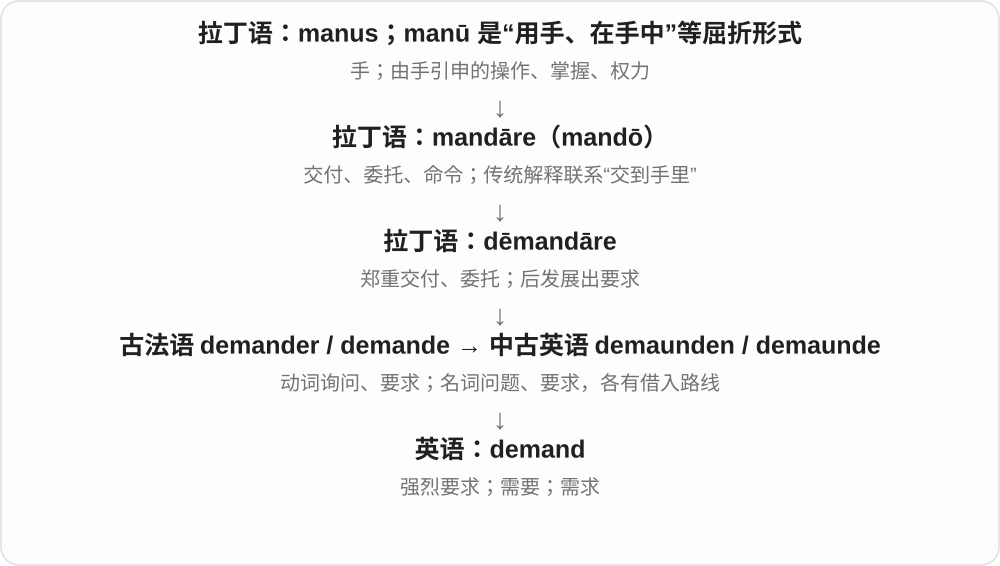

demand an explanation 是强烈要求解释；a job demands patience 是工作需要耐心；in demand 是很抢手。

**常见搭配与例句**

demand that；demand an answer；supply and demand；in demand。

> The residents demanded an explanation for the delay.

居民强烈要求解释延误的原因。

> The work demands patience and careful attention.

这项工作需要耐心和细心。

> Demand for smaller apartments has increased.

对小户型公寓的需求增加了。

**别混淆**

ask 可以礼貌询问；demand 通常更强硬。need 表示需要，demand 还可体现外部压力或购买需求。

### 2. command — 命令；指挥；控制；掌握；赢得

**音标**：英 /kəˈmɑːnd/；美 /kəˈmænd/

**先抓住这个画面**

command 的中心是“有能力或权力让事情照自己的指令运转”，可以是命令部队，也可以是熟练掌握语言。

**怎么拆**

经法语和晚期拉丁 commandāre，远连 commendāre、mandāre；名词也经古法语 comand 借入；这里 com- 的历史不是现代英语 come。

**怎么变成今天的意思**

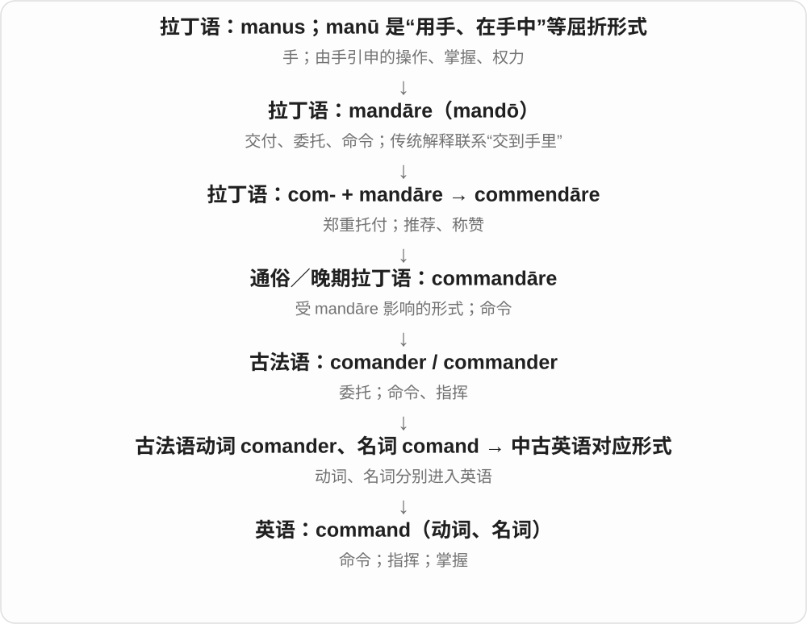

give a command 是发命令；in command 是掌权；a good command of English 是熟练掌握英语；command respect 是赢得敬重。

**常见搭配与例句**

under someone’s command；a command line；command respect；a command of。

> The captain gave the command to stop.

船长下令停下。

> She has an excellent command of written English.

她很擅长运用书面英语。

> His calm response commanded respect.

他镇定的回应赢得了尊重。

**别混淆**

order 常指具体命令；command 还能指指挥权、掌控能力，语气常更正式。

### 3. recommend — 推荐；建议

**音标**：/ˌrekəˈmend/

**先抓住这个画面**

recommend 像把一个你认为可靠的人或选择放到别人面前：“这个值得考虑。”

**怎么拆**

re- 在这里常解释为加强作用，具体早期作用尚不完全明确；接拉丁 commendāre“托付、赞许”，经法语和中古英语而来；不是只能指“再次命令”。

**怎么变成今天的意思**

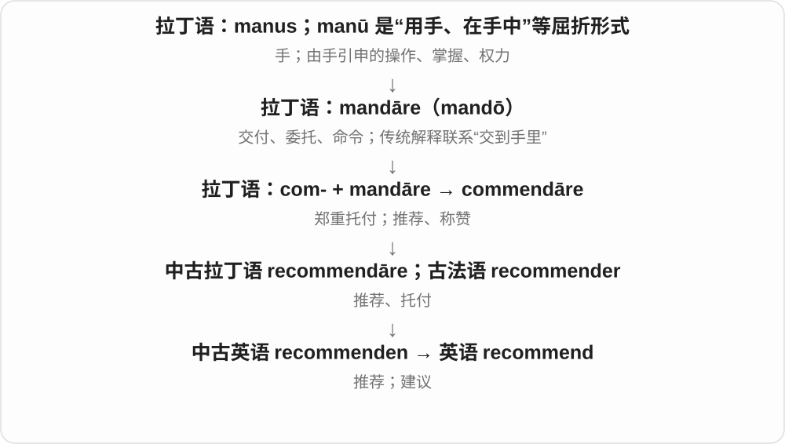

recommend a book 是推荐书；recommend doing 是建议做；recommend that someone do 是建议某人采取行动。

**常见搭配与例句**

recommend something to someone；recommend doing；highly recommend。

> Can you recommend a book for someone new to the subject?

你能给刚接触这个主题的人推荐一本书吗？

> I recommend saving a copy before you edit the file.

我建议编辑文件前先保存一份副本。

**别混淆**

command 是下命令；recommend 是提出值得采纳的选择，对方通常仍有决定空间。

### 4. commander — 指挥官；统领；某些军种的中校军衔

**音标**：英 /kəˈmɑːndə/；美 /kəˈmændər/

**先抓住这个画面**

commander 是负责发出指令并统筹行动的人，像把各支力量协调到一个方向。

**怎么拆**

现代可拆 command + -er；历史经古法语 comandeor / cumandeur 和中古英语 comaundour 独立借入。

**怎么变成今天的意思**

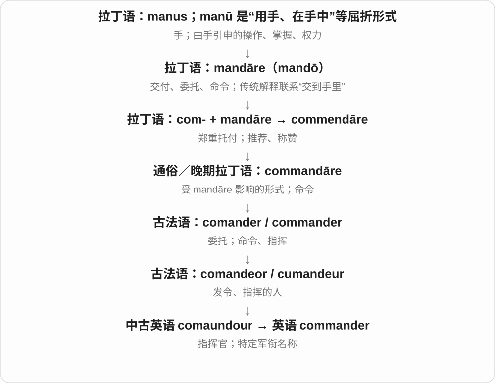

可指职位，也可指某些海军体系中的特定军衔。不同国家与军种的军衔不能只凭同一个英文词机械对应。

**常见搭配与例句**

a unit commander；a mission commander；the commanding officer。

> The commander briefed the team before the exercise.

指挥官在演习前向团队说明了情况。

> The mission commander made the final decision.

任务指挥官作出了最终决定。

**别混淆**

captain 也可任指挥官，但首先可能是军衔、船长等身份；commander 更直接突出指挥职责。

### 5. demanding — 要求高的；费力的；苛求的

**音标**：英 /dɪˈmɑːndɪŋ/；美 /dɪˈmændɪŋ/

**先抓住这个画面**

demanding 像一个不断伸手向你要时间、精力或注意力的任务，也可以形容不断向别人提要求的人。

**怎么拆**

demand + -ing，分词转成形容词。

**怎么变成今天的意思**

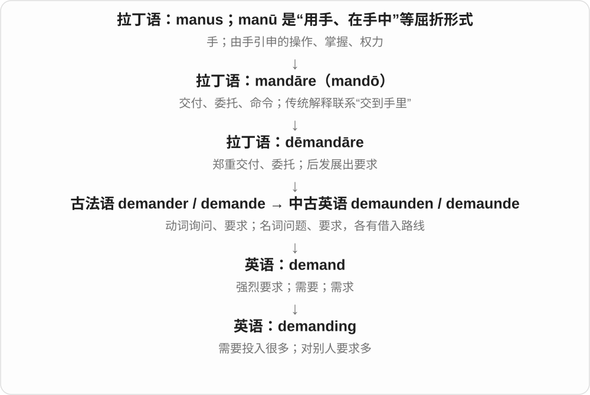

a demanding job 是工作很费力；a demanding customer 是顾客要求多。前者不一定负面，后者常含难伺候的评价。

**常见搭配与例句**

physically demanding；a demanding task；a demanding audience。

> The hike was physically demanding but rewarding.

这次徒步很耗体力，但收获很大。

> The team had to satisfy a particularly demanding client.

团队必须满足一位要求特别多的客户。

**别混淆**

difficult 是困难；demanding 更突出它要求你投入很多能力、时间或精力。

### 6. mandatory — 强制的；必须遵守的

**音标**：英 /ˈmændətəri/；美 /ˈmændəˌtɔːri/

**先抓住这个画面**

mandatory 像事项旁盖上“必须”的印章：它不是建议，而是规则要求你做。

**怎么拆**

来自晚期拉丁 mandātōrius，联系 mandātor“发令者”和 mandāre；现代可联想 mandate + -ory。

**怎么变成今天的意思**

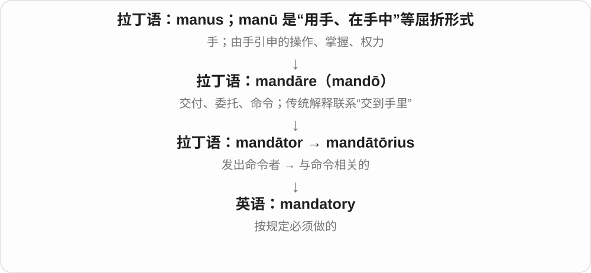

a mandatory course 是必修课；mandatory attendance 是要求出席。历史文本也有委任统治相关名词义。

**常见搭配与例句**

mandatory training；mandatory attendance；a mandatory requirement。

> Attendance at the safety briefing is mandatory.

安全说明会必须参加。

> The form marks mandatory fields with an asterisk.

表格用星号标出必填项。

**别混淆**

recommended 表示建议采用；mandatory 表示规则要求执行。

### 7. recommendation — 建议；推荐；推荐信、推荐意见

**音标**：/ˌrekəmenˈdeɪʃən/

**先抓住这个画面**

recommendation 是递到你面前的一条选择意见，或某人替你作出的正面评价。

**怎么拆**

借自盎格鲁法语 recomendacion，远源中古拉丁 recommendātiō；现代可对应 recommend + -ation，但名词有自己的借入路线。

**怎么变成今天的意思**

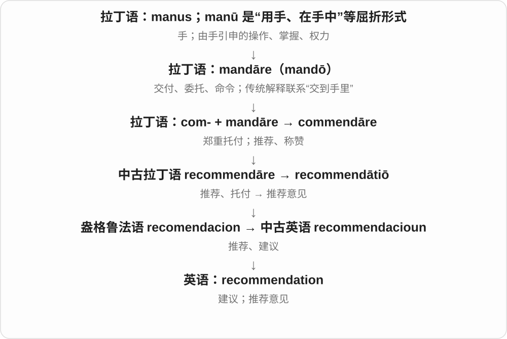

a recommendation for a restaurant 是餐厅推荐；a letter of recommendation 是推荐信；accept a recommendation 是采纳建议。

**常见搭配与例句**

make a recommendation；on someone’s recommendation；a letter of recommendation。

> We chose the restaurant on her recommendation.

我们听了她的推荐，选了这家餐厅。

> The report makes three practical recommendations.

报告提出了三条切实可行的建议。

**别混淆**

requirement 是要求；recommendation 是建议或推荐，不一定具有强制性。

### 8. mandate — 正式命令；授权、委托；要求、授权

**音标**：/ˈmændeɪt/

**先抓住这个画面**

mandate 像把一份正式任务交到你手里：既可能是必须做的命令，也可能是允许你代表别人行动的授权。

**怎么拆**

来自拉丁 mandātum，联系 mandāre“委托、命令”；传统分析把更早构成联系到 manus“手”及交付、放置的成分。不是 man + date。

**怎么变成今天的意思**

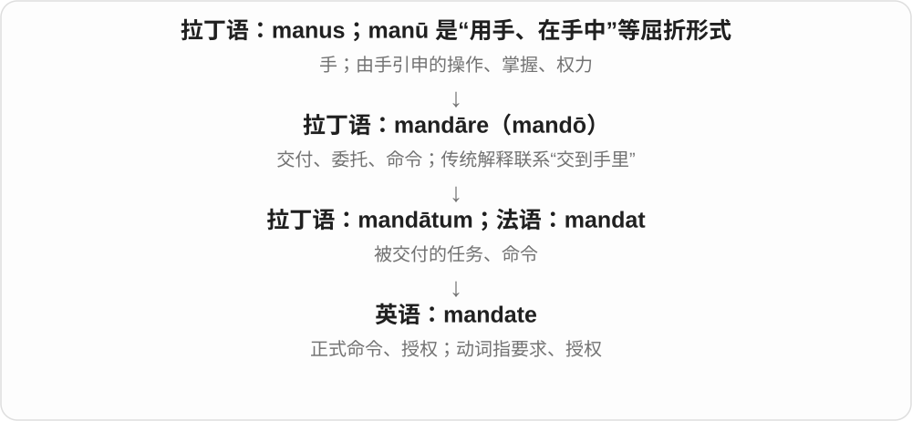

a mandate to negotiate 是谈判授权；a government mandate 是正式要求；选举里的 mandate 指被视为由选民赋予的政治授权。

**常见搭配与例句**

a clear mandate；a mandate to do；mandate training；within its mandate。

> The committee has a mandate to review the process.

委员会获授权审查这一流程。

> The new policy mandates annual safety training.

新政策要求每年接受安全培训。

**别混淆**

permission 是获准做；mandate 往往连带正式职责、权力或要求。具体是命令还是授权，要看上下文。

### 9. commanding — 有威势的；居支配地位的；可俯瞰的；指挥的

**音标**：英 /kəˈmɑːndɪŋ/；美 /kəˈmændɪŋ/

**先抓住这个画面**

像站在一个能控制全场的位置上：说话能让人听见，比赛优势明显，从高处也能把周围看清。

**怎么拆**

英语 command 的现在分词形容词；由指挥、控制发展出有威严、占优势及居高临下的视野。

**怎么变成今天的意思**

**拉丁 mandare／mandatus**  
托付、交付；命令、委派

↓

**拉丁 com- + mandare → commendare**  
郑重托付；推荐、赞许

↓

**通俗拉丁 \*commandare〔重构形式〕→ 古法语 comander**  
发出命令、托付

↓

**中古英语 commanden → 英语 command〔动词〕**  
命令；控制、掌握

↓

**英语 command + -ing → commanding**  
正在指挥；具有控制力、优势或开阔视野的

a commanding officer 是指挥官；a commanding lead 是明显领先；a commanding view 是居高临下的开阔视野。最后一种用法是在延伸“控制、统览周围”的空间关系。

**常见搭配与例句**

a commanding officer；a commanding presence；a commanding lead；a commanding view。

> She spoke in a calm but commanding voice.

她说话平静，却很有威势。

> The hilltop house has a commanding view of the valley.

山顶的房子可以俯瞰整个山谷。

> The team took a commanding lead in the first half.

球队在上半场取得明显领先。

**别混淆**

demanding 是对人要求高或事情费力；commanding 是有控制力、威势或优势。

### 10. commando — 突击队员；突击队

**音标**：英 /kəˈmɑːndəʊ/；美 /kəˈmændoʊ/

**先抓住这个画面**

commando 的现代画面是受过专门训练、执行特殊突击任务的小队或队员。

**怎么拆**

经南非荷兰语 kommando，联系葡萄牙语 comando“命令、指挥”，远源拉丁 commendāre / commandāre；不是英语 command 临时加 o。

**怎么变成今天的意思**

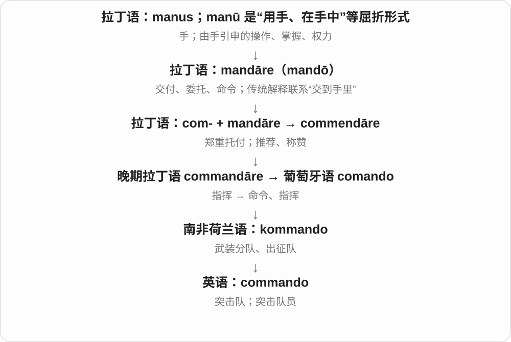

这个词经过南非武装队伍语境，再发展出现代突击部队用法。名词可以指一人，也可以指一支部队，需看句子。

**常见搭配与例句**

a commando unit；commando training；a commando raid。

> The exhibit describes the equipment carried by a commando.

展览介绍了一名突击队员携带的装备。

> The documentary follows a commando unit during training.

纪录片跟拍了一支突击队的训练。

**别混淆**

soldier 是士兵总称；commando 指特定训练和任务背景下的队员或部队。

### 11. commend — 赞扬；推荐；郑重托付

**音标**：/kəˈmend/

**先抓住这个画面**

commend 像把一个人的表现郑重放到别人面前，告诉大家“这值得肯定”；旧一点的用法也能把人托付给别人照顾。

**怎么拆**

com- 加拉丁 mandāre“托付”，形成 commendāre，经法语 comender 和中古英语 commenden 而来；与 command 同源但分化。

**怎么变成今天的意思**

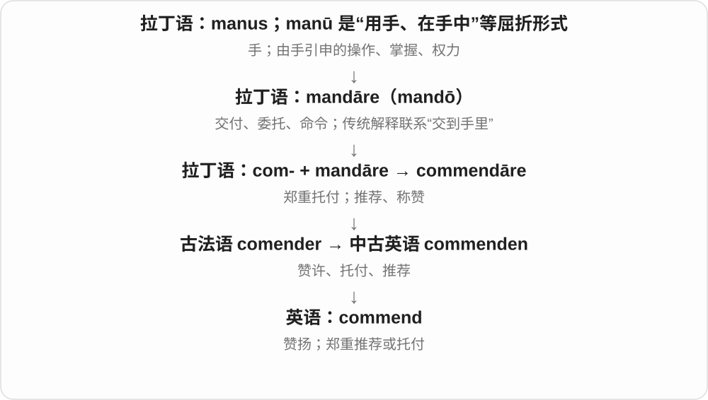

commend someone for something 是因某事表扬某人；commend something to someone 是请某人认真考虑某事，较正式。

**常见搭配与例句**

commend someone for；highly commended；commend to your attention。

> The director commended the team for its careful work.

主管表扬了团队认真细致的工作。

> I commend this thoughtful essay to your attention.

我郑重推荐你关注这篇思考深入的文章。

**别混淆**

recommend 更常是提出选择建议；commend 更常是郑重称赞，也保留托付义。

### 12. commandant — 司令；驻地或训练机构负责人

**音标**：英 /ˌkɒmənˈdɑːnt/；美 /ˌkɑːmənˈdænt/

**先抓住这个画面**

commandant 常是某个营地、军事院校或机构的最高负责人，重点是这个特定管理岗位。

**怎么拆**

借法语 commandant，原为 commander“指挥”的现在分词，后来作负责人名称；与英语 commander 是平行借词。

**怎么变成今天的意思**

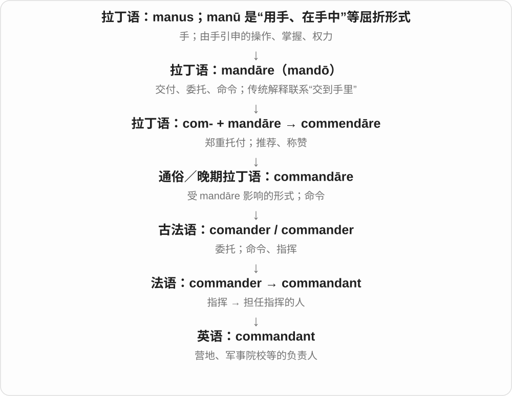

具体头衔与军衔依国家和机构而异。不要看到词尾不同就假定 commandant 一定比 commander 高一级。

**常见搭配与例句**

the commandant of an academy；a camp commandant。

> The academy’s commandant welcomed the new students.

学院负责人欢迎了新学员。

> The letter was addressed to the commandant of the camp.

这封信是寄给营地负责人的。

**别混淆**

commander 泛指指挥者及特定军衔；commandant 常是某类机构的职务称号。

### 13. commandment — 诫命；戒律；郑重的命令

**音标**：英 /kəˈmɑːndmənt/；美 /kəˈmændmənt/

**先抓住这个画面**

commandment 像把一条命令刻成必须遵守的准则，最熟悉的场景是宗教诫命。

**怎么拆**

借自古法语 comandement，经中古英语 comaundement；与 command 共享法语动词祖先，不能倒画成英语动词生出法语名词。

**怎么变成今天的意思**

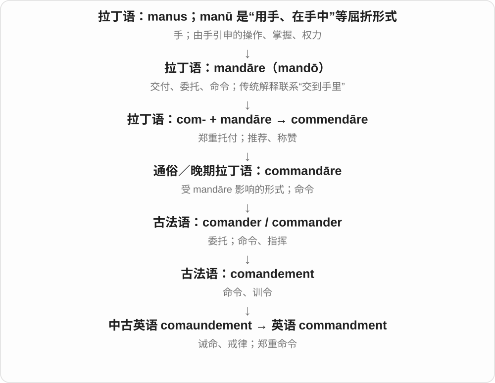

the Ten Commandments 指《圣经》十诫。普通比喻中也能称某领域奉为铁律的规则，但带庄重或戏谑色彩。

**常见搭配与例句**

the Ten Commandments；keep a commandment；break a commandment。

> The lesson discusses the meaning of the first commandment.

这一课讨论第一条诫命的含义。

> He treated that rule as an absolute commandment.

他把那条规则当成不可违背的戒律。

**别混淆**

command 可是一次性的命令；commandment 更像长期遵守的规范，尤其宗教准则。

### 14. commendable — 值得赞扬的；可嘉的

**音标**：/kəˈmendəbəl/

**先抓住这个画面**

一个行为摆在面前，让人觉得“这一点做得好，应该肯定”。它评价的是被赞扬的事情。

**怎么拆**

经法语或直接接拉丁 commendabilis，来自 commendare“赞扬、托付”；现代可对应 commend + -able，但形容词本身有借入路线。

**怎么变成今天的意思**

**拉丁 mandare／mandatus**  
托付、交付；命令、委派

↓

**拉丁 com- + mandare → commendare**  
郑重托付；推荐、赞许

↓

**拉丁 commendabilis → 法语 commendable／直接拉丁 → 中古英语 commendable**  
值得推荐、值得赞扬的

commendable patience 是值得称赞的耐心；a commendable effort 肯定付出的努力，不保证最后结果完美。有时称赞程度较克制，类似“这一点值得表扬”。

**常见搭配与例句**

a commendable effort；commendable patience；highly commendable。

> The volunteers showed commendable patience with the repeated delays.

面对一再延误，志愿者表现出可嘉的耐心。

> It was a commendable effort, even though the team did not finish first.

虽然团队没拿第一，但这份努力值得肯定。

**别混淆**

commendatory 是在表达赞扬的，如赞扬的话；commendable 是值得被赞扬的，如好行为。

### 15. commendation — 表扬；嘉奖；推荐、赞许

**音标**：英 /ˌkɒmenˈdeɪʃən/；美 /ˌkɑːmenˈdeɪʃən/

**先抓住这个画面**

commendation 像一份公开的肯定：可以是一段赞扬，也可以是正式颁发的嘉奖。

**怎么拆**

拉丁 commendātiō 经古法语 commendacion、中古英语 commendacioun 借入；现代对应 commend + -ation，但并非英语动词造出拉丁名词。

**怎么变成今天的意思**

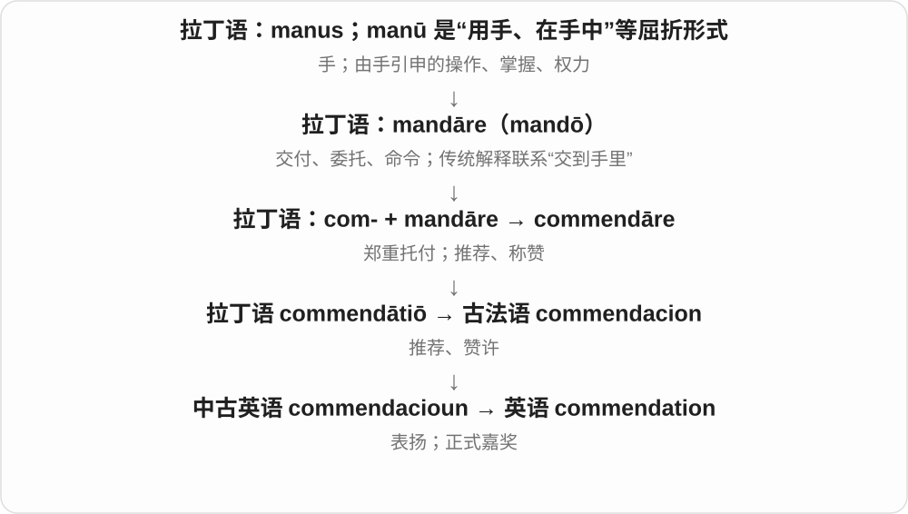

receive a commendation 常指受到正式嘉奖；a letter of commendation 是表扬信。不要与 condemnation“谴责”看混。

**常见搭配与例句**

an official commendation；a letter of commendation；receive a commendation。

> The volunteer received a commendation for years of service.

这位志愿者因多年服务而获嘉奖。

> The letter of commendation praised her calm response.

表扬信赞扬了她镇定的应对。

**别混淆**

recommendation 常帮助别人作选择；commendation 更突出对已有表现的肯定。

### 16. remand — 发回重审或进一步处理；使候审；还押

**音标**：英 /rɪˈmɑːnd/；美 /rɪˈmænd/

**先抓住这个画面**

remand 的核心画面是“按正式命令送回去”：案子可送回下级法院处理，被告也可被安排候审。

**怎么拆**

re-（回）+ 拉丁 mandāre“命令”，经法语 remander 和中古英语 remaunden 进入英语。

**怎么变成今天的意思**

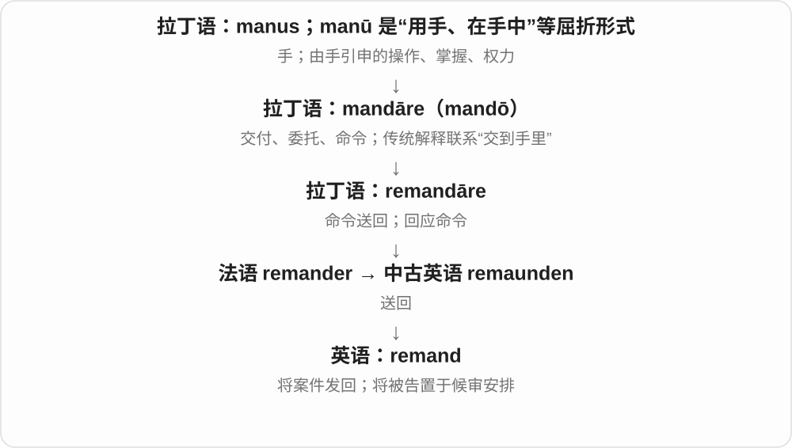

remand a case 是发回案件；remand someone in custody 是还押候审。英式还可说 remand on bail，所以不能把所有 remand 都翻成关进牢里。

**常见搭配与例句**

remand a case；remand in custody；on remand。

> The appeals court remanded the case for further consideration.

上诉法院将案件发回进一步审理。

> The report says the defendant was remanded on bail.

报道说，被告获准保释候审。

**别混淆**

convict 是定罪；remand 常发生在程序尚未结束时，不等于判定有罪。

### 17. commandeer — 征用；强占、擅自占用

**音标**：英 /ˌkɒmənˈdɪə/；美 /ˌkɑːmənˈdɪr/

**先抓住这个画面**

不只是对别人说一个命令，而是把车辆、房间或设备直接调来给自己使用。

**怎么拆**

经荷兰语 commanderen，部分经南非荷兰语 kommandeer，最终接法语 commander。英语在南非军事背景中借入；不是 command 加“鹿”deer，也不等于 commander“指挥官”。

**怎么变成今天的意思**

**拉丁 mandare／mandatus**  
托付、交付；命令、委派

↓

**拉丁 com- + mandare → commendare**  
郑重托付；推荐、赞许

↓

**法语 commander → 荷兰语 commanderen／南非荷兰语 kommandeer**  
命令、征召服役

↓

**英语 commandeer**  
征用军需；后来泛指强行或擅自占用

政府或军队可 commandeer vehicles；日常轻松说 children commandeered the sofa，是孩子们把沙发占了。正式征用与随意占用是不同情境，词义由上下文决定。

**常见搭配与例句**

commandeer a vehicle；commandeer a room；commandeer equipment。

> The army commandeered several trucks to carry supplies.

军队征用了几辆卡车运送物资。

> The children commandeered the dining table for their model railway.

孩子们占用了餐桌来搭模型铁路。

**别混淆**

command 常指命令、指挥；commandeer 突出把某物收来占用。borrow 通常含借用与归还的约定。

### 18. undemanding — 不费力的；要求不高的；不难照料的

**音标**：英 /ˌʌndɪˈmɑːndɪŋ/；美 /ˌʌndɪˈmændɪŋ/

**先抓住这个画面**

它不会不断向你索取时间、精力或技巧，接手以后比较轻松。

**怎么拆**

英语 un- 不 + demanding“要求高、费力的”；demanding 是 demand 的分词形容词。这里 un- 只是否定，不是拉丁 unus“一”。

**怎么变成今天的意思**

**拉丁 mandare／mandatus**  
托付、交付；命令、委派

↓

**拉丁 demandare → 古法语 demander／名词 demande**  
委托、提出要求；要求这一事项

↓

**中古英语 demaunden／demaunde → 英语 demand**  
动词要求；名词要求、需求，分别借入

↓

**英语 demand → demanding → un- + demanding → undemanding**  
要求很多的 → 不需要很多投入的

an undemanding walk 是轻松的步行路线；an undemanding plant 不难照料；an undemanding person 对别人要求不多。它可以是优点，也可能暗示缺少挑战。

**常见搭配与例句**

an undemanding task；an undemanding walk；undemanding plants。

> After a busy week, I wanted an undemanding film to relax with.

忙了一周后，我想看一部不费脑子的电影放松。

> These undemanding plants are suitable for a beginner’s garden.

这些不难照料的植物适合新手种植。

**别混淆**

easy 泛指容易；undemanding 更具体地说不需要太多精力、注意或技能。

### 19. mandamus — 履行职责令；强制履行令

**音标**：/mænˈdeɪməs/

**先抓住这个画面**

mandamus 像法院对负有职责的人说：“这项职责该履行，请去做。”

**怎么拆**

直接借拉丁 mandāmus，意思是“我们命令”，是 mandāre 的第一人称复数形式；不是 mand + amus 随意拼接。

**怎么变成今天的意思**

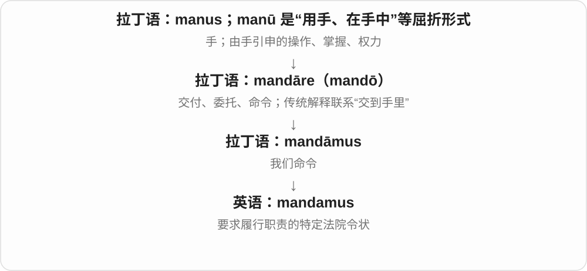

在普通法制度语境中，它指特定的司法救济名称；适用条件因制度而异，不是所有法院命令的总称。

**常见搭配与例句**

a writ of mandamus；seek mandamus；a petition for mandamus。

> The petition asked the court to issue a writ of mandamus.

申请书请求法院发出履行职责令。

> The judgment explains why mandamus was unavailable in that case.

判决解释了为什么该案不适用这种履行职责令。

**别混淆**

injunction 也是法院命令的一类，但 mandamus 特别围绕要求履行某项职责。

### 20. recommender — 推荐人；推荐系统、推荐器

**音标**：英 /ˌrekəˈmendə/；美 /ˌrekəˈmendər/

**先抓住这个画面**

从“给出建议”转向“是谁在替你挑”：可以是写推荐信的人，也可以是挑出你可能喜欢内容的程序。

**怎么拆**

英语 recommend + -er。虽然古法语 recommender 拼写相同，但那个是动词；现代英语人物、系统名词的 -er 是英语构词。

**怎么变成今天的意思**

**拉丁 mandare／mandatus**  
托付、交付；命令、委派

↓

**拉丁 com- + mandare → commendare**  
郑重托付；推荐、赞许

↓

**中世纪拉丁 recommendare → 古法语 recommender → 中古英语 recommenden**  
郑重推荐、托付

↓

**英语 recommend**  
建议、推荐

↓

**英语 recommend + -er → recommender**  
提出推荐的人；执行推荐的系统

申请材料里的 recommender 常是推荐信作者；a recommender system 则根据兴趣、行为或物品相似性等信息挑选内容。输出是建议，不保证一定合适。

**常见搭配与例句**

a letter from a recommender；a recommender system；a movie recommender。

> Please ask your recommender to submit the letter by Friday.

请你的推荐人在周五前提交推荐信。

> The music recommender suggests tracks similar to songs I have enjoyed.

音乐推荐系统会推荐与我喜欢的歌曲相似的曲目。

**别混淆**

recommendation 是给出的建议或推荐信；recommender 是给出它的人或系统。

### 21. commendably — 值得称赞地；可嘉地

**音标**：/kəˈmendəbli/

**先抓住这个画面**

一边描述事情怎么做，一边明确肯定这种做法：做得坦诚、认真或克制，值得赞扬。

**怎么拆**

英语 commendable + -ly，-able 的词尾变成 -ably；接的是已经借入英语的 commendable。

**怎么变成今天的意思**

**拉丁 mandare／mandatus**  
托付、交付；命令、委派

↓

**拉丁 com- + mandare → commendare**  
郑重托付；推荐、赞许

↓

**拉丁 commendabilis → 法语 commendable／直接拉丁 → 中古英语 commendable**  
值得推荐、值得赞扬的

↓

**英语 commendable → commendably**  
值得称赞的 → 以值得称赞的方式

commendably honest 是诚实得值得肯定；commendably brief 可以赞扬报告简洁。它不是说一个人“正在赞扬别人”，而是说其表现值得赞扬。

**常见搭配与例句**

commendably clear；commendably honest；acted commendably。

> The author is commendably honest about the limits of the study.

作者坦诚说明研究的局限，这一点值得肯定。

> The team responded commendably quickly to the problem.

团队迅速回应了问题，表现可嘉。

**别混淆**

commendatory 修饰表达称赞的话；commendably 修饰获得称赞的行为或特点。

### 22. countermand — 撤销命令；下反令取消

**音标**：英 /ˌkaʊntəˈmɑːnd/；美 /ˈkaʊntərˌmænd/

**先抓住这个画面**

countermand 像刚发出“开始”，又发出一个有权覆盖它的“取消”：后一道命令把前一道撤回。

**怎么拆**

经古法语 contremander，远源中古拉丁 contrāmandāre；contra（反向）+ mandāre（命令）。

**怎么变成今天的意思**

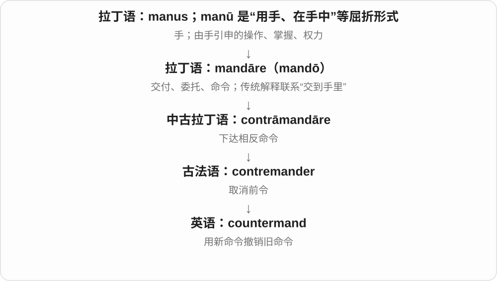

通常是有相应权力的人撤销此前指令。它不是一般提出不同意见，而是改变命令的效力。

**常见搭配与例句**

countermand an order；countermand instructions。

> The supervisor countermanded the instruction to close the office.

主管撤销了关闭办公室的指令。

> No one was authorized to countermand the captain’s order.

没有人获授权撤销船长的命令。

**别混淆**

contradict 是反驳、说相反的话；countermand 是以命令取消先前命令。

### 23. commendatory — 赞许的；表示推荐的；受托兼领教产的〔教会史〕

**音标**：英 /kəˈmendətəri/；美 /kəˈmendətɔːri/

**先抓住这个画面**

想象一封信在替某人说好话：信本身在做“称赞、推荐”这件事，而不只是值得别人夸。

**怎么拆**

后期拉丁 commendatorius 接 commendator、commendare“托付、赞扬”；现代也可分析 commend + -atory，但借词路线比单纯英语拼接更完整。

**怎么变成今天的意思**

**拉丁 mandare／mandatus**  
托付、交付；命令、委派

↓

**拉丁 com- + mandare → commendare**  
郑重托付；推荐、赞许

↓

**拉丁 commendator → 后期拉丁 commendatorius → 英语 commendatory**  
托付、称赞者 → 用来推荐、赞许的

commendatory remarks 是赞许的评论。教会史中 commendatory abbot 指以托管等方式享有修道院权益的院长，接“托付”支线；这种历史义不等于“值得夸奖的院长”。

**常见搭配与例句**

commendatory remarks；a commendatory letter；a commendatory abbot〔历史〕。

> The review ends with several commendatory remarks about the translation.

书评最后对译文作了几句赞许。

> The archive preserves a commendatory letter written by her former teacher.

档案馆保存着她以前的老师写的一封推荐信。

**别混淆**

commendable 说对象值得赞扬；commendatory 说言语或文字正在表达赞扬。普通场景中 complimentary 更常见。

### 24. mandatorily — 强制地；按必须执行的要求

**音标**：英 /ˈmændətərɪli/；美 /ˈmændətɔːrəli/

**先抓住这个画面**

这一步写在规定里，办事的人不能把它当成可选项跳过。

**怎么拆**

英语 mandatory + -ly，y 变 i；mandatory 本身接后期拉丁 mandatorius“与命令、委派有关的”。

**怎么变成今天的意思**

**拉丁 mandare／mandatus**  
托付、交付；命令、委派

↓

**拉丁 mandator → 后期拉丁 mandatorius → 英语 mandatory**  
发出命令者 → 命令性质的、必须的

↓

**英语 mandatory + -ly → mandatorily**  
按照强制性要求、作为必须事项

mandatorily included 是按规定必须包含；mandatorily reported 是必须报告。普通表达中 required to 往往更顺口，本词较正式。它只说有强制要求，具体哪项规定要另看上下文。

**常见搭配与例句**

mandatorily included；mandatorily reported；mandatorily required。

> Under the club’s new rules, a safety briefing is mandatorily included in every trip.

依照俱乐部新规，每次出行都必须包含安全说明。

> The report distinguishes information disclosed voluntarily from information disclosed mandatorily.

报告区分了自愿披露的信息与按强制要求披露的信息。

**别混淆**

voluntarily 是自愿地；mandatorily 是被要求必须如此。necessarily 有必然逻辑或必要性，不一定来自外部规则。

### 25. encomienda — 委托监护制；西班牙殖民地的贡赋、劳役授予制度〔历史〕

**音标**：美 /ˌenkoʊmiˈendə/，亦有其他读法

**先抓住这个画面**

名字听起来是“把人交给某人照管”，制度实际却让获授者向特定原住民群体索取贡赋或劳动。词源的温和说法不能遮住实际关系。

**怎么拆**

西班牙语 encomienda 来自 encomendar“托付”，en- 加旧 comendar，远接拉丁 commendare；英语借入西班牙制度名称，不经英语 commend。

**怎么变成今天的意思**

**拉丁 mandare／mandatus**  
托付、交付；命令、委派

↓

**拉丁 com- + mandare → commendare**  
郑重托付；推荐、赞许

↓

**西班牙语 comendar → en- + comendar → encomendar → encomienda**  
托付；委托及其制度名称

↓

**英语 encomienda**  
尤其用于西班牙殖民统治中的贡赋、劳役授予制度

殖民者等获授对象可取得向指定群体征取贡赋、劳役的权益，名义上承担保护和宗教教化责任，实际伴随严重剥削。它的核心是对人的贡赋、劳动的控制，不能简单等同土地所有权授予。

**常见搭配与例句**

the encomienda system；an encomienda grant；labour under the encomienda system。

> The chapter explains how the encomienda system extracted tribute from Indigenous communities.

这一章解释委托监护制怎样从原住民社区征取贡赋。

> The historian distinguishes an encomienda grant from a simple grant of land.

历史学家把委托监护权益的授予与单纯的土地授予区分开来。

**别混淆**

estate 泛指地产；encomienda 是特定历史制度。它与其他殖民劳役安排有关，但各地区、时期的法律形式并不完全相同。

### 26. commendam — 教会俸禄、教产的托管或兼领；这样持有的圣职俸禄〔历史〕

**音标**：/kəˈmendæm/

**先抓住这个画面**

一个职位附带收入，但暂未按通常方式交给正式任职者，于是把它及收益交由某人管理或享有。

**怎么拆**

来自中世纪拉丁短语 in commendam“以托管方式”，commendam 是 commenda“托付”的宾格形式，接 commendare。最后的 -am 是拉丁格变化，不是现代英语后缀。

**怎么变成今天的意思**

**拉丁 mandare／mandatus**  
托付、交付；命令、委派

↓

**拉丁 com- + mandare → commendare**  
郑重托付；推荐、赞许

↓

**中世纪拉丁 commenda；短语 in commendam**  
托付；交由代管

↓

**英语 commendam**  
圣职俸禄的托管、兼领状态及相关权益

benefice 是附有收入的教会圣职。hold a benefice in commendam 表示以托付形式持有，历史上常是临时安排，也可能延续。它还可指享有该收入，不应只译成一般的“表扬”。

**常见搭配与例句**

hold a benefice in commendam；a grant in commendam。

> The document records that the benefice was held in commendam.

文书记载，这项圣职俸禄以托管形式持有。

> The historian traced the income received under the grant in commendam.

历史学家追查了依据这项教产托管授予而取得的收入。

**别混淆**

commendation 是称赞；commendam 是教会制度用语，两者同接托付支线却不能互换。

### 27. mandatary — 受托人；受委任者；受委任统治国〔历史〕

**音标**：英 /ˈmændətəri/；美 /ˈmændəteri/

**先抓住这个画面**

任务书交过来，接住它并代表别人办理事务的这一方，就是 mandatary。

**怎么拆**

借后期拉丁 mandatarius“受委托者”，接 mandatus。现代能看出 mandate 与 -ary 的对应，历史却是一个现成拉丁名词的借入。

**怎么变成今天的意思**

**拉丁 mandare／mandatus**  
托付、交付；命令、委派

↓

**拉丁 mandatus → 后期拉丁 mandatarius → 英语 mandatary**  
受到委派的 → 接受委任的人

委托关系中指接受授权办事的人；历史国际政治中也可指接受委任统治授权的国家。词的重点是收到委托的一方，不是发出命令的一方。

**常见搭配与例句**

act as a mandatary；the powers of the mandatary；a mandatary state〔历史〕。

> The agreement identifies the person who will act as mandatary.

协议明确指出谁将担任受托人。

> The historian examined the powers claimed by the mandatary state.

历史学家考察了该受委任统治国所主张的权力。

**别混淆**

mandator 是发出委托的人；mandatary 是接受者。mandatory 最常见的现代用法是形容词“必须的”，注意拼写不同。

### 28. counterdemand — 反要求；回应对方要求而提出的要求

**音标**：英 /ˌkaʊntədɪˈmɑːnd/；美 /ˌkaʊntərdɪˈmænd/

**先抓住这个画面**

对方说“你得给我这个”，你没有直接答应，而是提出“那你也得先满足我的条件”。

**怎么拆**

英语 counter- 反向、回应 + demand 要求。demand 名词本来经法语 demande 借入，这一步才是在英语中加前缀。

**怎么变成今天的意思**

**拉丁 mandare／mandatus**  
托付、交付；命令、委派

↓

**拉丁 demandare → 古法语 demander／名词 demande**  
委托、提出要求；要求这一事项

↓

**中古英语 demaunden／demaunde → 英语 demand**  
动词要求；名词要求、需求，分别借入

↓

**英语 counter- + demand → counterdemand**  
针对对方要求提出的反要求

谈判中的 counterdemand 可作为回应、抵制或交换条件。它可以是口头要求或书面条件，不一定已经成为诉讼程序里的反诉。

**常见搭配与例句**

make a counterdemand；respond with a counterdemand；a series of counterdemands。

> The buyers responded to the price increase with a counterdemand for longer warranties.

买方回应涨价，反过来要求更长的保修期。

> Each new demand brought another counterdemand from the other side.

每提出一个新要求，对方就会再提出一个反要求。

**别混淆**

counteroffer 是回应报价的另一报价；counterdemand 更广，可涉及行动、保证或条件。

### 29. demandant — 提出权利要求者；土地诉讼中的原告〔旧法律用语〕

**音标**：英 /dɪˈmɑːndənt/；美 /dɪˈmændənt/

**先抓住这个画面**

在旧案卷中认出“站出来要求归还土地或确认权利的那一方”，不要把它看成一般的苛刻性格描述。

**怎么拆**

盎格鲁法语 demander 的现在分词 demandant 转为人物名词，经中古英语 demaundant 而来；不是现代英语 demanding 的另一种写法。

**怎么变成今天的意思**

**拉丁 mandare／mandatus**  
托付、交付；命令、委派

↓

**拉丁 demandare → 盎格鲁法语 demander → 名词 demandant**  
要求、主张权利 → 提出请求的人

↓

**中古英语 demaundant → demandant**  
提出诉求者；尤其旧式 real action 中的原告

历史法律术语 real action 与土地等不动产权益有关，其中的原告可称 demandant。现代一般文章说 claimant 或 plaintiff 更常见；本词主要帮助读旧文书。

**常见搭配与例句**

the demandant in a land action；the demandant’s claim。

> The old record names the demandant in a dispute over the manor.

旧案卷写出了庄园争议中提出权利请求者的姓名。

> The historian compared the demandant’s claim with the tenant’s response.

历史学家比较了原告的权利主张与占有人一方的答复。

**别混淆**

demanding 是要求高、费力的形容词；demandant 是提出要求的人，尤其旧案卷中的一方。

### 30. mandator — 委托人；发出命令、授权者

**音标**：美 /ˈmændeɪtər/，亦读 /mænˈdeɪtər/

**先抓住这个画面**

同一份委托书有两端：mandator 在发出任务的一端，把权限或工作交出去。

**怎么拆**

借拉丁 mandator，来自 mandare 的施事名词。可与 mandate 对照学习，但不是先有现代英语 mandate 才能有这个拉丁人物名称。

**怎么变成今天的意思**

**拉丁 mandare／mandatus**  
托付、交付；命令、委派

↓

**拉丁 mandator → 英语 mandator**  
发出委托或命令的人

在委托关系的讨论中，mandator 指授权别人替自己办事的一方。日常英语更常按具体场景说 principal、client 或 person giving the order。

**常见搭配与例句**

the mandator and the mandatary；instructions from the mandator。

> The mandator gave written instructions to the person acting on her behalf.

委托人向代她办事的人给出了书面指示。

> The diagram places the mandator on one side and the mandatary on the other.

示意图把委托人与受托人分别放在两侧。

**别混淆**

mandatary 是受托者；mandator 是委托者。-or 在这里标记发出行为的一方。

### 31. recommendatory — 推荐的；建议性质的；赞许的

**音标**：英 /ˌrekəˈmendətəri/；美 /ˌrekəˈmendətɔːri/

**先抓住这个画面**

把意见放到你面前供采用，或替某个人、方案引起好感；重点可能是建议效力，也可能是推荐作用。

**怎么拆**

Merriam-Webster 分析为中世纪拉丁 recommendatus 加英语 -ory；现代也能对应 recommend + -atory。历史说明保留拉丁分词材料，不硬断言全词只是英语动词派生。

**怎么变成今天的意思**

**拉丁 mandare／mandatus**  
托付、交付；命令、委派

↓

**拉丁 com- + mandare → commendare**  
郑重托付；推荐、赞许

↓

**中世纪拉丁 recommendare → recommendatus**  
推荐、托付 → 被推荐的

↓

**中世纪拉丁分词词干 + 英语 -ory → recommendatory**  
具有推荐、建议作用的

a recommendatory letter 是推荐信；recommendatory guidelines 强调它们是建议性质，可与 binding 或 mandatory 对比。但一份具体文件是否有约束力，需要看制度与全文，不能只靠词根判断。

**常见搭配与例句**

a recommendatory letter；a recommendatory role；recommendatory guidelines。

> The panel has a recommendatory role and cannot make the final decision.

这个小组只起建议作用，不能作出最终决定。

> The archive contains a recommendatory letter supporting her application.

档案中保存着一封支持她申请的推荐信。

**别混淆**

mandatory 强调必须遵从；recommendatory 的建议义强调供考虑。commendatory 更突出表达赞许。

### 32. remandment — 发回处理；还押、候审安排〔少见名词〕

**音标**：英 /rɪˈmɑːndmənt/；美 /rɪˈmændmənt/〔按 remand + -ment 构词读法〕

**先抓住这个画面**

正式命令把案件送回原处理层级，或把人安排回候审程序；词尾 -ment 把这个动作作为一件程序事项来谈。

**怎么拆**

英语 remand + -ment。remand 经法语 remander，接拉丁 re- 回 + mandare 命令。

**怎么变成今天的意思**

**拉丁 mandare／mandatus**  
托付、交付；命令、委派

↓

**拉丁 remandare → 法语 remander → 英语 remand**  
命令送回；发回处理、安排候审

↓

**英语 remand + -ment → remandment**  
发回或候审安排这一行为、事项

这个名词少见，现代通常直接用 remand。读到时要看被送回的是案件还是人；只有 remandment 一词，不能推出当事人已被定罪。

**常见搭配与例句**

an order of remandment〔少见〕；remandment of a case〔少见〕。

> The old legal text uses remandment for the sending back of a case.

这份旧法律文本用 remandment 表示将案件发回。

> The researcher found an order of remandment among the archived papers.

研究人员在存档文件中发现了一份发回处理的命令。

**别混淆**

remand 是常见得多的名词和动词；remandment 主要用于识读旧式或少见表达。

## 这一组要分清什么

command 强调有权命令，demand 强调强烈要求，recommend 提供建议。commendable 是值得被称赞，commendatory 是正在表达赞许。mandator 发出委托，mandatary 接受委托。mandatory“必须的”与 mandatary“受托者”只有一个元音字母之差。

## 串起来练习

Her recommender praised her commendable patience, but made no demands. 她的推荐人称赞她可嘉的耐心，没有提出任何要求。把“推荐者、值得表扬、提出要求”分别放回具体角色，词族就不会只剩一堆近义中文标签。
