# 0505 · cred- — 相信；信任；给予认可与信用

[逐词精讲目录](../00_逐词精讲目录.md) · [总目录](../00_总目录_按常用程度.md)

## 核心词根与来源

**cred-** 来自拉丁语 **crēdere**“相信、信任、托付”。相信能还钱，形成 credit 的信贷义；相信一个说法，评价它是否 credible；一个人太容易相信别人，就叫 credulous。许多近似词要分清：是谁在相信，谁被相信，谁拿到了正式认可。

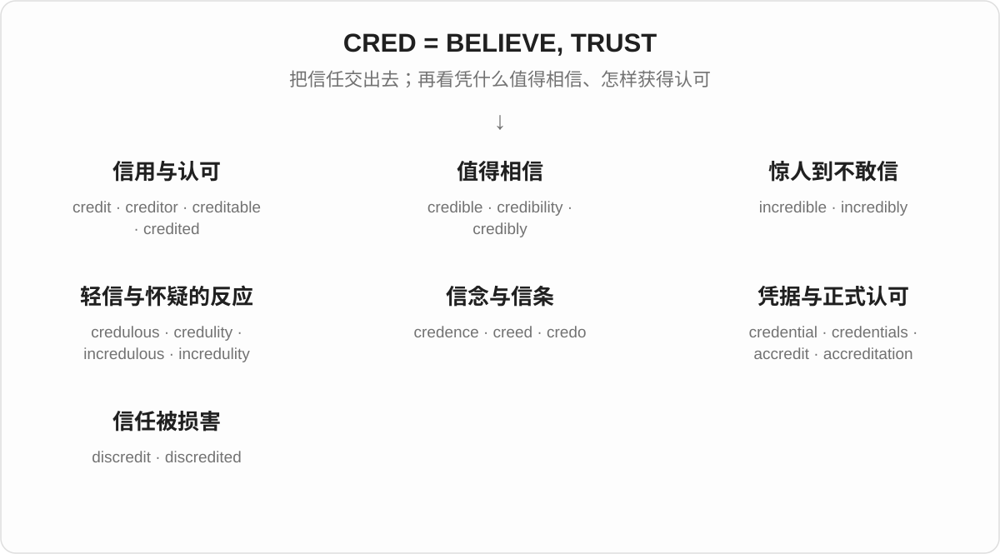

## 词形与演化规律

**crēdere** 的相关形式包括 **crēditus、crēditum**，留下 credit；**crēdibilis** 留下 credible；**crēdulus** 留下 credulous。**crēdō** 是“我相信”，形成 credo，并经古英语一路形成 creed。另一些词经法语 creire / croire 音变，才有 miscreant、recreant；看不到完整 cred 也仍能同源。

## 单词速览（按词族由简到繁）

同一基础词的相关扩展放在一起，先读基础形式，再读扩展；各组之间优先读常用的。具体词源关系见各词讲解。

| 单词 | 音标 | 核心意思 |
|---|---|---|
| [credit](#w-1) | /ˈkredɪt/ | 信用；赊购；功劳；学分；记入账户 |
| [credited](#w-5) | /ˈkredɪtɪd/ | 被认可为有贡献的；被归功于的；已入账的 |
| [creditor](#w-13) | 英 /ˈkredɪtə/；美 /ˈkredɪtər/ | 债权人；别人欠其钱的一方 |
| [creditable](#w-20) | /ˈkredɪtəbəl/ | 值得称赞的；过得硬的 |
| [discredit](#w-11) | /dɪsˈkredɪt/ | 使不再可信；损害名誉 |
| [discredited](#w-12) | /dɪsˈkredɪtɪd/ | 不再被相信的；信誉受损的 |
| [microcredit](#w-27) | 英 /ˈmaɪkrəʊˌkredɪt/；美 /ˈmaɪkroʊˌkredɪt/ | 小额信贷 |
| [credible](#w-6) | /ˈkredəbəl/ | 可信的；有说服力的 |
| [credibility](#w-4) | /ˌkredəˈbɪləti/ | 可信度；信誉 |
| [credibly](#w-18) | /ˈkredəbli/ | 可信地；令人信服地 |
| [incredible](#w-2) | /ɪnˈkredəbəl/ | 难以置信的；惊人的；极棒的 |
| [incredibly](#w-3) | /ɪnˈkredəbli/ | 极其；难以置信地 |
| [credence](#w-14) | /ˈkriːdəns/ | 相信；信任；使人相信的支持 |
| [credential](#w-17) | /krɪˈdenʃəl/ | 资格证明；身份凭据；授予资格 |
| [credentials](#w-7) | /krɪˈdenʃəlz/ | 资历；资格证明；身份证明；登录凭据 |
| [accredit](#w-26) | /əˈkredɪt/ | 正式认可；认证；授权代表身份 |
| [accredited](#w-8) | /əˈkredɪtɪd/ | 获正式认可的；经认证的；获授权的 |
| [accreditation](#w-10) | /əˌkredɪˈteɪʃən/ | 正式认证；认可资格；授权 |
| [creed](#w-9) | /kriːd/ | 信条；一套坚持的信念 |
| [credulous](#w-23) | 英 /ˈkredjələs/；美 /ˈkredʒələs/ | 轻信的；容易上当的 |
| [credulity](#w-21) | 英 /krɪˈdjuːləti/；美 /krɪˈduːləti/ | 轻信；轻信的倾向 |
| [incredulous](#w-15) | 英 /ɪnˈkredjələs/；美 /ɪnˈkredʒələs/ | 不敢相信的；表示怀疑的 |
| [incredulity](#w-19) | 英 /ˌɪnkrɪˈdjuːləti/；美 /ˌɪnkrɪˈduːləti/ | 怀疑；难以置信的反应 |
| [incredulously](#w-24) | 英 /ɪnˈkredjələsli/；美 /ɪnˈkredʒələsli/ | 怀疑地；难以置信地 |
| [credo](#w-16) | 英 /ˈkriːdəʊ/、/ˈkreɪdəʊ/；美 /ˈkriːdoʊ/、/ˈkreɪdoʊ/ | 信条；行为准则 |
| [creditworthiness](#w-22) | 英 /ˈkredɪtˌwɜːðinəs/；美 /ˈkredɪtˌwɜːrðinəs/ | 信用可靠程度；偿债信用 |
| [miscreant](#w-25) | /ˈmɪskriənt/ | 恶棍；作恶的人；捣乱者 |
| [recreant](#w-28) | /ˈrekriənt/ | 怯懦的；背弃职责的；懦夫或叛徒 |

## 逐词讲解

### 1. credit — 信用；赊购；功劳；学分；记入账户

**音标**：/ˈkredɪt/

**先抓住这个画面**

credit 可以先想一笔“相信与认可”：相信你会还钱，允许先买后付；认可你做过的贡献，把功劳记给你。

**怎么拆**

经法语 crédit，来自拉丁语 crēditum“托付之物、借贷”，属于 crēdere“相信”的词族。英语动词由名词发展。

**怎么变成今天的意思**

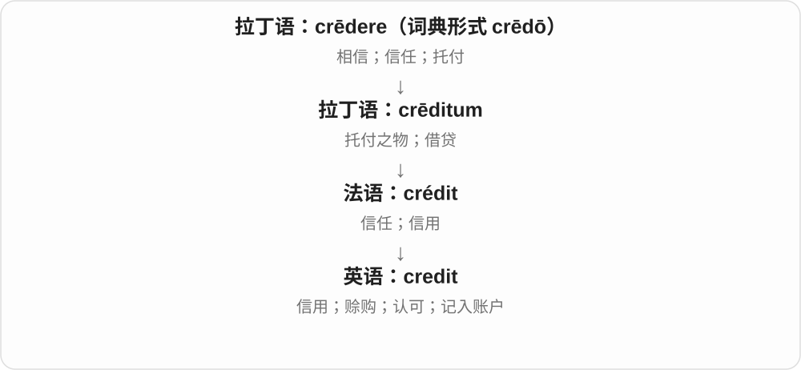

信任走进交易，形成信用和赊购；认可贡献，形成 give credit。学分也是对完成课程的正式认可。不同场景都要结合搭配理解，不能一律译成信用。

**常见搭配与例句**

buy on credit；give someone credit；take credit for…；earn course credits；credit money to an account。

> Give Maya credit for solving the problem.

这个问题是玛雅解决的，功劳应该归她。

> The shop allows customers to buy furniture on credit.

这家店允许顾客赊购家具。

**别混淆**

credit 既有信任与金融义，也有功劳和学分义。Give her credit 常是“认可她的贡献”，不是“借钱给她”。

### 2. credited — 被认可为有贡献的；被归功于的；已入账的

**音标**：/ˈkredɪtɪd/

**先抓住这个画面**

credited 像把一笔功劳、创作署名或金额正式记到某个名字下面。

**怎么拆**

credit + -ed。作过去分词时，常与 with、to 搭配，交代贡献或款项被记给谁。

**怎么变成今天的意思**

be credited with an invention 是被认为对发明有贡献；be credited to an account 是金额记入账户。两者共享“记在某一方名下”的画面。

**常见搭配与例句**

be credited with…；be credited as…；be credited to an account；a credited contributor。

> She is credited with designing the original prototype.

最初原型的设计被归功于她。

> The refund was credited to my account yesterday.

退款昨天已经记入我的账户。

**别混淆**

credited 不等于一定独自完成，也不保证历史归属毫无争议。它先说明获得了怎样的认可或记录。

### 3. creditor — 债权人；别人欠其钱的一方

**音标**：英 /ˈkredɪtə/；美 /ˈkredɪtər/

**先抓住这个画面**

creditor 是把钱或付款信任先交出去、现在有权收回的人或机构。记住方向：钱是别人欠它的。

**怎么拆**

经盎格鲁诺曼语 creditour，来自拉丁语 crēditor，与 crēditum“借贷”相连。现代 credit + -or 的画面也容易理解。

**怎么变成今天的意思**

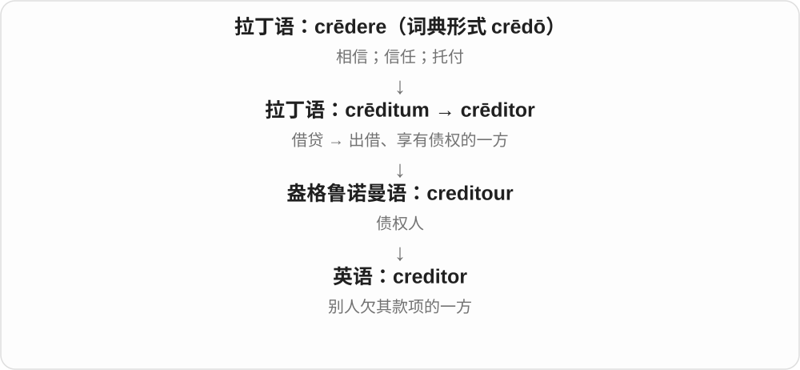

它不只指银行。商家已经交货、买方尚未付款，也可能形成债权关系。核心是存在应向它偿付的款项。

**常见搭配与例句**

pay creditors；owe money to a creditor；a major creditor；meet with creditors。

> The company contacted its creditors to discuss a repayment plan.

公司联系了各债权人，讨论还款安排。

> The supplier became a creditor when the invoice went unpaid.

账单未获支付后，那家供应商成了应收款的债权人。

**别混淆**

creditor 是应收款的一方；debtor 是欠款的一方。二者站在同一笔债务的两端。

### 4. creditable — 值得称赞的；过得硬的

**音标**：/ˈkredɪtəbəl/

**先抓住这个画面**

creditable 是“这个表现值得记上一笔好评”。不一定惊艳到第一名，但足以让人尊重。

**怎么拆**

credit（功劳、荣誉）+ -able。现代常用义沿 credit 的认可与声誉这一支发展。

**怎么变成今天的意思**

a creditable performance 常是在给定条件下表现不错。它说的是值得肯定，不只是内容听起来像真的。

**常见搭配与例句**

a creditable performance；a creditable result；a creditable effort；finish a creditable third。

> Finishing third was a creditable result for such a young team.

对这么年轻的队伍来说，获得第三名是值得称赞的成绩。

> She made a creditable attempt to explain a difficult topic.

她努力解释这个难题，做得颇有可取之处。

**别混淆**

credible 是可信；creditable 是值得赞许；credulous 是轻信别人。三个词的评价方向不同。

### 5. discredit — 使不再可信；损害名誉

**音标**：/dɪsˈkredɪt/

**先抓住这个画面**

discredit 像把一个说法脚下的支撑抽掉：原来有人信，现在证据或反驳使它站不住了。

**怎么拆**

dis-（取消、相反）+ credit（信任、声誉），是英语的否定性构词。

**怎么变成今天的意思**

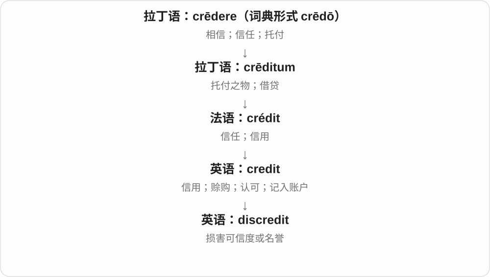

可以用证据推翻一个理论，也可以用攻击手段损害一个人的可信度。动词只说明使其失去信任，不保证使用的手段公正。

**常见搭配与例句**

discredit a claim；discredit a theory；discredit a witness；bring discredit on… 。

> The new evidence discredited the original explanation.

新证据使原先的解释失去了可信度。

> They tried to discredit her by spreading false rumors.

他们试图散布虚假传闻来损害她的名誉。

**别混淆**

disagree 是不同意；discredit 要进一步损害说法或来源的可信度。单说“我不喜欢”通常还谈不上 discredit。

### 6. discredited — 不再被相信的；信誉受损的

**音标**：/dɪsˈkredɪtɪd/

**先抓住这个画面**

discredited 描述信任已经塌下来的状态：曾经被接受的理论，经过核查后不再站得住脚。

**怎么拆**

discredit + -ed，是失去可信度之后的状态。

**怎么变成今天的意思**

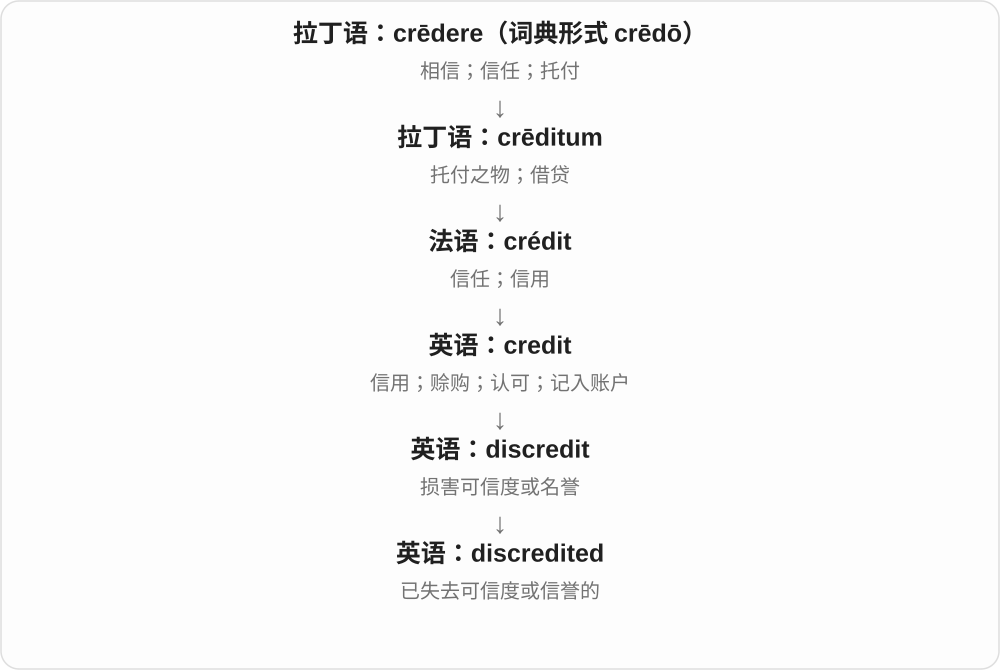

它常用于理论、说法、方法或人物。但要分清因事实被推翻，与因不实攻击而名誉受损；词形本身不交代全部原因。

**常见搭配与例句**

a discredited theory；a discredited claim；a discredited official；widely discredited。

> The textbook no longer includes the discredited theory.

教材不再收录那个已被推翻、失去可信度的理论。

> The article relied on a source that had already been discredited.

这篇文章依赖了一个早已失去可信度的来源。

**别混淆**

controversial 是有争议，未必已经失去可信度；discredited 则强调原有信任已受到严重破坏。

### 7. microcredit — 小额信贷

**音标**：英 /ˈmaɪkrəʊˌkredɪt/；美 /ˈmaɪkroʊˌkredɪt/

**先抓住这个画面**

microcredit 是把信贷规模缩小：较小金额的借款，常用于帮助难以获得传统贷款的人开展生产或经营。

**怎么拆**

micro-（小）+ credit（信贷）。这里 micro- 表示规模小，不表示没有还款责任。

**怎么变成今天的意思**

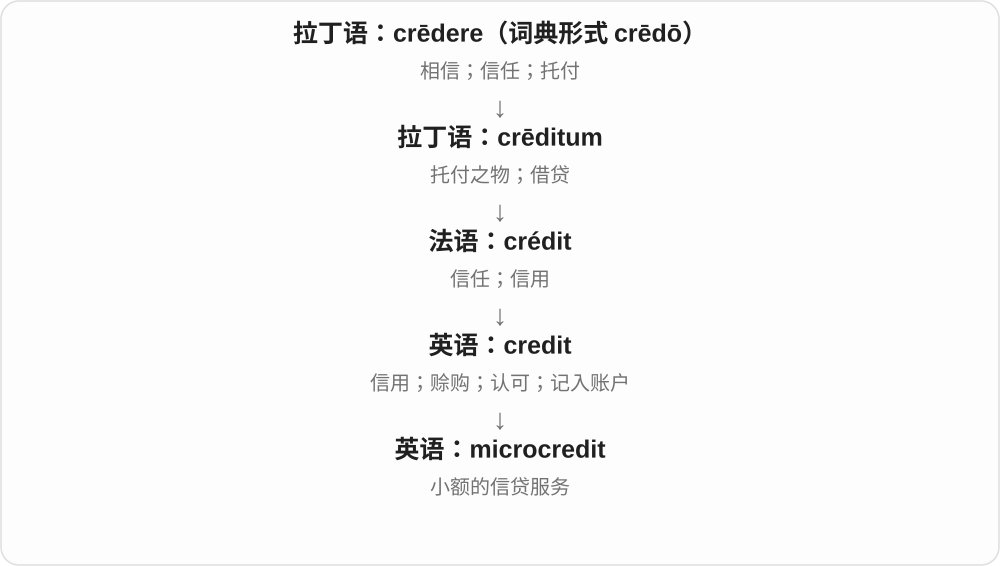

它沿 credit 的借贷义造词，不是“小小的赞扬”。与小生意、社区融资等话题联系密切，效果仍要看具体安排。

**常见搭配与例句**

a microcredit program；access to microcredit；microcredit borrowers；provide microcredit。

> The cooperative launched a microcredit program for local shop owners.

合作社为当地店主推出了小额信贷项目。

> She used microcredit to buy equipment for her repair business.

她用小额贷款为自己的维修生意购买了设备。

**别混淆**

microcredit 重点是小额贷款；microfinance 范围更广，还可能包括储蓄、支付、保险等金融服务。

### 8. credible — 可信的；有说服力的

**音标**：/ˈkredəbəl/

**先抓住这个画面**

credible 是“有足够理由认真相信它”。证人说法有根据，计划有现实支撑，都可以 credible。

**怎么拆**

来自拉丁语 crēdibilis“值得相信的”，经法语传入。cred- 是相信，-ible 表示能够被相信。

**怎么变成今天的意思**

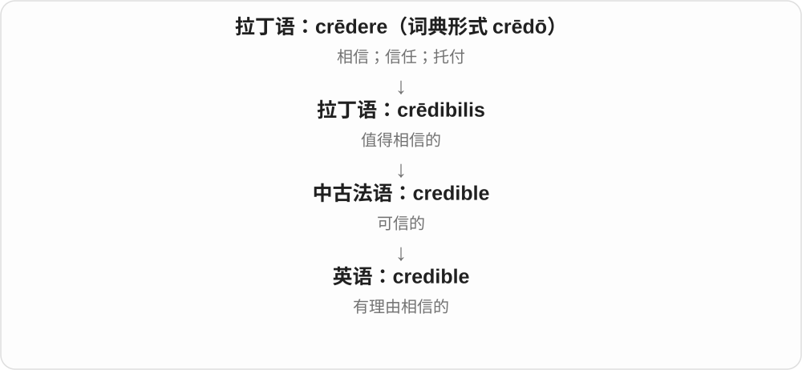

它通常评价被相信的对象，而不是评价一个人多容易信别人。credible explanation 不保证绝对正确，但值得纳入判断。

**常见搭配与例句**

a credible witness；a credible explanation；credible evidence；a credible alternative。

> We need credible evidence before making that claim.

提出那个说法前，我们需要可信的证据。

> Her plan offers a credible alternative to closing the school.

她的计划为避免关闭学校提供了一个可信可行的替代方案。

**别混淆**

credible 是值得别人相信；credulous 是自己容易相信别人。一个 credible witness 和一个 credulous listener 是不同角色。

### 9. credibility — 可信度；信誉

**音标**：/ˌkredəˈbɪləti/

**先抓住这个画面**

credibility 像别人愿意给你的“相信额度”：前后说法一致、证据可靠，额度就高；反复说错话，就会下降。

**怎么拆**

经法语 crédibilité，来自中世纪拉丁语 credibilitas；现代可对照 credible + -ity，-ible 对应 -ibility。

**怎么变成今天的意思**

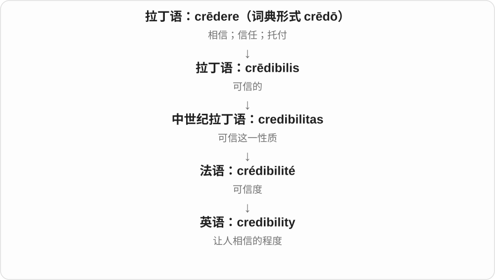

它把“这条消息可信”变成“这条消息或这个来源有多大可信度”。这里的额度只是帮助理解的比喻，不是词源里真的有一张计分卡。

**常见搭配与例句**

gain credibility；lose credibility；damage credibility；the credibility of a source。

> The unexplained changes damaged the report’s credibility.

这些没有解释的改动损害了报告的可信度。

> Admitting the mistake helped restore her credibility.

承认错误帮助她恢复了信誉。

**别混淆**

credibility 看可信程度；popularity 看受欢迎程度。一个说法传播很广，也可能缺少 credibility。

### 10. credibly — 可信地；令人信服地

**音标**：/ˈkredəbli/

**先抓住这个画面**

credibly 是把事情说得或表现得让人有理由相信：细节对得上，解释也经得起追问。

**怎么拆**

credible + -ly，结尾 -le 改为 -ly，形成副词。

**怎么变成今天的意思**

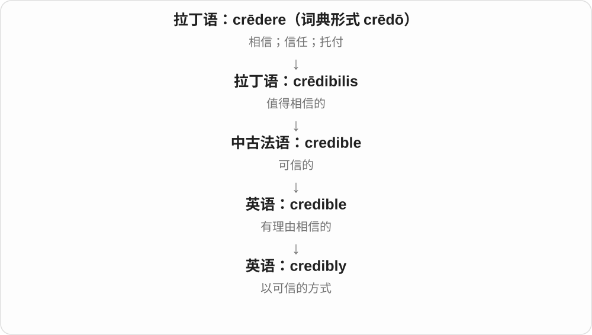

它常修饰声称、解释、描述，也可形容演员把角色演得可信。重点是能让人相信，不是音量大或态度自信。

**常见搭配与例句**

credibly explain；credibly claim；credibly portray；be credibly accused（有可信依据地被指控）。

> She could not credibly explain why the figures had changed.

她无法令人信服地解释这些数字为何改变。

> The actor credibly portrayed a doctor under intense pressure.

演员把一名承受巨大压力的医生演得很可信。

**别混淆**

confidently 是自信地；credibly 是令人信服地。说得很自信，证据却可能不足。

### 11. incredible — 难以置信的；惊人的；极棒的

**音标**：/ɪnˈkredəbəl/

**先抓住这个画面**

incredible 原本是“这也能信？”现代赞叹时常是“好得、强得让人不敢相信”。

**怎么拆**

拉丁语 in-（不）+ crēdibilis（可信），形成 incrēdibilis。现代也能看清 in- + credible。

**怎么变成今天的意思**

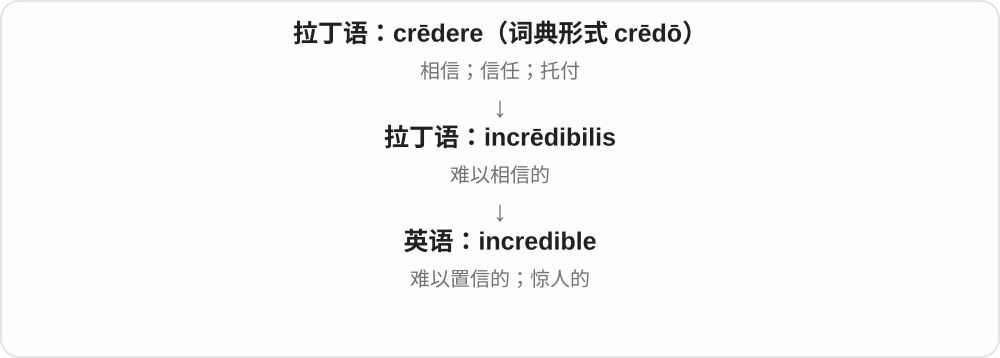

否定“可相信”之后，一条路是真不可信，另一条路是夸张地形容出色、惊人。听到 an incredible performance，通常是在赞扬，并非指表演造假。

**常见搭配与例句**

an incredible story；an incredible achievement；an incredible amount；It is incredible that… 。

> The climbers showed incredible courage.

这些登山者展现出了惊人的勇气。

> His account sounded so incredible that we checked every detail.

他的说法听起来太难以置信，我们核查了每一个细节。

**别混淆**

incredible 可以评价事情；incredulous 常描述人的不相信。an incredible look 多半是惊人的外观，an incredulous look 才是难以置信的神情。

### 12. incredibly — 极其；难以置信地

**音标**：/ɪnˈkredəbli/

**先抓住这个画面**

incredibly 常像给形容词加一档很强的程度：“特别、特别……”。

**怎么拆**

incredible + -ly，变成修饰程度或整个陈述的副词。

**怎么变成今天的意思**

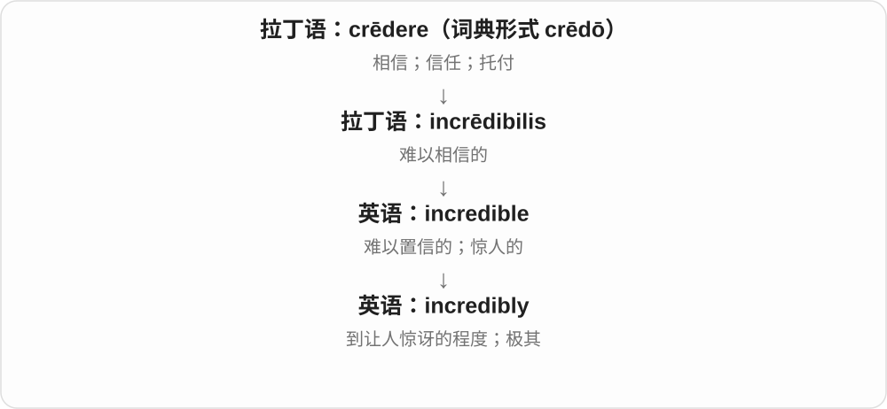

从“难以相信的方式”扩展成日常程度词。incredibly helpful 通常就是帮了大忙，不是说这份帮助不可信。

**常见搭配与例句**

incredibly difficult；incredibly useful；incredibly fast；Incredibly, … 。

> The instructions were incredibly easy to follow.

这些说明特别容易照着操作。

> Incredibly, no one noticed the missing page.

令人难以置信的是，竟然没人发现少了一页。

**别混淆**

incredibly 修饰事物或程度；incredulously 描写一个人不敢相信的反应。两者不能因为都含“不信”就互换。

### 13. credence — 相信；信任；使人相信的支持

**音标**：/ˈkriːdəns/

**先抓住这个画面**

credence 常出现在“给不给这个说法相信的分量”里。give credence to a rumor，就是把传闻当成有可能可信的事。

**怎么拆**

经古法语 credence，来自中世纪拉丁语 crēdentia“相信”，与 crēdere 的分词 crēdēns 有关。

**怎么变成今天的意思**

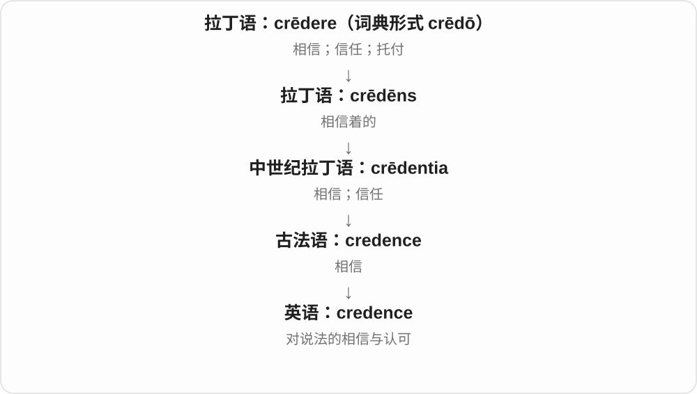

它比 belief 更常见于固定搭配。lend credence to 某说法，是新增的信息让那个说法更有理由被相信。

**常见搭配与例句**

give credence to…；lend credence to…；little credence；gain credence。

> I would not give much credence to an anonymous rumor.

我不会太相信一条匿名传闻。

> The new records lent credence to her account.

新发现的记录让她的叙述更可信了。

**别混淆**

credibility 是对象有多可信；credence 是人给予的相信，或支持这种相信的分量。

### 14. credential — 资格证明；身份凭据；授予资格

**音标**：/krɪˈdenʃəl/

**先抓住这个画面**

credential 常指一项具体的证明：一张专业证书，或系统用来确认身份与权限的一项数字凭据。

**怎么拆**

源头是中世纪拉丁语 crēdentiālis。英语名词单数可能由较早常用的 credentials 逆构而成；现代可把 credential 与复数 credentials 配对使用。

**怎么变成今天的意思**

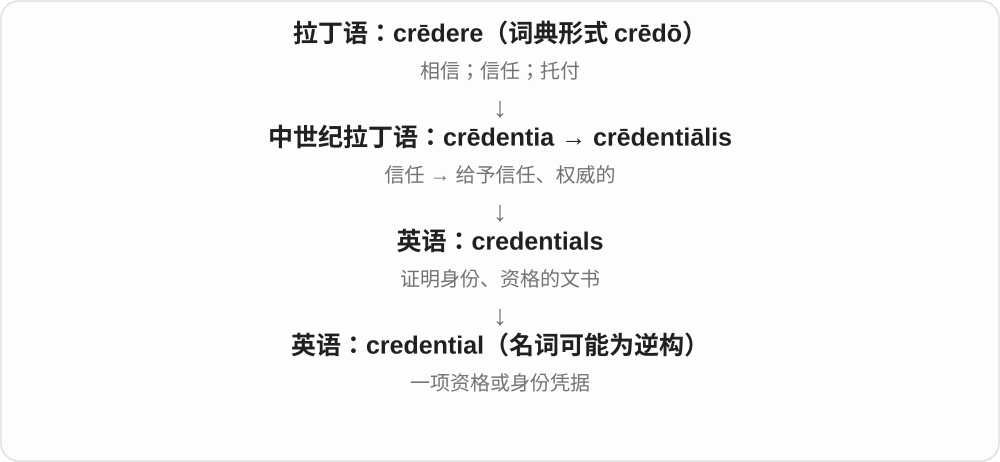

它把成套证明中的一个单位单独拿出来说。也可作动词 credential someone，表示审核并授予所需资格或凭证。

**常见搭配与例句**

a professional credential；a digital credential；earn a credential；credential staff。

> She earned a teaching credential after completing the program.

完成项目后，她取得了教学资格证明。

> The system rejected the expired credential.

系统拒绝了已经过期的身份凭据。

**别混淆**

certificate 是一种证书形式；credential 的范围更广，可以是证明资格、身份或权限的多种材料。

### 15. credentials — 资历；资格证明；身份证明；登录凭据

**音标**：/krɪˈdenʃəlz/

**先抓住这个画面**

credentials 像你拿出来让对方放心的那一包证据：我有这项能力、代表这个机构，或确实是这个账号的使用者。

**怎么拆**

历史上与 letters credential“证明身份或授权的文书”有关，背后是拉丁语 crēdentiālis“给予信任的”。今天语法上也是 credential 的复数，但不能把历史先后简单倒过来。

**怎么变成今天的意思**

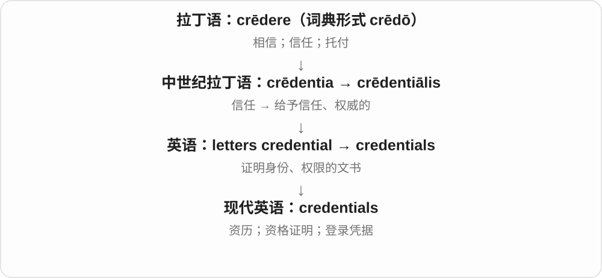

早期重在文书带来的信任，后来扩展到学历、经验和资格，再进入数字身份场景。strong credentials 可以指实在的资历，不只是一张证书。

**常见搭配与例句**

professional credentials；check someone’s credentials；login credentials；present one’s credentials。

> The committee checked the applicant’s professional credentials.

委员会核查了申请人的专业资历。

> Enter your login credentials to access your account.

输入登录凭据以访问你的账户。

**别混淆**

credentials 是支持身份、资格或权限的证据；credibility 是让人相信的程度。有一份证件，仍可能需要核实它是否真实有效。

### 16. accredit — 正式认可；认证；授权代表身份

**音标**：/əˈkredɪt/

**先抓住这个画面**

accredit 像有资格判断的机构盖下认可的章：这个项目达到了相应要求，这个人可以以某种身份参加或代表。

**怎么拆**

来自法语 accréditer，与 à“向、给予”和 crédit“信用、信任”有关。现代可认出与 credit 的联系，但不是普通地“赞扬一下”。

**怎么变成今天的意思**

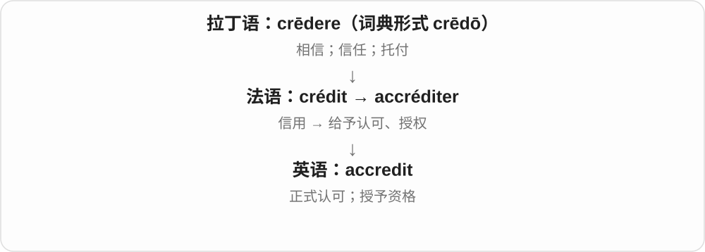

给予信任在机构语境里变成正式承认或授权。既能用于院校和项目，也能用于记者、外交代表等的身份。

**常见搭配与例句**

accredit an institution；accredit a course；accredit someone as…；accredit a representative to… 。

> The board accredits programs that meet its standards.

该委员会认证符合其标准的项目。

> The organizers accredited her as a photographer for the event.

主办方认可了她作为该活动摄影记者的身份。

**别混淆**

accredit 通常涉及正式认可或授权；credit someone with something 常只是把贡献归给某人。

### 17. accredited — 获正式认可的；经认证的；获授权的

**音标**：/əˈkredɪtɪd/

**先抓住这个画面**

accredited 表示已经拿到了相应的认可，不是只在宣传中声称自己很专业。

**怎么拆**

accredit + -ed，描述正式认可之后的状态。

**怎么变成今天的意思**

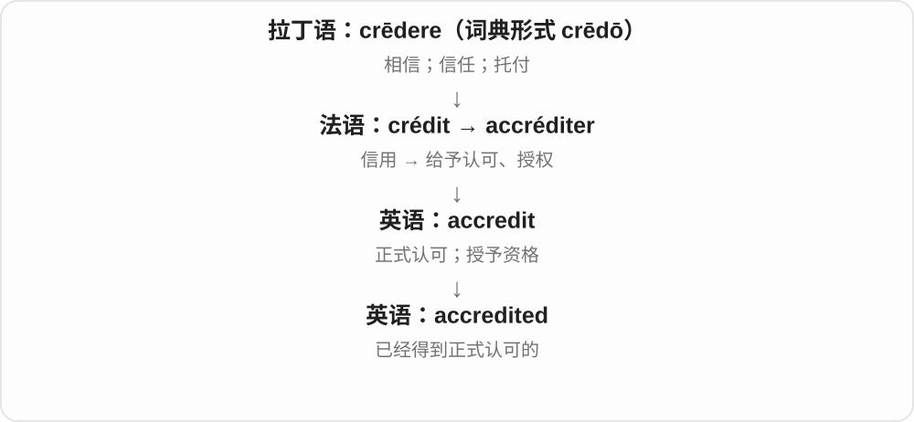

看见 accredited institution，还需要看 by whom“由谁认可”、for what“认可什么”。词本身不把不同机构的标准变成一样。

**常见搭配与例句**

an accredited institution；an accredited course；an accredited representative；accredited by… 。

> She completed the course at an accredited institution.

她在一家经认证的机构完成了这门课程。

> Only accredited reporters could enter the press area.

只有获得采访资格的记者才能进入媒体区。

**别混淆**

credited 常说获得功劳或署名；accredited 常说获得正式认可与身份。差一个 a，使用场景明显不同。

### 18. accreditation — 正式认证；认可资格；授权

**音标**：/əˌkredɪˈteɪʃən/

**先抓住这个画面**

accreditation 是那次正式认可的过程，也可以是得到认可之后的资格状态。

**怎么拆**

accredit + -ation，是英语动作名词派生。

**怎么变成今天的意思**

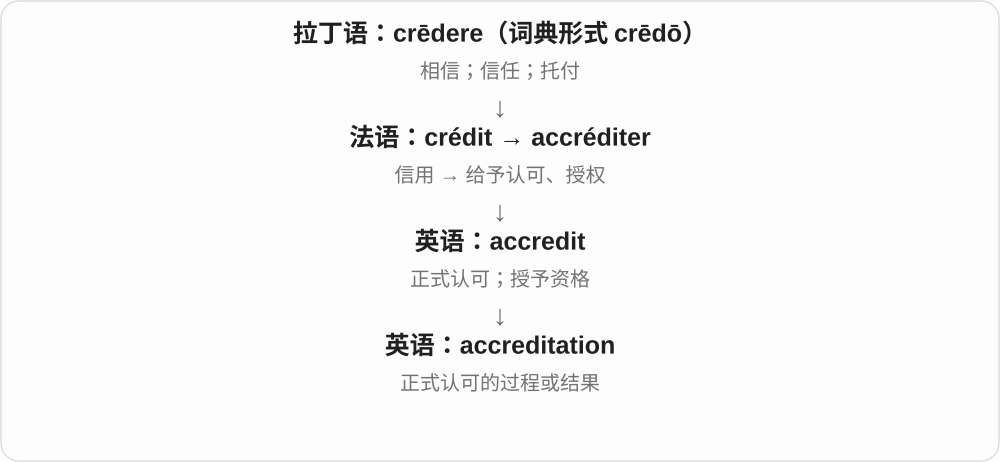

它把“谁认可谁”的动作变成机构可以申请、获得、维持的资格。具体认可什么，由认证范围决定。

**常见搭配与例句**

apply for accreditation；gain accreditation；maintain accreditation；institutional accreditation。

> The school applied for accreditation of its new program.

学校为新项目申请了认证。

> The laboratory renewed its accreditation this year.

这家实验室今年续办了认证资格。

**别混淆**

accreditation 不等于笼统地保证一切优秀。它通常说明符合某项认可体系的要求，仍要看范围与有效状态。

### 19. creed — 信条；一套坚持的信念

**音标**：/kriːd/

**先抓住这个画面**

creed 像写下来的“我们相信这些”：可以是宗教信仰，也可以是一群人或一个人坚持的原则。

**怎么拆**

从拉丁语 crēdō“我相信”进入古英语 crēda / crēdo，再发展成 creed。它与现代英语 credo 是同源的不同路径。

**怎么变成今天的意思**

“我相信”在宗教文本开头出现，逐渐用来称整套信仰声明。后来范围扩展，不再只限宗教。

**常见搭配与例句**

a religious creed；a political creed；live by a creed；regardless of creed。

> The organization welcomes people of every creed.

这个组织欢迎持有各种信仰的人。

> “Do the work well” became the team’s simple creed.

“把工作做好”成了团队简单的信条。

**别混淆**

creed 常是一组原则或明确的信仰立场；opinion 可以只是对一件事的看法，不一定构成整套信念。

### 20. credulous — 轻信的；容易上当的

**音标**：英 /ˈkredjələs/；美 /ˈkredʒələs/

**先抓住这个画面**

credulous 像门槛设得太低：别人一说，你还没核查就让这个说法进来了。

**怎么拆**

来自拉丁语 crēdulus“容易相信的”，属于 crēdere。结尾 -ous 是形容词形式，不是 credible 的同义写法。

**怎么变成今天的意思**

它评价相信别人的习惯，通常带批评意味，暗示没有充分核查就接受了说法。

**常见搭配与例句**

a credulous audience；credulous readers；be too credulous；exploit credulous people。

> The advertisement targeted credulous buyers with impossible promises.

这则广告用不可能兑现的承诺吸引轻信的买家。

> He was too credulous to question the stranger’s story.

他太容易相信别人，没有质疑那个陌生人的说法。

**别混淆**

credible 是可信的对象；credulous 是容易相信的接受者。trusting 可以只是信任别人，credulous 常暗示相信得过头。

### 21. credulity — 轻信；轻信的倾向

**音标**：英 /krɪˈdjuːləti/；美 /krɪˈduːləti/

**先抓住这个画面**

credulity 是把“别人一说就信”当作一种倾向来讨论，往往意味着判断的门槛太低。

**怎么拆**

经法语 credulité，来自拉丁语 crēdulitās；现代与 credulous 的性质名词对应。

**怎么变成今天的意思**

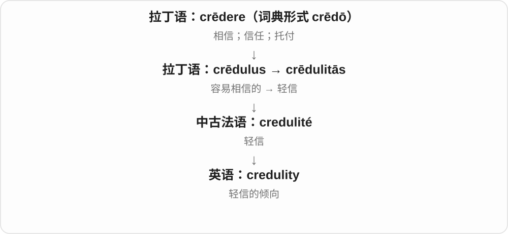

credulous 描述一个人，credulity 讨论这种容易相信的性质。strain credulity 则说某种说法离谱到让人很难继续相信。

**常见搭配与例句**

exploit someone’s credulity；human credulity；strain credulity；test someone’s credulity。

> The scheme depended on people’s credulity.

这个骗局依赖人们轻易相信它。

> That explanation strains credulity.

那个解释实在让人难以相信。

**别混淆**

credulity 是轻信；credibility 是可信度。报道可能利用读者的 credulity，却没有多少 credibility。

### 22. incredulous — 不敢相信的；表示怀疑的

**音标**：英 /ɪnˈkredjələs/；美 /ɪnˈkredʒələs/

**先抓住这个画面**

incredulous 是听到消息后瞪大眼睛：“不会吧？”它描述接收消息的人的反应。

**怎么拆**

来自拉丁语 incrēdulus“不相信的”，in- 是否定，后面属于 crēdere“相信”的词族。

**怎么变成今天的意思**

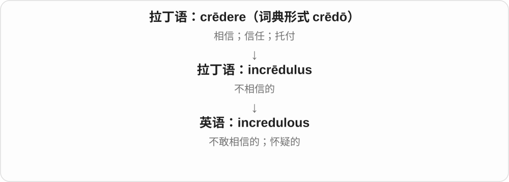

它可以是惊讶到不敢信，也可以是真的怀疑对方。an incredulous stare 让“不相信”从心里显露到眼神上。

**常见搭配与例句**

an incredulous look；sound incredulous；be incredulous at…；an incredulous audience。

> She gave me an incredulous look when I told her the price.

我告诉她价格时，她露出难以置信的神情。

> The audience was incredulous at the claim.

观众对那个说法表示怀疑。

**别混淆**

incredible 是事情惊人或难以相信；incredulous 是人不相信。常见搭配是 an incredible story 和 an incredulous listener。

### 23. incredulity — 怀疑；难以置信的反应

**音标**：英 /ˌɪnkrɪˈdjuːləti/；美 /ˌɪnkrɪˈduːləti/

**先抓住这个画面**

incredulity 是把“怎么可能”的反应当成一件事来说，可以从脸色、语气或沉默里看出来。

**怎么拆**

经法语 incredulité，来自晚期拉丁语 incrēdulitās；现代与 incredulous 对应为性质或状态名词。

**怎么变成今天的意思**

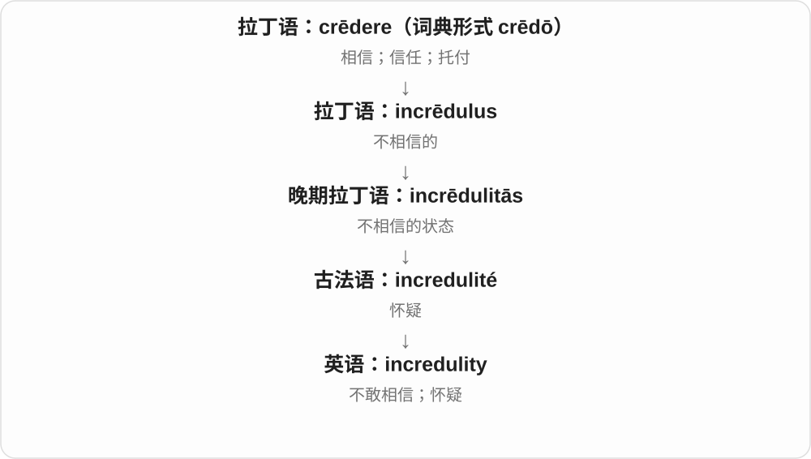

credulity 是轻易相信；加否定成分后的这一支是难以接受某个说法。它不自动表示已经查明消息是假的。

**常见搭配与例句**

with incredulity；a look of incredulity；react with incredulity；express incredulity。

> He stared at the bill with incredulity.

他盯着账单，满脸难以置信。

> The announcement was met with widespread incredulity.

这项宣布引来了普遍的怀疑。

**别混淆**

incredulity 描写不相信的反应；disproof 是反证。表示怀疑与真正证明错误，是不同的步骤。

### 24. incredulously — 怀疑地；难以置信地

**音标**：英 /ɪnˈkredjələsli/；美 /ɪnˈkredʒələsli/

**先抓住这个画面**

incredulously 常给一句话配上表情和语气：话说出来时，眼睛和声音都在问“你当真？”

**怎么拆**

incredulous + -ly，形成描写反应方式的副词。

**怎么变成今天的意思**

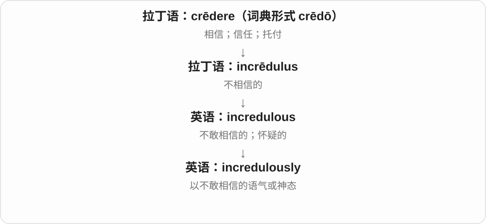

它常跟 ask、stare、look 等词，说明这个人怎样说话或看东西。重点在人的反应。

**常见搭配与例句**

ask incredulously；stare incredulously；look at someone incredulously。

> “You finished all of it today?” she asked incredulously.

“你今天就全部做完了？”她难以置信地问。

> He looked at the empty shelves incredulously.

他难以置信地看着空荡荡的货架。

**别混淆**

incredibly expensive 是极贵；ask incredulously 是不敢相信地问。不要把 incredibly 当作表示人物怀疑神态的副词。

### 25. credo — 信条；行为准则

**音标**：英 /ˈkriːdəʊ/、/ˈkreɪdəʊ/；美 /ˈkriːdoʊ/、/ˈkreɪdoʊ/

**先抓住这个画面**

credo 常像一句你愿意一直照着做的宣言：“遇到问题先问清楚”“对人诚实”。

**怎么拆**

保留拉丁语 crēdō“我相信”的形式，经法语等路径进入英语。这里的 -o 不是英语后缀，而是拉丁语词形的一部分。

**怎么变成今天的意思**

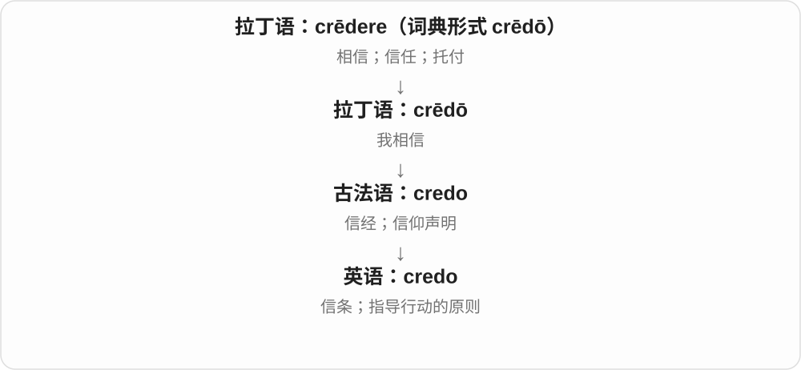

从宗教中的信仰陈述，扩展到个人、团体的原则。它与 creed 意思接近，现代用来概括个人理念时很自然。

**常见搭配与例句**

a personal credo；a professional credo；live by a credo；adopt a credo。

> Her personal credo is to leave things better than she found them.

她的人生信条是：让经手的事物比原来更好。

> The studio’s credo puts clarity before decoration.

这家工作室的理念是：清楚表达优先于装饰。

**别混淆**

creed 和 credo 可以重叠；creed 较常让人想到一套共同信仰，credo 常用于简明概括个人或组织的做事原则。

### 26. creditworthiness — 信用可靠程度；偿债信用

**音标**：英 /ˈkredɪtˌwɜːðinəs/；美 /ˈkredɪtˌwɜːrðinəs/

**先抓住这个画面**

creditworthiness 问的是：把钱借给这一方，按约还回来的把握有多大？它是一种借贷语境的判断。

**怎么拆**

credit + worthy（值得的）形成 creditworthy，再加 -ness 表示性质。中间词不必单列，也能看清构造。

**怎么变成今天的意思**

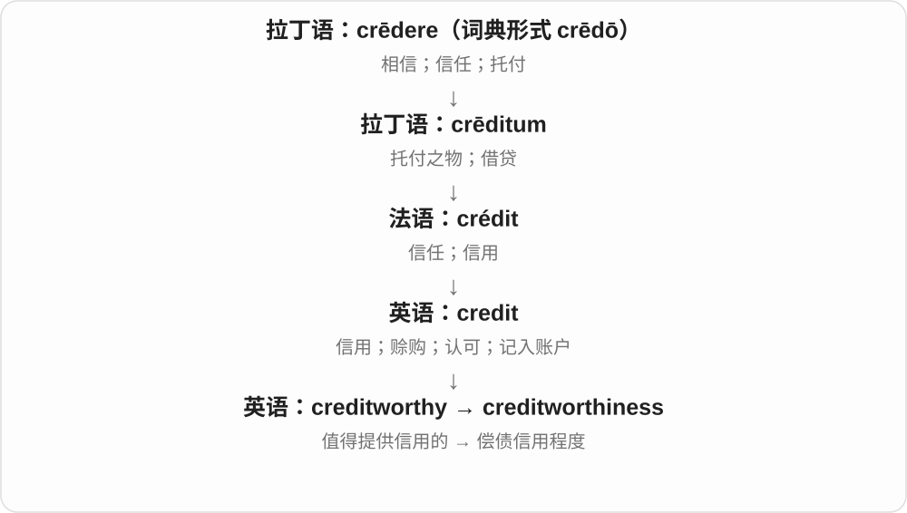

信任被具体化为对履行债务承诺的评价。它涉及财务状况、还款记录等信息，不等于一个人的全部道德或人生价值。

**常见搭配与例句**

assess creditworthiness；a borrower’s creditworthiness；evidence of creditworthiness。

> The lender reviewed the company’s creditworthiness before offering a loan.

出借方在提供贷款前评估了公司的偿债信用。

> The report contains information relevant to the borrower’s creditworthiness.

报告包含了与借款人信用状况有关的信息。

**别混淆**

creditworthiness 是对信用的整体评价；credit score 是某套方法给出的分数，两者不能完全画等号。

### 27. miscreant — 恶棍；作恶的人；捣乱者

**音标**：/ˈmɪskriənt/

**先抓住这个画面**

miscreant 今天主要指做了坏事或违法事情的人，语气书面，有时也被故意夸张地用来骂淘气鬼。

**怎么拆**

来自古法语 mescreant，与 mes-（错误地）+ creire（相信）有关；creire 追溯到拉丁语 crēdere。中间不是 create“创造”。

**怎么变成今天的意思**

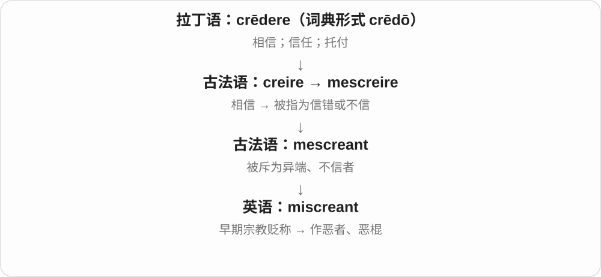

早期这是宗教立场带来的贬称，后来扩展成对道德行为的谴责。这段历史反映使用者当时的偏见，不表示不同信仰真的等于作恶。

**常见搭配与例句**

a gang of miscreants；catch the miscreant；some young miscreants。

> The novel follows a band of miscreants planning a robbery.

小说讲述一群恶棍策划抢劫的故事。

> Some miscreant had painted a moustache on the poster.

不知哪个捣蛋鬼给海报上的人画了胡子。

**别混淆**

现代主要关注作恶行为；不要拿它当中性的“不同信仰者”。offender、troublemaker 往往更符合一般具体语境。

### 28. recreant — 怯懦的；背弃职责的；懦夫或叛徒

**音标**：/ˈrekriənt/

**先抓住这个画面**

recreant 可以想成旧故事里临阵认输、抛弃誓约的人。它的批评很重，而且今天很少在普通对话中使用。

**怎么拆**

经法语 recreant，来自 recroire“在决斗中屈服、放弃效忠”，其中 croire“相信、信任”追溯到 crēdere。不是 re- + create。

**怎么变成今天的意思**

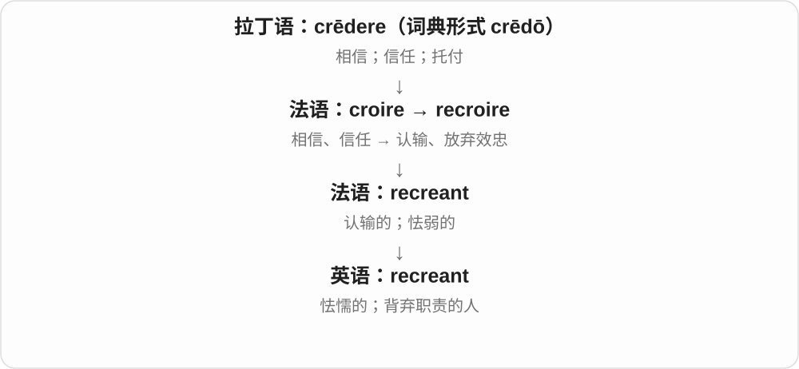

历史上从承认战败扩展到怯懦、失忠。把它理解为“收回承诺、放弃立场”是一种词义联系的解释；更早为什么由“相信”走到“屈服”，并不能靠前缀直接算定。

**常见搭配与例句**

a recreant knight；a recreant follower；prove recreant to one’s duty（背弃职责，文学用法）。

> The poem condemns the recreant knight who abandons his companions.

这首诗谴责那名抛弃同伴的怯懦骑士。

> In the tale, the king calls his disloyal followers recreants.

故事里，国王把那些不忠的追随者斥为叛徒。

**别混淆**

cowardly 是更常见的怯懦；recreant 还可能带背弃职责和效忠的意思。它与 recreation“娱乐、恢复活力”不是同一词源。

## 这一组要分清什么

**credible / creditable / credulous**：说法可信 / 表现值得称赞 / 人容易轻信。

**incredible / incredulous**：事情惊人、难以相信 / 人表现出怀疑或不敢相信。对应副词 incredibly 常表程度，incredulously 常表人的反应。

**credited / accredited**：前者常是获得功劳、署名或入账；后者常是获得正式资格认可。

**miscreant / recreant** 的 cre- 经法语来自“相信”，不是 create“创造”。miscreant 的早期宗教贬义需要按历史立场理解，不能把不同信仰与作恶画等号。

## 串起来练习

**A credible source can earn our trust without making us credulous.**

可信的来源可以赢得信任，但我们仍不必变得轻信。credible 评价来源值得相信，credulous 评价听者太容易相信。
