# 0570 · scrib-, script- — 写；刻写；记录

[逐词精讲目录](../00_逐词精讲目录.md) · [总目录](../00_总目录_按常用程度.md)

## 核心词根与来源

拉丁语 **scrībere** 是“写”。想象同一支笔换位置：**subscribe** 在下面签名表示同意；**prescribe** 事先写明要求；**inscribe** 写在物品上；**transcribe** 把内容写到另一种记录里。**describe** 则用文字为别人画出事物的样子。

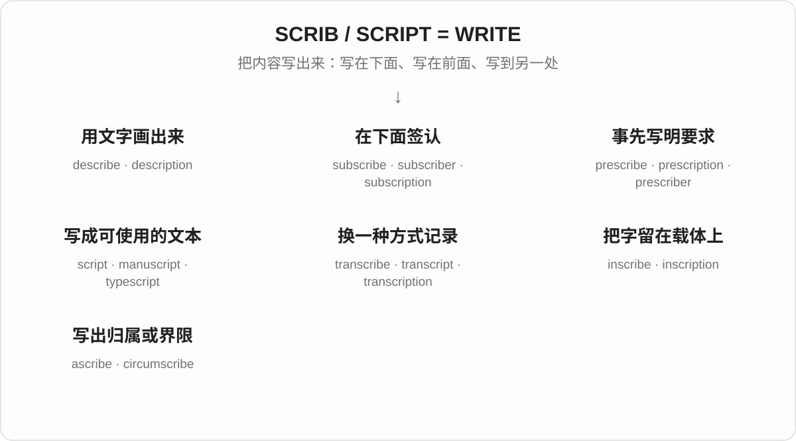

## 词形与演化规律

**scrib- 与 script- 来自同一个拉丁动词的不同形式。** scrībere 的分词是 scrīptus，所以 describe / description、prescribe / prescription、transcribe / transcription 会成对出现。字母 b 在历史词形中与后面的音发生变化，不是今天见到 -scribe 就能自由拼出一个新词。

## 单词速览（按词族由简到繁）

同一基础词的相关扩展放在一起，先读基础形式，再读扩展；各组之间优先读常用的。具体词源关系见各词讲解。

| 单词 | 音标 | 核心意思 |
|---|---|---|
| [scribe](#w-14) | /skraɪb/ | 抄写员；文书；刻写 |
| [scribble](#w-19) | /ˈskrɪbəl/ | 潦草地写；乱画；潦草的字迹 |
| [describe](#w-2) | /dɪˈskraɪb/ | 描述；描写 |
| [description](#w-1) | /dɪˈskrɪpʃən/ | 描述；说明 |
| [subscribe](#w-5) | /səbˈskraɪb/ | 订阅；认同；定期捐助 |
| [subscription](#w-4) | /səbˈskrɪpʃən/ | 订阅；订阅费；定期支持 |
| [subscriber](#w-12) | 英 /səbˈskraɪbə/；美 /səbˈskraɪbər/ | 订阅者；订户；定期支持者 |
| [unsubscribe](#w-16) | /ˌʌnsəbˈskraɪb/ | 取消订阅；退订 |
| [prescribe](#w-13) | /prɪˈskraɪb/ | 开处方；规定 |
| [prescription](#w-6) | /prɪˈskrɪpʃən/ | 处方；药方；解决问题的办法 |
| [prescriber](#w-26) | 英 /prɪˈskraɪbə/；美 /prɪˈskraɪbər/ | 开处方者；作出规定者 |
| [ascribe](#w-18) | /əˈskraɪb/ | 把……归因于；把……归属于 |
| [inscribe](#w-25) | /ɪnˈskraɪb/ | 刻写；题写；铭记 |
| [inscription](#w-10) | /ɪnˈskrɪpʃən/ | 铭文；题词；刻写的文字 |
| [script](#w-3) | /skrɪpt/ | 剧本；脚本；文字体系；书写体 |
| [scripture](#w-8) | 英 /ˈskrɪptʃə/；美 /ˈskrɪptʃər/ | 宗教经典；经文 |
| [scriptural](#w-17) | /ˈskrɪptʃərəl/ | 经典中的；依据经文的 |
| [scripting](#w-15) | /ˈskrɪptɪŋ/ | 编写脚本；编写剧本 |
| [scriptwriter](#w-23) | 英 /ˈskrɪptraɪtə/；美 /ˈskrɪptraɪtər/ | 编剧；剧本作者 |
| [typescript](#w-21) | /ˈtaɪpskrɪpt/ | 打字稿 |
| [conscript](#w-22) | 名词 英 /ˈkɒnskrɪpt/、美 /ˈkɑːnskrɪpt/；动词 /kənˈskrɪpt/ | 应征入伍者；征召 |
| [subscript](#w-24) | /ˈsʌbskrɪpt/ | 下标；下标字符 |
| [manuscript](#w-7) | /ˈmænjəskrɪpt/ | 手稿；尚未出版的文稿 |
| [transcribe](#w-20) | /trænˈskraɪb/ | 转写；誊写；抄录 |
| [transcript](#w-9) | /ˈtrænskrɪpt/ | 文字记录；誊本；成绩单 |
| [transcription](#w-11) | /trænˈskrɪpʃən/ | 转写；转录；转写文本 |
| [circumscribe](#w-27) | 英 /ˈsɜːkəmskraɪb/；美 /ˈsɝːkəmskraɪb/ | 限制；划定界限；作外接图形 |

## 逐词讲解

### 1. scribe — 抄写员；文书；刻写

**音标**：/skraɪb/

**先抓住这个画面**

scribe 原来是靠写字、抄录、记录办事的人。想象印刷术普及以前，有人一页页抄出整本书。

**怎么拆**

名词经法语来自拉丁语 scrība“文书”，与 scrībere“写”相连。英语动词 scribe 也有写、刻线等用法。

**怎么变成今天的意思**

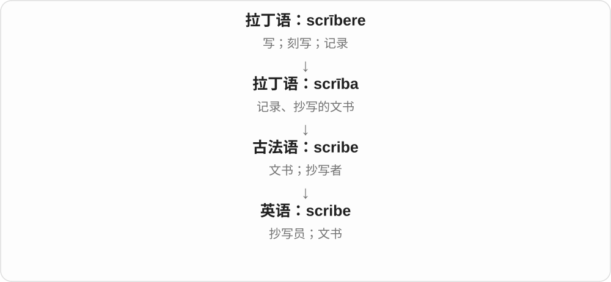

作为历史角色，scribe 不一定创作内容，也可能负责复制已有文字、记账或记录。技术动作里的 scribe 则指刻画一条线或标记。

**常见搭配与例句**

a medieval scribe（中世纪抄写员）；a court scribe（宫廷文书）；scribe a line（刻画一条线）。

> The scribe copied the text by hand.

抄写员用手抄下了这段文字。

> The carpenter scribed a line along the edge.

木匠沿边缘划了一条线。

**别混淆**

writer 通常泛指写作者；scribe 常强调记录和抄写的职业或历史角色。

### 2. scribble — 潦草地写；乱画；潦草的字迹

**音标**：/ˈskrɪbəl/

**先抓住这个画面**

scribble 像在便条上飞快抓几个字，或者边听电话边随手乱画。重点是快、随意，往往不工整。

**怎么拆**

与 scrībere“写”同族。可能来自中古英语 scriben 加表示细小、反复动作的结尾，也可能受拉丁语 scribillare 形式影响，具体路线有不同分析。

**怎么变成今天的意思**

写得乱可以出于着急，也可以只是消遣。图从确定的中古英语词形开始；不要把存在分歧的更早路线画成一条确定链。

**常见搭配与例句**

scribble a note（匆忙写便条）；scribble down an address（潦草记下地址）；a page of scribbles（满页乱涂的线条）。

> She scribbled the address on a receipt.

她在收据上匆匆写下地址。

> The child filled the page with colorful scribbles.

孩子用彩色线条涂满了整张纸。

**别混淆**

scribble 可写字也可乱画；doodle 多指无意识或消遣式涂画；scrawl 更强调字迹难看、难认。

### 3. describe — 描述；描写

**音标**：/dɪˈskraɪb/

**先抓住这个画面**

describe 是把你看到或经历的东西，用话语递给没在现场的人。可以写，也可以口头说。

**怎么拆**

拉丁语 dē- + scrībere 形成 dēscrībere“写下、描画”，经法语进入英语；这里 de- 不能机械理解成否定。

**怎么变成今天的意思**

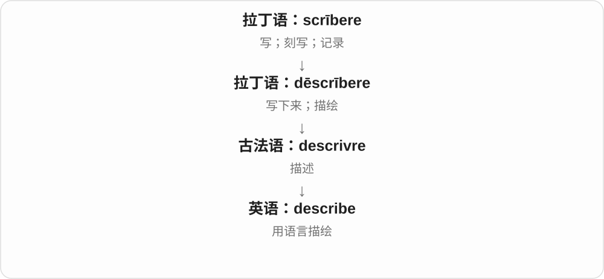

历史画面是写出轮廓，现代把范围扩展到各种语言描绘。describe someone as… 是把某人说成某种样子。

**常见搭配与例句**

describe the situation（描述情况）；describe A as B（把 A 描述为 B）；describe something to someone（向某人描述某事）。

> Can you describe the person you saw?

你能描述一下你看到的那个人吗？

> She described the room to me in great detail.

她非常详细地向我描述了那个房间。

**别混淆**

不要照中文说 describe me the room；通常说 describe the room to me。tell 与 describe 的句型不完全一样。

### 4. description — 描述；说明

**音标**：/dɪˈskrɪpʃən/

**先抓住这个画面**

description 像用文字画的一幅画：别人没见过那个人或东西，读完你的描述，也能大致知道它是什么样。

**怎么拆**

经法语来自拉丁语 dēscrīptiō，是 dēscrībere“描写”的动作名词。script- 与 scrib- 是拉丁词形的对应。

**怎么变成今天的意思**

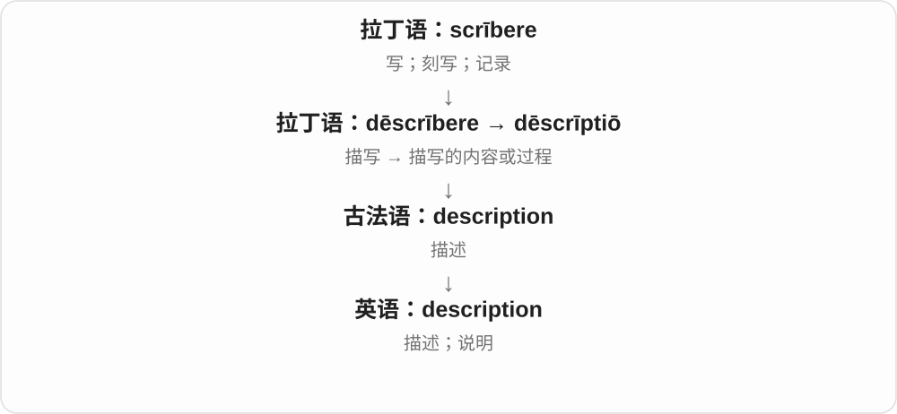

它可以写外貌，也可以说明职责、过程或情况。job description 不是工作的感想，而是说明这个岗位要做什么。

**常见搭配与例句**

a detailed description（详细描述）；a job description（职位说明）；a description of the scene（场景描写）。

> Her description helped us find the missing bag.

她的描述帮助我们找到了丢失的包。

> Read the job description before applying.

申请前先阅读职位说明。

**别混淆**

description 描述是什么样；explanation 解释为什么或怎么回事。definition 则划清概念的边界。

### 5. subscribe — 订阅；认同；定期捐助

**音标**：/səbˈskraɪb/

**先抓住这个画面**

subscribe 可以想成在一张同意单下面签名：“我愿意接收、支持，或按这个办法办。”今天最常见的是订阅内容或服务。

**怎么拆**

拉丁语 sub-（在下面）+ scrībere（写），形成 subscrībere“在下面签字”。

**怎么变成今天的意思**

签名可以表示认可，也可以承诺缴费或支持，于是发展出赞同、认捐、订阅。现代订阅不一定收费，例如订阅免费邮件。

**常见搭配与例句**

subscribe to a newsletter（订阅通讯）；subscribe to a view（认同一种观点）；subscribe to a service（订用服务）。

> I subscribe to a weekly science newsletter.

我订阅了一份每周科学通讯。

> I do not subscribe to the idea that success depends only on luck.

我不认同成功只取决于运气的看法。

**别混淆**

subscribe to a view 是认同观点，不是付费看观点。register 只是登记，未必订阅了持续服务。

### 6. subscription — 订阅；订阅费；定期支持

**音标**：/səbˈskrɪpʃən/

**先抓住这个画面**

subscription 是你和内容或服务之间的持续约定：按一段时间接收，可能定期付费，也可能免费。

**怎么拆**

来自拉丁语 subscrīptiō，与 subscrībere“在下面签名、同意”同源。

**怎么变成今天的意思**

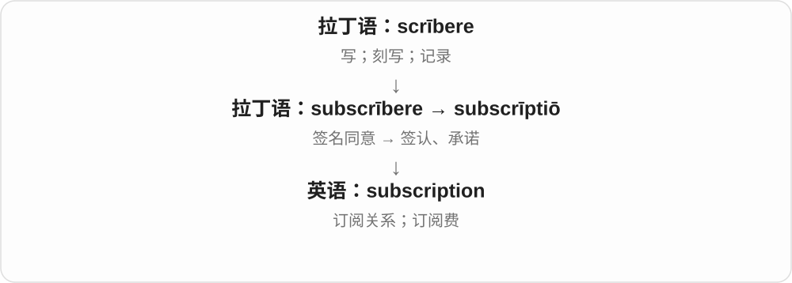

从签认、承诺支持，发展到定期付费接收内容。subscription 可以指关系本身，也可指付出的订阅费用。

**常见搭配与例句**

a monthly subscription（按月订阅）；renew a subscription（续订）；cancel a subscription（取消订阅）；a subscription fee（订阅费）。

> My annual subscription expires next month.

我的年度订阅下个月到期。

> The newsletter is available through a free subscription.

这份通讯可以免费订阅。

**别混淆**

subscription 是持续订阅关系；purchase 是一次购买。买过一本杂志，不一定订了整年的 subscription。

### 7. subscriber — 订阅者；订户；定期支持者

**音标**：英 /səbˈskraɪbə/；美 /səbˈskraɪbər/

**先抓住这个画面**

subscriber 是已经说好“以后继续给我这个内容或服务”的人。可以是付费订户，也可以是免费通讯的订阅者。

**怎么拆**

subscribe + -er，表示进行订阅或支持的人；词尾已有 e，只加 r。

**怎么变成今天的意思**

它强调持续关系，不只是偶然看过一次。subscriber 数量统计的是订阅关系，未必等于每一期都实际阅读的人数。

**常见搭配与例句**

a paying subscriber（付费订户）；newsletter subscribers（通讯订阅者）；gain subscribers（增加订阅者）。

> Subscribers receive the report every Friday.

订阅者每周五收到报告。

> The magazine has gained a thousand new subscribers.

这本杂志新增了一千名订户。

**别混淆**

reader 是读者，subscriber 是订阅者。有人读到转发内容却没有订阅，也有人订阅却暂时没读。

### 8. unsubscribe — 取消订阅；退订

**音标**：/ˌʌnsəbˈskraɪb/

**先抓住这个画面**

unsubscribe 就是撤回之前的“以后继续发给我”：不再接收这份邮件，或终止某个订阅关系。

**怎么拆**

un-（撤销）+ subscribe（订阅），是英语层面的直接派生。

**怎么变成今天的意思**

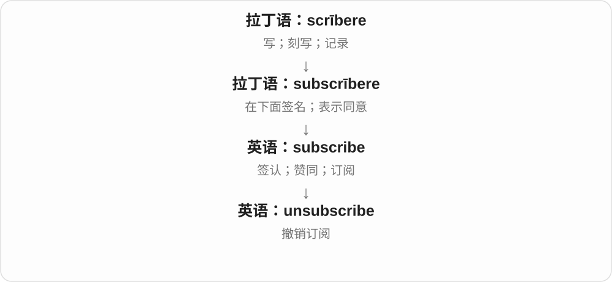

这里 un- 表示把一个已经建立的状态取消。常用 unsubscribe from，from 后放通讯、列表或服务。

**常见搭配与例句**

unsubscribe from a newsletter（退订通讯）；an unsubscribe link（退订链接）。

> I unsubscribed from the newsletter last week.

我上周退订了那份通讯。

> Click the link at the bottom to unsubscribe.

点击底部链接即可退订。

**别混淆**

unsubscribe 取消订阅；delete 删除某封邮件或某个文件。删了一封邮件，通常不等于退订以后所有邮件。

### 9. prescribe — 开处方；规定

**音标**：/prɪˈskraɪb/

**先抓住这个画面**

prescribe 是把该怎么做先定下来：医生开出药物要求，规则规定步骤。它常带一定专业或制度权威。

**怎么拆**

拉丁语 prae-（预先、在前）+ scrībere（写），形成 praescrībere“预先写明、规定”。

**怎么变成今天的意思**

“写在前面”可帮助理解事先立好要求，但今天 prescribe 不要求真的拿笔写。固定搭配中的 prescribed procedure 就是规定程序。

**常见搭配与例句**

prescribe medicine（开药）；prescribe a method（规定方法）；as prescribed by the rules（按照规则的规定）。

> The doctor prescribed a different medicine.

医生开了另一种药。

> The rules prescribe how the votes must be counted.

规则规定了必须如何计票。

**别混淆**

prescribe 是规定做什么；proscribe 是禁止。只有一个字母不同，意思方向却很不一样。

### 10. prescription — 处方；药方；解决问题的办法

**音标**：/prɪˈskrɪpʃən/

**先抓住这个画面**

prescription 像事先写好的行动单：“按这些要求做。”医疗里是处方；比喻用法里是某人主张的解决办法。

**怎么拆**

经法语来自拉丁语 praescrīptiō，与 prae-（预先）+ scrībere（写）相连。

**怎么变成今天的意思**

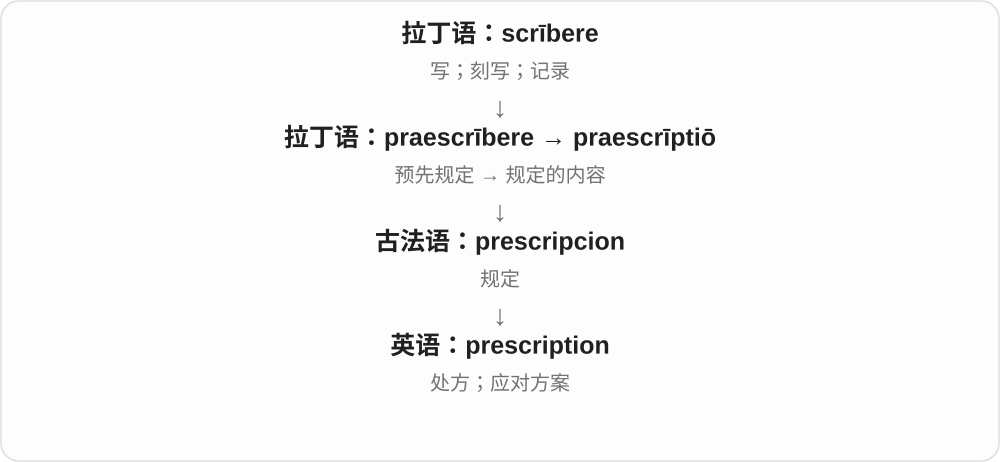

处方把应使用的药物或处理要求写明；a prescription for success 则是“成功之道”的比喻，并不表示它保证有效。

**常见搭配与例句**

write a prescription（开处方）；a prescription for…（……的处方或方案）；prescription medicine（处方药）。

> The pharmacist checked the prescription carefully.

药剂师仔细核对了处方。

> The book offers no simple prescription for happiness.

这本书没有提供获得幸福的简单公式。

**别混淆**

prescription 写的是要求怎样做；description 说的是实际是什么样。两词都含 script-，前缀决定方向。

### 11. prescriber — 开处方者；作出规定者

**音标**：英 /prɪˈskraɪbə/；美 /prɪˈskraɪbər/

**先抓住这个画面**

prescriber 是决定并开出处方的一方。这个词把注意力放在“谁作出用药或处理要求”这个角色上。

**怎么拆**

prescribe + -er；词末已有 e，只加 r。

**怎么变成今天的意思**

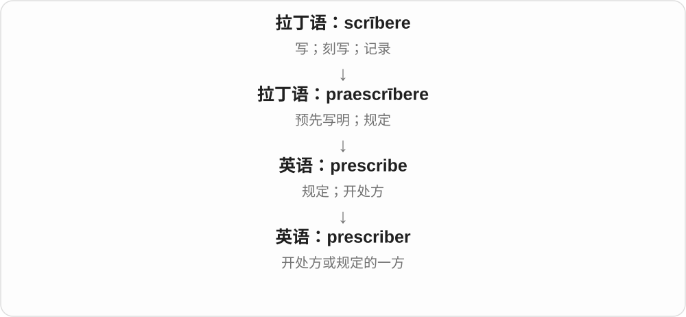

常见于医疗服务说明，使用这个称呼时不必重复某一种职业头衔。谁有处方权限取决于具体制度，词本身不作规定。

**常见搭配与例句**

contact the prescriber（联系开方者）；an authorized prescriber（获授权的开方者）；prescriber information（开方者信息）。

> The pharmacist contacted the prescriber to clarify the instructions.

药剂师联系开方者，核实处方说明。

> The form includes the prescriber’s name and contact details.

表格包含开方者的姓名和联系方式。

**别混淆**

prescriber 负责开出处方；pharmacist 是药剂师，两种角色不能仅凭单词画等号。

### 12. ascribe — 把……归因于；把……归属于

**音标**：/əˈskraɪb/

**先抓住这个画面**

ascribe 像给一件事贴上归属标签：“这个结果算在它头上”“这幅画是某人画的”。

**怎么拆**

拉丁语 ad-（向、附到）+ scrībere（写）形成 āscrībere，经法语传入；字面可理解为把名字或归属写上去。

**怎么变成今天的意思**

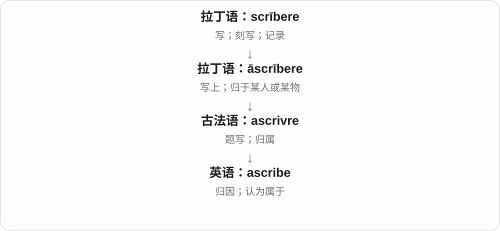

ascribe success to hard work 是把成功归因于努力；ascribe a painting to an artist 是认为画出自那位画家。两种都在判断归属。

**常见搭配与例句**

ascribe A to B（把 A 归于 B）；ascribe motives to someone（认为某人有某种动机）。

> She ascribes her progress to daily practice.

她把自己的进步归功于每天练习。

> The painting was once ascribed to an unknown Italian artist.

这幅画曾被认为出自一位身份不明的意大利画家。

**别混淆**

ascribe 与 attribute 在归因义上接近。describe 是描述是什么样，不判断归属。

### 13. inscribe — 刻写；题写；铭记

**音标**：/ɪnˈskraɪb/

**先抓住这个画面**

inscribe 是把文字留在一个载体上：奖牌上刻名字，书扉页写赠言，纪念碑上刻日期。

**怎么拆**

拉丁语 in-（在……上）+ scrībere（写），形成 īnscrībere。这里不是否定前缀 in-。

**怎么变成今天的意思**

它比普通 write 更容易让人想到正式、特意保留的文字。可以刻，也可以用笔题写，不要求一定凿进石头。

**常见搭配与例句**

inscribe a name on…（把名字刻在……上）；inscribe a book to someone（在赠书中题词给某人）；be inscribed with…（刻有……）。

> Their names were inscribed on the memorial.

他们的名字刻在纪念碑上。

> She inscribed the book to her first teacher.

她在赠书上题词，献给自己的第一位老师。

**别混淆**

write 很普通；inscribe 强调文字被题在、刻在特定载体上。engrave 更突出雕刻这一制作动作。

### 14. inscription — 铭文；题词；刻写的文字

**音标**：/ɪnˈskrɪpʃən/

**先抓住这个画面**

inscription 是留在物品表面上的那段字。戒指里的日期、墓碑上的姓名、书里的赠言，都可能是 inscription。

**怎么拆**

来自拉丁语 īnscrīptiō，与 īnscrībere“题写、刻写”相连。

**怎么变成今天的意思**

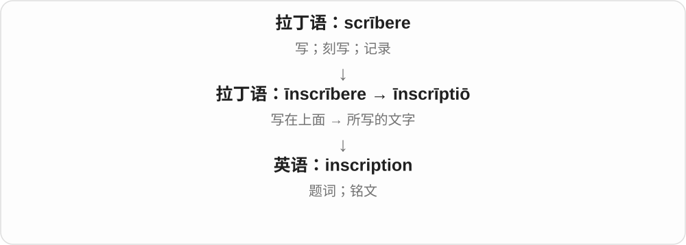

inscribe 是题写动作；inscription 常指动作留下的具体文本。它可以很短，不必是长篇文章。

**常见搭配与例句**

an inscription on a ring（戒指上的刻字）；read an inscription（读铭文）；a dedicatory inscription（献词、题赠文字）。

> The inscription on the bell gives the year it was made.

钟上的铭文记载了它的铸造年份。

> He found a personal inscription inside the book.

他在书里发现了一段私人题词。

**别混淆**

inscription 通常特意留在物品上；caption 是图片等的说明文字。两者都可能短，却服务不同场景。

### 15. script — 剧本；脚本；文字体系；书写体

**音标**：/skrɪpt/

**先抓住这个画面**

script 是写成某种形式、能照着读或执行的内容：演员有台词本，计算机有命令脚本，书写也有不同字形体系。

**怎么拆**

来自拉丁语 scrīptum“写下的东西”，经法语传入。script- 对应 scrībere 的过去分词词干。

**怎么变成今天的意思**

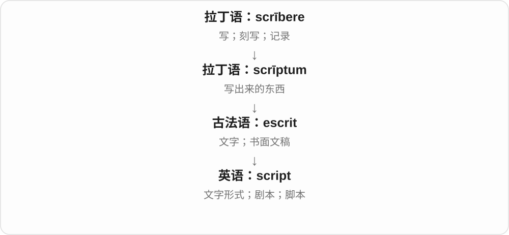

先有书面文字，再专化为演出稿和一串程序指令。Arabic script 里的 script 指文字体系，不是某部阿拉伯语电影的剧本。

**常见搭配与例句**

read a script（读剧本）；write a script（写脚本或剧本）；run a script（运行脚本）；a handwritten script（手写体）。

> The actors read through the script together.

演员们一起通读了剧本。

> She wrote a short script to rename the files.

她写了一个短脚本来重命名文件。

**别混淆**

screenplay 特指影视剧本；script 更广。字体中的 script 还可指连笔书写风格，要看语境。

### 16. scripture — 宗教经典；经文

**音标**：英 /ˈskrɪptʃə/；美 /ˈskrɪptʃər/

**先抓住这个画面**

scripture 是一个宗教传统认为具有权威或神圣地位的文本。它不只是“写过的东西”，而是被当作经典来读的文字。

**怎么拆**

来自拉丁语 scrīptūra，原本泛指写作、文字，后来在英语中专化为宗教经文。

**怎么变成今天的意思**

普通“文字”经过特定领域的长期使用，词义变窄。英语大写 Scripture 常指《圣经》经文；复数 scriptures 也可用于不同宗教的经典。

**常见搭配与例句**

read scripture（读经文）；a passage of scripture（一段经文）；sacred scriptures（宗教经典）。

> The speaker quoted a passage of scripture.

演讲者引用了一段经文。

> The course compares scriptures from several religious traditions.

这门课程比较几个宗教传统的经典。

**别混淆**

script 是剧本、脚本或文字形式；scripture 通常有宗教含义。相同词干不代表可以混用。

### 17. scriptural — 经典中的；依据经文的

**音标**：/ˈskrɪptʃərəl/

**先抓住这个画面**

scriptural 表示与宗教经典有关，或依据经典文字来说明。a scriptural reference 就是指向某处经文的引用。

**怎么拆**

scripture + -al，去掉词末 e，形成形容词。

**怎么变成今天的意思**

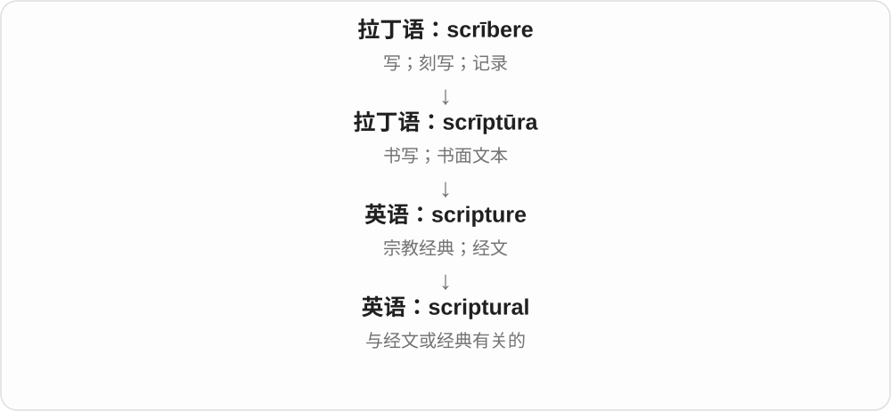

scripture 是经典文本，scriptural 则描述材料的来源或性质。具体指哪种宗教经典，由文章所谈的传统决定。

**常见搭配与例句**

a scriptural passage（一段经文）；scriptural interpretation（经文解释）；scriptural references（经文引注）。

> The essay examines different forms of scriptural interpretation.

文章考察了不同的经文解释方式。

> Each chapter includes several scriptural references.

每章都包含几处经文引注。

**别混淆**

scriptural 强调来自经典；religious 泛指与宗教有关。宗教习俗不一定都有直接的 scriptural basis。

### 18. scripting — 编写脚本；编写剧本

**音标**：/ˈskrɪptɪŋ/

**先抓住这个画面**

scripting 是把需要发生的步骤或台词写下来。计算机语境最常见：把重复工作写成一段能执行的命令。

**怎么拆**

script + -ing，表示编写 script 的过程或活动。

**怎么变成今天的意思**

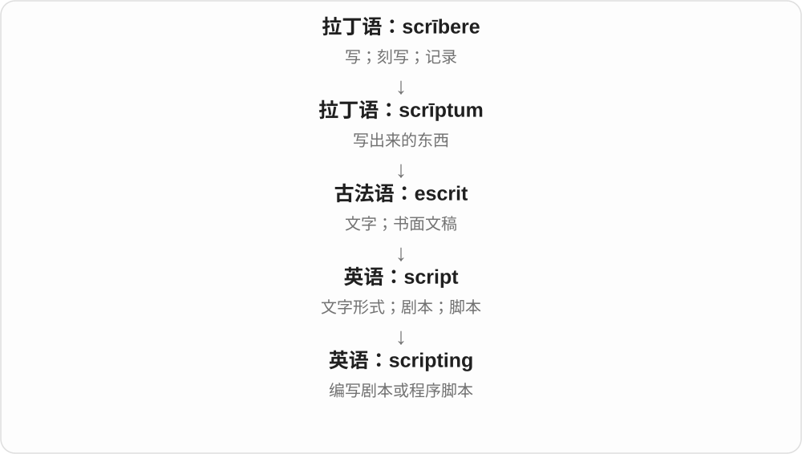

这个词既可谈舞台影视写作，也可谈自动化任务。看见 scripting skills，多数技术语境是在说编写脚本的能力。

**常见搭配与例句**

scripting skills（脚本编写能力）；a scripting language（脚本语言）；basic scripting（基础脚本编写）。

> Basic scripting saved her hours of repetitive work.

基础脚本编写帮她省下了几小时重复劳动。

> He is responsible for scripting the short educational films.

他负责为这些教育短片编写剧本。

**别混淆**

script 是写出来的脚本；scripting 是编写活动。programming 范围更广，不能只凭语言名称硬分两者。

### 19. scriptwriter — 编剧；剧本作者

**音标**：英 /ˈskrɪptraɪtə/；美 /ˈskrɪptraɪtər/

**先抓住这个画面**

scriptwriter 是把人物要说的话、故事要怎样展开写成剧本的人。演员负责演，编剧先把内容写出来。

**怎么拆**

script（剧本）+ writer（写作者），两个完整英语词组成复合词。

**怎么变成今天的意思**

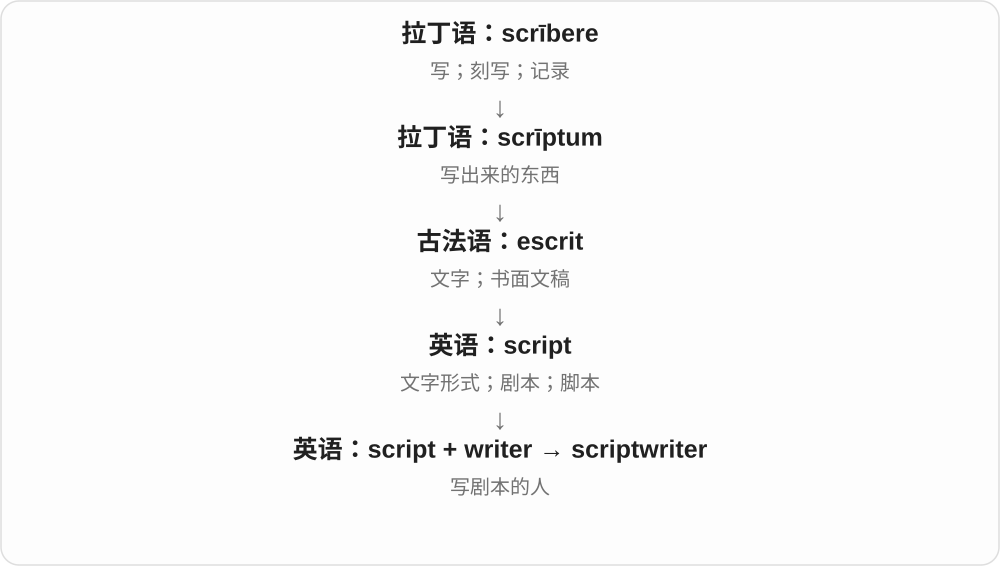

可以写电影、电视剧、广播剧或其他节目。这里 script 使用演出稿义，不是泛指所有文字。

**常见搭配与例句**

a television scriptwriter（电视编剧）；work as a scriptwriter（从事编剧工作）。

> The scriptwriter rewrote the final scene.

编剧重写了最后一场戏。

> She began her career as a radio scriptwriter.

她从广播剧编剧开始了职业生涯。

**别混淆**

scriptwriter 范围较广；screenwriter 通常强调影视编剧。director 是导演，主要角色不同。

### 20. typescript — 打字稿

**音标**：/ˈtaɪpskrɪpt/

**先抓住这个画面**

typescript 是用打字方式形成的稿子。想象作者把手写草稿重新打成整齐的页面交给编辑。

**怎么拆**

type（打字）+ script（写成的文本），是英语复合词。

**怎么变成今天的意思**

在出版史、档案和文献研究中，这个词能说明文本的物理形式：是打出来的稿，而不是手写原件或正式印刷本。

**常见搭配与例句**

an original typescript（原始打字稿）；a corrected typescript（带修改的打字稿）；a typescript of a novel（小说打字稿）。

> The archive holds the corrected typescript of the novel.

档案馆保存着这部小说带修改的打字稿。

> She compared the typescript with the handwritten notes.

她把打字稿与手写笔记作了比较。

**别混淆**

manuscript 在现代出版中可泛指稿件；typescript 明确强调打字形式。首字母大写的 TypeScript 还可作编程语言名称。

### 21. conscript — 应征入伍者；征召

**音标**：名词 英 /ˈkɒnskrɪpt/、美 /ˈkɑːnskrɪpt/；动词 /kənˈskrɪpt/

**先抓住这个画面**

conscript 的画面是在征召名册上写入一个人的名字。名词指被征召的人，动词指实施征召。

**怎么拆**

拉丁语 con-（一起）+ scrībere（写）形成 cōnscrībere“登记、招募”，其分词 cōnscriptus 进入英语。

**怎么变成今天的意思**

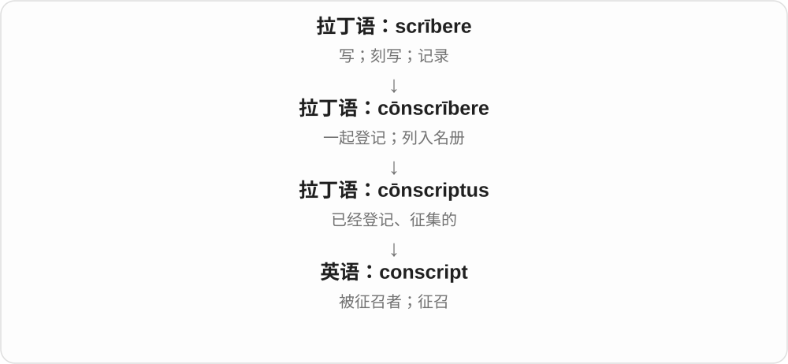

从把名字列进名册，发展到强制征召的用法。它通常不表示自愿报名入伍；比喻中也可说被拉去帮忙。

**常见搭配与例句**

a young conscript（年轻的应征入伍者）；conscript someone into the army（征召某人入伍）。

> The novel follows the life of a young conscript.

小说讲述了一名年轻应征入伍者的生活。

> He was conscripted into the army at eighteen.

他十八岁时被征召入伍。

**别混淆**

conscript 通常是按征召制度入伍的人；volunteer 是自愿者。名词重音在前，动词重音在后。

### 22. subscript — 下标；下标字符

**音标**：/ˈsʌbskrɪpt/

**先抓住这个画面**

subscript 就是写在主文字右下方、位置更低的小字符。H₂O 中的 ₂，是最直观的例子。

**怎么拆**

sub-（下面）+ script（写成的字符），是可以直接看见的构词关系。

**怎么变成今天的意思**

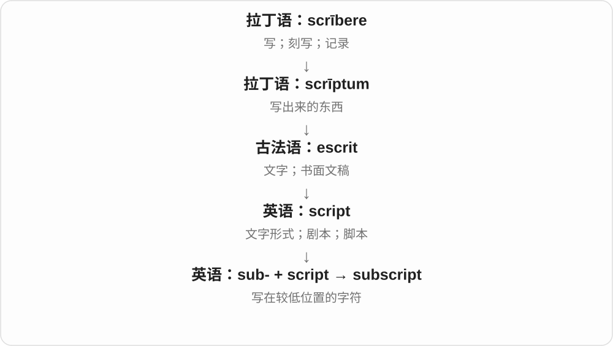

数学和化学常用下标区分变量、表示数量。编程里 subscript 也可指索引，属于从符号用途发展出来的技术义。

**常见搭配与例句**

a subscript number（下标数字）；write as a subscript（写成下标）；an array subscript（数组索引）。

> The two in H₂O is a subscript.

H₂O 中的数字二是下标。

> Use a subscript to distinguish the two variables.

用下标区分这两个变量。

**别混淆**

subscript 在下方；superscript 在上方，如 x² 中的 ²。subscribe 虽也含“写在下面”，现代主要是订阅。

### 23. manuscript — 手稿；尚未出版的文稿

**音标**：/ˈmænjəskrɪpt/

**先抓住这个画面**

manuscript 原来是手写出来的文本。今天作者交给编辑的稿件即使在电脑上写成，也仍然可以叫 manuscript。

**怎么拆**

中世纪拉丁语 manū（用手）+ scrīptus（写成的）形成 manūscrīptus 等形式，不是古典拉丁语里早已有的完整词。

**怎么变成今天的意思**

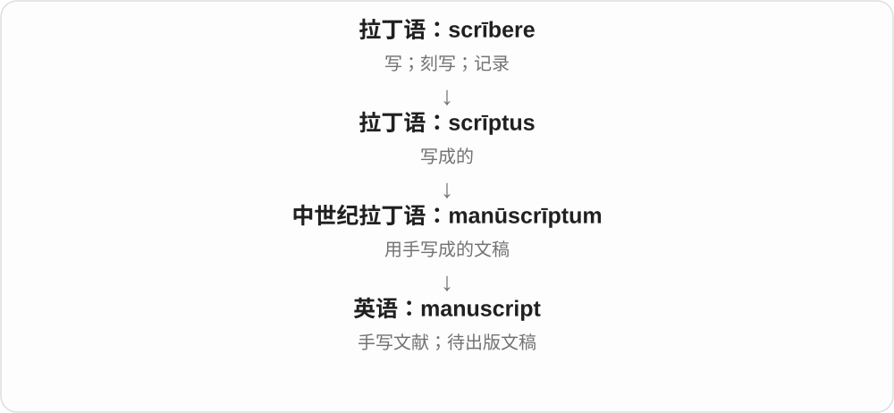

“手写”是历史起点，现代出版用法则按稿件所处阶段命名，不再要求真的用笔写。古文献语境仍常保留手写本的含义。

**常见搭配与例句**

submit a manuscript（提交稿件）；a medieval manuscript（中世纪手抄本）；the original manuscript（原稿）。

> She sent the completed manuscript to her editor.

她把完成的书稿交给了编辑。

> The library preserves several medieval manuscripts.

图书馆保存着几份中世纪手抄本。

**别混淆**

manuscript 是稿件或手抄本文献；published book 是已经出版的书。typescript 强调用打字方式形成。

### 24. transcribe — 转写；誊写；抄录

**音标**：/trænˈskraɪb/

**先抓住这个画面**

transcribe 是把内容搬到文字里，或从一个书写载体搬到另一个。听录音逐句打出来，就是 transcribe。

**怎么拆**

拉丁语 trāns-（转到另一处）+ scrībere（写），形成 trānscrībere“抄写、转录”。

**怎么变成今天的意思**

重点是尽量保留原有内容，只改变记录形式。它也可以把手稿誊清，或按专门符号记录声音。

**常见搭配与例句**

transcribe an interview（转写采访）；transcribe handwritten notes（誊写手写笔记）；transcribe speech（把话语写下）。

> She transcribed the recording before writing her report.

写报告前，她先把录音转成文字。

> The assistant transcribed the faded handwritten notes.

助手誊写了那些字迹褪色的手写笔记。

**别混淆**

transcribe 改变记录形式；translate 改变语言。把中文录音写成中文，是转写，不是翻译。

### 25. transcript — 文字记录；誊本；成绩单

**音标**：/ˈtrænskrɪpt/

**先抓住这个画面**

transcript 是把原先说过、写过或记录过的内容转成一份文字记录。采访录音对应文字稿，学校学习记录对应成绩单。

**怎么拆**

来自拉丁语 trānscrīptum，与 trānscrībere“抄写到另一处”相连。trans- 表示跨过、转移，script- 表示写。

**怎么变成今天的意思**

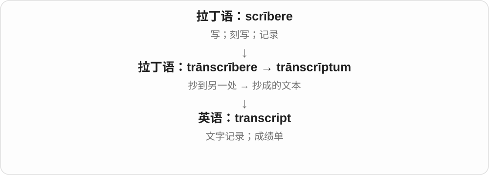

采访 transcript 通常记录谈话内容，不是只概括要点。academic transcript 则是课程、成绩等的正式学习记录。

**常见搭配与例句**

a transcript of the interview（采访文字稿）；an academic transcript（成绩单）；a complete transcript（完整文字记录）。

> A transcript of the interview is available online.

网上可以看到采访的文字稿。

> The university asked for an official transcript.

大学要求提供正式成绩单。

**别混淆**

transcript 记录内容；summary 压缩要点。minutes 是会议纪要，也不一定逐字记录所有发言。

### 26. transcription — 转写；转录；转写文本

**音标**：/trænˈskrɪpʃən/

**先抓住这个画面**

transcription 可以是“把声音或原稿写出来”的过程，也可以是写成的结果。给录音做文字稿，就是一次 transcription 工作。

**怎么拆**

经法语或直接来自拉丁语 trānscrīptiō，与 transcribe 同源；使用 script- 词干。

**怎么变成今天的意思**

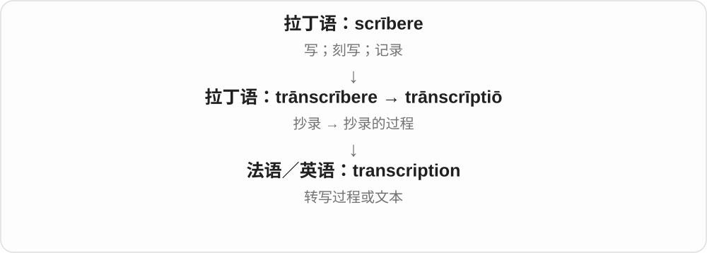

语音学中的 phonetic transcription 用音标记录发音。分子生物学的“转录”是另一个专门领域，不要把它想成听录音打字。

**常见搭配与例句**

audio transcription（录音转写）；phonetic transcription（语音转写）；an accurate transcription（准确的转写文本）。

> Manual transcription of the interview took two hours.

手工转写这次采访花了两个小时。

> The dictionary includes a phonetic transcription of each word.

词典给每个词都标了音标。

**别混淆**

transcription 更常强调过程或记录方式；transcript 常指一份完成的文字记录，两者有时可以重叠。

### 27. circumscribe — 限制；划定界限；作外接图形

**音标**：英 /ˈsɜːkəmskraɪb/；美 /ˈsɝːkəmskraɪb/

**先抓住这个画面**

circumscribe 像围着一件事画一圈：“活动只能到这里。”圈可以是几何图形，也可以是权力、自由或讨论范围的边界。

**怎么拆**

拉丁语 circum（围绕）+ scrībere（写、画），形成 circumscrībere“在周围画线”。

**怎么变成今天的意思**

从画出外围线，扩展成限定某事物的范围。几何里也保留具体的外接用法，如作三角形的外接圆。

**常见搭配与例句**

circumscribe someone’s powers（限制某人的权力）；be circumscribed by rules（受规则限制）；circumscribe a circle about a triangle（作三角形外接圆）。

> The committee’s powers are carefully circumscribed.

委员会的权力受到明确限制。

> Circumscribe a circle about the triangle.

作这个三角形的外接圆。

**别混淆**

describe 是描写；circumscribe 是围着画界限。restrict 更常用，circumscribe 带较正式、边界明确的感觉。

## 这一组要分清什么

**describe 与 prescribe**：一个描述实际是什么样，一个规定应该怎样做。description 不等于 prescription。

**subscribe 与 subscript**：两者都能看见“写在下面”的画面，但 subscribe 已发展为签认、赞同和订阅，subscript 保留写在低处的“下标”意思。

**manuscript 不必真的手写。** 它的历史起点是手稿，现代出版语境也包括电脑写成、尚待出版的稿件。

**scribble 的早期路线有不同分析。** 保留它与书写词族的联系，但不把一个猜测写成唯一历史。

## 串起来练习

把动作分开：**Transcribe the interview, describe the main findings, and submit the manuscript.**

先把采访转成文字，再描述主要发现，最后提交文稿。transcribe 尽量保留原话，describe 用语言讲清内容，manuscript 是交给编辑的稿件。
