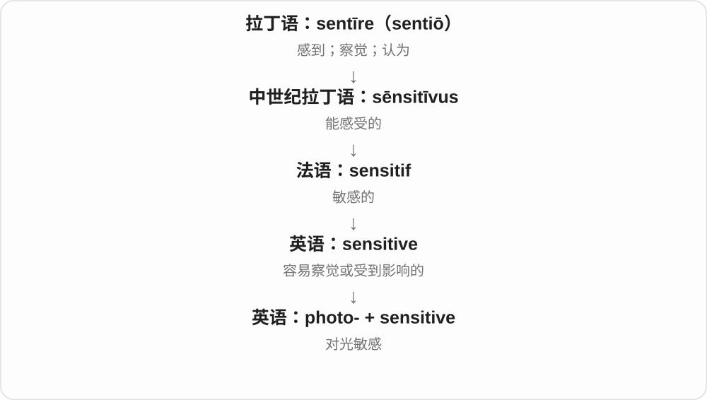

# 0583 · phos-, phot- — 光；用光记录、测量、感知、供能或引发反应

[逐词精讲目录](../00_逐词精讲目录.md) · [总目录](../00_总目录_按常用程度.md)

## 核心词根与来源

希腊语 phōs 是光，属格 phōtos 显示 phot- 词干。现代科学大量采用 photo- 组合新词；独立名词 photo 却是 photograph 的缩略形式。phosphorus 走另一条古典路线：phōs 加携带者形成“带来光的”，经拉丁语先指启明星或发光物，后来用于磷元素。

**光本身很简单，后面接的部分决定它在做什么：记录成照片，进入眼睛被感知，落到材料上又能转成电或引发变化。**

想象同一束光分向三个地方：相机留下影像，叶片利用它供能，传感器把它变成信号。别把每个 photo- 都先想成照片。

- **摄影与照片**：photo, photograph, photography, photographer, photographic, photographically, photoshoot, photogenic, telephoto, photobook, astrophotography, photobomb, photogram, microphotograph, photocopy, photocopier
- **光子与光电技术**：photon, photonic, photonics, photoelectric, photovoltaic, photocell, photodiode, photophone, biophoton, diphoton
- **测光与视觉**：photometry, photometric, photometer, spectrophotometer, photopic, photoreceptor
- **光与生命**：photosynthesis, photosynthetic, photosynthesize, photobiology, photoperiod, phototaxis, phototroph, photophore, photoptarmosis, phototherapy, photophobia, photosensitive, photosensitivity
- **水中光照区域**：photic, euphotic, aphotic
- **光致化学变化**：photolysis, photocatalysis, photochromism
- **磷元素与发光材料**：phosphorus, phosphor, phosphorous, phosphoric, phosphate, phosphorylation, phosphorescent, phosphorescence

## 词形与演化规律

phot-、photo- 多见于近代组合；phos- 保留在 phosphorus 一支。photograph、photography、photogenic 有相互关联但并不完全相同的形成史。photopic 经新拉丁语 photopia。phosphorescent 与 phosphorescence 的记录、形成方式不能简单按现代词尾倒推。

## 单词速览（按词族由简到繁）

同一基础词的相关扩展放在一起，先读基础形式，再读扩展；各组之间优先读常用的。具体词源关系见各词讲解。

| 单词 | 音标 | 核心意思 |
|---|---|---|
| [photo](#w-1) | 英 /ˈfəʊtəʊ/；美 /ˈfoʊtoʊ/ | 照片 |
| [photoshoot](#w-12) | 英 /ˈfəʊtəʊʃuːt/；美 /ˈfoʊtoʊʃuːt/ | 一次安排好的摄影活动；摄影拍摄 |
| [photobook](#w-25) | 构词参考读法：英 /ˈfəʊtəʊbʊk/；美 /ˈfoʊtoʊbʊk/ | 摄影集；照片书 |
| [photobomb](#w-31) | 英 /ˈfəʊtəʊbɒm/；美 /ˈfoʊtoʊbɑːm/ | 突然闯入别人正在拍的照片；抢镜 |
| [photophobia](#w-40) | 英 /ˌfəʊtəʊˈfəʊbiə/；美 /ˌfoʊtoʊˈfoʊbiə/ | 畏光；对光不耐受 |
| [telephoto](#w-20) | 英 /ˌtelɪˈfəʊtəʊ/；美 /ˌteləˈfoʊtoʊ/ | 长焦摄影的；长焦镜头；长焦照片 |
| [photograph](#w-4) | 英 /ˈfəʊtəɡrɑːf/；美 /ˈfoʊtəɡræf/ | 照片；拍摄照片 |
| [photography](#w-2) | 英 /fəˈtɒɡrəfi/；美 /fəˈtɑːɡrəfi/ | 摄影；摄影术；摄影艺术 |
| [astrophotography](#w-29) | 英 /ˌæstrəʊfəˈtɒɡrəfi/；美 /ˌæstroʊfəˈtɑːɡrəfi/ | 天文摄影 |
| [photographer](#w-3) | 英 /fəˈtɒɡrəfə/；美 /fəˈtɑːɡrəfər/ | 摄影师；拍照的人 |
| [photographic](#w-5) | 英 /ˌfəʊtəˈɡræfɪk/；美 /ˌfoʊtəˈɡræfɪk/ | 摄影的；照片的；像照片般细致的 |
| [photographically](#w-33) | 英 /ˌfəʊtəˈɡræfɪkli/；美 /ˌfoʊtəˈɡræfɪkli/ | 用摄影方式；从摄影效果来看；像照片一样逼真地 |
| [microphotograph](#w-55) | 美 /ˌmaɪkrəˈfoʊtəˌɡræf/ | 缩微照片；显微照片〔另有用法〕 |
| [phosphate](#w-6) | 英 /ˈfɒsfeɪt/；美 /ˈfɑːsfeɪt/ | 磷酸盐；磷酸根；磷酸酯〔依语境〕 |
| [photon](#w-7) | 英 /ˈfəʊtɒn/；美 /ˈfoʊtɑːn/ | 光子 |
| [photonic](#w-16) | 英 /fəʊˈtɒnɪk/ | 光子的；光子技术的 |
| [photonics](#w-18) | 英 /fəʊˈtɒnɪks/ | 光子学；光子技术 |
| [diphoton](#w-54) | 构词参考读法：英 /daɪˈfəʊtɒn/；美 /daɪˈfoʊtɑːn/ | 双光子系统；双光子的〔粒子物理〕 |
| [biophoton](#w-53) | 构词参考读法：英 /ˌbaɪəʊˈfəʊtɒn/；美 /ˌbaɪoʊˈfoʊtɑːn/ | 生物光子 |
| [phosphorus](#w-8) | 英 /ˈfɒsfərəs/；美 /ˈfɑːsfərəs/ | 磷〔化学元素 P〕 |
| [phosphorous](#w-21) | 美 /ˈfɑːsfərəs/ | 亚磷的；含较低价态磷的〔化学〕 |
| [phosphorescent](#w-26) | 美 /ˌfɑːsfəˈresənt/ | 发磷光的；能持续余辉的 |
| [phosphorescence](#w-36) | 美 /ˌfɑːsfəˈresəns/ | 磷光；余辉发光现象 |
| [photosynthesis](#w-9) | 英 /ˌfəʊtəʊˈsɪnθəsɪs/；美 /ˌfoʊtoʊˈsɪnθəsɪs/ | 光合作用 |
| [photosynthetic](#w-15) | 美 /ˌfoʊtoʊsɪnˈθetɪk/ | 光合作用的；能进行光合作用的 |
| [photovoltaic](#w-10) | 英 /ˌfəʊtəʊvɒlˈteɪɪk/；美 /ˌfoʊtoʊvɑːlˈteɪɪk/ | 光伏的；把光转成电的 |
| [phosphorylation](#w-11) | 美 /ˌfɑːsˌfɔːrəˈleɪʃən/ | 磷酸化 |
| [photogenic](#w-13) | 英 /ˌfəʊtəʊˈdʒenɪk/；美 /ˌfoʊtoʊˈdʒenɪk/ | 上镜的；适合拍照的；光致的〔早期或专业义〕 |
| [photocopy](#w-14) | 英 /ˈfəʊtəʊkɒpi/；美 /ˈfoʊtoʊkɑːpi/ | 复印件；复印 |
| [photocopier](#w-30) | 英 /ˈfəʊtəʊkɒpiə/；美 /ˈfoʊtoʊkɑːpiər/ | 复印机 |
| [phosphor](#w-17) | 美 /ˈfɑːsfər/ | 发光材料；荧光粉 |
| [phosphoric](#w-22) | 美 /fɑːsˈfɔːrɪk/ | 磷的；磷酸的；含较高价态磷的〔化学〕 |
| [photometry](#w-28) | 英 /fəʊˈtɒmɪtri/ | 光度测量；测光学 |
| [photometric](#w-19) | 英 /ˌfəʊtəʊˈmetrɪk/；美 /ˌfoʊtəˈmetrɪk/ | 光度测量的；测光的 |
| [photoelectric](#w-23) | 英 /ˌfəʊtəʊɪˈlektrɪk/；美 /ˌfoʊtoʊɪˈlektrɪk/ | 光电的 |
| [photosensitive](#w-24) | 英 /ˌfəʊtəʊˈsensətɪv/；美 /ˌfoʊtoʊˈsensətɪv/ | 光敏的；对光产生反应的 |
| [photosensitivity](#w-37) | 美 /ˌfoʊtoʊˌsensəˈtɪvəti/ | 光敏性；对光敏感 |
| [photoreceptor](#w-27) | 英 /ˌfəʊtəʊrɪˈseptə/；美 /ˌfoʊtoʊrɪˈseptər/ | 光感受器；感光细胞或结构 |
| [photometer](#w-41) | 英 /fəʊˈtɒmɪtə/；美 /foʊˈtɑːmətər/ | 光度计；测光仪 |
| [spectrophotometer](#w-32) | 英 /ˌspektrəʊfəʊˈtɒmɪtə/；美 /ˌspektroʊfoʊˈtɑːmətər/ | 分光光度计 |
| [photodiode](#w-34) | 美 /ˌfoʊtoʊˈdaɪˌoʊd/ | 光电二极管 |
| [phototherapy](#w-35) | 英 /ˌfəʊtəʊˈθerəpi/；美 /ˌfoʊtoʊˈθerəpi/ | 光疗 |
| [photoperiod](#w-38) | 英 /ˌfəʊtəʊˈpɪəriəd/ | 光周期；每日光照时长 |
| [photic](#w-39) | 英 /ˈfəʊtɪk/；美 /ˈfoʊtɪk/ | 光的；受光照的 |
| [euphotic](#w-50) | 英 /juːˈfəʊtɪk/；美 /juːˈfoʊtɪk/ | 真光层的；光照足以支持光合作用的 |
| [aphotic](#w-51) | 英 /eɪˈfəʊtɪk/；美 /eɪˈfoʊtɪk/ | 无光的；无光层的 |
| [photolysis](#w-42) | 英 /fəʊˈtɒlɪsɪs/ | 光解；光致分解 |
| [photocell](#w-43) | 美 /ˈfoʊtəˌsel/ | 光电池；光电元件 |
| [photosynthesize](#w-44) | 英 /ˌfəʊtəʊˈsɪnθɪsaɪz/；美 /ˌfoʊtoʊˈsɪnθəsaɪz/ | 进行光合作用；通过光合作用合成 |
| [photobiology](#w-45) | 英 /ˌfəʊtəʊbaɪˈɒlədʒi/；美 /ˌfoʊtoʊbaɪˈɑːlədʒi/ | 光生物学 |
| [photogram](#w-46) | 英 /ˈfəʊtəɡræm/；美 /ˈfoʊtəɡræm/ | 物影照片；不用相机直接曝光形成的图像 |
| [photocatalysis](#w-47) | 英 /ˌfəʊtəʊkəˈtælɪsɪs/ | 光催化 |
| [photopic](#w-48) | 美 /foʊˈtoʊpɪk/，也读 /foʊˈtɑːpɪk/ | 明视觉的；与较亮环境下视觉有关的 |
| [phototaxis](#w-49) | 英 /ˌfəʊtəʊˈtæksɪs/ | 趋光性；对光的定向运动 |
| [photophone](#w-52) | 英 /ˈfəʊtəʊˌfəʊn/ | 光线电话〔历史设备〕；拍照手机〔另有用法〕 |
| [photochromism](#w-56) | 美 /ˌfoʊtəˈkroʊˌmɪzəm/ | 光致变色 |
| [photophore](#w-57) | 美 /ˈfoʊtəˌfɔːr/ | 发光器；发光器官 |
| [photoptarmosis](#w-58) | 构词参考读法：英 /ˌfəʊtəʊtɑːˈməʊsɪs/；美 /ˌfoʊtoʊtɑːrˈmoʊsɪs/ | 光刺激性喷嚏反射〔罕见术语〕 |
| [phototroph](#w-59) | 英 /ˈfəʊtəʊˌtrɒf/ | 光养生物 |

## 逐词讲解

### 1. photo — 照片

**音标**：英 /ˈfəʊtəʊ/；美 /ˈfoʊtoʊ/

**先抓住这个画面**

手机或相机留下的一张影像，日常说 photo 最顺口。

**怎么拆**

英语 photograph 的缩略形式。photo- 在科学构词里原指光；独立名词 photo 则是较晚由 photograph 截短来的。

**怎么变成今天的意思**

**希腊语 phōs，属格 phōtos**  
光；phot- 来自它的变化词干

↓

**19世纪 photo- + -graph → 英语 photograph**  
光 + 记录、图像 → 照片；也作拍照动词

↓

**英语 photograph 缩略为 photo**  
照片的常用短称

a photo of my dog 是狗的照片；a photo by her 是她拍的照片。复数 photos 直接加 -s，不写 photoes。

**常见搭配与例句**

take a photo；a photo of；share photos。

> I found an old photo of our first apartment.

我找到了一张我们第一间公寓的旧照片。

> Could you take a photo of us by the window?

你能在窗边给我们拍张照吗？

**别混淆**

photo 与 photograph 基本同义，前者更日常；picture 还包括画、屏幕图像等。

### 2. photoshoot — 一次安排好的摄影活动；摄影拍摄

**音标**：英 /ˈfəʊtəʊʃuːt/；美 /ˈfoʊtoʊʃuːt/

**先抓住这个画面**

不是路过随手按一下快门，而是安排时间、地点和对象，集中拍一组照片。

**怎么拆**

photo + shoot；shoot 在摄影中有拍摄义，英语把两词组合成活动名，亦常分写 photo shoot。

**怎么变成今天的意思**

**希腊语 phōs，属格 phōtos**  
光；phot- 来自它的变化词干

↓

**19世纪 photo- + -graph → 英语 photograph**  
光 + 记录、图像 → 照片；也作拍照动词

↓

**英语 photograph 缩略为 photo**  
照片的常用短称

↓

**英语 photo + shoot → photoshoot**  
照片 + 拍摄活动 → 一次安排好的摄影拍摄

a fashion photoshoot 可以涉及模特、服装、灯光和摄影师。普通旅行拍照不必都叫 photoshoot；这个词常带组织好一场拍摄的感觉。

**常见搭配与例句**

a fashion photoshoot；arrange a photoshoot；on a photoshoot。

> The outdoor photoshoot was moved indoors because of the rain.

因为下雨，原定户外的拍摄改到了室内。

> They booked a studio for the family photoshoot.

他们为这次家庭照拍摄预订了摄影棚。

**别混淆**

a photograph 是成品；a photoshoot 是拍摄活动，一场可产生很多照片。

### 3. photobook — 摄影集；照片书

**音标**：构词参考读法：英 /ˈfəʊtəʊbʊk/；美 /ˈfoʊtoʊbʊk/

**先抓住这个画面**

把一组照片按顺序编成一本书，让它们一起讲一个主题或故事。

**怎么拆**

photo + book；现代英语组合，亦常分写 photo book。

**怎么变成今天的意思**

**希腊语 phōs，属格 phōtos**  
光；phot- 来自它的变化词干

↓

**19世纪 photo- + -graph → 英语 photograph**  
光 + 记录、图像 → 照片；也作拍照动词

↓

**英语 photograph 缩略为 photo**  
照片的常用短称

↓

**英语 photo + book → photobook**  
照片 + 书 → 以照片为主要内容的书

可以是艺术家的摄影作品集，也可以是把家庭照片印成的书。照片的选择、排列和页面设计共同影响阅读效果，不只是随意堆放图片。

**常见搭配与例句**

publish a photobook；a travel photobook；design a photobook。

> She made a photobook of the family’s coastal trip.

她把一家人的海边旅行做成了一本照片书。

> The photographer’s new photobook follows life in a fishing village.

摄影师的新摄影集记录了一个渔村的生活。

**别混淆**

photo album 也可指装入照片的相册；photobook 更突出编排、印制成书的成品。

### 4. photobomb — 突然闯入别人正在拍的照片；抢镜

**音标**：英 /ˈfəʊtəʊbɒm/；美 /ˈfoʊtoʊbɑːm/

**先抓住这个画面**

别人正认真合影，你从旁边突然钻进画面，把照片的注意力带偏了。

**怎么拆**

photo + bomb；bomb 的突袭、突然闯入形象用于照片场景，属于较新的口语组合。

**怎么变成今天的意思**

**希腊语 phōs，属格 phōtos**  
光；phot- 来自它的变化词干

↓

**19世纪 photo- + -graph → 英语 photograph**  
光 + 记录、图像 → 照片；也作拍照动词

↓

**英语 photograph 缩略为 photo**  
照片的常用短称

↓

**英语 photo + bomb → photobomb**  
照片 + 突然闯入 → 意外或故意抢入拍摄画面

常见于玩笑，也可能说动物无意闯入画面。作为动词可直接接 people 或 photo；它不一定意味着照片彻底不能用了。

**常见搭配与例句**

photobomb a selfie；photobomb a group photo；an accidental photobomb。

> A curious dog photobombed our group picture.

一只好奇的狗突然闯进了我们的合影。

> He tried to photobomb his sister’s selfie.

他想突然钻进妹妹自拍的画面里抢镜。

**别混淆**

pose for a photo 是配合拍摄；photobomb 突出原本不在主角安排中的突然入镜。

### 5. photophobia — 畏光；对光不耐受

**音标**：英 /ˌfəʊtəʊˈfəʊbiə/；美 /ˌfoʊtoʊˈfoʊbiə/

**先抓住这个画面**

亮光让眼睛难受，因此想眯眼、躲开或待在暗处。

**怎么拆**

photo-“光” + -phobia“畏惧、排斥”；医学里常说光引起不适，不能只照词尾翻成心理上的恐惧症。

**怎么变成今天的意思**

**希腊语 phōs，属格 phōtos**  
光；phot- 来自它的变化词干

↓

**photo- + -phobia → photophobia**  
光 + 排斥、不耐受 → 畏光

临床描述常指光线引起的眼部不适。另有少见用法把 photo 当照片，指对拍照的厌恶；看医疗语境时，应优先理解畏光这一常见义。

**常见搭配与例句**

experience photophobia；severe photophobia；symptoms of photophobia。

> The patient described photophobia during the interview.

患者在问诊时描述了畏光的情况。

> The questionnaire asked about headaches and photophobia.

问卷询问了头痛和畏光的情况。

**别混淆**

shyness in front of a camera 是镜头前害羞；通常的 photophobia 与眼睛对光的反应有关。

### 6. telephoto — 长焦摄影的；长焦镜头；长焦照片

**音标**：英 /ˌtelɪˈfəʊtəʊ/；美 /ˌteləˈfoʊtoʊ/

**先抓住这个画面**

人在远处不挪近，也能让远方的小目标在画面里占得更大。

**怎么拆**

现代可按 tele-“远” + photo 理解；历史形容词也由 telephotographic 缩短而来。日常主要围绕长焦镜头及用它拍出的图像。

**怎么变成今天的意思**

**希腊语 phōs，属格 phōtos**  
光；phot- 来自它的变化词干

↓

**19世纪 photo- + -graph → 英语 photograph**  
光 + 记录、图像 → 照片；也作拍照动词

↓

**英语 photograph 缩略为 photo**  
照片的常用短称

↓

**tele- + 摄影术语；telephotographic 缩短为 telephoto**  
远 + 摄影 → 长焦镜头及远摄相关用法

a telephoto lens 常用来拍远处的鸟或运动员。日常用法广指长焦镜头；严格光学中 telephoto 还可特指一种使镜身较有效焦距短的结构。它不自动表示镜头可以变焦。

**常见搭配与例句**

a telephoto lens；a telephoto shot；shoot with a telephoto。

> He used a telephoto lens to photograph the bird from a distance.

他用长焦镜头从远处拍摄那只鸟。

> The telephoto shot isolates the tower against the mountains.

这张长焦照片把塔从群山背景中突出出来。

**别混淆**

zoom 表示焦距可变；telephoto 关注长焦、远摄，定焦镜头也可以是 telephoto。

### 7. photograph — 照片；拍摄照片

**音标**：英 /ˈfəʊtəɡrɑːf/；美 /ˈfoʊtəɡræf/

**先抓住这个画面**

让来自场景的光留下记录，把眼前的一刻变成可保存的图像。

**怎么拆**

19世纪以希腊来源的 photo-“光”与 -graph“记录、图像”造出的术语，与 Herschel 等早期摄影研究者的用语传播有关。英语名词和动词都在早期摄影时期出现。

**怎么变成今天的意思**

**希腊语 phōs，属格 phōtos**  
光；phot- 来自它的变化词干

↓

**19世纪 photo- + -graph → 英语 photograph**  
光 + 记录、图像 → 照片；也作拍照动词

a photograph 是一张照片；photograph a building 是给建筑拍照。传统方法用感光材料，现代可用电子传感器，词的核心仍是用光记录图像。

**常见搭配与例句**

take a photograph；a photograph of；photograph a scene。

> The photograph shows the street before the old houses were demolished.

照片显示了老房子被拆除前的街道。

> She photographs the same tree in every season.

她每个季节都给同一棵树拍照。

**别混淆**

photograph 重音在开头；photography、photographer 的重音往后移，不能始终按 photo 单词的节奏读。

### 8. photography — 摄影；摄影术；摄影艺术

**音标**：英 /fəˈtɒɡrəfi/；美 /fəˈtɑːɡrəfi/

**先抓住这个画面**

重点不在某一张照片，而在怎样用光和构图把影像拍出来这门活动。

**怎么拆**

photo-“光” + -graphy“记录的方法、过程”；19世纪英法摄影术语中有 photography、photographie 等相应形式。可理解为用光作记录，不是把现代 photograph 随意加一个 y。

**怎么变成今天的意思**

**希腊语 phōs，属格 phōtos**  
光；phot- 来自它的变化词干

↓

**19世纪 photo- + -graphy → photography；法语对应 photographie**  
用光记录图像 → 摄影技术与艺术

portrait photography 是人像摄影；digital photography 是数码摄影。通常作不可数名词，说一张作品用 a photograph，而不说 a photography。

**常见搭配与例句**

an interest in photography；portrait photography；digital photography。

> She became interested in photography while travelling.

她在旅行中开始对摄影感兴趣。

> The course covers lighting and composition in portrait photography.

这门课讲解人像摄影中的用光和构图。

**别混淆**

photograph 是作品或拍摄动词；photography 是技术、艺术或活动本身。

### 9. astrophotography — 天文摄影

**音标**：英 /ˌæstrəʊfəˈtɒɡrəfi/；美 /ˌæstroʊfəˈtɑːɡrəfi/

**先抓住这个画面**

把镜头对向天空，记录星星、行星、星云等天体。

**怎么拆**

astro-“星体、天文” + photography；19世纪随着摄影技术用于天文观测而形成的组合。

**怎么变成今天的意思**

**希腊语 phōs，属格 phōtos**  
光；phot- 来自它的变化词干

↓

**19世纪 photo- + -graphy → photography；法语对应 photographie**  
用光记录图像 → 摄影技术与艺术

↓

**英语 astro- + photography → astrophotography**  
天文 + 摄影 → 天体及天空现象的摄影

既可服务科学观测，也可以是爱好者的艺术创作。长曝光、追踪和多张叠加是常用方法，但不是每一张天文照片都必须用同一套技术。

**常见搭配与例句**

deep-sky astrophotography；an interest in astrophotography；astrophotography equipment。

> She took up astrophotography after moving to a darker rural area.

搬到夜空更暗的乡村后，她开始玩天文摄影。

> The workshop introduced basic techniques for astrophotography.

工作坊介绍了天文摄影的基本技巧。

**别混淆**

astronomy 是研究天体的学科；astrophotography 是用摄影记录天体的方法与活动。

### 10. photographer — 摄影师；拍照的人

**音标**：英 /fəˈtɒɡrəfə/；美 /fəˈtɑːɡrəfər/

**先抓住这个画面**

站在镜头这一边，选择画面、光线和时机的人。

**怎么拆**

photograph 动词 + -er；加入职业、人员词尾时重音移到第二个音节，开头弱读。

**怎么变成今天的意思**

**希腊语 phōs，属格 phōtos**  
光；phot- 来自它的变化词干

↓

**19世纪 photo- + -graph → 英语 photograph**  
光 + 记录、图像 → 照片；也作拍照动词

↓

**英语 photograph + -er → photographer**  
拍照 → 拍摄照片的人

可以是职业摄影师，也可以是认真拍摄的业余爱好者。a wedding photographer 强调拍摄场合；the photographer of this image 指这张图的拍摄者。

**常见搭配与例句**

a professional photographer；a wedding photographer；an amateur photographer。

> The photographer waited for the clouds to clear.

摄影师等着云散开。

> An amateur photographer discovered the rare bird near the lake.

一位业余摄影爱好者在湖边发现了那只罕见的鸟。

**别混淆**

photographer 拍静态照片；videographer 通常拍摄视频，实际工作可以兼任。

### 11. photographic — 摄影的；照片的；像照片般细致的

**音标**：英 /ˌfəʊtəˈɡræfɪk/；美 /ˌfoʊtəˈɡræfɪk/

**先抓住这个画面**

把事物与照片的拍摄、呈现或记录能力联系起来。

**怎么拆**

photograph + -ic，亦可按 photo- + -graphic 分析；它属于19世纪摄影术语群，重音落到 -graph-。

**怎么变成今天的意思**

**希腊语 phōs，属格 phōtos**  
光；phot- 来自它的变化词干

↓

**19世纪 photo- + -graph → 英语 photograph**  
光 + 记录、图像 → 照片；也作拍照动词

↓

**英语 photograph + -ic → photographic**  
照片、拍摄 → 与摄影或照片有关的

photographic evidence 是照片证据；photographic equipment 是摄影器材。a photographic memory 通常形容记忆细节很强，并不保证一个人能像相机一样毫无误差地保存所有画面。

**常见搭配与例句**

photographic evidence；photographic equipment；a photographic memory。

> The archive contains a photographic record of the rebuilding work.

档案保存了重建工作的照片记录。

> Photographic evidence helped identify the damaged bridge.

照片证据帮助确定了那座受损的桥。

**别混淆**

photogenic 是上镜；photographic 只是与摄影有关，不表示人一定好看。

### 12. photographically — 用摄影方式；从摄影效果来看；像照片一样逼真地

**音标**：英 /ˌfəʊtəˈɡræfɪkli/；美 /ˌfoʊtəˈɡræfɪkli/

**先抓住这个画面**

把现场拍下来作为记录，或从光线、构图等摄影效果去评价一个地方，都可以用这个副词。

**怎么拆**

photographic + -ally，英语副词派生；photographic 接 photograph，远由“光 + 记录”构成。

**怎么变成今天的意思**

**希腊 graphein／graphē**  
刻画、写；文字、图画

↓

**希腊 phōt- 光 + 写画构件 → 英语 photograph**  
用光记录的影像；照片；后转为拍照动词

↓

**英语 photographic**  
摄影的；照片般的

↓

**英语 photographic + -ally → photographically**  
通过摄影；从摄影角度

documented photographically 表示用照片记录；photographically interesting 说适合或值得摄影呈现。它并不表示记录一定完整、未经选择或修改。

**常见搭配与例句**

record photographically；document photographically；photographically interesting。

> Each stage of the restoration was documented photographically.

修复的每个阶段都用照片作了记录。

> The old bridge is photographically interesting in the morning light.

晨光中的老桥很有摄影表现力。

**别混淆**

photographic 是形容词；photographically 修饰记录方式或评价角度，不直接替换 photograph 名词。

### 13. microphotograph — 缩微照片；显微照片〔另有用法〕

**音标**：美 /ˌmaɪkrəˈfoʊtəˌɡræf/

**先抓住这个画面**

一支是把原本较大的内容拍得极小，查看时再放大；另一支用来指显微镜下拍出的图像。

**怎么拆**

micro-“小” + photograph；同一组合在使用中有两种方向，要看小的是照片本身，还是被拍摄的对象。

**怎么变成今天的意思**

**希腊语 phōs，属格 phōtos**  
光；phot- 来自它的变化词干

↓

**19世纪 photo- + -graph → 英语 photograph**  
光 + 记录、图像 → 照片；也作拍照动词

↓

**英语 micro- + photograph → microphotograph**  
小 + 照片 → 缩小成的照片；另用于显微照片

保存文件的 microphotograph 往往很小，需要放大查看。指通过显微镜拍摄时，也有人用这个词，但 photomicrograph 更能清楚表达显微摄影。

**常见搭配与例句**

view a microphotograph；a microphotograph of a document；a microscope image。

> The document was preserved as a microphotograph.

这份文件以缩微照片的形式保存下来。

> A magnifier was needed to read the microphotograph.

需要放大镜才能读清那张缩微照片。

**别混淆**

microphotograph 常指缩微照片；photomicrograph 明确指通过显微镜取得的图像，两个词有使用上的重叠。

### 14. phosphate — 磷酸盐；磷酸根；磷酸酯〔依语境〕

**音标**：英 /ˈfɒsfeɪt/；美 /ˈfɑːsfeɪt/

**先抓住这个画面**

把磷酸这一类结构放进盐、矿物或生物分子里时，常会遇到 phosphate。

**怎么拆**

来自法语 phosphate，由 phosphore“磷” + 化学名词尾 -ate 形成；不是 photo + 某个看不懂的尾巴。

**怎么变成今天的意思**

**希腊语 phōs，属格 phōtos**  
光；phot- 来自它的变化词干

↓

**希腊语 phōsphoros → 拉丁语 phosphorus**  
phōs 光 + phoros 携带者 → 带来光的、启明星

↓

**英语 phosphorus**  
早期指发光物；后来用于元素磷

↓

**法语 phosphore + -ate → phosphate**  
磷 + 化学名称词尾 → 磷酸盐等

↓

**英语 phosphate**  
磷酸盐、磷酸根或磷酸酯相关用法

肥料中的 phosphate 常说磷酸盐；生物化学的 phosphate group 指磷酸基团。要靠上下文判断是在谈盐、离子还是分子上的基团。

**常见搭配与例句**

phosphate fertilizer；a phosphate group；phosphate ions。

> The laboratory measured phosphate levels in the water.

实验室测量了水中的磷酸盐含量。

> The enzyme transfers a phosphate group to the protein.

这种酶把一个磷酸基团转移到蛋白质上。

**别混淆**

phosphorus 指元素；phosphate 指与磷酸结构相关的一类化合物、离子或基团。

### 15. photon — 光子

**音标**：英 /ˈfəʊtɒn/；美 /ˈfoʊtɑːn/

**先抓住这个画面**

光和物质交换能量时，一份一份地交换；这份电磁辐射的量子叫 photon。

**怎么拆**

photo-“光” + 粒子名称中常见的 -on。20世纪这个名称逐步用于光量子，不是古希腊已有的现代物理概念。

**怎么变成今天的意思**

**希腊语 phōs，属格 phōtos**  
光；phot- 来自它的变化词干

↓

**20世纪 photo- + -on → photon**  
光 + 粒子名词尾 → 光子，电磁辐射的量子

可以说 a single photon，一个光子。红外线、紫外线、X射线也有光子，不限于眼睛看得见的光；也不能把光子完全想成沿固定轨道滚动的小球。

**常见搭配与例句**

emit a photon；detect a photon；photon energy。

> The detector registered a single photon.

探测器记录到了一个光子。

> The energy of a photon depends on its frequency.

光子的能量取决于它的频率。

**别混淆**

electron 是带负电的电子；photon 是电磁辐射的量子，没有电荷。

### 16. photonic — 光子的；光子技术的

**音标**：英 /fəʊˈtɒnɪk/

**先抓住这个画面**

让光子参与传输、控制或处理信息，而不是只把光当照明。

**怎么拆**

photon + -ic；词干 photon- 加形容词尾，重音落在 -ton-。

**怎么变成今天的意思**

**希腊语 phōs，属格 phōtos**  
光；phot- 来自它的变化词干

↓

**20世纪 photo- + -on → photon**  
光 + 粒子名词尾 → 光子，电磁辐射的量子

↓

**英语 photon + -ic → photonic**  
光子 → 与光子及其应用有关的

a photonic chip 可以在芯片上引导、调制光。这个形容词说明光在其中起关键作用，并不表示整个设备绝对没有电子部件。

**常见搭配与例句**

a photonic chip；photonic devices；a photonic crystal。

> The team tested a new photonic chip.

团队测试了一种新的光子芯片。

> Photonic devices can guide light along tiny channels.

光子器件可以沿着微小通道引导光。

**别混淆**

optical 广指光学；photonic 常突出光子及控制光的技术。

### 17. photonics — 光子学；光子技术

**音标**：英 /fəʊˈtɒnɪks/

**先抓住这个画面**

研究怎样产生光、控制光、传送光和检测光的一整门技术领域。

**怎么拆**

photon + -ics；-ics 常用来组成学科名称。

**怎么变成今天的意思**

**希腊语 phōs，属格 phōtos**  
光；phot- 来自它的变化词干

↓

**20世纪 photo- + -on → photon**  
光 + 粒子名词尾 → 光子，电磁辐射的量子

↓

**英语 photon + -ics → photonics**  
光子 → 产生和操控光的学科、技术

从光纤通信到激光器、光传感器，都可进入 photonics 的范围。词尾有 s，但表示学科时通常配单数动词：photonics is。

**常见搭配与例句**

research in photonics；a photonics laboratory；integrated photonics。

> She works in photonics at a university laboratory.

她在大学实验室从事光子学研究。

> Photonics is central to modern optical communication.

光子技术是现代光通信的核心。

**别混淆**

photography 是摄影；photonics 关注光本身的产生与技术应用。

### 18. diphoton — 双光子系统；双光子的〔粒子物理〕

**音标**：构词参考读法：英 /daɪˈfəʊtɒn/；美 /daɪˈfoʊtɑːn/

**先抓住这个画面**

一次事件里观察到两个光子，把这两个光子作为一组来研究。

**怎么拆**

di-“两个” + photon“光子”；现代粒子物理组合。

**怎么变成今天的意思**

**希腊语 phōs，属格 phōtos**  
光；phot- 来自它的变化词干

↓

**20世纪 photo- + -on → photon**  
光 + 粒子名词尾 → 光子，电磁辐射的量子

↓

**di- + photon → diphoton**  
两个 + 光子 → 双光子组合及相关事件

a diphoton final state 是含两个光子的末态。这个名称本身不表示两个光子已经黏成一种新的复合粒子；研究者可以利用它们的组合信息寻找其他粒子的衰变信号。

**常见搭配与例句**

a diphoton event；the diphoton mass；a diphoton final state。

> The analysis selected events with a diphoton final state.

分析选取了具有双光子末态的事件。

> The researchers plotted the diphoton mass distribution.

研究人员绘制了双光子质量分布。

**别混淆**

two photons 直接数两个光子；diphoton 常放在物理术语前，强调把这一对作为整体分析。

### 19. biophoton — 生物光子

**音标**：构词参考读法：英 /ˌbaɪəʊˈfəʊtɒn/；美 /ˌbaɪoʊˈfoʊtɑːn/

**先抓住这个画面**

生物体内的化学活动会伴随极微弱的发光，其中的光子可称 biophotons。

**怎么拆**

bio-“生命” + photon“光子”；是按产生来源命名的现代术语。

**怎么变成今天的意思**

**希腊语 phōs，属格 phōtos**  
光；phot- 来自它的变化词干

↓

**20世纪 photo- + -on → photon**  
光 + 粒子名词尾 → 光子，电磁辐射的量子

↓

**bio- + photon → biophoton**  
生物来源 + 光子 → 生物光子

常见于 ultraweak photon emission，即生物体的超微弱光子发射研究。微弱说的是总体发射强度很低，并不是说这种光子具有独特的“生命粒子”性质。

**常见搭配与例句**

biophoton emission；detect biophotons；biophoton measurements。

> The detector measured biophoton emission from the sample.

探测器测量了样品的生物光子发射。

> The experiment required darkness to detect the biophotons.

实验需要黑暗环境来检测这些生物光子。

**别混淆**

photon 是一般物理名称；biophoton 说明它来自生物过程，通常需要灵敏设备检测。

### 20. phosphorus — 磷〔化学元素 P〕

**音标**：英 /ˈfɒsfərəs/；美 /ˈfɑːsfərəs/

**先抓住这个画面**

元素名称原来带着“带来光”的形象；白磷的微光让这个名字格外贴切。

**怎么拆**

借自拉丁语 phosphorus，来自希腊语 phōsphoros：phōs“光” + phoros“携带者”。它曾指启明星、发光物，后来用于磷元素。

**怎么变成今天的意思**

**希腊语 phōs，属格 phōtos**  
光；phot- 来自它的变化词干

↓

**希腊语 phōsphoros → 拉丁语 phosphorus**  
phōs 光 + phoros 携带者 → 带来光的、启明星

↓

**英语 phosphorus**  
早期指发光物；后来用于元素磷

现代 phosphorus 是元素名，原子序数15，有白磷、红磷等不同形态。白磷的微光来自与氧相关的化学反应，不能因名字相近就把它一概说成现代物理里的磷光现象。

**常见搭配与例句**

red phosphorus；white phosphorus；phosphorus compounds。

> Phosphorus is represented by the symbol P.

磷用元素符号 P 表示。

> Red phosphorus and white phosphorus have different properties.

红磷和白磷具有不同的性质。

**别混淆**

phosphorus 是元素名；phosphorous 是形容词，末尾多一个 o，化学中不能随便互换。

### 21. phosphorous — 亚磷的；含较低价态磷的〔化学〕

**音标**：美 /ˈfɑːsfərəs/

**先抓住这个画面**

在传统化学名称中，用 -ous 把较低价态的磷与 -ic 那一支区分开。

**怎么拆**

形式上是 phosphorus 的词干 + -ous；英语早期也有发光义，现代化学义受法语 phosphoreux 对应名称影响。

**怎么变成今天的意思**

**希腊语 phōs，属格 phōtos**  
光；phot- 来自它的变化词干

↓

**希腊语 phōsphoros → 拉丁语 phosphorus**  
phōs 光 + phoros 携带者 → 带来光的、启明星

↓

**英语 phosphorus**  
早期指发光物；后来用于元素磷

↓

**phosphor- + -ous；法语对应 phosphoreux**  
早期发光义；化学中区别较低价态的磷

↓

**英语 phosphorous**  
如 phosphorous acid，亚磷酸

常见于 phosphorous acid，化学式 H₃PO₃，其中磷为 +3 价。一般说“磷含量”应写 phosphorus content，不把这个专门形容词当元素名。

**常见搭配与例句**

phosphorous acid；phosphorous compounds。

> The label identifies the reagent as phosphorous acid.

标签注明这份试剂是亚磷酸。

> The student confused phosphorous acid with phosphoric acid.

那个学生把亚磷酸和磷酸混淆了。

**别混淆**

phosphoric acid 是 H₃PO₄，磷为 +5 价；phosphorous acid 是 H₃PO₃。

### 22. phosphorescent — 发磷光的；能持续余辉的

**音标**：美 /ˌfɑːsfəˈresənt/

**先抓住这个画面**

先吸收能量，光源移走后还能慢慢发亮，像贴在天花板上的夜光星星。

**怎么拆**

phosphor- / phosphorus“发光物、磷” + -escent；英语形容词的记录早于名词 phosphorescence，不能反过来把它一律当名词派生。

**怎么变成今天的意思**

**希腊语 phōs，属格 phōtos**  
光；phot- 来自它的变化词干

↓

**希腊语 phōsphoros → 拉丁语 phosphorus**  
phōs 光 + phoros 携带者 → 带来光的、启明星

↓

**英语 phosphorus**  
早期指发光物；后来用于元素磷

↓

**英语 phosphor- + -escent → phosphorescent**  
呈现发光状态的 → 专门指磷光、余辉性质

现代常指受激发后仍持续发光的材料。日常文学也会宽泛形容幽微的光；严格区分时，海洋生物发光等现象不都属于磷光。

**常见搭配与例句**

phosphorescent paint；a phosphorescent glow；phosphorescent material。

> The sign is coated with phosphorescent paint.

这块标牌涂有磷光涂料。

> The phosphorescent stars remained visible after the light was switched off.

关灯后，那些夜光星星仍清晰可见。

**别混淆**

fluorescent 通常在激发停止后很快停止发光；phosphorescent 常有更持久的余辉。

### 23. phosphorescence — 磷光；余辉发光现象

**音标**：美 /ˌfɑːsfəˈresəns/

**先抓住这个画面**

激发已经停止，材料仍把先前吸收的能量慢慢以光释放出来。

**怎么拆**

与法语 phosphorescence 或英语 phosphoresce + -ence 相连；远源是 phosphorus“发光物”。不同来源分析保留这两条近源可能。

**怎么变成今天的意思**

**希腊语 phōs，属格 phōtos**  
光；phot- 来自它的变化词干

↓

**希腊语 phōsphoros → 拉丁语 phosphorus**  
phōs 光 + phoros 携带者 → 带来光的、启明星

↓

**英语 phosphorus**  
早期指发光物；后来用于元素磷

↓

**法语 phosphorescence；或英语 phosphoresce + -ence**  
围绕发光现象形成的名词

↓

**英语 phosphorescence**  
现代物理中的磷光；早期也泛指冷光

日常观察可以看关灯后的余辉；科学上还按电子态跃迁等机制进一步区分。名字里有 phosphor，并不意味着发光材料必须含磷元素。

**常见搭配与例句**

the duration of phosphorescence；observe phosphorescence；persistent phosphorescence。

> The phosphorescence faded gradually in the dark.

磷光在黑暗中逐渐减弱。

> The experiment compared the phosphorescence of two materials.

实验比较了两种材料的磷光表现。

**别混淆**

phosphorescent 是描述材料的形容词；phosphorescence 是现象名词。

### 24. photosynthesis — 光合作用

**音标**：英 /ˌfəʊtəʊˈsɪnθəsɪs/；美 /ˌfoʊtoʊˈsɪnθəsɪs/

**先抓住这个画面**

用光提供能量，把简单原料合成生物需要的物质，像叶片里的小型制作车间。

**怎么拆**

photo-“光” + synthesis“合成”；是近代科学组合，不是把 photo 理解为照片。

**怎么变成今天的意思**

**希腊语 phōs，属格 phōtos**  
光；phot- 来自它的变化词干

↓

**photo- + synthesis → photosynthesis**  
光 + 合成 → 利用光能进行的生物合成过程

绿色植物利用光能，把二氧化碳和水转成有机物并释放氧气。这个熟悉过程是光合作用的一种；部分细菌的光合作用不释放氧气。

**常见搭配与例句**

carry out photosynthesis；the rate of photosynthesis；oxygenic photosynthesis。

> Light intensity affects the rate of photosynthesis.

光照强度会影响光合作用的速率。

> The class compared photosynthesis in leaves under different conditions.

班上比较了不同条件下叶片的光合作用。

**别混淆**

respiration 是细胞从物质中取得可用能量的过程；植物也进行呼吸，不能把它与光合作用当成植物、动物各自独占的功能。

### 25. photosynthetic — 光合作用的；能进行光合作用的

**音标**：美 /ˌfoʊtoʊsɪnˈθetɪk/

**先抓住这个画面**

把一个生物或过程与“利用光能合成物质”这件事联系起来。

**怎么拆**

photo- + synthetic，与 photosynthesis 对应的形容词；synthetic 在此是合成的，不是日常所说的人造材料。

**怎么变成今天的意思**

**希腊语 phōs，属格 phōtos**  
光；phot- 来自它的变化词干

↓

**photo- + synthetic → photosynthetic**  
光 + 合成的 → 光合作用的

photosynthetic organisms 包括植物、藻类以及某些细菌。photosynthetic activity 是光合作用的活动程度，不是拍摄活动。

**常见搭配与例句**

photosynthetic organisms；photosynthetic activity；photosynthetic pigments。

> Algae are photosynthetic organisms.

藻类是能进行光合作用的生物。

> The researchers measured photosynthetic activity in the leaves.

研究人员测量了叶片的光合作用活动程度。

**别混淆**

synthetic alone 常指人工合成；photosynthetic 说的是由光能驱动的合成，常发生在自然生物体内。

### 26. photovoltaic — 光伏的；把光转成电的

**音标**：英 /ˌfəʊtəʊvɒlˈteɪɪk/；美 /ˌfoʊtoʊvɑːlˈteɪɪk/

**先抓住这个画面**

光照到材料上，产生电压，并在接通的电路里提供电流。

**怎么拆**

photo-“光” + voltaic“电的”；voltaic 来自科学家 Volta 的姓。这里的 volt- 不是转动词根。

**怎么变成今天的意思**

**希腊语 phōs，属格 phōtos**  
光；phot- 来自它的变化词干

↓

**英语 photo- + voltaic → photovoltaic**  
光 + 以 Volta 命名的电学用语 → 光伏的

photovoltaic panels 是光伏板，重点是把光能直接转成电能。它和先把阳光聚集成热、再用热发电的系统原理不同。

**常见搭配与例句**

a photovoltaic cell；photovoltaic panels；photovoltaic power。

> Photovoltaic panels cover the school roof.

学校屋顶铺设了光伏板。

> The calculator is powered by a small photovoltaic cell.

这台计算器由一枚小型光伏电池供电。

**别混淆**

solar 泛指太阳相关；photovoltaic 特指光转成电的效应与技术。

### 27. phosphorylation — 磷酸化

**音标**：美 /ˌfɑːsˌfɔːrəˈleɪʃən/

**先抓住这个画面**

给某个分子接上磷酸基团，常常因此改变它怎样工作。

**怎么拆**

由 phosphorylate“使磷酸化”形成动作名词，phosphoryl- 属磷化学词干，配 -ate / -ation；与 phosphorus 的元素名称相连。

**怎么变成今天的意思**

**希腊语 phōs，属格 phōtos**  
光；phot- 来自它的变化词干

↓

**希腊语 phōsphoros → 拉丁语 phosphorus**  
phōs 光 + phoros 携带者 → 带来光的、启明星

↓

**英语 phosphorus**  
早期指发光物；后来用于元素磷

↓

**现代化学 phosphoryl- → phosphorylate → phosphorylation**  
磷相关基团 → 引入磷酸基团 → 磷酸化过程

蛋白质磷酸化常参与细胞信号调控，但并非一律“打开开关”：对不同蛋白质可能增强、减弱或改变其作用。

**常见搭配与例句**

protein phosphorylation；a phosphorylation site；phosphorylation of a protein。

> Phosphorylation changes the activity of this enzyme.

磷酸化改变了这种酶的活性。

> The study identified a new phosphorylation site on the protein.

这项研究在蛋白质上发现了一个新的磷酸化位点。

**别混淆**

dephosphorylation 是移除磷酸基团；两者常构成可逆调节。

### 28. photogenic — 上镜的；适合拍照的；光致的〔早期或专业义〕

**音标**：英 /ˌfəʊtəʊˈdʒenɪk/；美 /ˌfoʊtoʊˈdʒenɪk/

**先抓住这个画面**

镜头一拍，人物或场景的特点就显得特别好看、特别有效果。

**怎么拆**

最初 photo-“光” + -genic“由……产生”，指由光形成；后来 photo 被理解为 photograph 的短称，发展出拍出来好看的常用义。

**怎么变成今天的意思**

**希腊语 phōs，属格 phōtos**  
光；phot- 来自它的变化词干

↓

**19世纪 photo- + -genic → photogenic**  
由光产生的；早期摄影用语

↓

**photo- 重新联系 photograph → photogenic 的日常义**  
拍成照片时呈现效果好的 → 上镜的

a photogenic face 是上镜的脸；村庄、建筑也可以 photogenic。它评价照片呈现效果，不保证本人或现场与照片给人的印象完全一样。

**常见搭配与例句**

a photogenic face；a photogenic village；highly photogenic。

> The village is especially photogenic in the early morning light.

这个村庄在清晨的光线下特别适合拍照。

> She dislikes posing but is naturally photogenic.

她不喜欢摆姿势，却天生上镜。

**别混淆**

beautiful 是一般的美；photogenic 特别说通过镜头呈现得好。

### 29. photocopy — 复印件；复印

**音标**：英 /ˈfəʊtəʊkɒpi/；美 /ˈfoʊtoʊkɑːpi/

**先抓住这个画面**

把原纸上的文字和图像照样复制到另一张纸上。

**怎么拆**

photo-“光” + copy“复制品、复制”；名称与通过光学成像复制文件的过程相联，英语可作名词和动词。

**怎么变成今天的意思**

**希腊语 phōs，属格 phōtos**  
光；phot- 来自它的变化词干

↓

**英语 photo- + copy → photocopy**  
用光成像复制 → 复印；复印件

a photocopy of a document 是文件复印件；photocopy both sides 是把两面都复印。复印件可以清楚保留文字，但并不会因此变成原件。

**常见搭配与例句**

make a photocopy；a photocopy of；photocopy a document。

> Please bring a photocopy of the certificate.

请带一份证书复印件。

> She photocopied both sides of the letter.

她把信的两面都复印了。

**别混淆**

scan 通常把文件转为数字图像；photocopy 常强调纸到纸的复制，设备可以兼有两种功能。

### 30. photocopier — 复印机

**音标**：英 /ˈfəʊtəʊkɒpiə/；美 /ˈfoʊtoʊkɑːpiər/

**先抓住这个画面**

把纸放进去，取得纸面副本的那台设备。

**怎么拆**

photocopy 动词 + -er；copy 的 y 在加词尾时变 i，形成 copier。这里 -er 指执行动作的机器，不是人。

**怎么变成今天的意思**

**希腊语 phōs，属格 phōtos**  
光；phot- 来自它的变化词干

↓

**英语 photo- + copy → photocopy + -er → photocopier**  
光学复制 → 进行复印的设备

load paper into the photocopier 是给复印机装纸；a jam in the photocopier 是卡纸。现代多功能设备也能打印、扫描，但 photocopier 特别按复印功能命名。

**常见搭配与例句**

use the photocopier；a colour photocopier；the office photocopier。

> The photocopier ran out of paper halfway through the job.

复印机印到一半没纸了。

> A technician cleared the jam in the photocopier.

技术员清除了复印机里的卡纸。

**别混淆**

printer 把数字内容印到纸上；photocopier 复制已有纸面内容，同一台设备可以同时具备两种功能。

### 31. phosphor — 发光材料；荧光粉

**音标**：美 /ˈfɑːsfər/

**先抓住这个画面**

受到光或电子等激发后，能把能量以光的形式发出来的材料。

**怎么拆**

来自拉丁语 phosphorus“带来光的、发光物”，远源为希腊语 phōsphoros；现代用作一类发光材料的名称。

**怎么变成今天的意思**

**希腊语 phōs，属格 phōtos**  
光；phot- 来自它的变化词干

↓

**希腊语 phōsphoros → 拉丁语 phosphorus**  
带来光的、发光物

↓

**英语 phosphor**  
受激发会发光的材料

荧光灯内的涂层、一些显示器中的发光物质都可称 phosphor。名字和 phosphorus 同源，但 phosphor 不一定含磷元素，也不限于关灯后长时间发亮的材料。

**常见搭配与例句**

a phosphor coating；a phosphor screen；a blue phosphor。

> The inside of the tube is coated with a phosphor.

管子的内壁涂有一层发光材料。

> The researchers tested a phosphor that emits blue light.

研究人员测试了一种发出蓝光的材料。

**别混淆**

phosphor 按发光性能分类；phosphorus 是一个具体化学元素。

### 32. phosphoric — 磷的；磷酸的；含较高价态磷的〔化学〕

**音标**：美 /fɑːsˈfɔːrɪk/

**先抓住这个画面**

遇到 phosphoric acid，就把它当成具体的“磷酸”，不要只模糊记成与光有关。

**怎么拆**

phosphor- + -ic；词干远源为 phosphorus 的“带来光”一支，化学名称中 -ic 常与 -ous 区别价态。

**怎么变成今天的意思**

**希腊语 phōs，属格 phōtos**  
光；phot- 来自它的变化词干

↓

**希腊语 phōsphoros → 拉丁语 phosphorus**  
phōs 光 + phoros 携带者 → 带来光的、启明星

↓

**英语 phosphorus**  
早期指发光物；后来用于元素磷

↓

**phosphor- + -ic → phosphoric**  
磷的 → 如磷酸等传统化学名称

最常见搭配 phosphoric acid 指 H₃PO₄，其中磷为 +5 价。phosphoric 已经是化学用词，不能按最远的“光”去猜具体物质。

**常见搭配与例句**

phosphoric acid；a phosphoric acid solution。

> The process uses phosphoric acid to treat the metal surface.

这一工艺用磷酸处理金属表面。

> The bottle contains a dilute phosphoric acid solution.

瓶里装着稀磷酸溶液。

**别混淆**

phosphoric 与 phosphorous 在化学名中指向不同物质；拼写和词尾都要保留。

### 33. photometry — 光度测量；测光学

**音标**：英 /fəʊˈtɒmɪtri/

**先抓住这个画面**

把“看起来亮不亮”转成可以比较的测量数值。

**怎么拆**

photo-“光” + -metry“测量”；近代科学组合。

**怎么变成今天的意思**

**希腊语 phōs，属格 phōtos**  
光；phot- 来自它的变化词干

↓

**英语 photo- + -metry → photometry**  
光 + 测量 → 测光学

照明技术中的 photometry 按人眼对不同波长的敏感程度来衡量光。天文学也用这个词测量天体的亮度，可能涉及可见光以外的波段，不能把所有领域的用法一律限为人眼视觉。

**常见搭配与例句**

stellar photometry；precision photometry；photometry measurements。

> Photometry revealed a small change in the star’s brightness.

测光结果显示那颗恒星的亮度有小幅变化。

> The laboratory uses photometry to compare different lamps.

实验室用光度测量比较不同灯具。

**别混淆**

radiometry 按辐射能量测量；照明领域的 photometry 加入人眼视觉响应的权重。

### 34. photometric — 光度测量的；测光的

**音标**：英 /ˌfəʊtəʊˈmetrɪk/；美 /ˌfoʊtəˈmetrɪk/

**先抓住这个画面**

把光的亮度作为测量对象，得到数值、曲线或数据。

**怎么拆**

photo- + -metric，与 photometry 对应的形容词；重音在 -met-。

**怎么变成今天的意思**

**希腊语 phōs，属格 phōtos**  
光；phot- 来自它的变化词干

↓

**photo- + -metric → photometric**  
光 + 测量的 → 光度测量的

photometric data 可以是灯具的光度分布，也可以是天体亮度随时间变化的记录。重点在测量光，不是在拍照是否好看。

**常见搭配与例句**

photometric data；a photometric measurement；photometric calibration。

> The researchers corrected the photometric data before analysis.

研究人员在分析前校正了测光数据。

> The lamp passed the photometric test.

这盏灯通过了光度测试。

**别混淆**

photographic 关乎照片与摄影；photometric 关乎测光。

### 35. photoelectric — 光电的

**音标**：英 /ˌfəʊtəʊɪˈlektrɪk/；美 /ˌfoʊtoʊɪˈlektrɪk/

**先抓住这个画面**

让光引起电的响应：光照变化能被变成电信号，某些情况下光还能使材料放出电子。

**怎么拆**

photo- 光，接希腊 phos、属格 photos + electric；是近代科学组合词，不是 photograph“照片”直接缩略出的意义。

**怎么变成今天的意思**

**古希腊 elektron → 拉丁 electrum**  
琥珀；摩擦后能吸引轻小物体

↓

**近代拉丁 electricus**  
像琥珀那样具有电性；吉尔伯特在 1600 年用于这一现象

↓

**科学英语 photo- 光 + electric → photoelectric**  
光照与电现象相联系的

常见搭配 photoelectric effect 指光电效应，其中外光电效应涉及光使电子从物质中逸出。能否逸出与单个光子的能量等条件有关，不能简单记成“灯越亮就一定行”。传感器语境的 photoelectric 范围更宽。

**常见搭配与例句**

the photoelectric effect；a photoelectric sensor；a photoelectric detector。

> A photoelectric sensor detects the interruption of a light beam.

光电传感器检测一束光是否被遮断。

> The lecture used the photoelectric effect to discuss the energy of light.

讲座用光电效应讨论光的能量。

**别混淆**

photographic 与摄影有关；photoelectric 与光引起的电响应有关。photo- 在后者仍是“光”。

### 36. photosensitive — 光敏的；对光产生反应的

**音标**：英 /ˌfəʊtəʊˈsensətɪv/；美 /ˌfoʊtoʊˈsensətɪv/

**先抓住这个画面**

把光照上去，材料或装置就发生反应；photo- 指定了它特别能感受到的东西是光。

**怎么拆**

photo-（光）+ sensitive（敏感的）。

**怎么变成今天的意思**

可描述胶片、感光材料，也可在生理语境描述对光敏感。单看词不说明具体反应机制。

**常见搭配与例句**

photosensitive material；a photosensitive layer；photosensitive paper。

> The paper has a photosensitive coating.

这种纸带有一层感光涂层。

> Keep the photosensitive material away from bright light.

把感光材料放在强光照不到的地方。

**别混淆**

photogenic 是上镜好看；photosensitive 是对光反应，不能用它夸人的照片好看。

### 37. photosensitivity — 光敏性；对光敏感

**音标**：美 /ˌfoʊtoʊˌsensəˈtɪvəti/

**先抓住这个画面**

同样受到光照，有的材料或身体组织反应特别明显，这种容易响应光的性质叫 photosensitivity。

**怎么拆**

photo- + sensitivity；也可与 photosensitive + -ity 对照理解。不同学科把“光敏感”用于不同对象。

**怎么变成今天的意思**

**希腊语 phōs，属格 phōtos**  
光；phot- 来自它的变化词干

↓

**photo- + sensitivity → photosensitivity**  
光 + 敏感性 → 对光的响应或异常敏感

谈胶片时是感光能力；谈皮肤时常指日光等照射后容易出现异常反应。这个名词本身没有说明反应的原因，也不等于所有视觉上的怕亮。

**常见搭配与例句**

skin photosensitivity；increased photosensitivity；the photosensitivity of a material。

> The report describes the material’s photosensitivity.

报告描述了这种材料的光敏性。

> Photosensitivity was recorded among the reported skin symptoms.

报告中的皮肤症状包括光敏感。

**别混淆**

photophobia 常指眼睛对光不耐受；photosensitivity 范围更宽，可说皮肤、胶片或器件。

### 38. photoreceptor — 光感受器；感光细胞或结构

**音标**：英 /ˌfəʊtəʊrɪˈseptə/；美 /ˌfoʊtoʊrɪˈseptər/

**先抓住这个画面**

生物体里负责接住光信号、把它变成反应的接收端。

**怎么拆**

photo-“光” + receptor“接收器”；20世纪形成的生物学组合词。

**怎么变成今天的意思**

**希腊语 phōs，属格 phōtos**  
光；phot- 来自它的变化词干

↓

**photo- + receptor → photoreceptor**  
光 + 接收器 → 光感受器

眼睛里的视杆细胞、视锥细胞是 photoreceptors。较广的生物学用法也包括植物等生物中的感光蛋白；共同点是检测光，不是发出光。

**常见搭配与例句**

rod photoreceptors；cone photoreceptors；photoreceptor cells。

> Rod photoreceptors help us see in dim light.

视杆感光细胞帮助我们在暗光中看东西。

> The study examined how photoreceptors respond to flashes of light.

这项研究考察了感光细胞如何响应闪光。

**别混淆**

photophore 是发光器官；photoreceptor 是接收光的结构，方向相反。

### 39. photometer — 光度计；测光仪

**音标**：英 /fəʊˈtɒmɪtə/；美 /foʊˈtɑːmətər/

**先抓住这个画面**

给光的亮度读出一个数，而不是只凭眼睛说亮或暗。

**怎么拆**

photo-“光” + -meter“测量仪器”；与 photometry 同属测光命名。

**怎么变成今天的意思**

**希腊语 phōs，属格 phōtos**  
光；phot- 来自它的变化词干

↓

**photo- + -meter → photometer**  
光 + 测量仪器 → 光度计

不同 photometer 测的量和波段不同：可用于灯具照度，也可用于天体亮度。具体读的是哪种单位，要看仪器用途。

**常见搭配与例句**

a digital photometer；calibrate a photometer；a photometer reading。

> She calibrated the photometer before testing the lamps.

测试灯具前，她校准了光度计。

> The photometer recorded a gradual decrease in brightness.

测光仪记录到亮度逐渐下降。

**别混淆**

thermometer 测温度；photometer 测光，-meter 只说明是测量仪器。

### 40. spectrophotometer — 分光光度计

**音标**：英 /ˌspektrəʊfəʊˈtɒmɪtə/；美 /ˌspektroʊfoʊˈtɑːmətər/

**先抓住这个画面**

把不同波长的光分开测，看某个样品让多少光通过、又吸收了多少。

**怎么拆**

spectro-“光谱” + photometer“测光仪”；将按波长分辨的能力加到测光上。

**怎么变成今天的意思**

**希腊语 phōs，属格 phōtos**  
光；phot- 来自它的变化词干

↓

**photo- + -meter → photometer**  
光 + 测量仪器 → 光度计

↓

**spectro- + photometer → spectrophotometer**  
光谱 + 测光仪 → 分波长测量光的仪器

实验室常借吸光度来研究溶液成分或浓度。仪器测到的是光学信号；把信号换成浓度，还需要合适的校准与方法。

**常见搭配与例句**

a UV-visible spectrophotometer；calibrate the spectrophotometer；measure absorbance。

> The sample’s absorbance was measured with a spectrophotometer.

研究人员用分光光度计测量了样品的吸光度。

> The spectrophotometer compared the light passing through the two solutions.

分光光度计比较了透过两种溶液的光。

**别混淆**

spectrometer 泛指分析光谱等谱信息的仪器；spectrophotometer 特别强调不同波长处的光强测量。

### 41. photodiode — 光电二极管

**音标**：美 /ˌfoʊtoʊˈdaɪˌoʊd/

**先抓住这个画面**

一枚专门接收光、把光的变化变成电信号的半导体器件。

**怎么拆**

photo-“光” + diode“二极管”；现代电子技术直接组合而成。

**怎么变成今天的意思**

**希腊语 phōs，属格 phōtos**  
光；phot- 来自它的变化词干

↓

**英语 photo- + diode → photodiode**  
光 + 二极管 → 检测光的半导体器件

遥控接收、光通信和测量设备中都能见到它。photodiode 常做接收端；LED 通常把电变成光，两个名称强调的工作方向不同。

**常见搭配与例句**

a silicon photodiode；photodiode current；a photodiode detector。

> The photodiode detected the incoming light pulses.

光电二极管检测到了传来的光脉冲。

> The circuit measures the current from the photodiode.

电路测量光电二极管产生的电流。

**别混淆**

photocell 是较宽泛的光电元件名称；photodiode 明确说明采用二极管结构。

### 42. phototherapy — 光疗

**音标**：英 /ˌfəʊtəʊˈθerəpi/；美 /ˌfoʊtoʊˈθerəpi/

**先抓住这个画面**

把特定的光当作治疗工具，控制照射方式来达到治疗目的。

**怎么拆**

photo-“光” + therapy“治疗”；19世纪末形成的医学组合词。

**怎么变成今天的意思**

**希腊语 phōs，属格 phōtos**  
光；phot- 来自它的变化词干

↓

**photo- + therapy → phototherapy**  
光 + 治疗 → 光疗

例如新生儿黄疸治疗中的专用光照。不同治疗使用的波长、设备和方案不同，phototherapy 只是这一大类方法的名称。

**常见搭配与例句**

receive phototherapy；a phototherapy unit；a course of phototherapy。

> The baby received phototherapy for jaundice.

婴儿因黄疸接受了光疗。

> The nurse checked the phototherapy equipment before the session.

护士在治疗前检查了光疗设备。

**别混淆**

photography 用光记录图像；phototherapy 用光进行治疗。

### 43. photoperiod — 光周期；每日光照时长

**音标**：英 /ˌfəʊtəʊˈpɪəriəd/

**先抓住这个画面**

一天里亮多久、暗多久，生物常把这个节奏当作季节信号。

**怎么拆**

photo-“光” + period“时段”；现代生物学组合，重点在光照持续的时间。

**怎么变成今天的意思**

**希腊语 phōs，属格 phōtos**  
光；phot- 来自它的变化词干

↓

**photo- + period → photoperiod**  
光 + 时间段 → 每日光照周期

实验里常写 a 16-hour photoperiod，表示每天有16小时光照。它说的是时间安排，不是灯有多亮。

**常见搭配与例句**

a long photoperiod；control the photoperiod；changes in photoperiod。

> The seedlings were grown under a sixteen-hour photoperiod.

幼苗在每天十六小时光照的条件下生长。

> A change in photoperiod can influence flowering.

光周期的变化可以影响开花。

**别混淆**

light intensity 是光照强度；photoperiod 是每天光照的时长或明暗周期。

### 44. photic — 光的；受光照的

**音标**：英 /ˈfəʊtɪk/；美 /ˈfoʊtɪk/

**先抓住这个画面**

光照得到、光能起作用的地方或现象。

**怎么拆**

phot- 接希腊 phôs“光”，再加 -ic；phôs 与 phaínein 属更早的光亮同源支线，但 photic 不是英语 phan- 直接换几个字母得来的。

**怎么变成今天的意思**

**希腊 phôs／词干 phōt-**  
光；与显现词族有更早的同源关系

↓

**英语 phot- + -ic → photic**  
与光有关；受光照的

海洋的 photic zone 是有光进入的水层。它的位置和范围会受水体透明度等影响，不是整个海洋都有光；其他语境中 photic 也能泛说光刺激。

**常见搭配与例句**

the photic zone；photic stimulation；photic conditions。

> The researchers measured light levels throughout the photic zone.

研究人员测量了透光层各处的光照水平。

> The experiment compared the animals’ responses to different photic conditions.

实验比较了动物对不同光照条件的反应。

**别混淆**

optic 常涉及视觉或眼睛；photic 强调光本身及其作用，不必有眼睛参与。

### 45. euphotic — 真光层的；光照足以支持光合作用的

**音标**：英 /juːˈfəʊtɪk/；美 /juːˈfoʊtɪk/

**先抓住这个画面**

水下还照得到足够阳光，能让藻类等进行光合作用的上层区域。

**怎么拆**

eu-“好、充分” + photic“有光的”；20世纪生态学组合。

**怎么变成今天的意思**

**希腊语 phōs，属格 phōtos**  
光；phot- 来自它的变化词干

↓

**phot- + -ic → photic；eu- + photic → euphotic**  
光的 → 光照充分的水层

the euphotic zone 是真光层。它有多深取决于水的透明程度等条件，并不是所有海洋和湖泊都在同一深度结束。

**常见搭配与例句**

the euphotic zone；euphotic depth；the euphotic layer。

> Most photosynthesis in the lake occurs in the euphotic zone.

湖中的大部分光合作用发生在真光层。

> Cloudy water reduces the depth of the euphotic layer.

浑浊的水会使真光层变浅。

**别混淆**

aphotic 指无光或光不足的深水区域；euphotic 强调足以维持光合作用。

### 46. aphotic — 无光的；无光层的

**音标**：英 /eɪˈfəʊtɪk/；美 /eɪˈfoʊtɪk/

**先抓住这个画面**

潜到深处，阳光已无法照亮或不足以支持光合作用的区域。

**怎么拆**

a-“没有” + photic“有光的”；这里 a- 是否定前缀，不是冠词 a。

**怎么变成今天的意思**

**希腊语 phōs，属格 phōtos**  
光；phot- 来自它的变化词干

↓

**phot- + -ic → photic；a- + photic → aphotic**  
有光的 → 缺少光的

the aphotic zone 常指深水无光层。不同分区会单列弱光层，范围并非总完全相同。无阳光不等于绝无光：有些深海生物自身会发光。

**常见搭配与例句**

the aphotic zone；aphotic waters；an aphotic environment。

> The vehicle descended into the aphotic zone.

潜水器下潜到了无光层。

> Some animals in aphotic waters produce their own light.

一些生活在无光水域的动物能够自己发光。

**别混淆**

dark 是一般的暗；aphotic 是地理、生态等领域描述光照条件的术语。

### 47. photolysis — 光解；光致分解

**音标**：英 /fəʊˈtɒlɪsɪs/

**先抓住这个画面**

光把能量交给分子，促使它发生断裂或分解。

**怎么拆**

photo-“光” + -lysis“分解、松开”；属于近代化学用希腊语材料组合的术语。

**怎么变成今天的意思**

**希腊语 phōs，属格 phōtos**  
光；phot- 来自它的变化词干

↓

**photo- + -lysis → photolysis**  
光 + 分解 → 光致分解

研究某种物质在日光下如何分解，可以谈 its photolysis。重点在光引发的化学变化，不是把纸晒褪色这一外观本身。

**常见搭配与例句**

photolysis of a compound；ultraviolet photolysis；a photolysis reaction。

> The researchers studied the photolysis of the compound in water.

研究人员考察了这种化合物在水中的光解。

> Photolysis produced smaller molecules from the original substance.

光解使原物质形成了更小的分子。

**别混淆**

electrolysis 利用电来推动分解；photolysis 的触发因素是光。

### 48. photocell — 光电池；光电元件

**音标**：美 /ˈfoʊtəˌsel/

**先抓住这个画面**

光照强弱一变，元件的电学响应就跟着变，机器便能据此感知明暗。

**怎么拆**

photo-“光” + cell；是 photoelectric cell 的常用短称，属于近代光电技术命名。

**怎么变成今天的意思**

**希腊语 phōs，属格 phōtos**  
光；phot- 来自它的变化词干

↓

**photoelectric cell → photocell**  
对光产生电学响应的元件 → 光电池、光电元件

路灯控制器可用 photocell 感知天色；有的元件产生电压，有的随光改变电阻。这个词比日常说的太阳能电池用途更宽。

**常见搭配与例句**

a photocell sensor；a light-sensitive photocell；cover the photocell。

> A photocell switches the lamp on when it gets dark.

光电元件在天黑时控制灯打开。

> Covering the photocell changed the sensor’s output.

遮住光电元件后，传感器的输出发生了变化。

**别混淆**

solar cell 主要按发电用途命名；photocell 也常用作测光和自动控制元件。

### 49. photosynthesize — 进行光合作用；通过光合作用合成

**音标**：英 /ˌfəʊtəʊˈsɪnθɪsaɪz/；美 /ˌfoʊtoʊˈsɪnθəsaɪz/

**先抓住这个画面**

把光合作用从一个过程名称，变成生物正在做的动作。

**怎么拆**

photo- + synthesize“合成”，与 photosynthesis 相配的动词；英式也拼 photosynthesise。

**怎么变成今天的意思**

**希腊语 phōs，属格 phōtos**  
光；phot- 来自它的变化词干

↓

**photo- + synthesize → photosynthesize**  
借光能合成 → 进行光合作用

plants photosynthesize 是植物进行光合作用。动词也可带产物，表示通过光合作用合成某种物质；多数日常科普句中不带宾语。

**常见搭配与例句**

plants photosynthesize；photosynthesize efficiently；the ability to photosynthesize。

> These algae can photosynthesize in very dim light.

这些藻类能在很微弱的光线下进行光合作用。

> The leaves continued to photosynthesize during the experiment.

实验期间，叶片持续进行光合作用。

**别混淆**

photosynthesis 是名词；photosynthesize 是动词，句中说 plants photosynthesize，不说 plants photosynthesis。

### 50. photobiology — 光生物学

**音标**：英 /ˌfəʊtəʊbaɪˈɒlədʒi/；美 /ˌfoʊtoʊbaɪˈɑːlədʒi/

**先抓住这个画面**

研究光碰到生命之后会发生什么：感知、损伤、生长或其他反应。

**怎么拆**

photo-“光” + biology“生物学”；20世纪学科名称。

**怎么变成今天的意思**

**希腊语 phōs，属格 phōtos**  
光；phot- 来自它的变化词干

↓

**photo- + biology → photobiology**  
光 + 生物学 → 研究光与生命相互作用的学科

可以研究植物如何响应日照，也可以研究皮肤对紫外线的反应。范围不只限于光合作用，更不是给生物拍照。

**常见搭配与例句**

research in photobiology；a photobiology laboratory；a course in photobiology。

> She studies photobiology, focusing on how plants detect light.

她研究光生物学，重点是植物如何感知光。

> The photobiology laboratory investigated the effects of ultraviolet radiation.

光生物学实验室研究了紫外辐射的影响。

**别混淆**

photosynthesis 是一个具体生物过程；photobiology 是研究多种光与生命现象的学科。

### 51. photogram — 物影照片；不用相机直接曝光形成的图像

**音标**：英 /ˈfəʊtəɡræm/；美 /ˈfoʊtəɡræm/

**先抓住这个画面**

把叶片或小物放在感光材料上，让光照过去，物体挡光的地方留下轮廓。

**怎么拆**

photo-“光” + -gram“记录、成品”；早期曾作照片的泛称，后来在艺术摄影里专指这类不用相机形成的影像。

**怎么变成今天的意思**

**希腊语 phōs，属格 phōtos**  
光；phot- 来自它的变化词干

↓

**英语 photo- + -gram → photogram**  
光记录的图像 → 艺术中直接在感光材料上形成的物影照片

物体透光程度不同，会留下不同浓淡和边缘。photogram 不等于任何相片的另一种正式叫法，在当代艺术语境中通常有具体制作含义。

**常见搭配与例句**

make a photogram；a photogram of leaves；a camera-free photogram。

> The students made a photogram using leaves and lace.

学生们用叶片和蕾丝制作了一张物影照片。

> The translucent objects produced pale shapes in the photogram.

半透明物体在物影照片上留下了较浅的形状。

**别混淆**

photograph 通常可由相机形成；photogram 的常见艺术用法强调物体直接作用于感光平面的方式。

### 52. photocatalysis — 光催化

**音标**：英 /ˌfəʊtəʊkəˈtælɪsɪs/

**先抓住这个画面**

催化材料吸收光后参与推动反应，让反应开始或速度改变。

**怎么拆**

photo-“光” + catalysis“催化”；在化学中把光与催化作用结合命名。

**怎么变成今天的意思**

**希腊语 phōs，属格 phōtos**  
光；phot- 来自它的变化词干

↓

**photo- + catalysis → photocatalysis**  
光 + 催化 → 光照参与的催化过程

关键是有吸收光并参与反应过程的光催化剂。并非任何在阳光下发生的反应都叫 photocatalysis。

**常见搭配与例句**

photocatalysis under visible light；applications of photocatalysis；heterogeneous photocatalysis。

> The team used photocatalysis to break down the dye.

团队利用光催化分解了染料。

> The experiment tested photocatalysis under visible light.

实验测试了可见光条件下的光催化作用。

**别混淆**

photolysis 突出光致分解；photocatalysis 突出光与催化剂协同推动反应。

### 53. photopic — 明视觉的；与较亮环境下视觉有关的

**音标**：美 /foʊˈtoʊpɪk/，也读 /foʊˈtɑːpɪk/

**先抓住这个画面**

光线充足时，视锥细胞主导视觉，让你看清颜色与细节。

**怎么拆**

来自新拉丁语 photopia“明视觉” + -ic；phot- 是光，-opia 是视觉状态。

**怎么变成今天的意思**

**希腊语 phōs，属格 phōtos**  
光；phot- 来自它的变化词干

↓

**新拉丁语 photopia → photopic**  
光 + 视觉状态 → 明视觉的

photopic vision 是较亮条件下的视觉。照明测量常用 photopic response 描述人眼在这一状态下对不同波长的响应。

**常见搭配与例句**

photopic vision；photopic conditions；the photopic response。

> The test was performed under photopic conditions.

测试在明视觉条件下进行。

> The graph shows the eye’s photopic response to different wavelengths.

图中显示了人眼在明视觉状态下对不同波长的响应。

**别混淆**

scotopic 是暗视觉，主要由视杆细胞承担；photopic 是明视觉，主要由视锥细胞承担。

### 54. phototaxis — 趋光性；对光的定向运动

**音标**：英 /ˌfəʊtəʊˈtæksɪs/

**先抓住这个画面**

整个小生物朝光游过去，或者离光游开，方向随着光而改变。

**怎么拆**

photo-“光” + taxis“定向运动”；taxis 远源是希腊语排列、安排，生物学中用于定向移动。

**怎么变成今天的意思**

**希腊语 phōs，属格 phōtos**  
光；phot- 来自它的变化词干

↓

**photo- + taxis → phototaxis**  
光 + 定向运动 → 对光作出方向性移动

positive phototaxis 是向光移动；negative phototaxis 是背离光移动。中文“趋光”听起来只像靠近，但这个英文过程名可以包含两个方向。

**常见搭配与例句**

positive phototaxis；negative phototaxis；show phototaxis。

> The algae showed positive phototaxis toward the light source.

这些藻类表现出朝向光源移动的正趋光性。

> The experiment measured phototaxis under different light intensities.

实验测量了不同光强下的趋光反应。

**别混淆**

phototropism 常指生长方向因光而改变；phototaxis 是细胞或生物整体移动。

### 55. photophone — 光线电话〔历史设备〕；拍照手机〔另有用法〕

**音标**：英 /ˈfəʊtəʊˌfəʊn/

**先抓住这个画面**

让声音改变一束光，再在远处把这束光的变化还原成声音。

**怎么拆**

历史设备名是 photo-“光” + -phone“声音装置”；后来另有 photo“照片” + phone“电话”用于拍照手机，属于不同组合语境。

**怎么变成今天的意思**

**希腊语 phōs，属格 phōtos**  
光；phot- 来自它的变化词干

↓

**photo- + -phone → 19世纪 photophone**  
用光传送声音的装置；Bell 与 Tainter 的光通信实验

↓

**另一路：photo“照片” + phone“手机”**  
同形词可用于拍照手机，不是上述装置的直接改名

讲通信史时，通常指 Bell 与 Tainter 研究的光线电话。现代手机义较少见，日常说 camera phone 更清楚。

**常见搭配与例句**

Bell’s photophone；a photophone transmitter；a photophone receiver。

> The exhibition includes a model of the photophone.

展览中有一台光线电话的模型。

> The photophone carried sound by means of a modulated light beam.

光线电话通过一束经过调制的光传送声音。

**别混淆**

telephone 是电话的一般名称；历史 photophone 特别按传送声音所用的光命名。

### 56. photochromism — 光致变色

**音标**：美 /ˌfoʊtəˈkroʊˌmɪzəm/

**先抓住这个画面**

光一照，材料的颜色或吸收光的性质改变；条件变回去时，它还能恢复。

**怎么拆**

photo-“光” + chrom-“颜色” + -ism“现象”；近代光化学构词。

**怎么变成今天的意思**

**希腊语 phōs，属格 phōtos**  
光；phot- 来自它的变化词干

↓

**photo- + chrom- + -ism → photochromism**  
光 + 颜色 + 现象 → 光致可逆变色

变色镜片是容易想象的例子。科学定义强调不同状态之间可逆转换，至少一个方向由光促成；反向可以靠另一种光，也可以靠热。

**常见搭配与例句**

reversible photochromism；photochromism in glass；study photochromism。

> Photochromism allows the lenses to darken in sunlight.

光致变色使镜片能在阳光下变暗。

> The study examined reversible photochromism in a new material.

研究考察了一种新材料中的可逆光致变色现象。

**别混淆**

photobleaching 是光引起的褪色，常不可逆；photochromism 强调可以在状态之间转换。

### 57. photophore — 发光器；发光器官

**音标**：美 /ˈfoʊtəˌfɔːr/

**先抓住这个画面**

动物身上的小发光装置，像身体自带的一盏灯。

**怎么拆**

photo-“光” + -phore“携带者”；近代生物学沿用希腊语构词材料。

**怎么变成今天的意思**

**希腊语 phōs，属格 phōtos**  
光；phot- 来自它的变化词干

↓

**photo- + -phore → photophore**  
光 + 携带者 → 发光器官

深海鱼、某些乌贼等可有 photophores。它说的是器官结构；其中的发光机制可以不同，不要求全都自己用同一种化学反应制造光。

**常见搭配与例句**

rows of photophores；a fish’s photophores；light from a photophore。

> The fish has rows of photophores along its body.

这条鱼的身体两侧排列着发光器官。

> A photophore near the eye produced a faint glow.

眼睛附近的一个发光器发出了微光。

**别混淆**

photoreceptor 接收光；photophore 发出光。

### 58. photoptarmosis — 光刺激性喷嚏反射〔罕见术语〕

**音标**：构词参考读法：英 /ˌfəʊtəʊtɑːˈməʊsɪs/；美 /ˌfoʊtoʊtɑːrˈmoʊsɪs/

**先抓住这个画面**

有些人从暗处突然走到亮处，会不由自主地打喷嚏。

**怎么拆**

photo-“光” + 希腊语 ptarmos“喷嚏” + -osis“状态”；是现代用古典语材料拼成的名称。

**怎么变成今天的意思**

**希腊语 phōs，属格 phōtos**  
光；phot- 来自它的变化词干

↓

**photo- + ptarmos + -osis → photoptarmosis**  
光 + 喷嚏 + 状态 → 光刺激性喷嚏反射

它描述由亮光刺激引起的喷嚏反应；日常科普和研究中，photic sneeze reflex 更常见、更容易看懂。名称本身没有确定全部神经机制。

**常见搭配与例句**

photoptarmosis triggered by bright light；the photic sneeze reflex。

> The paper uses photoptarmosis as another name for the photic sneeze reflex.

论文把 photoptarmosis 用作光刺激性喷嚏反射的另一名称。

> She noticed her photoptarmosis when she stepped into bright daylight.

她走进明亮的日光下时，注意到了自己的光刺激性喷嚏反应。

**别混淆**

sneezing 是一般的打喷嚏；photoptarmosis 特别指出光是触发因素。

### 59. phototroph — 光养生物

**音标**：英 /ˈfəʊtəʊˌtrɒf/

**先抓住这个画面**

把光当作能量来源的生物，好比用光给自己的活动供能。

**怎么拆**

photo-“光” + -troph“营养方式、生物”；-troph 远源是希腊语养育、营养。

**怎么变成今天的意思**

**希腊语 phōs，属格 phōtos**  
光；phot- 来自它的变化词干

↓

**photo- + -troph → phototroph**  
光 + 营养方式 → 利用光能的生物

这个名称回答“能量从哪来”，不单独回答“碳从哪来”。有的光养生物利用二氧化碳，有的利用有机物，所以 phototroph 不自动等于 autotroph。

**常见搭配与例句**

a phototroph；phototrophs in water；the growth of phototrophs。

> This microorganism is a phototroph that uses light as its energy source.

这种微生物是以光为能量来源的光养生物。

> The study compared phototrophs from two aquatic habitats.

研究比较了两种水生环境中的光养生物。

**别混淆**

autotroph 按碳源分类；phototroph 按能量来源分类，两套分类可以交叉。

## 这一组要分清什么

photo- 可以是光，也可以在较新的日常组合中是照片。photoreceptor 接收光，photophore 发出光；phosphorus 是元素，phosphor 是发光材料，phosphorescence 是一种发光现象。phototroph 说明能量来自光，不自动说明碳来自二氧化碳。

## 串起来练习

先用自己的话分别解释 photocopy、photovoltaic、photosynthesis：同样的光分别做了什么？再说明 photogenic 与 photographic、phosphorus 与 phosphorous 为什么不能互换。
