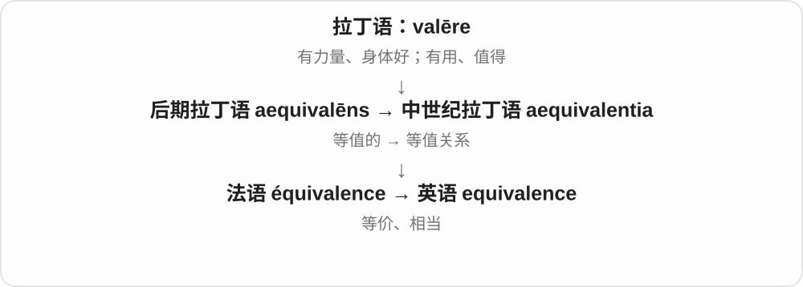
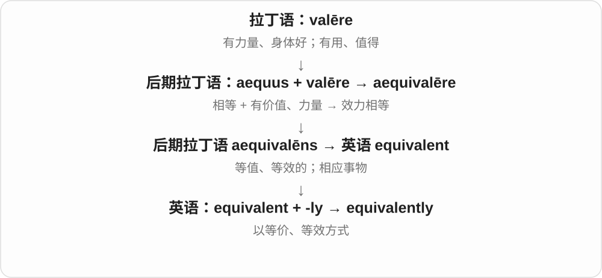

# 0584 · equ-, -iqu- — 相等；平；公平；平稳

[逐词精讲目录](../00_逐词精讲目录.md) · [总目录](../00_总目录_按常用程度.md)

## 核心词根与来源

拉丁 aequus 既说平、相等，也说公道、平稳。不同分支不是互相随便替换：equal 比数量，equity 讲公平或财产权益，equilibrium 讲作用的平衡，equanimity 讲人的镇定。先看正在比较什么，再理解这条“平”的线索。

**把两边放平，或让一个状态不大起大落**

equal 是两边一样多；equilibrium 像天平稳住；equanimity 是心里稳住；equity 则问安排是否公道。

- **相等与调整**：equal、equally、unequal、unequally、equality、inequality、equate、equation、equalize、equalise、equalizer、equaliser、equalization、equalisation
- **公平与不公**：equity、equitable、equitably、inequitable、inequity、iniquity、iniquitous
- **平稳与镇定**：equilibrium、disequilibrium、equipoise、equable、equanimity、equanimous
- **地理与距离**：Equator、equatorial、equinox、equinoctial、equidistant、equidistance
- **等值与同等说法**：equivalent、equivalently、equivalence、equivocal、equivocate、unequivocal、unequivocally

## 词形与演化规律

equ-／equi- 常代表 aequus；equal- 来自 aequalis；equit- 接 aequitas 的词干；iniqu- 是拉丁 in- 与 aequus 结合后的词形。注意 equine、equestrian 的 equ- 来自 equus“马”，不是本页的 aequus。

## 单词速览（常用到不常用）

| 单词 | 音标 | 核心意思 |
|---|---|---|
| [equal](#w-1) | /ˈiːkwəl/ | 相等的；平等的；等于、匹敌；同等的人或事物 |
| [equivalent](#w-2) | 英、美 /ɪˈkwɪvələnt/ | 等值、等效的；相当的；对应物 |
| [equally](#w-3) | /ˈiːkwəli/ | 同样地；平均地；也同样 |
| [equity](#w-4) | /ˈekwɪti/ | 公平；衡平法；净权益、股权；股票〔equities〕 |
| [equality](#w-5) | 英 /iˈkwɒləti/；美 /iˈkwɑːləti/ | 相等；平等 |
| [equation](#w-6) | /ɪˈkweɪʒən/ | 方程、等式；等同看待；影响局面的因素组合 |
| [inequality](#w-7) | 英 /ˌɪnɪˈkwɒləti/；美 /ˌɪnɪˈkwɑːləti/ | 不平等；差距；不等式 |
| [equilibrium](#w-8) | /ˌiːkwɪˈlɪbriəm/，也读 /ˌekwɪˈlɪbriəm/ | 平衡；均衡；情绪稳定 |
| [equitable](#w-9) | /ˈekwɪtəbəl/ | 公平合理的；衡平法上的 |
| [unequal](#w-10) | /ʌnˈiːkwəl/ | 不相等的；不平等的；不能胜任的 |
| [Equator](#w-11) | 英 /ɪˈkweɪtə/；美 /ɪˈkweɪtər/ | 地球赤道〔通常写 the equator〕 |
| [equatorial](#w-12) | /ˌekwəˈtɔːriəl/ | 赤道的；赤道附近的；赤道面的 |
| [equate](#w-13) | /ɪˈkweɪt/ | 把……等同于；使相等 |
| [equivalence](#w-14) | 英、美 /ɪˈkwɪvələns/ | 等值；等价关系；相当 |
| [unequivocally](#w-15) | /ˌʌnɪˈkwɪvəkəli/ | 明确地；毫不含糊地 |
| [equinox](#w-16) | 英 /ˈekwɪnɒks/；美 /ˈekwɪnɑːks/；首音节也可读 /iː/ | 春分或秋分；二分点 |
| [equalizer](#w-17) | 英 /ˈiːkwəlaɪzə/；美 /ˈiːkwəlaɪzər/ | 扳平比分的进球或得分；均衡器；使差距缩小的事物 |
| [unequivocal](#w-18) | /ˌʌnɪˈkwɪvəkəl/ | 明确的；毫不含糊的 |
| [equaliser](#w-19) | 英 /ˈiːkwəlaɪzə/；美 /ˈiːkwəlaɪzər/ | 扳平球；均衡器〔equalizer 的另一拼写〕 |
| [iniquity](#w-20) | /ɪˈnɪkwɪti/ | 严重的不公；罪恶；不义之举 |
| [equalization](#w-21) | 英 /ˌiːkwəlaɪˈzeɪʃən/；美 /ˌiːkwələˈzeɪʃən/ | 均等化；调平；均衡处理 |
| [inequity](#w-22) | /ɪnˈekwɪti/ | 不公平；不公正的差别 |
| [equalize](#w-23) | /ˈiːkwəlaɪz/ | 使相等；使均衡；追平比分；调节音频均衡 |
| [equidistant](#w-24) | /ˌiːkwɪˈdɪstənt/ | 等距的；距离相等的 |
| [equivalently](#w-25) | 英、美 /ɪˈkwɪvələntli/ | 等价地；等效地；换个等价说法 |
| [equanimity](#w-26) | /ˌekwəˈnɪmɪti/，也读 /ˌiːkwəˈnɪmɪti/ | 镇定；心境平和；处变不惊 |
| [equitably](#w-27) | /ˈekwɪtəbli/ | 公平合理地 |
| [equivocal](#w-28) | /ɪˈkwɪvəkəl/ | 含糊的；有多种解释的；不确定的 |
| [equalise](#w-29) | /ˈiːkwəlaɪz/ | 使相等；追平；调节均衡〔equalize 的另一拼写〕 |
| [inequitable](#w-30) | /ɪnˈekwɪtəbəl/ | 不公平的；不公正的 |
| [unequally](#w-31) | /ʌnˈiːkwəli/ | 不平均地；不平等地；程度不同地 |
| [equalisation](#w-32) | 英 /ˌiːkwəlaɪˈzeɪʃən/；美 /ˌiːkwələˈzeɪʃən/ | 均等化；调平；均衡处理〔equalization 的另一拼写〕 |
| [disequilibrium](#w-33) | /ˌdɪsiːkwɪˈlɪbriəm/ | 失衡；不平衡状态 |
| [iniquitous](#w-34) | /ɪˈnɪkwɪtəs/ | 极不公正的；邪恶的；罪恶的 |
| [equipoise](#w-35) | /ˈekwɪpɔɪz/ | 均衡；平衡状态；平衡物；使平衡〔较少见动词〕 |
| [equivocate](#w-36) | /ɪˈkwɪvəkeɪt/ | 含糊其辞；说模棱两可的话以回避 |
| [equable](#w-37) | /ˈekwəbəl/ | 平和稳定的；变化不大的；温和均匀的 |
| [equinoctial](#w-38) | 英 /ˌekwɪˈnɒkʃəl/；美 /ˌekwəˈnɑːkʃəl/；首音节也可读 /iː/ | 春分秋分的；天赤道的；天赤道〔名词〕 |
| [equidistance](#w-39) | /ˌiːkwɪˈdɪstəns/ | 等距；距离相等 |
| [equanimous](#w-40) | /ɪˈkwænəməs/ | 镇定平和的；不易受扰的 |

## 逐词讲解

### 1. equal — 相等的；平等的；等于、匹敌；同等的人或事物

**音标**：/ˈiːkwəl/

**先抓住这个画面**

放到同一把尺子上量，在所比较的方面一样。

**怎么拆**

借拉丁 aequalis，接 aequus“平、等”；英语再发展名词和动词。equal 不要求所有方面都一模一样。

**怎么变成今天的意思**

**拉丁 aequus**  
平、等量、公平、平稳

↓

**拉丁 aequalis → 中古英语 equal**  
相等的、均匀的

↓

**英语 equal**  
相等；匹敌；地位相等的人

equal lengths 是长度相等；treat someone as an equal 是以平等身份相待；equal a record 是追平纪录。be equal to a task 还可说有能力胜任，不是在比较任务和人的尺寸。

**常见搭配与例句**

equal to；equal in size；equal opportunities；as an equal；equal a record。

> The two ropes are equal in length but different in thickness.

两根绳子一样长，但粗细不同。

> She spoke to the trainees as equals.

她以平等身份与实习生交流。

> His final jump equalled the club record.

他最后一跳追平了俱乐部纪录。

**别混淆**

identical 往往强调完全一样；equal 可以只在指定维度相等。两根不同材料的绳子仍可长度 equal。

### 2. equivalent — 等值、等效的；相当的；对应物

**音标**：英、美 /ɪˈkwɪvələnt/

**先抓住这个画面**

样子可以不同，但在眼下比较的价值、作用或数量上，能放在同一个位置。

**怎么拆**

后期拉丁语 aequus“相等” + valēre“有力量、有价值” → aequivalēns；现代可识别 equi- + -valent。

**怎么变成今天的意思**

equivalent to 后接比较对象。两种资格等同，不表示课程完全一样；两种说法含义相当，也不表示每个字一一对应。

**常见搭配与例句**

equivalent to；an equivalent amount；the nearest equivalent。

> One kilometre is equivalent to one thousand metres.

一公里等于一千米。

> This expression has no exact equivalent in English.

这个表达在英语中没有完全对应的说法。

**别混淆**

equal 常直接说量相等；equivalent 常说在某个关系或用途上相当。

### 3. equally — 同样地；平均地；也同样

**音标**：/ˈiːkwəli/

**先抓住这个画面**

每份一样多，或两件事在某个程度上不分高下。

**怎么拆**

equal + -ly；对应相同的份额、程度，也可用来连接同样成立的另一点。

**怎么变成今天的意思**

**拉丁 aequus**  
平、等量、公平、平稳

↓

**拉丁 aequalis → 中古英语 equal**  
相等的、均匀的

↓

**英语 equal**  
相等；匹敌；地位相等的人

↓

**英语 equal + -ly → equally**  
以相等的方式；在相同程度上

divide equally 是等份分；equally important 是同样重要。句首 Equally, ... 可补充另一面同样值得注意的事实，不必都译成平均地。

**常见搭配与例句**

share equally；equally important；equally likely；equally well。

> They divided the remaining food equally among the four hikers.

他们把剩下的食物平均分给四名徒步者。

> The second proposal is equally practical.

第二个方案同样可行。

**别混淆**

evenly 常强调分布均匀；equally 还可比较两个抽象性质的程度，比如两件事同样重要。

### 4. equity — 公平；衡平法；净权益、股权；股票〔equities〕

**音标**：/ˈekwɪti/

**先抓住这个画面**

谈人和制度时问是否公道；谈资产时问扣除相关负担后，属于所有者的权益有多少。

**怎么拆**

经古法语 equité 借自拉丁 aequitas，接 aequus“公平、平”。公平原则发展出衡平法及受承认的权利，再产生财产权益等专业义。

**怎么变成今天的意思**

**拉丁 aequus**  
平、等量、公平、平稳

↓

**拉丁 aequitas／aequitat- → 古法语 equité**  
平等、公正

↓

**中古英语 equitee → equity**  
公平；衡平法；后来还指产权权益、股权

equity in education 谈教育公平；home equity 是房屋价值扣除所欠相关债务后的权益；equity in a company 是公司所有权权益。法律里的 equity 还有特定历史形成的规则体系，不能只译成法官个人觉得公平。

**常见搭配与例句**

equity in education；home equity；shareholders’ equity；an equity stake；equities。

> The report examines equity in access to public libraries.

报告考察公众使用图书馆的机会是否公平。

> The founders retained most of the equity in the company.

创办人保留了公司大部分股权。

> The course traces the historical development of equity in English law.

这门课追溯英国法中衡平法的历史发展。

**别混淆**

equality 常问数额、地位、待遇是否相等；equity 强调是否公平，未必要求人人分到一样的东西。金融语境下 equity 则是权益，不能译成平等。

### 5. equality — 相等；平等

**音标**：英 /iˈkwɒləti/；美 /iˈkwɑːləti/

**先抓住这个画面**

把比较的双方放在同一水平上，没有高一等、低一等。

**怎么拆**

借法语 equalité，接拉丁 aequalitas；现代能看作 equal + -ity，但名词本身在拉丁语和法语中已经存在。

**怎么变成今天的意思**

**拉丁 aequus**  
平、等量、公平、平稳

↓

**拉丁 aequalis → aequalitas → 法语 equalité**  
相等的 → 相等、平等这种状态

↓

**英语 equality**  
相等；权利、地位等方面的平等

equality of opportunity 说机会平等；numerical equality 说数值相等。平等究竟比较机会、规则还是结果，要看后面的具体说明，不能一概当成所有人完全相同。

**常见搭配与例句**

equality of opportunity；gender equality；equality before the law；numerical equality。

> The school discussed equality of opportunity in its admissions process.

学校讨论了招生过程中机会平等的问题。

> The calculation confirms the equality of the two expressions.

计算确认了两个表达式的值相等。

**别混淆**

similarity 只要求相似；equality 在所指标准下要求相等。equity 则侧重公平判断，与 equality 有关联却不总能互换。

### 6. equation — 方程、等式；等同看待；影响局面的因素组合

**音标**：/ɪˈkweɪʒən/

**先抓住这个画面**

数学里让两边接上等号；日常说法里，把几种因素放在一起考虑。

**怎么拆**

经法语借自拉丁 aequatio“使相等”，接 aequare；不是先有现代英语 equate 才在英语中造出这个名词。

**怎么变成今天的意思**

**拉丁 aequus**  
平、等量、公平、平稳

↓

**拉丁 aequare → aequatio／aequation- → 法语 équation**  
使相等 → 使相等的过程

↓

**中古英语 equacioun → equation**  
等同；后来用于数学等式、方程

solve an equation 是求出让等式成立的未知量；bring something into the equation 是把某个因素考虑进来。读音中 -tion 常读 /ʒən/，不同于很多词的 /ʃən/。

**常见搭配与例句**

solve an equation；a linear equation；a chemical equation；part of the equation。

> The equation has two real solutions.

这个方程有两个实数解。

> Travel time is another factor in the equation.

交通耗时也是需要考虑的一个因素。

**别混淆**

expression 是表达式，不必有等号；equation 声明两边相等。公式 formula 可以以 equation 的形式写出，两者关注点不同。

### 7. inequality — 不平等；差距；不等式

**音标**：英 /ˌɪnɪˈkwɒləti/；美 /ˌɪnɪˈkwɑːləti/

**先抓住这个画面**

社会里说人们处在不同水平；数学里比较两边的大小关系。

**怎么拆**

经古法语 inequalité 或中世纪拉丁 inaequalitas 借入，接拉丁 in- + aequalis。现代可看成 in- + equality，但历史名词不是只在英语里临时加前缀。

**怎么变成今天的意思**

**拉丁 aequus**  
平、等量、公平、平稳

↓

**拉丁 in- + aequalis → inaequalis → inaequalitas**  
不相等的 → 不相等这种状态

↓

**古法语 inequalité／拉丁借入 → 英语 inequality**  
地位、数量等差距；数学不等式

income inequality 是收入差距；solve an inequality 是求出使大小关系成立的取值。数学里的 <、>、≤、≥ 表达不同关系，≤ 与 ≥ 还允许边界处相等。

**常见搭配与例句**

income inequality；social inequality；reduce inequality；solve an inequality。

> The report compares income inequality across the three regions.

报告比较了三个地区的收入差距。

> Every number greater than three satisfies this inequality.

每个大于三的数都满足这个不等式。

**别混淆**

inequity 直接强调不公；inequality 可先描述差距，社会讨论中也常带不公意味。数学不等式则没有这种道德评价。

### 8. equilibrium — 平衡；均衡；情绪稳定

**音标**：/ˌiːkwɪˈlɪbriəm/，也读 /ˌekwɪˈlɪbriəm/

**先抓住这个画面**

两边的影响顶住了，整体不再往某一边继续偏。

**怎么拆**

借拉丁 aequilibrium，接 aequus“相等” + libra“天平”。词形里的 libra 是天平，不是英语 library 的缩写。

**怎么变成今天的意思**

**拉丁 aequus**  
平、等量、公平、平稳

↓

**拉丁 aequus + libra → aequilibris／aequilibrium**  
相等 + 天平 → 均衡

↓

**英语 equilibrium**  
相互作用保持平衡的状态

reach equilibrium 是达到平衡；regain one’s equilibrium 可说恢复情绪稳定。化学平衡时正反应与逆反应仍进行，只是速率相等，不是所有分子停止活动。

**常见搭配与例句**

in equilibrium；reach equilibrium；dynamic equilibrium；regain one’s equilibrium。

> The suspended beam remained in equilibrium.

悬挂的梁保持平衡。

> After the shock, she took a few minutes to regain her equilibrium.

震惊之后，她用了几分钟恢复情绪稳定。

**别混淆**

balance 是更日常的宽泛词；equilibrium 常强调相互作用抵消形成的状态。平衡不必稳定，受扰后能否返回还要另看。

### 9. equitable — 公平合理的；衡平法上的

**音标**：/ˈekwɪtəbəl/

**先抓住这个画面**

把具体处境也考虑进去，让安排对各方都说得过去。

**怎么拆**

借法语 équitable，由 équité“公平”派生。现代可以联想到 equity + -able，但不是说某事“能够成为股权”。

**怎么变成今天的意思**

**拉丁 aequus**  
平、等量、公平、平稳

↓

**拉丁 aequitas → 法语 équité → équitable**  
公平 → 公平合理的

↓

**英语 equitable**  
公道的；衡平法上的

an equitable arrangement 是公道的安排；an equitable distribution 是公平分配。法律语境中的 equitable 可特指衡平法上的权利或救济，需按术语理解。

**常见搭配与例句**

an equitable distribution；an equitable solution；an equitable arrangement；equitable treatment。

> They agreed on an equitable division of the shared costs.

他们就共同费用的公平分担达成了一致。

> The committee is looking for an equitable way to allocate the limited spaces.

委员会在寻找公平分配有限名额的方法。

**别混淆**

equal 强调相等；equitable 强调公平。人数、需求、责任不同的时候，公平分配未必就是每人数量一样。

### 10. unequal — 不相等的；不平等的；不能胜任的

**音标**：/ʌnˈiːkwəl/

**先抓住这个画面**

两边没在同一水平上，或自己的能力够不上事情的要求。

**怎么拆**

中古英语 unequale，un-“不” + equal；直接否定相等、匹敌的性质。

**怎么变成今天的意思**

**拉丁 aequus**  
平、等量、公平、平稳

↓

**中古英语 equal → un- + equal → unequale**  
相等的 → 不相等的

↓

**英语 unequal**  
不等；不公平对等；不能胜任

unequal lengths 是长度不同；unequal treatment 是不平等对待；unequal to the task 是难以胜任。最后一种的 to 不能随手改成 with。

**常见搭配与例句**

unequal in size；unequal treatment；unequal to the task；an unequal contest。

> The two pieces are unequal in length.

这两段长度不相等。

> He felt unequal to the task of leading the expedition.

他觉得自己难以胜任带领考察队的任务。

**别混淆**

different 很宽，可以只是颜色不同；unequal 点明某个数量、地位、能力等方面不相等。

### 11. Equator — 地球赤道〔通常写 the equator〕

**音标**：英 /ɪˈkweɪtə/；美 /ɪˈkweɪtər/

**先抓住这个画面**

绕地球中间一圈，把北半球和南半球分开。

**怎么拆**

接中世纪拉丁 aequator diei et noctis“使昼夜相等者”，源自 aequare。英语先用于天赤道，后来用于地球上两极中间的纬圈；不是按现代 equate + -or 才造出的词。

**怎么变成今天的意思**

**拉丁 aequus**  
平、等量、公平、平稳

↓

**拉丁 aequare → 中世纪拉丁 aequator diei et noctis**  
使相等 → 使昼夜相等者，天赤道的旧称

↓

**英语 equator → 地球赤道义**  
先有天赤道义，后用于地球两极中间的纬圈

赤道纬度是零度，常说 cross the equator。天赤道是地球赤道平面延伸到天球的对应大圆。词源里的昼夜相等反映命名观念，实际日照长度还受大气折射、日出日落的定义等影响。

**常见搭配与例句**

cross the equator；near the equator；north of the equator；the celestial equator。

> The ship crossed the equator during the night.

船在夜间越过了赤道。

> The map marks the equator as a line of zero degrees latitude.

地图把赤道标为零度纬线。

**别混淆**

equator 是地理、天文的线；equinox 是一年中的春分、秋分时刻。不要把赤道与春分当作同一件事。

### 12. equatorial — 赤道的；赤道附近的；赤道面的

**音标**：/ˌekwəˈtɔːriəl/

**先抓住这个画面**

围绕中间那一圈，或与那一圈所在的平面有关。

**怎么拆**

equator + -ial；英语以赤道名词造形容词。远源接 aequare，但这里不是泛泛说各部分相等。

**怎么变成今天的意思**

**拉丁 aequus**  
平、等量、公平、平稳

↓

**拉丁 aequare → 中世纪拉丁 aequator diei et noctis**  
使相等 → 使昼夜相等者，天赤道的旧称

↓

**英语 equator → 地球赤道义**  
先有天赤道义，后用于地球两极中间的纬圈

↓

**英语 equator + -ial → equatorial**  
赤道、赤道附近或赤道面相关的

equatorial regions 是赤道附近地区；equatorial plane 是赤道平面。化学里的 equatorial position 借用中腰部方向这一形象，是具体分子结构中的位置术语。

**常见搭配与例句**

equatorial regions；an equatorial climate；the equatorial plane；equatorial coordinates。

> The expedition studied forests in an equatorial region.

考察队研究赤道地区的森林。

> The diagram marks the planet’s equatorial plane.

图示标出了行星的赤道平面。

**别混淆**

tropical 指热带范围，通常比赤道附近更广；equatorial 更紧扣赤道的位置和方向。

### 13. equate — 把……等同于；使相等

**音标**：/ɪˈkweɪt/

**先抓住这个画面**

在头脑里或算式上，给两样东西画上等号。

**怎么拆**

借拉丁 aequatus，aequare“使相等”的完成分词。早期有调匀、使平衡等义，后来常说把两事视为等同。

**怎么变成今天的意思**

**拉丁 aequus**  
平、等量、公平、平稳

↓

**拉丁 aequare；完成分词 aequatus**  
使平、使相等

↓

**中古英语 equaten → equate**  
使相等；视为等同

equate A with B 是把 A 当成 B，常见于提醒不要混为一谈；equate the two expressions 是把两表达式设为相等。也有 equate to“相当于”的用法。

**常见搭配与例句**

equate A with B；equate to；equate the two expressions。

> Do not equate a quiet manner with a lack of confidence.

不要把安静的举止等同于缺乏自信。

> We equated the two expressions and solved for the unknown.

我们把两个表达式设为相等，然后解出未知量。

**别混淆**

equal 直接说两者相等；equate 常说有人进行等同、设为相等的判断。这种判断可能需要论证，也可能是错的。

### 14. equivalence — 等值；等价关系；相当

**音标**：英、美 /ɪˈkwɪvələns/

**先抓住这个画面**

关注两件事之间那条“在这个标准下算一样”的关系。

**怎么拆**

经法语 équivalence 来自中世纪拉丁语 aequivalentia；不只是现代 equivalent 换词尾。

**怎么变成今天的意思**

数学、翻译、资格比较都可以谈 equivalence。说 equivalence between A and B，必须看是哪方面等价；不能自动扩大到所有方面。

**常见搭配与例句**

logical equivalence；equivalence between；establish equivalence。

> The exercise asks you to prove the equivalence of the two statements.

这道练习要求证明两个命题等价。

> The translator looked for equivalence of meaning rather than identical word order.

译者追求意义相当，而不是词序完全一致。

**别混淆**

similarity 是相似；equivalence 是在指定意义上等价，要求更具体。

### 15. unequivocally — 明确地；毫不含糊地

**音标**：/ˌʌnɪˈkwɪvəkəli/

**先抓住这个画面**

把立场说得没有两种解读，或把结论表明得足够清楚；副词关注表达或证明的方式。

**怎么拆**

英语 unequivocal + -ly，也可理解为 un- + equivocally；基础都是否定 equivocal 的含混。

**怎么变成今天的意思**

**拉丁 vox，词干 voc-，宾格 vocem**  
声音、话语；与 vocare“呼唤”同族

↓

**晚期拉丁 aequi- 相同 + voc- 声音 → aequivocus**  
声音相同而意义可能不同；含混

↓

**英语 equivocal，采用 -al 形容词形式**  
有多种解释的；态度或证据不明确的

↓

**英语 unequivocal → unequivocally**  
毫不含糊地表达、表明

state unequivocally 是明确声明；demonstrate unequivocally 是清楚无疑地证明。这个词表示说话者对明确程度的判断，仍要看支撑它的证据。

**常见搭配与例句**

state unequivocally；reject unequivocally；demonstrate unequivocally。

> He stated unequivocally that the offer had been withdrawn.

他明确声明，提议已经撤回。

> The team unequivocally rejected the proposed shortcut.

团队毫不含糊地拒绝了所提议的捷径。

**别混淆**

clearly 很通用；unequivocally 更强调排除了模棱两可和两面解释的余地。

### 16. equinox — 春分或秋分；二分点

**音标**：英 /ˈekwɪnɒks/；美 /ˈekwɪnɑːks/；首音节也可读 /iː/

**先抓住这个画面**

太阳走到跨越天赤道的位置，昼夜长度在这附近比较接近。

**怎么拆**

拉丁 aequus“相等” + nox／noct-“夜”构成 aequinoctium，经法语或中世纪拉丁形式进入英语。字面是等夜，实际天文学条件是太阳越过天赤道。

**怎么变成今天的意思**

**拉丁 aequus**  
平、等量、公平、平稳

↓

**拉丁 aequus + nox／noct- → aequinoctium**  
相等 + 夜 → 昼夜接近等长时

↓

**古法语 equinoce／中世纪拉丁变体 → 英语 equinox**  
春分、秋分；太阳越过天赤道的时刻

March equinox 在北半球对应春分、南半球对应秋分；September equinox 反过来。名称含相等，却不能据此断言各地白昼都精确十二小时。

**常见搭配与例句**

the March equinox；the September equinox；the vernal equinox；the autumnal equinox。

> The observatory held a public event for the March equinox.

天文台为三月的分日举办了公众活动。

> Day and night are close in length around an equinox, but not exactly equal everywhere.

分日前后昼夜长度接近，但不是各地都精确相等。

**别混淆**

solstice 是至日，太阳赤纬到南北极值；equinox 是分日，太阳越过天赤道。两者是不同的季节节点。

### 17. equalizer — 扳平比分的进球或得分；均衡器；使差距缩小的事物

**音标**：英 /ˈiːkwəlaɪzə/；美 /ˈiːkwəlaɪzər/

**先抓住这个画面**

它一出现，原本落后的追上了，或原先偏多偏少的成分得到了调整。

**怎么拆**

equalize + -er；-er 在这里不只指人，也可以指工具、得分或产生作用的事物。

**怎么变成今天的意思**

**拉丁 aequus**  
平、等量、公平、平稳

↓

**拉丁 aequalis → 中古英语 equal**  
相等的、均匀的

↓

**英语 equal**  
相等；匹敌；地位相等的人

↓

**英语 equalize + -er → equalizer**  
使达到均衡的人、物或动作结果

score an equalizer 是打入扳平球；audio equalizer 是调节不同频段强弱的装置或软件。音频均衡不一定把所有频率调成同样响，而是改变它们的相对平衡。

**常见搭配与例句**

score an equalizer；a late equalizer；a graphic equalizer；a great equalizer。

> Her equalizer brought the score to two all.

她的扳平球把比分变成了二比二。

> He used the equalizer to reduce the booming bass.

他用均衡器减弱轰隆的低音。

**别混淆**

winning goal 是制胜球；equalizer 只负责追平。即使之后输球，先前的扳平球仍可叫 equalizer。

### 18. unequivocal — 明确的；毫不含糊的

**音标**：/ˌʌnɪˈkwɪvəkəl/

**先抓住这个画面**

两扇解释的门关掉一扇，意思清清楚楚：“我支持”，就是支持，没有模棱两可的余地。

**怎么拆**

英语 un- 不 + equivocal；这是现代英语否定构词，和拉丁 aequivocus 的更早构件分层理解。

**怎么变成今天的意思**

**拉丁 vox，词干 voc-，宾格 vocem**  
声音、话语；与 vocare“呼唤”同族

↓

**晚期拉丁 aequi- 相同 + voc- 声音 → aequivocus**  
声音相同而意义可能不同；含混

↓

**英语 equivocal，采用 -al 形容词形式**  
有多种解释的；态度或证据不明确的

↓

**英语 un- + equivocal → unequivocal**  
没有含混余地；明确、确定的

unequivocal support 是明确支持；unequivocal evidence 是能清楚支持某种结论的证据。它强调明确程度，不等于说话人音量大或态度粗暴。

**常见搭配与例句**

unequivocal support；an unequivocal answer；unequivocal evidence。

> She gave an unequivocal yes.

她明确地答应了。

> The committee expressed unequivocal support for the project.

委员会毫不含糊地表示支持这个项目。

**别混淆**

explicit 是把内容明说出来；unequivocal 是意思毫不含糊。明确的行动也可以传达 unequivocal support。

### 19. equaliser — 扳平球；均衡器〔equalizer 的另一拼写〕

**音标**：英 /ˈiːkwəlaɪzə/；美 /ˈiːkwəlaɪzər/

**先抓住这个画面**

体育里把比分拉平，音响里把各频段的相对强弱调好。

**怎么拆**

equalise + -er；与 equalizer 只是 s／z 的拼写差异。

**怎么变成今天的意思**

**拉丁 aequus**  
平、等量、公平、平稳

↓

**拉丁 aequalis → 中古英语 equal**  
相等的、均匀的

↓

**英语 equal**  
相等；匹敌；地位相等的人

↓

**英语 equalise + -er → equaliser**  
追平得分；均衡装置

a late equaliser 常见于英式足球报道，表示临近结束时扳平的进球。音响面板上的 equaliser 则是声音调节功能，不能译成进球者。

**常见搭配与例句**

a last-minute equaliser；score the equaliser；adjust the equaliser。

> The substitute scored a dramatic equaliser in added time.

替补球员在补时阶段戏剧性地打入扳平球。

> The app includes an equaliser for adjusting the sound.

这个应用内置了调节声音的均衡器。

**别混淆**

equaliser 与 equalizer 同义；equalisation 是调平或均衡处理这一过程，不是那一脚进球或那个设备。

### 20. iniquity — 严重的不公；罪恶；不义之举

**音标**：/ɪˈnɪkwɪti/

**先抓住这个画面**

不是轻微不齐，而是让人觉得道德上很坏、很不公道。

**怎么拆**

经古法语 iniquité，接拉丁 iniquitas，由 iniquus“不公平的”派生；in- + aequus 在拉丁语内部变成 iniquus。

**怎么变成今天的意思**

**拉丁 aequus**  
平、等量、公平、平稳

↓

**拉丁 in- + aequus → iniquus → iniquitas**  
不公平 → 不义、邪恶

↓

**古法语 iniquité → 中古英语 iniquite → iniquity**  
严重的不公；罪恶

the iniquities of a system 常强烈批评制度的不义；a den of iniquity 是“罪恶窝点”这一传统说法，也可能半开玩笑使用。词带明显道德谴责，较书面。

**常见搭配与例句**

the iniquities of；social iniquity；a den of iniquity。

> The novel exposes the iniquities of the corrupt regime.

小说揭露了腐败政权的种种不义。

> She spoke passionately against the iniquity of exploiting children.

她激烈谴责剥削儿童的罪恶。

**别混淆**

inequity 主要说不公平；iniquity 通常道德语气更重，可指罪恶。只差一个字母，不能都机械译成数量不等。

### 21. equalization — 均等化；调平；均衡处理

**音标**：英 /ˌiːkwəlaɪˈzeɪʃən/；美 /ˌiːkwələˈzeɪʃən/

**先抓住这个画面**

说的是把差距调整好这一过程，而不是已经相等的静态结果。

**怎么拆**

equalize + -ation；名词把调平、使相等的动作作为过程来谈。

**怎么变成今天的意思**

**拉丁 aequus**  
平、等量、公平、平稳

↓

**拉丁 aequalis → 中古英语 equal**  
相等的、均匀的

↓

**英语 equal**  
相等；匹敌；地位相等的人

↓

**英语 equalize + -ation → equalization**  
调平、使均衡的过程

pressure equalization 是压力平衡过程；audio equalization 是音频均衡处理。资源方面的 equalization 也可指减少地区或群体之间的差距。

**常见搭配与例句**

pressure equalization；audio equalization；the equalization of resources。

> Pressure equalization took several seconds.

压力平衡花了几秒钟。

> The engineer applied gentle equalization to make the voice clearer.

工程师稍作均衡处理，让人声更清晰。

**别混淆**

equality 是相等这一状态；equalization 是使其趋向相等或均衡的过程。完成某项调整，也不保证所有方面都已相等。

### 22. inequity — 不公平；不公正的差别

**音标**：/ɪnˈekwɪti/

**先抓住这个画面**

资源、机会或负担的安排让某些人受到不公正的对待。

**怎么拆**

英语 in-“不” + equity；与较早经拉丁、法语借入的 iniquity 不同，这里直接在英语 equity 前加否定。

**怎么变成今天的意思**

**拉丁 aequus**  
平、等量、公平、平稳

↓

**拉丁 aequitas／aequitat- → 古法语 equité**  
平等、公正

↓

**中古英语 equitee → equity**  
公平；衡平法；后来还指产权权益、股权

↓

**英语 in- + equity → inequity**  
缺乏公平；不公的安排

inequities in access 是获取机会方面的不公；address inequity 是处理不公平问题。关注的是差别是否公道，不只是在数差值大小。

**常见搭配与例句**

social inequity；inequities in access；address inequity；reduce inequities。

> The study identifies inequities in access to training.

研究指出了获得培训机会方面的不公平。

> The new timetable was designed to reduce inequity between the two groups.

新时刻表旨在减少两组之间的不公。

**别混淆**

inequality 可先描述数量、地位不相等；inequity 直接带出不公平判断。iniquity 的罪恶、邪恶意味又更强。

### 23. equalize — 使相等；使均衡；追平比分；调节音频均衡

**音标**：/ˈiːkwəlaɪz/

**先抓住这个画面**

把原先有差距的两边拉到同一水平，或调整各部分的平衡。

**怎么拆**

equal + -ize“使成为”；英语构词。音频用法从调平、补偿各频段响应发展而来，不要求把每个频段设成同一个数。

**怎么变成今天的意思**

**拉丁 aequus**  
平、等量、公平、平稳

↓

**拉丁 aequalis → 中古英语 equal**  
相等的、均匀的

↓

**英语 equal**  
相等；匹敌；地位相等的人

↓

**英语 equal + -ize → equalize**  
使相等、调平；比赛中追平

equalize pressure 是使压力平衡；球队 equalize 是把比分扳平；equalize a recording 是调整频率响应。体育用法通常不及物，直接说 the team equalized。

**常见搭配与例句**

equalize pressure；equalize the score；equalize opportunities；equalize a recording。

> The valve allows the pressure on both sides to equalize.

阀门使两侧压力能够达到平衡。

> The visitors equalized with a goal in the final minute.

客队在最后一分钟进球，把比分扳平。

**别混淆**

equate 是设为或看作相等；equalize 常要真的做调整，使两边趋于相等或平衡。

### 24. equidistant — 等距的；距离相等的

**音标**：/ˌiːkwɪˈdɪstənt/

**先抓住这个画面**

从同一个点量出去，到两个目标的距离一样长，这个点便与两者 equidistant。

**怎么拆**

经法语来自晚期拉丁语 aequidistāns；aequī-（相等）+ distāns（相隔）。

**怎么变成今天的意思**

它比较的是距离，不是方向或位置相同。圆周上各点与圆心等距，但彼此位置当然不同。

**常见搭配与例句**

equidistant from A and B；equidistant points；equidistant intervals。

> The hotel is equidistant from the two stations.

这家酒店到两个车站的距离相等。

> Every point on the circle is equidistant from its center.

圆上的每一点到圆心的距离都相等。

**别混淆**

equal 是一般的相等；equidistant 专门说距离相等。

### 25. equivalently — 等价地；等效地；换个等价说法

**音标**：英、美 /ɪˈkwɪvələntli/

**先抓住这个画面**

换了表达方式或处理方式，但关键的意义、值或效果保持相同。

**怎么拆**

equivalent + -ly。

**怎么变成今天的意思**

数学中常用 equivalently 引出逻辑等价的写法；一般技术文字也用来说明不同方案实现同等作用。

**常见搭配与例句**

equivalently expressed；treat equivalently；or, equivalently…。

> The fraction can be written equivalently as one half.

这个分数可以等价地写成二分之一。

> The two inputs are treated equivalently by the program.

程序对这两种输入作等效处理。

**别混淆**

similarly 是相似地；equivalently 更强，要求在相关标准下等价。

### 26. equanimity — 镇定；心境平和；处变不惊

**音标**：/ˌekwəˈnɪmɪti/，也读 /ˌiːkwəˈnɪmɪti/

**先抓住这个画面**

外面有起伏，心里那架天平没有被一下掀翻。

**怎么拆**

经法语 équanimité 借自拉丁 aequanimitas，接 aequus“平稳” + animus“心神”。这里不是 equi- 加英语 animal。

**怎么变成今天的意思**

**拉丁 aequus**  
平、等量、公平、平稳

↓

**拉丁 aequus + animus → aequanimis／aequanimitas**  
平稳 + 心神 → 心境平和

↓

**法语 équanimité → 英语 equanimity**  
处变不惊的平静

accept something with equanimity 是平静接受；maintain equanimity 是保持镇定。它说情绪不被轻易带跑，不代表看不见问题或完全不在乎。

**常见搭配与例句**

with equanimity；maintain equanimity；accept with equanimity；remarkable equanimity。

> She accepted the unexpected delay with equanimity.

她平静地接受了意外延误。

> His equanimity helped the group think clearly under pressure.

他的镇定帮助整个团队在压力下保持清晰思考。

**别混淆**

indifference 是不关心；equanimity 是平和镇定。一个人可以很在乎结果，同时保持 equanimity。

### 27. equitably — 公平合理地

**音标**：/ˈekwɪtəbli/

**先抓住这个画面**

做分配或处理时，把各方应得的、承担的和实际处境一起衡量。

**怎么拆**

equitable + -ly；把公平这一性质变成处理事情的方式。

**怎么变成今天的意思**

**拉丁 aequus**  
平、等量、公平、平稳

↓

**拉丁 aequitas → 法语 équité → équitable**  
公平 → 公平合理的

↓

**英语 equitable**  
公道的；衡平法上的

↓

**英语 equitable + -ly → equitably**  
以公平合理的方式

distribute equitably 是公平分配；treat people equitably 是公正对待。这个副词不预先规定唯一算法，读者仍要看作者怎样说明公平。

**常见搭配与例句**

distribute equitably；allocate equitably；share equitably；treat equitably。

> The workload was shared equitably according to each person’s available time.

工作按每个人可投入的时间公平分担。

> The policy aims to treat applicants equitably.

这项政策旨在公平对待申请人。

**别混淆**

equally 可能只是平均分；equitably 要说分配公道。两者有时一致，有时因需求或责任不同而不一致。

### 28. equivocal — 含糊的；有多种解释的；不确定的

**音标**：/ɪˈkwɪvəkəl/

**先抓住这个画面**

一句话像同时开着两扇门，你听不出说话人到底站哪边；一组证据也可能无法把答案推向明确一边。

**怎么拆**

以晚期拉丁 aequivocus 为基础，aequi- 相同 + voc- 声音，原来涉及同音、同名而意义不一；英语采用 -al 形式。不是“声音相等所以音量相同”。

**怎么变成今天的意思**

**拉丁 vox，词干 voc-，宾格 vocem**  
声音、话语；与 vocare“呼唤”同族

↓

**晚期拉丁 aequi- 相同 + voc- 声音 → aequivocus**  
声音相同而意义可能不同；含混

↓

**英语 equivocal，采用 -al 形容词形式**  
有多种解释的；态度或证据不明确的

an equivocal answer 是模棱两可的回答；equivocal evidence 是无法得出明确结论的证据。后者不涉及有人故意撒谎，只是证据不够明朗。

**常见搭配与例句**

an equivocal answer；equivocal evidence；an equivocal attitude。

> His equivocal answer left us unsure whether he would help.

他模棱两可的回答让我们拿不准他是否愿意帮忙。

> The results were equivocal, so the team gathered more data.

结果不明确，因此团队收集了更多数据。

**别混淆**

ambiguous 常说文字、信号有多种解释；equivocal 也常说态度、证据不明朗，语境中有时带回避立场的意味。

### 29. equalise — 使相等；追平；调节均衡〔equalize 的另一拼写〕

**音标**：/ˈiːkwəlaɪz/

**先抓住这个画面**

把落后的比分追上来，或把有差距的量调整到平衡。

**怎么拆**

equal + -ise；与 equalize 是同一构词的拼写变体，英国英语常见 -ise，美国英语通常用 -ize。

**怎么变成今天的意思**

**拉丁 aequus**  
平、等量、公平、平稳

↓

**拉丁 aequalis → 中古英语 equal**  
相等的、均匀的

↓

**英语 equal**  
相等；匹敌；地位相等的人

↓

**英语 equal + -ise → equalise，与 equalize 并行**  
使相等、调平；体育中追平

比赛报道里 The home side equalised 是主队扳平了。技术语境可说 equalise pressure；换成 s 拼写没有改变任何动作含义。

**常见搭配与例句**

equalise the pressure；equalise the score；equalise access；the team equalised。

> The home side equalised just before half-time.

主队在中场休息前刚刚扳平比分。

> The design allows the two chambers to equalise pressure.

这项设计让两个腔室的压力能够平衡。

**别混淆**

equalise 是动作；equaliser 是完成扳平的进球、得分或均衡装置。一次 equaliser 可以让球队 equalise。

### 30. inequitable — 不公平的；不公正的

**音标**：/ɪnˈekwɪtəbəl/

**先抓住这个画面**

安排让某一方承担了不合理的负担，或得不到应有的待遇。

**怎么拆**

有法语 inéquitable 借入路线；现代英语可拆成 in-“不” + equitable。这里否定公平，而不是笼统否定相同。

**怎么变成今天的意思**

**拉丁 aequus**  
平、等量、公平、平稳

↓

**拉丁 aequitas → 法语 équité／équitable → inéquitable**  
公平 → 公道的 → 不公道的

↓

**英语 inequitable**  
不公平、不合理的

an inequitable arrangement 常指长期或制度性的安排不公；inequitable access 说获取机会不公平。语气通常比日常 unfair 更正式。

**常见搭配与例句**

an inequitable system；inequitable distribution；inequitable treatment；inequitable access。

> The review criticised the inequitable distribution of overtime work.

审查批评了加班任务分配不公。

> Residents objected to what they saw as an inequitable charging system.

居民反对他们认为不公平的收费制度。

**别混淆**

unequal 先说不相等；inequitable 进一步说不公平。两个人承担不同任务不必然不公，还要看责任与条件。

### 31. unequally — 不平均地；不平等地；程度不同地

**音标**：/ʌnˈiːkwəli/

**先抓住这个画面**

分到两边的量、受到的影响或拥有的机会并不相同。

**怎么拆**

unequal + -ly；用副词描述不相等的分布、程度或对待方式。

**怎么变成今天的意思**

**拉丁 aequus**  
平、等量、公平、平稳

↓

**中古英语 unequal → 现代英语 unequal**  
不相等、不平等的

↓

**英语 unequal + -ly → unequally**  
以不相等的方式

distributed unequally 是分布不均；affect groups unequally 是对不同群体影响程度不同。是否不公平，须再看差别的具体原因和标准。

**常见搭配与例句**

distributed unequally；affect unequally；treat unequally；share unequally。

> Rainfall is distributed unequally across the island.

岛上各地降雨分布不均。

> The schedule affected the two teams unequally.

这份日程对两支队伍的影响程度不同。

**别混淆**

inequitably 明说不公正地；unequally 可以只说明数量或影响不等，如雨水在地理上分布不均。

### 32. equalisation — 均等化；调平；均衡处理〔equalization 的另一拼写〕

**音标**：英 /ˌiːkwəlaɪˈzeɪʃən/；美 /ˌiːkwələˈzeɪʃən/

**先抓住这个画面**

把不均衡的分布或响应作调整，让它更接近需要的平衡。

**怎么拆**

equalise + -ation；对应 -ise 拼写体系，与 equalization 同源同义。

**怎么变成今天的意思**

**拉丁 aequus**  
平、等量、公平、平稳

↓

**拉丁 aequalis → 中古英语 equal**  
相等的、均匀的

↓

**英语 equal**  
相等；匹敌；地位相等的人

↓

**英语 equalise + -ation → equalisation**  
调平、使均衡的过程

在英式拼写的文件中，equalisation 可谈资金、压力或音频。具体要均衡哪一项，应看后面的对象，不应固定译成社会平等。

**常见搭配与例句**

the equalisation of funding；pressure equalisation；sound equalisation。

> The proposal aims at greater equalisation of funding between districts.

提案旨在让各区经费更加均衡。

> The manual describes the equalisation settings for speech recordings.

手册说明了人声录音的均衡设置。

**别混淆**

equalisation 是过程；equilibrium 是各种作用相抵形成的平衡状态。做过 equalisation 不必代表系统永远保持 equilibrium。

### 33. disequilibrium — 失衡；不平衡状态

**音标**：/ˌdɪsiːkwɪˈlɪbriəm/

**先抓住这个画面**

原先两边互相顶住，现在一边压过另一边，系统开始偏移。

**怎么拆**

dis-“失去、破坏” + equilibrium；以已有的平衡名词构成反义概念。

**怎么变成今天的意思**

**拉丁 aequus**  
平、等量、公平、平稳

↓

**拉丁 aequus + libra → aequilibris／aequilibrium**  
相等 + 天平 → 均衡

↓

**英语 equilibrium**  
相互作用保持平衡的状态

↓

**英语 dis- + equilibrium → disequilibrium**  
缺乏或失去平衡的状态

市场、生态系统或物理系统都可谈 disequilibrium，但具体是哪种量不平衡须由上下文说明。身体失衡义也可见，不能凭这个词就判断病因。

**常见搭配与例句**

a state of disequilibrium；market disequilibrium；temporary disequilibrium。

> The sudden change left the system in disequilibrium.

突如其来的变化使系统处于失衡状态。

> The model shows how the market adjusts after a period of disequilibrium.

模型展示市场在一段失衡之后如何调整。

**别混淆**

imbalance 是宽泛的不平衡；disequilibrium 更常描述系统偏离平衡状态，语气较技术化。

### 34. iniquitous — 极不公正的；邪恶的；罪恶的

**音标**：/ɪˈnɪkwɪtəs/

**先抓住这个画面**

评价一种做法，不只说不合心意，而是说它严重违背公道。

**怎么拆**

iniquity 去 -y 加 -ous；把不义、罪恶这一名词变成形容事物的性质。

**怎么变成今天的意思**

**拉丁 aequus**  
平、等量、公平、平稳

↓

**拉丁 in- + aequus → iniquus → iniquitas**  
不公平 → 不义、邪恶

↓

**古法语 iniquité → 中古英语 iniquite → iniquity**  
严重的不公；罪恶

↓

**英语 iniquity + -ous → iniquitous**  
充满不义、严重不公的

an iniquitous system 是强烈谴责制度；an iniquitous bargain 说交易条件极不公道。较书面、措辞重，日常小小不便通常不用它。

**常见搭配与例句**

an iniquitous system；an iniquitous practice；an iniquitous arrangement。

> The campaign condemned the iniquitous use of forced labour.

运动谴责了使用强迫劳动这一罪恶做法。

> The novelist portrays an iniquitous system that rewards cruelty.

小说家描绘了一套奖励残酷行为的极不公正制度。

**别混淆**

unfair 可描述从轻到重的不公；iniquitous 通常是更强烈的道德批判，不只是吃一点小亏。

### 35. equipoise — 均衡；平衡状态；平衡物；使平衡〔较少见动词〕

**音标**：/ˈekwɪpɔɪz/

**先抓住这个画面**

两边的分量或影响相抵，没有哪一边明显压倒另一边。

**怎么拆**

有从英语 equal poise“等重、均衡”缩合的历史分析；现代也可拆作 equi-“等” + poise“平衡”。poise 经法语接拉丁称量的词系。

**怎么变成今天的意思**

**拉丁 aequus**  
平、等量、公平、平稳

↓

**拉丁 aequalis → 英语 equal；法语 pois → 英语 poise**  
相等；重量、平衡

↓

**英语 equal poise → equipoise**  
等重、均衡；也用于心理和意见的平衡

a state of equipoise 可以是力量平衡，也可说判断没有明显倾向一边。这个词比 balance 更正式；作动词时表示使两边相抵、保持平衡。

**常见搭配与例句**

in equipoise；a state of equipoise；maintain equipoise；mental equipoise。

> For a moment, the opposing forces remained in equipoise.

有一阵子，相反的力量保持着均衡。

> The essay maintains an equipoise between criticism and appreciation.

这篇文章在批评与欣赏之间保持着平衡。

**别混淆**

equanimity 强调情绪镇定；equipoise 还可说两种力量、理由或分量平衡。一个争论势均力敌，并不保证参与者心平气和。

### 36. equivocate — 含糊其辞；说模棱两可的话以回避

**音标**：/ɪˈkwɪvəkeɪt/

**先抓住这个画面**

别人问“你到底同不同意”，你却说一大圈，让两种答案都能往里装；这个回避明确回答的动作叫 equivocate。

**怎么拆**

经中古英语 equivocaten 接中世纪拉丁 aequivocatus，来自 aequivocare，进一步接 aequivocus。不是现代英语 equivocal 改一个词尾的历史。

**怎么变成今天的意思**

**拉丁 vox，词干 voc-，宾格 vocem**  
声音、话语；与 vocare“呼唤”同族

↓

**晚期拉丁 aequivocus → 中世纪拉丁 aequivocare → aequivocatus**  
同音、含混 → 使用同名、多义的表达

↓

**中古英语 equivocaten → equivocate**  
用可作多种解释的话回避明确表态

equivocate on a question 是在某个问题上含糊其辞。它常带批评意味，指出说话人不肯把立场说明白；不要和 equate“等同”混淆。

**常见搭配与例句**

equivocate on an issue；refuse to equivocate；equivocate about one’s intentions。

> Asked whether she supported the plan, she refused to equivocate.

被问是否支持这个计划时，她不肯含糊其辞。

> He equivocated for several minutes without answering the question.

他绕着说了几分钟，仍没有回答问题。

**别混淆**

hesitate 可以是确实没想好；equivocate 常是用措辞回避明确回答。不是所有犹豫都是故意含糊。

### 37. equable — 平和稳定的；变化不大的；温和均匀的

**音标**：/ˈekwəbəl/

**先抓住这个画面**

气性不忽冷忽热，气候也没有大起大落。

**怎么拆**

可能直接接拉丁 aequabilis“均匀、稳定的”，也可能从较早的英语 equability 逆构而来。两种分析都回到 aequare“使均匀”，不能只拆成 equal + able。

**怎么变成今天的意思**

**拉丁 aequus**  
平、等量、公平、平稳

↓

**拉丁 aequare → aequabilis；其名词 aequabilitas → 英语 equability**  
使均匀 → 稳定的；稳定性

↓

**拉丁形容词借入或由英语 equability 逆构 → equable**  
平和的；变化温和、稳定的

an equable temperament 是平和的性情；an equable climate 是变化较温和的气候。重点是波动小，不是把两种气候判定为相等。

**常见搭配与例句**

an equable temperament；an equable climate；an equable manner。

> Her equable temperament made tense meetings easier to manage.

她平和的性情让紧张的会议更容易协调。

> The coastal town is known for its equable climate.

这座沿海城镇以温和稳定的气候著称。

**别混淆**

equal 问两边相不相等；equable 问一个人或环境是否平稳、少剧烈变化。equitable 则问是否公平。

### 38. equinoctial — 春分秋分的；天赤道的；天赤道〔名词〕

**音标**：英 /ˌekwɪˈnɒkʃəl/；美 /ˌekwəˈnɑːkʃəl/；首音节也可读 /iː/

**先抓住这个画面**

围绕昼夜接近等长的时刻，以及太阳当时经过的天赤道来谈。

**怎么拆**

经古法语 equinoxial，接拉丁 aequinoctialis，由 aequinoctium 派生。-noct- 是 nox“夜”的词干，不是现代 equinox 随意换几个字母。

**怎么变成今天的意思**

**拉丁 aequus**  
平、等量、公平、平稳

↓

**拉丁 aequus + nox／noct- → aequinoctium**  
相等 + 夜 → 昼夜接近等长时

↓

**拉丁 aequinoctium → aequinoctialis → 古法语 equinoxial**  
春分秋分 → 与分日、天赤道有关的

↓

**中古英语及现代英语 equinoctial**  
分日的；天赤道的；也作天赤道名词

equinoctial points 是黄道与天赤道的两个交点；旧天文学文本中的 the equinoctial 可直接指天赤道。equinoctial gale 是传统说法，不足以证明分日前后必然出现暴风。

**常见搭配与例句**

equinoctial points；the equinoctial circle；an equinoctial gale。

> The chart labels the two equinoctial points.

星图标出了两个二分点。

> In the old manual, the equinoctial means the celestial equator.

在那本旧手册中，equinoctial 指天赤道。

**别混淆**

equatorial 现在常用于地球赤道相关；equinoctial 更多见于分日、天赤道或历史天文语言。二者有重叠但使用范围不完全相同。

### 39. equidistance — 等距；距离相等

**音标**：/ˌiːkwɪˈdɪstəns/

**先抓住这个画面**

把“到几个目标一样远”这件事作为一个性质来讨论，就是 equidistance。

**怎么拆**

equi-（相等）+ distance（距离）。

**怎么变成今天的意思**

这个名词比 equidistant 少见，多用于几何、地图或边界论述。它不是一个新的长度单位。

**常见搭配与例句**

equidistance from two points；the principle of equidistance。

> The construction preserves equidistance from the two centers.

这个作图保持了到两个中心距离相等。

> The lesson introduces equidistance with a simple diagram.

这堂课用一张简单图引入了等距的概念。

**别混淆**

equidistance 是名词；equidistant 是形容词。说 a point is equidistant，不说 is equidistance。

### 40. equanimous — 镇定平和的；不易受扰的

**音标**：/ɪˈkwænəməs/

**先抓住这个画面**

压力来了，仍能把心放平，不被情绪一下带走。

**怎么拆**

接拉丁 aequanimis／aequanimus，加英语 -ous；与 equanimity 同源。不能把英语名词先画成拉丁形容词的祖先。

**怎么变成今天的意思**

**拉丁 aequus**  
平、等量、公平、平稳

↓

**拉丁 aequus + animus → aequanimis／aequanimus**  
心神平稳的、温和的

↓

**拉丁词基 + 英语 -ous → equanimous**  
镇定平和的

remain equanimous 是保持平静；an equanimous response 是沉着回应。较书面，日常常直接用 calm。重音与 equanimity 不同，不要照着名词逐音节读。

**常见搭配与例句**

remain equanimous；an equanimous response；an equanimous manner。

> She remained equanimous when the discussion became heated.

讨论激烈起来时，她仍保持平和。

> His equanimous response helped everyone return to the facts.

他沉着的回应帮助大家重新回到事实本身。

**别混淆**

emotionless 说没有显露情感；equanimous 说不被情感搅乱，不要求毫无感受。

## 这一组要分清什么

equal 是相等，equitable 是公平，equable 是平稳。inequality 可描述差距，inequity 指不公平，iniquity 往往重到罪恶、不义。equator 是赤道，equinox 是分日；名称含“等”，并不证明各地实际昼夜精确等长。equivocal 的多义支线接拉丁“同样的声音／称呼”，并非现代 equal 直接变成含糊。

## 串起来练习

先比较 equal shares 与 equitable shares：同样数量是否就一定公道？再用 equable、equanimity、equilibrium 分别说性情、心境与系统平衡。最后区分一条赤道线和一年两次的分日时刻。
