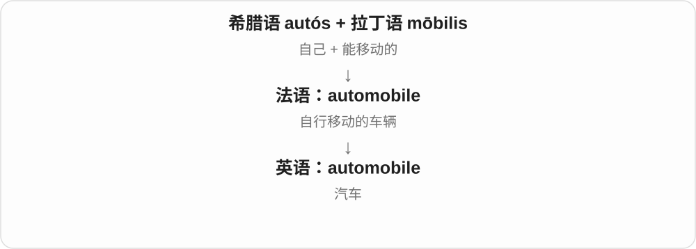

# 0590 · aut-, auto- — 自己；自身；自行

[逐词精讲目录](../00_逐词精讲目录.md) · [总目录](../00_总目录_按常用程度.md)

## 核心词根与来源

希腊 autos 表示自己、同一。它既进入古代复合词，又在近代英语中不断组合出新词。学习时先问“这里的自己是谁”：写作者本人、作决定的主体、自动运转的系统，还是免疫反应的对象。

**动作由自己完成，决定由自己作出，或对象正是自己。不是所有 auto- 都表示机器自动。**

自己写自己的人生是 autobiography；设备自己运行是 automatic；免疫反应指向自身是 autoimmune。

- **自动运行与自动化**：automatic, automatically, automation, automate, automated, automaton, autopilot, autocorrect, autosave, autoplay
- **自己作主与自给**：autonomy, autonomous, autonomously, autarky
- **权力集中于一人**：autocracy, autocrat, autocratic
- **本人写下**：autobiography, autobiographical, autograph, autographed
- **真实及核验真实性**：authentic, authenticity, authentically, inauthentic, authenticate, authentication, authenticated, unauthenticated, authenticator
- **汽车相关的缩略与组合**：auto, automobile, automotive
- **身体与医学中的自身**：autoimmune, autoimmunity, autonomic
- **旧命名与现代神经发育概念**：autism, autistic

## 词形与演化规律

常见 auto-，在一些古老形式中见 aut-、auth-。汽车义 auto 是 automobile 的缩略，自动模式的 auto 可缩略 automatic。authentic 有自己的希腊—拉丁—法语历史，不能按现代拼写随意拆。

## 单词速览（按词族由简到繁）

同一基础词的相关扩展放在一起，先读基础形式，再读扩展；各组之间优先读常用的。具体词源关系见各词讲解。

| 单词 | 音标 | 核心意思 |
|---|---|---|
| [automate](#w-20) | 英 /ˈɔːtəmeɪt/；美 /ˈɔːtəmeɪt/，也读 /ˈɑːtəmeɪt/ | 使自动化；把流程交给自动系统执行 |
| [automatic](#w-3) | 英 /ˌɔːtəˈmætɪk/；美 /ˌɔːtəˈmætɪk/，也读 /ˌɑːtəˈmætɪk/ | 自动的；不假思索的；按规则自然发生的 |
| [automatically](#w-1) | 英 /ˌɔːtəˈmætɪkli/；美 /ˌɔːtəˈmætɪkli/，也读 /ˌɑːtəˈmætɪkli/ | 自动地；不假思索地；必然地 |
| [automation](#w-11) | 英 /ˌɔːtəˈmeɪʃən/；美 /ˌɔːtəˈmeɪʃən/，也读 /ˌɑːtəˈmeɪʃən/ | 自动化 |
| [automated](#w-8) | 英 /ˈɔːtəmeɪtɪd/；美 /ˈɔːtəmeɪtɪd/，也读 /ˈɑːtəmeɪtɪd/ | 自动化的；由自动系统执行的 |
| [auto](#w-2) | 英 /ˈɔːtəʊ/；美 /ˈɔːtoʊ/，也读 /ˈɑːtoʊ/ | 汽车〔尤美式〕；自动模式〔缩略用法〕 |
| [authentic](#w-4) | 英 /ɔːˈθentɪk/，也读 /ɒˈθentɪk/；美 /ɔːˈθentɪk/，也读 /ɑːˈθentɪk/ | 真实的；真正的；忠实于本来样子的；真诚自然的 |
| [authenticity](#w-13) | 英 /ˌɔːθenˈtɪsəti/；美 /ˌɔːθenˈtɪsəti/，也读 /ˌɑːθenˈtɪsəti/ | 真实性；真伪；真实自然的程度 |
| [authenticate](#w-26) | 英 /ɔːˈθentɪkeɪt/；美 /ɔːˈθentɪkeɪt/，也读 /ɑːˈθentɪkeɪt/ | 鉴定真实性；验证身份或来源 |
| [authentication](#w-16) | 英 /ɔːˌθentɪˈkeɪʃən/；美 /ɔːˌθentɪˈkeɪʃən/，也读 /ɑːˌθentɪˈkeɪʃən/ | 真实性鉴定；身份验证；来源验证 |
| [authenticated](#w-22) | 英 /ɔːˈθentɪkeɪtɪd/；美 /ɔːˈθentɪkeɪtɪd/，也读 /ɑːˈθentɪkeɪtɪd/ | 已验证的；已鉴定为真的 |
| [authenticator](#w-35) | 英 /ɔːˈθentɪkeɪtə/；美 /ɔːˈθentɪkeɪtər/，也读 /ɑːˈθentɪkeɪtər/ | 鉴定者；身份验证器；用于认证的工具或凭据 |
| [unauthenticated](#w-38) | 英 /ˌʌnɔːˈθentɪkeɪtɪd/；美 /ˌʌnɔːˈθentɪkeɪtɪd/，也读 /ˌʌnɑːˈθentɪkeɪtɪd/ | 未验证的；未经鉴定的 |
| [authentically](#w-27) | 英 /ɔːˈθentɪkli/；美 /ɔːˈθentɪkli/，也读 /ɑːˈθentɪkli/ | 真实自然地；忠实地；地道地 |
| [inauthentic](#w-32) | 英 /ˌɪnɔːˈθentɪk/；美 /ˌɪnɔːˈθentɪk/，也读 /ˌɪnɑːˈθentɪk/ | 不真实的；不真诚的；显得做作的 |
| [autism](#w-5) | 英 /ˈɔːtɪzəm/；美 /ˈɔːtɪzəm/，也读 /ˈɑːtɪzəm/ | 自闭症；孤独症；自闭症谱系相关状况 |
| [autistic](#w-15) | 英 /ɔːˈtɪstɪk/；美 /ɔːˈtɪstɪk/，也读 /ɑːˈtɪstɪk/ | 自闭症的；自闭症谱系人士的 |
| [automobile](#w-6) | 英 /ˈɔːtəməbiːl/；美 /ˈɔːtəmoʊbiːl/ | 汽车 |
| [automotive](#w-7) | 英 /ˌɔːtəˈməʊtɪv/；美 /ˌɔːtəˈmoʊtɪv/ | 汽车的；机动车相关的 |
| [autonomy](#w-9) | 英 /ɔːˈtɒnəmi/；美 /ɔːˈtɑːnəmi/ | 自治；自主权；独立作决定的能力 |
| [autonomous](#w-10) | 英 /ɔːˈtɒnəməs/；美 /ɔːˈtɑːnəməs/ | 自治的；自主运行的；能独立决定的 |
| [autonomously](#w-29) | 英 /ɔːˈtɒnəməsli/；美 /ɔːˈtɑːnəməsli/ | 自主地；独立决定并行动地 |
| [autonomic](#w-25) | 英 /ˌɔːtəˈnɒmɪk/；美 /ˌɔːtəˈnɑːmɪk/ | 自主神经的；不由意识逐项控制的 |
| [autobiography](#w-12) | 英 /ˌɔːtəbaɪˈɒɡrəfi/；美 /ˌɔːtəbaɪˈɑːɡrəfi/ | 自传 |
| [autobiographical](#w-19) | /ˌɔːtəˌbaɪəˈɡræfɪkəl/ | 自传的；取材于本人经历的 |
| [autograph](#w-14) | 英 /ˈɔːtəɡrɑːf/；美 /ˈɔːtəɡræf/ | 亲笔签名；亲笔稿；给……签名 |
| [autographed](#w-24) | 英 /ˈɔːtəɡrɑːft/；美 /ˈɔːtəɡræft/ | 有亲笔签名的；签了名的 |
| [autoimmune](#w-17) | 英 /ˌɔːtəʊɪˈmjuːn/；美 /ˌɔːtoʊɪˈmjuːn/，也读 /ˌɑːtoʊɪˈmjuːn/ | 自身免疫的 |
| [autoimmunity](#w-34) | 英 /ˌɔːtəʊɪˈmjuːnəti/；美 /ˌɔːtoʊɪˈmjuːnəti/，也读 /ˌɑːtoʊɪˈmjuːnəti/ | 自身免疫；针对自身成分的免疫反应 |
| [autopilot](#w-18) | 英 /ˈɔːtəʊpaɪlət/；美 /ˈɔːtoʊpaɪlət/，也读 /ˈɑːtoʊpaɪlət/ | 自动驾驶仪；自动控制飞行的系统；下意识照常做事的状态 |
| [autocorrect](#w-21) | 英 /ˈɔːtəʊkəˌrekt/；美 /ˈɑːtoʊkəˌrekt/ | 自动纠错；自动更正；自动纠错功能 |
| [autocrat](#w-31) | 英 /ˈɔːtəkræt/；美 /ˈɑːtoʊkræt/ | 独裁者；独断专行的人 |
| [autocratic](#w-23) | 英 /ˌɔːtəˈkrætɪk/；美 /ˌɑːtoʊˈkrætɪk/ | 专制的；独断专行的 |
| [autocracy](#w-30) | 英 /ɔːˈtɒkrəsi/；美 /ɔːˈtɑːkrəsi/ | 独裁统治；专制制度；专制国家 |
| [automaton](#w-28) | 英 /ɔːˈtɒmətən/；美 /ɔːˈtɑːmətən/ | 自动机械装置；机械般行动的人；自动机 |
| [autoplay](#w-33) | 英 /ˈɔːtəʊpleɪ/；美 /ˈɔːtoʊpleɪ/，也读 /ˈɑːtoʊpleɪ/ | 自动播放；自动开始播放 |
| [autarky](#w-36) | 英 /ˈɔːtɑːki/；美 /ˈɔːtɑːrki/ | 自给自足；经济自给自足的状态或政策 |
| [autosave](#w-37) | 英 /ˈɔːtəʊˌseɪv/；美 /ˈɔːtoʊˌseɪv/，也读 /ˈɑːtoʊˌseɪv/ | 自动保存；自动存档；自动保存的副本 |

## 逐词讲解

### 1. automate — 使自动化；把流程交给自动系统执行

**音标**：英 /ˈɔːtəmeɪt/；美 /ˈɔːtəmeɪt/，也读 /ˈɑːtəmeɪt/

**先抓住这个画面**

原来每天手动做一次，现在把步骤设好，让系统到时自己做，就是 automate 这个动作。

**怎么拆**

二十世纪中期的逆构词：有从 automation 或 automated 回构的分析。现代看起来像一个基础动词，但历史上名词、形容词先出现。

**怎么变成今天的意思**

**希腊 autos**  
自己；自身；同一

↓

**希腊 automatos／automaton**  
自行活动的；自行动作之物

↓

**新拉丁 automaticus → 英语 automatic**  
自动的；不经有意识控制的

↓

**英语 automatic 词族 + -ion → automation**  
二十世纪工业用词：自动化

↓

**英语 automated 形容词及 automation 名词背景 → 逆构 automate**  
把某个过程改成自动运行

automate invoicing 是把开票流程自动化；automate a task 是让某项任务按设定自动完成。宾语一般是流程、步骤或任务，不是说让某个人变成机器。

**常见搭配与例句**

automate a process；automate routine tasks；automate data collection。

> We wrote a small script to automate the weekly report.

我们写了一个小脚本，让周报自动生成。

> The team decided to automate the repetitive steps first.

团队决定先把重复性步骤自动化。

**别混淆**

delegate 是把任务交给另一人或单位；automate 是让机器或软件按规则执行。二者都能减少手头操作，但实现方式不同。

### 2. automatic — 自动的；不假思索的；按规则自然发生的

**音标**：英 /ˌɔːtəˈmætɪk/；美 /ˌɔːtəˈmætɪk/，也读 /ˌɑːtəˈmætɪk/

**先抓住这个画面**

条件到了，动作就自己发生，不需要人每一步都重新按一下按钮或作一次决定。

**怎么拆**

远接希腊 automatos“自行活动的”，经新拉丁 automaticus 进入英语。auto- 是自己；后半是古老词的一部分，不是把现代英语 magic 缩成 matic。

**怎么变成今天的意思**

**希腊 autos**  
自己；自身；同一

↓

**希腊 automatos／automaton**  
自行活动的；自行动作之物

↓

**新拉丁 automaticus → 英语 automatic**  
自动的；不经有意识控制的

automatic doors 是感应后自动开关的门；an automatic response 可以是脱口而出的反应；automatic renewal 是按既定安排续期。自动并不等于系统有人的理解能力。

**常见搭配与例句**

automatic doors；an automatic response；automatic renewal；an automatic car。

> The building has automatic doors at the main entrance.

这栋楼的主入口装有自动门。

> Her automatic response was to apologise before checking what had happened.

她还没弄清发生了什么，就下意识先道了歉。

**别混淆**

automated 常说某个流程被安排为自动运行；automatic 更广，也可形容自然或不经思考的反应。a manual car 与 an automatic 可对照手动挡和自动挡。

### 3. automatically — 自动地；不假思索地；必然地

**音标**：英 /ˌɔːtəˈmætɪkli/；美 /ˌɔːtəˈmætɪkli/，也读 /ˌɑːtəˈmætɪkli/

**先抓住这个画面**

不用再点确认，系统自己做；不用认真思考，人顺手做；但在 not automatically 中，还可以说“未必会这样”。

**怎么拆**

现代对应 automatic + -ally；历史也可从较早形容词 automatical + -ly 分析。属于同一个英语副词，不要从汽车 auto 去解释它。

**怎么变成今天的意思**

**希腊 autos**  
自己；自身；同一

↓

**希腊 automatos／automaton**  
自行活动的；自行动作之物

↓

**新拉丁 automaticus → 英语 automatic**  
自动的；不经有意识控制的

↓

**英语 automatic／automatical + 副词后缀 → automatically**  
自动地；不经思考地；按既定联系而发生

The file updates automatically 是文件自动更新。More experience does not automatically mean better judgment 则说经验更多并不必然判断更好，未涉及机器。

**常见搭配与例句**

update automatically；respond automatically；does not automatically mean；automatically qualify。

> The calendar automatically adjusts the meeting time for each time zone.

日历会根据各时区自动调整会议时间。

> A higher price does not automatically guarantee better quality.

价格更高并不必然保证质量更好。

**别混淆**

manually 指手动地；automatically 不只说机器，常用于行为习惯或逻辑上的“自然就会”。

### 4. automation — 自动化

**音标**：英 /ˌɔːtəˈmeɪʃən/；美 /ˌɔːtəˈmeɪʃən/，也读 /ˌɑːtəˈmeɪʃən/

**先抓住这个画面**

把原来需要人反复做、反复盯着的步骤，交给预先安排的机器或软件流程来完成。

**怎么拆**

二十世纪中期由 automatic 词族配 -ion 形成的工业用语，后来扩展到软件等领域。它早于常用动词 automate 的出现，不能倒画成先有 automate 才有 automation。

**怎么变成今天的意思**

**希腊 autos**  
自己；自身；同一

↓

**希腊 automatos／automaton**  
自行活动的；自行动作之物

↓

**新拉丁 automaticus → 英语 automatic**  
自动的；不经有意识控制的

↓

**英语 automatic 词族 + -ion → automation**  
二十世纪工业用词：自动化

工厂流水线自动化是 automation，自动整理表单、生成报告也可以是 automation。一个流程可以只自动化其中一部分，仍需要人检查或处理例外。

**常见搭配与例句**

industrial automation；office automation；workflow automation；the automation of routine tasks。

> Automation reduced the time spent copying data between systems.

自动化减少了在系统之间反复复制数据的时间。

> The factory introduced automation in one part of the production line.

工厂在生产线的一个环节引入了自动化。

**别混淆**

mechanization 侧重用机器替代体力操作；automation 更突出按设定过程自动执行和控制。使用机器不必然等于整个流程自动化。

### 5. automated — 自动化的；由自动系统执行的

**音标**：英 /ˈɔːtəmeɪtɪd/；美 /ˈɔːtəmeɪtɪd/，也读 /ˈɑːtəmeɪtɪd/

**先抓住这个画面**

描述的是一个已安排好自动运行的流程：消息有人预先设置，但发出时不用人工逐条操作。

**怎么拆**

现代是 automate + -ed 的过去式、分词；历史上 automated 形容词以 automation 为基础先出现，随后又参与 automate 的逆构。现代拆分和最初形成顺序不同。

**怎么变成今天的意思**

**希腊 autos**  
自己；自身；同一

↓

**希腊 automatos／automaton**  
自行活动的；自行动作之物

↓

**新拉丁 automaticus → 英语 automatic**  
自动的；不经有意识控制的

↓

**英语 automatic 词族 + -ion → automation**  
二十世纪工业用词：自动化

↓

**英语 automated 形容词**  
由自动设备完成的；历史记录早于常用动词 automate

↓

**英语 automate 形成后，automated 也成为规则分词**  
已经自动化；被自动处理的

an automated message 是系统自动发出的消息；an automated check 是由程序执行的检查。它不保证检查充分，也不表示内容一定由人工智能生成。

**常见搭配与例句**

an automated message；an automated process；automated testing；an automated response。

> This is an automated message confirming receipt of your request.

这是一条自动消息，用于确认已收到你的请求。

> The laboratory uses an automated system to label samples.

实验室使用自动化系统给样本贴标签。

**别混淆**

automatic 可以描述自然反应；automated 通常暗示有人设计、配置过自动执行的流程。

### 6. auto — 汽车〔尤美式〕；自动模式〔缩略用法〕

**音标**：英 /ˈɔːtəʊ/；美 /ˈɔːtoʊ/，也读 /ˈɑːtoʊ/

**先抓住这个画面**

在 auto industry 里说的是汽车行业；在设备的 AUTO 挡位上，通常是在说让设备自动决定相关操作。

**怎么拆**

汽车义是 automobile 的缩略：法语 automobile 来自希腊 auto- 自己 + mobile 可移动。设备标签的 auto 则可缩略 automatic，是同源词族中的另一条缩略路线。

**怎么变成今天的意思**

**希腊 autos**  
自己；自身；同一

↓

**汽车支线：法语 automobile → 英语 automobile → 缩略 auto**  
原指自行移动的车辆，后缩成汽车名称

↓

**模式支线：英语 automatic → 缩略 auto**  
自动运行的设置或模式

an auto show 是车展，auto parts 是汽车零件；set the camera to auto 则是把相机调到自动模式。碰到 auto，要先看是在谈车辆还是设备设置。

**常见搭配与例句**

the auto industry；an auto show；auto parts；set something to auto。

> The city hosts a large auto show every spring.

这座城市每年春天举办一场大型车展。

> I left the camera on auto for the family photos.

拍家庭照片时，我把相机保持在自动模式。

**别混淆**

auto 是 automobile 或 automatic 等词的缩略用法；不能见到 auto 就一律译成汽车，也不能把 auto industry 译成自动化行业。

### 7. authentic — 真实的；真正的；忠实于本来样子的；真诚自然的

**音标**：英 /ɔːˈθentɪk/，也读 /ɒˈθentɪk/；美 /ɔːˈθentɪk/，也读 /ɑːˈθentɪk/

**先抓住这个画面**

东西确实是它声称的那样，人物表现也没有刻意装成另一个样子：关键是名与实对得上。

**怎么拆**

远接希腊 authentes“亲自行动者、主事者”，其 aut- 接 autos“自己”；经 authentikos、拉丁 authenticus、古法语 autentique 进入英语。后半的早期分析有讨论，不把它硬拆成现代英语“自己＋某物”。

**怎么变成今天的意思**

**希腊 autos**  
自己；自身；同一

↓

**希腊 authentes → authentikos**  
亲自行动者、主事者 → 本原的、真正的

↓

**晚期／中世纪拉丁 authenticus → 古法语 autentique／直接拉丁借入**  
有权威的、可信的

↓

**中古英语 autentik → 英语 authentic**  
真实的、真正的；忠实于本来样子的

an authentic signature 是真签名；an authentic reconstruction 可以是忠实复原品，并非原件；an authentic voice 说表达像本人，而非刻意模仿。此处“真实”也可能是风格和体验上的贴切。

**常见搭配与例句**

an authentic document；an authentic experience；an authentic voice；an authentic reproduction。

> The expert confirmed that the signature was authentic.

专家确认签名是真的。

> Her writing has an authentic voice that feels entirely her own.

她的文字有一种真诚自然、属于自己的声音。

**别混淆**

original 强调原件或最初的；authentic 也能形容忠实复原、地道做法。authority 虽拼写相近，来自拉丁 auctor 词族，不要与这里直接合并。

### 8. authenticity — 真实性；真伪；真实自然的程度

**音标**：英 /ˌɔːθenˈtɪsəti/；美 /ˌɔːθenˈtɪsəti/，也读 /ˌɑːθenˈtɪsəti/

**先抓住这个画面**

不只是说“它是真的”，而是把它究竟有多真实、是否可信当成一个问题来讨论。

**怎么拆**

authentic + -ity，英语抽象名词；重音移到 -tic- 附近，-c- 在这里读 /s/。

**怎么变成今天的意思**

**希腊 autos**  
自己；自身；同一

↓

**希腊 authentes → authentikos**  
亲自行动者、主事者 → 本原的、真正的

↓

**晚期／中世纪拉丁 authenticus → 古法语 autentique／直接拉丁借入**  
有权威的、可信的

↓

**中古英语 autentik → 英语 authentic**  
真实的、真正的；忠实于本来样子的

↓

**英语 authentic + -ity → authenticity**  
真实、可信或忠于本来的性质

question the authenticity of a letter 是质疑信件真伪；the authenticity of a performance 可以说表演是否自然可信。它不必只用于鉴定古董。

**常见搭配与例句**

verify authenticity；question the authenticity of；a sense of authenticity。

> The museum investigated the authenticity of the newly acquired letter.

博物馆调查了新购入信件的真伪。

> The small details gave the scene a sense of authenticity.

那些小细节让场景显得真实可信。

**别混淆**

accuracy 是细节准确性；authenticity 是真伪或真实感。一份真文献也可能记错日期，一段虚构表演也可能很有真实感。

### 9. authenticate — 鉴定真实性；验证身份或来源

**音标**：英 /ɔːˈθentɪkeɪt/；美 /ɔːˈθentɪkeɪt/，也读 /ɑːˈθentɪkeɪt/

**先抓住这个画面**

有人声称“这是某画家的真迹”或“这个账号是我的”，authenticate 就是查证这个说法是否成立。

**怎么拆**

现代可对应 authentic + -ate；实际借中世纪拉丁 authenticare 的分词 authenticatus。先有“证实可信、真实”的动作，后来进入账号、设备等验证场景。

**怎么变成今天的意思**

**希腊 autos**  
自己；自身；同一

↓

**希腊 authentes → authentikos → 拉丁 authenticus**  
主事者 → 本原、可信的

↓

**中世纪拉丁 authenticare，分词 authenticatus → 英语 authenticate**  
证实真实性；鉴定

authenticate a painting 是鉴定画作真伪；authenticate a user 是核验用户身份。核验身份成功，不意味着该用户就拥有全部操作权限。

**常见搭配与例句**

authenticate a document；authenticate a user；authenticate a request。

> The gallery hired a specialist to authenticate the painting.

画廊请了一位专家鉴定这幅画。

> The service must authenticate the user before showing private files.

服务展示私人文件前，必须先验证用户身份。

**别混淆**

authorize 是授权能做什么，authenticate 是核验是谁或来源是否可信；两者在登录流程里常相邻，却不是同一个动作。

### 10. authentication — 真实性鉴定；身份验证；来源验证

**音标**：英 /ɔːˌθentɪˈkeɪʃən/；美 /ɔːˌθentɪˈkeɪʃən/，也读 /ɑːˌθentɪˈkeɪʃən/

**先抓住这个画面**

把“核验这是真的、确实来自所声称的一方”整个过程当作名词说出来。

**怎么拆**

authenticate + -ion，英语动作名词；保留 authent- 真实性这一支，并非 auto- 自动 + 其他成分。

**怎么变成今天的意思**

**希腊 autos**  
自己；自身；同一

↓

**希腊 authentes → authentikos → 拉丁 authenticus**  
主事者 → 本原、可信的

↓

**中世纪拉丁 authenticare，分词 authenticatus → 英语 authenticate**  
证实真实性；鉴定

↓

**英语 authenticate + -ion → authentication**  
真实性或身份的核验过程

user authentication 是用户身份验证；document authentication 是文件真实性鉴定。技术场景中它可核验人、设备或消息来源，不只限于输入密码。

**常见搭配与例句**

user authentication；an authentication method；authentication failure；multifactor authentication。

> The login failed because authentication could not be completed.

由于未能完成身份验证，登录失败了。

> The archive requires authentication before accepting valuable manuscripts.

档案馆在接收贵重手稿前要求先鉴定真伪。

**别混淆**

authorization 是授权，authentication 是验证；encryption 是加密，也不能用来替代这两个词。

### 11. authenticated — 已验证的；已鉴定为真的

**音标**：英 /ɔːˈθentɪkeɪtɪd/；美 /ɔːˈθentɪkeɪtɪd/，也读 /ɑːˈθentɪkeɪtɪd/

**先抓住这个画面**

验证这一步已经完成：物件经过鉴定，或系统已经确认某个会话对应的身份。

**怎么拆**

authenticate + -ed，去末尾 e 后接 -ed，书写为 authenticated；词尾 /t/ 后的 -ed 读 /ɪd/。

**怎么变成今天的意思**

**希腊 autos**  
自己；自身；同一

↓

**希腊 authentes → authentikos → 拉丁 authenticus**  
主事者 → 本原、可信的

↓

**中世纪拉丁 authenticare，分词 authenticatus → 英语 authenticate**  
证实真实性；鉴定

↓

**英语 authenticate → authenticated**  
已经过真实性或身份核验

an authenticated letter 是经过鉴定的信；an authenticated user 是通过身份验证的用户。验证只对应具体证据与范围，不能自动推导出“完全可信、所有内容都对”。

**常见搭配与例句**

authenticated users；an authenticated session；an authenticated document。

> The archive displayed an authenticated letter by the composer.

档案馆展出了一封经鉴定的作曲家亲笔信。

> Only authenticated users can view their saved drafts.

只有通过身份验证的用户才能查看自己保存的草稿。

**别混淆**

authorized 是获得某项许可，authenticated 是经过身份或真伪核验；用户可能已登录，却仍无权修改某文件。

### 12. authenticator — 鉴定者；身份验证器；用于认证的工具或凭据

**音标**：英 /ɔːˈθentɪkeɪtə/；美 /ɔːˈθentɪkeɪtər/，也读 /ɑːˈθentɪkeɪtər/

**先抓住这个画面**

它提供验证所需的证据或能力：可以是鉴定物件的人，也可以是帮助用户证明账号归属的装置或应用。

**怎么拆**

authenticate 去末尾 e + -or，英语施事名词；后来技术语境把执行或支持身份核验的工具也称为 authenticator。

**怎么变成今天的意思**

**希腊 autos**  
自己；自身；同一

↓

**希腊 authentes → authentikos → 拉丁 authenticus**  
主事者 → 本原、可信的

↓

**中世纪拉丁 authenticare，分词 authenticatus → 英语 authenticate**  
证实真实性；鉴定

↓

**英语 authenticate + -or → authenticator**  
鉴定者；用于身份核验的工具、凭据或装置

an authenticator app 常指协助登录验证的应用；安全技术中的 authenticator 还可以包括用户控制的密钥或设备。并不是所有语境都只指那串短验证码。

**常见搭配与例句**

an authenticator app；a hardware authenticator；an art authenticator。

> The museum consulted an experienced art authenticator.

博物馆咨询了一位经验丰富的艺术品鉴定专家。

> The account can be verified with an authenticator app.

这个账号可以借助身份验证器应用进行验证。

**别混淆**

authentication 是验证过程，authenticator 是参与验证的人或工具；code 常是工具生成的一次输出，不一定就是工具本身。

### 13. unauthenticated — 未验证的；未经鉴定的

**音标**：英 /ˌʌnɔːˈθentɪkeɪtɪd/；美 /ˌʌnɔːˈθentɪkeɪtɪd/，也读 /ˌʌnɑːˈθentɪkeɪtɪd/

**先抓住这个画面**

目前还没有完成“确认是谁、确认真伪”这一步；它说的是核验状态，不等于已经认定为假。

**怎么拆**

un- 未、不 + authenticated，英语否定形容词；后半由 authenticate 的过去分词形成。

**怎么变成今天的意思**

**希腊 autos**  
自己；自身；同一

↓

**希腊 authentes → authentikos → 拉丁 authenticus**  
主事者 → 本原、可信的

↓

**中世纪拉丁 authenticare，分词 authenticatus → 英语 authenticate**  
证实真实性；鉴定

↓

**英语 authenticated → un- + authenticated → unauthenticated**  
尚未经真实性或身份核验

an unauthenticated document 是未经鉴定的文件；an unauthenticated request 是请求没有通过相应身份验证。公开网页也可以允许此类请求，因此词本身不等于恶意。

**常见搭配与例句**

unauthenticated users；unauthenticated requests；an unauthenticated document。

> The historian treated the unauthenticated letter with caution.

历史学家谨慎对待那封未经鉴定的信。

> The public search page accepts unauthenticated requests.

公共搜索页面允许未登录验证的请求。

**别混淆**

fake 是假的，unauthenticated 是尚未核实；anonymous 强调匿名，也不与未经验证完全等同。

### 14. authentically — 真实自然地；忠实地；地道地

**音标**：英 /ɔːˈθentɪkli/；美 /ɔːˈθentɪkli/，也读 /ɑːˈθentɪkli/

**先抓住这个画面**

表达没有刻意套别人腔调，复原则照着原有风格和细节来做：做法体现出“像它本来那样”。

**怎么拆**

authentic + -ally，英语副词；一般读 /kli/，无需把书写的每个字母各读一遍。

**怎么变成今天的意思**

**希腊 autos**  
自己；自身；同一

↓

**希腊 authentes → authentikos**  
亲自行动者、主事者 → 本原的、真正的

↓

**晚期／中世纪拉丁 authenticus → 古法语 autentique／直接拉丁借入**  
有权威的、可信的

↓

**中古英语 autentik → 英语 authentic**  
真实的、真正的；忠实于本来样子的

↓

**英语 authentic + -ally → authentically**  
以真实、自然或忠实于本来的方式

speak authentically 是说得像自己的真实想法；an authentically restored room 是按照历史风貌认真复原的房间。它评价方式，不只是宣布某物是否为真品。

**常见搭配与例句**

speak authentically；write authentically；authentically restored；authentically represent。

> She speaks authentically about the challenges of starting again.

她真实而自然地讲述重新开始的困难。

> The room was authentically restored using photographs from the period.

房间参照当时的照片，按原有风貌进行了复原。

**别混淆**

accurately 强调准确，authentically 可以进一步强调自然、可信、忠于人物或风格。

### 15. inauthentic — 不真实的；不真诚的；显得做作的

**音标**：英 /ˌɪnɔːˈθentɪk/；美 /ˌɪnɔːˈθentɪk/，也读 /ˌɪnɑːˈθentɪk/

**先抓住这个画面**

形式上像那么回事，却让人觉得没有说出真实想法，或并不像它所声称的来源与风格。

**怎么拆**

in- 不 + authentic，英语否定形容词；这个 in- 不表示向内。

**怎么变成今天的意思**

**希腊 autos**  
自己；自身；同一

↓

**希腊 authentes → authentikos**  
亲自行动者、主事者 → 本原的、真正的

↓

**晚期／中世纪拉丁 authenticus → 古法语 autentique／直接拉丁借入**  
有权威的、可信的

↓

**中古英语 autentik → 英语 authentic**  
真实的、真正的；忠实于本来样子的

↓

**英语 in- + authentic → inauthentic**  
缺少真实性；不是本来宣称的样子

an inauthentic apology 常是听起来像照稿念、没有诚意；an inauthentic object 可能是不真实的物件。这个词有时是对表达的评价，并非已经证明有人造假。

**常见搭配与例句**

an inauthentic performance；feel inauthentic；sound inauthentic。

> The carefully scripted apology sounded inauthentic.

那段精心写好的道歉听起来不真诚。

> She felt inauthentic whenever she copied another writer’s style.

她每次模仿其他作家的风格，都觉得不像真实的自己。

**别混淆**

fake 常直接指伪造或冒充；inauthentic 也可以只是显得不自然、不真诚，范围较宽。

### 16. autism — 自闭症；孤独症；自闭症谱系相关状况

**音标**：英 /ˈɔːtɪzəm/；美 /ˈɔːtɪzəm/，也读 /ˈɑːtɪzəm/

**先抓住这个画面**

这是描述神经发育特点的名称，涉及沟通、社会互动以及行为和感官体验等方面；不同人的表现和支持需求差异很大。

**怎么拆**

英语借二十世纪初德语 Autismus，来自 autos“自己”配 -ismus。早期命名属于当时的精神医学概念，后来含义改变；旧字面不能拿来定义今天的自闭症。

**怎么变成今天的意思**

**希腊 autos**  
自己；自身；同一

↓

**二十世纪初德语 Autismus → 英语 autism**  
旧精神医学命名，以“自我”为构词成分

↓

**现代 autism 的概念逐渐发展**  
现指自闭症谱系相关的神经发育状况；不等于旧词义

现代 autism 不能解释成“自私”“故意不理人”或普通的内向，也不是人人具有同样能力与困难。学习这个词时，记住它是一个谱系相关名称，而不是性格标签。

**常见搭配与例句**

autism research；an autism diagnosis；people with autism；autism spectrum。

> The workshop included speakers with autism who described their own experiences.

工作坊邀请了有自闭症的讲者，分享他们自己的经历。

> Her research focuses on communication and support needs in autism.

她的研究关注自闭症中的沟通特点和支持需求。

**别混淆**

introversion 是性格上的内向，autism 是神经发育相关概念；二者不能根据“喜欢独处”这一表面印象互相替换。

### 17. autistic — 自闭症的；自闭症谱系人士的

**音标**：英 /ɔːˈtɪstɪk/；美 /ɔːˈtɪstɪk/，也读 /ɑːˈtɪstɪk/

**先抓住这个画面**

用于描述自闭症相关特点或人群，不能只凭这个词推断一个人的兴趣、语言能力或生活方式。

**怎么拆**

与 autism 配对形成的形容词，现代可对应 aut- + -istic；早期英语用法与二十世纪初医学词族有关，现代概念随后发展。

**怎么变成今天的意思**

**希腊 autos**  
自己；自身；同一

↓

**二十世纪初德语 Autismus → 英语 autism**  
旧精神医学命名，以“自我”为构词成分

↓

**现代 autism 的概念逐渐发展**  
现指自闭症谱系相关的神经发育状况；不等于旧词义

↓

**英语 autistic 形容词**  
自闭症相关的；形容自闭症谱系人士

autistic adults 是自闭症成年人；autistic experience 可以讨论当事人的体验。autistic person 与 person with autism 都有人使用，具体称呼应尊重当事人的偏好。

**常见搭配与例句**

autistic adults；autistic people；autistic children；autistic experiences。

> The project was designed with input from autistic adults.

这个项目在设计时听取了自闭症成年人的意见。

> The interview explores how one autistic writer experiences crowded places.

访谈探讨了一位自闭症作家如何感受拥挤的场所。

**别混淆**

artistic 是艺术的，autistic 是自闭症相关的，两者拼写相近但完全不同。它也不是“冷漠”的通用替换词。

### 18. automobile — 汽车

**音标**：英 /ˈɔːtəməbiːl/；美 /ˈɔːtəmoʊbiːl/

**先抓住这个画面**

automobile 的历史画面是车辆自己带着动力行驶，不再需要马在前面拉。

**怎么拆**

法语 automobile 由希腊来源 auto-（自己）与 mobile（可移动的）组成，再借入英语。

**怎么变成今天的意思**

“自己动”指车辆有动力，不是现代所谓自动驾驶；驾驶者仍可以是人。

**常见搭配与例句**

an automobile manufacturer；the automobile industry；an early automobile。

> The exhibition traces the history of the automobile.

展览追溯汽车的发展史。

> She works for an automobile manufacturer.

她在一家汽车制造企业工作。

**别混淆**

car 是日常最常用的汽车；automobile 较正式，尤其见于历史、产业描述。

### 19. automotive — 汽车的；机动车相关的

**音标**：英 /ˌɔːtəˈməʊtɪv/；美 /ˌɔːtəˈmoʊtɪv/

**先抓住这个画面**

automotive 把讨论放进汽车这一行业：零件、工程、维修和制造都可以加它。

**怎么拆**

auto-（自己）+ motive（使移动的），原来表示自行驱动。

**怎么变成今天的意思**

现代主要是汽车领域形容词，不表示商品会自动运作。automotive paint 就是车用涂料。

**常见搭配与例句**

automotive engineering；automotive parts；the automotive industry。

> The company makes automotive parts.

这家公司制造汽车零件。

> He studied automotive engineering.

他学习的是汽车工程。

**别混淆**

automatic 是自动的；automotive 是汽车相关的。

### 20. autonomy — 自治；自主权；独立作决定的能力

**音标**：英 /ɔːˈtɒnəmi/；美 /ɔːˈtɑːnəmi/

**先抓住这个画面**

事情由自己决定，不必每一步都等外面下命令。

**怎么拆**

接希腊 autonomía，由 autónomos“按自己的规则治理”派生：autós“自己” + nómos“规则、法律”。现代 auto- + -nomy 是有依据的拆法。

**怎么变成今天的意思**

**希腊 nemein → nómos；复合词中的 -nomos／-nomia**  
分配、安排 → 惯例、规则；管理的方法

↓

**希腊 autós + nómos → autónomos → autonomía**  
自己 + 规则 → 自己治理 → 自治

↓

**英语 autonomy**  
自治权；自行决定的能力、自由

a department has autonomy 是部门有自行决策的空间；personal autonomy 说个人对自己事务的决定权。某方面有 autonomy，不代表完全不受法律、资源或职责约束。

**常见搭配与例句**

personal autonomy；local autonomy；grant autonomy；a degree of autonomy。

> The team has considerable autonomy over its daily work.

团队对日常工作有相当大的自主权。

> The course encourages learners to develop greater autonomy.

这门课鼓励学习者增强自主学习能力。

**别混淆**

independence 常强调不依赖或不受控制；autonomy 常指在某个明确范围内自行治理、决定。一个机构内部也可有自治空间。

### 21. autonomous — 自治的；自主运行的；能独立决定的

**音标**：英 /ɔːˈtɒnəməs/；美 /ɔːˈtɑːnəməs/

**先抓住这个画面**

自己决定下一步怎么走，不用别人实时逐条指挥。

**怎么拆**

接希腊 autónomos“有自己的规则”；现代可与 autonomy + -ous 对应理解。希腊形容词本来就存在，不应画成由现代英语 autonomy 倒生出希腊词。

**怎么变成今天的意思**

**希腊 nemein → nómos；复合词中的 -nomos／-nomia**  
分配、安排 → 惯例、规则；管理的方法

↓

**希腊 autós + nómos → autónomos**  
按自己的规则治理的

↓

**英语 autonomous**  
自治的；自主作决定或运行的

an autonomous region 说有一定自治权的地区；an autonomous robot 说能自行作部分判断和动作的机器人。这不自动意味着机器人有自我意识，也不保证它在所有环境都能独立工作。

**常见搭配与例句**

an autonomous region；an autonomous institution；an autonomous robot；autonomous operation。

> The museum operates as an autonomous institution.

博物馆作为一个自主运营的机构运作。

> The autonomous robot adjusted its route around the obstacle.

自主机器人绕开障碍物，调整了路线。

**别混淆**

automatic 可以只是按固定触发条件执行；autonomous 更突出有一定独立决策、运行能力。二者都不能直接等同于“有意识”。

### 22. autonomously — 自主地；独立决定并行动地

**音标**：英 /ɔːˈtɒnəməsli/；美 /ɔːˈtɑːnəməsli/

**先抓住这个画面**

下一步由系统或当事者自己决定，无须持续接收外部指令。

**怎么拆**

autonomous + -ly；描述自主运行或行事的方式。

**怎么变成今天的意思**

**希腊 nemein → nómos；复合词中的 -nomos／-nomia**  
分配、安排 → 惯例、规则；管理的方法

↓

**希腊 autónomos → 英语 autonomous**  
自主治理、运行的

↓

**英语 autonomous + -ly → autonomously**  
自主地作决定、行动

work autonomously 常用于工作能力；navigate autonomously 常用于机器导航。仍可在预定边界、目标和监督机制内自主，词本身不表示没有任何限制。

**常见搭配与例句**

work autonomously；operate autonomously；navigate autonomously；act autonomously。

> Experienced editors can work autonomously within the publication’s guidelines.

有经验的编辑可以在刊物准则内自主工作。

> The vehicle navigated autonomously through the test area.

车辆自主驶过了测试区域。

**别混淆**

individually 只是分别、单独地；autonomously 强调自主。一个人单独执行逐字指令，未必是在自主决定。

### 23. autonomic — 自主神经的；不由意识逐项控制的

**音标**：英 /ˌɔːtəˈnɒmɪk/；美 /ˌɔːtəˈnɑːmɪk/

**先抓住这个画面**

心跳、血管收缩等调节，不需要你在脑中一条条下命令。

**怎么拆**

autonomy + -ic，早期也有自治的泛义，后来常用于生理学。这里“自主”说主要不受随意意识控制，不是说这套神经完全脱离脑和身体其他系统。

**怎么变成今天的意思**

**希腊 nemein → nómos；复合词中的 -nomos／-nomia**  
分配、安排 → 惯例、规则；管理的方法

↓

**希腊 autós + nómos → autónomos → autonomía**  
自己 + 规则 → 自己治理 → 自治

↓

**英语 autonomy**  
自治权；自行决定的能力、自由

↓

**英语 autonomy + -ic → autonomic**  
自行调节的；后来多用于自主神经系统

autonomic nervous system 是自主神经系统；autonomic responses 是相应调节反应。不能把所有“不自觉动作”都不加区分地归到这一系统。

**常见搭配与例句**

the autonomic nervous system；autonomic regulation；autonomic responses。

> The lecture explains how the autonomic nervous system helps regulate heart rate.

讲座解释自主神经系统如何参与调节心率。

> The researcher recorded autonomic responses during the task.

研究者记录了任务进行中的自主神经反应。

**别混淆**

autonomous 常谈机构、个人或机器的自主能力；autonomic 主要用于身体调节。autonomic nerves 不应译成“自治地区的神经”。

### 24. autobiography — 自传

**音标**：英 /ˌɔːtəbaɪˈɒɡrəfi/；美 /ˌɔːtəbaɪˈɑːɡrəfi/

**先抓住这个画面**

别人替你写人生故事是 biography；你以自己的视角讲自己的一生，前面就加 auto-。

**怎么拆**

auto- 自己 + biography 传记，是近代英语组合；bio- 生命 + -graphy 记录。auto- 这里不是自动。

**怎么变成今天的意思**

**希腊 graphein／graphē**  
刻画、写；文字、图画

↓

**希腊 bios 生命 + -graphia → 后期希腊 biographia**  
人的生平记录

↓

**中古拉丁 biographia 等背景 → 英语 biography**  
人物传记

↓

**英语 auto- 自己 + biography → autobiography**  
由本人讲述自己生平的自传

作者和主要叙述对象是同一个人。它可以由别人协助整理，不要求每个字都亲手写；重点在“我讲我自己”。自传也有选择和记忆的局限，并不天然等于完整的客观档案。

**常见搭配与例句**

write an autobiography；publish an autobiography；in her autobiography。

> In her autobiography, she describes the school that changed her life.

她在自传里描述了那所改变她人生的学校。

> He began writing his autobiography after retirement.

退休后，他开始写自传。

**别混淆**

memoir 往往集中于一段经历或主题；autobiography 通常更强调个人生平。autograph 则是亲笔文字、签名。

### 25. autobiographical — 自传的；取材于本人经历的

**音标**：/ˌɔːtəˌbaɪəˈɡræfɪkəl/

**先抓住这个画面**

读小说时发现主人公的经历很像作者本人：作品带有 autobiographical 成分，却不一定整本都是自传。

**怎么拆**

autobiography 转成 -ical 形容词，也可分析为 auto- + biographical；是英语形容词构造。

**怎么变成今天的意思**

**希腊 graphein／graphē**  
刻画、写；文字、图画

↓

**希腊 bios 生命 + -graphia → 后期希腊 biographia**  
人的生平记录

↓

**中古拉丁 biographia 等背景 → 英语 biography**  
人物传记

↓

**英语 auto- 自己 + biography → autobiography**  
由本人讲述自己生平的自传

↓

**英语 autobiography → autobiographical**  
自传性质的；与作者自身经历有关的

可以修饰 novel、essay、detail。autobiographical fiction 允许虚构与真实经历混合，不能把小说每一件事都当成作者生活的记录。

**常见搭配与例句**

an autobiographical novel；autobiographical details；an autobiographical essay。

> The novel contains several autobiographical details.

小说包含几处取材于作者自身经历的细节。

> Her essay is autobiographical, but it focuses on only one summer.

她的文章带有自传性质，不过只聚焦一个夏天。

**别混淆**

biographical 是关于某人生平的；autobiographical 明确加入作者讲自己这一层。

### 26. autograph — 亲笔签名；亲笔稿；给……签名

**音标**：英 /ˈɔːtəɡrɑːf/；美 /ˈɔːtəɡræf/

**先抓住这个画面**

重点不是签了几个字，而是这些字确实出自本人之手；收藏者因此特别看重作者或名人的 autograph。

**怎么拆**

希腊 autos“自己”+ graphein“写”，经晚期拉丁 autographum、法语 autographe 借入。英语先有名词，后有签名动词。

**怎么变成今天的意思**

**希腊 graphein／graphē**  
刻画、写；文字、图画

↓

**希腊 autos 自己 + graphos → autographos／autographon**  
由本人亲手写的；亲笔文稿

↓

**晚期拉丁 autographum → 法语 autographe → 英语 autograph**  
亲笔文稿；亲笔签名；后转为签名动词

日常多指名人的亲笔签名，也可指作者亲笔文稿。ask for an autograph 是求签名；autograph a book 是在书上亲笔签名。

**常见搭配与例句**

ask for an autograph；an autograph manuscript；autograph a copy。

> She asked the novelist for an autograph.

她向小说家索要亲笔签名。

> The museum owns an autograph manuscript of the poem.

博物馆收藏着这首诗的亲笔原稿。

**别混淆**

signature 常用于身份确认和文件签署；autograph 常突出亲笔收藏价值。auto- 不是自动生成。

### 27. autographed — 有亲笔签名的；签了名的

**音标**：英 /ˈɔːtəɡrɑːft/；美 /ˈɔːtəɡræft/

**先抓住这个画面**

书本原来只是普通印本，作者在上面亲笔签字后，它就成了 an autographed copy。

**怎么拆**

autograph 动词 + -ed；词基末尾 /f/ 后 -ed 读 /t/，不另加音节。

**怎么变成今天的意思**

**希腊 graphein／graphē**  
刻画、写；文字、图画

↓

**希腊 autos 自己 + graphos → autographos／autographon**  
由本人亲手写的；亲笔文稿

↓

**晚期拉丁 autographum → 法语 autographe → 英语 autograph**  
亲笔文稿；亲笔签名；后转为签名动词

↓

**英语 autograph 动词 + -ed → autographed**  
已经亲笔签名的；签了名

常修饰 copy、book、photo。它说物品被亲笔签过，不等于整本书都是作者手写，也不自动保证市场上的签名真伪。

**常见搭配与例句**

an autographed copy；an autographed photo；autographed by the author。

> He kept an autographed photo in a small frame.

他把一张有亲笔签名的照片放在小相框里。

> The writer autographed fifty copies after the event.

活动结束后，作者给五十本书签了名。

**别混淆**

autograph manuscript 是作者亲笔稿；autographed book 通常只是某处有作者签名。

### 28. autoimmune — 自身免疫的

**音标**：英 /ˌɔːtəʊɪˈmjuːn/；美 /ˌɔːtoʊɪˈmjuːn/，也读 /ˌɑːtoʊɪˈmjuːn/

**先抓住这个画面**

本来用来识别和抵御外来威胁的免疫反应，却把自身某些成分也当成了目标。

**怎么拆**

auto- 自身 + immune 免疫的，近代英语医学构词；这里 auto- 表示反应所指向的“自己”，不是“自动获得免疫”。

**怎么变成今天的意思**

**希腊 autos**  
自己；自身；同一

↓

**近代英语 auto- + immune → autoimmune**  
免疫反应指向自身成分的

autoimmune disease 是自身免疫性疾病这一大类。这个词说明免疫反应涉及自身成分，不是在说免疫系统简单地更强或更弱。

**常见搭配与例句**

an autoimmune disease；an autoimmune response；autoimmune conditions。

> The textbook explains why lupus is classed as an autoimmune disease.

教材解释了为什么狼疮被归为自身免疫性疾病。

> The study examines how autoimmune responses develop.

这项研究考察自身免疫反应如何形成。

**别混淆**

allergic 常指对外来物质的过敏反应；autoimmune 指向自身成分。immune 本身则可以说有免疫力，不含“攻击自己”的意思。

### 29. autoimmunity — 自身免疫；针对自身成分的免疫反应

**音标**：英 /ˌɔːtəʊɪˈmjuːnəti/；美 /ˌɔːtoʊɪˈmjuːnəti/，也读 /ˌɑːtoʊɪˈmjuːnəti/

**先抓住这个画面**

把“免疫系统对自身成分起反应”这一现象单独拿出来研究，而不是直接说某一种病名。

**怎么拆**

auto- 自身 + immunity 免疫，是英语名词组合；与形容词 autoimmune 对应，但不必说成从该形容词机械加一个后缀才形成。

**怎么变成今天的意思**

**希腊 autos**  
自己；自身；同一

↓

**英语 auto- + immunity → autoimmunity**  
针对自身成分的免疫反应这一现象

research on autoimmunity 是自身免疫研究。autoimmunity 描述反应和现象；autoimmune disease 则进一步指相关反应造成的疾病情况，两者概念不能完全画等号。

**常见搭配与例句**

research on autoimmunity；mechanisms of autoimmunity；the development of autoimmunity。

> The laboratory studies the mechanisms of autoimmunity.

实验室研究自身免疫的机制。

> The lecture distinguished autoimmunity from the diseases it may contribute to.

讲座区分了自身免疫现象与它可能促成的疾病。

**别混淆**

immunity 泛指免疫，自身免疫的 auto- 特别点明目标是自己；这个词不是“自己让自己免疫”。

### 30. autopilot — 自动驾驶仪；自动控制飞行的系统；下意识照常做事的状态

**音标**：英 /ˈɔːtəʊpaɪlət/；美 /ˈɔːtoʊpaɪlət/，也读 /ˈɑːtoʊpaɪlət/

**先抓住这个画面**

机器接管设定范围内的操纵；比喻到日常生活，就是熟到不用想，身体照着惯例走。

**怎么拆**

auto- 自动 + pilot 驾驶员、驾驶，近代英语复合词；auto- 在此不是 automobile“汽车”的缩略。

**怎么变成今天的意思**

**希腊 autos**  
自己；自身；同一

↓

**英语 auto- + pilot → autopilot**  
自动控制驾驶的装置；后来形成 on autopilot 的比喻用法

航空里指执行某些飞行控制任务的系统，不等于飞机从此不需要飞行员。I was on autopilot 则可以说自己一早按习惯做事，心思没有完全投入。

**常见搭配与例句**

engage the autopilot；the autopilot system；be on autopilot；go through a routine on autopilot。

> The display showed that the autopilot was engaged.

显示屏表明自动驾驶仪已接通。

> I made breakfast on autopilot while thinking about the meeting.

我一边想着会议，一边下意识地做好了早餐。

**别混淆**

autonomous 更强调自主运作能力；autopilot 是特定自动控制系统的名称，也有习惯性行动的比喻义。

### 31. autocorrect — 自动纠错；自动更正；自动纠错功能

**音标**：英 /ˈɔːtəʊkəˌrekt/；美 /ˈɑːtoʊkəˌrekt/

**先抓住这个画面**

字刚打出来，软件就把它换成它认为正确的拼法；如果猜错了，也会把人名改成别的词。

**怎么拆**

auto- 自动 + correct 更正，是现代英语组合，不是古希腊已有的完整单词。名词说功能，动词说自动改正这个动作。

**怎么变成今天的意思**

**希腊 autos**  
自己；自身；同一

↓

**英语 auto- + correct → autocorrect**  
自动更正；自动纠错功能

键盘里的 autocorrect 常自动替换被认作拼写错误的词。它能节省操作，也可能误改专名或你有意使用的写法。

**常见搭配与例句**

turn off autocorrect；autocorrect a typo；autocorrect settings。

> Autocorrect changed my colleague’s surname to an ordinary word.

自动纠错把我同事的姓改成了一个普通单词。

> The editor can autocorrect common typing mistakes.

这个编辑器能自动更正常见输入错误。

**别混淆**

spellcheck 可以只标出疑似错字；autocorrect 通常直接替你改字。autocomplete 则尝试补完还没输完的内容。

### 32. autocrat — 独裁者；独断专行的人

**音标**：英 /ˈɔːtəkræt/；美 /ˈɑːtoʊkræt/

**先抓住这个画面**

别人可以提意见，但最后全凭这个人的意志，而且缺少能约束他的机制。

**怎么拆**

auto- 自己 + krat- 权力，经希腊 autokratḗs、法语 autocrate 传入。

**怎么变成今天的意思**

**古希腊 krátos**  
力量；权力、支配

↓

**希腊 autokratḗs → 法语 autocrate**  
自己掌握权力 → 独掌权力者

↓

**英语 autocrat**  
独裁者；专断的人

既可指独掌政治权力的统治者，也可夸张形容控制欲强的管理者或家庭成员。历史头衔的语气未必和今天的批评用法一样。

**常见搭配与例句**

an absolute autocrat；rule like an autocrat。

> The ruler governed as an autocrat for decades.

这位统治者独裁统治了数十年。

> The director behaved like an autocrat during rehearsals.

导演在排练时表现得独断专行。

**别混淆**

dictator 与 autocrat 常重叠；autocrat 更直接突出权力集中在个人、按个人意志行事。

### 33. autocratic — 专制的；独断专行的

**音标**：英 /ˌɔːtəˈkrætɪk/；美 /ˌɑːtoʊˈkrætɪk/

**先抓住这个画面**

决定集中到一个人手中，其他人的意见难以真正约束他。

**怎么拆**

一条借入分析接法语 autocratique；现代也可分析为 autocrat + -ic，保留 auto- 自己 + krat- 权力的主线。

**怎么变成今天的意思**

**古希腊 krátos**  
力量；权力、支配

↓

**希腊 autokratḗs → 法语 autocrate**  
自己掌握权力 → 独掌权力者

↓

**法语 autocrate → autocratique → 英语 autocratic**  
独掌权力者 → 专断的

可描述政体，也可形容上司或管理作风。放在办公室里通常说事事由领导说了算。

**常见搭配与例句**

autocratic rule；an autocratic manager。

> His autocratic management style left little room for discussion.

他的独断管理方式几乎不给讨论留空间。

> The play portrays an autocratic ruler who distrusts everyone.

这出戏刻画了一位不信任任何人的专制统治者。

**别混淆**

authoritative 可指有权威、可信的；autocratic 强调独断，不是对专业可靠性的赞扬。

### 34. autocracy — 独裁统治；专制制度；专制国家

**音标**：英 /ɔːˈtɒkrəsi/；美 /ɔːˈtɑːkrəsi/

**先抓住这个画面**

重大决定集中在一个统治者手里，缺少能有效限制他的权力；这就是现代 autocracy 最典型的画面。

**怎么拆**

希腊 autos 自己 + kratos 权力，形成 autokratēs 及抽象名词 autokrateia；有直接希腊借入及经法语 autocratie 的分析。早义曾涉及自主、自我控制，现代政治义还受 autocrat 等相关称谓影响，不只是把 auto- 译成自动。

**怎么变成今天的意思**

**希腊 autos 自己 + kratos 权力 → autokratēs**  
自行支配、拥有单独权力的

↓

**希腊 autokrateia；另有法语 autocratie 中介分析 → 英语 autocracy**  
早有自主权、自我控制等义

↓

**受 autocrat 等统治者称谓影响的现代政治义**  
权力高度集中、缺乏有效制约的专制统治

既可指统治方式，也可用 an autocracy 指实行这种统治的国家。工作场景里偶尔用来批评一个组织由某人一言堂，但这属于比喻，不能把每次个人作决定都叫独裁制度。

**常见搭配与例句**

absolute autocracy；an autocracy；the transition from autocracy。

> The chapter compares autocracy with constitutional government.

这一章比较专制统治与宪政政府。

> They described the organisation as a small autocracy in which one person made every decision.

他们把这个组织形容成一个小型独裁体制，所有决定都由一个人作出。

**别混淆**

autonomy 是自治、自主；autocracy 现代通常指专制。monarchy 说明有君主，是否专制还要看实际权力安排。

### 35. automaton — 自动机械装置；机械般行动的人；自动机

**音标**：英 /ɔːˈtɒmətən/；美 /ɔːˈtɑːmətən/

**先抓住这个画面**

像一只会自己点头、展翅的机械鸟：装置按结构运转，看起来自己会动。也能比喻人毫无生气地照做。

**怎么拆**

借拉丁 automaton，来自希腊 automaton，是 automatos“自行活动的”的中性名词形式。不是现代 automation 少了一个 i；常用复数 automata，也可用 automatons。

**怎么变成今天的意思**

**希腊 autos**  
自己；自身；同一

↓

**希腊 automatos → 名词 automaton → 拉丁 automaton**  
自行活动的东西

↓

**英语 automaton**  
自动机械装置；机械般行动者；后来进入计算理论

古董 automaton 常靠齿轮或发条动作；说一个人 like an automaton，则是他像机器一样重复行动。计算机科学中 automaton 还指按状态和输入规则运行的数学模型。

**常见搭配与例句**

a mechanical automaton；a clockwork automaton；like an automaton；a finite automaton。

> The museum displayed an automaton that moved its head and played a tune.

博物馆展出了一件会转头并演奏曲调的自动机械装置。

> After the long shift, he moved through the routine like an automaton.

长时间轮班后，他像机器一样完成那套日常动作。

**别混淆**

robot 常让人想到能执行任务的现代机器；automaton 范围可包括古老机械玩偶和抽象模型。automation 是自动化过程，不是那台装置。

### 36. autoplay — 自动播放；自动开始播放

**音标**：英 /ˈɔːtəʊpleɪ/；美 /ˈɔːtoʊpleɪ/，也读 /ˈɑːtoʊpleɪ/

**先抓住这个画面**

这一段结束后，下一段自己开始；或页面一打开，视频就开始播放，省去了那一次手动点击。

**怎么拆**

auto- 自动 + play 播放，现代英语复合词；可作功能名词，也可作动词。

**怎么变成今天的意思**

**希腊 autos**  
自己；自身；同一

↓

**英语 auto- + play → autoplay**  
自动开始或继续播放

turn off autoplay 是关闭自动播放。它说的是播放何时被触发，并不保证声音一定打开，也不表示内容一定是系统推荐的。

**常见搭配与例句**

turn off autoplay；autoplay videos；an autoplay setting。

> I turned off autoplay so that the next episode would not start by itself.

我关闭了自动播放，让下一集不会自行开始。

> The page contains a video that autoplays without sound.

页面上有一个会静音自动播放的视频。

**别混淆**

replay 是再播放一次；autoplay 是自动触发播放，可以播下一条，也可以播当前内容。

### 37. autarky — 自给自足；经济自给自足的状态或政策

**音标**：英 /ˈɔːtɑːki/；美 /ˈɔːtɑːrki/

**先抓住这个画面**

需要的东西尽量在自己这边生产和供给，不依赖从外面买进来；常用于国家经济层面的讨论。

**怎么拆**

借希腊 autarkeia“自足”，来自 autarkes：autos 自己 + arkein 足够、满足。末尾并非“统治”的 -archy；与 autocracy 不是同一个概念。

**怎么变成今天的意思**

**希腊 autos**  
自己；自身；同一

↓

**希腊 arkein 足够 → autarkes → autarkeia**  
自身就够用 → 自足

↓

**英语 autarky**  
自给自足；后来常用于经济上的自给政策

economic autarky 说尽量不依靠外部贸易满足需求。现实政策可以是追求提高自给程度，并不意味着每个被这样描述的国家真的一件东西都不进口。

**常见搭配与例句**

economic autarky；pursue autarky；a policy of autarky。

> The chapter examines a historical policy of economic autarky.

这一章研究一项历史上的经济自给自足政策。

> Greater domestic production does not necessarily amount to autarky.

提高国内产量并不必然等于实现经济自给自足。

**别混淆**

autonomy 说能否自己作主；autarky 说供给是否自足。政治上自主的地区仍可以高度依赖贸易。

### 38. autosave — 自动保存；自动存档；自动保存的副本

**音标**：英 /ˈɔːtəʊˌseɪv/；美 /ˈɔːtoʊˌseɪv/，也读 /ˈɑːtoʊˌseɪv/

**先抓住这个画面**

你继续写或继续玩，程序按设定保存进度，不必每次都停下来点“保存”。

**怎么拆**

auto- 自动 + save 保存，英语计算机用语；save 本来就有保住、保存的意思，现代再用于文件和进度。

**怎么变成今天的意思**

**希腊 autos**  
自己；自身；同一

↓

**英语 auto- + save → autosave**  
自动保存功能、动作或保存结果

enable autosave 是启用自动保存；load the latest autosave 是读取最近的自动存档。具体保存的是原文件还是恢复副本，要看应用的设计，不能仅凭词名判断。

**常见搭配与例句**

enable autosave；an autosave feature；the latest autosave；autosave progress。

> Autosave preserved most of the chapter when the program closed unexpectedly.

程序意外关闭时，自动保存保住了这一章的大部分内容。

> The game loaded the latest autosave.

游戏读取了最近的自动存档。

**别混淆**

backup 强调另外保留备份；autosave 强调保存动作自动发生，两者不等同。

## 这一组要分清什么

automatic 是自动的，autonomous 是自主的，autarky 是自给自足。authentic 是真实的，authenticated 是核验过的，unauthenticated 只是尚未核验。autism 的旧命名不等于现代定义，更不能用来推断个人性格。

## 串起来练习

An autobiography is written by the person whose life it describes. An automatic system runs without repeated manual steps. 两处都能找到“自己”，但前者是本人写，后者是自行运行，不能译成同一种“自动”。
