# 0613 · dic-, dict- — 说出来：预测、命令、约定、反驳、祝福

[逐词精讲目录](../00_逐词精讲目录.md) · [总目录](../00_总目录_按常用程度.md)

## 核心词根与来源

**这一组先记一个动作：说。** 拉丁语 dīcere 是说，dictus 是相关分词形式。预先说是 predict；反着说是 contradict；公开说定规矩可以成为 edict。这里的“说”常比闲聊更正式，能承担宣告、规定和约定的作用。

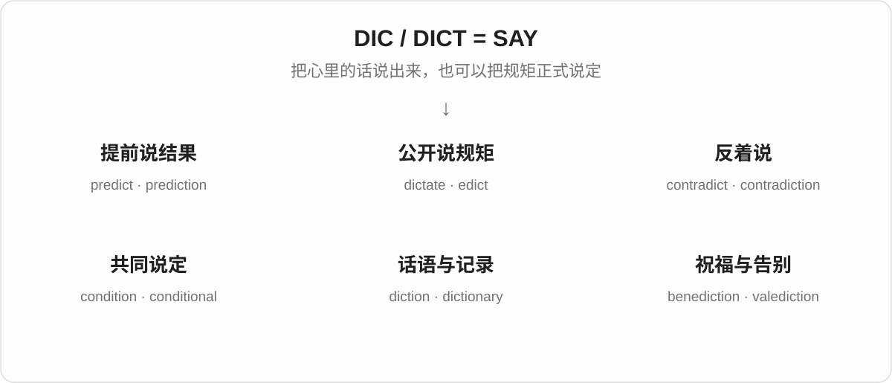

## 词形与演化规律

dic- / dict- 是拉丁词干的不同形式。dictāre 是相关的反复动作形式，形成 dictate、dictator 一支。经过法语的词可能变得不太像原根：condition 来自“共同说定”的 condiciō 一支；indict 后来补写了 c，读音却没有 /k/。不能凭字母猜出所有变化。

## 单词速览（常用到不常用）

| 单词 | 音标 | 核心意思 |
|---|---|---|
| [condition](#w-1) | /kənˈdɪʃən/ | 条件；状况；使适应 |
| [predict](#w-2) | /prɪˈdɪkt/ | 预测；预言 |
| [verdict](#w-3) | 英 /ˈvɜːdɪkt/；美 /ˈvɝːdɪkt/ | 裁决；最终判断或评价 |
| [dictionary](#w-4) | 英 /ˈdɪkʃənəri/；美 /ˈdɪkʃəneri/ | 词典；字典 |
| [prediction](#w-5) | /prɪˈdɪkʃən/ | 预测；预言的内容 |
| [predictable](#w-6) | /prɪˈdɪktəbəl/ | 可预测的；不出所料的 |
| [indictment](#w-7) | /ɪnˈdaɪtmənt/ | 起诉；起诉书；强烈谴责的证据 |
| [unpredictable](#w-8) | /ˌʌnprɪˈdɪktəbəl/ | 难以预测的；变化无常的 |
| [dictator](#w-9) | 英 /dɪkˈteɪtə/；美 /ˈdɪkteɪtər/ | 独裁者；专横的人 |
| [dictatorship](#w-10) | 英 /dɪkˈteɪtəʃɪp/；美 /ˈdɪkteɪtərʃɪp/ | 独裁统治；独裁政权 |
| [conditional](#w-11) | /kənˈdɪʃənəl/ | 有条件的；条件式的 |
| [dictate](#w-12) | 动词英 /dɪkˈteɪt/、美也读 /ˈdɪkteɪt/；名词 /ˈdɪkteɪt/ | 口述；命令；决定 |
| [unconditional](#w-13) | /ˌʌnkənˈdɪʃənəl/ | 无条件的 |
| [contradictory](#w-14) | 英 /ˌkɒntrəˈdɪktəri/；美 /ˌkɑːntrəˈdɪktəri/ | 互相矛盾的 |
| [contradiction](#w-15) | 英 /ˌkɒntrəˈdɪkʃən/；美 /ˌkɑːntrəˈdɪkʃən/ | 矛盾；反驳 |
| [conditioner](#w-16) | 英 /kənˈdɪʃənə/；美 /kənˈdɪʃənər/ | 护发素；调节剂；调节装置 |
| [predictive](#w-17) | /prɪˈdɪktɪv/ | 预测性的；用于预测的 |
| [contradict](#w-18) | 英 /ˌkɒntrəˈdɪkt/；美 /ˌkɑːntrəˈdɪkt/ | 反驳；与……矛盾 |
| [predictor](#w-19) | 英 /prɪˈdɪktə/；美 /prɪˈdɪktər/ | 预测因素；预测者 |
| [edict](#w-20) | /ˈiːdɪkt/ | 法令；正式命令 |
| [dictatorial](#w-21) | 英 /ˌdɪktəˈtɔːriəl/；美 /ˌdɪktəˈtɔːriəl/ | 独裁的；专横的 |
| [indict](#w-22) | /ɪnˈdaɪt/ | 正式起诉；控告 |
| [predictability](#w-23) | /prɪˌdɪktəˈbɪləti/ | 可预测性；稳定可预期的程度 |
| [dictation](#w-24) | /dɪkˈteɪʃən/ | 口述；听写 |
| [diction](#w-25) | /ˈdɪkʃən/ | 措辞；咬字、吐字 |
| [precondition](#w-26) | 名词 /ˌpriːkənˈdɪʃən/；动词同形，重音有变体 | 先决条件；预先调节 |
| [interdiction](#w-27) | 英 /ˌɪntəˈdɪkʃən/；美 /ˌɪntərˈdɪkʃən/ | 禁止；阻截；封锁 |
| [benediction](#w-28) | /ˌbenɪˈdɪkʃən/ | 祝福；祝祷 |
| [dictum](#w-29) | /ˈdɪktəm/ | 格言；权威式断言 |
| [interdict](#w-30) | 动词英 /ˌɪntəˈdɪkt/；名词英 /ˈɪntədɪkt/ | 禁止；阻断；禁令 |
| [conditionality](#w-31) | /kənˌdɪʃəˈnæləti/ | 附带条件的性质；所附条件机制 |
| [valediction](#w-32) | /ˌvælɪˈdɪkʃən/ | 告别的话；辞别 |
| [malediction](#w-33) | /ˌmælɪˈdɪkʃən/ | 诅咒；恶毒的咒骂 |

## 逐词讲解

### 1. condition — 条件；状况；使适应

**音标**：/kənˈdɪʃən/

**先抓住这个画面**

先看两种常见用法：“你答应这点，我才同意”是在谈条件；“这东西现在怎么样”是在谈状况。

**怎么拆**

来自拉丁语 condiciō，与 con-（共同）+ dīcere（说）组成的 condīcere“说定、约定”有关。后来拼写受另一个拉丁词影响，英语成了 condition。

**怎么变成今天的意思**

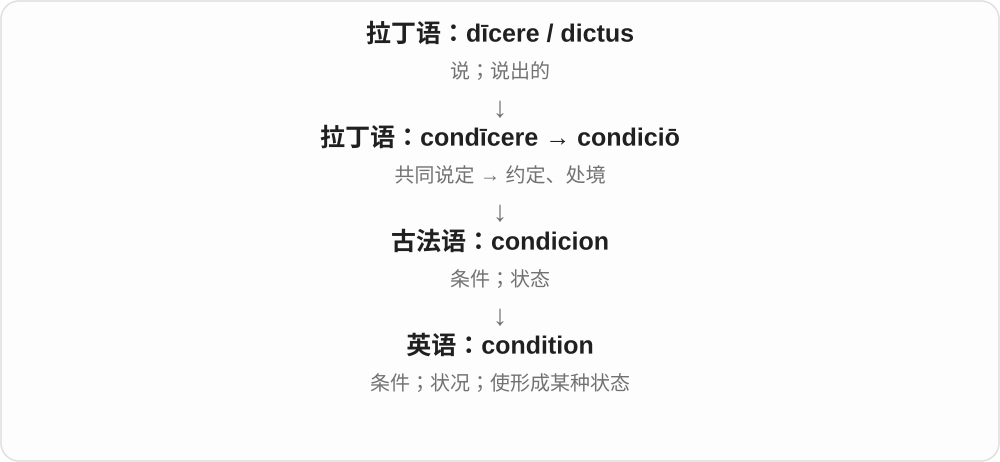

说定的条款是“条件”；一个人或物被哪些条件围着，又能说它的“处境、状态”。动词进一步表示使东西达到某种状态，或让人习惯某种反应。

**常见搭配与例句**

on condition that…；in good condition；working conditions；condition someone to do…。

> You can borrow the car on condition that you return it tonight.

你可以借车，条件是今晚还回来。

> The bicycle is still in excellent condition.

这辆自行车的状况仍然很好。

**别混淆**

a condition 可能是一个条件，也可能指一种疾病；看搭配。conditions 常指环境条件，不是每次都译“条件们”。

### 2. predict — 预测；预言

**音标**：/prɪˈdɪkt/

**先抓住这个画面**

事情还没发生，你先说它大概会怎样。predict 的时间方向是“先说，后看结果”。

**怎么拆**

拉丁语 prae-（在前）+ dīcere（说）→ praedīcere；英语从相关分词词形借入。

**怎么变成今天的意思**

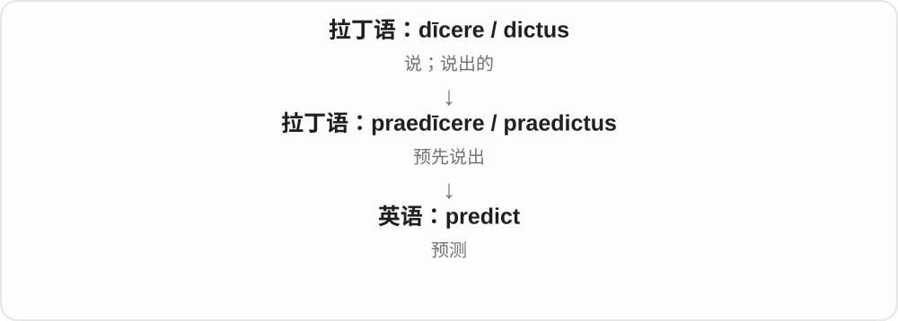

从提前说出，发展为根据经验、数据或判断推测未来。词本身不保证有科学依据，更不保证猜对。

**常见搭配与例句**

predict the result；predict that…；predict how…；hard to predict。

> It is difficult to predict how customers will respond.

很难预测顾客会怎样回应。

> The model predicts heavier rain tomorrow.

模型预测明天雨势会更大。

**别混淆**

predict 是说将来可能怎样；promise 是承诺自己会怎样做。一个是判断，一个是承担承诺。

### 3. verdict — 裁决；最终判断或评价

**音标**：英 /ˈvɜːdɪkt/；美 /ˈvɝːdɪkt/

**先抓住这个画面**

verdict 是听完、看完、考虑过后给出的结论。法庭里是裁决；日常问“What’s your verdict?”，就是问“你最后觉得怎么样？”

**怎么拆**

来自盎格鲁法语 verdit，里面 veir 表示“真的”，dit 表示“所说的话”。两个部分分别连到拉丁语 vērus 和 dīcere。后来英语拼写受拉丁形式影响，出现 verdict 的 c。

**怎么变成今天的意思**

“被正式说出的结论”帮助你理解现代用法，但 verdict 不保证结论客观上永远正确。词源里的“真”说的是词如何形成；今天它命名的是一种判断结果。

**常见搭配与例句**

reach a verdict（作出裁决）；return a verdict（宣布裁决）；a guilty verdict（有罪裁决）；the final verdict（最终结论）。

> The jury reached a verdict after several hours.

陪审团经过几个小时后作出了裁决。

> You have tried the new café—what is your verdict?

你去过那家新咖啡馆了——最后觉得怎么样？

**别混淆**

verdict 是对问题作出的判断；sentence 在刑事语境中常指判处的刑罚。日常 verdict 也可以是对餐厅、电影或产品的评价。

### 4. dictionary — 词典；字典

**音标**：英 /ˈdɪkʃənəri/；美 /ˈdɪkʃəneri/

**先抓住这个画面**

把说话用的词收在一起，方便查它们怎么读、什么意思、怎么用。这就是 dictionary 的直观功能。

**怎么拆**

来自中世纪拉丁语 dictiōnārium，基础是 dictiō“说话、词语”。现代可用 diction + -ary 联系记忆，但它不是从现代“措辞风格”临时拼出的书名。

**怎么变成今天的意思**

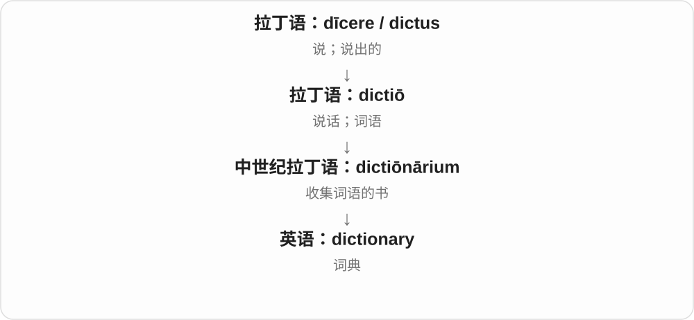

从“说出来的词”到集中收集词的工具。现代也有电子词典；编程中 dictionary 借用了“按键找到对应值”的查找感觉。

**常见搭配与例句**

look up a word in a dictionary；a bilingual dictionary；a learner’s dictionary。

> I looked up the word in a learner’s dictionary.

我在学习词典里查了这个词。

> A good dictionary shows how a word behaves in real sentences.

好的词典会展示一个词在实际句子中怎样使用。

**别混淆**

dictionary 常解释词的意思与用法；thesaurus 主要帮助找近义词等词语关系。

### 5. prediction — 预测；预言的内容

**音标**：/prɪˈdɪkʃən/

**先抓住这个画面**

predict 是提前作判断，prediction 是你提前说出的那个判断。它可以拿来与后来发生的事实比较。

**怎么拆**

来自拉丁语 praedictiō；现代也能按 predict + -ion 理解为预测的行为或结果。

**怎么变成今天的意思**

说出来的预测成为一条可讨论、可验证的内容。make a prediction 强调作出判断；an accurate prediction 说明后来与事实相符。

**常见搭配与例句**

make a prediction；an accurate prediction；a prediction about…；against all predictions。

> Her prediction about the election turned out to be correct.

她对选举结果的预测后来证明是对的。

> We should compare the prediction with the actual result.

我们应该把预测和实际结果作比较。

**别混淆**

prediction 不等于计划 plan：前者判断会发生什么，后者安排希望怎样做。

### 6. predictable — 可预测的；不出所料的

**音标**：/prɪˈdɪktəbəl/

**先抓住这个画面**

还没往下看，你已经大概知道会发生什么。规律稳定时这是优点，故事老套时也可能是缺点。

**怎么拆**

predict + -able：能够提前预测的。

**怎么变成今天的意思**

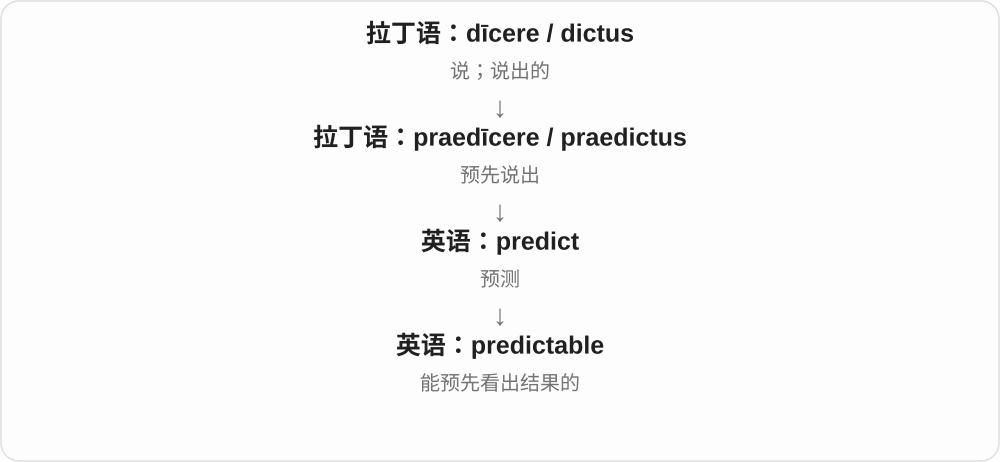

-able 把动作变成一种性质。predictable income 是比较稳定可预期的收入；a predictable ending 则可能嫌结局缺乏新意。

**常见搭配与例句**

a predictable pattern；a predictable result；highly predictable。

> The machine follows a predictable cycle.

这台机器按一个可预测的周期运行。

> The film was enjoyable, though its ending was predictable.

电影挺好看，只是结局容易猜到。

**别混淆**

predictable 不一定是 boring。稳定的设备表现很可预测，通常值得高兴；小说太可预测才可能乏味。

### 7. indictment — 起诉；起诉书；强烈谴责的证据

**音标**：/ɪnˈdaɪtmənt/

**先抓住这个画面**

正式起诉写成文件，就是 indictment；某种糟糕现实也可以像一份“控诉书”，揭示制度或行为的问题。

**怎么拆**

经法语 enditement 进入英语，与 indict 同族。现代可看出 indict + -ment，但这个名词也有自己的法语借入历史。c 同样不发音。

**怎么变成今天的意思**

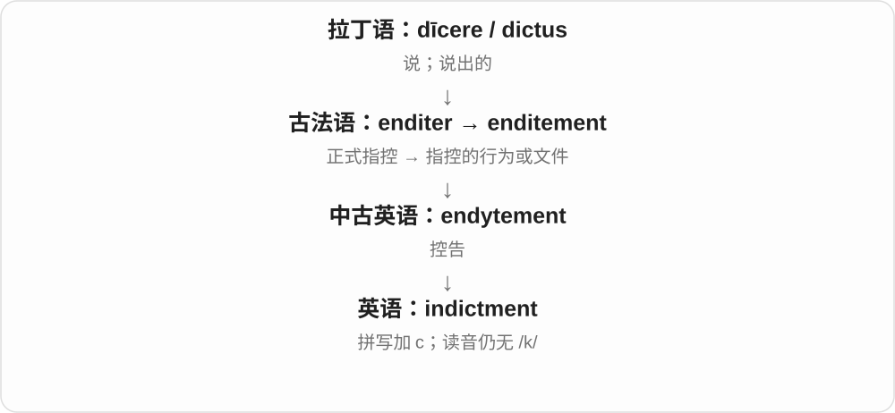

法律中的正式指控延伸出比喻义：a powerful indictment of the system，是让人看清这个系统严重问题的事实或作品。

**常见搭配与例句**

an indictment for…；an indictment against…；an indictment of the system。

> The indictment listed three separate charges.

起诉书列出了三项不同的指控。

> The documentary is a powerful indictment of institutional neglect.

这部纪录片有力地揭露并谴责了机构的失职。

**别混淆**

法律义的 indictment 不代表裁定有罪；比喻义也不一定真的有法院介入。

### 8. unpredictable — 难以预测的；变化无常的

**音标**：/ˌʌnprɪˈdɪktəbəl/

**先抓住这个画面**

你想提前猜下一步，但它总会偏离预期。unpredictable 说的是这种不容易掌握的变化。

**怎么拆**

un-（不）+ predictable（可预测的）。

**怎么变成今天的意思**

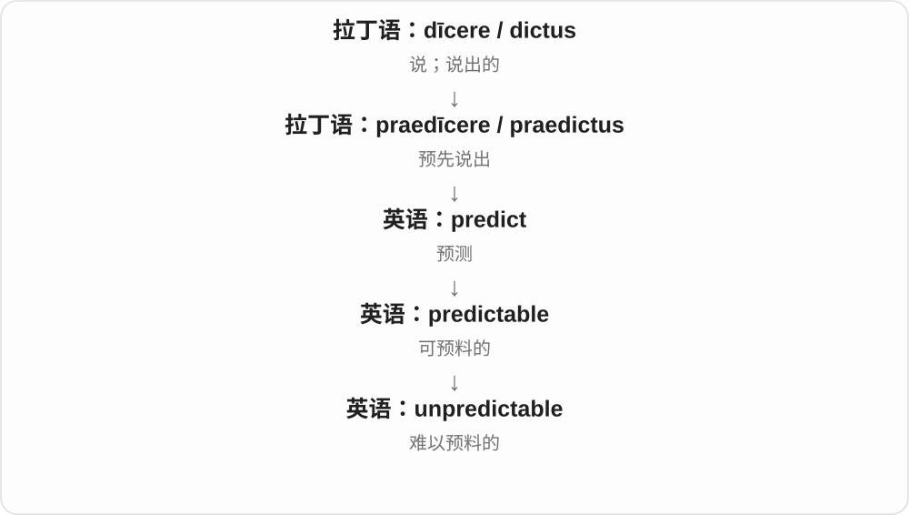

用在天气或系统上，是行为难预测；用在人身上，常说情绪或反应不稳定。它不必是完全随机，只是你难以可靠预先判断。

**常见搭配与例句**

unpredictable weather；an unpredictable outcome；highly unpredictable。

> Mountain weather can be unpredictable.

山区天气可能很难预测。

> His unpredictable reactions made the team uneasy.

他难以预料的反应让团队感到不安。

**别混淆**

unexpected 是某一次结果没料到；unpredictable 是一贯难预测的性质。

### 9. dictator — 独裁者；专横的人

**音标**：英 /dɪkˈteɪtə/；美 /ˈdɪkteɪtər/

**先抓住这个画面**

“我说了算，别人照着做。”这能抓住 dictator 现代含义里的权力不受正常制约这一点。

**怎么拆**

来自拉丁语 dictātor，与 dictāre“规定、发布指令”有关。-or 指执行这种职能的人。

**怎么变成今天的意思**

它最初是古罗马的一种特殊官职名称，后来扩展为掌握高度集中的、不受充分约束权力的统治者。日常也能比喻一个处处要求别人服从的人。

**常见搭配与例句**

a military dictator；rule as a dictator；a ruthless dictator。

> The dictator refused to allow an independent press.

独裁者拒绝允许独立新闻媒体存在。

> You can lead the group without becoming a little dictator.

你可以带领这个小组，而不必变成事事专断的人。

**别混淆**

dictator 不是所有强势领导者的中性称呼。现代一般有明确的独裁或专横意味；历史官职则要放回具体背景。

### 10. dictatorship — 独裁统治；独裁政权

**音标**：英 /dɪkˈteɪtəʃɪp/；美 /ˈdɪkteɪtərʃɪp/

**先抓住这个画面**

dictator 是掌权的人，dictatorship 则把镜头拉远，指这种统治方式、政权或统治时期。

**怎么拆**

dictator + -ship。这里 -ship 表示身份、制度或状态，与船 ship 没有关系。

**怎么变成今天的意思**

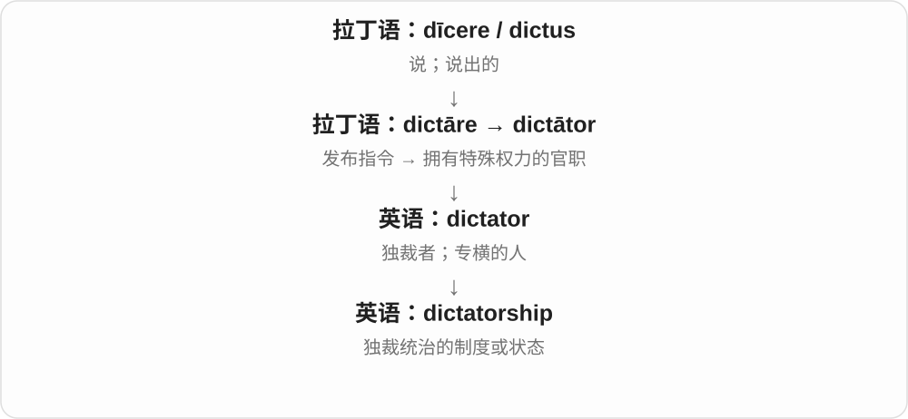

从个人的职权走向整个政治安排。它可以与 democracy 对比，也可以说 live under a dictatorship，描述生活所处的统治环境。

**常见搭配与例句**

a military dictatorship；under a dictatorship；the fall of a dictatorship。

> The novel is set during a military dictatorship.

小说以军事独裁统治时期为背景。

> The lecture compared several forms of dictatorship.

这场讲座比较了几种独裁统治形式。

**别混淆**

dictator 是人，dictatorship 是统治形态。一个人很专横，不必因此把他所在的一切组织都按政治制度称为 dictatorship。

### 11. conditional — 有条件的；条件式的

**音标**：/kənˈdɪʃənəl/

**先抓住这个画面**

“可以，但先得满足这一点。”conditional 说的不是直接答应，而是把决定系在某个条件上。

**怎么拆**

经法语 conditionnel / condicionel 传入，现代可按 condition + -al 理解。

**怎么变成今天的意思**

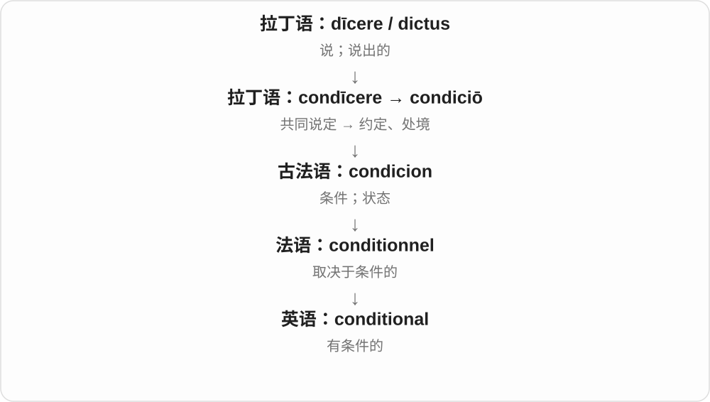

conditional approval 是满足附带条件才有效的批准。语法中的 conditional sentence 则讨论 if 等结构表达的条件关系。

**常见搭配与例句**

conditional on…；conditional approval；a conditional offer；a conditional sentence。

> The offer is conditional on your passing the final exam.

这份录取或聘用要约以你通过期末考试为条件。

> The council gave conditional approval to the plan.

委员会有条件地批准了这个计划。

**别混淆**

conditional 是有条件；conditioned 更常是已经受训练、处理或环境影响。

### 12. dictate — 口述；命令；决定

**音标**：动词英 /dɪkˈteɪt/、美也读 /ˈdɪkteɪt/；名词 /ˈdɪkteɪt/

**先抓住这个画面**

一人说，另一人照着写，是口述；一人说，别人必须照着做，是命令。局势让你只能这样选，又可以说局势 dictates 你的选择。

**怎么拆**

来自拉丁语 dictāre，属于 dīcere“说”的反复动作形式。英语动词和名词分别承接相关拉丁词形。

**怎么变成今天的意思**

共同点是给出需要照着执行的内容。命令者可以是人，也可以比喻为预算、时间、环境；the dictates of conscience 则是良心的要求。

**常见搭配与例句**

dictate a letter；dictate terms；dictate what happens；the dictates of conscience。

> She dictated the message while I typed.

她口述消息，我打字。

> Our budget will dictate the size of the project.

我们的预算将决定项目规模。

**别混淆**

suggest 给建议，dictate 常让对方没有多少选择。口述义却可以完全不带专横态度。

### 13. unconditional — 无条件的

**音标**：/ˌʌnkənˈdɪʃənəl/

**先抓住这个画面**

“不需要你先做到什么，我也会这样。”unconditional 去掉了附带的前提。

**怎么拆**

un-（没有）+ conditional（有条件的）。

**怎么变成今天的意思**

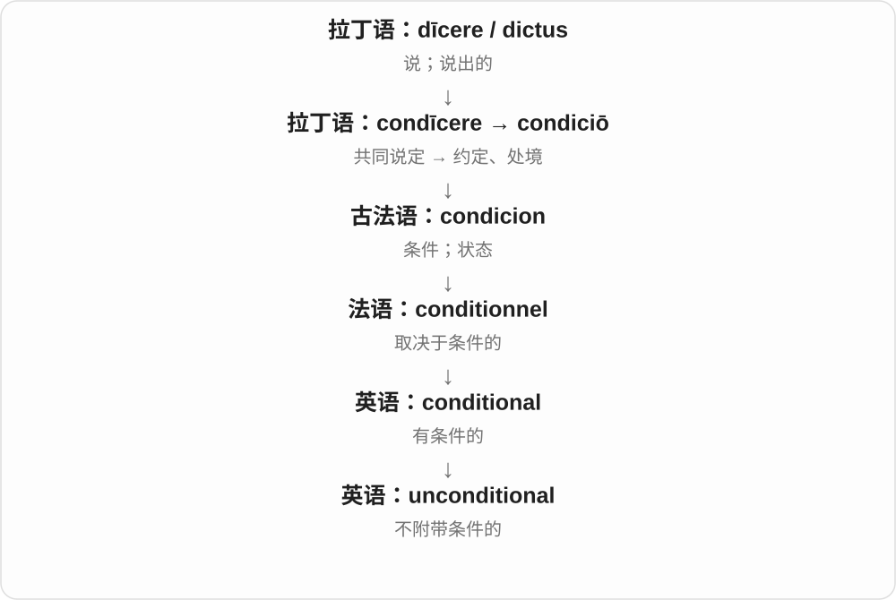

它可以形容支持、承诺，也可说 unconditional surrender“无条件投降”。具体范围仍由所谈的事情决定，不表示生活中从此没有任何界限。

**常见搭配与例句**

unconditional support；unconditional love；unconditional surrender。

> She offered him unconditional support.

她向他提供了无条件的支持。

> The agreement called for an unconditional surrender.

协议要求无条件投降。

**别混淆**

unconditional 说没有附带条件；unlimited 说没有数量或范围上限。这两件事不同。

### 14. contradictory — 互相矛盾的

**音标**：英 /ˌkɒntrəˈdɪktəri/；美 /ˌkɑːntrəˈdɪktəri/

**先抓住这个画面**

你听到两套说法，一套往东，一套往西，没法同时照单全收。这些说法就是 contradictory。

**怎么拆**

来自拉丁语 contrādictōrius；现代也可分析为 contradict + -ory，表示具有抵触性质。

**怎么变成今天的意思**

它用来形容信息、命令、证据甚至感受之间的冲突。描述人时也可能指爱唱反调，但常见搭配仍围绕不一致的信息。

**常见搭配与例句**

contradictory statements；contradictory evidence；mutually contradictory。

> We received contradictory instructions from two managers.

两位经理给了我们相互矛盾的指示。

> The witness gave contradictory accounts of the same event.

证人对同一事件作出了相互矛盾的叙述。

**别混淆**

confusing 只说让人困惑；contradictory 指其中有实质冲突，因而可能让人困惑。

### 15. contradiction — 矛盾；反驳

**音标**：英 /ˌkɒntrəˈdɪkʃən/；美 /ˌkɑːntrəˈdɪkʃən/

**先抓住这个画面**

把两句话放在一起，它们却互相“打架”：如果一句成立，另一句就难以成立。这种冲突是 contradiction。

**怎么拆**

来自拉丁语 contrādictiō，经法语进入英语；现代可与 contradict + -ion 联系。

**怎么变成今天的意思**

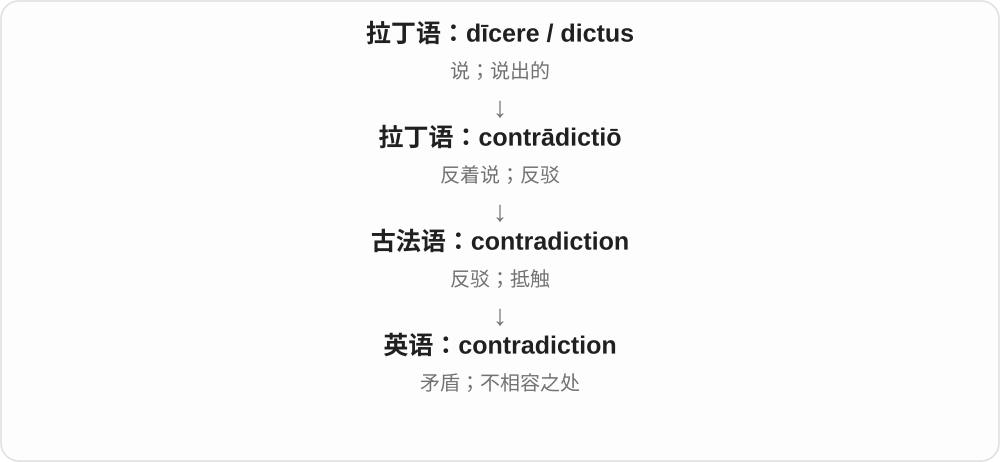

动作“反驳”可以变为两种说法之间的矛盾。a contradiction in terms 指一个表达内部概念冲突，不是任何让人吃惊的说法。

**常见搭配与例句**

a contradiction between…；in contradiction to…；a contradiction in terms。

> There is a contradiction between the two reports.

这两份报告之间存在矛盾。

> His actions stand in contradiction to his promises.

他的行为与承诺相矛盾。

**别混淆**

contrast 是对比或差异，未必互相否定；contradiction 的冲突通常更强。

### 16. conditioner — 护发素；调节剂；调节装置

**音标**：英 /kənˈdɪʃənə/；美 /kənˈdɪʃənər/

**先抓住这个画面**

一种把东西调到更合适状态的产品或设备。头发被调理得更柔顺，空气被调到更舒适，都用到 condition 的动词义。

**怎么拆**

condition（使达到某种状态）+ -er（起这种作用的东西）。

**怎么变成今天的意思**

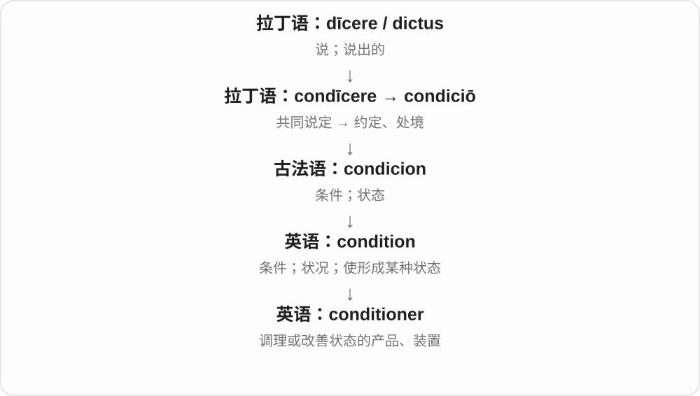

单说 conditioner，日常常指护发素；air conditioner 才明确是空调。词尾 -er 不一定指人，也可以是工具或产品。

**常见搭配与例句**

hair conditioner；leave conditioner on；an air conditioner；soil conditioner。

> She uses conditioner after washing her hair.

她洗头后会使用护发素。

> The air conditioner kept the room comfortable.

空调让房间保持舒适。

**别混淆**

shampoo 主要用于洗头；conditioner 主要调理发丝。两者功能不同。

### 17. predictive — 预测性的；用于预测的

**音标**：/prɪˈdɪktɪv/

**先抓住这个画面**

不是回头描述已经发生的事，而是拿信息往前看，估计还没发生的结果。

**怎么拆**

来自拉丁语 praedictīvus；现代可理解为 predict + -ive。

**怎么变成今天的意思**

a predictive model 是用于预测的模型；predictive value 是某个信息对预测结果能提供多少帮助。名称本身不保证模型准确。

**常见搭配与例句**

a predictive model；predictive accuracy；predictive value；predictive text。

> The team built a predictive model of customer demand.

团队建立了一个预测顾客需求的模型。

> This measure has little predictive value on its own.

单靠这个指标，几乎不能有效预测结果。

**别混淆**

predictive 是用来预测；predictable 是能被预测。天气模型可以 predictive，天气本身却未必 predictable。

### 18. contradict — 反驳；与……矛盾

**音标**：英 /ˌkɒntrəˈdɪkt/；美 /ˌkɑːntrəˈdɪkt/

**先抓住这个画面**

一个说是，另一个说不是；或者一条证据与某个说法对不上。这种正面冲突就是 contradict。

**怎么拆**

contra-（反对、相反）+ dīcere（说）→ contrādīcere；英语借用相关分词词干。

**怎么变成今天的意思**

从人与人反着说，扩展到陈述、行为、证据彼此不一致。因此不仅人能 contradict，事实也能。

**常见搭配与例句**

contradict someone；contradict the evidence；contradict oneself。

> The new evidence contradicts his account of the accident.

新证据与他对事故的叙述相矛盾。

> You said the opposite earlier; you are contradicting yourself.

你先前说的正好相反；你在自相矛盾。

**别混淆**

disagree 可以只是立场不同；contradict 更强调否定某个说法或形成不能同时成立的冲突。

### 19. predictor — 预测因素；预测者

**音标**：英 /prɪˈdɪktə/；美 /prɪˈdɪktər/

**先抓住这个画面**

看到一个信号，你就更容易猜到后面的结果。那个帮助预测的信号，可以叫 predictor。

**怎么拆**

predict + -or。-or 既能指做预测的人，也能指在预测中起作用的因素或工具。

**怎么变成今天的意思**

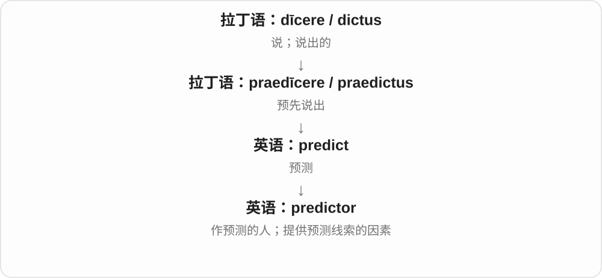

研究文章里，predictor 常是一个变量。它与后来的结果相关，所以有预测价值；这不自动证明它是造成结果的原因。

**常见搭配与例句**

a predictor of…；a strong predictor；a poor predictor；a predictor variable。

> Past demand is often a useful predictor of future sales.

过去的需求往往是预测未来销量的有用因素。

> Price alone is a poor predictor of quality.

单凭价格并不能很好地预测质量。

**别混淆**

predictor 与 cause 不同。带伞人数能预测下雨情况，不意味着带伞的人制造了雨。

### 20. edict — 法令；正式命令

**音标**：/ˈiːdɪkt/

**先抓住这个画面**

权威者把规矩公开说出来，要求大家遵守。这种正式发布的命令是 edict。

**怎么拆**

来自拉丁语 ēdictum，与 ē- / ex-（向外）+ dīcere（说）有关，即正式宣告出来。

**怎么变成今天的意思**

“说出来”带上权威与公开发布的背景，就从普通话语变成法令。日常也可半开玩笑地把上级硬性规定称为 edict。

**常见搭配与例句**

issue an edict；a royal edict；by edict；an edict banning…。

> The ruler issued an edict banning the practice.

统治者颁布法令，禁止这种做法。

> A new office edict requires every meeting to end on time.

办公室新下了一道硬规定：所有会议都必须按时结束。

**别混淆**

edict 是命令本身；verdict 是裁断结果。两者都与“说”有关，但说话的用途不同。

### 21. dictatorial — 独裁的；专横的

**音标**：英 /ˌdɪktəˈtɔːriəl/；美 /ˌdɪktəˈtɔːriəl/

**先抓住这个画面**

别人还没来得及讨论，就听到一句“按我说的办”。dictatorial 形容这种不容别人参与或反对的作风。

**怎么拆**

dictator + -ial，构成描述其制度或行为方式的形容词，重音随词尾改变。

**怎么变成今天的意思**

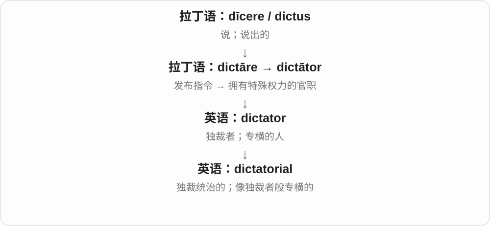

它既能形容政权，也能批评管理风格。形容普通老板时，通常是比喻他控制欲强、不给人商量余地。

**常见搭配与例句**

a dictatorial regime；a dictatorial manner；dictatorial control。

> Her dictatorial manner discouraged people from offering ideas.

她专横的作风让大家不敢提出想法。

> The essay examines the rise of dictatorial power.

文章考察了独裁权力的兴起。

**别混淆**

decisive 是能果断作决定；dictatorial 是专横地替所有人作决定。果断本身不等于专横。

### 22. indict — 正式起诉；控告

**音标**：/ɪnˈdaɪt/

**先抓住这个画面**

把指控正式提出来，进入特定的法律程序。比普通的“我觉得你做错了”更正式。

**怎么拆**

属于拉丁语 dīcere / dictāre“说、宣告”词族，经法语 enditer 传入。英语后来按拉丁来源补写 c，但没有把 /k/ 读回来。

**怎么变成今天的意思**

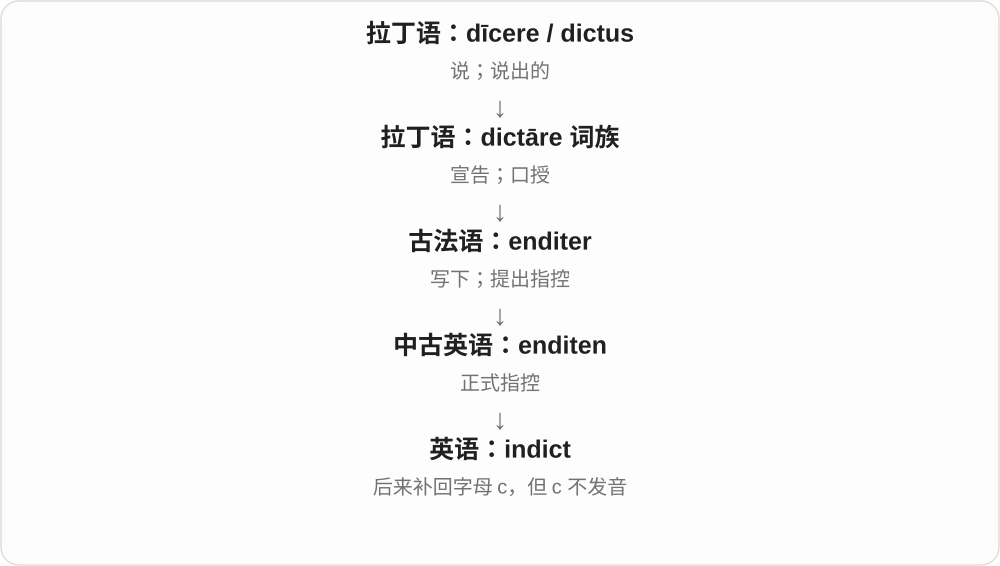

从陈述、写下，到正式提出控罪。最容易错的是读音：中间是 /daɪt/，不读成 /dɪkt/。具体起诉程序由相关司法制度规定。

**常见搭配与例句**

indict someone for…；be indicted on charges of…。

> The official was indicted on charges of fraud.

这名官员因欺诈指控被正式起诉。

> The report says three people were indicted, but none had yet been tried.

报告说三人被起诉，但当时尚无人受审。

**别混淆**

indict 是正式提出指控；convict 是认定有罪。被起诉不等于已被判有罪。

### 23. predictability — 可预测性；稳定可预期的程度

**音标**：/prɪˌdɪktəˈbɪləti/

**先抓住这个画面**

你有多大把握提前知道它下一步会怎样？predictability 就是在讨论这种把握和规律性。

**怎么拆**

predict + -ability，与 predictable“可预测的”对应的名词。

**怎么变成今天的意思**

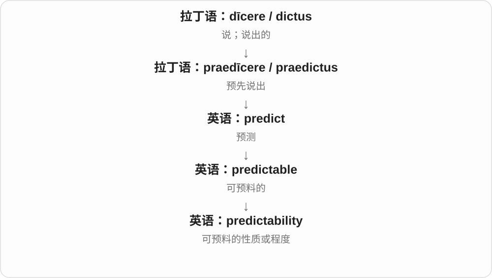

用于收入、制度或系统时，稳定可预期常是优点；用于故事时，又可能批评套路明显。它描述性质，不是某一次预测内容。

**常见搭配与例句**

greater predictability；the predictability of…；improve predictability。

> A regular schedule gives children a sense of predictability.

规律的作息让孩子对接下来会发生什么心里有数。

> Critics complained about the predictability of the plot.

评论者批评情节太容易猜到。

**别混淆**

prediction 是一条预测；predictability 是事情有多容易被预测。

### 24. dictation — 口述；听写

**音标**：/dɪkˈteɪʃən/

**先抓住这个画面**

声音从一个人口中出来，另一个人把它落成文字。同一过程，从说话方看是口述，从记录练习看就是听写。

**怎么拆**

来自拉丁语 dictātiō，属于 dictāre“口授”词族；现代可与 dictate + -ion 联系。

**怎么变成今天的意思**

take dictation 是把别人口述的话记录下来；do a dictation 是做听写练习。现代手机语音输入也常使用 dictation 这个名称。

**常见搭配与例句**

take dictation；a dictation exercise；voice dictation；at someone’s dictation。

> The assistant took dictation while the manager walked around the room.

经理在房间里来回走动时，助理记录了他的口述。

> We did a short dictation to practise spelling.

我们做了一小段听写来练习拼写。

**别混淆**

dictation 通常是口述变文字；transcription 范围更广，可把已有录音转写，未必是现场听写。

### 25. diction — 措辞；咬字、吐字

**音标**：/ˈdɪkʃən/

**先抓住这个画面**

同一件事，你选哪些词来说，以及说得多清楚。diction 把注意力放在表达本身。

**怎么拆**

来自拉丁语 dictiō“说、话语”，通过法语或直接借入英语；其基础是 dīcere“说”。

**怎么变成今天的意思**

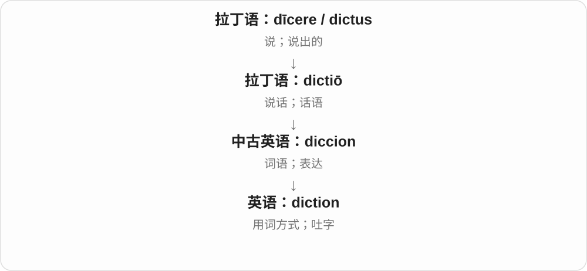

文学评论常谈作者的用词，表演和演讲训练常谈咬字是否清楚。两条用法都在问“话是怎么说出来的”。

**常见搭配与例句**

clear diction；formal diction；poetic diction；improve one’s diction。

> The actor’s clear diction made every word easy to understand.

演员清晰的吐字让每个词都容易听懂。

> The poem combines simple diction with complex ideas.

这首诗用简单的措辞表达复杂的思想。

**别混淆**

diction 不等于 accent。口音不同的人都可以吐字清晰；文风用词又是另一层。

### 26. precondition — 先决条件；预先调节

**音标**：名词 /ˌpriːkənˈdɪʃən/；动词同形，重音有变体

**先抓住这个画面**

想进入下一步，得先过这一关。名词 precondition 强调某件事发生之前必须具备的条件。

**怎么拆**

pre-（预先）+ condition。动词则指在正式使用前，先把人或物调整到某种状态。

**怎么变成今天的意思**

普通 condition 可以是任何附带条件；precondition 特别把先后顺序挑出来。它也常用于谈判，表示坐下来谈之前的要求。

**常见搭配与例句**

a precondition for…；without preconditions；meet a precondition；precondition a sample。

> Mutual trust is a precondition for meaningful cooperation.

相互信任是开展实质合作的先决条件。

> The two sides agreed to meet without preconditions.

双方同意不设先决条件地会面。

**别混淆**

precondition 是开始之前的门槛；result 是做完之后的结果。别把“有助于成功”的东西都说成不可缺少的先决条件。

### 27. interdiction — 禁止；阻截；封锁

**音标**：英 /ˌɪntəˈdɪkʃən/；美 /ˌɪntərˈdɪkʃən/

**先抓住这个画面**

不是拦下一次就结束，而是把“防止东西或活动通过”当成一项行动或措施。

**怎么拆**

经法语 interdiction 来自拉丁语 interdictiō，与 interdict 同族。

**怎么变成今天的意思**

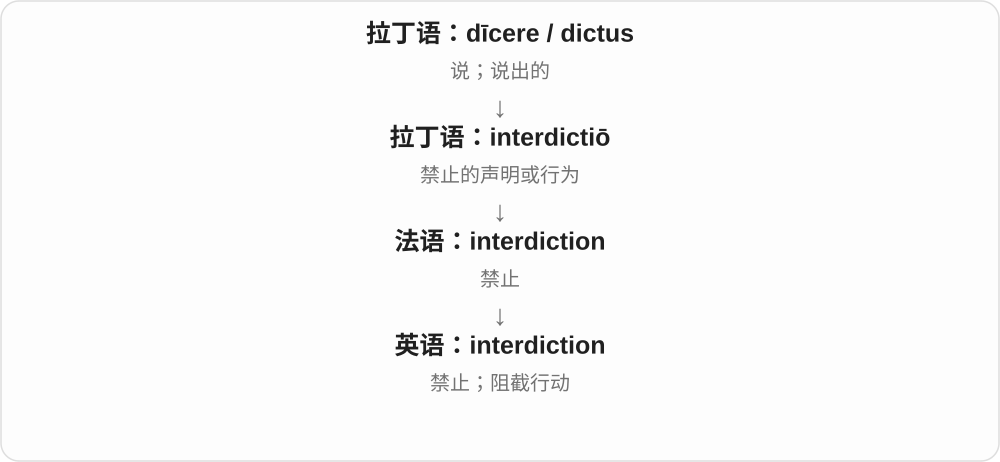

法语中仍很常用的“禁止”，在英语里常见于较正式的法律、军事和执法表述。具体是发命令还是实际阻断，要看语境。

**常见搭配与例句**

drug interdiction；maritime interdiction；the interdiction of supplies。

> The article discusses maritime interdiction.

文章讨论了海上拦截行动。

> The plan focused on the interdiction of illegal trade.

该计划重点在于阻断非法贸易。

**别混淆**

interdiction 是阻止或封锁；intervention 是介入，介入未必为了阻断。

### 28. benediction — 祝福；祝祷

**音标**：/ˌbenɪˈdɪkʃən/

**先抓住这个画面**

郑重地对一个人说出愿他安好的话。benediction 比随口一句 good luck 更有仪式感。

**怎么拆**

拉丁语 bene（好地）+ dīcere（说）形成 benedīcere“祝福”，名词 benedictiō 进入英语。

**怎么变成今天的意思**

“说好话”在宗教和礼仪场景中成为祝福，而不是奉承别人。它可以是仪式末尾的一段祝祷，也能用于文学性的祝愿。

**常见搭配与例句**

give a benediction；pronounce a benediction；a closing benediction。

> The ceremony ended with a brief benediction.

仪式以一段简短祝祷结束。

> Her parting words sounded like a benediction.

她临别的话听起来像一份祝福。

**别混淆**

compliment 是夸赞某个优点；benediction 是祝福。两者都是好话，但目的不同。

### 29. dictum — 格言；权威式断言

**音标**：/ˈdɪktəm/

**先抓住这个画面**

一句被人当作原则反复引用的话，或者一位有分量的人郑重说下的判断。

**怎么拆**

直接借自拉丁语 dictum“说出的话”，来自 dīcere 的分词形式 dictus。复数常见 dicta，也可见 dictums。

**怎么变成今天的意思**

从泛指所说的话，收窄为有权威感、概括性的说法。法律文本里的 dictum 又有特定用法，不能把所有法官的话都当同一种判决规则。

**常见搭配与例句**

a famous dictum；follow the dictum that…；a judicial dictum。

> She often repeated the dictum that preparation matters more than luck.

她常说，准备比运气更重要。

> The essay questions a familiar dictum about human nature.

文章质疑了一条人们熟悉的关于人性的断言。

**别混淆**

dictum 可能像原则，但不保证永远正确。quotation 只强调引用，dictum 还带概括和权威口气。

### 30. interdict — 禁止；阻断；禁令

**音标**：动词英 /ˌɪntəˈdɪkt/；名词英 /ˈɪntədɪkt/

**先抓住这个画面**

在某件事继续发生之前，用权威命令或实际行动把它拦下来。interdict 比普通 stop 正式得多。

**怎么拆**

来自拉丁语 inter-（在其间）+ dīcere（说）的词族，历史含义是以声明禁止。

**怎么变成今天的意思**

最初重在禁止的命令，后来也用于实际截断交通、补给等。名词可指禁令，在宗教史中还有特定的教会禁令义。

**常见搭配与例句**

interdict a route；interdict supplies；place under an interdict。

> The operation aimed to interdict illegal shipments.

这次行动旨在阻断非法货运。

> The historian explains why the town was placed under an interdict.

历史学家解释了为什么这座城被置于教会禁令之下。

**别混淆**

intercept 是截住正在移动的东西；interdict 可以是依法禁止，也可以是更持续地阻断某种活动或通道。

### 31. conditionality — 附带条件的性质；所附条件机制

**音标**：/kənˌdɪʃəˈnæləti/

**先抓住这个画面**

不是只问“给不给”，而是讨论“给这件事之前，要满足哪些要求”。conditionality 把附带条件这套安排当成话题。

**怎么拆**

conditional + -ity，把“有条件的”变成抽象名词。

**怎么变成今天的意思**

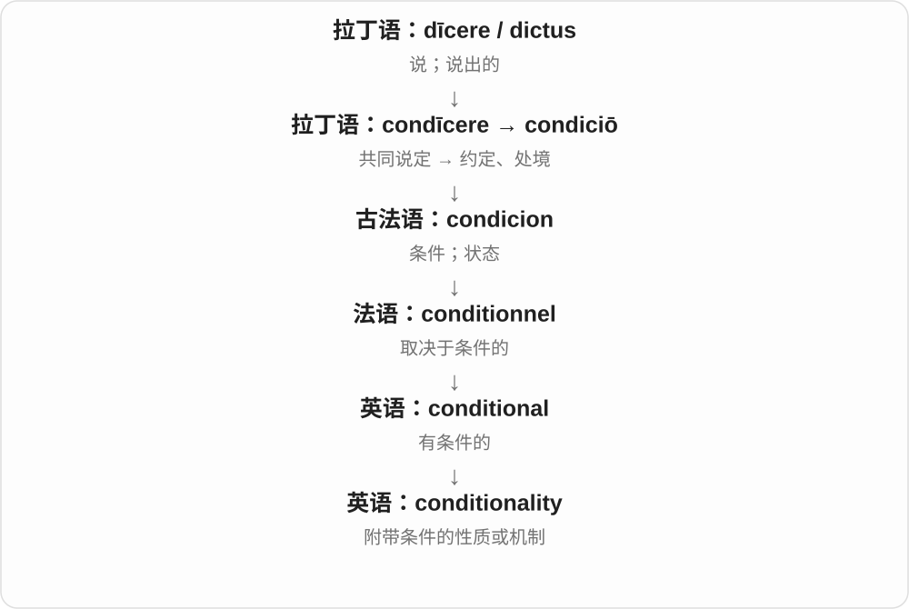

常用于正式政策、援助和贷款讨论，谈某项支持与哪些要求挂钩。日常只说某个简单条件，用 condition 更清楚。

**常见搭配与例句**

aid conditionality；loan conditionality；the conditionality of an offer。

> The paper examines the conditionality attached to foreign aid.

论文研究了对外援助所附带的条件机制。

> Both sides debated the conditionality of the proposed support.

双方讨论了拟议支持方案所附条件的问题。

**别混淆**

condition 是一项条件；conditionality 常谈附条件的原则、机制或整体性质。

### 32. valediction — 告别的话；辞别

**音标**：/ˌvælɪˈdɪkʃən/

**先抓住这个画面**

临别时郑重说的最后几句话，不只是随手挥一下手。valediction 是告别中的那份言语。

**怎么拆**

拉丁语 valē（再见；原为保重）+ dīcere（说），形成新拉丁语 valedictiō。

**怎么变成今天的意思**

说“保重”就是一种告别，两个成分合起来命名了告别行为和告别的话。这个词偏正式或文学，日常 goodbye 已够用。

**常见搭配与例句**

a farewell valediction；a final valediction；a moving valediction。

> He ended the letter with a warm valediction.

他用温暖的告别话语结束了信件。

> The final poem serves as a valediction to her hometown.

最后一首诗是她献给故乡的告别辞。

**别混淆**

benediction 是祝福，valediction 是告别；告别中可以带祝福，但两个词强调不同事情。

### 33. malediction — 诅咒；恶毒的咒骂

**音标**：/ˌmælɪˈdɪkʃən/

**先抓住这个画面**

不是祝你安好，而是恶狠狠地说希望坏事落在你身上。malediction 把“恶言”推到了诅咒这一端。

**怎么拆**

拉丁语 male（坏地）+ dīcere（说）形成 maledīcere，名词 maledictiō 经法语进入英语。

**怎么变成今天的意思**

它与 benediction 构成清楚的对照：好意的话变祝福，恶意的话变诅咒。现代偏文学用语，并不意味着诅咒真的有超自然效力。

**常见搭配与例句**

utter a malediction；mutter a malediction；a terrible malediction。

> The villain muttered a malediction as he left.

反派离开时低声咒骂了一句。

> In the tale, a malediction hangs over the abandoned castle.

故事中，那座废弃城堡笼罩在一个诅咒之下。

**别混淆**

criticism 是批评某个问题；malediction 是咒骂或诅咒，恶意更强。

## 这一组要分清什么

**predict / dictate**：判断未来会怎样；要求或实际决定事情怎样。

**diction / dictation / dictionary**：措辞或吐字；口述听写；收集解释词语的工具。

**indict / verdict**：正式提出指控；作出裁断。不要把指控写成已经证实的罪名。

**benediction / malediction / valediction**：祝福的话；诅咒的话；告别的话。

## 串起来练习

**The evidence contradicted the prediction, so we changed the conditions of the experiment.**

证据与预测不符，因此我们改变了实验条件。提前说是 prediction，事实与说法冲突是 contradict，实验所处的设置是 conditions。
