# 0636 · nect-, nex- — 系住；连接；附接

[逐词精讲目录](../00_逐词精讲目录.md) · [总目录](../00_总目录_按常用程度.md)

## 核心词根与来源

**nect-、nex-** 来自拉丁语 **nectere**“系住、连接”。connect 把部分接起来；disconnect 把线断开；reconnect 再接回去。annex 则把一部分附到较大主体上，nexus 看的是连接关系或交汇点。物理线索很清楚，也容易扩展到人际关系和思想联系。

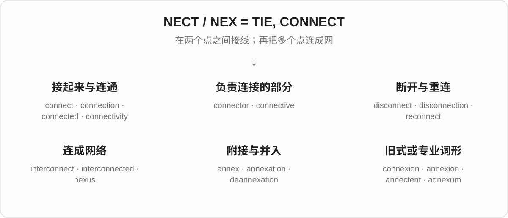

## 词形与演化规律

拉丁语 **nectere** 的相关形式里有 **nex-**，如 nexus；不是英语里见到 nect 就能任意换成 nex。**con-** 表示一起，**ad-** 在 n 前可同化成 an-，形成 annectere。**本组是拉丁语“连接”**，与来自希腊语、表示游泳的 nect- 不同；nekton、nectopod 不放在这里。

## 单词速览（按词族由简到繁）

同一基础词的相关扩展放在一起，先读基础形式，再读扩展；各组之间优先读常用的。具体词源关系见各词讲解。

| 单词 | 音标 | 核心意思 |
|---|---|---|
| [connect](#w-3) | /kəˈnekt/ | 连接；联系起来；产生共鸣 |
| [connection](#w-1) | /kəˈnekʃən/ | 连接；关系；衔接；人脉 |
| [interconnection](#w-14) | 英 /ˌɪntəkəˈnekʃən/；美 /ˌɪntərkəˈnekʃən/ | 互联；相互联系；互连通道 |
| [connected](#w-2) | /kəˈnektɪd/ | 相连的；相关的；有人脉的 |
| [connector](#w-8) | 英 /kəˈnektə/；美 /kəˈnektər/ | 连接器；接头；起连接作用的东西 |
| [connective](#w-13) | /kəˈnektɪv/ | 起连接作用的；连接词；连接成分 |
| [connectivity](#w-5) | /ˌkɒnekˈtɪvəti/；美 /ˌkɑːnekˈtɪvəti/ | 连接能力；连通性 |
| [disconnect](#w-9) | 动词 /ˌdɪskəˈnekt/；名词 /ˈdɪskənekt/ | 断开；脱离；脱节 |
| [disconnected](#w-6) | /ˌdɪskəˈnektɪd/ | 断开的；疏离的；不连贯的 |
| [disconnection](#w-16) | /ˌdɪskəˈnekʃən/ | 断开；断连；疏离感 |
| [reconnect](#w-12) | /ˌriːkəˈnekt/ | 重新连接；恢复联系 |
| [reconnection](#w-18) | /ˌriːkəˈnekʃən/ | 重新接通；恢复联系 |
| [interconnect](#w-15) | 英 /ˌɪntəkəˈnekt/；美 /ˌɪntərkəˈnekt/ | 互相连接；使相互联系 |
| [interconnected](#w-11) | 英 /ˌɪntəkəˈnektɪd/；美 /ˌɪntərkəˈnektɪd/ | 相互关联的；彼此相连的 |
| [nexus](#w-4) | /ˈneksəs/ | 联系；关联网络；交汇点 |
| [annex](#w-7) | 动词 /əˈneks/；名词 /ˈæneks/ | 并入；兼并；附属建筑；附件 |
| [annexation](#w-10) | /ˌænekˈseɪʃən/ | 兼并；领土或地区的并入 |
| [deannexation](#w-22) | /ˌdiːænekˈseɪʃən/ | 从管辖范围划出；撤销并入 |
| [annexion](#w-21) | /əˈnekʃən/ | 兼并；并入，annexation 的古旧用词 |
| [connexion](#w-17) | /kəˈnekʃən/ | connection 的旧式拼写；宗教组织的联结体系 |
| [adnexum](#w-19) | /ædˈneksəm/ | 器官的附属部分；附件 |
| [annectent](#w-20) | /əˈnektənt/ | 起连接作用的；介于两类之间的 |

## 逐词讲解

### 1. connect — 连接；联系起来；产生共鸣

**音标**：/kəˈnekt/

**先抓住这个画面**

connect 像在两个点之间接上一条线：插上电缆，关联两件事，或跟一个人建立谈得来的关系。

**怎么拆**

con-（一起）+ nectere（绑、连接），形成拉丁语 connectere。不是 con + next“下一个”。

**怎么变成今天的意思**

原本的系在一起扩展到设备、交通、思想和人际关系。connect with someone 有时表示彼此理解，不必真的有一条线。

**常见搭配与例句**

connect A to B；connect A with B；connect to the internet；connect with an audience。

> Connect the monitor to the laptop with this cable.

用这根线把显示器连到笔记本电脑上。

> Her stories helped her connect with the audience.

她讲的故事帮助她与观众产生了共鸣。

**别混淆**

connect 是建立联系；attach 常强调把一物附在另一物上。connect 两个网络不必把它们合成一个整体。

### 2. connection — 连接；关系；衔接；人脉

**音标**：/kəˈnekʃən/

**先抓住这个画面**

connection 是接上之后形成的那条线或关系：网络连通、两件事有关、车次接得上，都可以这样说。

**怎么拆**

来自拉丁语 connexiō，经中古英语传入；现代 connection 的拼写使 connect + -ion 的关系更明显。

**怎么变成今天的意思**

联系可以是物理的，也可以是因果、社交和交通上的。connections 还常指认识的人，因为这些关系能提供信息或机会。

**常见搭配与例句**

an internet connection；a connection between…；miss a connection；have connections；in connection with… 。

> We lost our internet connection during the meeting.

开会时，我们的网络连接断了。

> Is there a connection between these two problems?

这两个问题之间有联系吗？

**别混淆**

connection 只说明有某种联系，不自动证明因果。两件事同时发生，也需要进一步解释它们怎样有关。

### 3. interconnection — 互联；相互联系；互连通道

**音标**：英 /ˌɪntəkəˈnekʃən/；美 /ˌɪntərkəˈnekʃən/

**先抓住这个画面**

interconnection 把网络里的连接关系本身拿出来看：哪些部分相通，通过什么路径影响彼此。

**怎么拆**

inter- + connection，是“各部分之间的连接”。

**怎么变成今天的意思**

可指互联过程，也可指具体的连接路径。复数 interconnections 常用于讨论一组彼此交织的关系。

**常见搭配与例句**

the interconnection of…；interconnections between…；network interconnection。

> The diagram shows the interconnections between the power systems.

图示展示了各供电系统之间的互联关系。

> The course explores the interconnection of language and culture.

这门课程探讨语言与文化的相互联系。

**别混淆**

connection 可以只谈一条关联；interconnection 常把它放在多个部分组成的系统里看。并不要求每个点都直接接到所有其他点。

### 4. connected — 相连的；相关的；有人脉的

**音标**：/kəˈnektɪd/

**先抓住这个画面**

connected 表示线已经接上了：设备能通，事情有关，人与人之间也可以保持联系。

**怎么拆**

connect + -ed，既是过去分词，也可作形容词。

**怎么变成今天的意思**

它描述连接形成后的状态。一个 connected person 在特定语境可指认识重要人物，但仅说人际关系好时要看上下文。

**常见搭配与例句**

be connected to…；be connected with…；stay connected；closely connected events。

> The two rooms are connected by a narrow corridor.

这两个房间由一条狭窄走廊相连。

> These decisions are closely connected.

这些决定彼此密切相关。

**别混淆**

connected 是连着的；connective 是起连接作用的。connected devices 是相连设备，connective tissue 是帮助连接和支持的组织。

### 5. connector — 连接器；接头；起连接作用的东西

**音标**：英 /kəˈnektə/；美 /kəˈnektər/

**先抓住这个画面**

connector 像电缆末端的接头：靠它，两边才真正接得上。

**怎么拆**

connect + -or；-or 在这里常指执行连接作用的器件，也可以说起连接作用的人或成分。

**怎么变成今天的意思**

connection 是连接关系，connector 是让连接发生的具体东西。语言、网络等领域也可以借用这个角色。

**常见搭配与例句**

a cable connector；a power connector；a loose connector；a sentence connector。

> A loose connector caused the screen to flicker.

一个松动的接头导致屏幕闪烁。

> Check that the connector fits before plugging it in.

插入前先确认接头是否匹配。

**别混淆**

connector 不一定是整根 cable“电缆”。电缆末端的接口部件才常叫 connector。

### 6. connective — 起连接作用的；连接词；连接成分

**音标**：/kəˈnektɪv/

**先抓住这个画面**

connective 的重点是“负责把部分接起来”：组织连接和支持身体结构，词语连接句子或观点。

**怎么拆**

来自拉丁语 connexīvus，英语词形调整为与 connect 相呼应的 connective。现代可用 connect + -ive 理解。

**怎么变成今天的意思**

它既可作形容词，也可作名词。connective tissue 里的 connective 描述作用；a connective 则可指一句话里的连接成分。

**常见搭配与例句**

connective tissue；a logical connective；use connectives；connective functions。

> Connective tissue supports and links other tissues in the body.

结缔组织在体内支持并连接其他组织。

> The connective “however” signals a contrast between the ideas.

连接词 however 表明前后观点之间有转折。

**别混淆**

connected 说已经相连的状态；connective 说帮助连接的作用。二者不能只因中文都有“连接”就互换。

### 7. connectivity — 连接能力；连通性

**音标**：/ˌkɒnekˈtɪvəti/；美 /ˌkɑːnekˈtɪvəti/

**先抓住这个画面**

connectivity 问的是“各部分能不能通，通得怎样”：一个地区有没有网络覆盖，一组节点之间是否有可走的路径。

**怎么拆**

connective + -ity，表示连接这一性质或能力。不是从 connect 随意加一个没有来由的 -tivity。

**怎么变成今天的意思**

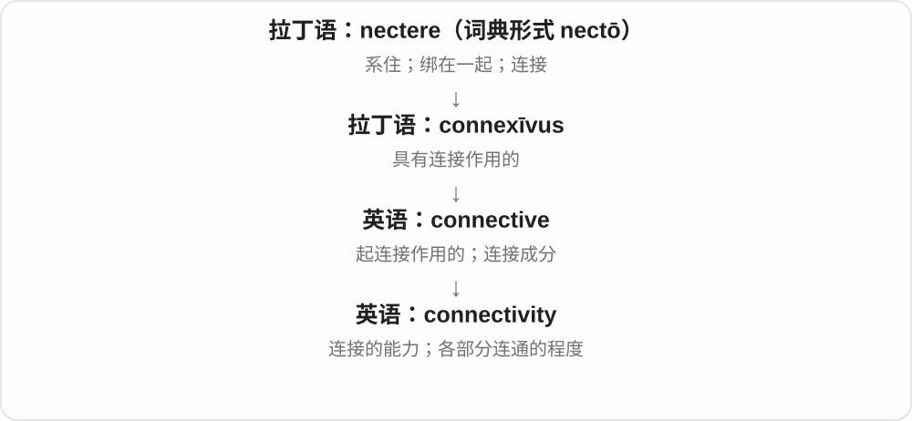

它把某一次连接提升为整体条件。网络、交通和数学图形都可以谈 connectivity，但各领域具体怎么衡量并不相同。

**常见搭配与例句**

internet connectivity；improve connectivity；poor connectivity；network connectivity。

> The village finally gained reliable internet connectivity.

这个村庄终于有了可靠的互联网连接条件。

> The new rail link improved connectivity between the two regions.

新铁路改善了两个地区之间的交通连通性。

**别混淆**

connection 可以指一条具体连接；connectivity 常问一个系统有没有、具有什么连接能力。

### 8. disconnect — 断开；脱离；脱节

**音标**：动词 /ˌdɪskəˈnekt/；名词 /ˈdɪskənekt/

**先抓住这个画面**

disconnect 是把刚才接着的线断开。名词说 a disconnect 时，也可以形容两边根本没对上。

**怎么拆**

dis-（分开、取消）+ connect，是英语内部的前缀构词。

**怎么变成今天的意思**

设备可以被拔掉，人也可以暂时脱离信息和工作。a disconnect between words and actions 则说话与行动之间接不上。

**常见搭配与例句**

disconnect A from B；disconnect the power；a disconnect between…；disconnect from work。

> Disconnect the printer from the computer before moving it.

移动打印机前，先断开它与电脑的连接。

> There is a disconnect between the policy and everyday practice.

这项政策与日常实际做法存在脱节。

**别混淆**

disconnect 强调切断联系；turn off 强调停止运行。设备关机后，电源线可能仍然连接着。

### 9. disconnected — 断开的；疏离的；不连贯的

**音标**：/ˌdɪskəˈnektɪd/

**先抓住这个画面**

disconnected 像几块没有接上的拼图：设备失去连接，人感觉与群体隔着一层，叙述也可能前后不搭。

**怎么拆**

disconnect + -ed；也能从 dis- + connected 看出“相连状态被否定”。

**怎么变成今天的意思**

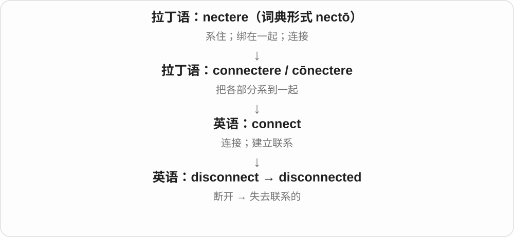

从物理上不相接，扩展到情感上缺少联系，以及内容上不连贯。具体意思由对象决定，不必一律译成“断网”。

**常见搭配与例句**

feel disconnected from…；a disconnected cable；disconnected thoughts；remain disconnected。

> The camera was disconnected, so it recorded nothing.

摄像头断开了连接，所以什么也没录到。

> After moving away, he felt disconnected from his old friends.

搬走以后，他觉得自己与老朋友逐渐疏远了。

**别混淆**

disconnected 是没有接上；unrelated 是内容或来源无关。两根原本配套的电缆断开后是 disconnected，但不一定 unrelated。

### 10. disconnection — 断开；断连；疏离感

**音标**：/ˌdɪskəˈnekʃən/

**先抓住这个画面**

disconnection 是从接通到断开的那件事，也可以是断开后留下的状态。

**怎么拆**

dis- + connection；也可与 disconnect 的动作名词关系一起理解。

**怎么变成今天的意思**

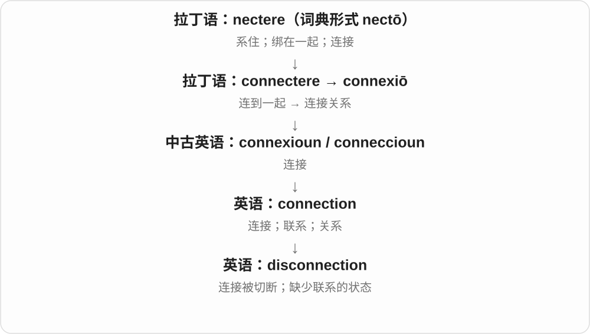

网络中它常是一次中断；人际语境中则可能指长期缺少交流和归属的感受。

**常见搭配与例句**

a sudden disconnection；service disconnection；a sense of disconnection；disconnection from… 。

> A brief disconnection interrupted the video call.

一次短暂断连打断了视频通话。

> The essay explores her sense of disconnection from city life.

这篇文章探讨了她对城市生活的疏离感。

**别混淆**

disconnection 可说实际连接中断；isolation 更突出孤立、缺少接触的处境。两者不必同时发生。

### 11. reconnect — 重新连接；恢复联系

**音标**：/ˌriːkəˈnekt/

**先抓住这个画面**

reconnect 是把断掉的线重新接上：重连网络，或跟很久没见的人重新聊起来。

**怎么拆**

re-（再次）+ connect。现代英语直接加前缀形成。

**怎么变成今天的意思**

它预设曾经有过某种联系，后来丢失或减弱。reconnect with old friends 往往也包含恢复感情，而不仅是重新加联系方式。

**常见搭配与例句**

reconnect to the network；reconnect a cable；reconnect with friends；reconnect with nature。

> The laptop reconnected to the network automatically.

笔记本电脑自动重新连上了网络。

> The reunion gave us a chance to reconnect with old classmates.

这次聚会让我们有机会与老同学恢复联系。

**别混淆**

connect 可以第一次建立联系；reconnect 常说恢复或重建已有联系。reconnect 不保证恢复到原先同样亲密的程度。

### 12. reconnection — 重新接通；恢复联系

**音标**：/ˌriːkəˈnekʃən/

**先抓住这个画面**

reconnection 是断开之后重新通起来的过程或结果，重点从“去重连”转到“重连这件事”。

**怎么拆**

re- + connection，也与 reconnect 相呼应。

**怎么变成今天的意思**

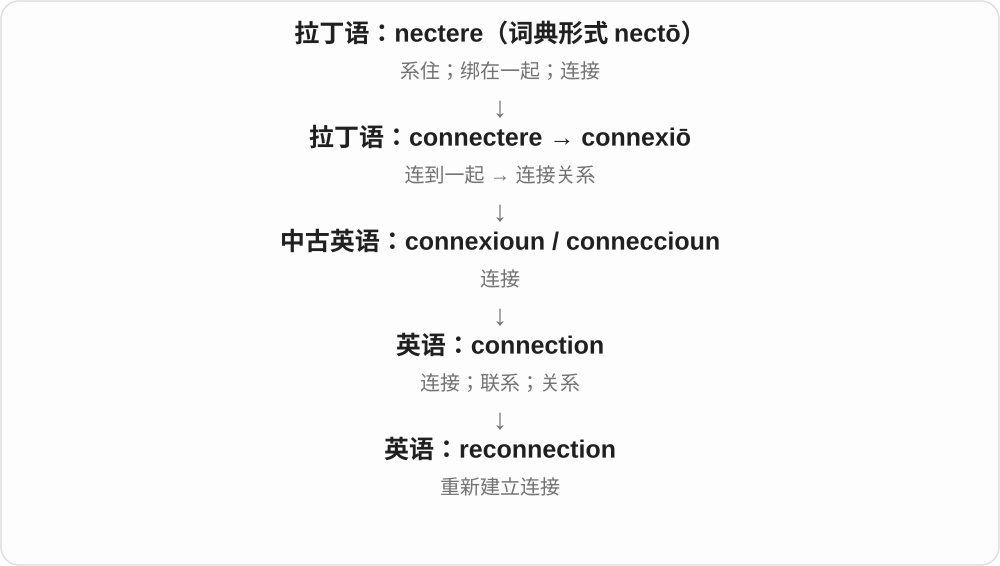

它既能谈电力和网络服务恢复，也能谈人与某个地方或群体重新建立联系。

**常见搭配与例句**

automatic reconnection；reconnection to the network；reconnection with family；a reconnection fee。

> The software supports automatic reconnection after a network failure.

软件支持在网络故障后自动重新连接。

> The visit marked her reconnection with the town where she grew up.

这次回访标志着她重新与自己长大的小镇建立了联系。

**别混淆**

reconnection 说恢复连接；recovery 更宽，可以是整个系统或身体恢复。连上网络不代表所有系统功能都恢复了。

### 13. interconnect — 互相连接；使相互联系

**音标**：英 /ˌɪntəkəˈnekt/；美 /ˌɪntərkəˈnekt/

**先抓住这个画面**

interconnect 像把几个原本独立的点接成网络，让它们之间能来回传递或相互影响。

**怎么拆**

inter-（彼此之间）+ connect。

**怎么变成今天的意思**

与 connect 相比，inter- 把注意力放到多个部分之间的关系上。道路、设备、产业和问题都可以互相连接。

**常见搭配与例句**

interconnect systems；interconnect with…；interconnecting roads；interconnect several networks。

> The new bridge interconnects the two road networks.

新桥把两套道路网络连接起来。

> These systems must interconnect without losing data.

这些系统必须能够互联，同时避免数据丢失。

**别混淆**

interconnect 不一定是把多个东西融成一个；各部分可以仍然独立，只是多了相互通行的路径。

### 14. interconnected — 相互关联的；彼此相连的

**音标**：英 /ˌɪntəkəˈnektɪd/；美 /ˌɪntərkəˈnektɪd/

**先抓住这个画面**

interconnected 像拉动网的一角，其他地方也跟着动：问题、行业或系统彼此有关联。

**怎么拆**

inter- + connected，也可视为 interconnect 的过去分词形容词。

**怎么变成今天的意思**

它描述网已经形成的状态。有联系不一定等于互相依赖到缺一不可，具体影响强弱还要看情况。

**常见搭配与例句**

interconnected systems；interconnected problems；closely interconnected；an interconnected world。

> Housing, transport, and employment are deeply interconnected.

住房、交通和就业之间有很深的联系。

> The building contains several interconnected courtyards.

这座建筑包含几个彼此相通的庭院。

**别混淆**

interconnected 强调存在连接；interdependent 更强调相互依赖。系统可以联网，但仍能独立工作。

### 15. nexus — 联系；关联网络；交汇点

**音标**：/ˈneksəs/

**先抓住这个画面**

nexus 像几条线汇聚成的结点，也可指把几个因素绑在一起的关系。它比普通的 link 更书面。

**怎么拆**

直接来自拉丁语 nexus“连接、绑定”，与 nectere 的相关词干 nex- 相连；不能把 x 当成任意可替换的词根字母。

**怎么变成今天的意思**

当连接本身成为研究对象，就会说 the nexus between A and B；强调汇聚位置时，也可以是交通、商业或权力的中心。

**常见搭配与例句**

a nexus between…；the nexus of…；a transport nexus；a nexus of interests。

> The report examines the nexus between housing costs and migration.

报告考察了住房成本与迁移之间的联系。

> The port became a nexus of regional trade.

这个港口成为区域贸易的交汇中心。

**别混淆**

nexus 往往突出复杂或重要联系；普通日常连接直接用 link、connection 更自然。它不自动证明谁导致谁。

### 16. annex — 并入；兼并；附属建筑；附件

**音标**：动词 /əˈneks/；名词 /ˈæneks/

**先抓住这个画面**

annex 像把旁边的一块划进自己的范围，或者在主楼、正文旁再附上一部分。

**怎么拆**

ad-（接到）+ nectere 形成 adnectere / annectere；动词经中世纪拉丁语 annexāre、法语 annexer 传来，名词也承接法语 annexe。

**怎么变成今天的意思**

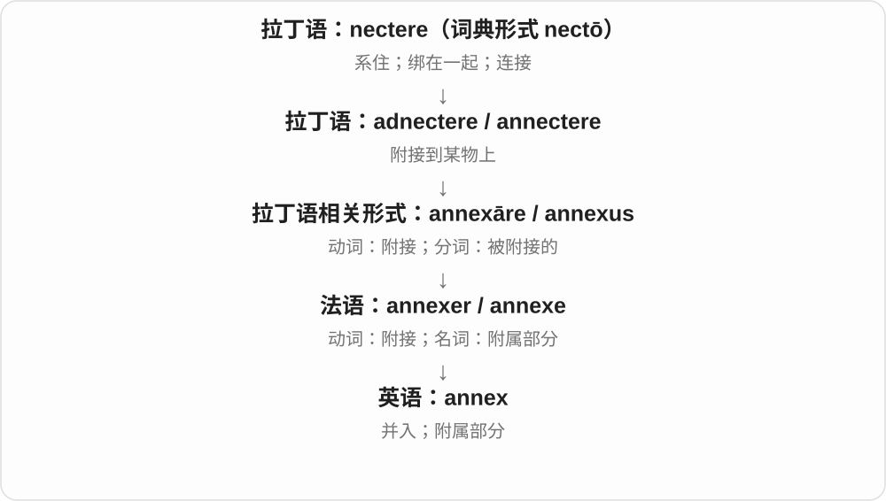

连接一物到另一物的画面，在领土语境成为兼并，在建筑和文书里成为附属部分。词本身没有说明一项领土并入是否获得同意或合法。

**常见搭配与例句**

annex territory；annex A to B；a library annex；an annex to a report。名词英国英语也常写 annexe。

> The empire annexed the neighboring province.

这个帝国吞并了邻近的省份。

> The museum opened a new annex for temporary exhibitions.

博物馆启用了一栋新的附属展馆，用于临时展览。

**别混淆**

annex 强调附加或纳入较大主体；connect 只要求联系。把两个网站连起来，并不等于 annex 其中一个。

### 17. annexation — 兼并；领土或地区的并入

**音标**：/ˌænekˈseɪʃən/

**先抓住这个画面**

annexation 是把原来边界外的一块纳入范围的过程：地图上的管辖线因此改变。

**怎么拆**

来自中世纪拉丁语 annexātiō，属于 annectere 的历史词族；现代可对照 annex + -ation。

**怎么变成今天的意思**

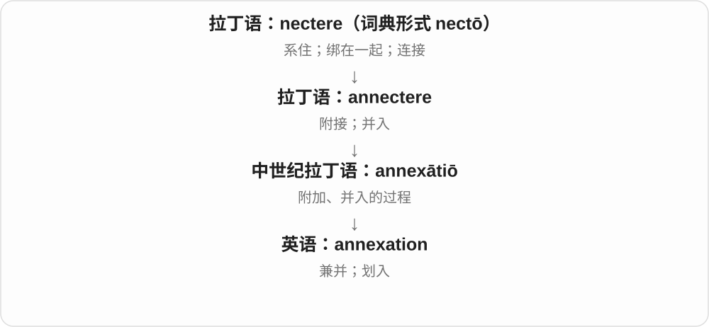

它常见于国家领土讨论，也能用于城市把邻近地区纳入行政范围。不能只凭词形断言任何具体并入都采用同一种方式。

**常见搭配与例句**

the annexation of territory；oppose annexation；a proposed annexation；annexation plans。

> The book examines the annexation of the region by the empire.

这本书考察了帝国对该地区的兼并。

> Residents debated the proposed annexation into the city.

居民讨论了将该地区划入这座城市的提案。

**别混淆**

annexation 是纳入范围；occupation 常指实际占据或控制。两者可能有关，但不是同一个概念。

### 18. deannexation — 从管辖范围划出；撤销并入

**音标**：/ˌdiːænekˈseɪʃən/

**先抓住这个画面**

deannexation 把 annexation 的方向倒过来：原来被划在这个范围内的一块，现在被划出去。

**怎么拆**

de-（撤除、反向）+ annexation。它是围绕现代行政和地域关系形成的派生词。

**怎么变成今天的意思**

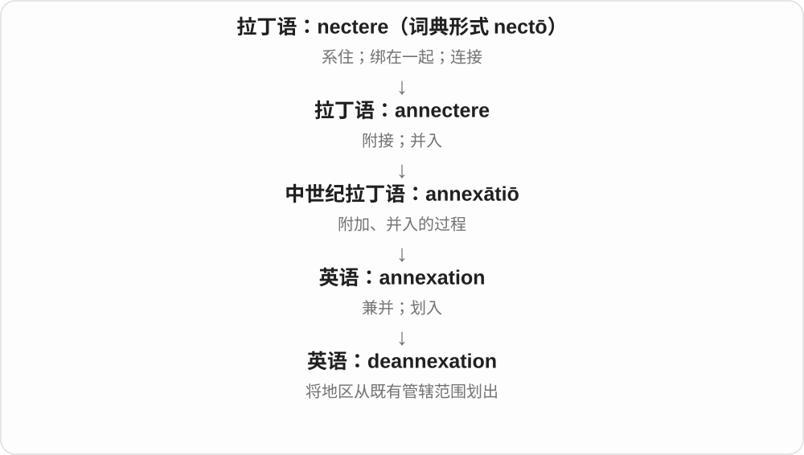

常见于地方行政边界讨论。它可以指从现有范围移出，不要求每次都是精确恢复某次历史兼并之前的边界。

**常见搭配与例句**

a deannexation proposal；request deannexation；deannexation of an area；a deannexation petition。

> Residents submitted a proposal for deannexation from the city.

居民提交了将该地区从城市管辖范围划出的提案。

> The meeting discussed how deannexation might affect local services.

会议讨论了划出该地区可能怎样影响当地公共服务。

**别混淆**

deannexation 关注领土或行政范围的分离，不等于拆掉 annex“附属楼”。实际制度中的条件要另看具体规定。

### 19. annexion — 兼并；并入，annexation 的古旧用词

**音标**：/əˈnekʃən/

**先抓住这个画面**

annexion 说的仍是“把一块地方接进较大范围”，今天主要在旧文献中遇到。

**怎么拆**

来自晚期拉丁语 annexiō，经中古英语传来；和 annexation 同族，但不能据此认为现代用法同样常见。

**怎么变成今天的意思**

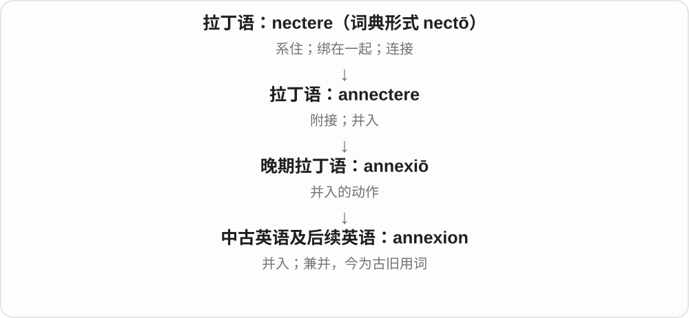

它与 annexation 的核心含义接近，只是历史词形不同。学习重点是阅读时认得，日常写作优先 annexation。

**常见搭配与例句**

the annexion of territory（古旧）；annexion to a state（古旧）。下面例句刻意模拟旧式书面用法。

> The pamphlet opposed the annexion of the province.

那本小册子反对兼并该省。

> The chronicle described the island’s annexion to the kingdom.

编年史描述了那座岛屿被并入王国的经过。

**别混淆**

英语 annexion 读 /əˈnekʃən/；不要把现代法语同形词的法语读音直接搬过来。

### 20. connexion — connection 的旧式拼写；宗教组织的联结体系

**音标**：/kəˈnekʃən/

**先抓住这个画面**

在旧英文里看到 connexion，先按 connection“联系、连接”理解。它并不是一种更神秘的连接。

**怎么拆**

来自拉丁语 connexiō，经中古英语 connexioun 保留 x 的拼写。现代更普遍使用 connection。

**怎么变成今天的意思**

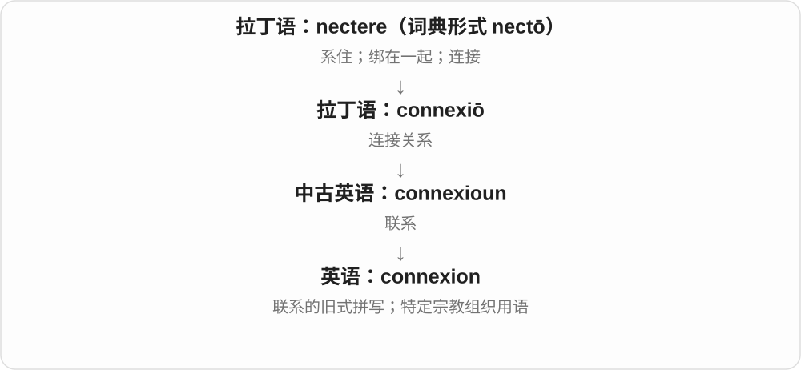

两种拼写反映同一历史词族。某些循道宗语境仍保留 connexion，用来谈相互联结的教会组织体系。

**常见搭配与例句**

in connexion with…（旧式）；a Methodist connexion；the connexional system（相关组织体系）。

> The old letter mentioned him in connexion with the school.

那封旧信在谈到学校时提到了他。

> The churches belonged to the same connexion.

这些教会属于同一个联结组织。

**别混淆**

一般现代写作用 connection。读到宗教专名或历史文本时，保留 connexion 可能是有意义的传统，而非笔误。

### 21. adnexum — 器官的附属部分；附件

**音标**：/ædˈneksəm/

**先抓住这个画面**

adnexum 像主器官旁边与它相连、配合工作的附属结构。这里的“附件”是解剖学说法，不是文件附件。

**怎么拆**

拉丁语 ad- + nectere 形成 adnectere“附接”；其分词 adnexus 的中性单数形式是 adnexum。英语医学用词保留了这个形式。

**怎么变成今天的意思**

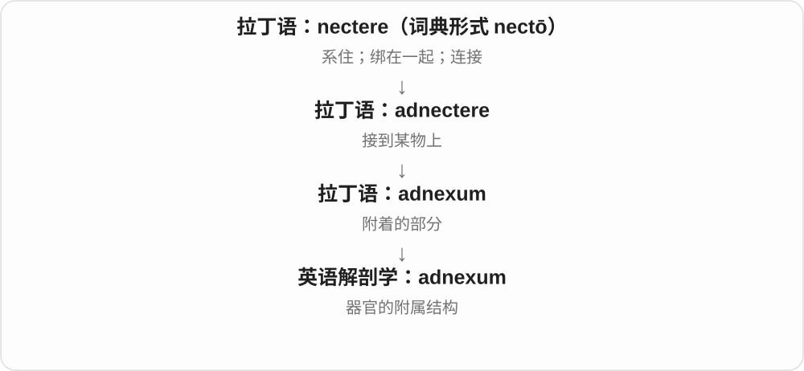

它把“接到主体上的东西”用作器官名称。更常见复数 adnexa，尤其在谈子宫附件等结构时；范围要随所讨论的器官看。

**常见搭配与例句**

an adnexum of an organ；复数 adnexa /ædˈneksə/；uterine adnexa（子宫附件）。

> The anatomy text describes the fallopian tube as an adnexum of the uterus.

这本解剖学教材把输卵管描述为子宫的一种附属结构。

> In this diagram, an adnexum is shown beside the main organ.

在这幅图中，一处附属结构画在主体器官旁边。

**别混淆**

appendage 是较一般的附属部分；adnexum 是专门的解剖用词。不要把它当作某一种疾病的名称。

### 22. annectent — 起连接作用的；介于两类之间的

**音标**：/əˈnektənt/

**先抓住这个画面**

annectent 像一座桥，连接原本分开的两类。它是罕见的书面词，旧生物分类描述中更容易见到。

**怎么拆**

来自拉丁语 annectere 的现在分词 annectēns，词干 annectent-；前面的 an- 是 ad- 在 n 前的同化。

**怎么变成今天的意思**

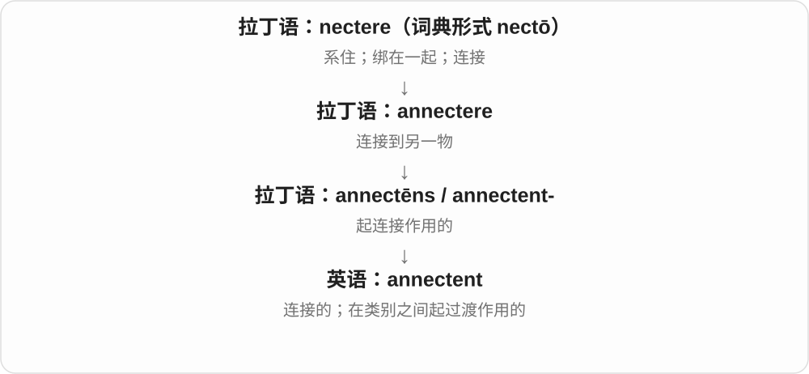

用于分类时，它描写一组生物具有连接两类的某些特征。这个用法本身不证明该组就是另一组的直接祖先。

**常见搭配与例句**

an annectent group；an annectent form；an annectent species。

> The old classification placed the animal in an annectent group.

旧分类法把这种动物归入一个具有过渡联系的类群。

> The author described the form as annectent between two familiar groups.

作者把这种形态描述为连接两个已知类群的过渡形式。

**别混淆**

日常表达用 connecting 或 linking 更自然。annectent 的生物分类用法有明显历史和专业色彩。

## 这一组要分清什么

**connection / connector / connectivity**：连接关系 / 连接器 / 连接能力。一个谈关系，一个谈部件，一个谈系统是否连得通。

**connected / connective**：已经相连 / 起连接作用。connected rooms 是相通的房间，connective tissue 是起支持和连接作用的组织。

**connexion 与 annexion**：前者是 connection 的旧式拼写，也留在特定宗教用法里；后者是 annexation 的古旧用词。它们需要读懂，但一般现代写作优先常用形式。

## 串起来练习

**A loose connector caused a disconnection, but the device soon reconnected.**

一个松动的接头造成了断连，不过设备很快又连上了。connector 是部件，disconnection 是发生的中断，reconnected 是恢复联系的动作。
