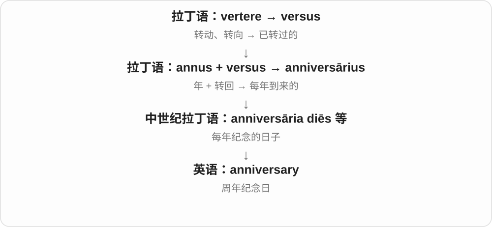

# 0638 · ann-, -enn- — 一年；以年为单位

[逐词精讲目录](../00_逐词精讲目录.md) · [总目录](../00_总目录_按常用程度.md)

## 核心词根与来源

核心来自拉丁 annus“一年”。英语中的年度、纪念日、编年史、植物生命周期和年金都有这条线，但每个词进入英语的路线并不一样：有的经法语借入，有的是后来用拉丁构件新造。

**日历翻完一轮，就是 annus：这根把一年当作计算时间、记录事情和安排周期的基本单位。**

把时间想成一排年历：annual 一张一轮，biennial 两张一轮；perennial 活过多轮；annals 把每一张上发生的事写下来。

- **年度和频率**：annual, annually, anniversary, biannual, biannually, semiannual, semiannually, biennial, biennially
- **多年生与持续**：perennial, perennially, perenniality
- **三年到千年**：triennial, quadrennial, quinquennial, septennial, decennial, centennial, bicentennial, sesquicentennial, millennium, millennial
- **成段的年份**：biennium, triennium, quinquennium, decennium
- **按年记录历史**：annals, annalist, annalistic
- **年度换算**：annualize, annualized, annualization
- **年金和退休**：annuity, annuitant, annuitize, annuitization, superannuated, superannuate, superannuation

## 词形与演化规律

ann- 保留年这个词干；-enn- 常出现在拉丁复合形式中，是 annus 的 a 在特定非重读闭音节环境中弱化为 e 的结果。-ennial 多用于形容词，-ennium 多用于年数名词；annualize 的 -ize 表示换算动作，annuitize 则从 annuity 年金形成。

## 单词速览（常用到不常用）

| 单词 | 音标 | 核心意思 |
|---|---|---|
| [annual](#w-1) | /ˈænjuəl/ | 每年一次的；年度的；一年生的；年刊、一年生植物 |
| [anniversary](#w-2) | 英 /ˌænɪˈvɜːsəri/；美 /ˌænɪˈvɜːrsəri/ | 周年纪念日；周年 |
| [annually](#w-3) | /ˈænjuəli/ | 每年；按年计算或发生 |
| [millennium](#w-4) | 英、美 /mɪˈleniəm/ | 一千年；千年期 |
| [perennial](#w-5) | /pəˈreniəl/ | 多年生的；长久存在、反复出现的；多年生植物 |
| [annals](#w-6) | /ˈænəlz/ | 编年史；历史记载 |
| [centennial](#w-7) | /senˈteniəl/ | 百周年的；百周年纪念；每百年的 |
| [annuity](#w-8) | 英 /əˈnjuːəti/；美 /əˈnuːəti/ | 年金；定期给付的款项、权利或合同 |
| [millennial](#w-9) | 英、美 /mɪˈleniəl/ | 千年的；千禧一代的；千禧一代成员 |
| [biennial](#w-10) | /baɪˈeniəl/ | 两年一次的；持续两年的；二年生植物 |
| [superannuation](#w-11) | 美 /ˌsuːpərˌænjəˈweɪʃən/ | 退休、养老给付；澳大利亚等地的退休储蓄安排 |
| [bicentennial](#w-12) | /ˌbaɪsenˈteniəl/ | 二百周年的；二百周年纪念 |
| [annualized](#w-13) | /ˈænjuəlaɪzd/ | 年化的；已换算为年度尺度的 |
| [triennial](#w-14) | /traɪˈeniəl/ | 三年一次的；持续三年的 |
| [biannual](#w-15) | /baɪˈænjuəl/ | 一年两次的；也有两年一次的用法 |
| [perennially](#w-16) | /pəˈreniəli/ | 常年地；反复地；长久以来一直 |
| [quadrennial](#w-17) | 英 /kwɒˈdreniəl/；美 /kwɑːˈdreniəl/ | 四年一次的；持续四年的 |
| [biennially](#w-18) | /baɪˈeniəli/ | 每两年一次地 |
| [semiannual](#w-19) | 英 /ˌsemiˈænjuəl/；美 /ˌsemiˈænjuəl/，也读 /ˌsemaɪˈænjuəl/ | 半年一次的；一年两次的 |
| [decennial](#w-20) | /dɪˈseniəl/ | 十年一次的；持续十年的；十周年的 |
| [sesquicentennial](#w-21) | /ˌseskwɪsenˈteniəl/ | 一百五十周年的；一百五十周年纪念 |
| [superannuated](#w-22) | 美 /ˌsuːpərˈænjəˌweɪtɪd/ | 过时的；因年老退出工作的；超过通常年龄的 |
| [biannually](#w-23) | /baɪˈænjuəli/ | 一年两次地；有时也指两年一次 |
| [biennium](#w-24) | /baɪˈeniəm/ | 两年期 |
| [annuitant](#w-25) | 英 /əˈnjuːɪtənt/；美 /əˈnuːətənt/ | 年金受领人；合同中以其生命为计算依据的人 |
| [semiannually](#w-26) | 英 /ˌsemiˈænjuəli/；美 /ˌsemiˈænjuəli/，也读 /ˌsemaɪˈænjuəli/ | 每半年；一年两次地 |
| [quinquennial](#w-27) | /kwɪŋˈkweniəl/ | 五年一次的；持续五年的 |
| [annalist](#w-28) | /ˈænəlɪst/ | 编年史作者；按年记录史事的人 |
| [triennium](#w-29) | /traɪˈeniəm/ | 三年期 |
| [septennial](#w-30) | /sepˈteniəl/ | 七年一次的；持续七年的 |
| [annalistic](#w-31) | /ˌænəˈlɪstɪk/ | 编年体的；按年记述的 |
| [decennium](#w-32) | /dɪˈseniəm/ | 十年期 |
| [annualization](#w-33) | 英 /ˌænjuəlaɪˈzeɪʃən/；美 /ˌænjuələˈzeɪʃən/ | 年化；年度换算 |
| [annualize](#w-34) | /ˈænjuəlaɪz/ | 换算为年度数值；按年折算 |
| [annuitization](#w-35) | 美 /əˌnuːətəˈzeɪʃən/，也读 /əˌnjuːətəˈzeɪʃən/ | 年金化；转为定期年金给付的过程 |
| [annuitize](#w-36) | 美 /əˈnuːətaɪz/，也读 /əˈnjuːətaɪz/ | 把一笔金额转为年金给付安排 |
| [perenniality](#w-37) | 英 /pəˌreniˈælɪti/ | 多年生性；持续长存的性质 |
| [quinquennium](#w-38) | /kwɪŋˈkweniəm/ | 五年期 |
| [superannuate](#w-39) | 美 /ˌsuːpərˈænjəˌweɪt/ | 使因年老退休并领取退休金；使过时；变得过时 |

## 逐词讲解

### 1. annual — 每年一次的；年度的；一年生的；年刊、一年生植物

**音标**：/ˈænjuəl/

**先抓住这个画面**

把日历翻完一轮，再做一次：annual meeting 是一年一度的会议。annual income 则把这一整年的收入合在一起看。

**怎么拆**

经古法语 annuel 或直接晚期／中世纪拉丁 annualis 进入英语，远接 annus“一年”。现代 ann- + -ual 能帮助认义，但不是英语首次按这些字母造出来的。

**怎么变成今天的意思**

**拉丁 annus**  
一年

↓

**拉丁 annalis；晚期／中世纪拉丁 annualis → 古法语 annuel**  
按年的、每年的

↓

**英语 annual〔经法语或直接拉丁来源〕**  
年度的、每年一次的；一年生植物、年刊

植物语境中的 annual 是在一个生长季完成萌发、开花、结籽直至死亡的植物，不是“每年回来开一次花”。名词 an annual 也可指一年出版一册的年刊。

**常见搭配与例句**

an annual meeting；annual income；an annual report；grow annuals。

> The club holds an annual meeting in May.

俱乐部每年五月召开一次会议。

> Her annual income includes a regular bonus.

她的年收入包括一项固定奖金。

> We planted annuals to add colour for one growing season.

我们种了一年生花卉，让花园在这个生长季更有色彩。

**别混淆**

yearly 多数情况下可以替换每年义；perennial 植物能活过多年，不等于 annual 每年重新长回原株。

### 2. anniversary — 周年纪念日；周年

**音标**：英 /ˌænɪˈvɜːsəri/；美 /ˌænɪˈvɜːrsəri/

**先抓住这个画面**

日历转完一圈，又回到当年那个日期；这就是“每年回来一次”的 anniversary。

**怎么拆**

拉丁语 annus“年” + versus“转回”，形成 anniversārius“每年返回的”；经中世纪拉丁语纪念日期的用法进入英语。

**怎么变成今天的意思**

可以纪念婚礼、成立、胜利，也能纪念灾难或去世，并不一定喜庆。通常隐含按年计算；第十周年用 tenth anniversary。

**常见搭配与例句**

a wedding anniversary；mark the anniversary；the anniversary of…。

> They celebrated their tenth wedding anniversary at home.

他们在家庆祝了结婚十周年。

> The town held a ceremony on the anniversary of the flood.

洪灾周年纪念日那天，镇上举行了纪念仪式。

**别混淆**

birthday 是出生纪念日；anniversary 可纪念任何特定事件。

### 3. annually — 每年；按年计算或发生

**音标**：/ˈænjuəli/

**先抓住这个画面**

它给动作加上一圈日历：更新、收费、发布等事情，以一年作为重复或计算单位。

**怎么拆**

annual + -ly，是英语副词派生；annual 自己经法语或拉丁借入。

**怎么变成今天的意思**

**拉丁 annus**  
一年

↓

**拉丁 annalis；晚期／中世纪拉丁 annualis → 古法语 annuel**  
按年的、每年的

↓

**英语 annual〔经法语或直接拉丁来源〕**  
年度的、每年一次的；一年生植物、年刊

↓

**英语 annual + -ly → annually**  
每年进行；以年为单位

publish annually 通常是一年出一次；earn an amount annually 是一年合计挣多少，不是只在年末拿一次工资。

**常见搭配与例句**

review annually；publish annually；pay annually；earn annually。

> The membership fee is reviewed annually.

会费每年审核一次。

> The project saves the school about five thousand dollars annually.

这个项目每年为学校节省约五千美元。

**别混淆**

once a year 明确一次；annually 在收入等语境中可表达年度总量。monthly 则以月为单位。

### 4. millennium — 一千年；千年期

**音标**：英、美 /mɪˈleniəm/

**先抓住这个画面**

把日历一次拉开一千年；它是时段单位，不只专指公元两千年。

**怎么拆**

近代拉丁语用 mille“一千” + annus“年”仿 biennium 等构成 millennium；英语先常见宗教千年国度义，再扩大到一般千年期。

**怎么变成今天的意思**

**拉丁语 mille，复数 milia**  
一千、若干个千

↓

**近代拉丁语 mille + annus → millennium**  
仿 biennium 等形式，表示千年

↓

**英语 millennium**  
先常见宗教千年国度义，后泛指一千年时段

复数常用 millennia，也可 millenniums。注意双 l、双 n，别写成少一个 n 的形式。

**常见搭配与例句**

the third millennium；for millennia；the turn of the millennium。

> The site was occupied for more than a millennium.

这处遗址持续有人居住超过一千年。

> The tradition has survived for millennia.

这项传统延续了数千年。

**别混淆**

century 是一百年；millennium 是一千年，十个世纪。

### 5. perennial — 多年生的；长久存在、反复出现的；多年生植物

**音标**：/pəˈreniəl/

**先抓住这个画面**

冬天看似退场，根或其他活体部分还在，下一季还能继续生长；借到抽象事物上，就是老问题一直在、老作品一直受欢迎。

**怎么拆**

来自拉丁 perennis“贯穿一年或多年”，per- 贯穿 + annus 年；英语再形成 -al 形容词。现代可认出 per- 与 -ennial，但整条历史先经过 perennis。

**怎么变成今天的意思**

**拉丁 annus**  
一年

↓

**拉丁 per- 贯穿 + annus → perennis**  
贯穿一年或多年；持续的

↓

**英语 perennis + -al → perennial**  
多年持续的；多年生的

植物学通常指寿命超过两年的植物，不要求全年常绿，也不保证每年都开花。a perennial problem 是总会碰上的问题；a perennial favourite 是长期受欢迎的东西。

**常见搭配与例句**

perennial plants；a perennial problem；a perennial favourite；plant perennials。

> The garden mixes annual flowers with hardy perennials.

花园把一年生花卉与耐寒的多年生植物搭配种植。

> Finding enough space is a perennial problem in this office.

空间不足一直是这个办公室的老问题。

**别混淆**

annual 一个生长季结束生命周期；perennial 能活多年。evergreen 说叶子常绿，与寿命分类是两个问题。

### 6. annals — 编年史；历史记载

**音标**：/ˈænəlz/

**先抓住这个画面**

第一页记这一年发生了什么，下一页继续下一年；一年的格子接一年，积成历史。

**怎么拆**

拉丁 annales libri 是“按年记事的书”，annales 来自 annalis“年度的”；经拉丁直接来源或中古法语 annales 进入英语。通常保留复数形式 annals。

**怎么变成今天的意思**

**拉丁 annus**  
一年

↓

**拉丁 annalis → annales libri**  
年度的 → 按年记事的书

↓

**拉丁 annales／中古法语 annales → 英语 annals**  
编年史、历史记载

in the annals of history 意为载入历史记载，带正式、庄重的语气。期刊标题中的 Annals 也沿用记录、文集的传统，不必真的每年只出一期。

**常见搭配与例句**

the annals of history；in the annals of science；medieval annals。

> The annals record a severe winter and a poor harvest that year.

编年史记载了那一年的严冬与歉收。

> The discovery earned a place in the annals of science.

这项发现进入了科学史册。

**别混淆**

chronicle 也可按时间记事；annals 的来源特别突出按年。annual 是年度的，annals 是记载。

### 7. centennial — 百周年的；百周年纪念；每百年的

**音标**：/senˈteniəl/

**先抓住这个画面**

从起点往后数满一百年，回头纪念那个起点。

**怎么拆**

cent- 是百，-ennial 与年有关；词典也联系拉丁 centennium“百年期”。这是以拉丁材料构成的英语词。

**怎么变成今天的意思**

**拉丁 centum**  
一百

↓

**拉丁 centum、annus 与 centennium 等形式**  
百、年、百年期提供构词材料

↓

**英语 centennial**  
百年的；百周年纪念

the school’s centennial 是学校建校一百周年。作形容词可修饰纪念活动，也可表示跨一百年的或每百年出现的。

**常见搭配与例句**

centennial celebration；centennial anniversary；the centennial of…。

> The school held a concert for its centennial.

学校举办音乐会庆祝建校一百周年。

> A centennial exhibition traced the company’s history.

一场百周年展览回顾了这家公司的历史。

**别混淆**

centenary 也可说百周年，尤其常见于英式英语；centennial 不是“在本世纪中央”。

### 8. annuity — 年金；定期给付的款项、权利或合同

**音标**：英 /əˈnjuːəti/；美 /əˈnuːəti/

**先抓住这个画面**

把钱的流动想成一连串日期：到了约定日期，收到一笔钱，再到下一个日期，再收到一笔。

**怎么拆**

来自盎格鲁法语／古法语 annuité，或直接接中世纪拉丁 annuitas，远接 annus 年。今天能联想到 annual，但不是英语把 annual 简单加 -ity 得来的。

**怎么变成今天的意思**

**拉丁 annus**  
一年

↓

**中世纪拉丁 annuitas → 盎格鲁法语／古法语 annuité**  
按年发放的款项

↓

**英语 annuity**  
定期给付的年金；相关权利或合同

历史名称突出按年给付；现代年金也可以按月等周期支付。普通数学语境可指一串定期付款；保险语境通常指用保费换取约定收入安排的合同，支付金额、起点和期限依合同而异。

**常见搭配与例句**

an annuity payment；an annuity contract；a lifetime annuity。

> The annuity provides a payment every month.

这份年金每月给付一笔款项。

> The textbook compares an annuity with a single payment made today.

教材把一串定期付款与今天一次付清的款项作比较。

**别混淆**

annualized 是年化换算；annuity 是给付安排。pension 是养老金的较广称呼，并非每一种 annuity 都只能用于退休。

### 9. millennial — 千年的；千禧一代的；千禧一代成员

**音标**：英、美 /mɪˈleniəl/

**先抓住这个画面**

原先只是与千年有关，后来用来称呼在新千年前后步入成年阶段的一代人。

**怎么拆**

millennium 的词干 millenni- + -al；世代名称是二十世纪后期发展出的用法，不是古代已有这一代人的名字。

**怎么变成今天的意思**

**拉丁语 mille，复数 milia**  
一千、若干个千

↓

**近代拉丁语 mille + annus → millennium**  
仿 biennium 等形式，表示千年

↓

**英语 millennium**  
先常见宗教千年国度义，后泛指一千年时段

↓

**英语 millennium + -al → millennial**  
千年期的

↓

**现代世代名称 millennial**  
在新千年前后成长、成年的一代成员

谈世代时常指二十世纪八十年代初至九十年代中后期出生的人，具体边界因资料而异。不要理解成公元 2000 年之后出生的人。

**常见搭配与例句**

millennial readers；a millennial employee；millennial celebrations。

> The survey compared millennial readers with older age groups.

调查比较了千禧一代读者与更年长年龄组。

> The exhibition explores millennial hopes and fears around the year 2000.

展览探讨了公元两千年前后人们对新千年的希望与担忧。

**别混淆**

millennium 是千年时段；millennial 是相关形容词，也可作世代成员名词。

### 10. biennial — 两年一次的；持续两年的；二年生植物

**音标**：/baɪˈeniəl/

**先抓住这个画面**

展览今年办一次，隔一年，到第三个年份再办；植物义则把完整生命周期分到两个生长季。

**怎么拆**

以拉丁 biennium“两年期”为基础接 -al；biennium 含 bi- 二与 annus 年。ann- 在拉丁复合环境中变成 enn-，不是英语随意拼错。

**怎么变成今天的意思**

**拉丁 annus**  
一年

↓

**拉丁 bi- 二 + annus → biennium**  
两年期

↓

**英语以 biennium 为基础接 -al → biennial**  
两年一次的；持续两年的

a biennial exhibition 通常每两年办一次。二年生植物一般先长根叶，第二个生长季开花结籽后结束生命周期；这与一株植物多年存活不同。

**常见搭配与例句**

a biennial exhibition；a biennial plant；a biennial report。

> The museum organises a biennial exhibition of local art.

博物馆每两年举办一次本地艺术展。

> This biennial produces leaves in the first season and flowers in the second.

这种二年生植物第一季长叶，第二季开花。

**别混淆**

biannual 通常一年两次；biennial 是两年一次。植物名词 biennial 说生命长度，不是每两年才长一次叶。

### 11. superannuation — 退休、养老给付；澳大利亚等地的退休储蓄安排

**音标**：美 /ˌsuːpərˌænjəˈweɪʃən/

**先抓住这个画面**

工作时往退休储蓄里积累，离开工作岗位后用来支持生活；在澳大利亚，常简称 super。

**怎么拆**

superannuate + -ion，沿动词的 -ate 形成 -ation 名词；其更早顺序是拉丁来源 → 英语 superannuated → 逆构 superannuate。

**怎么变成今天的意思**

**拉丁 annus**  
一年

↓

**拉丁 super 超过 + annus → 中世纪拉丁 superannatus**  
超过一岁，曾用于牲畜

↓

**新拉丁 superannuatus → 英语 superannuated**  
词形可能受 annual 影响；年老退出使用、过时的

↓

**英语逆构 superannuate**  
使因年老退休

↓

**英语 superannuate → superannuation**  
退休、养老给付；退休储蓄安排

旧义包括因年老退休及其津贴；当代澳大利亚语境通常说工作期间积累的退休储蓄制度和资金。不能只按字面误读为“超级年度费用”。

**常见搭配与例句**

a superannuation fund；superannuation contributions；superannuation savings。

> The statement shows the contributions paid into her superannuation fund.

对账单列出了存入她退休基金的缴款。

> The guide explains how superannuation supports income after retirement.

指南解释了退休储蓄怎样支持退休后的收入。

**别混淆**

pension 可以泛指养老金；superannuation 在特定地区是制度名称，未必等于政府直接发的养老金。

### 12. bicentennial — 二百周年的；二百周年纪念

**音标**：/ˌbaɪsenˈteniəl/

**先抓住这个画面**

把一个百年块数两遍。

**怎么拆**

bi-“二” + centennial“百周年的”，英语复合构词。

**怎么变成今天的意思**

**拉丁 centum**  
一百

↓

**拉丁 centum、annus 与 centennium 等形式**  
百、年、百年期提供构词材料

↓

**英语 centennial**  
百年的；百周年纪念

↓

**英语 bi- + centennial → bicentennial**  
两个百年 → 二百周年

常用于城市、大学、国家或机构的二百周年纪念。bi- 乘的是“一百年”，不是每年举办两次。

**常见搭配与例句**

a bicentennial celebration；mark the bicentennial。

> The town planted two hundred trees for its bicentennial.

小镇为建镇二百周年种了两百棵树。

> The bicentennial exhibition opened in the old library.

二百周年纪念展在旧图书馆开幕。

**别混淆**

biennial 是每两年一次；bicentennial 是二百周年或二百年的。

### 13. annualized — 年化的；已换算为年度尺度的

**音标**：/ˈænjuəlaɪzd/

**先抓住这个画面**

眼前写着一个年率，但原始观察期可能只有一个月：annualized 提醒你，这是经过换算的显示方式。

**怎么拆**

annualize + -ed，作过去分词或形容词；词尾 /z/ 后的 -ed 读 /d/。

**怎么变成今天的意思**

**拉丁 annus**  
一年

↓

**拉丁 annalis；晚期／中世纪拉丁 annualis → 古法语 annuel**  
按年的、每年的

↓

**英语 annual〔经法语或直接拉丁来源〕**  
年度的、每年一次的；一年生植物、年刊

↓

**英语 annual + -ize → annualize**  
把数值折算到一年尺度

↓

**英语 annualize + -ed → annualized**  
已经换算成年度数值的

常见 annualized rate、annualized return。它和实际完整一年发生的结果不是同一个概念，尤其不能仅凭 annualized 就认定未来会得到这份数值。

**常见搭配与例句**

an annualized rate；annualized growth；annualized costs。

> The table presents the quarterly change as an annualized rate.

表格把季度变化表示为年化率。

> The annualized cost assumes that the monthly fee stays unchanged.

这项年化成本假定月费保持不变。

**别混淆**

annual return 可指某一整年的实际结果；annualized return 强调统一换算到年尺度，具体仍看报告定义。

### 14. triennial — 三年一次的；持续三年的

**音标**：/traɪˈeniəl/

**先抓住这个画面**

今年的展览办完，要再翻三轮日历才轮到下一届；也可说一份计划本身覆盖三年。

**怎么拆**

以拉丁 triennium“三年期”为基础接 -al；tri- 三 + annus 年。英语形容词的记录早于英语名词 triennium，不能把后者当作已经存在的英语祖先。

**怎么变成今天的意思**

**拉丁 annus**  
一年

↓

**拉丁 tri- 三 + annus → triennium**  
三年期

↓

**英语以拉丁 triennium 为基础形成 triennial**  
三年一次的；持续三年的

a triennial event 通常说频率；a triennial term 说时长。名词 a triennial 也可以指三年一届的展览。

**常见搭配与例句**

a triennial exhibition；a triennial review；a triennial term。

> The gallery announced its next triennial exhibition.

画廊公布了下一届三年展。

> The committee approved a triennial plan covering the next three years.

委员会批准了一份覆盖未来三年的计划。

**别混淆**

triannual 通常指一年三次；triennial 是每三年一次或持续三年。直接说 every three years 最清楚。

### 15. biannual — 一年两次的；也有两年一次的用法

**音标**：/baɪˈænjuəl/

**先抓住这个画面**

常用意思是在一张年历上打两个点：比如春季一次、秋季一次。

**怎么拆**

bi- 二 + annual 每年的，是英语构词。bi- 本身只给出“二”，并没有自动告诉你是“一年两次”还是“两年一次”。

**怎么变成今天的意思**

**拉丁 annus**  
一年

↓

**拉丁 annalis；晚期／中世纪拉丁 annualis → 古法语 annuel**  
按年的、每年的

↓

**英语 annual〔经法语或直接拉丁来源〕**  
年度的、每年一次的；一年生植物、年刊

↓

**英语 bi- + annual → biannual**  
通常一年两次；使用中也出现两年一次义

为了避免日程误会，具体安排最好写 twice a year，并列出日期；两年一次通常用 biennial。理解原文时仍需看上下文，不能假装 biannual 永远无歧义。

**常见搭配与例句**

a biannual review；a biannual publication；biannual meetings。

> The team holds biannual reviews, one in March and one in September.

团队每年评审两次，分别在三月和九月。

> The invitation explains that “biannual” means twice a year in this programme.

邀请函说明，这个项目中的 biannual 指一年两次。

**别混淆**

semiannual 更明确指半年一次、一年两次；biennial 通常是两年一次。

### 16. perennially — 常年地；反复地；长久以来一直

**音标**：/pəˈreniəli/

**先抓住这个画面**

一个话题每过一阵又出现，像多年生植物下一季又回来；perennially 把这种持续或反复放到动作、状态上。

**怎么拆**

perennial + -ly；词源中 per- 贯穿与 annus 年的组合，经拉丁 perennis 进入英语形容词。

**怎么变成今天的意思**

**拉丁 annus**  
一年

↓

**拉丁 per- 贯穿 + annus → perennis**  
贯穿一年或多年；持续的

↓

**英语 perennis + -al → perennial**  
多年持续的；多年生的

↓

**英语 perennial + -ly → perennially**  
长年持续或经常重复地

perennially popular 不要求每年做一次受欢迎调查，只是说长久受欢迎。它也能表达抱怨：perennially short of money，老是缺钱。

**常见搭配与例句**

perennially popular；perennially short of funds；a perennially debated question。

> The novel remains perennially popular with young readers.

这本小说一直很受年轻读者欢迎。

> The department is perennially short of storage space.

这个部门长期缺少储物空间。

**别混淆**

annually 常按一年一个周期计算；perennially 可以只是长久不断、老是如此，不是严格排期词。

### 17. quadrennial — 四年一次的；持续四年的

**音标**：英 /kwɒˈdreniəl/；美 /kwɑːˈdreniəl/

**先抓住这个画面**

把四个年份装进一个周期，下一轮再从头开始；常用于比赛、会议和较长的计划期。

**怎么拆**

quadri- 四与表示年数的 -ennial 组合，受 biennial 等形式影响；拉丁 quadriennium“四年期”是对应背景。英语还曾用 quadriennial 形式。

**怎么变成今天的意思**

**拉丁 annus**  
一年

↓

**拉丁 quattuor 四；quadriennium 四年期**  
四个年份组成一段

↓

**英语 quadri- 与 -ennial 类推形成 quadrennial**  
四年一次的；持续四年的

它可以说四年举行一次，也可以说一件事历时四年；句子中的 event、term、plan 会帮助判断。不是一年四次。

**常见搭配与例句**

a quadrennial meeting；a quadrennial review；a quadrennial cycle。

> Delegates gather for a quadrennial conference.

代表们参加每四年举行一次的会议。

> The organisation adopted a quadrennial planning cycle.

机构采用了四年一轮的规划周期。

**别混淆**

quarterly 每季度一次、一年四次；quadrennial 每四年一次。

### 18. biennially — 每两年一次地

**音标**：/baɪˈeniəli/

**先抓住这个画面**

时间线上不是一年放两个点，而是隔着一整年再放下一个点。

**怎么拆**

biennial + -ly，沿 biennial 的拉丁 biennium“两年期”来源派生。

**怎么变成今天的意思**

**拉丁 annus**  
一年

↓

**拉丁 bi- 二 + annus → biennium**  
两年期

↓

**英语以 biennium 为基础接 -al → biennial**  
两年一次的；持续两年的

↓

**英语 biennial + -ly → biennially**  
每两年进行一次

常用于报告、评审、艺术活动。比 biannually 更明确地表示两年一轮，日常仍可直接说 every two years。

**常见搭配与例句**

meet biennially；publish biennially；be held biennially。

> The survey is conducted biennially.

这项调查每两年开展一次。

> The prize is awarded biennially, with the next award due in two years.

奖项每两年颁发一次，下次颁奖在两年后。

**别混淆**

semiannually 每半年一次；biennially 每两年一次。先看 annual 与 ennial 的区别，再看 -ly。

### 19. semiannual — 半年一次的；一年两次的

**音标**：英 /ˌsemiˈænjuəl/；美 /ˌsemiˈænjuəl/，也读 /ˌsemaɪˈænjuəl/

**先抓住这个画面**

把一年切成两半，每半年来一次：semi- 的“一半”比 bi- 的“二”更容易看清日程。

**怎么拆**

semi- 一半 + annual 每年的；英语复合形容词。

**怎么变成今天的意思**

**拉丁 annus**  
一年

↓

**拉丁 annalis；晚期／中世纪拉丁 annualis → 古法语 annuel**  
按年的、每年的

↓

**英语 annual〔经法语或直接拉丁来源〕**  
年度的、每年一次的；一年生植物、年刊

↓

**英语 semi- + annual → semiannual**  
以半年为周期；一年两次

常用于报告、复查、支付和活动安排。它描述频率，不说明每次会持续多久。

**常见搭配与例句**

a semiannual report；a semiannual review；semiannual payments。

> The organisation publishes a semiannual progress report.

机构每半年发布一次进展报告。

> The equipment receives a semiannual inspection.

设备每半年接受一次检查。

**别混淆**

annual 一年一次，semiannual 半年一次；biennial 两年一次。

### 20. decennial — 十年一次的；持续十年的；十周年的

**音标**：/dɪˈseniəl/

**先抓住这个画面**

日历翻过十轮才做一次的大盘点，比年度更新看得更长。

**怎么拆**

以拉丁 decennium“十年期”为基础接 -al；decennium 经 decennis 接 decem 十与 annus 年，也见拉丁形容词 decennialis 的借入分析。

**怎么变成今天的意思**

**拉丁 annus**  
一年

↓

**拉丁 decem 十 + annus → decennis、decennium**  
十年的；十年期

↓

**拉丁基础 decennium／decennialis → 英语 decennial**  
十年一次的；持续十年的

常见于人口统计、纪念或长期评估。decennial survey 是十年一次的调查，不能读成调查必定需要十年才能做完。

**常见搭配与例句**

a decennial census；a decennial review；a decennial celebration。

> The researchers compared two decennial surveys.

研究者比较了两次每十年开展一轮的调查。

> The archive marked its decennial anniversary with an exhibition.

档案馆用一场展览纪念成立十周年。

**别混淆**

decade 是十年这个时段的普通名词；decennial 是描述频率、时长或十周年的形容词。

### 21. sesquicentennial — 一百五十周年的；一百五十周年纪念

**音标**：/ˌseskwɪsenˈteniəl/

**先抓住这个画面**

一个百年，再加半个百年。

**怎么拆**

sesqui-“一又二分之一” + centennial“百周年”；1.5 × 100 = 150。

**怎么变成今天的意思**

**拉丁 centum**  
一百

↓

**拉丁 centum、annus 与 centennium 等形式**  
百、年、百年期提供构词材料

↓

**英语 centennial**  
百年的；百周年纪念

↓

**英语 sesqui- + centennial → sesquicentennial**  
一个半百年 → 一百五十周年

字很长，算式很短。常见于学校、城市或机构的纪念名称，日常直接说 150th anniversary 更容易听懂。

**常见搭配与例句**

a sesquicentennial celebration；mark a sesquicentennial。

> The university issued a book for its sesquicentennial.

大学为建校一百五十周年出版了一本书。

> The town’s sesquicentennial parade began at noon.

小镇建镇一百五十周年的游行于中午开始。

**别混淆**

sesqui- 是一又二分之一；semi- 才是半，bi- 是二。

### 22. superannuated — 过时的；因年老退出工作的；超过通常年龄的

**音标**：美 /ˌsuːpərˈænjəˌweɪtɪd/

**先抓住这个画面**

像一台服役多年的旧机器：年头已经跨过去，原来的岗位不再适合它；也可以借指过时的观念或措辞。

**怎么拆**

super- 超过 + annus 年，先在拉丁语形成 superannuatus 一类词，英语先借入 superannuated 形容词，随后才逆构出 superannuate 动词。今天也能作该动词的过去分词。

**怎么变成今天的意思**

**拉丁 annus**  
一年

↓

**拉丁 super 超过 + annus → 中世纪拉丁 superannatus**  
超过一岁，曾用于牲畜

↓

**新拉丁 superannuatus → 英语 superannuated**  
词形可能受 annual 影响；年老退出使用、过时的

书面语中常带“太老、跟不上时代”的评价。说人时可能显得刻薄，并非所有退休者都适合这样称呼；描述设备或习语时，重点是已经过时。

**常见搭配与例句**

superannuated equipment；a superannuated expression；a superannuated official。

> The workshop still contains several superannuated machines.

车间里仍放着几台已经过时的机器。

> The reviewer mocked the novel’s superannuated slang.

评论者嘲讽了小说中过时的俚语。

**别混淆**

retired 通常中性地说已退休；superannuated 还可能暗示老旧、不再合用。

### 23. biannually — 一年两次地；有时也指两年一次

**音标**：/baɪˈænjuəli/

**先抓住这个画面**

不是给会议命名，而是说“它多久开”：如果是 biannually，先看作者有没有写清一年内的两个时间点。

**怎么拆**

biannual + -ly；承接形容词 biannual，也继承它在实际使用中的频率歧义。

**怎么变成今天的意思**

**拉丁 annus**  
一年

↓

**拉丁 annalis；晚期／中世纪拉丁 annualis → 古法语 annuel**  
按年的、每年的

↓

**英语 annual〔经法语或直接拉丁来源〕**  
年度的、每年一次的；一年生植物、年刊

↓

**英语 biannual**  
通常一年两次的

↓

**英语 biannual + -ly → biannually**  
以这一频率进行

排期时 twice a year 更直白；阅读中如果只有 biannually，没有具体年月，就要从上下文判断。

**常见搭配与例句**

meet biannually；publish biannually；review biannually。

> The newsletter is published biannually, in June and December.

简报每年六月和十二月各出版一次。

> The committee meets biannually rather than every month.

委员会一年开两次会，而不是每月开会。

**别混淆**

biennially 的重读部分是 /ˈeni/，通常表示每两年一次；biannually 中间仍保留 annual 的 /ˈænju/。

### 24. biennium — 两年期

**音标**：/baɪˈeniəm/

**先抓住这个画面**

它是一块装着两个年份的时间盒子，常用来装预算、计划或一段任期。

**怎么拆**

直接来自拉丁 biennium，bi- 二 + annus 年；-ennium 是拉丁这类年数名词的形态。它与 biennial 共享拉丁基础，英语借入时间不同。

**怎么变成今天的意思**

**拉丁 annus**  
一年

↓

**拉丁 bi- + annus → biennium**  
两年期

↓

**英语借入 biennium**  
作为一个整体计算的两年

复数可用 biennia 或 bienniums。通常说 during the biennium，关心这两年内的整体，不是在数一年发生几次。

**常见搭配与例句**

the next biennium；a budget for the biennium；during the biennium。

> The budget covers the next biennium.

这份预算覆盖下一个两年期。

> Three major projects were completed during the biennium.

这两年期内完成了三个主要项目。

**别混淆**

biennial 是两年一次的或持续两年的；biennium 是两年这段时间。

### 25. annuitant — 年金受领人；合同中以其生命为计算依据的人

**音标**：英 /əˈnjuːɪtənt/；美 /əˈnuːətənt/

**先抓住这个画面**

先看合同把谁放在“人的寿命”这一格：有些年金按这个人的生存情况计算给付，这个人就是 annuitant。

**怎么拆**

annuit(y) + -ant，去掉 y 接表示人的后缀；底层仍是经法语或中世纪拉丁进入英语的 annuity。

**怎么变成今天的意思**

**拉丁 annus**  
一年

↓

**中世纪拉丁 annuitas → 盎格鲁法语／古法语 annuité**  
按年发放的款项

↓

**英语 annuity**  
定期给付的年金；相关权利或合同

↓

**英语 annuity → annuit- + -ant → annuitant**  
年金受领人或生命作为年金计算依据的人

普通词义常说领取年金的人；具体合同中 annuitant、所有人和收款人不一定是同一个人。要读懂角色名称，不能直接把三个人画上等号。

**常见搭配与例句**

the named annuitant；the age of the annuitant；a joint annuitant。

> The contract names Maria as the annuitant.

合同指定玛丽亚为年金给付所依据的人。

> The form lists the owner and the annuitant in separate boxes.

表格把合同所有人和年金所依据的人列在不同栏目中。

**别混淆**

owner 是拥有合同的人；beneficiary 是指定受益人；annuitant 侧重年金所依据的那个人，具体权利仍看合同。

### 26. semiannually — 每半年；一年两次地

**音标**：英 /ˌsemiˈænjuəli/；美 /ˌsemiˈænjuəli/，也读 /ˌsemaɪˈænjuəli/

**先抓住这个画面**

动词后面这个词告诉你：一年要做两轮，通常隔半年再来一轮。

**怎么拆**

semiannual + -ly；词中的 semi- 意为半，annual 接拉丁 annus 年。

**怎么变成今天的意思**

**拉丁 annus**  
一年

↓

**拉丁 annalis；晚期／中世纪拉丁 annualis → 古法语 annuel**  
按年的、每年的

↓

**英语 annual〔经法语或直接拉丁来源〕**  
年度的、每年一次的；一年生植物、年刊

↓

**英语 semiannual**  
半年一次的

↓

**英语 semiannual + -ly → semiannually**  
每半年进行一次

常见于正式日程。读 reports are issued semiannually，只需换成“半年发一次”就很清楚。

**常见搭配与例句**

report semiannually；review semiannually；pay semiannually。

> The safety procedures are reviewed semiannually.

安全流程每半年审核一次。

> Subscribers receive the journal semiannually.

订阅者每半年收到一期期刊。

**别混淆**

annually 以年计，semiannually 以半年计；词尾 -ly 把频率用于动作，而非修饰名词。

### 27. quinquennial — 五年一次的；持续五年的

**音标**：/kwɪŋˈkweniəl/

**先抓住这个画面**

先把五年的账或成果放在一起，再做一轮总结；quinquennial 把“五”直接写进年度周期。

**怎么拆**

接拉丁 quinquennalis／quinquennialis 一类形式，底层 quinque 五 + annus 年，经 quinquennis“五年的”。不是英语先造出 quinquennium 名词再必然派生形容词。

**怎么变成今天的意思**

**拉丁 annus**  
一年

↓

**拉丁 quinque + annus → quinquennis；quinquennalis／quinquennialis**  
五年的；与五年周期有关的

↓

**英语 quinquennial**  
五年一次的；持续五年的

是较正式的时间词，适合统计、评审和任期说明。现代通常按五年理解；古代材料里的包容计数另需看其具体制度。

**常见搭配与例句**

a quinquennial review；a quinquennial survey；a quinquennial term。

> The institute publishes a quinquennial review of its research.

研究所每五年发布一次研究工作回顾。

> The report covers a quinquennial period ending last year.

报告涵盖了截至去年的一个五年期。

**别混淆**

five-year 更适合口语；quinquennial 既可能表示持续五年，也可能表示隔五年重复一次。

### 28. annalist — 编年史作者；按年记录史事的人

**音标**：/ˈænəlɪst/

**先抓住这个画面**

他不是只写“很久以前”，而是一年一年记下战争、天气、死亡或庆典，给后来的人留下时间骨架。

**怎么拆**

可来自法语 annaliste，也可由英语 annals 的 annal- 部分加 -ist 造词；两种分析都接拉丁 annales，不能断言只有现代英语派生一条线。

**怎么变成今天的意思**

**拉丁 annus**  
一年

↓

**拉丁 annales；法语 annales、annaliste**  
按年记事；做这种记录的人

↓

**法语 annaliste 或英语 annals + -ist → annalist**  
编年史作者

读历史研究时常见，关注作者的记录方式。annalist 不保证完全客观或每一年记得同样详细，仍需判断史料。

**常见搭配与例句**

a medieval annalist；a contemporary annalist；the account of an annalist。

> The annalist recorded the flood under the year in which it occurred.

编年史作者把洪水记在它发生的那一年名下。

> The historian compares the reports of two annalists.

历史学家比较了两位编年史作者的记录。

**别混淆**

analyst 是分析者，通常读 /ˈænəlɪst/，与 annalist 同音，但拼写和词源不同。

### 29. triennium — 三年期

**音标**：/traɪˈeniəm/

**先抓住这个画面**

把三年的工作放进同一个报告区间，就得到一个 triennium；它说区间本身，不说重复次数。

**怎么拆**

英语直接借拉丁 triennium，tri- 三 + annus 年。对应形容词 triennial 在英语中出现更早，两者并行接同一拉丁来源。

**怎么变成今天的意思**

**拉丁 annus**  
一年

↓

**拉丁 tri- 三 + annus → triennium**  
三年期

↓

**英语借入 triennium**  
三年这一时间段

复数可用 triennia 或 trienniums。属于正式用语，普通交流说 a three-year period 更轻松。

**常见搭配与例句**

over a triennium；the coming triennium；a report for the triennium。

> The report summarises the centre’s work over a triennium.

报告总结了中心三年间的工作。

> Funding was approved for the coming triennium.

未来三年期的经费获得了批准。

**别混淆**

triennial meeting 是每三年开的会；a triennium 是三年这段时间，未必有任何周期性事件。

### 30. septennial — 七年一次的；持续七年的

**音标**：/sepˈteniəl/

**先抓住这个画面**

数过七个年份，才完成一个周期；不像 weekly 那样数一周里的七天。

**怎么拆**

拉丁 septem 七 + annus 年，形成 septennis、septennium；英语以 septennium 为基础加 -al。

**怎么变成今天的意思**

**拉丁 annus**  
一年

↓

**拉丁 septem + annus → septennis、septennium**  
七年的；七年期

↓

**英语以拉丁 septennium 为基础形成 septennial**  
七年一次的；持续七年的

较少见，常在历史制度、长期合约或正式周期说明中出现。看到 -ennial，要把前面的数与“年”相乘。

**常见搭配与例句**

a septennial term；a septennial review；a septennial cycle。

> The charter established a septennial term for the office.

章程为该职位规定了七年任期。

> A septennial review examines changes across seven years.

七年一轮的评估考察七年间的变化。

**别混淆**

sept- 在这里是七；September 的名称也保留七的历史，但现代九月不能据此说成第七个月。

### 31. annalistic — 编年体的；按年记述的

**音标**：/ˌænəˈlɪstɪk/

**先抓住这个画面**

叙述沿着年份往前走，而不是按人物、主题或因果专题重新分组，这就是 annalistic 的组织方式。

**怎么拆**

annalist + -ic，或理解为与 annals 有关的 -istic 形容词；远接拉丁 annus 年。

**怎么变成今天的意思**

**拉丁 annus**  
一年

↓

**拉丁 annales → 法语 annaliste／英语 annalist**  
按年记事的传统与作者

↓

**英语 annalist + -ic → annalistic**  
编年体的、编年史作者式的

常修饰 account、record、structure。它描述写作组织，不是在评价文章分析得深入还是浅显。

**常见搭配与例句**

an annalistic account；an annalistic structure；annalistic records。

> The book adopts an annalistic structure, with a separate entry for each year.

这本书采用编年体结构，每年单列一个条目。

> The researcher used annalistic records to trace the sequence of events.

研究者利用编年记录梳理事件的先后顺序。

**别混淆**

chronological 只说按时间顺序；annalistic 更特指按年份记事的形式。

### 32. decennium — 十年期

**音标**：/dɪˈseniəm/

**先抓住这个画面**

把十张年历合成一册来看，这整册就是 decennium；与更常用的 decade 表示的时长相同。

**怎么拆**

英语直接借拉丁 decennium，源于 decem 十 + annus 年这一组合，与 decennis“十年的”有关。

**怎么变成今天的意思**

**拉丁 annus**  
一年

↓

**拉丁 decem 十 + annus → decennis、decennium**  
十年的；十年期

↓

**英语借入 decennium**  
十年这一时间段

复数 decennia 或 decenniums。较书面，适合历史分期或正式纪念；不要求必须从某个以零结尾的年份起算。

**常见搭配与例句**

the preceding decennium；over a decennium；the first decennium。

> The study examines migration over a decennium.

研究考察了十年间的人口迁移。

> The society’s first decennium ended with a commemorative volume.

学会以一册纪念文集为成立后的第一个十年作结。

**别混淆**

decade 更常见；decennial 说十年一次或十年的，decennium 本身是一段十年时间。

### 33. annualization — 年化；年度换算

**音标**：英 /ˌænjuəlaɪˈzeɪʃən/；美 /ˌænjuələˈzeɪʃən/

**先抓住这个画面**

不同报告用了不同长度的观察期，年化把它们尽量放到同一把“每年”的尺子上。

**怎么拆**

annualize + -ation；动词末尾 -ize 转为 -ization，表示换算这个过程。

**怎么变成今天的意思**

**拉丁 annus**  
一年

↓

**拉丁 annalis；晚期／中世纪拉丁 annualis → 古法语 annuel**  
按年的、每年的

↓

**英语 annual〔经法语或直接拉丁来源〕**  
年度的、每年一次的；一年生植物、年刊

↓

**英语 annual + -ize → annualize**  
把数值折算到一年尺度

↓

**英语 annualize → annualization**  
把数值折算到年度尺度的过程

是否采用简单比例、复利或其他统计口径，决定计算方式。单词本身只说明换算尺度，没有指定一个适用于所有数据的公式。

**常见搭配与例句**

annualization of returns；an annualization method；annualization assumptions。

> The analyst stated the assumptions used in the annualization.

分析者说明了年化换算采用的假设。

> Annualization makes the periods easier to compare, but it does not remove seasonal effects.

年化让不同期间更容易比较，但不会自动消除季节性影响。

**别混淆**

aggregation 是把数据合起来；annualization 是换到一年尺度，有时会涉及外推，不一定只是相加。

### 34. annualize — 换算为年度数值；按年折算

**音标**：/ˈænjuəlaɪz/

**先抓住这个画面**

手里只有一个月或一季的数据，先问“如果按这个口径看一年，会是多少”，这一步叫 annualize。

**怎么拆**

annual + -ize，英语近现代统计、经济用语；不是拉丁语已有的财务动词。

**怎么变成今天的意思**

**拉丁 annus**  
一年

↓

**拉丁 annalis；晚期／中世纪拉丁 annualis → 古法语 annuel**  
按年的、每年的

↓

**英语 annual〔经法语或直接拉丁来源〕**  
年度的、每年一次的；一年生植物、年刊

↓

**英语 annual + -ize → annualize**  
把数值折算到一年尺度

固定月费乘以十二可以得到年度费用；增长率、收益率是否复利计算则要看口径。年化是换算，不保证下一整年真的维持同样结果。

**常见搭配与例句**

annualize a rate；annualize monthly costs；annualize quarterly growth。

> To annualize the fixed monthly fee, multiply it by twelve.

要把固定月费换算成年费，把它乘以十二。

> The report explains how it annualizes the quarterly growth rate.

报告说明了它怎样把季度增长率换算成年率。

**别混淆**

annual 是年度的；annualize 是把较短或不同长度期间的数据换到年度尺度。

### 35. annuitization — 年金化；转为定期年金给付的过程

**音标**：美 /əˌnuːətəˈzeɪʃən/，也读 /əˌnjuːətəˈzeɪʃən/

**先抓住这个画面**

它给“总额变成一串给付”这个转变起了名：关注的不是今年赚多少，而是以后怎样把钱付出来。

**怎么拆**

annuitize → annuitization，-ize 换成 -ization 表示过程；也见英式 annuitisation。

**怎么变成今天的意思**

**拉丁 annus**  
一年

↓

**中世纪拉丁 annuitas → 盎格鲁法语／古法语 annuité**  
按年发放的款项

↓

**英语 annuity**  
定期给付的年金；相关权利或合同

↓

**英语 annuity 去 y + -ize → annuitize**  
把一笔金额转为年金给付安排

↓

**英语 annuitize → annuitization**  
把金额转为年金给付的过程

它和资金积累阶段可以分开讨论。具体年金方案不必都按年支付，也不必都给同样金额或保证相同期限。

**常见搭配与例句**

the annuitization date；annuitization options；before annuitization。

> The document identifies the date on which annuitization begins.

文件标出了年金给付转换开始的日期。

> The chapter explains annuitization before comparing different payment schedules.

这一章先解释年金化，再比较不同给付日程。

**别混淆**

accumulation 是资金积累；annuitization 是转为年金给付。annualization 则只是年化换算。

### 36. annuitize — 把一笔金额转为年金给付安排

**音标**：美 /əˈnuːətaɪz/，也读 /əˈnjuːətaɪz/

**先抓住这个画面**

原来账户里是一个总数；做完这一步，就按约定把它转成一串将来给付的款项。

**怎么拆**

annuit(y) + -ize，英语金融动词；英式拼写也见 annuitise。

**怎么变成今天的意思**

**拉丁 annus**  
一年

↓

**中世纪拉丁 annuitas → 盎格鲁法语／古法语 annuité**  
按年发放的款项

↓

**英语 annuity**  
定期给付的年金；相关权利或合同

↓

**英语 annuity 去 y + -ize → annuitize**  
把一笔金额转为年金给付安排

核心是改变给付安排，并非把数字乘以十二。开始时间、持续多久、金额是否变化，取决于采用的年金安排。

**常见搭配与例句**

annuitize a sum；annuitize savings；choose to annuitize。

> The illustration shows what happens when the balance is annuitized.

示例说明了账户余额转成年金给付后会怎样。

> She asked the provider to explain what it means to annuitize the contract.

她请机构解释把合同转入年金给付阶段是什么意思。

**别混淆**

annualize 把数据换成年尺度；annuitize 把金额转成年金收入，两词只差几处字母，动作完全不同。

### 37. perenniality — 多年生性；持续长存的性质

**音标**：英 /pəˌreniˈælɪti/

**先抓住这个画面**

把“一株植物能活过多个年头”作为一个可研究的性状，而不是只给植物贴标签。

**怎么拆**

perennial + -ity，英语抽象名词派生；重音向后移到 /ˈæl/。

**怎么变成今天的意思**

**拉丁 annus**  
一年

↓

**拉丁 per- 贯穿 + annus → perennis**  
贯穿一年或多年；持续的

↓

**英语 perennis + -al → perennial**  
多年持续的；多年生的

↓

**英语 perennial + -ity → perenniality**  
多年生或长久存在的性质

多见植物学和学术讨论。它讨论能否多年生存、怎样形成这种生命策略，不表示具体已经活了多少岁。

**常见搭配与例句**

the evolution of perenniality；a trait associated with perenniality。

> The study examines the evolution of perenniality in this plant group.

研究考察了这一植物类群中多年生性的演化。

> The author connects the story’s perenniality with its familiar human conflicts.

作者把这个故事的长久生命力与其中人们熟悉的冲突联系起来。

**别混淆**

perennial 是植物或形容词；perenniality 是性质名词。longevity 侧重寿命长短，不限于多年生这一分类。

### 38. quinquennium — 五年期

**音标**：/kwɪŋˈkweniəm/

**先抓住这个画面**

不是五次会议，而是连续五年的整段时间；可以用来装一份战略计划或历史阶段。

**怎么拆**

直接借拉丁 quinquennium，接 quinquennis“五年的”，更底层为 quinque 五 + annus 年。

**怎么变成今天的意思**

**拉丁 annus**  
一年

↓

**拉丁 quinque 五 + annus → quinquennis、quinquennium**  
五年的；五年期

↓

**英语借入 quinquennium**  
五年这一时间段

复数 quinquennia 或 quinquenniums。长词可以分成 quinque 五与 -ennium 年期来认，不必把每个字母都强拆成独立英语词缀。

**常见搭配与例句**

the first quinquennium；over a quinquennium；the next quinquennium。

> The museum expanded considerably during its first quinquennium.

博物馆在成立后的第一个五年期内大幅扩建。

> The plan sets priorities for the next quinquennium.

计划确定了下一个五年期的优先事项。

**别混淆**

quinquennial 是形容词；quinquennium 是名词。日常通常直接说 five years 或 a five-year period。

### 39. superannuate — 使因年老退休并领取退休金；使过时；变得过时

**音标**：美 /ˌsuːpərˈænjəˌweɪt/

**先抓住这个画面**

给已经服役太久的人或东西划一道退场线：可以是正式安排退休，也可以是新技术让旧东西不再合用。

**怎么拆**

从英语形容词 superannuated 去掉看似过去分词的 -d 逆构动词；不是先有英语动词再造出最早的形容词。

**怎么变成今天的意思**

**拉丁 annus**  
一年

↓

**拉丁 super 超过 + annus → 中世纪拉丁 superannatus**  
超过一岁，曾用于牲畜

↓

**新拉丁 superannuatus → 英语 superannuated**  
词形可能受 annual 影响；年老退出使用、过时的

↓

**英语 superannuated → 逆构 superannuate**  
安排因年老退休；使或变得过时

较少用于日常闲聊，常见于历史、制度或带修辞的文字。作及物动词时，有人或变化使对象退出；也能不及物地表示自身变得陈旧。

**常见搭配与例句**

superannuate an employee；superannuate old equipment；be superannuated。

> The old rules allowed the institution to superannuate employees after long service.

旧规章允许机构让长期任职的员工退休并领取退休金。

> A change in technology can superannuate an expensive machine.

技术变化可能让一台昂贵机器变得过时。

**别混淆**

retire 的范围更广，运动员年轻时也能 retire；superannuate 的历史意义特别带着年老、服役已久的背景。

## 这一组要分清什么

biannual 通常一年两次，但实际用法存在歧义；biennial 通常两年一次。annualized 是数据换算，annuitized 是转为年金给付。perennial 说植物能活多年，不等于 evergreen 常绿。annular“环状的”来自 annulus 小环，annul“废除”接 nullus 无，都不属于 annus 年这一族。

## 串起来练习

The annual report covers one year; the biennial exhibition returns every two years; a perennial plant lives for more than two years. 先区分报告覆盖多久、活动隔多久重复、植物活多久，再看这些词便不会混成同一个“每年”。
