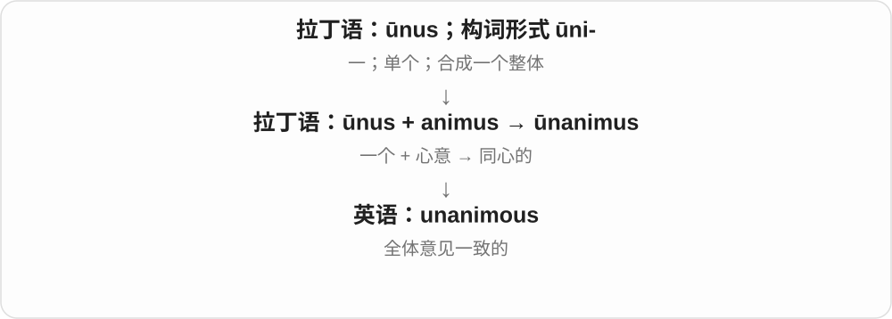
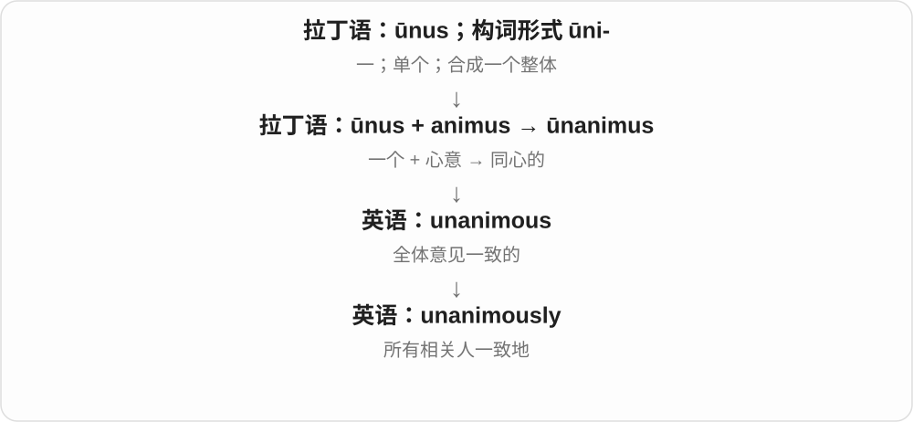
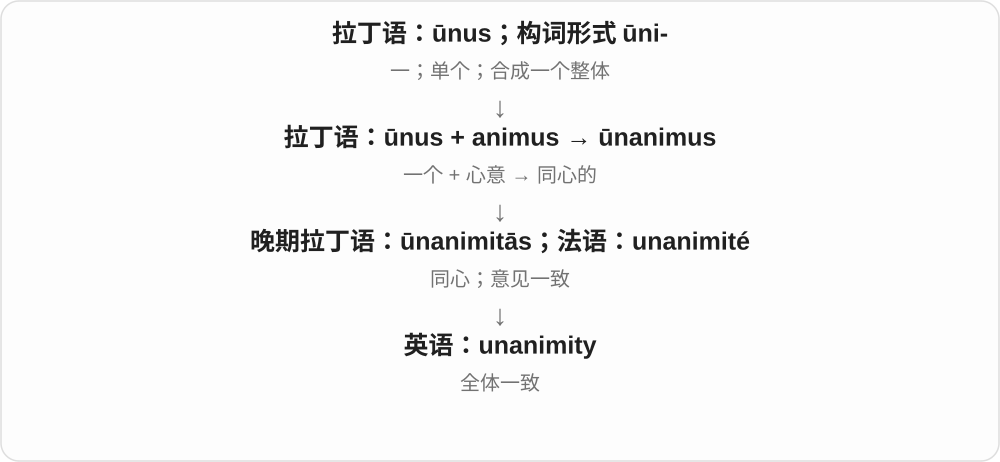

# 0655 · anim- — 呼吸、生命；精神与心胸

[逐词精讲目录](../00_逐词精讲目录.md) · [总目录](../00_总目录_按常用程度.md)

## 核心词根与来源

拉丁 anima 表示气息、生命、灵魂，相关的 animus 常说心意、精神。前一支走向 animal 与 animation，后一支走向敌意、心胸和共同意愿等抽象词。历史上的“呼吸就是生命迹象”很好记，但现代意义仍要看每个词的实际用法。

**ANIM = BREATH, LIFE, SPIRIT**

一个原本静止的角色开始呼吸、眨眼、移动，像被赋予生命；再把生命的气息想成心里的精神与意志，就能连到 animus、magnanimous。

- **有生命与让事物活跃**：animal, animate, animated, animation, animator, inanimate, reanimate, reanimation
- **影像与机械表演**：anime, animatronic, animatronics
- **精神、态度与心胸**：animus, animosity, magnanimous, magnanimity, equanimity, unanimous, unanimity, unanimously
- **思想与形象**：animism, animalistic
- **animal → animals：有生命、气息的到动物**：animal · animals
- **deer：从泛称野兽到专指鹿**：deer
- **常见动物名称的不同借词路线**：panda · pandas · koala · koalas · kangaroo · kangaroos · giraffe · giraffes · cheetah · cheetahs · jaguar · jaguars
- **动物名对照：当地语言、古英语与欧洲借词**：raccoon · raccoons · weasel · weasels · hamster · hamsters · crocodile · crocodiles · alligator · alligators · camels

## 词形与演化规律

anim-、animat- 保留拉丁词干；animate 作动词与形容词时，词尾发音不同。anime 经日语缩略后回借。magnanimous 的 magn- 是大，unanimous 的 un- 接拉丁 unus“一个”，不是英语否定 un-。

animal 接拉丁 anima 生命、气息与 animalis 有生命的词族，英语经法语和拉丁借入。

和 animal 比较动物泛称与收窄，不从拉丁 anima 派生。deer 承古英语 deor 野兽，属于日耳曼词，现代通常单复数同形。

本支与 animal 对照动物名称，各词不由拉丁 anim- 派生。panda 经法语接喜马拉雅地区名称；koala、kangaroo 接不同澳洲原住民语言；giraffe 经欧洲语言接阿拉伯语；cheetah 经印地语接有斑点的梵语材料；jaguar 经葡萄牙语接图皮语。名称不强行归成一条词源。

本支按 animal 动物对照名称，分别有来源：raccoon 接波瓦坦语，weasel 接古英语，hamster 借德语，crocodile 经法语、拉丁语接更早希腊名称，alligator 由西班牙语 el lagarto 借来，camel 更远接闪米特语名称。各词不从拉丁 anim- 派生。

## 单词速览（按词族由简到繁）

同一基础词的相关扩展放在一起，先读基础形式，再读扩展；各组之间优先读常用的。具体词源关系见各词讲解。

| 单词 | 音标 | 核心意思 |
|---|---|---|
| [anime](#w-2) | /ˈænɪmeɪ/ | 日本动画；日本动画风格的作品 |
| [animal](#w-1) | 英 /ˈænɪməl/；美 /ˈænəməl/ | 动物；动物的 |
| [animals](#w-22) | /ˈænɪməlz/ | 动物；animal 的复数 |
| [animalistic](#w-16) | /ˌænɪməˈlɪstɪk/ | 像动物的；体现强烈本能的 |
| [animate](#w-8) | 动词 /ˈænɪmeɪt/；形容词 /ˈænɪmət/ | 使活跃；使有生气；制作动画；有生命的 |
| [animation](#w-3) | /ˌænɪˈmeɪʃən/ | 动画；动画制作；生气、活力 |
| [animated](#w-4) | /ˈænɪmeɪtɪd/ | 生动活跃的；兴致勃勃的；动画的 |
| [animator](#w-10) | 英 /ˈænɪmeɪtə/；美 /ˈænəmeɪtər/ | 动画师；使事物活跃的人或力量 |
| [inanimate](#w-9) | /ɪnˈænɪmət/ | 无生命的；没有生气的 |
| [reanimate](#w-21) | 动词 /riˈænɪmeɪt/；少见形容词 /riˈænɪmət/ | 使恢复生气；使重新活跃；使复活〔常见于虚构〕 |
| [reanimation](#w-20) | /ˌriːænɪˈmeɪʃən/ | 重新赋予活力；复苏；复活〔也用于虚构〕 |
| [animism](#w-19) | /ˈænɪmɪzəm/ | 万物有灵观；泛灵论 |
| [deer](#w-23) | 英 /dɪə/；美 /dɪr/ | 鹿〔通常单复数同形〕 |
| [unanimous](#w-5) | /juːˈnænɪməs/ | 全体一致的；一致赞成的 |
| [unanimously](#w-6) | /juːˈnænɪməsli/ | 全体一致地 |
| [unanimity](#w-13) | /ˌjuːnəˈnɪməti/ | 全体一致；一致同意 |
| [panda](#w-24) | 英 /ˈpændə/；美 /ˈpændə/ | 熊猫；〔giant panda〕大熊猫；〔red panda〕小熊猫 |
| [pandas](#w-30) | 英、美 /ˈpændəz/ | 熊猫〔复数〕 |
| [jaguar](#w-25) | 英 /ˈdʒæɡjʊə/；美 /ˈdʒæɡwɑr/ | 美洲豹、美洲虎 |
| [jaguars](#w-28) | 英 /ˈdʒæɡjʊəz/；美 /ˈdʒæɡwɑrz/ | 美洲豹、美洲虎〔复数〕 |
| [kangaroo](#w-26) | 英 /ˌkæŋɡəˈruː/；美 /ˌkæŋɡəˈru/ | 袋鼠 |
| [kangaroos](#w-32) | 英 /ˌkæŋɡəˈruːz/；美 /ˌkæŋɡəˈruz/ | 袋鼠〔复数〕 |
| [crocodile](#w-36) | 英 /ˈkrɒkədaɪl/；美 /ˈkrɑkəˌdaɪl/ | 鳄鱼〔常指鳄科类〕 |
| [crocodiles](#w-42) | 英 /ˈkrɒkədaɪlz/；美 /ˈkrɑkəˌdaɪlz/ | 鳄鱼〔复数〕 |
| [alligator](#w-37) | 英 /ˈælɪɡeɪtə/；美 /ˈæləˌɡeɪtɚ/ | 短吻鳄 |
| [alligators](#w-44) | 英 /ˈælɪɡeɪtəz/；美 /ˈæləˌɡeɪtɚz/ | 短吻鳄〔复数〕 |
| [giraffe](#w-27) | 英 /dʒɪˈrɑːf/；美 /dʒəˈræf/ | 长颈鹿 |
| [giraffes](#w-33) | 英 /dʒɪˈrɑːfs/；美 /dʒəˈræfs/ | 长颈鹿〔复数〕 |
| [hamster](#w-38) | 英 /ˈhæmstə/；美 /ˈhæmstɚ/ | 仓鼠 |
| [hamsters](#w-45) | 英 /ˈhæmstəz/；美 /ˈhæmstɚz/ | 仓鼠〔复数〕 |
| [camels](#w-39) | 英 /ˈkæməlz/；美 /ˈkæməlz/ | 骆驼〔复数〕 |
| [raccoon](#w-40) | 英、美 /rəˈkuːn/ | 浣熊 |
| [raccoons](#w-43) | 英、美 /rəˈkuːnz/ | 浣熊〔复数〕 |
| [cheetah](#w-29) | 英 /ˈtʃiːtə/；美 /ˈtʃitə/ | 猎豹 |
| [cheetahs](#w-34) | 英 /ˈtʃiːtəz/；美 /ˈtʃitəz/ | 猎豹〔复数〕 |
| [weasel](#w-41) | 英、美 /ˈwiːzəl/ | 鼬；狡猾的人〔贬义〕；推诿、设法逃脱〔常接 out〕 |
| [weasels](#w-46) | 英、美 /ˈwiːzəlz/ | 鼬〔复数〕；耍滑头逃避〔第三人称单数〕 |
| [animosity](#w-7) | 英 /ˌænɪˈmɒsəti/；美 /ˌænəˈmɑːsəti/ | 敌意；怨恨 |
| [koala](#w-31) | 英 /kəʊˈɑːlə/；美 /koʊˈɑlə/ | 树袋熊、考拉 |
| [koalas](#w-35) | 英 /kəʊˈɑːləz/；美 /koʊˈɑləz/ | 树袋熊、考拉〔复数〕 |
| [animus](#w-11) | /ˈænɪməs/ | 敌意；意向、动机〔正式〕；阿尼姆斯〔荣格理论〕 |
| [magnanimous](#w-12) | /mæɡˈnænɪməs/ | 宽宏大量的；有气度的 |
| [animatronic](#w-14) | 英 /ˌænɪməˈtrɒnɪk/；美 /ˌænəməˈtrɑːnɪk/ | 电子机械驱动的仿生偶像的；机电动画装置的 |
| [animatronics](#w-17) | 英 /ˌænɪməˈtrɒnɪks/；美 /ˌænəməˈtrɑːnɪks/ | 电子机械动画技术；机电仿生装置 |
| [equanimity](#w-15) | /ˌekwəˈnɪmɪti/，也读 /ˌiːkwəˈnɪmɪti/ | 镇定；心境平和；处变不惊 |
| [magnanimity](#w-18) | /ˌmæɡnəˈnɪməti/ | 宽宏大量；高尚气度 |

## 逐词讲解

### 1. anime — 日本动画；日本动画风格的作品

**音标**：/ˈænɪmeɪ/

**先抓住这个画面**

英语 animation 被借进日语后缩短成 anime，英语又把这个短形式借回来，专门指日本动画这一文化类别。

**怎么拆**

英语 animation → 日语 アニメーション animēshon → 缩略 アニメ anime → 英语 anime。

**怎么变成今天的意思**

**拉丁 anima；相关 animus**  
呼吸、生命、灵魂；心意、精神

↓

**拉丁 animāre → animātiō → 英语 animation**  
赋予生命、活力 → 生动；动画

↓

**日语 animēshon → anime → 英语 anime**  
动画一词缩短后回借，英语中多指日本动画

日语里的 anime 可以广泛指动画；英语里通常指日本动画，或与其传统、风格密切相关的作品。它是一类媒介作品，不只是一种固定画风。

**常见搭配与例句**

an anime series；anime fans；Japanese anime。

> The manga was later adapted into an anime series.

这部漫画后来被改编成了动画剧集。

> She enjoys anime with carefully developed characters.

她喜欢人物塑造细致的日本动画。

**别混淆**

manga 通常指日本漫画，anime 指动画；同一故事可以先是 manga，再改编成 anime。

### 2. animal — 动物；动物的

**音标**：英 /ˈænɪməl/；美 /ˈænəməl/

**先抓住这个画面**

词源把动物看成“有生命、会呼吸的存在”。这是历史命名的画面，现代生物分类还要看更多特征。

**怎么拆**

拉丁 anima“生命、气息”→ animālis“有生命的”→ 名词 animal；经法语及拉丁借入英语。

**怎么变成今天的意思**

**拉丁 anima → animālis → animal**  
生命 → 有生命的 → 动物

↓

**古法语及中古英语 animal → 英语 animal**  
动物；动物的

生物学上人也属于动物；日常说 animals and people，往往把 animal 限定为人之外的动物。animal behaviour 是动物行为，animal products 是动物产品。

**常见搭配与例句**

wild animals；animal behaviour；animal products。

> The reserve provides a safe habitat for wild animals.

保护区为野生动物提供了安全的栖息地。

> Humans are animals in the biological sense.

从生物学上说，人类也属于动物。

**别混淆**

creature 可以宽泛指生物或想象中的生物；animal 是更明确的常用分类词。不能因为植物也有呼吸作用，就只靠词源把它们叫作 animals。

### 3. animals — 动物；animal 的复数

**音标**：/ˈænɪməlz/

**先抓住这个画面**

猫、兔、鸟、鱼等都能是 animals。这个词把许多不同动物放在一个大类别里，具体是哪种再用名称补出来。

**怎么拆**

animal + -s，/l/ 后读 /z/。拉丁 anima 生命、气息 → animalis 有生命的 → animal 动物，经法语及拉丁借入英语。

**怎么变成今天的意思**

**拉丁 anima → animalis → animal**  
生命、气息 → 有生命的 → 动物名词

↓

**法语、拉丁借入英语 animal；再加 -s → animals**  
多个动物

wild animals 野生动物；farm animals 农场动物；domestic animals 家养动物；animals in the forest 森林里的动物。

**常见搭配与例句**

care for animals；different kinds of animals。

> The farm keeps several kinds of animals.

这家农场养着几种动物。

> We watched the wild animals from a distance.

我们隔着一段距离观察野生动物。

**别混淆**

日常 people and animals 常把人和其他动物分开说；在更广的生物分类语境里，人也属于动物。具体阅读要看这个词采用哪种语境范围。

### 4. animalistic — 像动物的；体现强烈本能的

**音标**：/ˌænɪməˈlɪstɪk/

**先抓住这个画面**

把某种动作、声音或造型看作像动物：表演中的爬行、低吼，或强烈而未加掩饰的本能冲动。

**怎么拆**

animal + -istic；英语派生形容词。

**怎么变成今天的意思**

**拉丁 anima → animālis → animal**  
生命 → 有生命的 → 动物

↓

**古法语及中古英语 animal → 英语 animal**  
动物；动物的

↓

**英语 animal + -istic → animalistic**  
动物 → 像动物、带动物特点的

描述艺术表现时可说形体和动作；评价人时容易带“受本能驱使、粗野”的贬义，语气与中性的 animal 不同。

**常见搭配与例句**

animalistic movements；an animalistic growl；animalistic instincts。

> The dancer used low, animalistic movements.

舞者用低伏的动作表现出动物般的姿态。

> The creature let out an animalistic growl.

那个生物发出了一声野兽般的低吼。

**别混淆**

animal behaviour 是动物的行为；animalistic behaviour 常是在说某人的行为像动物，不是同一种中性分类。

### 5. animate — 使活跃；使有生气；制作动画；有生命的

**音标**：动词 /ˈænɪmeɪt/；形容词 /ˈænɪmət/

**先抓住这个画面**

给原本沉静的东西注入活力：谈话热起来，角色动起来，或故事里的木偶像活了一样。

**怎么拆**

拉丁 animātus 是 animāre 的分词；英语先有相关形容词，后有动词用法。

**怎么变成今天的意思**

**拉丁 anima；相关 animus**  
呼吸、生命、灵魂；心意、精神

↓

**拉丁 animāre → animātus → 英语 animate**  
赋予生命、鼓起精神 → 有生命的；使活跃

animate a character 是让角色形成动画；animate a discussion 是让讨论活跃。形容词 animate objects 指有生命的事物，词尾读 /mət/，与动词不同。

**常见搭配与例句**

animate a character；animate a discussion；animate and inanimate objects。

> The software lets you animate a simple character.

这款软件可以让你给简单角色制作动画。

> Her questions animated the discussion.

她的问题让讨论活跃起来。

> The lesson distinguishes animate beings from inanimate objects.

这一课区分有生命的存在与无生命的物体。

**别混淆**

animated 是被激活、充满活力或动画形式的；animate 作形容词时常是“有生命的”。两者不是随时可互换。

### 6. animation — 动画；动画制作；生气、活力

**音标**：/ˌænɪˈmeɪʃən/

**先抓住这个画面**

一张画本来不动，连续呈现变化后却像活起来了；动画义正好保留“赋予生命”的比喻。

**怎么拆**

借拉丁 animātiō，来自动词 animāre；现代与 animate 对应，但历史名词本身也是借词。

**怎么变成今天的意思**

**拉丁 anima；相关 animus**  
呼吸、生命、灵魂；心意、精神

↓

**拉丁 animāre → animātiō → 英语 animation**  
赋予生命、活力 → 生动；动画

可说技术、创作过程或作品片段。with animation 还可表示说话有精神，不一定与屏幕有关。动画可以手绘、定格或计算机制作。

**常见搭配与例句**

computer animation；an animation studio；speak with animation。

> She studies animation and wants to create short films.

她学习动画，希望创作短片。

> He spoke with animation when the subject turned to music.

话题转到音乐时，他说得兴致勃勃。

**别混淆**

animation 是媒介或制作方式；cartoon 可以是动画片，也可以只是一张漫画，范围不完全相同。

### 7. animated — 生动活跃的；兴致勃勃的；动画的

**音标**：/ˈænɪmeɪtɪd/

**先抓住这个画面**

被注入活力以后，人说话有精神，讨论热烈，画面中的角色也像活了过来。

**怎么拆**

animate 的过去分词转作形容词；后来用于移动影像和动画。

**怎么变成今天的意思**

**拉丁 anima；相关 animus**  
呼吸、生命、灵魂；心意、精神

↓

**拉丁 animāre → animātus → 英语 animate**  
赋予生命、鼓起精神 → 有生命的；使活跃

↓

**英语 animate → animated**  
使活跃 → 活泼、热烈的；动画的

an animated discussion 是热烈讨论，不是“一场动画讨论”。an animated film 才是动画电影，具体意义要由它修饰的名词决定。

**常见搭配与例句**

an animated conversation；an animated film；become animated。

> They had an animated discussion over dinner.

他们吃饭时讨论得很热烈。

> The studio is making an animated film about ocean life.

工作室正在制作一部讲海洋生物的动画电影。

**别混淆**

lively 通常直接说活跃；animated 还承担动画影像这一专门义。excited 偏激动，不一定意味着表达生动。

### 8. animator — 动画师；使事物活跃的人或力量

**音标**：英 /ˈænɪmeɪtə/；美 /ˈænəmeɪtər/

**先抓住这个画面**

让角色动起来的人是动画师；更早、更宽的意思是给人或事物带来活力者。

**怎么拆**

拉丁 animātor“赋予活力者”借入英语；现代可按 animate 与表示执行者的 -or 对应记忆。

**怎么变成今天的意思**

**拉丁 anima；相关 animus**  
呼吸、生命、灵魂；心意、精神

↓

**拉丁 animāre → animātor → 英语 animator**  
赋予生命、活力 → 使活跃者

↓

**现代影视用法**  
让画面角色运动的动画师

今天最常见于动画行业。动画师可能设计动作、表情与时间节奏，并不只负责把角色画得漂亮。

**常见搭配与例句**

a character animator；work as an animator；a team of animators。

> The animator adjusted the timing of the character’s smile.

动画师调整了角色露出微笑的时机和节奏。

> She worked as an animator on several short films.

她参与过几部短片，担任动画师。

**别混淆**

illustrator 主要创作插画；animator 的核心工作涉及运动与时间，虽有技能交集，职业并不相同。

### 9. inanimate — 无生命的；没有生气的

**音标**：/ɪnˈænɪmət/

**先抓住这个画面**

在“有生命”前加否定，把石头、椅子这类物体与有生命的存在区分开来。

**怎么拆**

后期拉丁 inanimātus，in- 不 + animātus；形容词进入中古英语。

**怎么变成今天的意思**

**拉丁 anima；相关 animus**  
呼吸、生命、灵魂；心意、精神

↓

**后期拉丁 in- + animātus → inanimātus**  
没有生命、没有活力的

↓

**中古英语 → inanimate〔形容词〕**  
无生命的；缺乏生气的

日常最常见 inanimate objects。语言学中的有生、无生类别还取决于具体语言，不能直接用生物学分类覆盖所有语法现象。另有极罕见旧动词 inanimate，in- 表“赋入”而读 /ɪnˈænɪmeɪt/，意思反而是赋予生命。

**常见搭配与例句**

inanimate objects；animate and inanimate nouns。

> The story gives voices to inanimate objects.

故事让无生命的物体开口说话。

> A stone is an inanimate object even when it is rolling downhill.

石头即使正沿山坡滚动，也仍是无生命的物体。

**别混淆**

dead 常说曾经活过而现已死亡；inanimate 通常强调不是有生命的主体。a moving toy 也仍是 an inanimate object。

### 10. reanimate — 使恢复生气；使重新活跃；使复活〔常见于虚构〕

**音标**：动词 /riˈænɪmeɪt/；少见形容词 /riˈænɪmət/

**先抓住这个画面**

re- 是重新，把失去活力的东西再带动起来：旧项目重新有劲，故事中的角色重新活过来。

**怎么拆**

英语 re- + animate；动词也可能受到中世纪拉丁 reanimāre 或法语 réanimer 的影响。

**怎么变成今天的意思**

**拉丁 anima；相关 animus**  
呼吸、生命、灵魂；心意、精神

↓

**拉丁 animāre → animātus → 英语 animate**  
赋予生命、鼓起精神 → 有生命的；使活跃

↓

**英语 re- + animate → reanimate**  
再次赋予活力 → 使恢复生气

现实中常可比喻重新激活一个计划、议题或传统；恐怖、科幻故事里可指复活尸体。不要把虚构义当作现实可行性的保证。

**常见搭配与例句**

reanimate a debate；reanimate a tradition；a reanimated character。

> The new evidence reanimated a debate that had seemed settled.

新证据让一场似乎已有定论的争论重新活跃起来。

> In the novel, a machine can reanimate the dead.

小说中，一台机器能够让死者复活。

**别混淆**

revive 是更常用的恢复、复苏；reanimate 更突出“重新像活的一样”，书面和虚构色彩较强。

### 11. reanimation — 重新赋予活力；复苏；复活〔也用于虚构〕

**音标**：/ˌriːænɪˈmeɪʃən/

**先抓住这个画面**

把 reanimate 的动作拿出来谈：原本停滞的活动重新动起来，或故事中出现了复活过程。

**怎么拆**

re- 再次 + animation；与 reanimate 的动词词族相连。

**怎么变成今天的意思**

**拉丁 anima；相关 animus**  
呼吸、生命、灵魂；心意、精神

↓

**拉丁 animāre → animātiō → 英语 animation**  
赋予生命、活力 → 生动；动画

↓

**英语 re- + animation → reanimation**  
再次赋予生命、活力 → 复苏、重新激活

可以是文学里的复活情节，也可比喻旧传统或组织的重新活跃。医学等专门领域会有更限定的用法，不能把所有意义都译成动画重制。

**常见搭配与例句**

the reanimation of a tradition；a story of reanimation。

> The novel explores the idea of reanimation.

小说探讨了复活这一设想。

> The festival helped bring about the reanimation of a local tradition.

节庆活动帮助一个地方传统重新焕发生机。

**别混淆**

animation 是动画或赋予活力；reanimation 在多数这类语境里是复苏、重新激活，并不自动表示把动画重做一次。

### 12. animism — 万物有灵观；泛灵论

**音标**：/ˈænɪmɪzəm/

**先抓住这个画面**

不只把生命或精神看成人才有的东西，也把某些自然存在看成具有精神、能动性或可与人建立关系的存在。

**怎么拆**

拉丁 anima“生命、灵魂”+ -ism；较早的生命学说用法与德语 Animismus 有关，后来用于人类学。

**怎么变成今天的意思**

**拉丁 anima；相关 animus**  
呼吸、生命、灵魂；心意、精神

↓

**学术词 Animismus / animism**  
以灵魂、生命原则说明生命的旧学说

↓

**人类学中的 animism**  
讨论人与自然存在的精神性、能动性关系

这是涵盖多种思想与实践的概括词，各文化并不都主张每一块石头都有同一种灵魂。学习时掌握概念，也保留具体传统之间的差别。

**常见搭配与例句**

animism in anthropology；animist traditions；beliefs associated with animism。

> The course examines animism in several cultural traditions.

课程考察了几种文化传统中的万物有灵观。

> The author warns against treating all forms of animism as identical.

作者提醒，不应把各种万物有灵观视为完全相同。

**别混淆**

animation 是动画或活力；animism 是思想、信仰概念。不要把一个广泛标签当作所有传统都完全相同的说明。

### 13. deer — 鹿〔通常单复数同形〕

**音标**：英 /dɪə/；美 /dɪr/

**先抓住这个画面**

今天说 a deer 是一只鹿，three deer 是三只鹿。这个词以前范围大得多，能泛指野兽；后来像把镜头缩小，固定到鹿这一类。

**怎么拆**

承古英语 deor 野兽、动物，接更早日耳曼同族词。专指鹿的收窄很早开始，后来成为现代主要意思；不接拉丁 animal 的呼吸词根。

**怎么变成今天的意思**

**古英语 deor：野兽、动物**  
相关日耳曼语言中仍有广义动物同源词

↓

**英语 deer 逐渐收窄 → 鹿**  
现代通常单数 a deer，复数 many deer

a herd of deer 是一群鹿；deer 常单复数同形。与同音的 dear 亲爱的、贵的分别记拼写。

**常见搭配与例句**

a wild deer；three deer；a herd of deer。

> A deer stepped out of the trees.

一只鹿从树林里走了出来。

> We saw three deer near the river.

我们在河边看见了三只鹿。

**别混淆**

deer 泛指鹿这一类，stag 常指成年雄鹿，doe 常指雌鹿；deer 本身不限定公母。

### 14. unanimous — 全体一致的；一致赞成的

**音标**：/juːˈnænɪməs/

**先抓住这个画面**

unanimous 像举手表决时一整排手全部举起来，没有一票反对；也可以说大家在一个判断上完全一致。

**怎么拆**

拉丁语 ūnus（一）+ animus（心意）形成 ūnanimus“同心的”，进入英语成为 unanimous。

**怎么变成今天的意思**

“一个心意”不是只有一个人在想，而是相关的所有人都同意。必须看清所说的投票或人群范围。

**常见搭配与例句**

a unanimous decision；unanimous support；be unanimous in… 。

> The panel reached a unanimous decision.

评审小组作出了一致决定。

> We were unanimous in our choice of venue.

我们在场地选择上完全一致。

**别混淆**

majority 是多数；unanimous 是全体一致。九人赞成、一人反对不是 unanimous。

### 15. unanimously — 全体一致地

**音标**：/juːˈnænɪməsli/

**先抓住这个画面**

unanimously 是把 unanimous 的结果放到动作上：所有参加表决的人以同一立场投票或决定。

**怎么拆**

unanimous + -ly。

**怎么变成今天的意思**

它说明意见如何形成，而不是说明决定本身是否正确。常和 vote、agree、approve 连用。

**常见搭配与例句**

vote unanimously；agree unanimously；be unanimously approved。

> The members voted unanimously to extend the exhibition.

成员们一致投票同意延长展期。

> The recommendation was unanimously approved.

这项建议获得了一致批准。

**别混淆**

overwhelmingly 表示压倒性多数；unanimously 表示全体一致，不能把少量反对票抹去。

### 16. unanimity — 全体一致；一致同意

**音标**：/ˌjuːnəˈnɪməti/

**先抓住这个画面**

unanimity 是让所有人的意见最后落在同一个答案上，重点是没有人持不同意见的状态。

**怎么拆**

来自法语 unanimité 和晚期拉丁语 ūnanimitās；现代与 unanimous 对应，但不能把借入名词简单画成英语形容词的后代。

**怎么变成今天的意思**

常在决策中谈是否达到一致。它比大多数赞成要求更高，但一致也不保证结论正确。

**常见搭配与例句**

reach unanimity；unanimity among members；require unanimity。

> The committee failed to reach unanimity.

委员会没能达成全体一致。

> There was unanimity on the need for clearer instructions.

大家一致认为需要更清楚的说明。

**别混淆**

consensus 常指广泛共识，不一定意味着每个人毫无保留；unanimity 更明确要求全体一致。

### 17. panda — 熊猫；〔giant panda〕大熊猫；〔red panda〕小熊猫

**音标**：英 /ˈpændə/；美 /ˈpændə/

**先抓住这个画面**

黑白毛色、常抱着竹子的大熊猫，今天单说 panda 很容易让人想到它。词的历史却先接小熊猫名称。

**怎么拆**

英语经法语借 panda，早期用于小熊猫，后来也用于大熊猫；更远通常联系尼泊尔等地区的动物名称，具体拆分不确定。

**怎么变成今天的意思**

**法语 panda → 英语 panda，早期指小熊猫**  
更远通常联系尼泊尔等喜马拉雅地区名称，具体形式解释不完全确定

↓

**名称后来也用于大熊猫 → panda、pandas 的现代常见用法**  
red panda 与 giant panda 用修饰词分清，不由名称相同推断同一物种

a giant panda 是大熊猫；a red panda 是小熊猫；a baby panda 是熊猫幼崽。

**常见搭配与例句**

a giant panda；a red panda；a baby panda。

> A panda was eating bamboo beside the tree.

一只熊猫在树旁吃竹子。

> The red panda curled up on a branch.

小熊猫蜷在一根树枝上。

**别混淆**

giant panda 和 red panda 是不同动物名称；现代不要因为都叫 panda，就把红毛、长尾的小熊猫当大熊猫幼崽。

### 18. pandas — 熊猫〔复数〕

**音标**：英、美 /ˈpændəz/

**先抓住这个画面**

几只熊猫，可以说 pandas；加 giant 或 red，便把大熊猫、小熊猫区分得更清楚。

**怎么拆**

panda + -s → pandas，末尾 /ə/ 后接 /z/；完整借入的动物名照英语规则形成复数。

**怎么变成今天的意思**

**法语 panda → 英语 panda，早期指小熊猫**  
更远通常联系尼泊尔等喜马拉雅地区名称，具体形式解释不完全确定

↓

**名称后来也用于大熊猫 → panda、pandas 的现代常见用法**  
red panda 与 giant panda 用修饰词分清，不由名称相同推断同一物种

↓

**panda + -s → pandas**  
多只熊猫，词尾 /əz/

giant pandas 是大熊猫；red pandas 是小熊猫；two pandas 是两只熊猫。

**常见搭配与例句**

giant pandas；red pandas；two pandas。

> The children watched two pandas playing.

孩子们看着两只熊猫玩耍。

> The sign describes the habits of red pandas.

说明牌介绍了小熊猫的习性。

**别混淆**

pandas 不说明年龄；baby pandas 才明确说幼崽，red pandas 则是小熊猫这个动物名。

### 19. jaguar — 美洲豹、美洲虎

**音标**：英 /ˈdʒæɡjʊə/；美 /ˈdʒæɡwɑr/

**先抓住这个画面**

美洲森林里体格结实、身上有斑纹的大型猫科动物，是 jaguar。中文既常叫美洲豹，也叫美洲虎。

**怎么拆**

经葡萄牙语 jaguar 接图皮语 jaguara 等；旧记录里的原语言词可能泛说较大的捕食兽，英语后来主要指美洲豹。

**怎么变成今天的意思**

**图皮语 jaguara 等 → 葡萄牙语 jaguar → 英语 jaguar**  
旧来源中的本地动物词范围可能比现代单一物种更宽

↓

**英语主要用作美洲豹名 → jaguars**  
名称整体借入，现代英语再按普通名词加复数

a jaguar in the forest 是森林里的美洲豹；a jaguar cub 是美洲豹幼崽；a jaguar’s coat 是美洲豹的皮毛。

**常见搭配与例句**

a jaguar cub；a jaguar in the forest；a jaguar’s coat。

> A jaguar moved quietly through the forest.

一只美洲豹悄悄穿过森林。

> The photograph shows a jaguar beside a river.

照片里是一只河边的美洲豹。

**别混淆**

jaguar 与 leopard 是不同动物名；大写 Jaguar 还可见于借动物名命名的汽车品牌，要按上下文判断。

### 20. jaguars — 美洲豹、美洲虎〔复数〕

**音标**：英 /ˈdʒæɡjʊəz/；美 /ˈdʒæɡwɑrz/

**先抓住这个画面**

几只美洲豹，是 jaguars。名字经南美语言、葡萄牙语传来，现代在英语里照常数复数。

**怎么拆**

jaguar + -s → jaguars，后缀读 /z/；英式常见 /jʊə/ 与美式常见 /wɑr/ 的差别随基础词保留。

**怎么变成今天的意思**

**图皮语 jaguara 等 → 葡萄牙语 jaguar → 英语 jaguar**  
旧来源中的本地动物词范围可能比现代单一物种更宽

↓

**英语主要用作美洲豹名 → jaguars**  
名称整体借入，现代英语再按普通名词加复数

↓

**jaguar + -s → jaguars**  
多只美洲豹，英美部分音节读法可不同

jaguars in the forest 是森林里的美洲豹；photographs of jaguars 是美洲豹照片；young jaguars 是幼年美洲豹。

**常见搭配与例句**

young jaguars；photographs of jaguars；jaguars in the forest。

> The film follows two jaguars in the forest.

影片跟拍森林里的两只美洲豹。

> The book compares jaguars and leopards.

这本书比较美洲豹与豹。

**别混淆**

谈动物时 jaguars 是普通复数名词；大写 Jaguars 在特定上下文也可能是队名，不能只靠 s 判断是在数动物。

### 21. kangaroo — 袋鼠

**音标**：英 /ˌkæŋɡəˈruː/；美 /ˌkæŋɡəˈru/

**先抓住这个画面**

长后腿、一跳一跳往前走的大袋鼠，是 kangaroo。名字来自澳洲一种当地语言里的动物名。

**怎么拆**

Guugu Yimidhirr 语言 gangurru 等形式借入英语，原指当地一种大型袋鼠，英语后来把名称用于更宽范围。不是当地人回答“我听不懂”而产生的词。

**怎么变成今天的意思**

**Guugu Yimidhirr 语言 gangurru 等形式**  
原用于当地一种大型袋鼠的名称

↓

**借入英语 kangaroo → kangaroos**  
英语逐渐用于较宽范围的袋鼠；听不懂的词源传说不成立

a kangaroo hopping 是正在跳的袋鼠；a young kangaroo 是幼年袋鼠；a kangaroo’s tail 是袋鼠尾巴。

**常见搭配与例句**

a young kangaroo；a kangaroo hopping；a kangaroo’s tail。

> A kangaroo hopped across the track.

一只袋鼠跳过了小路。

> The kangaroo balanced itself with its long tail.

袋鼠用长尾巴保持平衡。

**别混淆**

袋鼠名的来路有原语言记录支持；听不懂的故事便于传播，却不能代替这种语言证据。

### 22. kangaroos — 袋鼠〔复数〕

**音标**：英 /ˌkæŋɡəˈruːz/；美 /ˌkæŋɡəˈruz/

**先抓住这个画面**

草地上几只大袋鼠，是 kangaroos。词尾虽然写 oo，复数直接加 s，不另加 es。

**怎么拆**

kangaroo + -s → kangaroos，元音 /uː/、/u/ 后读 /z/；英语规则复数加在借词整体后。

**怎么变成今天的意思**

**Guugu Yimidhirr 语言 gangurru 等形式**  
原用于当地一种大型袋鼠的名称

↓

**借入英语 kangaroo → kangaroos**  
英语逐渐用于较宽范围的袋鼠；听不懂的词源传说不成立

↓

**kangaroo + -s → kangaroos**  
多只袋鼠，词尾 /ruːz/、/ruz/

a group of kangaroos 是一群袋鼠；kangaroos grazing 是袋鼠在吃草；wild kangaroos 是野生袋鼠。

**常见搭配与例句**

wild kangaroos；a group of kangaroos；kangaroos grazing。

> A group of kangaroos grazed near the trees.

一群袋鼠在树边吃草。

> We saw kangaroos from the train window.

我们从火车窗里看到了袋鼠。

**别混淆**

kangaroos 说多只动物；a kangaroo enclosure 的前部 kangaroo 作修饰，通常仍用单数形式。

### 23. crocodile — 鳄鱼〔常指鳄科类〕

**音标**：英 /ˈkrɒkədaɪl/；美 /ˈkrɑkəˌdaɪl/

**先抓住这个画面**

长身体贴着水面、只露出眼鼻的鳄鱼，可以叫 crocodile。词名经过希腊、拉丁、法语，英语拼写也曾多次变化。

**怎么拆**

希腊 krokodilos 经拉丁 crocodilus、中世纪拉丁与古法语相关形式借入英语；中古英语有 cocodril 等，后来向古典形式靠拢。更远来路不定，不宜硬拆成石子加虫。

**怎么变成今天的意思**

**希腊 krokodilos → 拉丁 crocodilus → 中世纪拉丁语、古法语形式**  
更远起源不明，石子加虫的拆分受到质疑

↓

**中古英语 cocodril、cokedrille 等 → 现代 crocodile**  
拼写后来向拉丁、法语形式靠拢；复数 crocodiles

a crocodile in the river 是河里的鳄鱼；a crocodile’s tail 是鳄鱼尾巴；crocodile tears 借传说形象说假哭、假惺惺的眼泪。

**常见搭配与例句**

a crocodile’s tail；a crocodile in the river；crocodile tears。

> A crocodile lay almost hidden in the water.

一条鳄鱼几乎完全隐在水里。

> He shed crocodile tears over the broken vase.

他对着碎花瓶假惺惺地掉眼泪。

**别混淆**

alligator 常译短吻鳄，crocodile 是另一常见名称；中文都可能泛译鳄鱼，英语里仍有名称区分。

### 24. crocodiles — 鳄鱼〔复数〕

**音标**：英 /ˈkrɒkədaɪlz/；美 /ˈkrɑkəˌdaɪlz/

**先抓住这个画面**

河边几条大鳄鱼，是 crocodiles。现代名称虽然来自多次借入、改写，复数只在整词末尾加 s。

**怎么拆**

crocodile + -s → crocodiles，基础词 e 不发音，/l/ 后加 /z/；读音末尾 /aɪlz/。

**怎么变成今天的意思**

**希腊 krokodilos → 拉丁 crocodilus → 中世纪拉丁语、古法语形式**  
更远起源不明，石子加虫的拆分受到质疑

↓

**中古英语 cocodril、cokedrille 等 → 现代 crocodile**  
拼写后来向拉丁、法语形式靠拢；复数 crocodiles

↓

**crocodile + -s → crocodiles**  
多条鳄鱼，词尾 /lz/

crocodiles in the river 是河里的鳄鱼；young crocodiles 是幼年鳄鱼；pictures of crocodiles 是鳄鱼图片。

**常见搭配与例句**

young crocodiles；crocodiles in the river；pictures of crocodiles。

> Several crocodiles rested along the riverbank.

几条鳄鱼伏在河岸边休息。

> The documentary shows crocodiles moving through shallow water.

纪录片展示了鳄鱼穿行浅水的情景。

**别混淆**

crocodiles 直接是动物复数；crocodile tears 的前部通常仍用单数词形，整个搭配才是鳄鱼的眼泪这个比喻。

### 25. alligator — 短吻鳄

**音标**：英 /ˈælɪɡeɪtə/；美 /ˈæləˌɡeɪtɚ/

**先抓住这个画面**

名字像一个长英语词，最初却含着西班牙语的“那个蜥蜴”：el lagarto。一整个称呼被听进英语，逐渐粘成了 alligator。

**怎么拆**

西班牙语 el 定冠词 + lagarto 蜥蜴，整体借入英语，出现 lagarto、aligarto 等形式，再变成 alligator；lagarto 更远接拉丁 lacertus、lacerta。

**怎么变成今天的意思**

**西班牙语 el 那个 + lagarto 蜥蜴**  
lagarto 更远接拉丁 lacertus、lacerta 动物名

↓

**整个词组被英语借入、改写 → alligator → alligators**  
原来独立的冠词 el 并入新词，不是现代英语 all 加 gator 的最初构词

an alligator in the water 是水里的短吻鳄；a young alligator 是幼年短吻鳄；an alligator’s tail 是短吻鳄尾巴。

**常见搭配与例句**

a young alligator；an alligator’s tail；an alligator in the water。

> An alligator rested beside the pond.

一条短吻鳄伏在池塘边休息。

> The picture shows an alligator with its mouth open.

图中是一条张着嘴的短吻鳄。

**别混淆**

alligator 与 crocodile 都常在中文里被说成鳄鱼；英语区分名称时，alligator 通常对应短吻鳄类。

### 26. alligators — 短吻鳄〔复数〕

**音标**：英 /ˈælɪɡeɪtəz/；美 /ˈæləˌɡeɪtɚz/

**先抓住这个画面**

几条短吻鳄，是 alligators。原先的西班牙语词组借成完整名词后，英语直接给整词加 s。

**怎么拆**

alligator + -s → alligators，后缀读 /z/；原来的 el、lagarto 不再各自按西班牙语规则形成复数。

**怎么变成今天的意思**

**西班牙语 el 那个 + lagarto 蜥蜴**  
lagarto 更远接拉丁 lacertus、lacerta 动物名

↓

**整个词组被英语借入、改写 → alligator → alligators**  
原来独立的冠词 el 并入新词，不是现代英语 all 加 gator 的最初构词

↓

**alligator + -s → alligators**  
英语整体词的规则复数，词尾 /z/

young alligators 是幼年短吻鳄；alligators in the pond 是池塘里的短吻鳄；pictures of alligators 是短吻鳄图片。

**常见搭配与例句**

young alligators；alligators in the pond；pictures of alligators。

> The documentary follows several young alligators.

纪录片跟拍了几条幼年短吻鳄。

> The sign compares alligators with crocodiles.

说明牌比较了短吻鳄与鳄鱼。

**别混淆**

alligators 的复数 s 属于现代英语；词源里旧冠词的一部分已并进词中，不再单独当作一个英语词。

### 27. giraffe — 长颈鹿

**音标**：英 /dʒɪˈrɑːf/；美 /dʒəˈræf/

**先抓住这个画面**

伸着长脖子从高处取叶子的长颈鹿，是 giraffe。这个名字经历了几种语言的接力。

**怎么拆**

阿拉伯语 zarāfa 等进入意大利语 giraffa、法语 girafe 等；英语历史上多路借入、拼写不一，现代 giraffe 与法语形式相关，更远可能来自非洲语言。

**怎么变成今天的意思**

**阿拉伯语 zarāfa 等 → 意大利语 giraffa、法语 girafe 等**  
阿拉伯语更远可能借自非洲语言

↓

**英语曾有多种借入拼写，现代 giraffe 与法语形式有关**  
giraffe → giraffes；多路传播，不把所有中间形式当唯一单线

a tall giraffe 是高大的长颈鹿；a baby giraffe 是幼年长颈鹿；a giraffe’s neck 是长颈鹿的脖子。

**常见搭配与例句**

a tall giraffe；a baby giraffe；a giraffe’s neck。

> A giraffe reached for leaves high in the tree.

一只长颈鹿伸向树上高处的叶子。

> The baby giraffe stood close to its mother.

小长颈鹿紧挨着妈妈站着。

**别混淆**

giraffe 末尾 ff 读 /f/、e 不发音；读音重心在后一个音节，别把末尾另读成 /fi/。

### 28. giraffes — 长颈鹿〔复数〕

**音标**：英 /dʒɪˈrɑːfs/；美 /dʒəˈræfs/

**先抓住这个画面**

几只长颈鹿站在一起，是 giraffes。词尾虽然写着 f，复数并不改成 v。

**怎么拆**

giraffe + -s → giraffes，基础词末尾已有 e，直接加 s；/f/ 后读 /s/，结尾 /fs/。

**怎么变成今天的意思**

**阿拉伯语 zarāfa 等 → 意大利语 giraffa、法语 girafe 等**  
阿拉伯语更远可能借自非洲语言

↓

**英语曾有多种借入拼写，现代 giraffe 与法语形式有关**  
giraffe → giraffes；多路传播，不把所有中间形式当唯一单线

↓

**giraffe + -s → giraffes**  
规则复数；保留 f 音，词尾 /fs/

a group of giraffes 是一群长颈鹿；young giraffes 是幼年长颈鹿；giraffes feeding 是长颈鹿正在进食。

**常见搭配与例句**

a group of giraffes；young giraffes；giraffes feeding。

> Three giraffes walked slowly across the grass.

三只长颈鹿缓缓走过草地。

> The children drew giraffes with very long necks.

孩子们画了脖子很长的长颈鹿。

**别混淆**

有些 f、fe 词复数变 -ves，但 giraffes 不套那条变化；这里直接加 s。

### 29. hamster — 仓鼠

**音标**：英 /ˈhæmstə/；美 /ˈhæmstɚ/

**先抓住这个画面**

小小一团、会把食物塞进颊囊的仓鼠，是 hamster。宠物仓鼠跑轮的画面也很常见。

**怎么拆**

整词借自德语 Hamster，向前有中古高地德语 hamastra 等形式；更远可能接斯拉夫语言名称，具体分析不确定。

**怎么变成今天的意思**

**德语 Hamster ← 中高地德语 hamastra 等**  
更远可能接斯拉夫语言名称，细节不确定

↓

**借入英语 hamster → hamsters**  
整词动物名进入英语，复数按现代规则变化

a pet hamster 是宠物仓鼠；a hamster wheel 是仓鼠跑轮；a hamster cage 是仓鼠笼。

**常见搭配与例句**

a pet hamster；a hamster wheel；a hamster cage。

> The hamster stored seeds in its cheeks.

仓鼠把种子塞在颊囊里。

> Her pet hamster ran on its wheel.

她的宠物仓鼠在跑轮上跑动。

**别混淆**

hamster 是整词动物名；这里的 -ster 不需要按现代英语职业后缀重新拼成做某事的人。

### 30. hamsters — 仓鼠〔复数〕

**音标**：英 /ˈhæmstəz/；美 /ˈhæmstɚz/

**先抓住这个画面**

几只小仓鼠，就是 hamsters。德语动物名称借进英语后，用英语规则变化复数。

**怎么拆**

hamster + -s → hamsters，词尾后缀读 /z/；英式常见 /stəz/，美式常见 /stɚz/。

**怎么变成今天的意思**

**德语 Hamster ← 中高地德语 hamastra 等**  
更远可能接斯拉夫语言名称，细节不确定

↓

**借入英语 hamster → hamsters**  
整词动物名进入英语，复数按现代规则变化

↓

**hamster + -s → hamsters**  
多只仓鼠，词尾 /z/

pet hamsters 是宠物仓鼠；young hamsters 是幼年仓鼠；pictures of hamsters 是仓鼠图片。

**常见搭配与例句**

pet hamsters；young hamsters；pictures of hamsters。

> The children drew pictures of hamsters.

孩子们画了仓鼠的图画。

> The poster shows several kinds of hamsters.

海报上展示了几种仓鼠。

**别混淆**

hamsters 数动物；hamster wheels 的 hamster 作前部修饰，通常不先加复数 s。

### 31. camels — 骆驼〔复数〕

**音标**：英 /ˈkæməlz/；美 /ˈkæməlz/

**先抓住这个画面**

背上有驼峰、常见于沙漠旅行画面的骆驼，是 camels。名称本身没有限定只能是一峰或两峰。

**怎么拆**

camel 在古英语已有形式，远处接拉丁 camelus、希腊 kamēlos，再接希伯来语、腓尼基语等闪米特语名称；法语形式也在其传播史中。camel + -s → camels，/l/ 后 /z/。

**怎么变成今天的意思**

**闪米特语 gamal 等 → 希腊 kamēlos → 拉丁 camelus**  
英语有古英语 camel 及法语相关传播形式

↓

**英语 camel + -s → camels**  
现代复数，词尾 /əlz/

a caravan of camels 是一队骆驼；camels carrying goods 是驮货的骆驼；two camels 是两头骆驼。

**常见搭配与例句**

a caravan of camels；camels carrying goods；two camels。

> A line of camels crossed the desert.

一队骆驼穿过沙漠。

> The camels carried bags and blankets.

骆驼驮着袋子和毯子。

**别混淆**

camels 可以包括单峰、双峰等骆驼；camel hair 的 camel 作前部修饰时，通常仍保持单数。

### 32. raccoon — 浣熊

**音标**：英、美 /rəˈkuːn/

**先抓住这个画面**

黑色眼罩、蓬松的环纹尾巴，前爪常灵巧摆弄东西的动物，是 raccoon。名字的旧线索也常联系用手抓挠。

**怎么拆**

借波瓦坦语等记录中的动物名称，英语早期有 arocoun 等多种拼写；原语言材料通常解释为用手抓挠，更远不按现代英语字母另拆。

**怎么变成今天的意思**

**波瓦坦语的当地动物名 → 英语早期 arocoun 等形式**  
通常联系用手抓挠的原语言材料，历史记录的拼写多样

↓

**英语 raccoon → raccoons**  
现代名称整体使用；黑眼罩、环纹尾帮助辨认

a raccoon’s tail 是浣熊尾巴；a raccoon near the bin 是垃圾桶旁的浣熊；a young raccoon 是幼年浣熊。

**常见搭配与例句**

a young raccoon；a raccoon’s tail；a raccoon near the bin。

> A raccoon climbed onto the fence.

一只浣熊爬上了栅栏。

> The raccoon searched around the empty bin.

浣熊在空垃圾桶周围翻找。

**别混淆**

raccoon 是浣熊，red panda 是小熊猫；面部花纹可能让人觉得相似，但名称、动物不同。

### 33. raccoons — 浣熊〔复数〕

**音标**：英、美 /rəˈkuːnz/

**先抓住这个画面**

几只戴着黑眼罩似的浣熊，就是 raccoons。注意重音仍在后面长长的 /kuːn/。

**怎么拆**

raccoon + -s → raccoons，/n/ 后读 /z/；基础词保留两个 c、两个 o，复数只在末尾添 s。

**怎么变成今天的意思**

**波瓦坦语的当地动物名 → 英语早期 arocoun 等形式**  
通常联系用手抓挠的原语言材料，历史记录的拼写多样

↓

**英语 raccoon → raccoons**  
现代名称整体使用；黑眼罩、环纹尾帮助辨认

↓

**raccoon + -s → raccoons**  
多只浣熊，词尾 /nz/

young raccoons 是幼年浣熊；raccoons in the garden 是花园里的浣熊；photographs of raccoons 是浣熊照片。

**常见搭配与例句**

young raccoons；raccoons in the garden；photographs of raccoons。

> Two raccoons were exploring the garden.

两只浣熊正在花园里探来探去。

> The camera recorded raccoons beside the fence.

摄像机拍到了栅栏旁的浣熊。

**别混淆**

raccoons 直接数动物；raccoon tracks 的前部通常用单数作修饰，表示浣熊的足迹。

### 34. cheetah — 猎豹

**音标**：英 /ˈtʃiːtə/；美 /ˈtʃitə/

**先抓住这个画面**

身体细长、脸上常见深色泪痕、善于奔跑的猎豹，是 cheetah。名字更远的线索则是身上的斑点、杂色。

**怎么拆**

印地语 cītā 等动物名借入英语，向前接梵语 citraka 等有斑点、杂色的材料；现代英语把 cheetah 当一个完整动物名使用。

**怎么变成今天的意思**

**印地语 cītā 等 → 英语 cheetah**  
更远接梵语 citraka 等，有斑点、杂色的命名背景

↓

**cheetah 猎豹 → cheetahs**  
斑点是词源线索；现代可另外用细长体形、奔跑姿态辨认

a cheetah running 是奔跑的猎豹；a cheetah cub 是猎豹幼崽；a cheetah’s spots 是猎豹的斑点。

**常见搭配与例句**

a cheetah cub；a cheetah running；a cheetah’s spots。

> A cheetah rested in the shade.

一只猎豹在阴凉处休息。

> The photograph shows a cheetah running across the grass.

照片中是一只跑过草地的猎豹。

**别混淆**

cheetah 是猎豹，leopard 是豹；两者都有斑纹，不能只凭中文名字都带豹就当同一个英文词。

### 35. cheetahs — 猎豹〔复数〕

**音标**：英 /ˈtʃiːtəz/；美 /ˈtʃitəz/

**先抓住这个画面**

几只细长体形、满身斑点的猎豹，是 cheetahs。复数的 s 接在听起来为 /ə/ 的结尾之后。

**怎么拆**

cheetah + -s → cheetahs，词尾字母 h 不单独发音，后缀读 /z/；不能按字母 h 猜成 /s/。

**怎么变成今天的意思**

**印地语 cītā 等 → 英语 cheetah**  
更远接梵语 citraka 等，有斑点、杂色的命名背景

↓

**cheetah 猎豹 → cheetahs**  
斑点是词源线索；现代可另外用细长体形、奔跑姿态辨认

↓

**cheetah + -s → cheetahs**  
多只猎豹，末尾 /təz/

young cheetahs 是幼年猎豹；cheetahs running 是猎豹在奔跑；photographs of cheetahs 是猎豹照片。

**常见搭配与例句**

young cheetahs；cheetahs running；photographs of cheetahs。

> Two cheetahs lay beneath a tree.

两只猎豹躺在树下。

> The documentary follows a family of cheetahs.

纪录片跟拍了一个猎豹家庭。

**别混淆**

判断复数读音看基础词的末音；cheetahs 的末尾来自 /ə/ 加 /z/，拼写没有额外音节。

### 36. weasel — 鼬；狡猾的人〔贬义〕；推诿、设法逃脱〔常接 out〕

**音标**：英、美 /ˈwiːzəl/

**先抓住这个画面**

细长身体能钻来钻去的鼬，是 weasel；说人 weasel out of something，就像滑溜溜地钻出难题，不肯承担。

**怎么拆**

古英语 weosule、wesle 经中古英语传为 weasel；更远词源不定。现代动物形象又借给人的狡猾、设法脱身、含糊推诿等用法。

**怎么变成今天的意思**

**古英语 weosule、wesle → 中古英语 wesel → weasel**  
更远来路不定，与其他动物名称的关系只是部分学者的提议

↓

**动物名 → 人的狡猾、逃避等比喻；weasel out 设法脱身、推诿**  
现代 weasels 可作动物复数，也可作第三人称单数动词

a weasel in the grass 是草里的鼬；weasel out of a promise 是设法逃避承诺；calling someone a weasel 是贬损地说对方狡猾。

**常见搭配与例句**

a small weasel；weasel out of a promise；weasel out of doing something。

> A weasel disappeared into the long grass.

一只鼬钻进了高草丛。

> Do not try to weasel out of your promise.

别想耍滑头逃避承诺。

**别混淆**

weasel out 常含不诚实地逃避的批评；普通 get out of 可以较中性地说脱身、免去某事。

### 37. weasels — 鼬〔复数〕；耍滑头逃避〔第三人称单数〕

**音标**：英、美 /ˈwiːzəlz/

**先抓住这个画面**

几只鼬是 weasels；he weasels out of work 则是他耍滑头躲活。看句子里是动物还是逃避的动作。

**怎么拆**

weasel + -s → weasels，/l/ 后读 /z/；名词复数、动词第三人称单数同形。

**怎么变成今天的意思**

**古英语 weosule、wesle → 中古英语 wesel → weasel**  
更远来路不定，与其他动物名称的关系只是部分学者的提议

↓

**动物名 → 人的狡猾、逃避等比喻；weasel out 设法脱身、推诿**  
现代 weasels 可作动物复数，也可作第三人称单数动词

↓

**weasel + -s → weasels**  
动物复数或人耍滑头逃避，词尾 /əlz/

small weasels 是小鼬；weasels out of a task 是耍滑头逃掉任务；weasels out of answering 是避而不答。

**常见搭配与例句**

small weasels；weasels out of work；weasels out of answering。

> We saw two weasels near the old wall.

我们在旧墙边看到了两只鼬。

> He always weasels out of doing the washing-up.

他总是耍滑头躲掉洗碗的活。

**别混淆**

he weasels out 表主语自己逃避；若说 weasels 在林中活动，通常就是复数动物，别把比喻套到所有句子。

### 38. animosity — 敌意；怨恨

**音标**：英 /ˌænɪˈmɒsəti/；美 /ˌænəˈmɑːsəti/

**先抓住这个画面**

一股强烈的心气原先可以是勇气、激情；后来词义偏向了冲着别人去的敌对情绪。

**怎么拆**

拉丁 animus → animōsus → animōsitās，经法语 animosité 借入英语。

**怎么变成今天的意思**

**拉丁 animus → animōsus → animōsitās**  
精神、心气 → 强烈的精神、激昂

↓

**法语 animosité → 英语 animosity**  
激情、敌对心态 → 敌意、怨恨

常说 animosity between 两方之间的敌意，或 animosity towards 某人。它是持续的敌对情绪，不一定已经发生争吵或冲突。

**常见搭配与例句**

personal animosity；animosity between；animosity towards。

> There was no personal animosity between the two candidates.

两位候选人之间没有私人恩怨。

> Years of rivalry had created deep animosity.

多年的竞争积下了深深的敌意。

**别混淆**

disagreement 是意见不同；animosity 表示关系里有敌意，分歧可以存在而没有怨恨。

### 39. koala — 树袋熊、考拉

**音标**：英 /kəʊˈɑːlə/；美 /koʊˈɑlə/

**先抓住这个画面**

灰毛、圆耳朵，常抱着树干休息的树袋熊，就是 koala。英语名字借自澳洲当地动物称呼。

**怎么拆**

接 Dharug 语言的 gula 等记录形式，经借入和拼写变化成为 koala；作为一个完整借词来记即可。

**怎么变成今天的意思**

**澳洲 Dharug 语言的 gula 等动物名形式 → 英语 koala**  
历史词表记录当地动物称呼，不根据英语字母硬拆

↓

**koala 树袋熊 → koalas**  
有袋类动物，常见 koala bear 称呼不改变它不是熊类的事实

a koala in a tree 是树上的树袋熊；a baby koala 是树袋熊幼崽；koala habitat 是树袋熊栖息地。

**常见搭配与例句**

a baby koala；a koala in a tree；koala habitat。

> A koala rested in the fork of a tree.

一只树袋熊在树杈间休息。

> The child pointed to a koala in the picture.

孩子指着画里的树袋熊。

**别混淆**

koala bear 是常见俗称，但 koala 是有袋类动物，不属于熊类；称呼相似不等于生物分类相同。

### 40. koalas — 树袋熊、考拉〔复数〕

**音标**：英 /kəʊˈɑːləz/；美 /koʊˈɑləz/

**先抓住这个画面**

树上几只抱着枝干的树袋熊，就是 koalas。复数仍保留原来中间的重音。

**怎么拆**

koala + -s → koalas，末尾 /ə/ 后接 /z/；不需要改变这个借词的基础拼写。

**怎么变成今天的意思**

**澳洲 Dharug 语言的 gula 等动物名形式 → 英语 koala**  
历史词表记录当地动物称呼，不根据英语字母硬拆

↓

**koala 树袋熊 → koalas**  
有袋类动物，常见 koala bear 称呼不改变它不是熊类的事实

↓

**koala + -s → koalas**  
规则复数，读音重心仍在 /ɑː/、/ɑ/

koalas in the trees 是树上的树袋熊；young koalas 是幼年树袋熊；pictures of koalas 是树袋熊图片。

**常见搭配与例句**

koalas in the trees；young koalas；pictures of koalas。

> We spotted two koalas high in the trees.

我们发现高高的树上有两只树袋熊。

> The book has photographs of koalas and kangaroos.

书里有树袋熊和袋鼠的照片。

**别混淆**

koalas 是复数名词；koala habitat 的 koala 作前部修饰，通常保持单数。

### 41. animus — 敌意；意向、动机〔正式〕；阿尼姆斯〔荣格理论〕

**音标**：/ˈænɪməs/

**先抓住这个画面**

拉丁语的心意和精神本来很宽；英语日常书面用法常落到“对某人怀着敌意”这一面。

**怎么拆**

直接借拉丁 animus“心智、意志、精神”等义，与 anima 同源。

**怎么变成今天的意思**

**拉丁 animus**  
心智、意愿、精神、情感

↓

**英语 animus**  
常指敌意；也保留意向及理论专门义

personal animus 指个人敌意，常用来区别对事情的批评与对人的怨恨。荣格理论中的特殊用法属于该理论的术语，不是这个词在所有场合的意思。

**常见搭配与例句**

personal animus；animus against；without animus。

> Her criticism was directed at the policy, not driven by personal animus.

她批评的是政策，并非出于个人敌意。

> He showed no animus against his former colleague.

他没有对前同事表现出敌意。

**别混淆**

animosity 也表示敌意，日常比 animus 更常见。animus 并不是动物，也不等于 animation 的动画。

### 42. magnanimous — 宽宏大量的；有气度的

**音标**：/mæɡˈnænɪməs/

**先抓住这个画面**

magnus 是大，animus 是心胸：心里容得下对手，不因一时输赢或小过错斤斤计较。

**怎么拆**

拉丁 magnus“大”+ animus“心意、精神”→ magnanimus，借入英语。

**怎么变成今天的意思**

**拉丁 magnus + animus → magnanimus**  
大的 + 心胸、精神 → 心胸宽广的

↓

**英语 magnanimous**  
宽宏大量、有气度的

常说胜者不羞辱败者，或受委屈后仍以宽厚待人。它不只是花钱大方，更强调不记小怨、不趁机为难别人。

**常见搭配与例句**

magnanimous in victory；a magnanimous gesture；magnanimous towards。

> She was magnanimous in victory and praised her opponent.

她获胜后很有风度，称赞了对手。

> It was magnanimous of him to offer help after their disagreement.

两人发生分歧后，他还愿意提供帮助，显得很有气度。

**别混淆**

generous 可以是给钱给物慷慨；magnanimous 更突出心胸与风度，尤其面对对手或冲突。

### 43. animatronic — 电子机械驱动的仿生偶像的；机电动画装置的

**音标**：英 /ˌænɪməˈtrɒnɪk/；美 /ˌænəməˈtrɑːnɪk/

**先抓住这个画面**

外面是恐龙、动物或人物造型，里面靠机械与电子控制活动，现场看起来像活的一样。

**怎么拆**

animation 与 electronics 等词汇成分的混合构词，常联系迪士尼 Audio-Animatronic / Audio-Animatronics 商标词族。

**怎么变成今天的意思**

**拉丁 anima；相关 animus**  
呼吸、生命、灵魂；心意、精神

↓

**拉丁 animāre → animātiō → 英语 animation**  
赋予生命、活力 → 生动；动画

↓

**animation + electronics 的混合构词 → animatronic**  
使形象活动 + 电子控制 → 机电驱动的仿生形象

常见于主题公园和电影特效；animatronic dinosaur 通常是实物装置，不只是屏幕上算出来的影像。这个词不保证装置拥有自主智能。

**常见搭配与例句**

an animatronic dinosaur；an animatronic figure；animatronic effects。

> An animatronic dinosaur moved its head as visitors approached.

游客靠近时，一只机电恐龙模型转动了头。

> The film used an animatronic creature for several close shots.

影片在几段近景中使用了一个机电生物模型。

**别混淆**

computer animation 可完全在屏幕里生成；animatronic 常指现实空间中会运动的实体模型。

### 44. animatronics — 电子机械动画技术；机电仿生装置

**音标**：英 /ˌænɪməˈtrɒnɪks/；美 /ˌænəməˈtrɑːnɪks/

**先抓住这个画面**

把制作模型、机械运动和电子控制结合，让一个实体角色按照节奏眨眼、转头或说话。

**怎么拆**

animation + electronics 的混合构词，与迪士尼 Audio-Animatronics 商标的历史相关。

**怎么变成今天的意思**

**拉丁 anima；相关 animus**  
呼吸、生命、灵魂；心意、精神

↓

**拉丁 animāre → animātiō → 英语 animation**  
赋予生命、活力 → 生动；动画

↓

**animation + electronics → animatronics**  
动画活动感 + 电子控制 → 机电动画技术

说技术领域时通常当作一个整体，如 animatronics is used；语境中也可用来统称多个装置。不是一看到 -s 就一定按复数人物理解。

**常见搭配与例句**

animatronics in film；study animatronics；an animatronics workshop。

> Animatronics is used to bring physical creatures to life on screen.

机电动画技术用于让实体生物模型在银幕上显得活灵活现。

> The workshop combines sculpture, mechanics and animatronics.

这个工作坊结合了雕塑、机械和机电动画技术。

**别混淆**

robotics 是更广的机器人领域；animatronics 特别重视模拟生物动作和演出形象，不等于所有机器人技术。

### 45. equanimity — 镇定；心境平和；处变不惊

**音标**：/ˌekwəˈnɪmɪti/，也读 /ˌiːkwəˈnɪmɪti/

**先抓住这个画面**

外面有起伏，心里那架天平没有被一下掀翻。

**怎么拆**

经法语 équanimité 借自拉丁 aequanimitas，接 aequus“平稳” + animus“心神”。这里不是 equi- 加英语 animal。

**怎么变成今天的意思**

**拉丁 aequus**  
平、等量、公平、平稳

↓

**拉丁 aequus + animus → aequanimis／aequanimitas**  
平稳 + 心神 → 心境平和

↓

**法语 équanimité → 英语 equanimity**  
处变不惊的平静

accept something with equanimity 是平静接受；maintain equanimity 是保持镇定。它说情绪不被轻易带跑，不代表看不见问题或完全不在乎。

**常见搭配与例句**

with equanimity；maintain equanimity；accept with equanimity；remarkable equanimity。

> She accepted the unexpected delay with equanimity.

她平静地接受了意外延误。

> His equanimity helped the group think clearly under pressure.

他的镇定帮助整个团队在压力下保持清晰思考。

**别混淆**

indifference 是不关心；equanimity 是平和镇定。一个人可以很在乎结果，同时保持 equanimity。

### 46. magnanimity — 宽宏大量；高尚气度

**音标**：/ˌmæɡnəˈnɪməti/

**先抓住这个画面**

不抓着别人的小错不放，也不借优势羞辱别人，这种宽厚心胸作为一种品质，就是 magnanimity。

**怎么拆**

拉丁 magnanimitās，经法语 magnanimité 进入英语；不是只在现代 magnanimous 后替换结尾而来的历史。

**怎么变成今天的意思**

**拉丁 magnanimus → magnanimitās**  
心胸宽广的 → 宽厚心胸

↓

**法语 magnanimité → 英语 magnanimity**  
宽宏大量；有气度的举动

可以说 show magnanimity，也可以说 have the magnanimity to do something。名词的重音转到 /nɪ/，与 magnanimous 的重音位置不同。

**常见搭配与例句**

show magnanimity；an act of magnanimity；magnanimity in defeat。

> Her magnanimity helped end the long quarrel.

她的宽宏大量帮助结束了长期争执。

> He had the magnanimity to admit that his rival had done a better job.

他有气度，承认对手做得更好。

**别混淆**

magnificence 说宏伟、壮丽；magnanimity 说心胸和待人的气度，不能因为都以 magna- 开头就混用。

## 这一组要分清什么

animus 常是敌意，animation 常是动画；共同词根不意味着现代含义相近。animated discussion 是热烈讨论。magnanimous 说心胸宽厚，而 unanimous 说大家意见一致。

## 串起来练习

The animator brought an inanimate model to life on screen. The team was unanimous about the result, and its leader showed magnanimity towards a former rival.

动画师让无生命的模型在银幕上活了起来。团队对结果意见一致，负责人也宽厚地对待了从前的对手。
