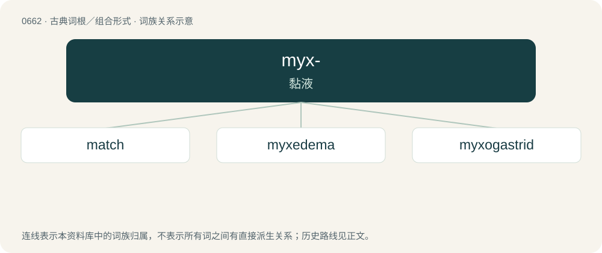

# 0735 · myx- — 黏液

[总目录](../00_总目录_按常用程度.md)

**类型**：古典词根／组合形式　｜　**来源语言**：古希腊语

## 核心含义与来源

- 核心含义：黏液
- 英文含义：slime
- 词形：myx-

**来源词形**：μύσσομαι, μύξα (múxa)

## 词族图

## 单词速览（常用到不常用）

| 单词 | 音标 | 释义 |
|---|---|---|
| [match](#w-1) | /mæt͡ʃ/ | 【英文】A small wooden stick specially treated with chemicals to produce flame upon contact with another chemical, from the frictional heat produced by striking it against a surface, or both; other similar items made from ch |
| [myxedema](#w-2) | /,miksəˈdiːmə/ | n. 粘液水肿；\[医\] 粘液\[性\]水肿 |
| [myxogastrid](#w-3) |  | 【英文】Any of the Myxogastria, a group of slime molds. |

## 逐词详解

### 1. match

**词性**：名词　｜　**音标**：/mæt͡ʃ/

**英文义项**：A small wooden stick specially treated with chemicals to produce flame upon contact with another chemical, from the frictional heat produced by striking it against a surface, or both; other similar items made from chemically-treated paper, cardboard, etc. / Synonym of taper, a thin stick used to transfer flame, as from tender to a candle.

**词源与演化**：

From Middle English macche, mecche (“wick (of a candle)”), from Old French mesche, meische, from Vulgar Latin micca (compare Catalan metxa, Spanish mecha, Italian miccia), which in turn is probably from Latin myxa (“nozzle, curved part of a lamp”), from Ancient Greek μύξα (múxa, “lamp wick”).

**例句**：

> He struck a match and lit his pipe.

该用例对应义项：A small wooden stick specially treated with chemicals to produce flame upon contact with another chemical, from the frictional heat produced by striking it against a surface, or both; other similar items made from chemically-treated paper, cardboard, etc.

### 2. myxedema

**词性**：名词　｜　**音标**：/,miksəˈdiːmə/

**中文释义**：n. 粘液水肿；\[医\] 粘液\[性\]水肿

**英文义项**：A form of cutaneous and dermal edema that is secondary to increased deposition of connective tissue components in subcutaneous tissue.

**词源与演化**：

By surface analysis, myx(o)- + edema.

### 3. myxogastrid

**词性**：名词

**英文义项**：Any of the Myxogastria, a group of slime molds.

## 其他候选词

- myxoedema
- Myxini
