# 0760 · ali-, alter- — 别的；另一方；变成另一种样子

[逐词精讲目录](../00_逐词精讲目录.md) · [总目录](../00_总目录_按常用程度.md)

## 核心词根与来源

这组词根的本质是 **“别的、另一个”**。拉丁语 alius 表示别的，alter 常表示两者中的另一方。沿着这个画面：属于别处的是 alien，变成别的样子是 alter，一个接另一个是 alternate，关心别人则连到 altruism。

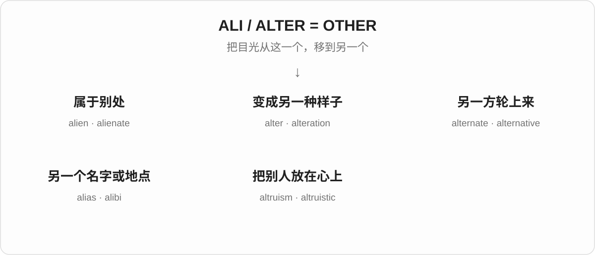

## 词形与演化规律

ali- 和 alter- 属于同一“别的”词族，但不应把它们画成所有情况下都可以互换的字母片段。alien 这支经 aliēnus“属于别人的”发展；alter 这支很适合串起改变、轮流和另一种选择。alias 的“另一个”落在名字上，alibi 则落在地点上。

## 单词速览（常用到不常用）

| 单词 | 音标 | 核心意思 |
|---|---|---|
| [alternative](#w-1) | 英 /ɔːlˈtɜːnətɪv/；美 /ɔːlˈtɜːrnətɪv/ | 另一种选择；替代的 |
| [alien](#w-2) | /ˈeɪliən/ | 外来的；陌生的；外星人 |
| [alternate](#w-3) | 动词 /ˈɔːltəneɪt/；形容词 /ɔːlˈtɜːnət/ | 交替；轮流；隔一个的；备用的 |
| [alter](#w-4) | 英 /ˈɔːltə/；美 /ˈɔːltər/ | 改动；改变 |
| [altered](#w-5) | /ˈɔːltəd/ | 改变了的；被改过的 |
| [alternatively](#w-6) | /ɔːlˈtɜːnətɪvli/ | 或者；也可以换一种办法 |
| [alias](#w-7) | /ˈeɪliəs/ | 别名；化名 |
| [alteration](#w-8) | /ˌɔːltəˈreɪʃən/ | 改动；修改 |
| [alienated](#w-9) | /ˈeɪliəneɪtɪd/ | 感到疏离的；被疏远的 |
| [alternately](#w-10) | /ɔːlˈtɜːnətli/ | 交替地；轮流地 |
| [alienation](#w-11) | /ˌeɪliəˈneɪʃən/ | 疏离；异化；转让 |
| [altercation](#w-12) | /ˌɔːltəˈkeɪʃən/ | 争吵；口角 |
| [alibi](#w-13) | /ˈæləbaɪ/ | 不在场证据；托词 |
| [alienate](#w-14) | /ˈeɪliəneɪt/ | 使疏远；使失去认同 |
| [altruistic](#w-15) | /ˌæltruˈɪstɪk/ | 利他的；无私助人的 |
| [altruism](#w-16) | /ˈæltruɪzəm/ | 利他；为别人着想 |
| [alternator](#w-17) | 英 /ˈɔːltəneɪtə/；美 /ˈɔːltərneɪtər/ | 交流发电机 |
| [inalienable](#w-18) | /ɪnˈeɪliənəbəl/ | 不可转让的；不可剥夺的 |

## 逐词讲解

### 1. alternative — 另一种选择；替代的

**音标**：英 /ɔːlˈtɜːnətɪv/；美 /ɔːlˈtɜːrnətɪv/

**先抓住这个画面**

面前有一条路，旁边还有另一条可以走。alternative 就是这条“别的路”，既可指选择，也可形容替代方案。

**怎么拆**

来自拉丁语 alternātīvus，经法语进入英语；与 alter“另一方”、alternate“轮换”同族。

**怎么变成今天的意思**

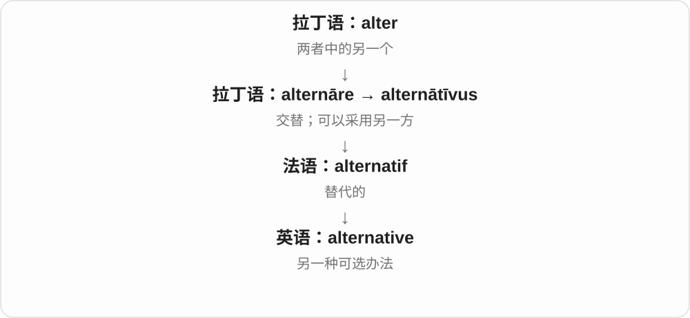

从另一方可以轮上来，发展到另一种可用的选择。现代英语不要求永远只能二选一，several alternatives 完全可以表示多个备选方案。

**常见搭配与例句**

an alternative to…；an alternative route；have no alternative but to…。

> Cycling is a practical alternative to driving for short trips.

短途出行时，骑车是开车之外的一种实用选择。

> We need an alternative plan in case it rains.

我们需要一个下雨时可用的替代方案。

**别混淆**

alternative 通常强调能用来替代现有方案；option 更宽泛，任何可选项都可以是 option。

### 2. alien — 外来的；陌生的；外星人

**音标**：/ˈeɪliən/

**先抓住这个画面**

先别急着想飞碟。alien 最初的画面是“这不是我们这边的，属于别处”。换到科幻里，来自别的星球的生命就成了 an alien。

**怎么拆**

ali- 与拉丁语 alius“别的”相关，aliēnus 表示属于别人的。现代 alien 已是完整词，不要把结尾硬拆成英语后缀。

**怎么变成今天的意思**

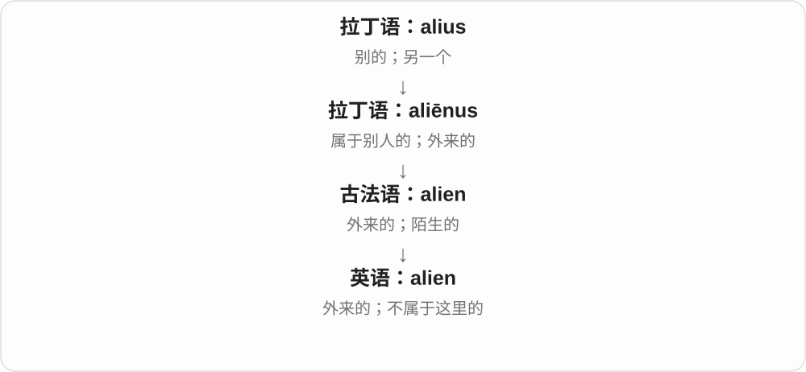

外来的植物可以是 alien species；完全不熟悉的做法可以是 alien to me。它们都保留“不是原来这一边的”感觉。指人时，法律文本中的 alien 有特定用法，日常称呼通常用更具体的词。

**常见搭配与例句**

alien species；alien to someone；an alien civilization。

> The custom was completely alien to me.

这种习俗对我来说完全陌生。

> The film imagines an encounter with an alien civilization.

这部电影设想了人类与外星文明的一次相遇。

**别混淆**

alien 不总指外星人。与 ally“盟友”也不同源，不能因为开头相似就记成一组。

### 3. alternate — 交替；轮流；隔一个的；备用的

**音标**：动词 /ˈɔːltəneɪt/；形容词 /ɔːlˈtɜːnət/

**先抓住这个画面**

一个轮到另一个，再轮回来：A、B、A、B。alternate 最清楚的画面就是这种交替。

**怎么拆**

拉丁语 alter“另一方”→ alternus“轮流的”→ alternāre；英语从相关分词词形借入。动词 -ate 读 /eɪt/，形容词常弱读 /ət/。

**怎么变成今天的意思**

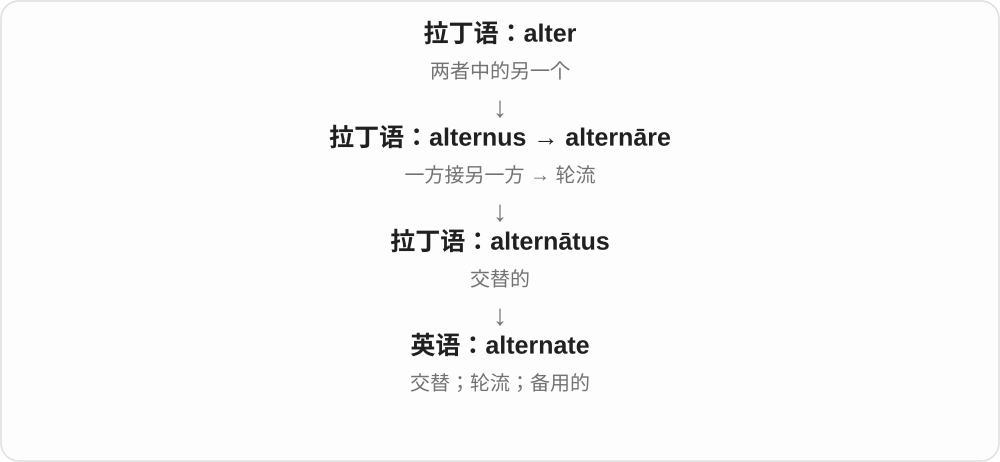

轮到另一方可以是动作 alternate，也可以形容隔一次出现的事。on alternate days 是隔天；美式英语中 alternate 还常表示备用、替代的。

**常见搭配与例句**

alternate between A and B；alternate with…；on alternate days。

> We alternate between working at home and working in the office.

我们轮流居家办公和去办公室工作。

> The clinic is open on alternate Saturdays.

这家诊所隔一个星期六开放一次。

**别混淆**

alternate 与 alternative 在“替代”义上有重叠，但表达轮流时用 alternate。alternating current 是交流电。

### 4. alter — 改动；改变

**音标**：英 /ˈɔːltə/；美 /ˈɔːltər/

**先抓住这个画面**

东西还在，但你把它改成了另一种样子：衣服改短一点、计划换一部分、设置调一调，都可以 alter。

**怎么拆**

拉丁语 alter“另一个”→ alterāre“使成为另一种样子”，经法语进入英语。不是 all + ter。

**怎么变成今天的意思**

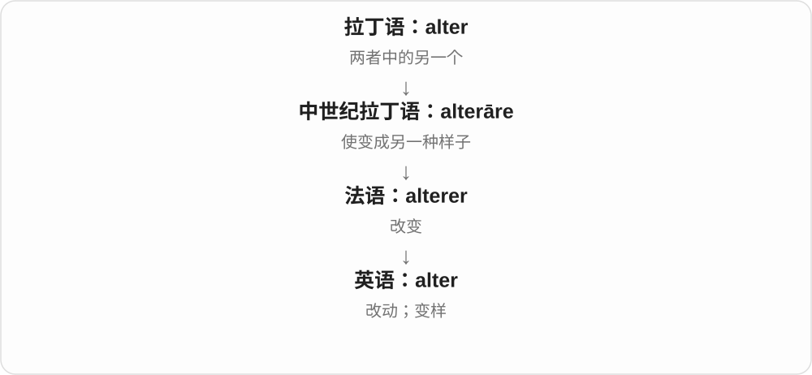

“另一种”变成一个动作，就是改变原来的样子。alter 常给人修改现有东西的感觉，不必整件换掉。

**常见搭配与例句**

alter a plan；alter the settings；have clothes altered。

> We altered the plan after hearing your suggestions.

听了你的建议后，我们修改了计划。

> She had the dress altered to fit her better.

她请人改了裙子，让它更合身。

**别混淆**

change 用途更广，可以整体换新；alter 常指原物基础上的调整。altar“祭坛”发音相同，但来源和意思不同。

### 5. altered — 改变了的；被改过的

**音标**：/ˈɔːltəd/

**先抓住这个画面**

把原版和眼前这版放在一起，能发现已经不是原来的样子。这就是 altered。

**怎么拆**

alter + -ed，表示改变后的状态。词尾 -ed 通常读 /d/。

**怎么变成今天的意思**

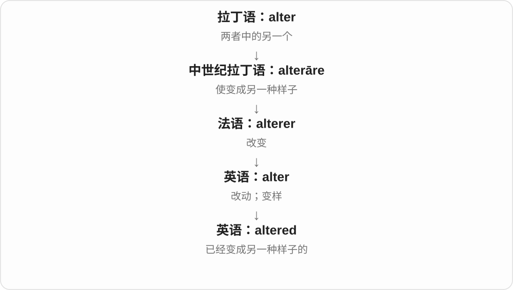

它只说明发生了改变，不告诉你是变好、变坏还是被人做了手脚。altered image 是改过的图像，具体改动要看语境。

**常见搭配与例句**

an altered image；altered circumstances；an altered state。

> The altered image no longer matched the original.

改过的图像已经与原图不一致。

> We had to respond to the altered circumstances.

我们不得不应对已经变化的情况。

**别混淆**

altered 不自动等于 fake。修正亮度的照片也被 altered，但是否构成误导，要看具体改了什么。

### 6. alternatively — 或者；也可以换一种办法

**音标**：/ɔːlˈtɜːnətɪvli/

**先抓住这个画面**

你刚说完一个方案，又补一句“还有个办法”。alternatively 就是把读者带到另一条可选路线。

**怎么拆**

alternative + -ly，把另一种选择变成连接句子、提出选择的副词。

**怎么变成今天的意思**

它不是说两个方案必须来回轮换，而是说可以从中选择另一个。写说明和给建议时很常用。

**常见搭配与例句**

Alternatively, you can…；Alternatively, we could…。

> You can take the bus. Alternatively, you can walk through the park.

你可以坐公交，也可以穿过公园走过去。

> We could meet on Friday; alternatively, we could talk online.

我们可以周五见面，或者在线聊。

**别混淆**

alternately 描述 A、B 交替发生；alternatively 提供 B 作为 A 的备选。

### 7. alias — 别名；化名

**音标**：/ˈeɪliəs/

**先抓住这个画面**

同一个人或东西，挂了另一个名字。这个另外的名字就是 alias。它可以用于写作、网络账号，也可以用于程序和数据库。

**怎么拆**

来自拉丁语 alias“在别的时候、换个说法”，与 alius“别的”相关。不是 a + lias。

**怎么变成今天的意思**

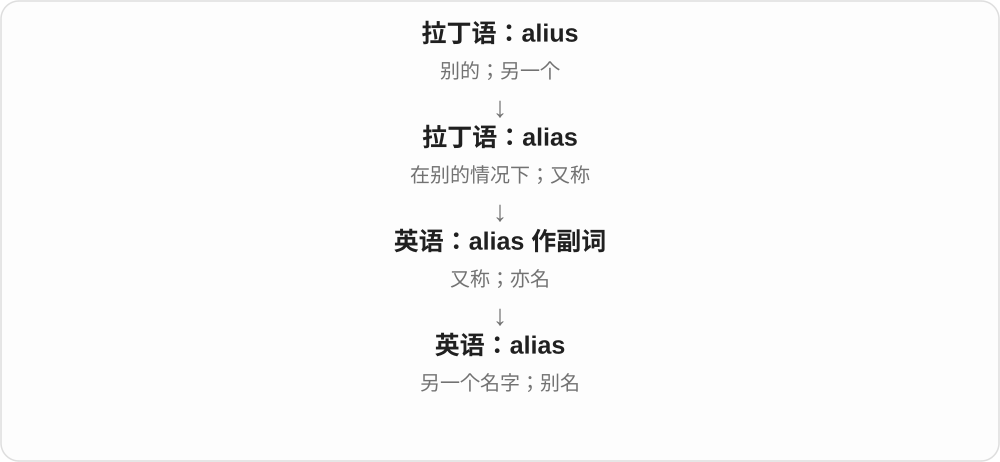

从“又称……”的表达，发展到指那个另外使用的名字。用别名不一定是在骗人，作家笔名和技术系统的别名也都很正常。

**常见搭配与例句**

use an alias；under an alias；an email alias。

> The writer published the novel under an alias.

这位作者用化名出版了小说。

> This address is an alias for my main email account.

这个地址是我主邮箱账号的别名。

**别混淆**

alias 是另一个名字；alibi 是不在场证据。它们都与“别的”有关，但别的是名字还是地点，要分开。

### 8. alteration — 改动；修改

**音标**：/ˌɔːltəˈreɪʃən/

**先抓住这个画面**

alter 是动手改，alteration 是改的这件事，或者改出来的那一处。常见于衣服修改、房屋改造和文本调整。

**怎么拆**

现代可分析为 alter + -ation；历史上也经法语承接拉丁语 alterātiō。

**怎么变成今天的意思**

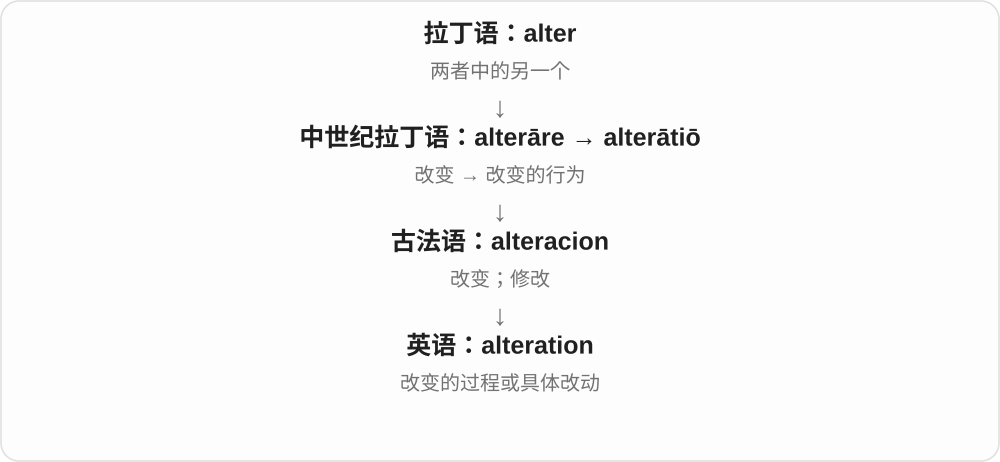

一个名词把动作变成可数的改动：make a few alterations，就是做几处修改。衣服店里的 alterations 常直接指改衣服务。

**常见搭配与例句**

make alterations to…；minor alterations；clothing alterations。

> The jacket needs a few minor alterations.

这件夹克需要做几处小修改。

> No alteration to the design is necessary.

这个设计无需改动。

**别混淆**

alteration 是改动，不一定是改进；improvement 才明确表示变得更好。

### 9. alienated — 感到疏离的；被疏远的

**音标**：/ˈeɪliəneɪtɪd/

**先抓住这个画面**

人还在这个群体里，心里却觉得“这里没有我的位置”。alienated 描述的常是这种失去归属感的状态。

**怎么拆**

alienate + -ed；动词以 /t/ 结尾，所以 -ed 在这里读 /ɪd/。它既可作过去分词，也可作形容词。

**怎么变成今天的意思**

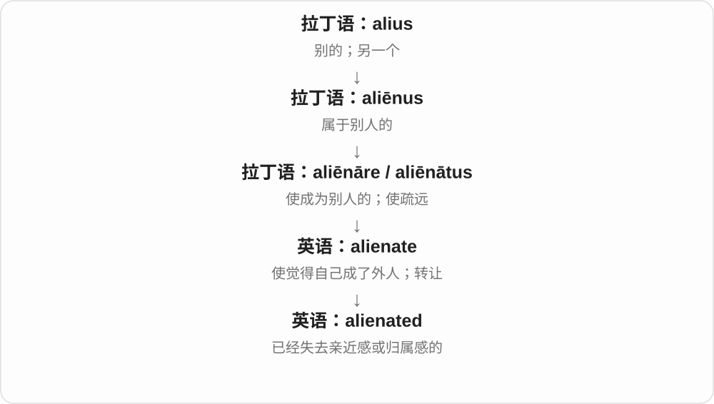

alienate 说某种行为把人推远，alienated 则说被推远之后人的感受。人多不多不是关键：身处人群中，也可能 feel alienated。

**常见搭配与例句**

feel alienated；alienated from one’s family；socially alienated。

> She felt alienated from the rest of the team.

她感到自己与团队其他人之间有隔阂。

> The new rules left many employees feeling alienated.

新规定让许多员工感到自己不被接纳。

**别混淆**

alone 是独处，lonely 是孤独，alienated 更强调与人或环境之间的隔阂。三者可能同时出现，但不是一回事。

### 10. alternately — 交替地；轮流地

**音标**：/ɔːlˈtɜːnətli/

**先抓住这个画面**

一会儿这样，一会儿那样，来回换着发生。alternately 说的是变化的顺序。

**怎么拆**

alternate + -ly；这里由形容词形成副词，末尾不按动词 -ate 的 /eɪt/ 来读。

**怎么变成今天的意思**

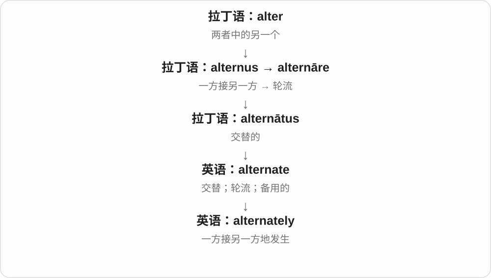

它把 A、B 交替的画面放进句子，强调轮换过程，而不是提供一个新的选择。

**常见搭配与例句**

alternately hot and cold；work alternately；laugh and cry alternately。

> The lights flashed alternately red and green.

灯光交替闪着红色和绿色。

> The two speakers answered the questions alternately.

两位发言人轮流回答问题。

**别混淆**

alternately 是交替地；alternatively 常是“或者，你也可以……”。两个词只差一小段，句子逻辑却不同。

### 11. alienation — 疏离；异化；转让

**音标**：/ˌeɪliəˈneɪʃən/

**先抓住这个画面**

alienation 把“我好像不属于这里”的体验变成一个可以讨论的问题：人与家人、工作、群体，甚至与自己的生活之间，产生了距离。

**怎么拆**

经法语来自拉丁语 aliēnātiō，与 alienate 同族。现代可用 alienate → alienation 联系动作和状态。

**怎么变成今天的意思**

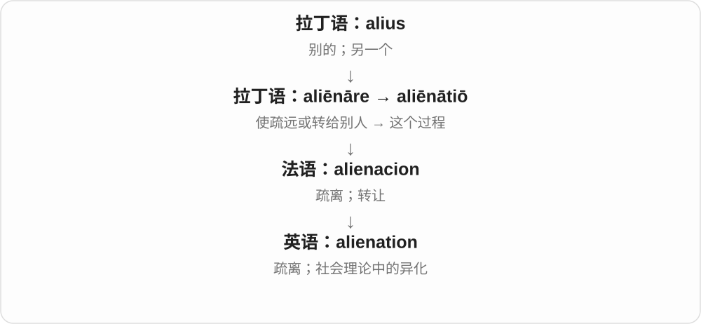

一般语境谈关系上的疏离；社会理论中的“异化”有更具体的解释，不能缩成普通孤独。法律用法又保留“转给别人”的另一条意义。

**常见搭配与例句**

a sense of alienation；alienation from work；social alienation。

> The novel explores a young man’s sense of alienation.

小说探讨了一个年轻人的疏离感。

> Having no say in decisions increased the workers’ alienation.

无法参与决策，加深了工人的疏离感。

**别混淆**

estrangement 常谈原本亲近的人关系变陌生；alienation 也常谈人与整个环境、劳动或生活的关系。

### 12. altercation — 争吵；口角

**音标**：/ˌɔːltəˈkeɪʃən/

**先抓住这个画面**

你一句，我一句，越说越冲，最后吵起来。这种带火气的口头争执就是 altercation。

**怎么拆**

来自拉丁语 altercārī“与另一人争辩”及 altercātiō，联系到 alter“另一方”。不是 alter“改变”加一个英语后缀 cation。

**怎么变成今天的意思**

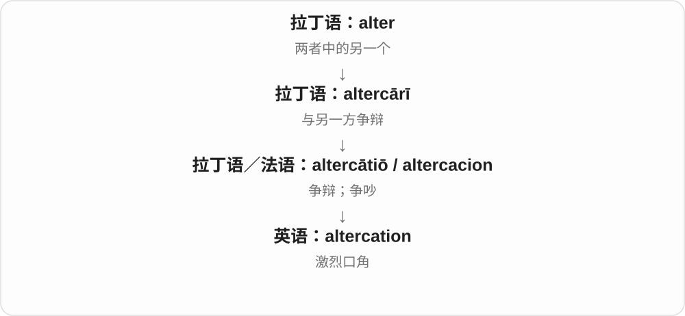

“一人说完另一人接话”可以帮助想象双方争执，但只是对这条语义联系的解释，不是说普通轮流发言都叫 altercation。现代词通常带冲突意味。

**常见搭配与例句**

a verbal altercation；get into an altercation；an altercation with someone。

> The disagreement turned into a heated altercation.

分歧演变成了一场激烈争吵。

> He left before the verbal altercation became worse.

口角进一步恶化前，他离开了。

**别混淆**

discussion 可以很平静；altercation 通常已经吵起来。它不自动表示动手打架。

### 13. alibi — 不在场证据；托词

**音标**：/ˈæləbaɪ/

**先抓住这个画面**

有人问“事情发生时你在哪里”，你说“我在别处”，而且能拿出证据。这个证明就是 alibi 的核心。

**怎么拆**

来自拉丁语 alibī“在别处”，与 alius“别的”相关。它不是 a lie“一个谎言”的变形。

**怎么变成今天的意思**

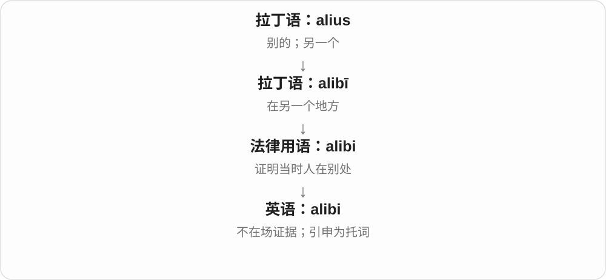

地点上的“别处”成了说明自己不在现场的依据。日常语境又会把它扩大为逃避责难的借口，但不能反过来说所有 alibi 都是假的。

**常见搭配与例句**

have an alibi；a convincing alibi；check someone’s alibi。

> The security footage confirmed her alibi.

监控录像证实了她的不在场证据。

> He used the delayed train as an alibi for missing the meeting.

他把火车晚点当作错过会议的托词。

**别混淆**

alibi 的核心是事发时在别处；excuse 更广，可以是任何解释或借口。

### 14. alienate — 使疏远；使失去认同

**音标**：/ˈeɪliəneɪt/

**先抓住这个画面**

你原本觉得“我们是一伙的”，对方的做法却让你觉得“我在这里像个外人”。造成这种疏离，就是 alienate。

**怎么拆**

历史上来自 aliēnāre / aliēnātus“使成为别人的、使疏远”。用 alien + -ate“使成为外人”很好记，但它不只是现代英语临时拼出来的词。

**怎么变成今天的意思**

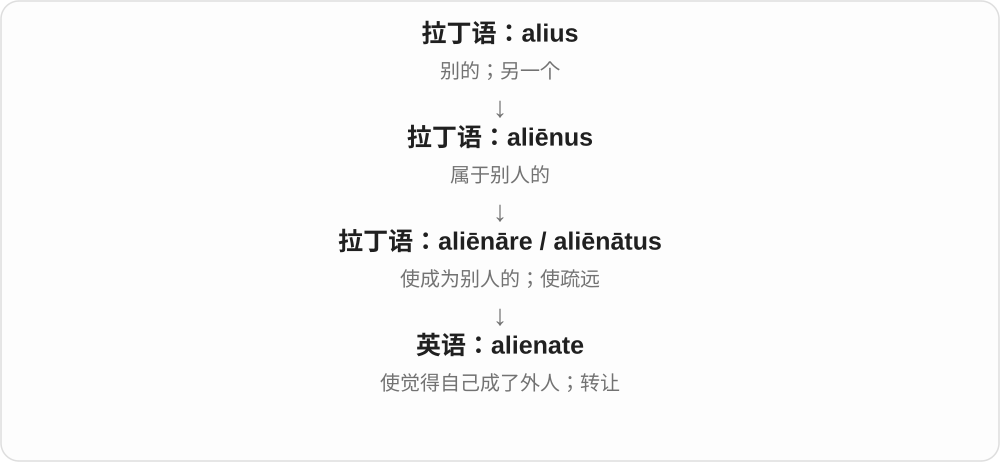

“使属于别人”在财产上是转让，在关系上则是使人不再亲近、认同或支持。因此一个决定可以 alienate friends，也可以 alienate voters。

**常见搭配与例句**

alienate someone；alienate someone from…；alienate voters。

> His constant criticism began to alienate his friends.

他不停地批评别人，开始让朋友们疏远他。

> The decision may alienate customers who value privacy.

这个决定可能失去重视隐私的顾客的支持。

**别混淆**

annoy 是让人生气或烦；alienate 更进一步，可能损害联系和支持。isolate 偏把人隔开，不一定涉及内心的归属感。

### 15. altruistic — 利他的；无私助人的

**音标**：/ˌæltruˈɪstɪk/

**先抓住这个画面**

一个行为的出发点主要是“这样能帮到别人”，可以说它 altruistic。

**怎么拆**

altruist（利他的人）+ -ic（具有这种性质的）；与 altruism 是同一现代词族。

**怎么变成今天的意思**

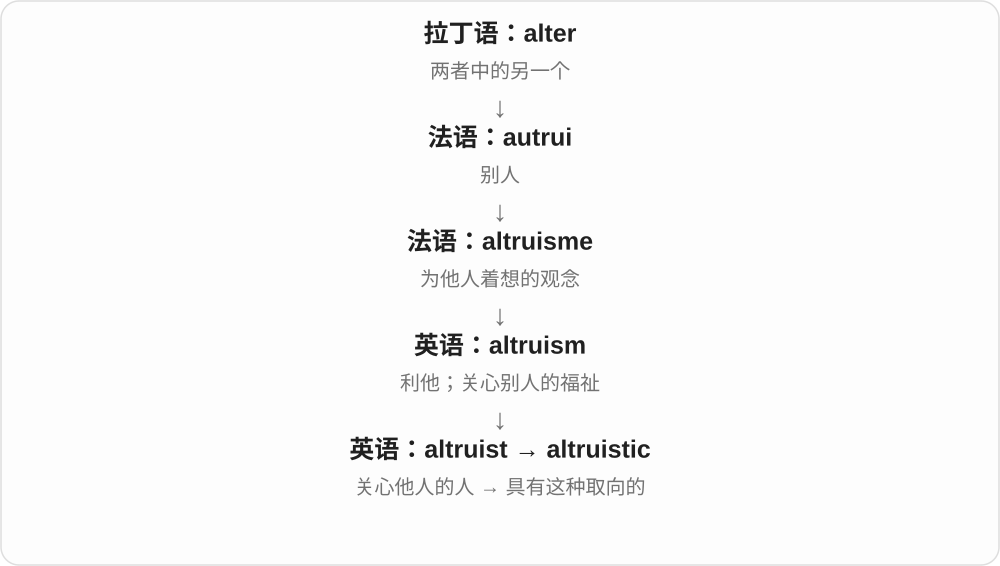

从利他这套观念，变成形容具体动机或行为的词。它评价为什么这样做，不只评价最后有没有人得利。

**常见搭配与例句**

altruistic motives；altruistic behavior；an altruistic act。

> His offer to help seemed genuinely altruistic.

他提出帮忙，看起来确实是出于为别人着想。

> The study explored altruistic behavior among strangers.

这项研究探讨了陌生人之间的利他行为。

**别混淆**

helpful 说有帮助，altruistic 更强调为别人着想的动机。提供付费服务也可以很 helpful，却未必主要出于利他。

### 16. altruism — 利他；为别人着想

**音标**：/ˈæltruɪzəm/

**先抓住这个画面**

做决定时，不只问“我能得到什么”，也愿意为别人的好处付出。这是 altruism 的日常画面。

**怎么拆**

来自法语 altruisme，由表示“别人”的 autrui 与 -isme 构成；更早联系到拉丁语 alter“另一方”。

**怎么变成今天的意思**

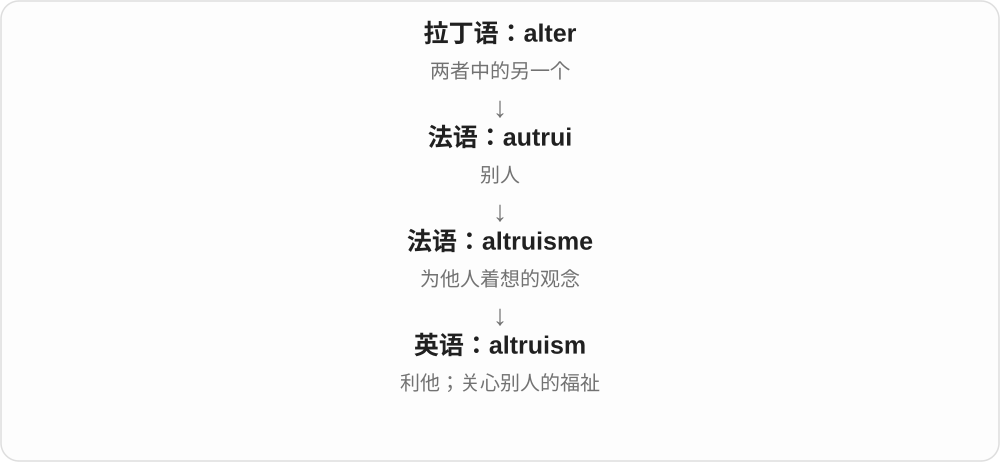

“别人”成为关心的对象，就有了利他的概念。它不要求每次帮助都轰轰烈烈，花时间给陌生人指路也能体现这种取向。

**常见搭配与例句**

an act of altruism；genuine altruism；altruism and self-interest。

> Her decision to volunteer was motivated by altruism.

她决定做志愿者，是出于对他人的关心。

> Small acts of altruism can strengthen a community.

小小的利他行为也能增强社区的联系。

**别混淆**

altruism 强调他人的利益；generosity 强调愿意给予。两者常重合，但一件慷慨行为也可能带有其他目的。

### 17. alternator — 交流发电机

**音标**：英 /ˈɔːltəneɪtə/；美 /ˈɔːltərneɪtər/

**先抓住这个画面**

电流的方向来回变化，像 A、B 轮流出现。产生这种交流电的发电机，就叫 alternator。

**怎么拆**

alternate（交替）+ -or（执行动作的设备或角色）。这里与 alternating current“交流电”联系记最直接。

**怎么变成今天的意思**

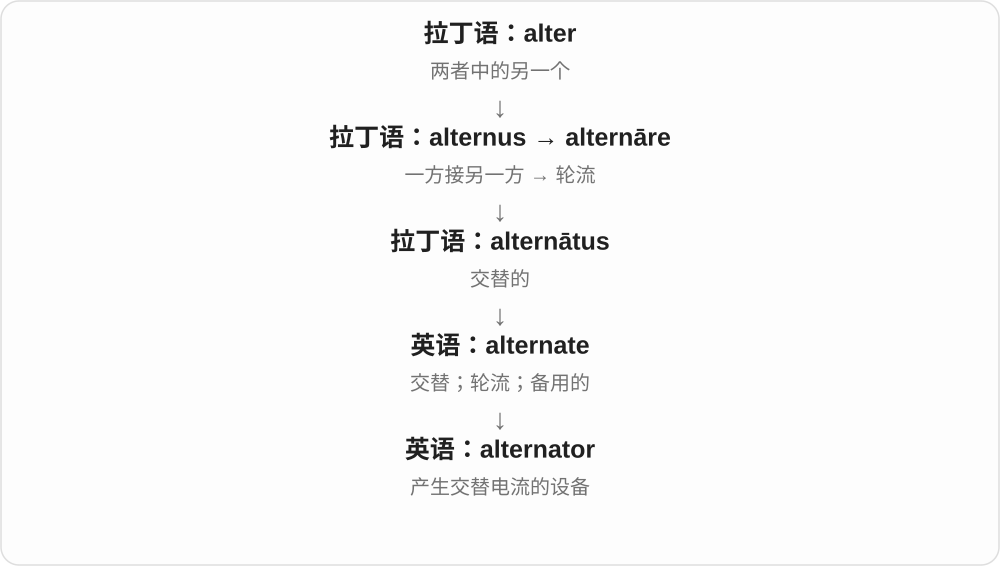

名字先说明它产生的电流类型。汽车里的 alternator 产生交流电后通常会经整流供电和充电，所以不能只凭名字说汽车电池直接接交流电。

**常见搭配与例句**

a car alternator；replace the alternator；alternator output。

> The mechanic replaced the faulty alternator.

修车师傅更换了有故障的交流发电机。

> The alternator supplies power while the engine is running.

发动机运转时，发电机提供电力。

**别混淆**

generator 是发电机的总称；alternator 特指产生交流电的类型。motor 则把电能转换为机械运动。

### 18. inalienable — 不可转让的；不可剥夺的

**音标**：/ɪnˈeɪliənəbəl/

**先抓住这个画面**

有些权利不是能随便交给别人、卖掉或夺走的东西。inalienable 表达的就是“不能从这个人身上拿走或转出去”。

**怎么拆**

in-（否定）+ alienable（可转让的）。alienable 的根源是 alienate 的“转给别人”义，不是“外星人的”。

**怎么变成今天的意思**

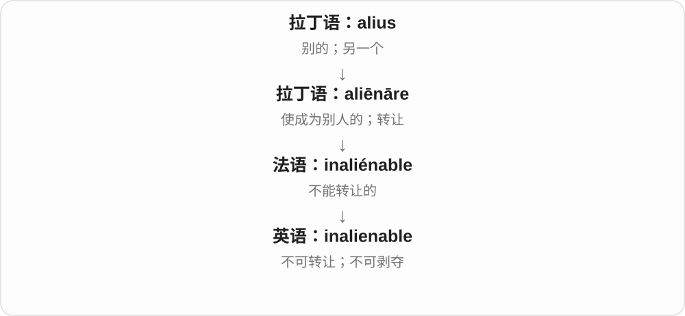

从“变成别人的财产”到“可以转让”，再加否定，就得到“不能这样转出去”。这条线索解释了为什么它常修饰 rights。

**常见搭配与例句**

inalienable rights；an inalienable right to…；inalienable dignity。

> The declaration describes freedom as an inalienable right.

这份宣言把自由描述为不可剥夺的权利。

> They argued that human dignity is inalienable.

他们主张人的尊严不可剥夺。

**别混淆**

inalienable 不是无论什么情况下都不受限制。它的具体法律含义取决于文本；学习时先记住不可转让、不可任意剥夺这个核心。

## 这一组要分清什么

**ally 与 alienate**：一个把人联合起来，一个把人推远；意义可对照，词源却不同。ally 属于 ligāre“绑”。

**alternately 与 alternatively**：一个是 A、B 轮流发生，一个是提供另一个方案。

**alter 与 altar**：前者是改动，后者是祭坛。

**alias 与 alibi**：另一个名字，和另一个地点。

## 串起来练习

**We can alter the plan. Alternatively, we can choose another route.**

我们可以修改计划，也可以选择另一条路线。alter 改现有的样子，alternatively 提供另一种办法。
