# 0826 · aud- — 听；听见；由听取形成的检查与评选

[逐词精讲目录](../00_逐词精讲目录.md) · [总目录](../00_总目录_按常用程度.md)

## 核心词根与来源

**aud-** 来自拉丁语 **audīre**“听”。audible 说声音能被听到，audience 是接收表达的人群，auditorium 是供大家听讲的空间。再往前走：听取账目并核查，成为 audit；让评选者听、看表演，成为 audition。两个词不能只靠拼写互相套。

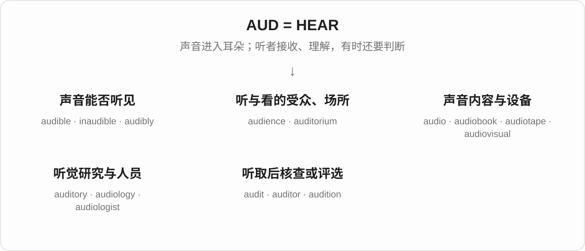

## 词形与演化规律

**audi-、audit-** 来自同一拉丁词族的不同形式，如 audiō、audītus。现代组合形式 **audio-** 常用来造音频、听觉相关词，audiobook 是声音与书结合，audiology 是听觉与学科成分结合。这里没有“aud 一定只能说耳朵、不许说观众”的限制；词义会随实际用途扩展。

## 单词速览（常用到不常用）

| 单词 | 音标 | 核心意思 |
|---|---|---|
| [audience](#w-1) | 英 /ˈɔːdiəns/；美 /ˈɑːdiəns/ | 听众；观众；受众；正式会见 |
| [audio](#w-2) | 英 /ˈɔːdiəʊ/；美 /ˈɑːdioʊ/ | 音频；声音部分；音频的 |
| [audit](#w-3) | 英 /ˈɔːdɪt/；美 /ˈɑːdɪt/ | 审计；系统核查；旁听课程 |
| [audition](#w-4) | 英 /ɔːˈdɪʃən/；美 /ɑːˈdɪʃən/ | 试演；试唱；参加试演 |
| [auditorium](#w-5) | 英 /ˌɔːdɪˈtɔːriəm/；美 /ˌɑːdɪˈtɔːriəm/ | 礼堂；讲堂；观众厅 |
| [auditor](#w-6) | 英 /ˈɔːdɪtə/；美 /ˈɑːdɪtər/ | 审计人员；核查者；旁听生 |
| [audible](#w-7) | 英 /ˈɔːdɪbəl/；美 /ˈɑːdɪbəl/ | 听得见的 |
| [auditory](#w-8) | 英 /ˈɔːdɪtəri/；美 /ˈɑːdɪtɔːri/ | 听觉的；与听觉有关的 |
| [audiobook](#w-9) | 英 /ˈɔːdiəʊbʊk/；美 /ˈɑːdioʊbʊk/ | 有声书 |
| [audiovisual](#w-10) | 英 /ˌɔːdiəʊˈvɪʒuəl/；美 /ˌɑːdioʊˈvɪʒuəl/ | 视听的；同时涉及声音与画面的 |
| [inaudible](#w-11) | 英 /ɪnˈɔːdɪbəl/；美 /ɪnˈɑːdɪbəl/ | 听不见的；微弱得听不到的 |
| [audibly](#w-12) | 英 /ˈɔːdɪbli/；美 /ˈɑːdɪbli/ | 听得见地；明显发出声音地 |
| [audiology](#w-13) | 英 /ˌɔːdiˈɒlədʒi/；美 /ˌɑːdiˈɑːlədʒi/ | 听力学 |
| [audiotape](#w-14) | 英 /ˈɔːdiəʊteɪp/；美 /ˈɑːdioʊteɪp/ | 录音磁带；磁带录音 |
| [audiologist](#w-15) | 英 /ˌɔːdiˈɒlədʒɪst/；美 /ˌɑːdiˈɑːlədʒɪst/ | 听力学专业人员；听力师 |

## 逐词讲解

### 1. audience — 听众；观众；受众；正式会见

**音标**：英 /ˈɔːdiəns/；美 /ˈɑːdiəns/

**先抓住这个画面**

audience 先想台下正在接收你表达的人：他们可能听演讲、看节目，也可能读文章。

**怎么拆**

来自拉丁语 audientia，与 audiēns“正在听的”有关，再经法语进入英语。现代 audience 不是 audio + ence。

**怎么变成今天的意思**

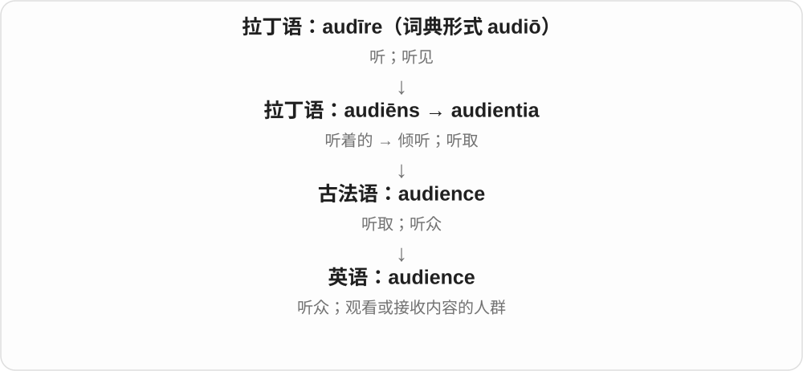

“听”的动作转向参与听的人，再扩展到视觉媒体和文字内容的接受者。an audience with someone 还保留正式获准见面、陈述的意思。

**常见搭配与例句**

a live audience；a target audience；address an audience；an audience with a leader。

> The audience fell silent as the music began.

音乐响起时，观众安静下来。

> The article was written for a young audience.

这篇文章是写给年轻读者看的。

**别混淆**

audience 常是作为整体的受众；spectators 更突出在现场看比赛或活动的人。网页的 audience 也可以从未坐到同一间屋里。

### 2. audio — 音频；声音部分；音频的

**音标**：英 /ˈɔːdiəʊ/；美 /ˈɑːdioʊ/

**先抓住这个画面**

audio 就是媒体里“用耳朵接收”的那一部分：画面正常但听不见，可以说音频出了问题。

**怎么拆**

现代英语把与 audīre 有关的构词形式 audio- 独立用作词。它也继续出现在 audiobook 等组合中。

**怎么变成今天的意思**

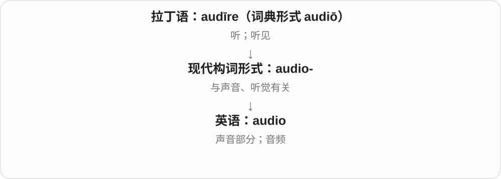

它常指录制、传输或播放的声音信号，不只是自然界中任何一种声响。audio quality 评价的是声音记录或播放得怎样。

**常见搭配与例句**

audio quality；an audio file；record audio；the audio track；audio equipment。

> The video is clear, but the audio is distorted.

画面很清楚，但声音失真了。

> She sent me an audio recording of the interview.

她把采访录音发给了我。

**别混淆**

sound 范围更宽，风声、脚步声都算；audio 常让人想到声音内容或技术中的声音信号。

### 3. audit — 审计；系统核查；旁听课程

**音标**：英 /ˈɔːdɪt/；美 /ˈɑːdɪt/

**先抓住这个画面**

audit 像逐项听取说明，再检查“说的和记录对不对得上”。现代可以审查账目，也可以核查流程和系统。

**怎么拆**

来自拉丁语 audītus“听、听取”，属于 audīre 词族。英语先有核查账目的名词，再发展出相关动词。

**怎么变成今天的意思**

早期账目检查包含口头陈述，检查者要听取汇报，听与核查因此连在一起。audit a course 则是去听课但通常不取得该课学分。

**常见搭配与例句**

conduct an audit；audit the accounts；a security audit；an internal audit；audit a course。

> The organization commissioned an independent audit of its accounts.

该组织委托外部人员对账目进行独立审计。

> I decided to audit the course without taking it for credit.

我决定旁听这门课，不修读它的学分。

**别混淆**

audit 常指按一定范围和程序进行检查，比随手 check 一下更系统。它不等于听见一点声音，也不自动等于发现造假。

### 4. audition — 试演；试唱；参加试演

**音标**：英 /ɔːˈdɪʃən/；美 /ɑːˈdɪʃən/

**先抓住这个画面**

audition 像让选角的人先听、先看你表演一小段，再决定你是否适合某个角色。

**怎么拆**

来自法语 audicion 和拉丁语 audītiō“听、听取”。现代动词由名词发展，不是 audit“审计”加上 -ion 就得到试镜。

**怎么变成今天的意思**

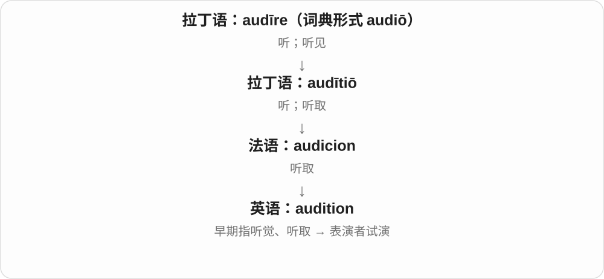

“让人听一听”后来成为表演者接受评选的机会，现代扩展到演员、舞者等，不只用耳朵评价歌手。名词试演义先于相关动词。

**常见搭配与例句**

an audition for a role；audition for a part；hold auditions；audition a performer。

> She has an audition for the lead role tomorrow.

她明天要参加主角的试演。

> More than fifty singers auditioned for the choir.

五十多名歌手参加了合唱团的试唱。

**别混淆**

interview 通常主要通过交谈了解人；audition 要展示表演能力。两者可以出现在同一次选拔中。

### 5. auditorium — 礼堂；讲堂；观众厅

**音标**：英 /ˌɔːdɪˈtɔːriəm/；美 /ˌɑːdɪˈtɔːriəm/

**先抓住这个画面**

auditorium 是把许多人聚在一起听演讲、音乐或观看表演的空间，画面重点是台下容纳听众的大厅。

**怎么拆**

来自拉丁语 audītōrium，基础是 audītōrius“与听有关的”；-ium 在这类词里常与地点或空间名称有关。

**怎么变成今天的意思**

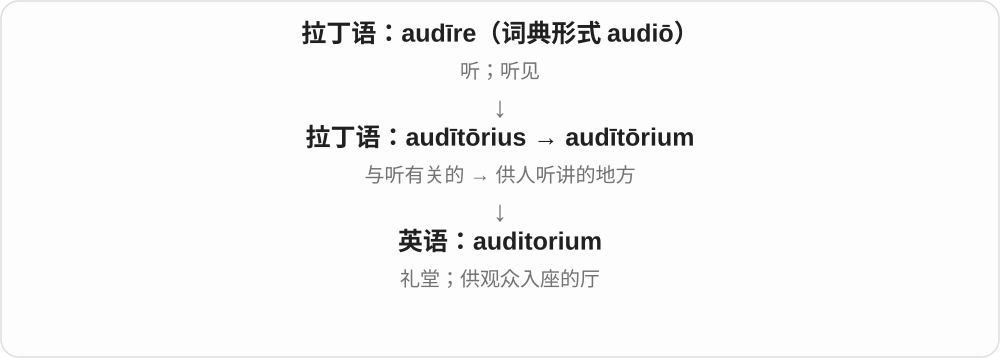

从“听的地方”发展为今天的礼堂或观众厅。它可以是一整间大厅，也可指剧院中观众坐的部分，未必包含舞台后台。

**常见搭配与例句**

a school auditorium；a packed auditorium；seats in the auditorium。

> The students gathered in the auditorium for the concert.

学生们聚集到礼堂里听音乐会。

> The auditorium can seat five hundred people.

这个观众厅能容纳五百人就座。

**别混淆**

audience 是人群；auditorium 是人群所在的空间。hall 范围更广，未必专供观看或听讲。

### 6. auditor — 审计人员；核查者；旁听生

**音标**：英 /ˈɔːdɪtə/；美 /ˈɑːdɪtər/

**先抓住这个画面**

auditor 是负责听取说明、核对记录的人；在课程场景，也可以是坐下来学习却不修学分的旁听者。

**怎么拆**

经盎格鲁诺曼语 auditour，来自拉丁语 audītor“听者”。现代 audit + -or 很好记，但整词并非最初在英语里这样拼出来。

**怎么变成今天的意思**

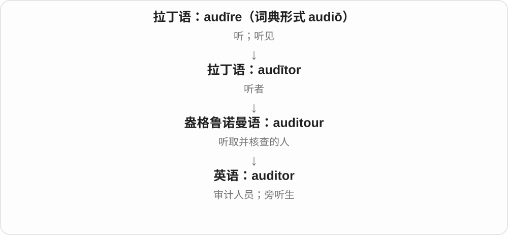

职业义保留了听取并检查的历史角色；现代审计当然还会查阅材料和数据。旁听生义则更直接回到“来听课的人”。

**常见搭配与例句**

an external auditor；an internal auditor；the auditor’s report；attend as an auditor。

> The auditor asked for supporting records for the payments.

审计人员要求提供这些付款的证明记录。

> She joined the history course as an auditor.

她以旁听生身份参加了历史课程。

**别混淆**

accountant 常处理会计记录和财务工作；auditor 重点检查记录与流程。两种专业角色有关，但不是同一个词。

### 7. audible — 听得见的

**音标**：英 /ˈɔːdɪbəl/；美 /ˈɑːdɪbəl/

**先抓住这个画面**

audible 只先过一关：“耳朵能不能捕捉到这个声音？”不要求它特别响，也不保证内容清楚。

**怎么拆**

来自晚期拉丁语 audibilis，经法语传入；aud- 是听，-ible 表示可以被这样感知。

**怎么变成今天的意思**

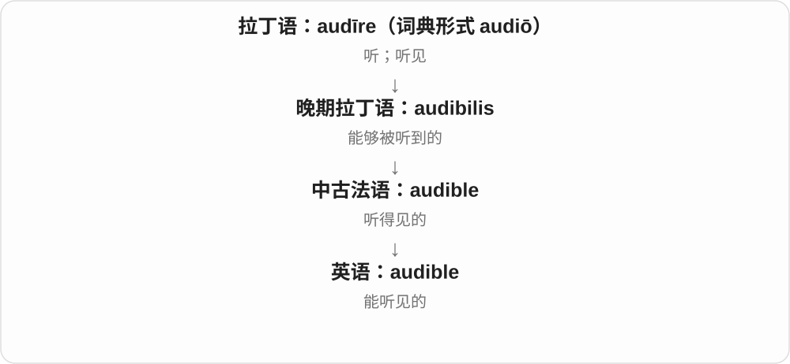

这里要从声音这一边看：它能被听见。barely audible 是声音勉强越过听见的门槛，不是声音很悦耳。

**常见搭配与例句**

barely audible；clearly audible；audible to someone；an audible sigh。

> Her voice was barely audible above the traffic.

在车流声中，她的声音几乎听不见。

> There was an audible sigh of relief from the audience.

观众席传来明显可闻的松了一口气的声音。

**别混淆**

audible 是听得见；clear 是听得清或表达清楚。隔着墙的人声可能 audible，却听不清每个字。

### 8. auditory — 听觉的；与听觉有关的

**音标**：英 /ˈɔːdɪtəri/；美 /ˈɑːdɪtɔːri/

**先抓住这个画面**

auditory 不是问声音有多响，而是把注意力放在听觉这条通道上：耳朵收到什么，大脑怎样处理。

**怎么拆**

来自拉丁语 audītōrius“与听或听者有关的”，属于 audīre 词族。-ory 在这里构成相关性质的形容词。

**怎么变成今天的意思**

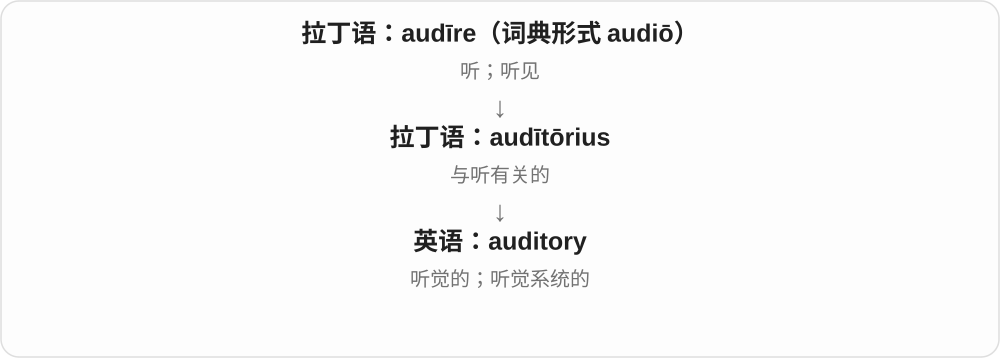

auditory memory 是对听到内容的记忆，auditory signal 是通过声音传达的信号。常见于学习、心理与生理讨论。

**常见搭配与例句**

auditory perception；auditory memory；the auditory system；an auditory signal。

> The task tests auditory memory rather than visual memory.

这项任务测试听觉记忆，而不是视觉记忆。

> An auditory signal warned us that the door was closing.

一声提示音提醒我们门正在关闭。

**别混淆**

audible 评价一个声音能否听见；auditory 说明它属于听觉领域。auditory system 不能换成 audible system。

### 9. audiobook — 有声书

**音标**：英 /ˈɔːdiəʊbʊk/；美 /ˈɑːdioʊbʊk/

**先抓住这个画面**

audiobook 就是把书的内容变成可以听的版本，眼睛不用盯着页面，也能跟着故事走。

**怎么拆**

audio-（声音）+ book（书），是现代英语组合词，不是古代拉丁语已经有了有声书。

**怎么变成今天的意思**

book 提供内容形式，audio 说明接收方式。朗读可以完整，也可以是删节版，是否完整还要看版本说明。

**常见搭配与例句**

listen to an audiobook；an audiobook narrator；an unabridged audiobook（完整版有声书）。

> I listened to an audiobook on the train.

我在火车上听了一本有声书。

> The author narrated the audiobook herself.

这本有声书由作者亲自朗读。

**别混淆**

audiobook 通常对应书籍；podcast 是按节目或系列发布的音频，内容不一定来自一本书。

### 10. audiovisual — 视听的；同时涉及声音与画面的

**音标**：英 /ˌɔːdiəʊˈvɪʒuəl/；美 /ˌɑːdioʊˈvɪʒuəl/

**先抓住这个画面**

audiovisual 把耳朵和眼睛一起用上：有声音，也有图像，比如带讲解的演示视频。

**怎么拆**

audio-（听、声音）+ visual（视觉的）。两个成分分别点明接收信息的通道。

**怎么变成今天的意思**

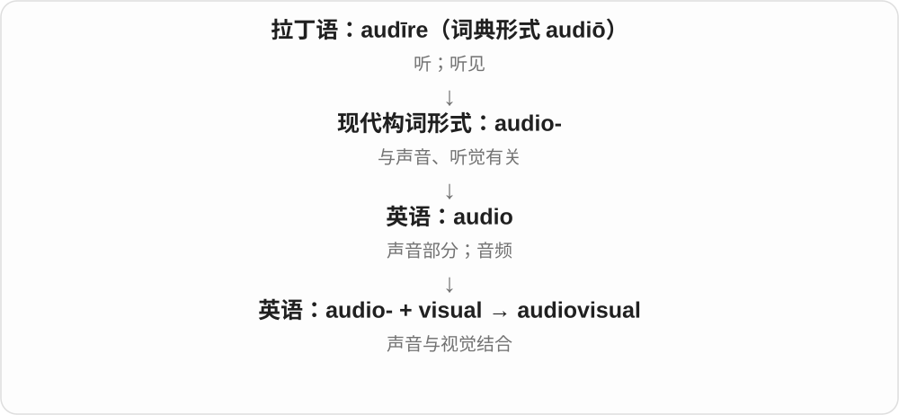

它可形容内容，也可形容录制、播放这类内容的设备。不能因为词里有两个感官，就理解成所有感官都参与。

**常见搭配与例句**

audiovisual equipment；audiovisual materials；an audiovisual presentation；audiovisual aids。

> The classroom has modern audiovisual equipment.

这间教室配有现代视听设备。

> The museum uses audiovisual displays to explain the excavation.

博物馆用视听展示来介绍这次发掘。

**别混淆**

audio 只强调声音；visual 只强调视觉；audiovisual 把两者结合。multimedia 的范围还可以更广。

### 11. inaudible — 听不见的；微弱得听不到的

**音标**：英 /ɪnˈɔːdɪbəl/；美 /ɪnˈɑːdɪbəl/

**先抓住这个画面**

inaudible 是声音没有进入听者的耳朵：可能太轻、太远，或被其他声音盖住。

**怎么拆**

in-（不）+ audible。这里的 in- 是否定，否定的是“可听到”。

**怎么变成今天的意思**

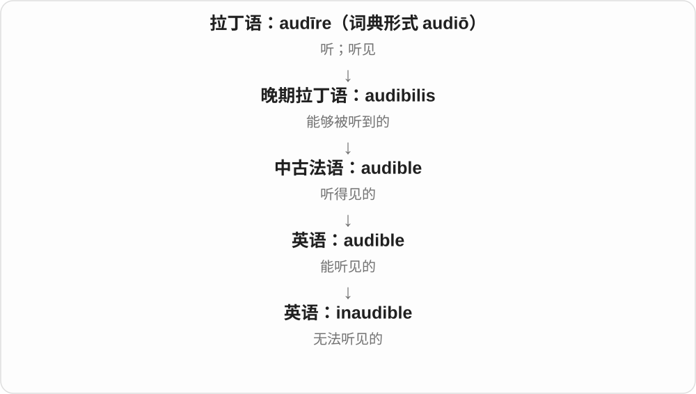

它不一定表示完全没有发声，只表示在当前条件下听不到。录音里某一段 inaudible，也不能自动断定说话人没有讲话。

**常见搭配与例句**

almost inaudible；be inaudible to…；an inaudible whisper；the final words were inaudible。

> The final sentence was inaudible because of the applause.

最后一句被掌声盖住了，听不见。

> At that distance, the engine was almost inaudible.

隔着那么远，发动机的声音几乎听不到。

**别混淆**

silent 是没有声音或保持安静；inaudible 是听不到。声源可能在发声，只是听者无法捕捉。

### 12. audibly — 听得见地；明显发出声音地

**音标**：英 /ˈɔːdɪbli/；美 /ˈɑːdɪbli/

**先抓住这个画面**

audibly 让你留意：这个动作伴随着别人确实能听到的声音，而不只是心里发生了变化。

**怎么拆**

audible + -ly，词尾 -le 改成 -ly，得到 audibly。

**怎么变成今天的意思**

audible 描述声音可听，audibly 用来描述说话、叹气、喘气等怎样发生。它不一定意味着故意大声。

**常见搭配与例句**

sigh audibly；gasp audibly；speak audibly；breathe audibly。

> He sighed audibly when the meeting was extended.

会议宣布延长时，他叹了口气，大家都听见了。

> She spoke audibly, but only the front row heard every word.

她的声音能听见，但只有前排听清了每个词。

**别混淆**

audibly 是确实听得到；loudly 是声音大。轻轻一叹，只要周围安静，也可以 audibly。

### 13. audiology — 听力学

**音标**：英 /ˌɔːdiˈɒlədʒi/；美 /ˌɑːdiˈɑːlədʒi/

**先抓住这个画面**

audiology 把“听得怎样”变成研究对象：声音怎样被感知，听力出现问题时怎样评估和帮助。

**怎么拆**

audio-（听觉）+ -logy（研究、学科），是现代科学利用古典成分组成的术语。

**怎么变成今天的意思**

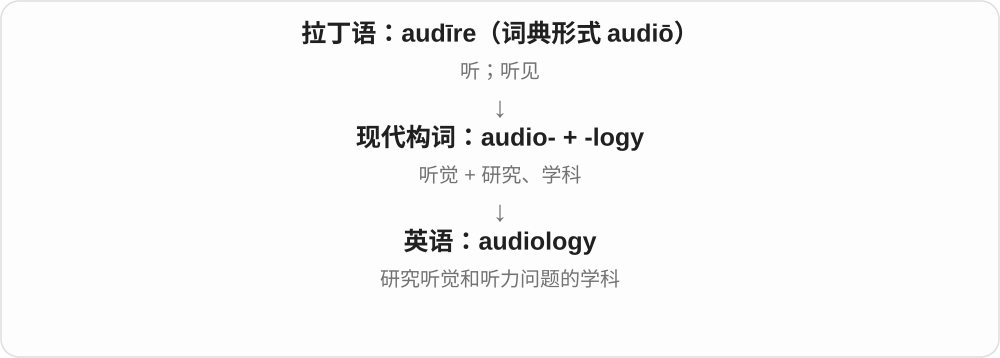

它研究的是人的听觉及相关问题，不是研究歌曲是否好听，也不是一般的音响器材评论。

**常见搭配与例句**

an audiology department；audiology services；a degree in audiology；an audiology assessment。

> She chose audiology because she wanted to help people with hearing difficulties.

她选择学习听力学，因为她希望帮助听力有困难的人。

> The hospital expanded its audiology services.

这家医院扩大了听力学相关服务。

**别混淆**

audiology 关注听觉与听力；acoustics“声学”更广泛研究声音的产生、传播等性质。

### 14. audiotape — 录音磁带；磁带录音

**音标**：英 /ˈɔːdiəʊteɪp/；美 /ˈɑːdioʊteɪp/

**先抓住这个画面**

audiotape 是把声音记录在磁带上的载体，也可以指磁带里保存的录音。

**怎么拆**

audio（音频）+ tape（带子、磁带）。它的词源构成直接说明“记录声音的带子”。

**怎么变成今天的意思**

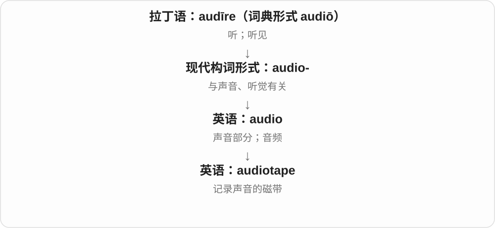

早期录音保存常依赖实体磁带，因此这个组合把媒体类型和材料连在一起。如今谈数字文件一般直接说 audio file。

**常见搭配与例句**

an old audiotape；record something on audiotape；an audiotape recording；transfer audiotapes to digital files。

> We found an audiotape of my grandfather telling stories.

我们找到一盘祖父讲故事的录音磁带。

> The archive is converting its audiotapes into digital recordings.

档案馆正在把录音磁带转成数字录音。

**别混淆**

audiotape 是声音磁带；videotape 通常记录视频及其声音。不要把手机里的每个录音文件都叫 audiotape。

### 15. audiologist — 听力学专业人员；听力师

**音标**：英 /ˌɔːdiˈɒlədʒɪst/；美 /ˌɑːdiˈɑːlədʒɪst/

**先抓住这个画面**

audiologist 是专门研究和评估听力、帮助处理相关问题的专业人员。不是负责给演出调音的人。

**怎么拆**

audiology + -ist，把学科名变成从事该领域的人；-logy 对应 -logist。

**怎么变成今天的意思**

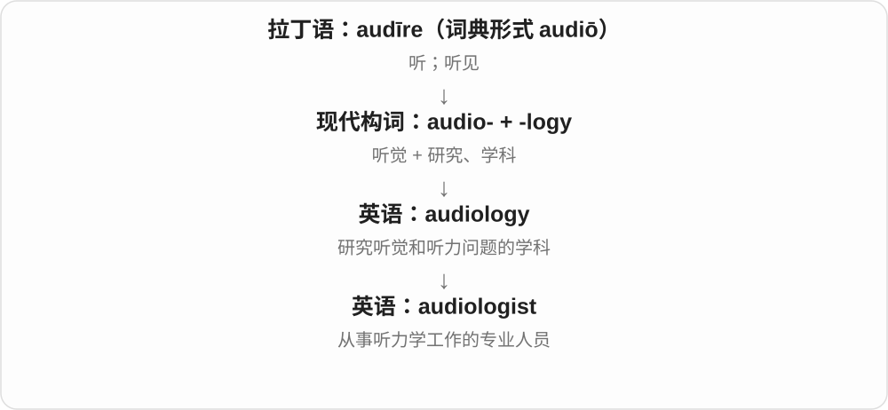

audiology 是领域，audiologist 是在这个领域工作的人。具体职业资格和职责因地区不同而异，不能一概等同于耳科医生。

**常见搭配与例句**

see an audiologist；a clinical audiologist；an appointment with an audiologist。

> The audiologist explained the results of the hearing test.

听力师解释了听力检查的结果。

> She works as an audiologist in a children’s clinic.

她在一家儿童诊所担任听力师。

**别混淆**

audiologist 主要关注听力评估和相关支持；audio engineer 则处理录音、扩声等音频技术。

## 这一组要分清什么

**audible / auditory**：听得见 / 与听觉有关。一个评价声音能否被感知，一个说明属于什么领域。

**audience / auditorium**：前者是接收表演或信息的人，后者是容纳听众、观众的空间。

**audit / audition**：audit 的审计义与早期口头检查账目有关；audition 从听取发展成表演试选。二者同源，但 audition 不是拿“审计”加后缀就能解释。

## 串起来练习

**The audience sat in the auditorium, but the speaker was barely audible.**

听众坐在礼堂里，却几乎听不到演讲者的声音。audience 是人，auditorium 是场所，audible 是声音能否被听见。
