# 0828 · clam- — 喊、宣告；提出主张

[逐词精讲目录](../00_逐词精讲目录.md) · [总目录](../00_总目录_按常用程度.md)

## 核心词根与来源

来自拉丁语 clāmāre“喊、呼叫、宣布”。它与 calāre 同源，但不是 calāre 在英语里加一个 m 就变成 clam-。现代常用词已不一定需要大声：claim 可以安静地写在申请表上，acclaim 也可以体现为很多好评。记住发声的意图，比记一个僵硬的“喊”字更有用。

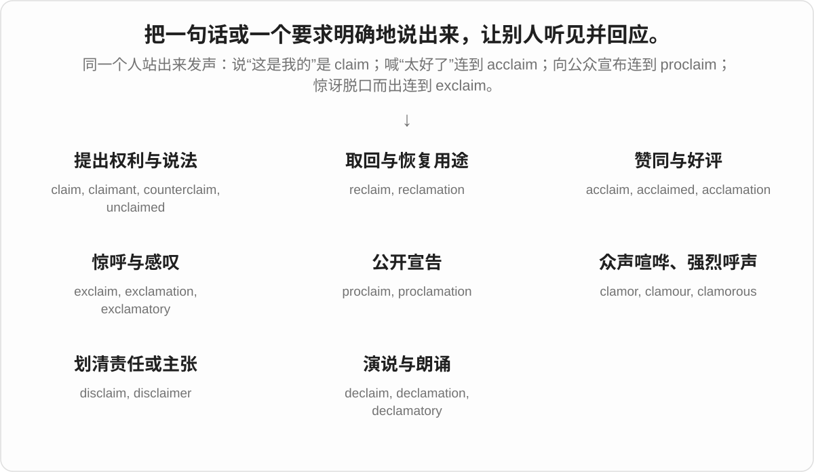

## 词形与演化规律

clam- 保留在 proclamation、exclamation、clamor；claim 常见于动词 claim、proclaim、exclaim、reclaim。许多 -ation 名词在拉丁语里已经形成，英语的动词和名词分别借入，不能一概当成现代动词加词尾。exclaim 甚至可能由较早的 exclamation 反构。

## 单词速览（按词族由简到繁）

同一基础词的相关扩展放在一起，先读基础形式，再读扩展；各组之间优先读常用的。具体词源关系见各词讲解。

| 单词 | 音标 | 核心意思 |
|---|---|---|
| [claim](#w-1) | 英、美 /kleɪm/ | 声称；主张、要求；认领、索赔；夺去生命；说法、权利要求 |
| [claimant](#w-8) | 英、美 /ˈkleɪmənt/ | 申请领取者；索赔人；提出权利要求的人 |
| [unclaimed](#w-11) | 英、美 /ʌnˈkleɪmd/ | 无人认领的；尚未申领的 |
| [reclaim](#w-5) | 英、美 /rɪˈkleɪm/ | 取回、夺回；使土地可用；回收再利用 |
| [reclamation](#w-9) | 英、美 /ˌrekləˈmeɪʃən/ | 土地开垦、整治或填海；回收利用；收回 |
| [disclaim](#w-15) | 英、美 /dɪsˈkleɪm/ | 否认自己与某事有关；声明不承担；放弃权利要求 |
| [disclaimer](#w-3) | 英 /dɪsˈkleɪmə/；美 /dɪsˈkleɪmər/ | 免责声明；否认某种责任、关联或主张的声明 |
| [counterclaim](#w-17) | 英 /ˈkaʊntəkleɪm/；美 /ˈkaʊntərkleɪm/ | 反主张；反诉；提出反诉 |
| [declaim](#w-21) | 英、美 /dɪˈkleɪm/ | 慷慨陈词；有声有色地朗诵；大声抨击 |
| [acclaim](#w-6) | 英、美 /əˈkleɪm/ | 公开赞扬；高度赞誉 |
| [acclaimed](#w-2) | 英、美 /əˈkleɪmd/ | 广受赞誉的；备受好评的 |
| [proclamation](#w-4) | 英 /ˌprɒkləˈmeɪʃən/；美 /ˌprɑːkləˈmeɪʃən/ | 公告；宣言；正式宣布 |
| [proclaim](#w-7) | 英 /prəʊˈkleɪm/；美 /proʊˈkleɪm/ | 公开宣布；郑重宣称；明显表明 |
| [exclamation](#w-10) | 英、美 /ˌekskləˈmeɪʃən/ | 感叹、惊呼；感叹语 |
| [exclaim](#w-12) | 英、美 /ɪkˈskleɪm/ | 惊呼；激动地说 |
| [clamor](#w-13) | 美 /ˈklæmər/；英 /ˈklæmə/ | 喧闹声；强烈呼声；大声要求〔美式拼写〕 |
| [clamorous](#w-19) | 英 /ˈklæmərəs/；美 /ˈklæmərəs/ | 喧闹的；大声要求、抱怨的 |
| [clamour](#w-14) | 英 /ˈklæmə/；美 /ˈklæmər/ | 喧闹；强烈呼声；大声要求〔英式拼写〕 |
| [acclamation](#w-16) | 英、美 /ˌækləˈmeɪʃən/ | 欢呼赞同；公开拥护；以一致口头赞同作决定 |
| [declamation](#w-18) | 英、美 /ˌdekləˈmeɪʃən/ | 慷慨陈词；朗诵；演说练习或演说词 |
| [declamatory](#w-20) | 英 /dɪˈklæmətəri/；美 /dɪˈklæmətɔːri/ | 演说式的；慷慨激昂的；空泛而夸张的 |
| [exclamatory](#w-22) | 英 /ɪkˈsklæmətəri/；美 /ɪkˈsklæmətɔːri/ | 感叹的；带惊叹语气的 |

## 逐词讲解

### 1. claim — 声称；主张、要求；认领、索赔；夺去生命；说法、权利要求

**音标**：英、美 /kleɪm/

**先抓住这个画面**

把自己的话或要求摆出来：“这是事实”“这是我的”“这笔钱我有权领”。现代说话不必真的大喊，但仍保留公开提出的感觉。

**怎么拆**

来自拉丁语 clāmāre，经古法语 clamer〔动词〕、claime〔名词〕等进入英语；名词与动词有平行借入线。

**怎么变成今天的意思**

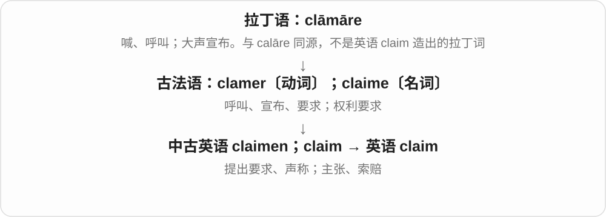

claim that 是声称；claim a bag 是认领行李；make a claim 是提出索赔或权利要求。报道里 the fire claimed lives 把灾难写成“夺走”生命。声称本身不证明真假。

**常见搭配与例句**

claim that…；claim ownership；claim compensation；make a claim。

> She claims that the idea was originally hers.

她声称这个想法最初是她提出的。

> Please show your ticket when you claim your bag.

认领行李时请出示票据。

> The family made an insurance claim after the storm.

风暴过后，这家人提出了保险索赔。

> The avalanche claimed three lives.

雪崩夺去了三个人的生命。

**别混淆**

claim 强调某人提出的说法或权利；prove 才表示已用证据证明。

### 2. claimant — 申请领取者；索赔人；提出权利要求的人

**音标**：英、美 /ˈkleɪmənt/

**先抓住这个画面**

站出来说“我有资格领这笔钱”或“这项权利属于我”的那个人。是否最终获准，是另一回事。

**怎么拆**

现代可拆 claim + -ant。历史解释包括英语按其他 -ant 人物词类推，以及法语 clamer 的分词名词用法，两条分析不强行串成一条。

**怎么变成今天的意思**

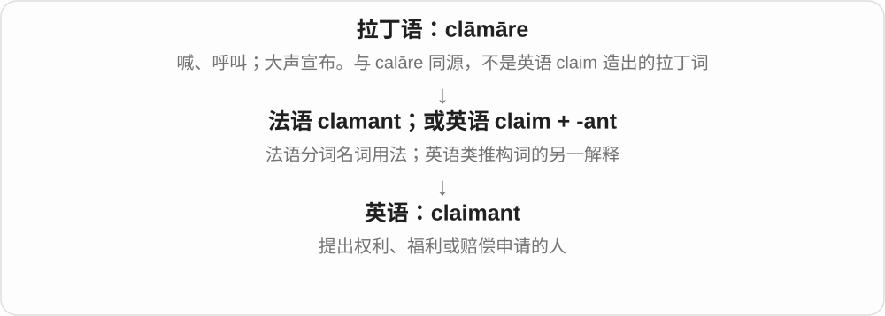

常见于福利申请、财产争议和诉讼语境。a claimant to the throne 是声称有继承王位权利的人；不等于已经被承认为君主。

**常见搭配与例句**

a benefit claimant；a successful claimant；a claimant to the throne。

> Each claimant must provide proof of ownership.

每位认领者都必须提供所有权证明。

> The report records the number of benefit claimants.

报告记录了申请领取福利金的人数。

**别混淆**

applicant 泛指申请人；claimant 特别强调主张自己有某项权利或资格。

### 3. unclaimed — 无人认领的；尚未申领的

**音标**：英、美 /ʌnˈkleɪmd/

**先抓住这个画面**

东西或款项还在那里，却没有人站出来说“这属于我”，或还没有完成领取。

**怎么拆**

un-“未” + claimed，后者是 claim 的过去分词。

**怎么变成今天的意思**

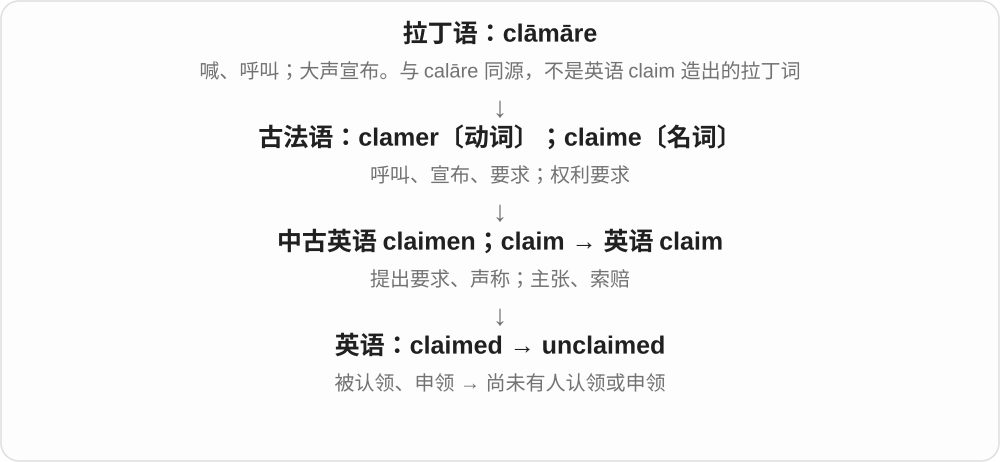

常修饰 baggage、property、prize、money。unclaimed 不等于没有主人，也不等于别人可以随意拿走。

**常见搭配与例句**

unclaimed baggage；an unclaimed prize；remain unclaimed。

> The suitcase remained unclaimed at the station.

那只手提箱一直留在车站无人认领。

> Several prizes are still unclaimed.

还有几份奖品尚未有人领取。

**别混淆**

unowned 是没有所有者；unclaimed 是没有人认领或申领，仍可能有明确的所有者。

### 4. reclaim — 取回、夺回；使土地可用；回收再利用

**音标**：英、美 /rɪˈkleɪm/

**先抓住这个画面**

现代常见画面是把东西拿回来。但它还走过“把猎鹰叫回、驯服”的路，所以能说把荒地变得可用，不一定真是恢复旧主权。

**怎么拆**

经古法语 reclamer 来自拉丁语 reclāmāre“喊着反对”。今天可拆 re- + claim，但各历史义项不能都机械套成“再次索要”。

**怎么变成今天的意思**

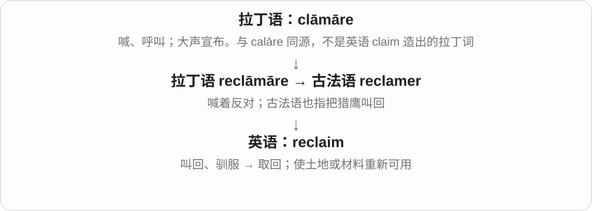

reclaim a bag 是取回行李；reclaim land 可指整理荒地或造出可用土地；reclaimed wood 则是回收利用的木料。也可说 reclaim your confidence。

**常见搭配与例句**

reclaim property；reclaim land；reclaimed materials。

> She returned to the desk to reclaim her passport.

她回到服务台取回护照。

> The table was made from wood reclaimed from an old barn.

桌子用从旧谷仓回收的木料制成。

> The project reclaimed damaged land for public use.

项目整治了受损土地，使其能够供公众使用。

**别混淆**

recover 强调找回或恢复；reclaim 常带主动取回、恢复用途的动作。land reclamation 不一定意味着回到原状。

### 5. reclamation — 土地开垦、整治或填海；回收利用；收回

**音标**：英、美 /ˌrekləˈmeɪʃən/

**先抓住这个画面**

把原先难以利用、已经废弃或失去控制的东西，经过处理重新纳入使用。

**怎么拆**

经古法语 réclamacion 及拉丁语 reclāmātiō 借入。它与 reclaim 同族，历史上不是英语先有 reclaim 再简单加 -ation。

**怎么变成今天的意思**

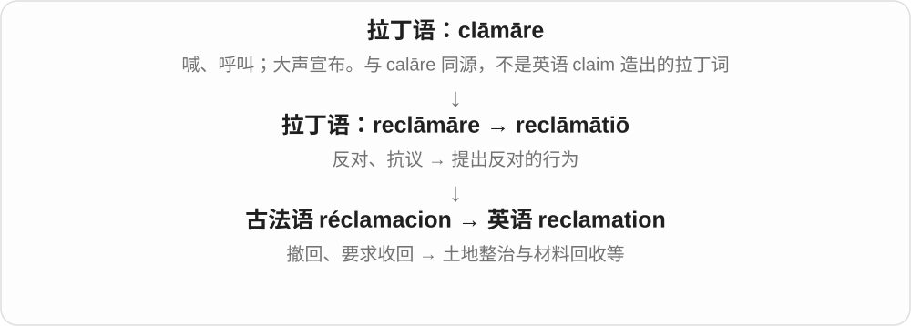

land reclamation 可以是土地整治或填海造地，译法要看场景；water reclamation 是处理废水以便再用。核心是变得可用，不保证恢复成历史原貌。

**常见搭配与例句**

land reclamation；water reclamation；a reclamation project。

> The reclamation project turned the former mine into a park.

这项土地整治工程把旧矿区改成了公园。

> Water reclamation reduces the amount of fresh water the factory needs.

废水回用减少了工厂对新鲜水的需求。

**别混淆**

restoration 偏向恢复原貌或功能；reclamation 可以为新用途创造可用条件。

### 6. disclaim — 否认自己与某事有关；声明不承担；放弃权利要求

**音标**：英、美 /dɪsˈkleɪm/

**先抓住这个画面**

把“这是我的、由我负责”这条关系划掉：“这不是我做的主张，我也不认这项责任。”

**怎么拆**

古法语 des-“否定、解除” + clamer“主张”，经盎格鲁法语 disclaimer 进入英语；现代可看成 dis- + claim。

**怎么变成今天的意思**

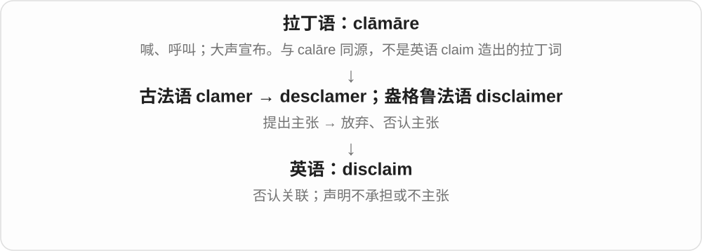

常用 disclaim responsibility、disclaim ownership。说话者这样声明，不自动决定责任实际上是否存在。也可谦逊地说 disclaim any expertise。

**常见搭配与例句**

disclaim responsibility；disclaim ownership；disclaim any knowledge of…。

> The author disclaimed any intention to offend readers.

作者声明自己无意冒犯读者。

> She disclaimed all credit for the discovery.

她表示这项发现的功劳不应归于自己。

**别混淆**

deny 更广，可否认事实；disclaim 常是否认自己的权利、责任、身份或关联。

### 7. disclaimer — 免责声明；否认某种责任、关联或主张的声明

**音标**：英 /dɪsˈkleɪmə/；美 /dɪsˈkleɪmər/

**先抓住这个画面**

在正文旁边划清一句边界：“这不代表本机构观点”“我不声称自己是专家”。

**怎么拆**

声明义来自盎格鲁法语 disclaimer 的不定式名词用法；不是看到 -er 就理解成“负责否认的人”。英语也有由 disclaim 派生的人物义。

**怎么变成今天的意思**

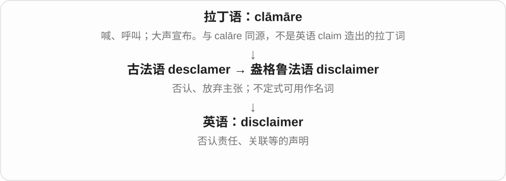

常见于网站、书籍和讲话开头。它说明发布者想划的边界，实际法律效果不能单靠“有一句 disclaimer”判断。

**常见搭配与例句**

include a disclaimer；a brief disclaimer；a disclaimer of responsibility。

> The article includes a disclaimer that the views are the author’s own.

文章附有声明，说明观点仅代表作者本人。

> He began with a disclaimer: he had never used the software himself.

他开头先说明了一点：自己从未使用过这款软件。

**别混淆**

warning 提醒危险或问题；disclaimer 重点是声明不承担、不同意或不主张某种关联。

### 8. counterclaim — 反主张；反诉；提出反诉

**音标**：英 /ˈkaʊntəkleɪm/；美 /ˈkaʊntərkleɪm/

**先抓住这个画面**

对方说“你欠我”，你不只回答“不欠”，还反过来提出“其实你欠我”的独立要求。

**怎么拆**

counter-“相对、反向” + claim，英语内部构词。

**怎么变成今天的意思**

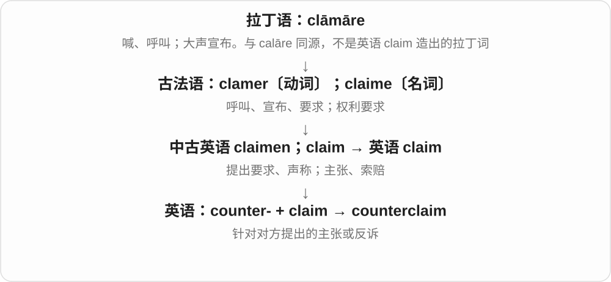

法律语境常指被告向原告提出的独立请求；一般讨论中也能指反向主张。这里只用来理解词义，具体程序随制度而异。

**常见搭配与例句**

file a counterclaim；a claim and counterclaim；bring a counterclaim。

> The company denied the allegation and filed a counterclaim.

公司否认指控，并提起反诉。

> The debate became a series of claims and counterclaims.

辩论变成了一连串主张和反主张。

**别混淆**

denial 只是否认；counterclaim 还提出了自己的相反要求或主张。

### 9. declaim — 慷慨陈词；有声有色地朗诵；大声抨击

**音标**：英、美 /dɪˈkleɪm/

**先抓住这个画面**

像站在舞台上发表演说一样，把话讲得响亮、有节奏、很有戏剧性。

**怎么拆**

拉丁语 dēclāmāre 来自 dē- 与 clāmāre；此处 dē- 常被解释为加强语气，经法语及拉丁语借入。它不是“取消 claim”。

**怎么变成今天的意思**

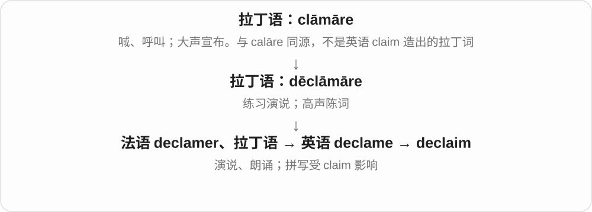

可以中性地说朗诵诗，也能略带讽刺地说某人把普通谈话说成大演讲。declaim against 是大声抨击。

**常见搭配与例句**

declaim a poem；declaim against injustice；declaim in a grand voice。

> The actor declaimed the opening lines from the balcony.

演员站在阳台上慷慨朗诵了开场台词。

> He preferred to declaim against the plan rather than discuss its details.

他更愿意高声抨击计划，而不愿讨论细节。

**别混淆**

recite 强调背诵或朗诵内容；declaim 进一步突出夸张、响亮的演说方式。

### 10. acclaim — 公开赞扬；高度赞誉

**音标**：英、美 /əˈkleɪm/

**先抓住这个画面**

人们把赞同喊出来，后来不一定有欢呼声，也能指评论家和公众一致给出的高度评价。

**怎么拆**

拉丁语 ad-“朝向” + clāmāre，d 在 c 前同化成 c，形成 acclāmāre；借入后拼写受 claim 影响。

**怎么变成今天的意思**

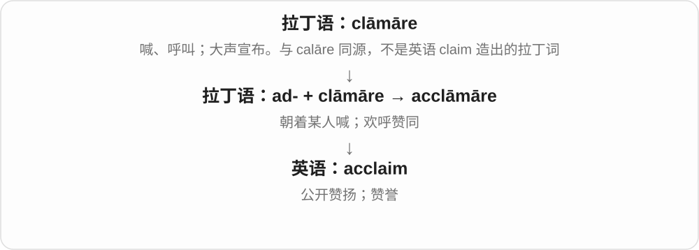

动词常用 be acclaimed as；名词通常不可数：win critical acclaim。获好评不等于一定卖得好，评价和销量是两个维度。

**常见搭配与例句**

critical acclaim；win acclaim；be acclaimed as…。

> The novel won critical acclaim but sold slowly at first.

小说获得评论界好评，但最初销量增长缓慢。

> The pianist was acclaimed as one of the festival’s finest performers.

这位钢琴家被誉为音乐节最出色的演奏者之一。

**别混淆**

praise 是普遍的赞扬；acclaim 常突出公开、广泛或很高的评价。

### 11. acclaimed — 广受赞誉的；备受好评的

**音标**：英、美 /əˈkleɪmd/

**先抓住这个画面**

已经有不少有分量的赞扬落在这个人或作品身上。

**怎么拆**

acclaim + -ed，过去分词作形容词。

**怎么变成今天的意思**

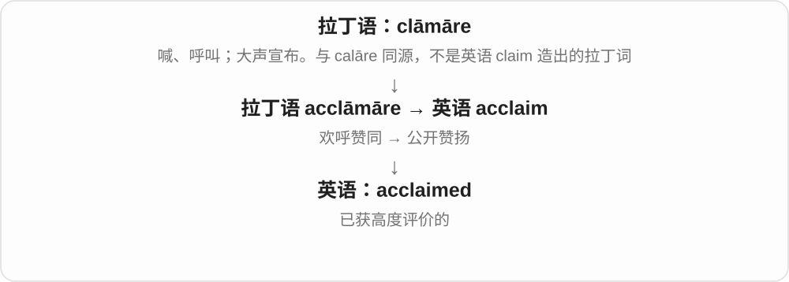

常见 critically acclaimed，意思是评论界给予高度评价，不是“被严重批评”。acclaimed 本身没有说所有人都喜欢。

**常见搭配与例句**

an acclaimed writer；a critically acclaimed film；internationally acclaimed。

> The festival invited an acclaimed documentary filmmaker.

电影节邀请了一位广受赞誉的纪录片导演。

> Her acclaimed debut was followed by a very different second album.

她备受好评的首张专辑之后，是一张风格很不同的第二张专辑。

**别混淆**

famous 是很多人知道；acclaimed 是受到赞扬，一个人也可能因坏事而 famous。

### 12. proclamation — 公告；宣言；正式宣布

**音标**：英 /ˌprɒkləˈmeɪʃən/；美 /ˌprɑːkləˈmeɪʃən/

**先抓住这个画面**

把公开宣布做成一个正式动作或一份让公众知晓的文告。

**怎么拆**

经古法语 proclamacion 及后期拉丁语 prōclāmātiō 借入；与 proclaim 是共同拉丁词族的不同路径。

**怎么变成今天的意思**

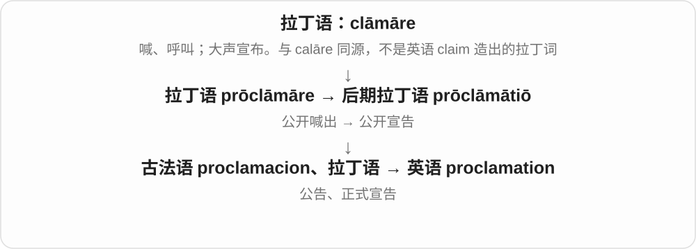

a proclamation 是一份文告；the proclamation of independence 是宣布独立这一行为。它是否具有法律效力，要看发布者和制度，词本身没有统一答案。

**常见搭配与例句**

issue a proclamation；a public proclamation；the proclamation of…。

> The mayor issued a proclamation recognizing the volunteers’ work.

市长发布公告，表彰志愿者的工作。

> A copy of the proclamation was displayed at the entrance.

入口处展示了一份公告副本。

**别混淆**

announcement 可以只是普通通知；proclamation 通常更正式、面向公众。

### 13. proclaim — 公开宣布；郑重宣称；明显表明

**音标**：英 /prəʊˈkleɪm/；美 /proʊˈkleɪm/

**先抓住这个画面**

把消息朝公众放出来，让大家都知道，常带正式或强烈的姿态。

**怎么拆**

拉丁语 prō-“向前、向外” + clāmāre → prōclāmāre，经法语或直接由拉丁语进入英语；拼写受 claim 影响。

**怎么变成今天的意思**

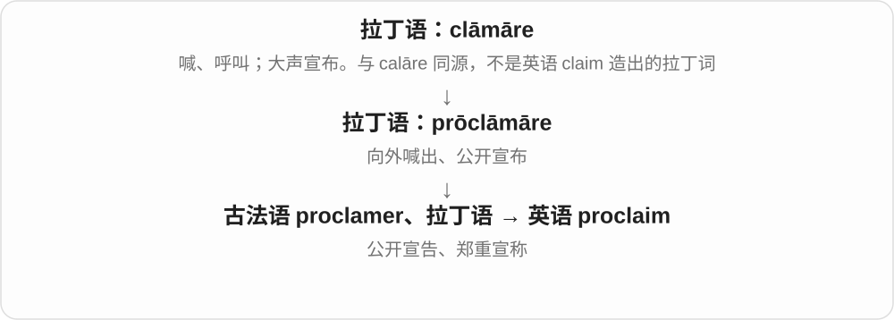

可以由政府正式宣布，也可形容个人高调表达观点；某种外观也能 proclaim wealth“明显显出财富”。不表示说出来就必然真实。

**常见搭配与例句**

proclaim independence；proclaim that…；proclaim someone the winner。

> The judges proclaimed her the winner.

评委宣布她为获胜者。

> The sign proudly proclaims that the bakery uses local flour.

招牌醒目而自豪地宣称，这家面包店使用本地面粉。

**别混淆**

announce 是一般宣布；proclaim 通常更公开、正式，或带高调强调。

### 14. exclamation — 感叹、惊呼；感叹语

**音标**：英、美 /ˌekskləˈmeɪʃən/

**先抓住这个画面**

情绪一下冲到嘴边形成的一声或一句话。写下来时，人们常用感叹号提示这种语气。

**怎么拆**

来自拉丁语 exclāmātiō，也有法语传入路线；英语名词早于 exclaim 的现存记录，不能只画 exclaim + -ation。

**怎么变成今天的意思**

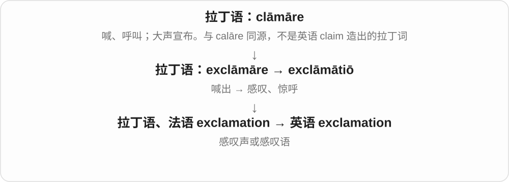

an exclamation of surprise 是一声惊呼；exclamation mark〔英〕、exclamation point〔美〕是感叹号。一个感叹句是否必须写叹号，还要看文体。

**常见搭配与例句**

an exclamation of delight；an exclamation mark；utter an exclamation。

> An exclamation of surprise came from the back of the room.

房间后面传来一声惊呼。

> The editor removed three unnecessary exclamation marks.

编辑删去了三个不必要的感叹号。

**别混淆**

explanation 是解释；exclamation 是感叹，词中有 clam“喊”的支线。

### 15. exclaim — 惊呼；激动地说

**音标**：英、美 /ɪkˈskleɪm/

**先抓住这个画面**

一句话被惊讶、喜悦或愤怒推了出来，语气明显比平常强。

**怎么拆**

来自拉丁语 ex- + clāmāre 的词族；可能由英语 exclamation 反构，也可能经法语 exclamer 借入，图中保留这两条解释。

**怎么变成今天的意思**

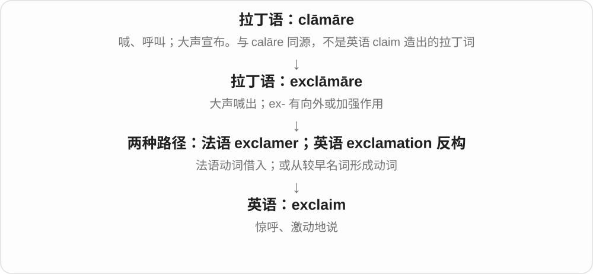

常出现在小说引语后。它不一定是恐惧尖叫，也不一定要求很大音量，重点是带强烈情绪地说出。

**常见搭配与例句**

exclaim in surprise；exclaim with delight；exclaim that…。

> “There it is!” she exclaimed when the island came into view.

小岛出现在视野里时，她惊喜地说：“就在那儿！”

> He exclaimed that the result was impossible.

他激动地说这个结果不可能。

**别混淆**

shout 侧重音量；exclaim 侧重突出的情绪和话语。

### 16. clamor — 喧闹声；强烈呼声；大声要求〔美式拼写〕

**音标**：美 /ˈklæmər/；英 /ˈklæmə/

**先抓住这个画面**

许多声音挤在一起，吵得不能忽略；也可以是公众持续要求某件事的强烈呼声。

**怎么拆**

拉丁语 clāmor 来自 clāmāre，经古法语 clamor 进入英语。clamor 是现代美式常用拼写，clamour 常见于英式。

**怎么变成今天的意思**

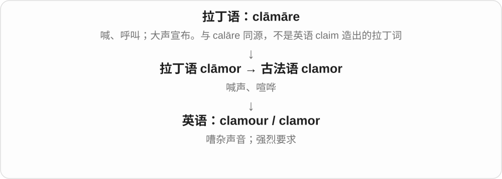

名词常用 a clamor for；动词可用 clamor for、clamor to do。呼声可以支持也可以反对，不能把它一律理解成抱怨。

**常见搭配与例句**

a clamor for change；clamor for attention；clamor to get in。

> The clamor from the crowd drowned out the announcement.

人群的喧闹声盖过了广播通知。

> Residents are clamoring for a safer crossing.

居民强烈要求设置更安全的过街设施。

**别混淆**

noise 是任何噪声；clamor 常让人想到众人的声音或强烈诉求。

### 17. clamorous — 喧闹的；大声要求、抱怨的

**音标**：英 /ˈklæmərəs/；美 /ˈklæmərəs/

**先抓住这个画面**

声音接连涌来，让人很难安静地想事情；用在人群上，还常带“非让你回应不可”的强烈要求。

**怎么拆**

来自中世纪拉丁语 clāmōrōsus，基于 clāmor“喊声”；现代能联系 clamor + -ous。

**怎么变成今天的意思**

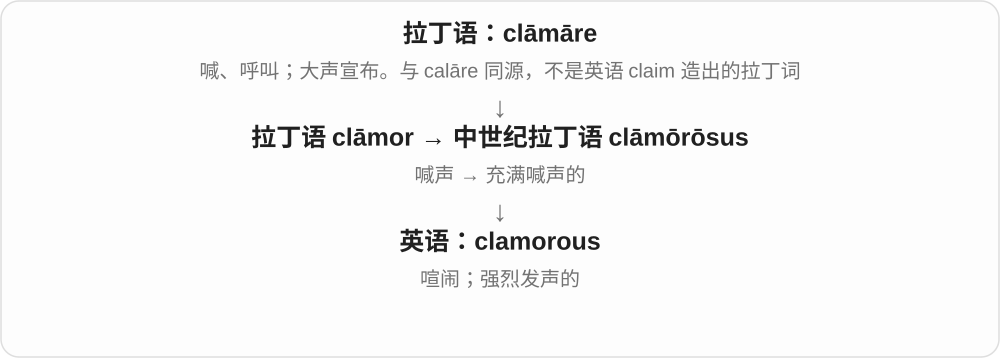

这是偏书面、文学的形容词。clamorous voices 可以是吵闹声音，也可以代表公开要求。英式也通常写 clamorous，而不是必须把 clamour 的 u 保留。

**常见搭配与例句**

a clamorous crowd；clamorous voices；clamorous demands。

> A clamorous crowd gathered outside the hall.

一群喧闹的人聚集在大厅外。

> The quiet proposal was lost among more clamorous demands.

这项平和提出的建议淹没在更响亮的诉求中。

**别混淆**

loud 只说明响；clamorous 还常带嘈杂、众声并起或催促要求的感觉。

### 18. clamour — 喧闹；强烈呼声；大声要求〔英式拼写〕

**音标**：英 /ˈklæmə/；美 /ˈklæmər/

**先抓住这个画面**

把人群的吵闹，或反复要求被听见的声音，汇成一个词。

**怎么拆**

与 clamor 同源同义，保留英语历史上常见的 -our 拼写；不是加了 -our 就多出一个义项。

**怎么变成今天的意思**

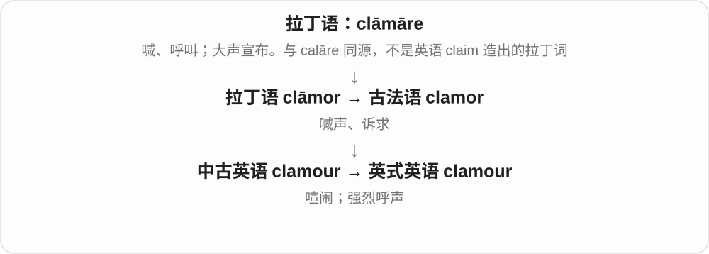

可以写 public clamour“公众的强烈呼声”。词尾的 -our 在这里不等于英语 our，也不用按字母逐个读。

**常见搭配与例句**

a clamour for reform；the clamour of voices；clamour for a response。

> There was a growing clamour for an explanation.

要求作出解释的呼声越来越高。

> The children clamoured to see the new puppy.

孩子们嚷着要看新来的小狗。

**别混淆**

clamour 与 clamor 只是常见区域拼写差别；glamour 是“魅力”，来源不同。

### 19. acclamation — 欢呼赞同；公开拥护；以一致口头赞同作决定

**音标**：英、美 /ˌækləˈmeɪʃən/

**先抓住这个画面**

大家不是悄悄点头，而是把赞同一起表达出来。会议里的 by acclamation 由此有了不用逐一计票、以一致赞同确认的意思。

**怎么拆**

借自拉丁语 acclāmātiō，来自 acclāmāre；与 acclaim 是同族名词支线。

**怎么变成今天的意思**

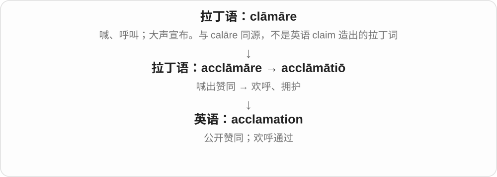

可以描述欢呼，也常出现在 elected/approved by acclamation。具体会议是否需要无人反对、是否投票，要按该组织规则理解。

**常见搭配与例句**

by acclamation；public acclamation；a chorus of acclamation。

> The committee elected her chair by acclamation.

委员会以一致赞同的方式选她为主席。

> The returning team was greeted with loud acclamation.

归来的队伍受到热烈欢呼。

**别混淆**

acclaim 常是持续的好评；acclamation 更突出一次集体表达赞同的行为。

### 20. declamation — 慷慨陈词；朗诵；演说练习或演说词

**音标**：英、美 /ˌdekləˈmeɪʃən/

**先抓住这个画面**

把声调、节奏和情绪都拿出来，用公开演说的方式讲一段话。

**怎么拆**

借自拉丁语 dēclāmātiō，来自 dēclāmāre；名词在拉丁语中已经形成，不只是现代英语 declaim 加 -ation。

**怎么变成今天的意思**

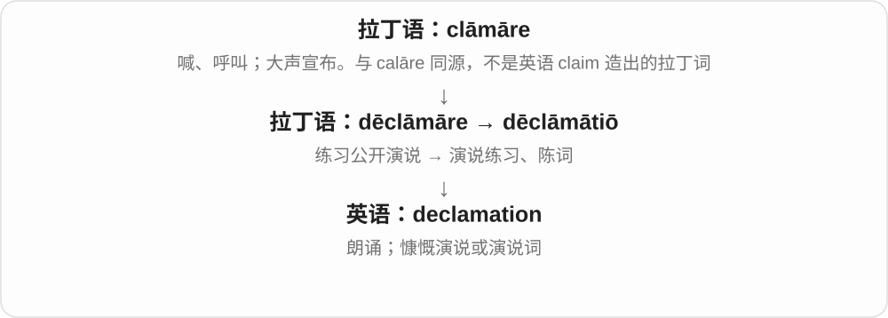

可以谈演说训练的技巧，也可以批评空有气势、缺少实质内容的陈词。是否贬义取决于上下文。

**常见搭配与例句**

the art of declamation；a dramatic declamation；empty declamation。

> The drama class included exercises in declamation.

戏剧课包含了朗诵训练。

> Her speech offered evidence instead of empty declamation.

她的演讲提供了证据，而不是空洞的慷慨陈词。

**别混淆**

declaration 是声明内容或行为；declamation 突出演说方式、朗诵或修辞气势。

### 21. declamatory — 演说式的；慷慨激昂的；空泛而夸张的

**音标**：英 /dɪˈklæmətəri/；美 /dɪˈklæmətɔːri/

**先抓住这个画面**

声音和措辞像对着满场观众发表宣言，有力、夸张，有时也显得太做作。

**怎么拆**

来自拉丁语 dēclāmātōrius，属于 dēclāmāre“练习演说”的词族；与 declamation 配套。

**怎么变成今天的意思**

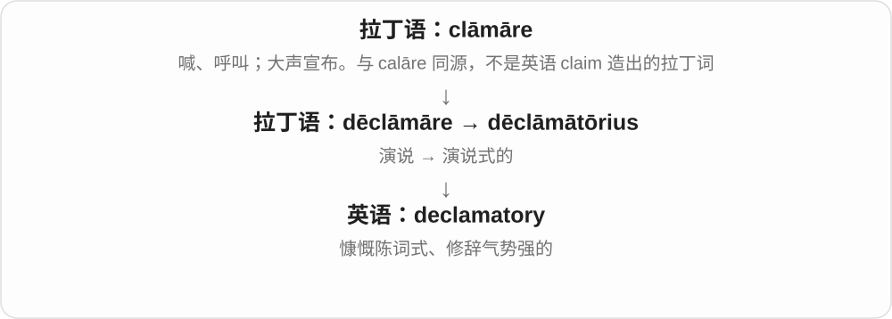

常形容 style、tone、speech。戏剧表演中可以只是风格说明；日常论证中则可能批评它气势大于内容。

**常见搭配与例句**

a declamatory style；a declamatory tone；declamatory rhetoric。

> The director asked for a less declamatory style of acting.

导演要求表演少一点慷慨陈词的腔调。

> The article’s declamatory tone obscures its main argument.

文章慷慨激昂的语气反而掩盖了主要论点。

**别混淆**

exclamatory 突出感叹语气；declamatory 更像整段正式、戏剧化的陈词。

### 22. exclamatory — 感叹的；带惊叹语气的

**音标**：英 /ɪkˈsklæmətəri/；美 /ɪkˈsklæmətɔːri/

**先抓住这个画面**

一句话的作用是把强烈感受表达出来，而不只是平静地报一个事实。

**怎么拆**

用拉丁语 exclāmāt- 分词词干 + -ory 形成，属于 exclaim / exclamation 词族。

**怎么变成今天的意思**

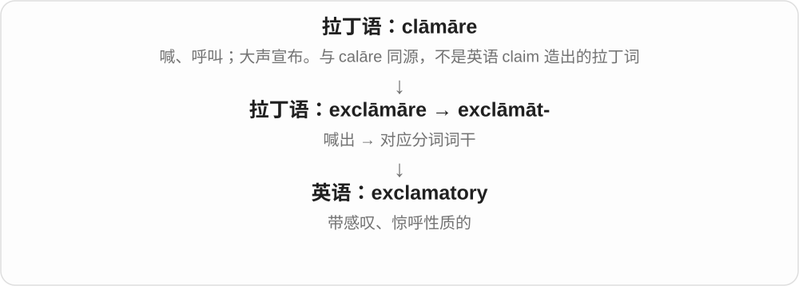

常用于语法和文体讨论。What a beautiful day! 是感叹句；但标了感叹号的命令仍可能是命令句，形式与语气不要混为一谈。

**常见搭配与例句**

an exclamatory sentence；an exclamatory phrase；an exclamatory tone。

> “What a wonderful surprise!” is an exclamatory sentence.

“真是个美妙的惊喜！”是一个感叹句。

> The narrator’s exclamatory tone makes the scene feel urgent.

叙述者的感叹语气让场景显得紧迫。

**别混淆**

exclamatory 是表达强烈感受；interrogative 是提问的，不能只看声音是否高亢。

## 这一组要分清什么

claim 是提出说法或要求，prove 才是证明；exclaim 是带情绪说出，proclaim 是公开宣告。declaim 的 de- 常被解释为加强，不是撤销；disclaim 才有否认、放弃主张的路线。clam“蛤蜊”不是 clāmāre 的后代，climb“爬”也不因拼写相似而属于这里。

## 串起来练习

用同一场发布会串联：The company claims the product is safer，是公司声称；critics acclaim the design，是评论者赞扬；a notice disclaims responsibility，是声明不承担某种责任。三个词都涉及表达，但表达的目的不同。
