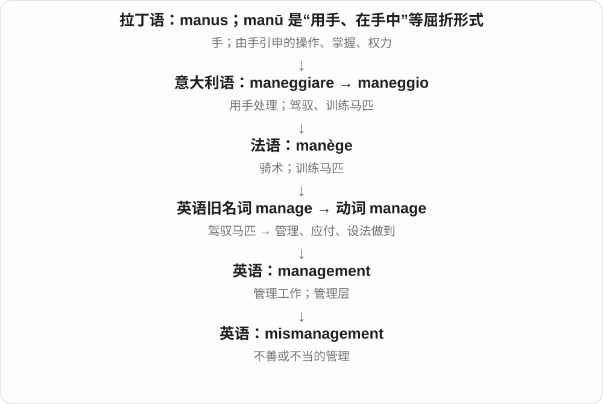

# 0900 · mis- — 同形要分源：错误、不当；另一条希腊来源表示厌恶

[逐词精讲目录](../00_逐词精讲目录.md) · [总目录](../00_总目录_按常用程度.md)

## 核心词根与来源

这一页把相似拼写放在一起辨清，不把它们冒充同一个古代词根。① 古英语已有的日耳曼 mis- 表示错误、不当，如 mislead、misread。② 古法语 mes- 也表示坏、不顺，常联系拉丁 minus 的罗曼语发展，并与日耳曼形式发生混合，misadventure 属于这条借入路线。③ 希腊 misos、misein 表示厌恶，形成 miso-／mis-，见 misogyny、misanthrope。原表把它们全放到希腊“厌恶”下面，这里明确纠正。

**MIS = WRONG；MISO = HATRED（不同来源）**

两块拼写相似的路牌，通向不同地方：misread 是读错了；misogyny 是厌恶女性。misadventure 还保留古法语“坏、不顺”的另一条历史。

- **误认、误解与误导：日耳曼前缀为主**：mistake, mistaken, misunderstand, mislead, misread, misinterpret, misrepresent
- **行为、匹配和结果不对**：misconduct, mismatch, misbehave, mistreat, misfit, misfire
- **不幸与意外：要分别看借入路线**：misfortune, mishap, misadventure, miscarriage
- **希腊“厌恶”的独立来源**：misogyny, misandry, misanthropy, misophonia

## 词形与演化规律

mis- 可以接英语或借来的词基：mistreat 的 treat 来自法语，不等于整个前缀也来自法语；misdiagnosis 的 diagnosis 来自希腊，也不能把 mis- 解释成“厌恶”。misspell 与 misshapen 的双 s 是前后成分相接。misread 的过去式拼写不变但读 /red/；mislead 的过去式是 misled。

## 单词速览（常用到不常用）

| 单词 | 音标 | 核心意思 |
|---|---|---|
| [mistake](#w-1) | /mɪˈsteɪk/ | 错误；弄错、误认 |
| [mistaken](#w-2) | /mɪˈsteɪkən/ | 弄错的；错误的；mistake 的过去分词 |
| [misleading](#w-3) | /ˌmɪsˈliːdɪŋ/ | 误导性的；容易造成错误印象的 |
| [misunderstanding](#w-4) | 英 /ˌmɪsʌndəˈstændɪŋ/；美 /ˌmɪsʌndərˈstændɪŋ/ | 误解；误会；由误会造成的分歧 |
| [misconduct](#w-5) | 名词英 /ˌmɪsˈkɒndʌkt/；美 /ˌmɪsˈkɑːndʌkt/ | 不当行为；失职；违规行为 |
| [misuse](#w-6) | 名词 /ˌmɪsˈjuːs/；动词 /ˌmɪsˈjuːz/ | 误用；不当使用 |
| [mistakenly](#w-7) | /mɪˈsteɪkənli/ | 错误地；误以为；误做了 |
| [misdemeanor](#w-8) | 美 /ˌmɪsdɪˈmiːnər/ | 轻罪；不当行为〔美式拼写〕 |
| [misfortune](#w-9) | 英 /ˌmɪsˈfɔːtʃuːn/；美 /ˌmɪsˈfɔːrtʃən/ | 不幸；厄运；不幸的事 |
| [miscarriage](#w-10) | /ˈmɪskærɪdʒ/ | 自然流产；失败；司法失误〔用于固定搭配〕 |
| [misinformation](#w-11) | 英 /ˌmɪsɪnfəˈmeɪʃən/；美 /ˌmɪsɪnfərˈmeɪʃən/ | 错误信息 |
| [misconception](#w-12) | /ˌmɪskənˈsepʃən/ | 错误观念；误解 |
| [mislead](#w-13) | /ˌmɪsˈliːd/ | 误导；使产生错误印象 |
| [misogyny](#w-14) | 英 /mɪˈsɒdʒɪni/；美 /mɪˈsɑːdʒɪni/ | 厌女；对女性的憎恶、轻视或敌意 |
| [misunderstand](#w-15) | 英 /ˌmɪsʌndəˈstænd/；美 /ˌmɪsʌndərˈstænd/ | 误解；理解错 |
| [mismatch](#w-16) | 名词常 /ˈmɪsmætʃ/；动词 /ˌmɪsˈmætʃ/ | 不匹配；错配；把不相配的东西配在一起 |
| [mismanagement](#w-17) | /ˌmɪsˈmænɪdʒmənt/ | 管理不善；经营失当 |
| [mistrust](#w-18) | /ˌmɪsˈtrʌst/ | 不信任；怀疑 |
| [mishap](#w-19) | /ˈmɪshæp/ | 小事故；意外的不顺；不幸事件 |
| [misogynistic](#w-20) | 英 /mɪˌsɒdʒɪˈnɪstɪk/；美 /mɪˌsɑːdʒɪˈnɪstɪk/ | 厌女的；带有贬低女性倾向的 |
| [misrepresentation](#w-21) | /ˌmɪsreprɪzenˈteɪʃən/ | 歪曲；不实陈述；错误呈现 |
| [misread](#w-22) | 现在时 /ˌmɪsˈriːd/；过去式、过去分词 /ˌmɪsˈred/ | 读错；误判；误解 |
| [misogynist](#w-23) | 英 /mɪˈsɒdʒɪnɪst/；美 /mɪˈsɑːdʒɪnɪst/ | 厌女者；厌女的 |
| [mismatched](#w-24) | /ˌmɪsˈmætʃt/ | 不相配的；错配的 |
| [misfit](#w-25) | /ˈmɪsfɪt/ | 不合群的人；与环境不适配的人或物 |
| [miscommunication](#w-26) | /ˌmɪskəmjuːnɪˈkeɪʃən/ | 沟通失误；信息传达不畅 |
| [misinterpretation](#w-27) | /ˌmɪsɪntɜːrprɪˈteɪʃən/ | 错误解读；曲解；误释 |
| [misrepresent](#w-28) | /ˌmɪsreprɪˈzent/ | 歪曲；不实地描述或呈现 |
| [mistrial](#w-29) | /ˈmɪstraɪəl/ | 无效审判；未能有效结束的审判 |
| [miscalculation](#w-30) | /ˌmɪskælkjəˈleɪʃən/ | 计算错误；估计失误；失策 |
| [misdirection](#w-31) | 英、美 /ˌmɪsdəˈrekʃən/，也读 /ˌmɪsdaɪˈrekʃən/ | 错误引导；转移注意力的手法 |
| [misappropriation](#w-32) | /ˌmɪsəprəʊpriˈeɪʃən/；美 /ˌmɪsəproʊpriˈeɪʃən/ | 侵占；挪用；不当占用 |
| [misinterpret](#w-33) | 英 /ˌmɪsɪnˈtɜːprɪt/；美 /ˌmɪsɪnˈtɜːrprɪt/ | 误解；曲解；错误解读 |
| [misstep](#w-34) | /ˌmɪsˈstep/，也读 /ˈmɪsstep/ | 失足；失策；错误的一步 |
| [misspelling](#w-35) | /ˌmɪsˈspelɪŋ/ | 拼写错误；错误拼法 |
| [misbehavior](#w-36) | 美 /ˌmɪsbɪˈheɪvjər/ | 不当行为；不守规矩〔美式拼写〕 |
| [misbehave](#w-37) | /ˌmɪsbɪˈheɪv/ | 行为不端；不守规矩；〔设备〕不正常运作 |
| [misshapen](#w-38) | /ˌmɪsˈʃeɪpən/ | 变形的；形状不规则的 |
| [mistreat](#w-39) | /ˌmɪsˈtriːt/ | 虐待；恶劣地对待 |
| [misfire](#w-40) | 英 /ˌmɪsˈfaɪə/；美 /ˌmɪsˈfaɪər/ | 未正常点火、发射；失败；产生不理想的效果 |
| [misalignment](#w-41) | 英、美 /ˌmɪsəˈlaɪnmənt/ | 错位；未对准；不一致 |
| [misadventure](#w-42) | 英 /ˌmɪsədˈventʃə/；美 /ˌmɪsədˈventʃər/ | 不幸遭遇；意外事故；倒霉经历 |
| [misplace](#w-43) | 英 /mɪsˈpleɪs/；美 /mɪsˈpleɪs/ | 放错地方；一时找不到 |
| [misspell](#w-44) | /ˌmɪsˈspel/ | 拼错；把字拼写错 |
| [misdiagnosis](#w-45) | 英 /ˌmɪsˌdaɪəɡˈnəʊsɪs/；美 /ˌmɪsˌdaɪəɡˈnoʊsɪs/ | 误诊；错误的诊断或问题判断 |
| [misprint](#w-46) | 名词：英、美 /ˈmɪsprɪnt/；动词：英、美 /mɪsˈprɪnt/ | 印刷错误；误印 |
| [misdemeanour](#w-47) | 英 /ˌmɪsdɪˈmiːnə/ | 不当行为；过失；轻罪〔英式拼写〕 |
| [misanthrope](#w-48) | 英 /ˈmɪsənθrəʊp/；美 /ˈmɪsənθroʊp/ | 厌世者；对人类普遍抱反感或不信任的人 |
| [misanthropic](#w-49) | 英 /ˌmɪsənˈθrɒpɪk/；美 /ˌmɪsənˈθrɑːpɪk/ | 厌世的；对人性抱反感的 |
| [misbehaviour](#w-50) | 英 /ˌmɪsbɪˈheɪvjə/ | 不当行为；不守规矩〔英式拼写〕 |
| [misjudge](#w-51) | /ˌmɪsˈdʒʌdʒ/ | 判断错；估错；误判某人 |
| [miscarry](#w-52) | 英 /ˌmɪsˈkæri/；美 /ˌmɪsˈkæri/ | 自然流产；〔计划等〕失败、未遂 |
| [misrule](#w-53) | /ˌmɪsˈruːl/ | 治理不善；暴政；混乱的统治 |
| [misperception](#w-54) | /ˌmɪspəˈsepʃən/ | 错误感知；误判 |
| [misanthropy](#w-55) | /mɪˈsænθrəpi/ | 厌世；对人类的普遍厌恶或不信任 |
| [miscast](#w-56) | 英 /ˌmɪsˈkɑːst/；美 /ˌmɪsˈkæst/ | 给演员安排不合适的角色；把人放错角色或位置 |
| [misdirect](#w-57) | 英、美 /ˌmɪsdəˈrekt/，也读 /ˌmɪsdaɪˈrekt/ | 引错方向；错投；使误用 |
| [misapprehension](#w-58) | /ˌmɪsæprɪˈhenʃən/ | 误解；错误认识〔较正式〕 |
| [mistranslation](#w-59) | /ˌmɪstrænzˈleɪʃən/，也读 /ˌmɪstrænsˈleɪʃən/ | 误译；错误的译文或译法 |
| [misconstrue](#w-60) | /ˌmɪskənˈstruː/ | 误解；错误地解释 |
| [misidentification](#w-61) | /ˌmɪsaɪdentɪfɪˈkeɪʃən/ | 认错；错误识别；身份或类别误判 |
| [misquote](#w-62) | 英 /ˌmɪsˈkwəʊt/；美 /ˌmɪsˈkwoʊt/ | 错误引用；误引；把原话引错 |
| [misandry](#w-63) | /mɪˈsændri/；也读 /ˈmɪsəndri/ | 厌男；对男性的憎恶或敌意 |
| [misophonia](#w-64) | 英 /ˌmɪsəˈfəʊniə/；美 /ˌmɪsəˈfoʊniə/ | 厌声症；对特定声音的耐受显著降低 |
| [misandrist](#w-65) | /ˈmɪsəndrɪst/ | 厌男者；厌男的 |

## 逐词讲解

### 1. mistake — 错误；弄错、误认

**音标**：/mɪˈsteɪk/

**先抓住这个画面**

本来该认作甲，却拿成或当成了乙。

**怎么拆**

现代可拆 mis- + take；历史还涉及古诺尔斯 mistaka，不能简单认定它完全是在现代英语里拼出来的。

**怎么变成今天的意思**

**日耳曼语系的 mis-，古英语已有**  
方向或结果不对；不是希腊“厌恶”

↓

**英语 mis- + take，或相关古诺尔斯 mistaka；两条路线可能相互影响**  
拿错、理解错

↓

**中古英语 mistaken → 英语 mistake**  
误认、弄错；后来也作名词“错误”

动词 mistake 常用 mistake A for B：把 A 误认成 B。名词 a mistake 是一次错误，make a mistake 是犯错，by mistake 是误做了某事。它通常不自动说明你故意做坏事。

**常见搭配与例句**

make a mistake；by mistake；mistake A for B。

> I sent the file to the wrong person by mistake.

我误把文件发给了不该收的人。

> In the dark, I mistook the coat for a person.

黑暗中，我把那件外套误看成了一个人。

**别混淆**

mistake 的过去式 mistook，过去分词 mistaken。不要把 make a mistake 写成 do a mistake。

### 2. mistaken — 弄错的；错误的；mistake 的过去分词

**音标**：/mɪˈsteɪkən/

**先抓住这个画面**

你心里的判断很确定，但它与实际情况对不上。

**怎么拆**

mistake 的过去分词；作形容词时表示判断或认识有误。

**怎么变成今天的意思**

**日耳曼语系的 mis-，古英语已有**  
方向或结果不对；不是希腊“厌恶”

↓

**英语 mis- + take，或相关古诺尔斯 mistaka；两条路线可能相互影响**  
拿错、理解错

↓

**中古英语 mistaken → 英语 mistake**  
误认、弄错；后来也作名词“错误”

↓

**过去分词 mistaken → 形容词用法**  
处在误认或判断错误的状态

You are mistaken 是“你弄错了”，不是“你是一个错误”。a mistaken belief 是错误认识，mistaken identity 是认错人。这里的 -en 是不规则动词变化的一部分，不要当成表示“使变成”的派生后缀。

**常见搭配与例句**

be mistaken about something；a mistaken belief；a case of mistaken identity。

> If I’m not mistaken, the meeting starts at ten.

如果我没记错，会议十点开始。

> She was mistaken about the delivery date.

她把送货日期弄错了。

**别混淆**

mistaken 描述判断错了的人或认识；misleading 描述容易把别人带向错误判断的信息。

### 3. misleading — 误导性的；容易造成错误印象的

**音标**：/ˌmɪsˈliːdɪŋ/

**先抓住这个画面**

表面看起来像在说明事实，实际却把人引向不准确的结论。

**怎么拆**

mislead + -ing，分词作形容词描述信息的效果。

**怎么变成今天的意思**

**日耳曼语系的 mis-，古英语已有**  
方向或结果不对；不是希腊“厌恶”

↓

**古英语 mislǣdan → 中古英语 misleden**  
把人带错方向

↓

**英语 mislead**  
使人得出错误印象或判断

↓

**mislead + -ing → misleading**  
容易把理解带偏的

a misleading average 可能数字算得没错，却掩盖了不同群体的差异；a misleading headline 可能夸大正文内容。所以 misleading 不只等于“数字全是假的”，也包括呈现方式造成的错觉。

**常见搭配与例句**

a misleading impression；misleading information；a misleading comparison。

> The graph is misleading because the vertical axis starts at ninety.

这张图容易误导，因为纵轴从九十开始。

> The phrase gives a misleading impression of how easy the task is.

这个说法让人误以为任务很容易。

**别混淆**

misleading 是使人误解的；misunderstood 是已经被人误解的。一个标题可能 misleading，一位讲话者可能 misunderstood。

### 4. misunderstanding — 误解；误会；由误会造成的分歧

**音标**：英 /ˌmɪsʌndəˈstændɪŋ/；美 /ˌmɪsʌndərˈstændɪŋ/

**先抓住这个画面**

双方拿着不同版本的意思继续交流，于是越说越不在一条线上。

**怎么拆**

misunderstand + -ing，表示误解这件事或其结果。

**怎么变成今天的意思**

**日耳曼语系的 mis-，古英语已有**  
方向或结果不对；不是希腊“厌恶”

↓

**中古英语 mis- + understand**  
理解错

↓

**英语 misunderstand**  
误解某人的话、意思或意图

↓

**misunderstand + -ing → misunderstanding**  
理解错误；由此产生的误会或分歧

a misunderstanding 可以是对安排、词义或意图的误会；clear up a misunderstanding 就是把误会说明白。有时它也委婉指双方闹了别扭，但不能据此把每次严重冲突都轻描淡写地叫误会。

**常见搭配与例句**

a misunderstanding about something；clear up a misunderstanding；avoid misunderstandings。

> There was a misunderstanding about who would book the room.

大家对谁来订房间有了误会。

> A short phone call cleared up the misunderstanding.

一个简短的电话就澄清了误会。

**别混淆**

miscommunication 强调沟通出了问题；misunderstanding 强调有人理解错了。前者可能造成后者。

### 5. misconduct — 不当行为；失职；违规行为

**音标**：名词英 /ˌmɪsˈkɒndʌkt/；美 /ˌmɪsˈkɑːndʌkt/

**先抓住这个画面**

行为越过了应遵守的职业、组织或道德界线。

**怎么拆**

mis- “不当” + conduct“行为”；历史也有管理不善的用法。

**怎么变成今天的意思**

**日耳曼语系的 mis-，古英语已有**  
方向或结果不对；不是希腊“厌恶”

↓

**英语 mis- + conduct**  
不当的管理或行为

↓

**常用名词 misconduct**  
失职、违规或其他不当行为

misconduct 常出现在调查和纪律处分的语境：academic misconduct 是学术不端，professional misconduct 是职业失当。它比普通 mistake 更强调行为规范出了问题，但词本身不等于已经被判犯罪。

**常见搭配与例句**

professional misconduct；academic misconduct；an allegation of misconduct。

> The university investigated allegations of academic misconduct.

大学调查了有关学术不端的指控。

> The report found evidence of serious misconduct by senior staff.

报告发现了高级员工严重失当行为的证据。

**别混淆**

misconduct 通常不可数；an instance of misconduct 才是在数一件事。mistake 可以只是无心算错，misconduct 常涉及应遵守的规则。

### 6. misuse — 误用；不当使用

**音标**：名词 /ˌmɪsˈjuːs/；动词 /ˌmɪsˈjuːz/

**先抓住这个画面**

misuse 是“用是用了，但方法或用途不对”：药没按要求使用，或者把别人的信任拿去做不该做的事。

**怎么拆**

mis-（错误地、不当地）+ use。名词与动词分别以 /s/ 和 /z/ 结尾。

**怎么变成今天的意思**

错误可以来自不了解，也可以来自故意滥用。这个词先指出“用法不对”，是否恶意要由上下文说明。

**常见搭配与例句**

misuse a word；misuse personal information；the misuse of funds；prevent misuse。

> I had been misusing that word for years.

那个词我误用了好多年。

> The report raised concerns about the misuse of personal data.

报告提出了对个人数据遭到不当使用的担忧。

**别混淆**

misuse 可以是操作或理解错误；abuse 常更突出严重滥用、伤害或侵犯。两词有重叠，不能机械分成无意与故意。

### 7. mistakenly — 错误地；误以为；误做了

**音标**：/mɪˈsteɪkənli/

**先抓住这个画面**

某个动作或判断发生了，但它建立在一个错误认识上。

**怎么拆**

mistaken + -ly，把“弄错的”变成描述动作方式的副词。

**怎么变成今天的意思**

**日耳曼语系的 mis-，古英语已有**  
方向或结果不对；不是希腊“厌恶”

↓

**英语 mis- + take，或相关古诺尔斯 mistaka；两条路线可能相互影响**  
拿错、理解错

↓

**中古英语 mistaken → 英语 mistake**  
误认、弄错；后来也作名词“错误”

↓

**mistaken + -ly → mistakenly**  
由于弄错而作出某个判断或动作

mistakenly believe 强调相信的内容不对；mistakenly delete 强调本不想删这项，却删了。这个词让读者看到错误发生在哪里，比笼统地说 badly 更清楚。

**常见搭配与例句**

mistakenly believe；mistakenly assume；mistakenly identify。

> I mistakenly assumed that the shop was open on Sundays.

我误以为这家店星期天也开门。

> The system mistakenly identified the message as spam.

系统误把这条消息识别成了垃圾信息。

**别混淆**

mistakenly 常突出弄错；accidentally 更广泛地表示意外，并不总涉及认错对象或错误判断。

### 8. misdemeanor — 轻罪；不当行为〔美式拼写〕

**音标**：美 /ˌmɪsdɪˈmiːnər/

**先抓住这个画面**

行为不当的一条正式用法，变成法律上与更严重犯罪相区别的类别。

**怎么拆**

mis- + 中古英语 demenure“行为”，后者关联 demeanor；不要拆成 mean“刻薄”加 -or。

**怎么变成今天的意思**

**日耳曼语系的 mis-，古英语已有**  
方向或结果不对；不是希腊“厌恶”

↓

**中古英语 mis- + demenure（行为、处事方式）**  
不当行为

↓

**英语 misdemeanor／misdemeanour**  
不当行为；一些法律体系中的较轻犯罪类别

在美国新闻里 misdemeanor 常是具体法律分类，通常译为轻罪，与 felony 相对。它并不表示“完全不要紧”，也不能只凭这个词推算处罚。一般或文学语境里还可能只是指过失、不端行为。

**常见搭配与例句**

a misdemeanor charge；be charged with a misdemeanor；a minor misdemeanor。

> The newspaper reported that he had been charged with a misdemeanor.

报纸报道说，他被指控犯有一项轻罪。

> The article explains the distinction between a misdemeanor and a felony.

文章解释了轻罪与重罪的区别。

**别混淆**

misdemeanor 是可数名词；misconduct 通常不可数，而且不必是法律分类。英式拼写常见 misdemeanour。

### 9. misfortune — 不幸；厄运；不幸的事

**音标**：英 /ˌmɪsˈfɔːtʃuːn/；美 /ˌmɪsˈfɔːrtʃən/

**先抓住这个画面**

事情落到自己头上，结果很糟，但不一定是自己做错了什么。

**怎么拆**

mis- “坏、不顺” + fortune“运气、命运”。这里 fortune 不应只按“财富”理解。

**怎么变成今天的意思**

**日耳曼语系的 mis-，古英语已有**  
方向或结果不对；不是希腊“厌恶”

↓

**英语 mis- + fortune**  
坏运气、不顺的遭遇

↓

**misfortune**  
不幸，或一件具体的不幸事件

misfortune 可以说总体遭遇，也能说一次不幸。have the misfortune to do something 常是“偏偏不幸遇上”。mis- 在这里表示不好的结果，不能倒推出遭遇者有过错。

**常见搭配与例句**

suffer misfortune；a series of misfortunes；have the misfortune to encounter something。

> A series of misfortunes forced the family to move.

一连串的不幸迫使这家人搬迁。

> I had the misfortune to lose my luggage on the first day of the trip.

旅行第一天，我就不幸丢了行李。

**别混淆**

mistake 是错误；misfortune 是不幸。一个人可能没有犯错，仍遭到 misfortune。

### 10. miscarriage — 自然流产；失败；司法失误〔用于固定搭配〕

**音标**：/ˈmɪskærɪdʒ/

**先抓住这个画面**

同一个“过程出了问题”的旧意，分出妊娠和司法等不同语境。

**怎么拆**

联系 miscarry 与名词结尾 -age；也可按 mis- + carriage 分析表面结构。这里 carriage 不能只理解成马车。

**怎么变成今天的意思**

**日耳曼语系的 mis-，古英语已有**  
方向或结果不对；不是希腊“厌恶”

↓

**中古英语 mis- + carry → miscarien**  
走偏、受损，未达到原定结果

↓

**英语 miscarry**  
计划失败；妊娠自然终止

↓

**英语 miscarriage**  
过程出错；后来用于自然流产等情形

↓

**miscarriage of justice**  
司法过程未实现公正，尤其造成错误定罪等严重不公

单独说 have a miscarriage，通常指自然流产。a miscarriage of justice 是完整搭配，讲司法不公或重大错判，不应拆译成“正义流产”。这两个现代用法各有自己的语境，不能见到 miscarriage 就只想到其中一个。

**常见搭配与例句**

have a miscarriage；support after a miscarriage；a miscarriage of justice。

> The charity offers support after a miscarriage.

这家慈善机构为经历自然流产的人提供支持。

> The documentary examines a serious miscarriage of justice.

这部纪录片探讨了一起严重的司法不公案件。

**别混淆**

miscarriage 是名词，miscarry 是动词。miscarriage of justice 与 mistrial 不同：后者说某次审判未能有效完成，并不自动意味着已经发生冤案。

### 11. misinformation — 错误信息

**音标**：英 /ˌmɪsɪnfəˈmeɪʃən/；美 /ˌmɪsɪnfərˈmeɪʃən/

**先抓住这个画面**

消息在传播，可里面的内容不对；转发的人甚至可能以为自己在帮忙。

**怎么拆**

mis- + information，错误的信息。

**怎么变成今天的意思**

通常先说信息是否可靠，不要求传播者有欺骗意图。过时的路线、错记的日期都可能成为 misinformation。

**常见搭配与例句**

spread misinformation；correct misinformation；misinformation about…。

> The website corrected the misinformation about ticket prices.

网站纠正了关于票价的错误信息。

> An old screenshot can spread misinformation if its date is missing.

旧截图如果没了日期，可能传播错误信息。

**别混淆**

disinformation 通常突出故意欺骗；misinformation 本身不一定故意。

### 12. misconception — 错误观念；误解

**音标**：/ˌmɪskənˈsepʃən/

**先抓住这个画面**

脑中形成了一张解释世界的图，可惜图画错了。这种错误理解就是 misconception。

**怎么拆**

mis-（错误）+ conception（观念）。不是 miss“想念”加 conception。

**怎么变成今天的意思**

它常指已经成形、甚至广泛流传的错误观念。因此 correct a misconception 是帮人把脑中的错误模型改过来。

**常见搭配与例句**

a common misconception；a misconception about…；correct a misconception。

> It is a common misconception that bats are blind.

认为蝙蝠看不见，是一种常见误解。

> The article corrected my misconception about how the system works.

这篇文章纠正了我对系统工作方式的错误认识。

**别混淆**

misconception 常是一种较稳定的错误观念；misunderstanding 也可以只是某次对话里没听懂。

### 13. mislead — 误导；使产生错误印象

**音标**：/ˌmɪsˈliːd/

**先抓住这个画面**

像把人带上岔路，只不过被带偏的是理解和判断。

**怎么拆**

mis- “错误地” + lead“带领”；这类形式在古英语就已存在。

**怎么变成今天的意思**

**日耳曼语系的 mis-，古英语已有**  
方向或结果不对；不是希腊“厌恶”

↓

**古英语 mislǣdan → 中古英语 misleden**  
把人带错方向

↓

**英语 mislead**  
使人得出错误印象或判断

mislead 可以说人故意误导，也可以说一个不清楚的图表无意中让人理解错。重点在信息把读者带偏了，不是一定有人撒了一个明确的谎。过去式和过去分词都是 misled /ˌmɪsˈled/。

**常见搭配与例句**

mislead someone about something；mislead someone into believing something。

> The title could mislead readers about the article’s main point.

这个标题可能让读者误解文章的重点。

> The advertisement misled me into thinking that delivery was free.

那则广告误导了我，让我以为送货免费。

**别混淆**

mislead 是造成错误认识；lie 是说谎。省掉关键信息也可能 mislead，即使单独每句话都是真的。

### 14. misogyny — 厌女；对女性的憎恶、轻视或敌意

**音标**：英 /mɪˈsɒdʒɪni/；美 /mɪˈsɑːdʒɪni/

**先抓住这个画面**

把反感指向女性这个群体，而不只是和某一个人意见不合。

**怎么拆**

miso- 来自希腊“厌恶”，gyn- 表示女性。不是 mis- “做错”加一个表示女人的词。

**怎么变成今天的意思**

**希腊 misein／misos**  
厌恶／憎恶；这里不是英语表示“错误”的 mis-

↓

**希腊 misogynēs（misein + gynē“女人”）**  
厌恶女性的人

↓

**希腊 misogynia，经新拉丁 misogynia**  
表示这种憎恶态度的抽象名词

↓

**英语 misogyny**  
厌女态度或表现

misogyny 可表现为敌意、蔑视，或把女性作为一个群体贬低。读到这个词，要抓住“针对女性身份的态度”，不能把任何对某位女性的批评都自动叫作 misogyny。名词通常不可数。

**常见搭配与例句**

challenge misogyny；online misogyny；misogyny in a workplace。

> The essay examines misogyny in the film’s portrayal of women.

这篇文章分析影片塑造女性形象时体现的厌女倾向。

> The discussion focused on how to challenge online misogyny.

讨论重点是如何反对网络上的厌女言论与行为。

**别混淆**

misogyny 指态度或现象；misogynist 指持这种态度的人。sexism“性别歧视”的范围更广。

### 15. misunderstand — 误解；理解错

**音标**：英 /ˌmɪsʌndəˈstænd/；美 /ˌmɪsʌndərˈstænd/

**先抓住这个画面**

话听到了，也给它安上了意思，只是安错了。

**怎么拆**

mis- “错误地” + understand“理解”；不要把整词硬拆成“站错在下面”。

**怎么变成今天的意思**

**日耳曼语系的 mis-，古英语已有**  
方向或结果不对；不是希腊“厌恶”

↓

**中古英语 mis- + understand**  
理解错

↓

**英语 misunderstand**  
误解某人的话、意思或意图

misunderstand 不一定是完全没听懂，而是自以为明白，却抓错了意思。You misunderstood me 常是在纠正对方对自己意图的理解。过去式和过去分词是 misunderstood。

**常见搭配与例句**

misunderstand a question；misunderstand someone’s intentions；Don’t misunderstand me.

> I misunderstood the instructions and filled in the wrong section.

我误解了说明，填错了栏目。

> Don’t misunderstand me—I like the idea, but we need more time.

别误会我的意思，我喜欢这个想法，只是我们需要更多时间。

**别混淆**

not understand 是不理解，misunderstand 是理解成了错误的意思。两者造成的问题不一样。

### 16. mismatch — 不匹配；错配；把不相配的东西配在一起

**音标**：名词常 /ˈmɪsmætʃ/；动词 /ˌmɪsˈmætʃ/

**先抓住这个画面**

两个东西被放到一起，但大小、能力、需求或条件对不上。

**怎么拆**

mis- “不对” + match“配合、匹配”。

**怎么变成今天的意思**

**日耳曼语系的 mis-，古英语已有**  
方向或结果不对；不是希腊“厌恶”

↓

**英语 mis- + match**  
配错、配不上

↓

**mismatch 作动词或名词**  
错误配对；两者之间的不协调

a mismatch between skills and jobs 不是说技能一无是处，而是岗位需要的和现有的对不上。比赛中的 a mismatch 则常指双方实力悬殊。核心是关系不合适，不是某一方单独不好。

**常见搭配与例句**

a mismatch between A and B；a skills mismatch；a complete mismatch。

> There is a mismatch between the training and the work employees actually do.

培训内容与员工实际从事的工作不匹配。

> The match was a complete mismatch between an expert and a beginner.

这场比赛是一位高手和一名新手之间实力悬殊的对决。

**别混淆**

difference 只是有差别；mismatch 表示差别造成不适合或不协调。不同也可能互补，未必 mismatch。

### 17. mismanagement — 管理不善；经营失当

**音标**：/ˌmɪsˈmænɪdʒmənt/

**先抓住这个画面**

mismanagement 像资源明明在手，却因为安排混乱、判断失误或不当使用而把事情弄糟。

**怎么拆**

mis-（错误、不当）+ management。

**怎么变成今天的意思**

可指组织、资金或项目管理失当。它描述问题的性质，不自动证明每次都出于故意。

**常见搭配与例句**

financial mismanagement；serious mismanagement；accusations of mismanagement。

> Poor records contributed to financial mismanagement.

记录混乱加剧了财务管理不善。

> The report blamed the delay on mismanagement of the project.

报告把延误归因于项目管理不善。

**别混淆**

misconduct 强调不当行为；mismanagement 具体指管理出了问题，可能是能力差也可能涉及不当行为。

### 18. mistrust — 不信任；怀疑

**音标**：/ˌmɪsˈtrʌst/

**先抓住这个画面**

心里不肯把可靠性这一票投给对方，总觉得哪里靠不住。

**怎么拆**

mis- + trust；这里已经形成“不信任”的意思，不应按字面译成“信任错了人”。

**怎么变成今天的意思**

**日耳曼语系的 mis-，古英语已有**  
方向或结果不对；不是希腊“厌恶”

↓

**中古英语 mistrust／mistrusten**  
怀疑、不信任

↓

**英语 mistrust**  
名词或动词：不信任

mistrust 可指对人的怀疑，也可指对某种制度、数字或技术的不信任。a climate of mistrust 是大家互相疑虑的气氛。它不必达到 hatred“憎恨”的程度。

**常见搭配与例句**

mistrust someone；mistrust of institutions；mutual mistrust。

> Years of secrecy created deep mistrust between the two teams.

多年的信息不透明让两个团队之间产生了深深的不信任。

> I mistrust figures that come without any explanation of how they were collected.

对于那些不说明收集方法的数字，我抱有怀疑。

**别混淆**

mistrust 与 distrust 大量重叠，不必硬分成一个一定“怀疑”、另一个一定“确认不可信”。语境和搭配更有用。

### 19. mishap — 小事故；意外的不顺；不幸事件

**音标**：/ˈmɪshæp/

**先抓住这个画面**

原本按计划走着，突然出了一个岔子。

**怎么拆**

mis- “坏” + hap“运气、偶然发生的事”；hap 也能帮助联系 happen。

**怎么变成今天的意思**

**日耳曼语系的 mis-，古英语已有**  
方向或结果不对；不是希腊“厌恶”

↓

**中古英语 mis- + hap**  
坏运气、不幸的偶发事件

↓

**英语 mishap**  
意外事故或不顺，常用于较小的岔子

mishap 常被用来淡化一次不严重的意外，比如打翻饮料或行李拿错。它并不从词义上保证事情绝不严重，但相比 disaster，语气通常轻得多。without mishap 就是一路顺利、没有出岔子。

**常见搭配与例句**

a minor mishap；a travel mishap；without mishap。

> Apart from a small mishap with the coffee machine, the morning went smoothly.

除了咖啡机出了点小状况，整个上午都很顺利。

> The equipment arrived without mishap.

设备平安运到了，没有出岔子。

**别混淆**

mishap 侧重意外发生的事；misstep 更常突出某一步行动或决策出了错。

### 20. misogynistic — 厌女的；带有贬低女性倾向的

**音标**：英 /mɪˌsɒdʒɪˈnɪstɪk/；美 /mɪˌsɑːdʒɪˈnɪstɪk/

**先抓住这个画面**

通常不是在给一个人命名，而是在评价一句话、一种描写或一套态度的性质。

**怎么拆**

misogynist + -ic → misogynistic；加后缀后，重音落在 -nis-。

**怎么变成今天的意思**

**希腊 misein／misos**  
厌恶／憎恶；这里不是英语表示“错误”的 mis-

↓

**希腊 misogynēs（misein + gynē“女人”）**  
厌恶女性的人

↓

**英语 misogynist + -ic**  
形成表示性质的形容词

↓

**misogynistic**  
体现厌女观念或态度的

misogynistic joke 指笑点建立在贬低女性之上的笑话；misogynistic portrayal 则说人物塑造带有这种偏见。词源中的“厌恶”帮助记住方向，具体判断仍需看言语和行为怎样对待女性。

**常见搭配与例句**

misogynistic remarks；misogynistic attitudes；a misogynistic portrayal。

> Several readers objected to the novel’s misogynistic portrayal of its female characters.

几位读者反对小说以厌女的方式塑造女性角色。

> The moderator removed the misogynistic comments.

管理员删除了那些厌女评论。

**别混淆**

misogynist 常指人，也可作形容词；misogynistic 明确是形容词。重音与 misogyny 不在同一位置。

### 21. misrepresentation — 歪曲；不实陈述；错误呈现

**音标**：/ˌmɪsreprɪzenˈteɪʃən/

**先抓住这个画面**

被讲歪的内容，或者把内容讲歪这件事。

**怎么拆**

可分析为 mis- + representation，也可联系 misrepresent + -ation；不必强行把名词当成一定晚于动词的产物。

**怎么变成今天的意思**

**日耳曼语系的 mis-，古英语已有**  
方向或结果不对；不是希腊“厌恶”

↓

**英语 representation 加 mis-；与 misrepresent 同族**  
不准确的呈现或描述

↓

**misrepresentation**  
失真的陈述、呈现或相关行为

a misrepresentation of the facts 是对事实的歪曲。它既能表示一般意义上的失真，也能出现在商业或法律争议中，后者要依具体语境理解。不要把所有观点分歧都叫 misrepresentation。

**常见搭配与例句**

a misrepresentation of the facts；a serious misrepresentation；correct a misrepresentation。

> The author called the review a misrepresentation of her argument.

作者认为那篇评论歪曲了她的论点。

> The company corrected the misrepresentation in its brochure.

公司更正了宣传册中的不实描述。

**别混淆**

representation 是呈现；misrepresentation 是呈现有问题。disagreement 只表示不同意，并不证明对方歪曲了事实。

### 22. misread — 读错；误判；误解

**音标**：现在时 /ˌmɪsˈriːd/；过去式、过去分词 /ˌmɪsˈred/

**先抓住这个画面**

可以是把字看错，也可以是把一个人的态度或整个形势看错。

**怎么拆**

mis- + read；历史有古英语 misrǣdan。现在与过去拼写相同，读音不同。

**怎么变成今天的意思**

**日耳曼语系的 mis-，古英语已有**  
方向或结果不对；不是希腊“厌恶”

↓

**古英语 misrǣdan → 中古英语 misreden**  
错误地劝告或读解

↓

**英语 misread**  
读错；看错局势或人的意思

misread the date 是日期看错；misread the room 是没有看准现场人的情绪或反应。read 本来就能指理解一个情境，misread 随着它一起从读文字扩展到看人、看局势。

**常见搭配与例句**

misread a label；misread the situation；misread someone’s intentions。

> I misread the timetable and arrived an hour early.

我看错了时刻表，早到了一个小时。

> He misread her nervousness as a lack of interest.

他把她的紧张误解成了不感兴趣。

**别混淆**

I often misread 读 /riːd/；I misread it yesterday 读 /red/。不要因为前面加了 mis- 就忘记 read 的不规则读音。

### 23. misogynist — 厌女者；厌女的

**音标**：英 /mɪˈsɒdʒɪnɪst/；美 /mɪˈsɑːdʒɪnɪst/

**先抓住这个画面**

把镜头从一种态度，转到持有这种态度的人。

**怎么拆**

关联希腊 misogynēs“厌女者”；现代可用 misogyny 与 -ist 联系记忆，但英语 misogynist 的记录早于 misogyny。

**怎么变成今天的意思**

**希腊 misein／misos**  
厌恶／憎恶；这里不是英语表示“错误”的 mis-

↓

**希腊 misogynēs（misein + gynē“女人”）**  
厌恶女性的人

↓

**英语 misogynist**  
厌女者；也可作形容词

misogynist 通常用来描述对女性有群体性敌意或轻视的人。它是对态度的较强判断，不是“这个人今天跟一位女性吵了架”的自动结论。形容词用法如 misogynist views，与 misogynistic 接近。

**常见搭配与例句**

a misogynist；describe someone as a misogynist；misogynist attitudes。

> The critic describes the narrator as a misogynist, but not the author.

评论者把叙述者描述为厌女者，但并没有这样评价作者。

> He rejected the character’s misogynist views.

他反对那个角色的厌女观点。

**别混淆**

misogynist 指人或相关性质，misogyny 指现象。喜欢独处、没有恋爱关系，本身都不构成这个词的意思。

### 24. mismatched — 不相配的；错配的

**音标**：/ˌmɪsˈmætʃt/

**先抓住这个画面**

已经配成一组，但一眼看去或实际使用起来不协调。

**怎么拆**

mismatch + -ed；结尾 -ed 在 /tʃ/ 后读 /t/。

**怎么变成今天的意思**

**日耳曼语系的 mis-，古英语已有**  
方向或结果不对；不是希腊“厌恶”

↓

**英语 mismatch**  
把东西配得不合适

↓

**mismatch + -ed → mismatched**  
配在一起却不协调的

mismatched socks 是两只不配套的袜子；mismatched expectations 是双方预期对不上。有时 mismatched 的物件是故意搭出来的风格，不一定是失误，要看上下文。

**常见搭配与例句**

mismatched socks；mismatched furniture；mismatched expectations。

> He arrived wearing mismatched socks.

他穿着两只不配套的袜子来了。

> The café’s mismatched chairs give it a relaxed feel.

咖啡馆里各不相配的椅子让它显得很随意自在。

**别混淆**

mismatch 常是名词，mismatched 是形容词。mixed 只是混合了，未必不协调。

### 25. misfit — 不合群的人；与环境不适配的人或物

**音标**：/ˈmɪsfɪt/

**先抓住这个画面**

像一块拼图放进了不合适的位置，问题在于它与周围对不上。

**怎么拆**

mis- + fit“适合、合身”；从不适配发展出人融不进环境的比喻。

**怎么变成今天的意思**

**日耳曼语系的 mis-，古英语已有**  
方向或结果不对；不是希腊“厌恶”

↓

**英语 mis- + fit**  
不合适、不相配

↓

**misfit**  
与环境、群体或用途不相适配的人或物

feel like a misfit 是觉得自己与周围格格不入。它不等于人本身没有价值，也可能只是兴趣、性格与当下群体不合。在故事里，a group of misfits 常是一群不被主流接纳的人聚在一起。

**常见搭配与例句**

feel like a misfit；a social misfit；a group of misfits。

> I felt like a misfit during my first week at the new school.

在新学校的第一周，我觉得自己格格不入。

> The film follows a group of misfits who become friends.

电影讲述一群不合群的人逐渐成为朋友的故事。

**别混淆**

loner 强调常独来独往；misfit 强调融不进去或不适合环境。独处可能是选择，不一定来自不适配。

### 26. miscommunication — 沟通失误；信息传达不畅

**音标**：/ˌmɪskəmjuːnɪˈkeɪʃən/

**先抓住这个画面**

消息从一人到另一人的路上出了问题：没说清、没收到，或双方接上的意思不同。

**怎么拆**

mis- + communication；communication 是信息交流，加 mis- 表示交流出了偏差。

**怎么变成今天的意思**

**日耳曼语系的 mis-，古英语已有**  
方向或结果不对；不是希腊“厌恶”

↓

**英语 communication 加 mis-**  
交流没有准确完成

↓

**miscommunication**  
沟通失误或交流中的误差

miscommunication 不一定有谁撒谎，也不一定是谁完全没能力理解。可能只是时间说得含糊、责任人没确认、邮件没送到。这个词强调沟通环节出了问题，通常比 blame“指责”更着眼过程。

**常见搭配与例句**

a miscommunication between teams；due to miscommunication；avoid miscommunication。

> A miscommunication between the two teams delayed the launch.

两个团队之间的沟通失误推迟了发布。

> We confirmed the address in writing to avoid miscommunication.

我们用文字确认了地址，以免沟通出错。

**别混淆**

misinformation 是错误信息本身；miscommunication 是交流过程出了问题。真实信息也可能在交流中被误解。

### 27. misinterpretation — 错误解读；曲解；误释

**音标**：/ˌmɪsɪntɜːrprɪˈteɪʃən/

**先抓住这个画面**

不对的解释已经形成了，可以把它指出、澄清或纠正。

**怎么拆**

mis- + interpretation；也可按 misinterpret + -ation 理解结构。

**怎么变成今天的意思**

**日耳曼语系的 mis-，古英语已有**  
方向或结果不对；不是希腊“厌恶”

↓

**英语 interpretation 加 mis-，与 misinterpret 同族**  
解释、领会发生错误

↓

**misinterpretation**  
错误的解读或解释过程

a common misinterpretation 是经常出现的一种误读。例如相关关系被解读成因果关系，就可以说 a misinterpretation of the data。这个名词着重“解释成了什么”，而不只是看漏了一个字。

**常见搭配与例句**

a misinterpretation of the results；a common misinterpretation；open to misinterpretation。

> The conclusion rests on a misinterpretation of the survey results.

这个结论建立在对调查结果的错误解读上。

> The writer added a note to prevent misinterpretation.

作者加了一条说明，防止读者误解。

**别混淆**

misreading 可以偏重读错或看错；misinterpretation 更突出意义解释。不过日常使用有很多重叠。

### 28. misrepresent — 歪曲；不实地描述或呈现

**音标**：/ˌmɪsreprɪˈzent/

**先抓住这个画面**

把事实搬到别人面前时，搬出来的样子已经走了样。

**怎么拆**

mis- + represent；这里 represent 是呈现、描述，不只是“代表某个组织”。

**怎么变成今天的意思**

**日耳曼语系的 mis-，古英语已有**  
方向或结果不对；不是希腊“厌恶”

↓

**英语 mis- + represent**  
呈现得不准确、把事实讲歪

↓

**misrepresent**  
歪曲或不实地描述

misrepresent someone’s views 是把某人的观点讲歪；misrepresent yourself 可能是把自己的身份或能力说得不实。它常带指责意味，但词本身没有保证每次失真都是故意的。

**常见搭配与例句**

misrepresent the facts；misrepresent someone’s views；misrepresent something as something else。

> The headline misrepresents what the researchers actually found.

标题歪曲了研究人员实际发现的内容。

> Please don’t misrepresent my concern as opposition to the whole plan.

请不要把我的担忧说成是反对整个计划。

**别混淆**

misunderstand 是自己理解错了；misrepresent 是向别人呈现时说错或说歪了。理解对了也可能故意 misrepresent。

### 29. mistrial — 无效审判；未能有效结束的审判

**音标**：/ˈmɪstraɪəl/

**先抓住这个画面**

审判这趟程序走不下去，或不能产生应有的法律结果。

**怎么拆**

mis- + trial“审判”；不能只按字面理解成“法官判错了”。

**怎么变成今天的意思**

**日耳曼语系的 mis-，古英语已有**  
方向或结果不对；不是希腊“厌恶”

↓

**英语 mis- + trial**  
存在问题的审判

↓

**法律语境 mistrial**  
因严重程序问题、陪审团僵局等而未能有效完成的审判

新闻中的 declare a mistrial 是宣布这次审判无效或不能正常完成。它可能与程序错误或陪审团无法达成裁决有关。重点是本次审理的状态，不等于宣布被告无罪，也不等于已经证明判决冤枉了人。

**常见搭配与例句**

declare a mistrial；end in a mistrial；a request for a mistrial。

> The judge declared a mistrial after a serious procedural error.

出现严重程序错误后，法官宣布此次审判无效。

> The case ended in a mistrial when the jury could not agree.

陪审团无法达成一致，这次审判未能有效结束。

**别混淆**

acquittal 是无罪裁决；mistrial 是本次审判未能有效结束。miscarriage of justice 则强调严重的司法不公。

### 30. miscalculation — 计算错误；估计失误；失策

**音标**：/ˌmɪskælkjəˈleɪʃən/

**先抓住这个画面**

账面数字算错，或者把现实中的代价、反应、难度估错了。

**怎么拆**

mis- + calculation；calculation 不只指算术，也可指盘算和估计。

**怎么变成今天的意思**

**日耳曼语系的 mis-，古英语已有**  
方向或结果不对；不是希腊“厌恶”

↓

**英语 calculation 加 mis-**  
计算或判断中出现偏差

↓

**miscalculation**  
算错；计划依据中的估计错误

miscalculation 能说预算加错，也能说低估对手的反应。a strategic miscalculation 往往没有一张真的算术草稿，意思是计划时算错了形势。

**常见搭配与例句**

a costly miscalculation；a strategic miscalculation；a miscalculation of the cost。

> A small miscalculation left us short of materials.

一个小小的计算错误导致我们的材料不够。

> Ignoring customer complaints proved to be a costly miscalculation.

忽视客户投诉最终证明是代价高昂的判断失误。

**别混淆**

miscalculation 强调估计过程出错；misfortune 是遭遇不幸，并不一定是判断造成的。

### 31. misdirection — 错误引导；转移注意力的手法

**音标**：英、美 /ˌmɪsdəˈrekʃən/，也读 /ˌmɪsdaɪˈrekʃən/

**先抓住这个画面**

让观众盯着右手，关键动作却发生在左手；注意力被带到了不该看的地方。

**怎么拆**

mis- + direction，表示方向或引导出了错。

**怎么变成今天的意思**

**拉丁语：regere**  
引导、使直；治理

↓

**拉丁语：dirigere → directus**  
引向一定方向、摆直 → 直的

↓

**拉丁语 directio → 法语 direccion**  
引导、定向

↓

**英语：direction**  
方向；指导；用法说明

↓

**英语：mis- + direction → misdirection**  
错误引导；有意把注意力引开

在魔术和叙事中常是有意安排；一般语境也可以只是误导路线，不必总有恶意。

**常见搭配与例句**

use misdirection；a piece of misdirection；clever misdirection。

> The magician used misdirection to hide the switch.

魔术师用转移注意力的手法掩盖了调包动作。

> The novel’s opening chapter is a clever piece of misdirection.

小说开篇巧妙地把读者引向了错误猜测。

**别混淆**

distraction 只需吸引走注意力；misdirection 更强调把注意力导到另一个目标。

### 32. misappropriation — 侵占；挪用；不当占用

**音标**：/ˌmɪsəprəʊpriˈeɪʃən/；美 /ˌmɪsəproʊpriˈeɪʃən/

**先抓住这个画面**

原本有指定归属或用途的东西，被人不当地拿走、占有或转用了。

**怎么拆**

mis- + appropriation“占用、拨用”；与动词 misappropriate 相连。

**怎么变成今天的意思**

**日耳曼语系的 mis-，古英语已有**  
方向或结果不对；不是希腊“厌恶”

↓

**英语 appropriation 加 mis-**  
不当地占有或挪用

↓

**misappropriation**  
侵占、挪用等行为

misappropriation of funds 常指挪用资金；也可谈他人的资料、作品等被不当据为己有。不要把它理解成普通“分配得不够好”：这个词常涉及归属、授权或用途的问题。

**常见搭配与例句**

misappropriation of funds；misappropriation of company assets；an allegation of misappropriation。

> The audit uncovered evidence of misappropriation of company funds.

审计发现了公司资金被挪用的证据。

> The dispute concerns the alleged misappropriation of research materials.

争议涉及研究资料被指遭到不当占用。

**别混淆**

misallocation 是分配不当；misappropriation 更强调不当地拿取、占用或挪作他用。二者不能直接互换。

### 33. misinterpret — 误解；曲解；错误解读

**音标**：英 /ˌmɪsɪnˈtɜːprɪt/；美 /ˌmɪsɪnˈtɜːrprɪt/

**先抓住这个画面**

同一段话、一个动作或一组数据，被你赋予了不对的意思。

**怎么拆**

mis- + interpret“解读、解释”。

**怎么变成今天的意思**

**日耳曼语系的 mis-，古英语已有**  
方向或结果不对；不是希腊“厌恶”

↓

**英语 mis- + interpret**  
解释或领会得不对

↓

**misinterpret**  
曲解、误解

misinterpret silence as agreement 是把沉默误当同意。它常强调如何解释一个信号，所以不仅能说语言，也能说统计结果、表情和行为。并不是任何另一种解释都一定是误解，要看证据。

**常见搭配与例句**

misinterpret a remark；misinterpret the data；misinterpret A as B。

> She misinterpreted my silence as a refusal.

她把我的沉默误解成了拒绝。

> The report warns that the figures are easy to misinterpret.

报告提醒，这些数字很容易被误读。

**别混淆**

mistranslate 特指翻译出错；misinterpret 范围更广，即使没有跨语言，也可能解读错。

### 34. misstep — 失足；失策；错误的一步

**音标**：/ˌmɪsˈstep/，也读 /ˈmɪsstep/

**先抓住这个画面**

脚下踩错一步的画面，延伸到做事时走了一步错棋。

**怎么拆**

mis- “错误” + step“步子”。两个 s 分别属于前后两部分。

**怎么变成今天的意思**

**日耳曼语系的 mis-，古英语已有**  
方向或结果不对；不是希腊“厌恶”

↓

**英语 mis- + step**  
走错或踩错的一步

↓

**misstep**  
身体的失足；行动、判断上的失误

misstep 可以很具体地指踩错，也常用于策略或沟通：a political misstep 是政治上的失策。它把错误说成过程里的一步，暗示还可以回看哪里走偏、怎样调整。

**常见搭配与例句**

a serious misstep；a strategic misstep；avoid another misstep。

> The rushed announcement was a serious misstep.

那次仓促的公告是一次严重失策。

> One misstep on the narrow path sent loose stones down the slope.

在那条窄路上踩错一步，就让松动的石头滚下了坡。

**别混淆**

misstep 通常着重一次错误行动；mishap 更像发生了一件不顺的意外，两者的关注点不同。

### 35. misspelling — 拼写错误；错误拼法

**音标**：/ˌmɪsˈspelɪŋ/

**先抓住这个画面**

把拼错的结果单独拿出来数：这里一处，那里又一处。

**怎么拆**

mis- + spelling；也可联系 misspell + -ing。双 s 仍是两个成分相接。

**怎么变成今天的意思**

**日耳曼语系的 mis-，古英语已有**  
方向或结果不对；不是希腊“厌恶”

↓

**英语 mis- + spell**  
把字母拼错

↓

**misspell**  
拼写错误

↓

**spelling 加 mis-；或 misspell 的 -ing 名词形式**  
错误拼写或某个具体错误拼法

a misspelling 可以是一处拼写错误，也可以指某个词常见的错误拼法。check for misspellings 是检查有没有拼写错误。语法、标点或用词不当不一定属于 misspelling。

**常见搭配与例句**

a common misspelling；correct a misspelling；check for misspellings。

> The editor corrected several misspellings in the draft.

编辑改正了草稿中的几处拼写错误。

> That version of the name is a common misspelling.

那个版本的名字是一种常见误拼。

**别混淆**

typo 是打字或排印失误；misspelling 是拼写不正确。有人因为不认识正确拼法写错，也属于 misspelling，却未必是手误。

### 36. misbehavior — 不当行为；不守规矩〔美式拼写〕

**音标**：美 /ˌmɪsbɪˈheɪvjər/

**先抓住这个画面**

不再说某人正在怎样做，而是把那种不合规矩的表现当成一件事来讨论。

**怎么拆**

mis- + behavior；与 misbehave 同族，behavior 是行为的名词。

**怎么变成今天的意思**

**日耳曼语系的 mis-，古英语已有**  
方向或结果不对；不是希腊“厌恶”

↓

**英语 behavior：行为；加 mis-**  
行为表现不当

↓

**misbehavior**  
不当行为的统称

misbehavior 常用于学校、家庭或组织里对行为的评价。它一般不可数，谈一次具体行为可说 an instance of misbehavior。不是每个小失误都叫 misbehavior：算错题通常是 mistake，故意扰乱课堂才更合适。

**常见搭配与例句**

disruptive misbehavior；address misbehavior；an instance of misbehavior。

> The teacher addressed the misbehavior without embarrassing the student.

老师处理了那个学生的不当行为，同时没有让他难堪。

> The school records repeated instances of misbehavior.

学校会记录反复发生的不当行为。

**别混淆**

misbehavior 是名词，misbehave 是动词。英式通常写 misbehaviour，含义基本相同。

### 37. misbehave — 行为不端；不守规矩；〔设备〕不正常运作

**音标**：/ˌmɪsbɪˈheɪv/

**先抓住这个画面**

本来应按一定规矩表现，结果偏偏闹起了不合适的动作。

**怎么拆**

mis- “不当” + behave“表现、举止”。

**怎么变成今天的意思**

**日耳曼语系的 mis-，古英语已有**  
方向或结果不对；不是希腊“厌恶”

↓

**中古英语 misbehaven → 英语 misbehave**  
行为不当、不守规矩

misbehave 常说孩子在课堂上捣乱，也可以说成年人行为失当。口语把电脑或机器说成 misbehaving，是拟人地说它“不听话、出毛病”，不是真的责怪机器有道德问题。

**常见搭配与例句**

misbehave in class；children who misbehave；a misbehaving printer。

> The children started to misbehave after waiting for an hour.

等了一个小时后，孩子们开始不守规矩地闹了起来。

> My printer has been misbehaving all morning.

我的打印机整个上午都在出毛病。

**别混淆**

misbehave 通常不直接接“某人”作宾语；mistreat someone 才是“虐待、恶劣对待某人”。

### 38. misshapen — 变形的；形状不规则的

**音标**：/ˌmɪsˈʃeɪpən/

**先抓住这个画面**

东西仍在那里，但形状没有长成或做成预期的样子。

**怎么拆**

mis- + shapen；shapen 是 shape 的旧过去分词形式。两个 s 是 mis- 与 shapen 相接。

**怎么变成今天的意思**

**日耳曼语系的 mis-，古英语已有**  
方向或结果不对；不是希腊“厌恶”

↓

**中古英语 mis- + shapen**  
形状不对或变形的

↓

**英语 misshapen**  
不规则、畸形或走样的

misshapen 常描述物件或食物，如 misshapen potatoes 是长得不规整的土豆。词形保留了旧分词 shapen，现代普通过去式仍用 shaped，不要据此写 I shapen it。

**常见搭配与例句**

a misshapen bowl；misshapen fruit；a misshapen lump。

> The misshapen bowl still held water perfectly well.

那只形状不规整的碗仍然可以正常盛水。

> The shop sells misshapen vegetables at a lower price.

这家店以较低价格出售外形不规整的蔬菜。

**别混淆**

misshapen 说形状；mismatched 说两个东西配不上。东西外形规整，也可能彼此 mismatched。

### 39. mistreat — 虐待；恶劣地对待

**音标**：/ˌmɪsˈtriːt/

**先抓住这个画面**

对象是一个人或动物，问题出在你怎样对待它，而非你怎样理解它。

**怎么拆**

mis- “恶劣、不当” + treat“对待”。

**怎么变成今天的意思**

**日耳曼语系的 mis-，古英语已有**  
方向或结果不对；不是希腊“厌恶”

↓

**英语 mis- + treat**  
以不好的方式对待

↓

**mistreat**  
恶劣对待，程度可到虐待

mistreat someone 可以是羞辱、苛待或伤害等不良对待。treat 在这里不是“请客”的意思，也不是只限于医疗治疗。翻译成“虐待”还是“恶劣对待”，要看行为程度。

**常见搭配与例句**

mistreat workers；mistreat animals；be mistreated by someone。

> The report describes how workers were mistreated at the factory.

报告描述了工人在那家工厂受到怎样的恶劣对待。

> The shelter cares for animals that have been mistreated.

这家收容所照料曾受到虐待的动物。

**别混淆**

misbehave 是自己行为不当；mistreat 后面常接受到不当对待的对象。mistreat animals 不等于 misuse a tool。

### 40. misfire — 未正常点火、发射；失败；产生不理想的效果

**音标**：英 /ˌmɪsˈfaɪə/；美 /ˌmɪsˈfaɪər/

**先抓住这个画面**

本来期待“这一下会起作用”，结果没打响，甚至弄巧成拙。

**怎么拆**

可能来自短语 miss fire 连写，也可联系 mis- + fire，两条形式可能汇合。

**怎么变成今天的意思**

**英语 miss fire，或 mis- + fire；两种形式可能汇合**  
未能正常发火

↓

**misfire**  
未正常点火或发射；行动没有达到预期效果

发动机 misfires 是燃烧、点火没有正常配合；a joke misfires 是笑话没有逗笑，反而冷场或惹人不快。比喻义保留了“该有的效果没有正常出来”的画面。

**常见搭配与例句**

an engine misfires；a joke misfires；a campaign misfires。

> The engine began to misfire on the way home.

回家途中，发动机开始点火不正常。

> His attempt at humor misfired and made the room go quiet.

他想开个玩笑，却弄巧成拙，让整个房间安静了下来。

**别混淆**

backfire 更明确表示产生与预期相反的后果；misfire 可以只是没成功，也可能产生不良效果。

### 41. misalignment — 错位；未对准；不一致

**音标**：英、美 /ˌmɪsəˈlaɪnmənt/

**先抓住这个画面**

两样本应对上的东西，偏开了一点或朝向不同。

**怎么拆**

mis-“错误、偏差” + alignment，否定的是对齐的正确程度。

**怎么变成今天的意思**

**拉丁 līnum → līneus → līnea**  
亚麻 → 亚麻制的 → 麻线、绳、线条

↓

**拉丁 līneāre → 法语 aligner → alignement**  
使成一线 → 排齐、校准

↓

**英语 alignment**  
对齐状态；方向、立场的一致

↓

**英语 mis- + alignment → misalignment**  
偏离应有对齐关系

可以是车轮、轴或文字位置错开，也可以是激励与目标不一致。

**常见搭配与例句**

a slight misalignment；misalignment between；correct a misalignment。

> A slight misalignment prevented the door from closing.

轻微错位让门无法关上。

> The report found a misalignment between incentives and long-term goals.

报告发现激励措施与长期目标不一致。

**别混淆**

realignment 是重新调整的动作；misalignment 是需要调整的偏差状态。

### 42. misadventure — 不幸遭遇；意外事故；倒霉经历

**音标**：英 /ˌmɪsədˈventʃə/；美 /ˌmɪsədˈventʃər/

**先抓住这个画面**

原本是一次经历，结果一路出岔子，变成了倒霉故事。

**怎么拆**

现代看似 mis- + adventure；历史来自古法语 mesaventure，mes- 与拉丁 minus 的路线有关，不能全归到日耳曼 mis-。

**怎么变成今天的意思**

**拉丁 minus 的罗曼语发展 → 古法语 mes-；加 aventure“偶然发生的事”**  
不好的遭遇

↓

**古法语 mesaventure → 中古英语 misaventure**  
不幸、事故

↓

**英语 misadventure**  
后来恢复 d 的拼写；不幸经历、意外事故

misadventure 在旅行故事里可以带轻松语气，说一连串倒霉经历；正式语境里也能指严重意外。adventure 的早期意义更接近“发生的事、遭遇”，所以本词不是单纯“冒险做错了”。

**常见搭配与例句**

travel misadventures；a series of misadventures；an unfortunate misadventure。

> She turned her travel misadventures into a funny book.

她把旅途中的倒霉经历写成了一本有趣的书。

> After a series of misadventures, we finally reached the village.

接连遇到几次不顺后，我们终于到了村子。

**别混淆**

adventure 常带新奇、刺激感，misadventure 强调不幸或出错的经过。不能只凭词尾 adventure 就翻成有趣冒险。

### 43. misplace — 放错地方；一时找不到

**音标**：英 /mɪsˈpleɪs/；美 /mɪsˈpleɪs/

**先抓住这个画面**

东西还在某处，只是你放下时没有把位置记对，现在找不着了。

**怎么拆**

mis- 错误 + place 放置，英语派生。

**怎么变成今天的意思**

常说 misplace keys、glasses、documents，语气通常比 lose 温和，暗示可能还在附近。

**常见搭配与例句**

misplace your keys；misplace a document。

> I seem to have misplaced my glasses again.

我好像又把眼镜放到不记得的地方了。

> She misplaced the receipt but found it in her coat later.

她一时找不到收据，后来在外套里找到了。

**别混淆**

misplace 常是放错后找不到；displace 是移开原位，不含“忘了放哪”的必要意思。

### 44. misspell — 拼错；把字拼写错

**音标**：/ˌmɪsˈspel/

**先抓住这个画面**

想写的是这个词，排出来的字母却不对。

**怎么拆**

mis- + spell；第一个 s 属于 mis-，第二个 s 属于 spell，所以保留双 s。

**怎么变成今天的意思**

**日耳曼语系的 mis-，古英语已有**  
方向或结果不对；不是希腊“厌恶”

↓

**英语 mis- + spell**  
把字母拼错

↓

**misspell**  
拼写错误

misspell a name 是把名字拼错。过去式和过去分词常用 misspelled，英式还常见 misspelt。这个词关注字母拼写，不是说把意思翻译错，也不是说发音不标准。

**常见搭配与例句**

misspell a word；misspell someone’s name；a frequently misspelled word。

> I always misspell this street name.

我总是把这条街的名字拼错。

> Her surname was misspelled on the certificate.

证书把她的姓拼错了。

**别混淆**

mispronounce 是读音说错，misspell 是字母拼错。说得对也可能写错，反过来也一样。

### 45. misdiagnosis — 误诊；错误的诊断或问题判断

**音标**：英 /ˌmɪsˌdaɪəɡˈnəʊsɪs/；美 /ˌmɪsˌdaɪəɡˈnoʊsɪs/

**先抓住这个画面**

看到了症状，却给它安上了不正确的病因或问题名称。

**怎么拆**

mis- + diagnosis“诊断”；diagnosis 本身来自希腊的辨别、认识这一支，不代表 mis- 也变成了希腊词根。

**怎么变成今天的意思**

**日耳曼语系的 mis-，古英语已有**  
方向或结果不对；不是希腊“厌恶”

↓

**英语 diagnosis 加 mis-**  
诊断发生错误

↓

**misdiagnosis**  
错误诊断；也可比喻对问题原因的误判

misdiagnosis 常用于医疗阅读，表示诊断错了；也可以比喻公司对业务问题的判断有误。它说的是诊断结果，不是所有治疗不顺或设备故障的统称。复数是 misdiagnoses，尾音读 /siːz/。

**常见搭配与例句**

an initial misdiagnosis；correct a misdiagnosis；a misdiagnosis of the problem。

> The later tests revealed that the initial diagnosis had been a misdiagnosis.

后来的检查表明，最初的诊断是误诊。

> The manager’s misdiagnosis of the problem led to an ineffective solution.

经理误判了问题的原因，导致解决方案没有效果。

**别混淆**

diagnosis 是诊断，misdiagnosis 是误诊。delayed diagnosis 是诊断延迟，和判断错不是同一个概念。

### 46. misprint — 印刷错误；误印

**音标**：名词：英、美 /ˈmɪsprɪnt/；动词：英、美 /mɪsˈprɪnt/

**先抓住这个画面**

内容在印出来时出了错，可能是一个字母、数字或标点不对。

**怎么拆**

mis- 错误 + print；可作印错的动作，也可指印出的错误。

**怎么变成今天的意思**

a misprint in the date 是日期印错。与 typo 的范围重叠，但 misprint 更贴近出版、印制的结果。

**常见搭配与例句**

correct a misprint；a misprint on page ten。

> A misprint changed the price from fifteen dollars to fifty.

一个印刷错误把价格从十五美元变成了五十美元。

> The publisher corrected several misprints in the next printing.

出版社在下次印刷时改正了几处印错。

**别混淆**

misprint 常是文字技术性错误；factual error 是事实错误，两者不必相同。

### 47. misdemeanour — 不当行为；过失；轻罪〔英式拼写〕

**音标**：英 /ˌmɪsdɪˈmiːnə/

**先抓住这个画面**

同一个关于行为失当的词，在英式拼写里保留了 -our。

**怎么拆**

与 misdemeanor 同源；mis- + demeanor／demeanour，英式保留 u。

**怎么变成今天的意思**

**日耳曼语系的 mis-，古英语已有**  
方向或结果不对；不是希腊“厌恶”

↓

**中古英语 mis- + demenure（行为、处事方式）**  
不当行为

↓

**英语 misdemeanor／misdemeanour**  
不当行为；一些法律体系中的较轻犯罪类别

↓

**英式常见拼写 misdemeanour**  
根据语境指过失、不端行为或法律类别

misdemeanour 的拼写本身不告诉你文章采用哪国法律。日常英式表达里，minor misdemeanours 也可以略带轻松地说小过失。读历史或跨国报道时，要根据上下文判断是不是专门的法律类别。

**常见搭配与例句**

a minor misdemeanour；past misdemeanours；a youthful misdemeanour。

> The teacher overlooked a few minor misdemeanours on the last day of term.

学期最后一天，老师没有计较几件小过失。

> The biography describes several youthful misdemeanours with gentle humour.

这部传记以温和的幽默描述了几件年轻时的过失。

**别混淆**

misdemeanour 与 misdemeanor 是拼写差异；manner 是方式，demeanour 是举止，不能把本词理解成“没有礼貌”这一种固定意思。

### 48. misanthrope — 厌世者；对人类普遍抱反感或不信任的人

**音标**：英 /ˈmɪsənθrəʊp/；美 /ˈmɪsənθroʊp/

**先抓住这个画面**

不是只讨厌某个人，而是看谁都像有毛病，对人性普遍失望。

**怎么拆**

mis- 是希腊 miso- 在元音前的形式；anthrop- 是“人类”。

**怎么变成今天的意思**

**希腊 misein／misos**  
厌恶／憎恶；这里不是英语表示“错误”的 mis-

↓

**希腊 misanthrōpos（misein + anthrōpos“人类”）**  
厌恶人类的；对人类抱反感的人

↓

**英语 misanthrope**  
厌恶人类、对人性抱很低评价的人

misanthrope 常出现在人物描写和文学评论里。这样的角色可能躲开社交，因为他觉得人都自私、虚伪。不要只记成“不爱社交的人”：一个安静、内向的人，仍可能很喜欢和关心别人。

**常见搭配与例句**

a solitary misanthrope；an old misanthrope；portray someone as a misanthrope。

> The novel’s narrator is a misanthrope who distrusts everyone he meets.

小说的叙述者是个厌世者，不信任遇到的任何人。

> She enjoys solitude, but she is no misanthrope.

她喜欢独处，但并不厌世。

**别混淆**

introvert 是内向的人；misanthrope 带对人类的反感。hermit 是隐居者，强调生活方式，也未必厌世。

### 49. misanthropic — 厌世的；对人性抱反感的

**音标**：英 /ˌmɪsənˈθrɒpɪk/；美 /ˌmɪsənˈθrɑːpɪk/

**先抓住这个画面**

看人类的镜头总偏向自私、虚伪和恶意，少有信任。

**怎么拆**

misanthrope + -ic，去词尾 e 形成形容词。

**怎么变成今天的意思**

**希腊 misein／misos**  
厌恶／憎恶；这里不是英语表示“错误”的 mis-

↓

**希腊 misanthrōpos（misein + anthrōpos“人类”）**  
厌恶人类的；对人类抱反感的人

↓

**英语 misanthrope + -ic**  
misanthropic：带有厌世性质的

misanthropic outlook 是对人类普遍悲观、反感的看法；misanthropic humor 常借讽刺人的愚蠢和自私制造笑点。它比 gloomy“情绪阴沉”具体，重点在怎么看待人，而非天气或一时心情。

**常见搭配与例句**

a misanthropic outlook；misanthropic humor；a misanthropic character。

> The film’s misanthropic humor is not for everyone.

这部电影带有厌世色彩的幽默并非人人都喜欢。

> His diary reveals an increasingly misanthropic outlook.

他的日记显示，他对人性的看法越来越厌世。

**别混淆**

pessimistic 是对结果不乐观；misanthropic 是对人类或人性抱反感。可以悲观而仍然喜欢别人。

### 50. misbehaviour — 不当行为；不守规矩〔英式拼写〕

**音标**：英 /ˌmɪsbɪˈheɪvjə/

**先抓住这个画面**

还是对行为是否合适的评价，只是沿用 behaviour 的英式拼法。

**怎么拆**

mis- + behaviour；与 misbehavior 对应，-our 的 u 不带来新的意思。

**怎么变成今天的意思**

**日耳曼语系的 mis-，古英语已有**  
方向或结果不对；不是希腊“厌恶”

↓

**英语 behaviour，加 mis-**  
不当的行为表现

↓

**英式 misbehaviour**  
不守规矩或其他失当行为

misbehaviour 在英国学校、家庭和公共生活的描述中很常用。它可以从小捣乱到更严重的失当，程度要由前面的修饰词和具体事情决定，不能一律翻成犯罪。

**常见搭配与例句**

serious misbehaviour；classroom misbehaviour；deal with misbehaviour。

> The coach spoke to the team about their misbehaviour on the bus.

教练就队员们在大巴上的不当行为和他们谈了话。

> Clear routines can reduce classroom misbehaviour.

清晰的课堂常规可以减少不守规矩的行为。

**别混淆**

misbehaviour 与 misconduct 都可表示不当行为；misconduct 更常见于正式的职业、纪律调查语境。

### 51. misjudge — 判断错；估错；误判某人

**音标**：/ˌmɪsˈdʒʌdʒ/

**先抓住这个画面**

心里对大小、距离、能力或人品作了判断，但判断不准。

**怎么拆**

mis- + judge“判断”；judge 在这里不一定指法官裁决。

**怎么变成今天的意思**

**日耳曼语系的 mis-，古英语已有**  
方向或结果不对；不是希腊“厌恶”

↓

**英语 mis- + judge**  
作出错误判断

↓

**misjudge**  
误估情况；误判一个人

misjudge the distance 是距离估错；misjudge someone 是对某人看错了，可以是看得太好，也可以是看得太坏。这个词本身没有规定错误方向，后面的情境才告诉你。

**常见搭配与例句**

misjudge the distance；misjudge someone’s ability；badly misjudge a situation。

> I misjudged the distance and stopped too late.

我估错了距离，刹停得太晚。

> I misjudged her at first; she turned out to be very generous.

起初我看错了她，后来发现她很慷慨。

**别混淆**

underestimate 一定偏低，overestimate 一定偏高；misjudge 只说错了，不限定高低。

### 52. miscarry — 自然流产；〔计划等〕失败、未遂

**音标**：英 /ˌmɪsˈkæri/；美 /ˌmɪsˈkæri/

**先抓住这个画面**

历史核心是事情没有顺利达到原定结果，后来分别用于计划和妊娠。

**怎么拆**

mis- + carry，词形可拆，语义不能机械译成“搬错了”。

**怎么变成今天的意思**

**日耳曼语系的 mis-，古英语已有**  
方向或结果不对；不是希腊“厌恶”

↓

**中古英语 mis- + carry → miscarien**  
走偏、受损，未达到原定结果

↓

**英语 miscarry**  
计划失败；妊娠自然终止

现代日常英语里，miscarry 常指妊娠自然终止；较正式的文字还会说计划或行动 miscarried。词源中的 mis- 描述结果不顺，并不说明发生了什么原因，更不是对当事人的指责。

**常见搭配与例句**

miscarry during pregnancy；a plan miscarried；the scheme miscarried。

> She wrote about the grief she felt after she miscarried.

她写下了自己自然流产后的悲伤。

> Their plan miscarried when the funding disappeared.

资金没了，他们的计划也随之失败。

**别混淆**

miscarry 是动词，miscarriage 是名词。谈妊娠时它通常不是主动终止妊娠的说法。

### 53. misrule — 治理不善；暴政；混乱的统治

**音标**：/ˌmɪsˈruːl/

**先抓住这个画面**

负责管理的人把事情管坏了，受影响的是整个地方或机构。

**怎么拆**

mis- + rule“治理、统治”；不是“没有一条规则”。

**怎么变成今天的意思**

**日耳曼语系的 mis-，古英语已有**  
方向或结果不对；不是希腊“厌恶”

↓

**中古英语 mis- + rule**  
错误或恶劣的治理

↓

**英语 misrule**  
治理不善、混乱或暴虐的统治

misrule 常出现在历史、政治评论里，概括长期失政或混乱的统治。它是带批评色彩的词，既可能着重无能，也可能着重恶劣和压迫，需要看文章具体说了什么。

**常见搭配与例句**

years of misrule；corruption and misrule；suffer under misrule。

> The historian describes decades of corruption and misrule.

历史学家描述了数十年的腐败与失政。

> The novel is set in a province exhausted by years of misrule.

小说以一个因多年失政而疲敝的省份为背景。

**别混淆**

misrule 说治理本身出了问题；disorder 是混乱状态，混乱可以有多种原因，不一定都来自统治。

### 54. misperception — 错误感知；误判

**音标**：/ˌmɪspəˈsepʃən/

**先抓住这个画面**

眼前的信息进了脑子，你却把它看偏了、读错了。misperception 更贴近这一步“看错”。

**怎么拆**

mis-（错误）+ perception（感知、看法）。结构与 misconception 相近，词基却不同。

**怎么变成今天的意思**

它可以指感官判断，也可以指对人的动机、危险或局面的误判。一个安静的人被当成冷漠，就是可能的 misperception。

**常见搭配与例句**

a misperception of…；correct a misperception；public misperception。

> The silence led to a misperception that nobody cared.

沉默让人误以为没有人在意。

> Better information can reduce misperceptions about the risks.

更充分的信息可以减少对风险的误判。

**别混淆**

misperception 偏看到和判断时出了偏差；misconception 偏脑中形成了错误观念。实际用法会有重叠。

### 55. misanthropy — 厌世；对人类的普遍厌恶或不信任

**音标**：/mɪˈsænθrəpi/

**先抓住这个画面**

把一个厌世者的想法抽出来，作为一种整体态度来谈。

**怎么拆**

mis- + anthrop- + 名词结尾；历史已有希腊 misanthrōpia，不是只能从英语 misanthrope 直接改尾巴解释。

**怎么变成今天的意思**

**希腊 misein／misos**  
厌恶／憎恶；这里不是英语表示“错误”的 mis-

↓

**希腊 misanthrōpos（misein + anthrōpos“人类”）**  
厌恶人类的；对人类抱反感的人

↓

**希腊 misanthrōpia → 英语 misanthropy**  
厌恶人类的态度

misanthropy 描述对人类整体的负面态度。文学作品里的 misanthropy 可能来自角色反复受骗后的失望，也可能是一种讽刺立场；词本身并没有说明这种态度为什么形成。

**常见搭配与例句**

a streak of misanthropy；express misanthropy；misanthropy in literature。

> There is a streak of misanthropy in his early essays.

他早期的散文里带有一点厌世倾向。

> The ending offers a brief escape from the narrator’s misanthropy.

结尾让读者短暂地摆脱了叙述者的厌世情绪。

**别混淆**

misanthrope 是人，misanthropy 是态度；misogyny 针对女性，misandry 针对男性，所指范围不同。

### 56. miscast — 给演员安排不合适的角色；把人放错角色或位置

**音标**：英 /ˌmɪsˈkɑːst/；美 /ˌmɪsˈkæst/

**先抓住这个画面**

人未必没有能力，但让他演的那一位，或承担的那种身份，和他不合。

**怎么拆**

mis- + cast；cast 的“分配角色”义带来现代常用法，早期 miscast 还有别的意思。

**怎么变成今天的意思**

**日耳曼语系的 mis-，古英语已有**  
方向或结果不对；不是希腊“厌恶”

↓

**英语 mis- + cast，早期有投射、计算失当等用法**  
随着 cast 的意义扩展而发展

↓

**cast 用于分配戏剧角色 → miscast**  
安排了不合适的角色

an actor is miscast 是说角色安排不合适，不必等于演员演技差。它也能用于工作或舆论中的身份安排，比如把一个调解者硬当成强硬谈判者。过去式、过去分词仍写 miscast。

**常见搭配与例句**

be miscast as someone；be badly miscast；a miscast actor。

> The reviewer thought the actor was miscast as the young prince.

评论者认为让那位演员饰演年轻王子不合适。

> She felt miscast in a role that required constant confrontation.

她觉得让自己承担一个需要不断与人对抗的角色很不合适。

**别混淆**

miscast 说角色匹配有问题；underperform 说实际表现低于预期。角色合适的人也可能发挥不好。

### 57. misdirect — 引错方向；错投；使误用

**音标**：英、美 /ˌmɪsdəˈrekt/，也读 /ˌmɪsdaɪˈrekt/

**先抓住这个画面**

方向盘一打，带到了错误的路上；同样，努力和怒气也可能投错对象。

**怎么拆**

mis-“错误地” + direct。

**怎么变成今天的意思**

**拉丁语：regere**  
引导、使直；治理

↓

**拉丁语：dirigere → directus**  
引向一定方向、摆直 → 直的

↓

**拉丁语及法语 → 英语 direct**  
引导、指向；直接的

↓

**英语：mis- + direct → misdirect**  
把方向或对象指定错

misdirected mail 是投错的邮件；misdirected anger 是冲错了对象的怒气。也可以故意把注意力引偏。

**常见搭配与例句**

misdirect a letter；misdirect attention；misdirected anger。

> A sorting error misdirected the parcel to another town.

分拣错误把包裹送到了另一个城镇。

> Do not misdirect your anger at the person trying to help.

别把怒气撒到那个试图帮助你的人身上。

**别混淆**

mislead 多指使人形成错误理解；misdirect 更形象地把路线、注意力或行动导向错误位置。

### 58. misapprehension — 误解；错误认识〔较正式〕

**音标**：/ˌmɪsæprɪˈhenʃən/

**先抓住这个画面**

你心里已经“抓住”了一个解释，但抓住的是错的。

**怎么拆**

mis- + apprehension；apprehension 在这里是理解、领会，不是担心。

**怎么变成今天的意思**

**日耳曼语系的 mis-，古英语已有**  
方向或结果不对；不是希腊“厌恶”

↓

**apprehension 的“理解”义加 mis-**  
对事实或意思理解不对

↓

**英语 misapprehension**  
一种错误认识

be under the misapprehension that... 很常用，意思是“误以为……”。这个词常出现在正式澄清里，指出某人当前依据的认识有误。看见 apprehension 不要只背“忧虑”，否则就会误译成“不正确的害怕”。

**常见搭配与例句**

be under the misapprehension that...；correct a misapprehension；a common misapprehension。

> I was under the misapprehension that the fee included meals.

我误以为费用里已经包含餐食。

> Let me correct one common misapprehension about the project.

我来澄清一下大家对这个项目常有的一种误解。

**别混淆**

misapprehension 比 misunderstanding 正式，常突出错误信念；apprehensive 则通常表示担忧，不能逐个字母照搬过去。

### 59. mistranslation — 误译；错误的译文或译法

**音标**：/ˌmɪstrænzˈleɪʃən/，也读 /ˌmɪstrænsˈleɪʃən/

**先抓住这个画面**

内容从一种语言搬到另一种语言时，意思在途中走样了。

**怎么拆**

mis- + translation；现代构词表示翻译中的错误。

**怎么变成今天的意思**

**日耳曼语系的 mis-，古英语已有**  
方向或结果不对；不是希腊“厌恶”

↓

**英语 translation 加 mis-**  
翻译不准确

↓

**mistranslation**  
误译行为，或某一处错误译法

mistranslation 可以指词义选错，也可以指否定、语气或关系翻错。一句译文即使读起来非常流畅，也可能是 mistranslation；好读与忠实传达原意是两件事。

**常见搭配与例句**

a mistranslation of a phrase；correct a mistranslation；a misleading mistranslation。

> A mistranslation made the polite request sound like an order.

一处误译把礼貌的请求变成了命令的语气。

> The new edition corrects several mistranslations.

新版改正了几处误译。

**别混淆**

misspelling 是字母拼错；mistranslation 是跨语言传达错。misinterpretation 则不要求跨语言。

### 60. misconstrue — 误解；错误地解释

**音标**：/ˌmɪskənˈstruː/

**先抓住这个画面**

misconstrue 像把别人的话拼错了图：对方本想表达关心，你却读成了责备。

**怎么拆**

mis- 错误 + construe；中古英语已有 misconstruen，延续到今天。

**怎么变成今天的意思**

常涉及话语、意图、沉默或举动；误解可能是无意的，不必带“故意歪曲”的指责。

**常见搭配与例句**

misconstrue a remark；misconstrue someone’s intentions；be misconstrued as。

> He misconstrued her concern as distrust.

他把她的关心理解成了不信任。

> A short message is easy to misconstrue.

简短的信息很容易让人误解。

**别混淆**

misunderstand 更日常、更宽泛；misconstrue 更强调解释话语或行为时把意思读偏了。

### 61. misidentification — 认错；错误识别；身份或类别误判

**音标**：/ˌmɪsaɪdentɪfɪˈkeɪʃən/

**先抓住这个画面**

本来是甲，却给它贴上了乙的名字、身份或类别。

**怎么拆**

mis- + identification；后者表示辨认、确认身份或类别。

**怎么变成今天的意思**

**日耳曼语系的 mis-，古英语已有**  
方向或结果不对；不是希腊“厌恶”

↓

**英语 identification 加 mis-**  
辨认有误

↓

**misidentification**  
认错人、物或所属类别

misidentification 可以是目击者认错人，也可以是软件认错图片中的物体，或把一种植物当成另一种。重点是“这究竟是谁、是什么”的判断错了，而不只是描述有一点不够详细。

**常见搭配与例句**

mistaken identity and misidentification；misidentification of a species；a case of misidentification。

> The museum corrected the misidentification of the bird in the photograph.

博物馆更正了对照片中那只鸟的错误识别。

> The study examines cases of eyewitness misidentification.

这项研究考察了目击者认错人的案例。

**别混淆**

misclassification 侧重分错类别；misidentification 也可以是认错具体的个人或物件。两者在分类任务中会重叠。

### 62. misquote — 错误引用；误引；把原话引错

**音标**：英 /ˌmɪsˈkwəʊt/；美 /ˌmɪsˈkwoʊt/

**先抓住这个画面**

声称是在重复别人的原话，重复出来的内容却不对。

**怎么拆**

mis- + quote“引用”；不是单纯不赞同那句话。

**怎么变成今天的意思**

**日耳曼语系的 mis-，古英语已有**  
方向或结果不对；不是希腊“厌恶”

↓

**英语 mis- + quote**  
引用有误

↓

**misquote**  
引错原话，或歪曲地转述为原话

misquote someone 可以是漏掉一个关键的 not，也可以是把不同句子拼成原话没有表达的意思。不是所有概括都叫 misquote：概括可以用自己的话，关键在有没有错误地当作引用。

**常见搭配与例句**

misquote a speaker；be misquoted in the press；misquote a sentence。

> The article misquoted her by leaving out the word “not.”

文章漏掉了 not 这个词，因而错误引用了她的话。

> He checked the recording to make sure he had not misquoted the speaker.

他核对了录音，确认自己没有引错发言者的话。

**别混淆**

misquote 是引错；paraphrase 是换个说法转述，可以准确也可以不准确。不同意某句话本身不是 misquote。

### 63. misandry — 厌男；对男性的憎恶或敌意

**音标**：/mɪˈsændri/；也读 /ˈmɪsəndri/

**先抓住这个画面**

反感的对象是男性这个群体，而不只是某一位男性的具体行为。

**怎么拆**

mis- 来自希腊“厌恶”，andr- 来自 anēr／andros“男人”；近代英语按这些古典成分造词。

**怎么变成今天的意思**

**希腊 misein／misos**  
厌恶／憎恶；这里不是英语表示“错误”的 mis-

↓

**miso- + andr-（男性）+ 名词结尾**  
以希腊成分组成近代词

↓

**英语 misandry**  
对男性的群体性厌恶

misandry 常出现在性别议题的讨论里，谈针对男性的憎恶或敌意。理解这个词时，要把“评价一个人的行为”和“因为他是男性就一概贬低”区分开；后者才更接近词义的核心。

**常见搭配与例句**

accusations of misandry；express misandry；discuss misogyny and misandry。

> The essay distinguishes criticism of a man’s actions from misandry.

这篇文章区分了对一名男性行为的批评和厌男态度。

> The panel discussed both misogyny and misandry in online debate.

讨论小组谈到了网络争论中的厌女与厌男现象。

**别混淆**

misandry 与 misogyny 的对象不同；两者都不能简单等同于对某个具体人的批评。misanthropy 则面向人类整体。

### 64. misophonia — 厌声症；对特定声音的耐受显著降低

**音标**：英 /ˌmɪsəˈfəʊniə/；美 /ˌmɪsəˈfoʊniə/

**先抓住这个画面**

某些特定声音一出现，就会引起很强的烦躁、厌恶或身体反应，音量未必很大。

**怎么拆**

现代 miso- “厌恶” + -phonia“声音状态”，两部分来自希腊语；不是日语味噌 miso。

**怎么变成今天的意思**

**希腊 phōnḗ〔φωνή〕**  
声音、嗓音；与“说话”的动词相连

↓

**近代组合形式 phono- / -phone**  
以“声音”给技术、设备和语言概念命名

↓

**现代 miso- + -phonia → misophonia**  
对特定声音的低耐受与强烈反应

例如对某种重复咀嚼声出现强烈反应，关心的是声音的模式和个人感受，不能只量它多响。这个术语不等于任何一次嫌人吵，也不能把当事人的反应简单理解成“故意挑剔”。

**常见搭配与例句**

misophonia triggers；live with misophonia；research on misophonia。

> The study asked people with misophonia to describe their trigger sounds.

研究请有厌声症的人描述哪些声音会触发他们的反应。

> Her misophonia was triggered by a quiet, repetitive sound rather than a loud noise.

触发她厌声反应的是轻而重复的声音，而不是很大的噪声。

**别混淆**

phonophobia 可侧重怕声音或对声音敏感；misophonia 更突出特定触发声引出的负面反应，不能只按字面互换。

### 65. misandrist — 厌男者；厌男的

**音标**：/ˈmɪsəndrɪst/

**先抓住这个画面**

从“厌男态度”转向持有这种态度的人，或带有这种性质的说法。

**怎么拆**

misandry + -ist，去 y；-ist 表示持某种态度或立场的人。

**怎么变成今天的意思**

**希腊 misein／misos**  
厌恶／憎恶；这里不是英语表示“错误”的 mis-

↓

**英语 misandry**  
对男性的群体性厌恶

↓

**misandry + -ist → misandrist**  
持这种态度的人；相关性质的

misandrist 可以作名词，也可以作形容词，如 misandrist remarks。它描述对男性的群体性态度，不能单凭不愿结婚、独居或与某个男性有矛盾来推出。讨论中它常是带强烈判断的标签，读句子时要看是谁在评价谁。

**常见搭配与例句**

call someone a misandrist；misandrist remarks；a misandrist character。

> The reviewer calls the character a misandrist, while other readers disagree.

评论者称那个角色是厌男者，但其他读者不同意。

> The discussion turned hostile after several misandrist remarks.

出现几句厌男言论后，讨论变得充满敌意。

**别混淆**

misandrist 讲人或性质；misandry 讲态度。不要把 -ist 机械理解成一定属于某个正式组织。

## 这一组要分清什么

misunderstand 是理解者弄错；misrepresent 是呈现出来的内容失真；mislead 是把别人带向错误认识。misfortune 是不幸，并不自动归责于当事人。希腊 miso- 与这些常用“错误”词的前缀不同源。

## 串起来练习

I misread the date, misunderstood the instructions, and mistakenly blamed the software. A short conversation cleared up the misunderstanding.

我看错了日期，误解了说明，还错怪了软件。一次简短的交谈澄清了误会。
