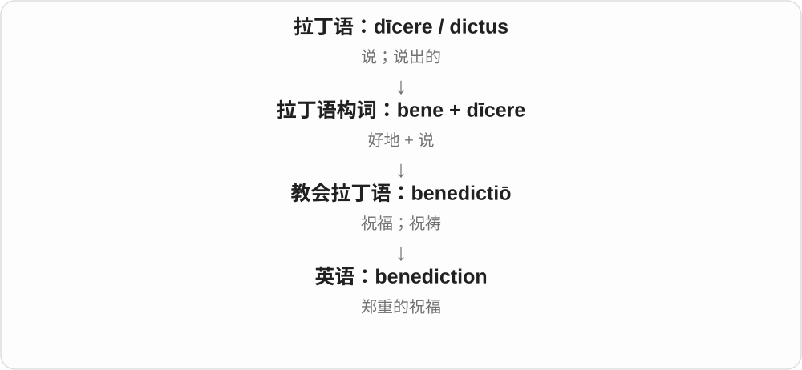

# 0978 · ben- — 好、善；善意、好处与帮助

[逐词精讲目录](../00_逐词精讲目录.md) · [总目录](../00_总目录_按常用程度.md)

## 核心词根与来源

拉丁 bene 是“好地、以好的方式”。进入复合词后分别接表示愿望、行动、出生和说话的材料。benefit、benefactor、benediction 在其他词族也能遇到，因为一个词可以同时包含两个有意义的构词部分。

**要把三件事分开：心里希望别人好，行动让别人受益，最后谁得到好处。它们相连，却不是一回事。**

bene + velle：希望别人好 → benevolent；bene + facere：做好事 → benefit、beneficial；beneficiary：好处落到的人；benign：温和、没有恶意。

- **温和与善意**：benign, benignly, benevolent, benevolence
- **做好事与带来好处**：benefit, beneficial, beneficially, beneficence, benefactor
- **受益与祝福**：beneficiary, benediction

## 词形与演化规律

bene- 常保留好、善的方向；benign 中的 beni- 是古老词形，g 在这个现代英语词里不单独读。benevolent 的 -volent 接 velle“希望”；beneficial 的 -fic- 接 facere“做”。名词 benevolence 在英语中早于 benevolent，别按长短倒排历史。

## 单词速览（常用到不常用）

| 单词 | 音标 | 核心意思 |
|---|---|---|
| [benefit](#w-1) | /ˈbɛn.ɪ.fɪt/ | 好处；受益；有益于 |
| [beneficial](#w-2) | /ˌbenɪˈfɪʃəl/ | 有益的；带来好处的 |
| [benign](#w-3) | /bɪˈnaɪn/ | 和善的；温和无害的；良性的 |
| [beneficiary](#w-4) | 英 /ˌbenɪˈfɪʃəri/；美 /ˌbenɪˈfɪʃieri/ | 受益者；受益人 |
| [benevolent](#w-5) | /bəˈnevələnt/ | 仁慈的；有善意的；乐善好施的 |
| [benefactor](#w-6) | /ˈbɛnəˌfæktəː/ | 恩人；捐助者 |
| [benevolence](#w-7) | /bəˈnevələns/ | 善意；仁慈；慈善帮助 |
| [benediction](#w-8) | /ˌbenɪˈdɪkʃən/ | 祝福；祝祷 |
| [beneficially](#w-9) | /ˌbenɪˈfɪʃəli/ | 有益地；在受益权上〔正式〕 |
| [beneficence](#w-10) | /bəˈnefɪsəns/ | 行善；施惠；促进他人福祉 |
| [benignly](#w-11) | /bɪˈnaɪnli/ | 和善地；无害地 |

## 逐词讲解

### 1. benefit — 好处；受益；有益于

**音标**：/ˈbɛn.ɪ.fɪt/

**先抓住这个画面**

有人替你撑伞，你实际少淋了雨：得到的这个好处就是 benefit。它关心对谁有帮助。

**怎么拆**

古法语 bienfaire“做好事”与 bienfait／benfet“好处”传入英语，后来的拼写受拉丁语 bene- 影响；faire 的祖先是 facere。

**怎么变成今天的意思**

从给予别人的善行，转向由此得到的好处。福利待遇也叫 benefits，因为它们是工作报酬之外给人的保障。

**常见搭配与例句**

benefit from…；benefit someone；health benefits。

> Students benefit from clear feedback.

学生能从清晰的反馈中受益。

> The main benefit is that we save time.

主要好处是我们节省了时间。

**别混淆**

profit 常指收益尤其利润；benefit 可是健康、便利等无法直接折成钱的好处。

### 2. beneficial — 有益的；带来好处的

**音标**：/ˌbenɪˈfɪʃəl/

**先抓住这个画面**

看实际效果：它让某人、某个过程或某种处境变得更好。

**怎么拆**

经古法语 bénéficial 或拉丁 beneficialis 借入，源于 beneficium“恩惠、益处”；不是英语 benefit 直接加 -cial。

**怎么变成今天的意思**

**拉丁语 bene**  
好、善；以好的方式

↓

**拉丁语 bene + facere 一系 → beneficus / beneficium**  
做好事 → 善意、恩惠、利益

↓

**拉丁语 beneficialis → 古法语 bénéficial / 直接借入英语**  
有益的、与恩惠有关的

↓

**英语 beneficial**  
能带来实际好处的

beneficial to someone 是对某人有益；mutually beneficial 是双方都受益。一个做法对甲有益，未必对乙也一样。

**常见搭配与例句**

beneficial to；a beneficial effect；mutually beneficial。

> The new timetable is beneficial to students who commute.

新课表对需要通勤的学生有益。

> The two groups reached a mutually beneficial agreement.

两个团体达成了一项互惠协议。

**别混淆**

benevolent 说善意；beneficial 说有益效果。beneficiary 则是获得好处的人。

### 3. benign — 和善的；温和无害的；良性的

**音标**：/bɪˈnaɪn/

**先抓住这个画面**

看起来没有伤害性，或带着温和、善意的态度；医学里则有更具体的分类义。

**怎么拆**

经古法语 benigne 接拉丁 benignus，传统分析联系 bene“好”与生育、出身的词根；从出身良好转为品性和善，再扩展到温和。

**怎么变成今天的意思**

**拉丁语 bene**  
好、善；以好的方式

↓

**拉丁语 benignus → 古法语 benigne**  
历史上联系“出身良好” → 友善、温和

↓

**中古英语 benigne → benign**  
和善的；温和无害的；良性的

a benign smile 是温和的微笑；a benign explanation 是无害、非恶意的解释。医学中的 benign tumor 指非癌性肿瘤，不等于它在任何位置、大小下都绝无影响。

**常见搭配与例句**

a benign smile；a benign influence；a benign tumour。

> She watched the children with a benign smile.

她带着温和的微笑看着孩子们。

> The report described the growth as benign.

报告将这个增生物描述为良性。

**别混淆**

benevolent 强调有善意、愿助人；benign 可只说不凶险或没有恶意。医学中与 malignant 相对。

### 4. beneficiary — 受益者；受益人

**音标**：英 /ˌbenɪˈfɪʃəri/；美 /ˌbenɪˈfɪʃieri/

**先抓住这个画面**

好处最后落到谁手里，谁就是 beneficiary。

**怎么拆**

接拉丁 beneficiarius“受到恩惠的”，可能经法语 bénéficiaire 借入；远接 beneficium，不从现代英语 benefit 直接加 -iary。

**怎么变成今天的意思**

**拉丁语 bene**  
好、善；以好的方式

↓

**拉丁语 bene + facere 一系 → beneficus / beneficium**  
做好事 → 善意、恩惠、利益

↓

**拉丁语 beneficiarius → 可能经法语 bénéficiaire → 英语 beneficiary**  
享受恩惠的人 → 受益者、受益人

奖学金计划的 beneficiary 是得到帮助的人；保险、遗嘱等文件中的 beneficiary 是指定或依法享有相应利益的人。可以是个人，也可以是机构。

**常见搭配与例句**

the main beneficiary；a beneficiary of；name someone as a beneficiary。

> Students are the main beneficiaries of the new transport scheme.

学生是新交通方案的主要受益者。

> She named a local charity as a beneficiary in her will.

她在遗嘱中指定一家当地慈善机构为受益人。

**别混淆**

benefactor 是给予帮助的人；beneficiary 是接受好处的一方。

### 5. benevolent — 仁慈的；有善意的；乐善好施的

**音标**：/bəˈnevələnt/

**先抓住这个画面**

心里希望别人过得好，也愿意给予照顾或帮助。

**怎么拆**

拉丁 bene“好” + volens“想要”，形成 benevolens；经古法语或直接拉丁语借入。

**怎么变成今天的意思**

**拉丁语 bene**  
好、善；以好的方式

↓

**拉丁语 bene + volens〔velle 的现在分词〕**  
好 + 想要 → 希望别人好

↓

**拉丁语 benevolens → 古法语 benivolent / 英语 benevolent**  
希望别人好 → 有善意、乐于助人的

a benevolent person 是善心的人；a benevolent fund 是为帮助有需要者而设的基金。它描述意愿、性质，不自动证明每个决定都有效。

**常见搭配与例句**

a benevolent attitude；a benevolent fund；a benevolent donor。

> A benevolent neighbour helped the family through a difficult winter.

一位善心的邻居帮助这家人度过了艰难的冬天。

> The company set up a benevolent fund for former employees.

公司为以前的员工设立了援助基金。

**别混淆**

beneficial 强调结果有好处；benevolent 强调主观善意，两者不必总同时成立。

### 6. benefactor — 恩人；捐助者

**音标**：/ˈbɛnəˌfæktəː/

**先抓住这个画面**

有人拿出钱或资源，帮一所学校真正办成事，这位施以帮助的人就是 benefactor。

**怎么拆**

bene（好）+ factor（做事者），来自拉丁语 benefactor。

**怎么变成今天的意思**

对别人做有益的事，词义落到给予帮助的人；现代尤其常指资助机构、艺术或公益的人。

**常见搭配与例句**

a generous benefactor；an anonymous benefactor。

> An anonymous benefactor paid for the new roof.

一位匿名捐助者支付了新屋顶的费用。

> The library thanked its benefactors.

图书馆向捐助者表示感谢。

**别混淆**

beneficiary 是得到好处的人；benefactor 是给予好处的人，方向相反。

### 7. benevolence — 善意；仁慈；慈善帮助

**音标**：/bəˈnevələns/

**先抓住这个画面**

把他人的处境放在心上，愿意为他们做点好事的心意与行为。

**怎么拆**

经法语 benivolence 或拉丁 benevolentia 借入；英语名词记录早于 benevolent，不能只按现代形容词换尾写历史。

**怎么变成今天的意思**

**拉丁语 bene**  
好、善；以好的方式

↓

**拉丁语 bene + volens〔velle 的现在分词〕**  
好 + 想要 → 希望别人好

↓

**拉丁语 benevolentia → 古法语 benivolence / 英语 benevolence**  
善意、好心 → 仁慈与帮助

an act of benevolence 是一次善举；depend on someone’s benevolence 是靠对方好心帮助。词义重点不是施助者多有钱，而是帮助意愿。

**常见搭配与例句**

an act of benevolence；human benevolence；depend on someone’s benevolence。

> The shelter survives through the benevolence of local residents.

收容所靠当地居民的善心援助维持运作。

> Her benevolence was clear in the way she treated new staff.

从她对待新员工的方式中，可以看出她的善意。

**别混淆**

beneficence 更聚焦行善、带来益处；benevolence 更突出善意和愿意助人的倾向。

### 8. benediction — 祝福；祝祷

**音标**：/ˌbenɪˈdɪkʃən/

**先抓住这个画面**

郑重地对一个人说出愿他安好的话。benediction 比随口一句 good luck 更有仪式感。

**怎么拆**

拉丁语 bene（好地）+ dīcere（说）形成 benedīcere“祝福”，名词 benedictiō 进入英语。

**怎么变成今天的意思**

“说好话”在宗教和礼仪场景中成为祝福，而不是奉承别人。它可以是仪式末尾的一段祝祷，也能用于文学性的祝愿。

**常见搭配与例句**

give a benediction；pronounce a benediction；a closing benediction。

> The ceremony ended with a brief benediction.

仪式以一段简短祝祷结束。

> Her parting words sounded like a benediction.

她临别的话听起来像一份祝福。

**别混淆**

compliment 是夸赞某个优点；benediction 是祝福。两者都是好话，但目的不同。

### 9. beneficially — 有益地；在受益权上〔正式〕

**音标**：/ˌbenɪˈfɪʃəli/

**先抓住这个画面**

普通义说产生好效果；正式文件里也可说谁实际享有某项权益。

**怎么拆**

beneficial + -ly，-cial 的读音与后接 -ly 合为 /ʃəli/；不把它与 beneficiary 混成同一个词。

**怎么变成今天的意思**

**拉丁语 bene**  
好、善；以好的方式

↓

**拉丁语 bene + facere 一系 → beneficus / beneficium**  
做好事 → 善意、恩惠、利益

↓

**拉丁语 beneficialis → 古法语 bénéficial / 直接借入英语**  
有益的、与恩惠有关的

↓

**英语 beneficial**  
能带来实际好处的

↓

**英语 beneficial + -ly → beneficially**  
有益的 → 以有益方式；也用于实际受益关系

affect beneficially 是产生有利影响。beneficially owned 常见于法律、商业文件，关注实际利益归属，不等同于谁在名义上持有。

**常见搭配与例句**

affect beneficially；use beneficially；beneficially owned。

> The extra funding affected the programme beneficially.

新增资金给这个项目带来了有利影响。

> The report identifies the shares beneficially owned by each director.

报告列明了每位董事实际享有受益权益的股份。

**别混淆**

profitably 常说盈利或有成效；beneficially 的好处未必是利润，正式受益权义还须按语境理解。

### 10. beneficence — 行善；施惠；促进他人福祉

**音标**：/bəˈnefɪsəns/

**先抓住这个画面**

不只在心里祝别人好，还要落实为对别人有帮助的行动。

**怎么拆**

借自拉丁 beneficentia，接 beneficus；bene“好”与 facere“做”这一支结合。

**怎么变成今天的意思**

**拉丁语 bene**  
好、善；以好的方式

↓

**拉丁语 bene + facere 一系 → beneficus / beneficium**  
做好事 → 善意、恩惠、利益

↓

**拉丁语 beneficentia → 英语 beneficence**  
做好事、慷慨 → 行善、促进福祉

是较正式的词，可谈慈善行为，也可出现在伦理讨论里，强调让他人受益。它并不等于单纯避免伤害。

**常见搭配与例句**

an act of beneficence；the principle of beneficence；public beneficence。

> The lecture distinguished beneficence from the simple avoidance of harm.

讲座区分了主动促进他人福祉与仅仅避免伤害。

> The library was built through the beneficence of local donors.

图书馆在当地捐赠者的善举支持下建成了。

**别混淆**

benevolence 偏善意；beneficence 偏善行和增进他人利益，实际用法有重叠。

### 11. benignly — 和善地；无害地

**音标**：/bɪˈnaɪnli/

**先抓住这个画面**

表情或行为没有攻击性，像带着温和的好意看待对方。

**怎么拆**

benign + -ly；保留 benign 中 g 不单独发音的读法。

**怎么变成今天的意思**

**拉丁语 bene**  
好、善；以好的方式

↓

**拉丁语 benignus → 古法语 benigne**  
历史上联系“出身良好” → 友善、温和

↓

**中古英语 benigne → benign**  
和善的；温和无害的；良性的

↓

**英语 benign + -ly → benignly**  
温和、无恶意的 → 以这种方式

smile benignly 常描写温厚、宽容的神情；act benignly 也可说某种影响并不造成伤害。它不必包含主动捐助或帮助。

**常见搭配与例句**

smile benignly；look benignly on；nod benignly。

> The old man smiled benignly at the noisy children.

老人对吵闹的孩子们温和地笑了笑。

> She nodded benignly and let him finish his story.

她和善地点点头，让他把故事讲完。

**别混淆**

kindly 常见于友善行动；benignly 更突出温和、不带威胁的状态或态度。

## 这一组要分清什么

benefactor 给予帮助，beneficiary 获得利益；benevolent 有善意，beneficial 有益处。benign 的医学用法是非癌性，与日常“温和”相连但有专门意义。

## 串起来练习

造一句区分“有善意但未必有帮助”：benevolent 与 beneficial 分别放在哪？再用 benefactor、beneficiary 说清帮助关系的两端。
