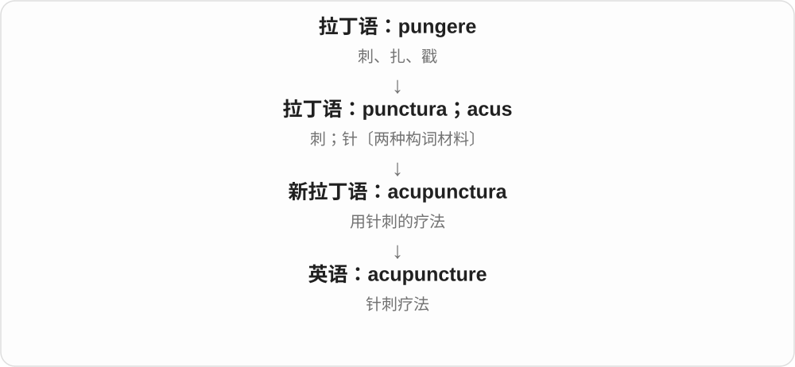
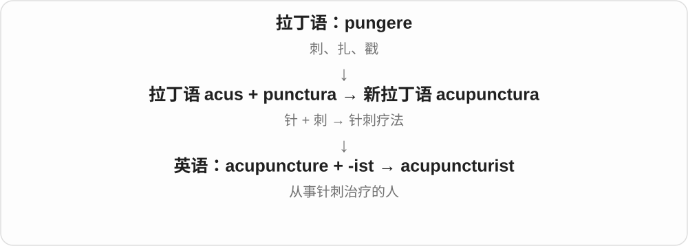

# 1234 · acu-, acut- — 尖锐、磨尖；针

[逐词精讲目录](../00_逐词精讲目录.md) · [总目录](../00_总目录_按常用程度.md)

## 核心词根与来源

尖锐不是所有词的直接中文答案。敏锐头脑、严重短缺、急性病程分别抓住了不同特点；cute 更经历了从机灵到可爱的变化。每个词都要落回实际搭配。

**先想一根针的尖端。拉丁 acus 是针，acuere 是使尖锐，acutus 是磨尖、尖锐的；这个画面后来延伸到敏锐的感官、判断和强烈的感受。**

尖锐 → acute；判断敏锐 → acumen；分辨清晰 → acuity；针刺 → acupuncture；acute 缩短再变义 → cute。

- **敏锐、强烈与病程**：acute, acutely, acuteness, acuity, acumen, subacute
- **针与按压**：acupuncture, acupuncturist, acupressure
- **从机灵转向可爱**：cute, cutely, cuteness

## 词形与演化规律

acu- 与 acus、acuere 相关；acut- 对应 acutus。acumen、acuity 各有拉丁名词背景，不能一概看成现代 acute 加后缀。cute 是 acute 的英语缩略，后来的可爱义不是针尖义。

## 单词速览（常用到不常用）

| 单词 | 音标 | 核心意思 |
|---|---|---|
| [cute](#w-1) | 英、美 /kjuːt/ | 可爱的；有吸引力的；有时也指耍小聪明的 |
| [acute](#w-2) | 英、美 /əˈkjuːt/ | 尖锐的；敏锐的；严重的；急性的；角度为锐角的 |
| [acutely](#w-3) | 英、美 /əˈkjuːtli/ | 敏锐地；强烈地；严重地 |
| [acupuncture](#w-4) | 英 /ˈækjupʌŋktʃə/；美 /ˈækjupʌŋktʃər/ | 针刺疗法；针灸中的针刺 |
| [acumen](#w-5) | 英、美 /ˈækjəmən/，亦 /əˈkjuːmən/ | 敏锐判断力；精明；洞察力 |
| [cuteness](#w-6) | 英、美 /ˈkjuːtnəs/ | 可爱；讨喜的特质 |
| [acuity](#w-7) | 英、美 /əˈkjuːəti/ | 敏锐度；清晰分辨能力 |
| [subacute](#w-8) | 英、美 /ˌsʌbəˈkjuːt/ | 亚急性的；略尖而不锐的〔形态〕 |
| [acupressure](#w-9) | 英 /ˈækjupreʃə/；美 /ˈækjəˌpreʃər/ | 穴位按压；指压疗法 |
| [acupuncturist](#w-10) | 英 /ˈækjupʌŋktʃərɪst/；美 /ˈækjəpʌŋktʃərɪst/ | 针灸师；针刺治疗从业者 |
| [acuteness](#w-11) | 英、美 /əˈkjuːtnəs/ | 敏锐；强烈、严重的程度；尖锐性 |
| [cutely](#w-12) | 英、美 /ˈkjuːtli/ | 可爱地；讨喜地 |

## 逐词讲解

### 1. cute — 可爱的；有吸引力的；有时也指耍小聪明的

**音标**：英、美 /kjuːt/

**先抓住这个画面**

现在常让人想到讨喜的小动物或漂亮物件；它最初却是说脑子机灵。

**怎么拆**

由 acute 缩短，去掉开头音节。早期 cute 仍指敏锐、聪明，后来在美国口语中发展出漂亮、可爱等义，不是与 acute 巧合相似。

**怎么变成今天的意思**

**英语 acute**  
敏锐、机灵等

↓

**缩短为 cute**  
早期仍说聪明、精明

↓

**现代常见义**  
讨喜、可爱；也保留机巧甚至卖弄聪明的用法

a cute puppy 是可爱的小狗；a cute apartment 可以是小巧讨喜的公寓。Don’t get cute with me 则可能是不让对方耍小聪明，不能按“别对我可爱”逐字翻译。

**常见搭配与例句**

a cute puppy；a cute smile；a cute little shop；don’t get cute。

> The puppy gave us a cute, slightly puzzled look.

小狗用可爱又有点困惑的眼神看着我们。

> Don’t get cute with the question; just give me a clear answer.

别在这个问题上耍小聪明，直接给我一个明确回答。

**别混淆**

beautiful 更偏美丽，cute 常偏讨喜、可爱，有时也用于有吸引力的人。cute 不必表示体积小；语气还可能带调侃。

### 2. acute — 尖锐的；敏锐的；严重的；急性的；角度为锐角的

**音标**：英、美 /əˈkjuːt/

**先抓住这个画面**

像一个尖端直达问题：感官分辨得细，问题来得强烈；医学里还要特别看起病和病程。

**怎么拆**

借自拉丁 acutus“磨尖的、尖锐的”，是 acuere“使尖锐”的分词，与 acus“针”相关。英语较早记录在疾病语境，不能把现代常用义的排列当成英语逐步出现的顺序。

**怎么变成今天的意思**

**拉丁 acuere → acutus**  
使尖锐 → 尖的、敏锐的

↓

**中古英语 acute**  
较早用于疾病、发热等

↓

**现代多领域用法**  
严重的、敏锐的；急性的；锐角的

an acute shortage 是短缺很严重，acute hearing 是听觉敏锐。医学 acute 常指起病急、进展快或相对短的病程，不能只等于“病得重”；acute angle 是大于 0°、小于 90° 的角，acute accent 是 é 上那样向右上斜的符号。

**常见搭配与例句**

an acute shortage；acute awareness；acute hearing；an acute illness；an acute angle。

> The town faced an acute shortage of affordable housing.

这个城镇面临严重的可负担住房短缺。

> Her acute hearing picked up a faint sound behind the wall.

她敏锐的听觉捕捉到了墙后微弱的声音。

> A sixty-degree angle is an acute angle.

六十度的角是锐角。

**别混淆**

chronic 与 acute 在医学里侧重持续时间、病程等区别；severe 专说程度严重。acute 的意思随它修饰的名词变化，不能逐个硬译成尖锐。

### 3. acutely — 敏锐地；强烈地；严重地

**音标**：英、美 /əˈkjuːtli/

**先抓住这个画面**

某种感受或认识特别清楚、强烈，像触到一个很尖的点。

**怎么拆**

英语 acute + -ly。形容词的敏锐、强烈等义转成副词，用来修饰 aware、conscious、embarrassed 等词。

**怎么变成今天的意思**

**拉丁 acutus → 英语 acute**  
尖锐、敏锐、强烈等

↓

**acute + -ly → acutely**  
转成副词

↓

**常见情境**  
清楚意识到；强烈感到；程度严重

acutely aware of a problem 是对问题非常清楚，可能还带切身压力；acutely embarrassed 是非常尴尬。这里通常不是“突然地”，也不是把任何感受都医学化成急性。

**常见搭配与例句**

acutely aware of；acutely conscious of；acutely embarrassed；acutely sensitive to。

> She was acutely aware of how little time remained.

她非常清楚剩下的时间已经很少。

> He felt acutely embarrassed when his private note appeared on the screen.

私人笔记出现在屏幕上时，他感到极其尴尬。

**别混淆**

accurately 是准确地，acutely 是敏锐或强烈地；拼写相似，关注点不同。意识强烈也不自动等于判断准确。

### 4. acupuncture — 针刺疗法；针灸中的针刺

**音标**：英 /ˈækjupʌŋktʃə/；美 /ˈækjupʌŋktʃər/

**先抓住这个画面**

词形抓住一个具体动作：用针刺入。它不是“痛”的名称，而是一种治疗方式的英语名称。

**怎么拆**

借自新拉丁语 acupunctura：拉丁语 acus“针” + punctura“刺”；现代可辨认 acu- 与 puncture，但不是历史上只由两个英语词拼成。

**怎么变成今天的意思**

日常中文常译“针灸”，但 acupuncture 本身聚焦针刺，并不自动包括艾灸。通常作不可数名词；一次治疗可以说 an acupuncture session。

**常见搭配与例句**

an acupuncture session；an acupuncture needle；practise acupuncture。

> The clinic offers acupuncture on Tuesdays and Thursdays.

这家诊所每周二和周四提供针刺治疗。

> She asked what would happen during her first acupuncture session.

她询问第一次针刺治疗时会进行哪些步骤。

**别混淆**

acupressure 是按压刺激的名称；acupuncture 里的 punct- 明确涉及针刺。

### 5. acumen — 敏锐判断力；精明；洞察力

**音标**：英、美 /ˈækjəmən/，亦 /əˈkjuːmən/

**先抓住这个画面**

信息很多，别人还在绕圈，你已经看见关键、判断出哪条路更可行。

**怎么拆**

直接借拉丁 acumen，原指尖端，也已可比喻头脑敏锐，来自 acuere“使尖”。-men 在这里属于古老名词构形，不是英语 man 或 men。

**怎么变成今天的意思**

**拉丁 acuere → acumen**  
使尖锐 → 尖端、敏锐

↓

**拉丁比喻义**  
思维的敏锐、判断力

↓

**英语 acumen**  
尤其用于商业、财务、政治等实际判断

business acumen 不是只会背商业术语，而是能理解局面、抓住机会与风险并作判断。它常带肯定意味，强调判断质量，不只强调反应快。

**常见搭配与例句**

business acumen；financial acumen；political acumen；show considerable acumen。

> Her business acumen helped the company recognize an overlooked market.

她敏锐的商业判断力帮助公司发现了一个被忽视的市场。

> The role requires technical knowledge and political acumen.

这个岗位既需要技术知识，也需要政治判断力。

**别混淆**

knowledge 是拥有知识，acumen 是善于看出关键并作判断；两者可以互相支持，却不是同一回事。

### 6. cuteness — 可爱；讨喜的特质

**音标**：英、美 /ˈkjuːtnəs/

**先抓住这个画面**

把那些让人觉得“真可爱”的外形、表情或行为当成一种整体感受。

**怎么拆**

英语 cute + -ness。cute 本身由 acute 缩短并产生新义，这个性质名词主要接今天常见的可爱义。

**怎么变成今天的意思**

**acute → cute**  
敏锐词的缩略，后发展出可爱义

↓

**cute + -ness → cuteness**  
可爱这一性质

↓

**日常评价**  
外形、行为、设计等的讨喜程度

the cuteness of a kitten 是小猫的可爱之处；设计里的 cuteness 可能来自圆润造型、表情或比例。它不是 beauty 的完整替换词，一个宏伟壮丽的建筑很美，却不一定可爱。

**常见搭配与例句**

the cuteness of something；sheer cuteness；a sense of cuteness；cuteness in design。

> The kitten’s awkward movements added to its cuteness.

小猫笨拙的动作让它更显可爱。

> The character design relies on cuteness rather than realistic proportions.

这个角色设计依靠可爱感，而不是写实的比例。

**别混淆**

cute 是可爱的，cuteness 是可爱这个性质。词源的 acute 不代表现代 cuteness 含有“尖锐度”，后来的词义已走向不同场景。

### 7. acuity — 敏锐度；清晰分辨能力

**音标**：英、美 /əˈkjuːəti/

**先抓住这个画面**

把两条很近的线、两个很相似的信号分开看清，体现的是分辨的精细程度。

**怎么拆**

来自古法语 acuité，或直接经中世纪拉丁 acuitas／acuitatem“尖锐、敏锐”，接 acuere“磨尖”。现代可与 acute 对照理解，但有独立的法语、拉丁名词借入路线。

**怎么变成今天的意思**

**拉丁 acuere；中世纪 acuitas**  
磨尖；尖锐、敏锐状态

↓

**古法语 acuité／直接拉丁借入**  
敏锐、清晰

↓

**英语 acuity**  
感官或心智的分辨能力

visual acuity 常指视力的清晰分辨能力，例如分辨图表上的小细节；mental acuity 说头脑敏锐。视觉敏锐度不是整个视觉能力的总和，色觉、视野等是另外的方面。

**常见搭配与例句**

visual acuity；auditory acuity；mental acuity；a test of visual acuity。

> The chart is used to assess visual acuity.

这张视力表用于评估视力的清晰分辨能力。

> The discussion revealed the acuity of her observations.

讨论显示出她观察的敏锐。

**别混淆**

acumen 更常指复杂情境中的判断力；acuity 更常说感官或头脑的清晰、敏锐程度。

### 8. subacute — 亚急性的；略尖而不锐的〔形态〕

**音标**：英、美 /ˌsʌbəˈkjuːt/

**先抓住这个画面**

医学里，病程或表现处在急性与慢性之间；描述形状时，尖端收窄却没有特别锐利。

**怎么拆**

sub- + acute。acute 原有尖锐义，医学里用于急性状态，两支都可用 sub- 表示未达到充分程度。

**怎么变成今天的意思**

**拉丁语：sub**  
在下面；从下向上；靠近

↓

**英语前缀：sub-**  
下方；下一级；低于某个标准

↓

**英语：sub- + acute → subacute**  
未到很尖锐；较急性缓和或处在急慢性之间

subacute inflammation 是亚急性炎症。各疾病的时间划分可能不同，不能从词根推出一律多少天，也不等于“无关紧要”。

**常见搭配与例句**

a subacute condition；subacute inflammation。

> The chapter discusses acute, subacute, and chronic inflammation.

这一章讨论急性、亚急性和慢性炎症。

> The botanical description calls the leaf tip subacute.

植物学描述把叶尖称为稍尖而不锐。

**别混淆**

acute 常突出急性；chronic 是慢性；subacute 不是简单把症状严重程度分成中等。

### 9. acupressure — 穴位按压；指压疗法

**音标**：英 /ˈækjupreʃə/；美 /ˈækjəˌpreʃər/

**先抓住这个画面**

把注意力放在“按”而非“刺”：对身体特定部位施加压力。

**怎么拆**

现代常用义可分析为 acupuncture 与 pressure 的混成。十九世纪已有同形词，由拉丁 acus“针”与 pressure 组成，指一种旧外科止血方法；两条命名背景相关，但不能把旧操作直接当成现代穴位按压。

**怎么变成今天的意思**

**共同构件背景：拉丁 acus、英语 acupuncture 与 pressure**  
针、针刺与压力

↓

**旧同形词：acus + pressure**  
十九世纪外科方法的名称

↓

**现代支线：acupuncture + pressure → acupressure**  
穴位按压；作为混成词解释

现代 acupressure 指在特定点位按压，名称保留 acu- 并不意味着必须刺入针。普通按摩可在较大范围揉按，acupressure 更突出点位与压力；这里的区别是词义与方式。

**常见搭配与例句**

an acupressure session；acupressure points；a study of acupressure；acupressure and acupuncture。

> The article distinguishes acupressure from acupuncture by the method used.

文章通过所用方式区分穴位按压与针刺。

> The researcher recorded participants’ experiences during the acupressure sessions.

研究人员记录了参加者在穴位按压过程中的体验。

**别混淆**

acupuncture 是针刺，acupressure 是按压。词里有 acu- 不代表现代操作一定使用针，也不能仅凭名称推断具体疗效。

### 10. acupuncturist — 针灸师；针刺治疗从业者

**音标**：英 /ˈækjupʌŋktʃərɪst/；美 /ˈækjəpʌŋktʃərɪst/

**先抓住这个画面**

把 acupuncture 作为专业工作来做的人。

**怎么拆**

acupuncture 去掉词尾 e，加 -ist“从事某种专业的人”。

**怎么变成今天的意思**

用词说明从事哪种疗法；某人在具体地区拥有什么资格，要看实际职业规定，不能仅从这个后缀判断。

**常见搭配与例句**

a qualified acupuncturist；consult an acupuncturist。

> The acupuncturist explained the appointment before it began.

针灸师在开始前说明了本次就诊安排。

> The clinic lists the training and qualifications of each acupuncturist.

诊所列明了每位针灸师的培训经历与资质。

**别混淆**

acupuncture 是疗法；acupuncturist 是从业者，-ist 不表示接受治疗的人。

### 11. acuteness — 敏锐；强烈、严重的程度；尖锐性

**音标**：英、美 /əˈkjuːtnəs/

**先抓住这个画面**

把 acute 的性质拿出来衡量：感官有多敏锐，感受有多强，问题有多严重。

**怎么拆**

英语 acute + -ness，直接形成性质名词。它与经法语、拉丁借入的 acuity 接近，但不是 acuity 的历史来源。

**怎么变成今天的意思**

**英语 acute**  
敏锐、强烈、尖锐等

↓

**acute + -ness → acuteness**  
把性质名词化

↓

**随搭配变化**  
感官敏锐程度；痛苦、需求等的强烈程度

the acuteness of her hearing 是听觉的敏锐，the acuteness of the housing shortage 是住房短缺的严重程度。名词保留多个义项，需要看 of 后面的对象，不能统一理解成医学上的急性。

**常见搭配与例句**

the acuteness of hearing；the acuteness of pain；mental acuteness；the acuteness of a problem。

> The test demonstrated the acuteness of the animal’s hearing.

测试显示了这种动物听觉的敏锐。

> The figures reveal the acuteness of the housing shortage.

这些数字揭示了住房短缺的严重程度。

**别混淆**

acuity 常用于感知、分辨的敏锐度；acuteness 更容易延伸到问题、痛苦等的强烈程度。用 visual acuity 是更固定的专业搭配。

### 12. cutely — 可爱地；讨喜地

**音标**：英、美 /ˈkjuːtli/

**先抓住这个画面**

把可爱落实到一个动作或一种呈现方式，例如歪头、挥手，或把物件布置得小巧讨喜。

**怎么拆**

英语 cute + -ly。acute 缩成 cute 后发展出可爱义，再由副词形式描述动作方式；不是从 cut“切”派生。

**怎么变成今天的意思**

**acute → cute**  
敏锐、机灵 → 后起可爱义

↓

**cute + -ly → cutely**  
可爱地

↓

**动作、表情及呈现方式**  
以讨喜的方式做出或安排

smile cutely 描述笑的样子，cutely decorated 描述布置给人的感觉。它是评价，不是可以客观量出的动作类别；过度修饰时，也可能让读者觉得刻意卖萌。

**常见搭配与例句**

smile cutely；tilt one’s head cutely；cutely decorated；cutely packaged。

> The puppy tilted its head cutely when it heard the whistle.

听到口哨声，小狗可爱地歪了歪头。

> The gifts were cutely packaged in tiny boxes with ribbon handles.

礼物装在带丝带提手的小盒子里，包装很讨喜。

**别混淆**

cutely 修饰动作、形容词等，cute 通常直接修饰名词或作表语。The puppy is cute 与 The puppy tilted its head cutely 是不同句子结构。

## 这一组要分清什么

acute 不总是严重，医学急性还关乎起病和病程。acumen 常说实际判断力，acuity 常说分辨敏锐度。acupuncture 用针，现代 acupressure 用压力；cute 的新义不能硬还原成尖。

## 串起来练习

She has acute hearing and business acumen, and she thinks the puppy is cute. 听觉敏锐、商业判断精明、小狗可爱：远处相接的词，今天已经各有具体场景。
