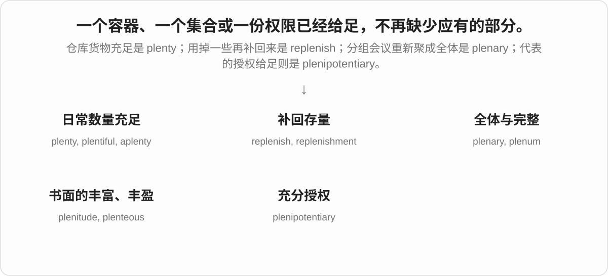
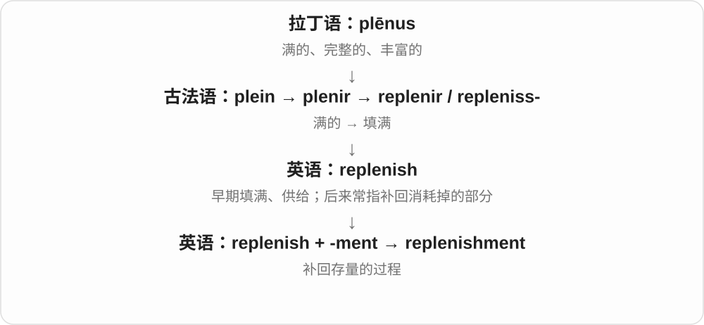
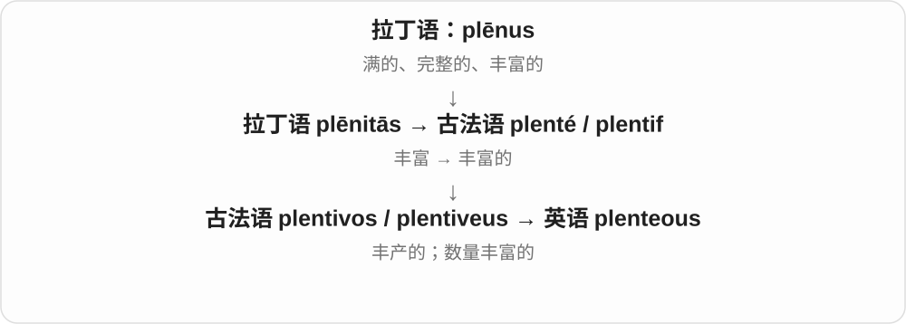

# 1244 · plen- — 满的；充足的；完整的

[逐词精讲目录](../00_逐词精讲目录.md) · [总目录](../00_总目录_按常用程度.md)

## 核心词根与来源

来自拉丁语形容词 plēnus“满的、完整的、丰富的”。plenty 经法语变化后已经看不到完整的 plen-，plenary 与 plenitude 则保留得较清楚。它与 plēre“填满”的词族同源；这里从“满的状态”讲起，不把所有 plen- 单词硬接在一个英语母词后面。

## 词形与演化规律

plen- 见于 plenary、plenitude、plenum；plēnitās 经法语 plenté 走到 plenty，再形成 plentiful、aplenty。replenish 经过古法语 replenir / repleniss-，结尾 -ish 不是“有点儿”的那个现代后缀。

## 单词速览（常用到不常用）

| 单词 | 音标 | 核心意思 |
|---|---|---|
| [plenty](#w-1) | 英、美 /ˈplenti/ | 充足；大量；足够多；很、十分〔口语〕 |
| [plentiful](#w-2) | 英、美 /ˈplentɪfəl/ | 大量存在的；充足的 |
| [plenary](#w-3) | 英、美常 /ˈpliːnəri/；美也读 /ˈplenəri/ | 全体参加的；完全的；全体会议 |
| [replenish](#w-4) | 英、美 /rɪˈplenɪʃ/ | 补充；补满；恢复储备 |
| [plenum](#w-5) | 英、美 /ˈpliːnəm/；美也读 /ˈplenəm/ | 全体会议；充满物质的空间；静压箱、空气分配空间〔技术〕 |
| [replenishment](#w-6) | 英、美 /rɪˈplenɪʃmənt/ | 补充；补货；恢复储备的过程 |
| [plenipotentiary](#w-7) | 英 /ˌplenɪpəˈtenʃəri/；美 /ˌplenɪpoʊˈtenʃieri/ | 全权代表；有全权的〔尤指外交〕 |
| [aplenty](#w-8) | 英、美 /əˈplenti/ | 很多；充足〔常放在名词后〕 |
| [plenitude](#w-9) | 英 /ˈplenɪtjuːd/；美 /ˈplenətuːd/ | 丰富；充实；圆满〔书面〕 |
| [plentifully](#w-10) | 英、美 /ˈplentɪfəli/ | 大量地；充足地 |
| [plenteous](#w-11) | 英 /ˈplentiəs/；美 /ˈplentiəs/ | 丰富的；丰产的〔文学、旧式〕 |

## 逐词讲解

### 1. plenty — 充足；大量；足够多；很、十分〔口语〕

**音标**：英、美 /ˈplenti/

**先抓住这个画面**

不是勉强凑够，而是手边还有余量：“别急，时间多着呢。”

**怎么拆**

拉丁语 plēnus“满的” → plēnitās“充满、丰富”，经古法语 plenté、中古英语 plentee 成为 plenty；末尾 -ty 不是现代英语自己接出的固定词尾。

**怎么变成今天的意思**

plenty of 后可接复数名词或不可数名词，如 plenty of books、plenty of time。名词已明确时可单独说 There is plenty。美式口语 plenty good enough 是“完全够好了”。

**常见搭配与例句**

plenty of time；plenty to do；plenty good enough。

> We have plenty of time to catch the train.

我们有充足的时间赶上火车。

> Bring a friend; there will be plenty of chairs.

带个朋友来吧，椅子很充足。

> This old bag is plenty good enough for a short trip.

短途旅行用这个旧包完全够了。

**别混淆**

many 只配可数复数；plenty of 两类名词都能接，而且常带足够、不必担心的感觉。

### 2. plentiful — 大量存在的；充足的

**音标**：英、美 /ˈplentɪfəl/

**先抓住这个画面**

需要的时候很容易找到，因为数量不少、供应充足。

**怎么拆**

plenty + -ful，拼写 y 变 i；早在中古英语已有 plentiful。

**怎么变成今天的意思**

常形容 food、water、jobs、opportunities，也可说 something is plentiful。它不等于装在某个容器里已经满了，而是总体数量丰富。

**常见搭配与例句**

a plentiful supply；plentiful food；opportunities are plentiful。

> Fresh fruit is plentiful here in summer.

这里夏天有大量新鲜水果。

> The village has a plentiful supply of clean water.

村里干净的水供应充足。

**别混淆**

full 常说某个容器或整体已满；plentiful 说某种东西数量多、容易获得。

### 3. plenary — 全体参加的；完全的；全体会议

**音标**：英、美常 /ˈpliːnəri/；美也读 /ˈplenəri/

**先抓住这个画面**

开会时不再分几个小组，而是把全体成员合到同一场；谈权力时，则是相关权限给足。

**怎么拆**

拉丁语 plēnus“满的”形成 plēnārius“完整的”，经古法语及中世纪拉丁语进入英语。名词指全体会议，由形容词用法发展。

**怎么变成今天的意思**

a plenary session 是全体会议；plenary powers 是全权。前者指会议面向全体成员，不表示现实中每个人一秒不差地都到场。

**常见搭配与例句**

a plenary session；a plenary speaker；plenary powers。

> All delegates returned to the hall for the plenary session.

所有代表回到大厅参加全体会议。

> The closing plenary reviewed the proposals from each group.

闭幕全会审议了各小组的提案。

**别混淆**

panel session 可是部分人专题讨论；plenary 把会议层级拉到全体。

### 4. replenish — 补充；补满；恢复储备

**音标**：英、美 /rɪˈplenɪʃ/

**先抓住这个画面**

杯里的水喝少了，货架的东西卖少了，再把空出来的部分补回来。

**怎么拆**

来自古法语 replenir 的 repleniss- 词干；plenir 与 plein“满的”、拉丁语 plēnus 相连。早期 re- 可能加强“填满”，现代则常突出再次补回。

**怎么变成今天的意思**

replenish stocks 是补库存；replenish your energy 是恢复精力。它不要求原先已经完全空了，只要存量下降就可补充。

**常见搭配与例句**

replenish stocks；replenish supplies；replenish energy。

> Staff replenish the shelves before the shop opens.

员工在开门营业前补满货架。

> A quiet weekend helped replenish her energy.

一个安静的周末帮助她恢复了精力。

**别混淆**

replace 是换掉原有东西；replenish 是补回消耗掉的部分。

### 5. plenum — 全体会议；充满物质的空间；静压箱、空气分配空间〔技术〕

**音标**：英、美 /ˈpliːnəm/；美也读 /ˈplenəm/

**先抓住这个画面**

记住“满”：会场是全体聚齐，技术中则是容纳、分配空气的空间。具体意思要靠上下文分开。

**怎么拆**

借自拉丁语 plēnum，是 plēnus 的中性形式，常联系 plēnum spatium“充满的空间”。全体会议和工程空间是英语的不同应用，不能画成会议先变成风箱。

**怎么变成今天的意思**

政治或组织报道里的 plenum 是全会。通风里的 plenum 是用于接收、分配空气的空间；不应把每一处吊顶空隙都自动叫 plenum。复数可用 plenums 或 plena。

**常见搭配与例句**

a committee plenum；an air plenum；a supply plenum。

> The committee approved the proposal at its annual plenum.

委员会在年度全会上通过了提案。

> The technician inspected the supply plenum for leaks.

技术人员检查了送风静压箱是否漏风。

**别混淆**

plenary 常作形容词修饰 session，也可作名词；plenum 本身是名词，另有空间技术义。

### 6. replenishment — 补充；补货；恢复储备的过程

**音标**：英、美 /rɪˈplenɪʃmənt/

**先抓住这个画面**

库存下降后把货补回来，这件事需要安排时间、数量和运输。

**怎么拆**

replenish + -ment；英语派生名词。

**怎么变成今天的意思**

常用于库存、仓储和自然资源恢复。补充可以靠人工，也可以是雨水等自然过程；不暗示每次都立刻补满。

**常见搭配与例句**

stock replenishment；regular replenishment；a replenishment system。

> The shop uses weekly replenishment for items that sell slowly.

对于卖得慢的商品，这家店每周补一次货。

> Heavy rain helped the replenishment of the reservoir.

大雨有助于水库恢复蓄水量。

**别混淆**

replacement 通常是替换；replenishment 通常是补数量。

### 7. plenipotentiary — 全权代表；有全权的〔尤指外交〕

**音标**：英 /ˌplenɪpəˈtenʃəri/；美 /ˌplenɪpoʊˈtenʃieri/

**先抓住这个画面**

这位代表不只是来传话，而是被正式授权，能代表派遣方处理谈判等事务。

**怎么拆**

拉丁语 plēnus“完全的” + potēns“有力量的” → 后期拉丁语 plēnipotēns，再形成中世纪拉丁语 plēnipotentiārius；经法语或直接拉丁语借入。

**怎么变成今天的意思**

主要见于外交称号、条约与历史文字。full powers 指所授事务范围内的充分授权，不是说这个人对世上任何事都有无限权力。

**常见搭配与例句**

an ambassador plenipotentiary；a plenipotentiary representative。

> The government sent a plenipotentiary to conduct the negotiations.

政府派了一位全权代表主持谈判。

> She was appointed ambassador extraordinary and plenipotentiary.

她被任命为特命全权大使。

**别混淆**

delegate 泛指代表；plenipotentiary 突出具有正式授予的充分处理权限。

### 8. aplenty — 很多；充足〔常放在名词后〕

**音标**：英、美 /əˈplenti/

**先抓住这个画面**

把“多着呢”放到名词后面：problems aplenty，就是问题一大堆。

**怎么拆**

来自较早 a-plenty，a- + plenty；后来连写。不是把 a 当成单数冠词去修饰 plenty。

**怎么变成今天的意思**

通常放在名词后，如 opportunities aplenty。略有生动、修辞色彩，常用于报道、标题和叙述。

**常见搭配与例句**

food aplenty；problems aplenty；opportunities aplenty。

> There were mistakes aplenty in the first draft.

初稿里错误一大堆。

> The festival offered music, food, and entertainment aplenty.

节日上音乐、食物和娱乐活动都很丰富。

**别混淆**

plenty of books 是名词前的常见表达；books aplenty 把强调放到后面，语气更鲜明。

### 9. plenitude — 丰富；充实；圆满〔书面〕

**音标**：英 /ˈplenɪtjuːd/；美 /ˈplenətuːd/

**先抓住这个画面**

看见的不是几样零散东西，而是满满当当、很充足的一整片。

**怎么拆**

拉丁语 plēnus → plēnitūdō“充满、完整”，经法语及拉丁语借入；不是英语 plenty 加 -tude。

**怎么变成今天的意思**

a plenitude of something 是很多某物，语气比 plenty 庄重；也可描写生活的充实。注意拼作 plenitude，中间没有 plenty 的那个额外 t。

**常见搭配与例句**

a plenitude of ideas；a sense of plenitude；the plenitude of life。

> The archive offers a plenitude of material for future research.

这批档案为今后的研究提供了丰富材料。

> The poem celebrates the plenitude of ordinary life.

这首诗歌颂了平凡生活的丰盈。

**别混淆**

plenty 是日常的足够多；plenitude 更书面，还能强调充实、圆满的整体感。

### 10. plentifully — 大量地；充足地

**音标**：英、美 /ˈplentɪfəli/

**先抓住这个画面**

让某种东西足足地到位：水浇得够，饭菜也给得足。

**怎么拆**

plentiful + -ly；形容词转副词。

**怎么变成今天的意思**

比 plenty of 更书面，常搭配 supplied、provided、stocked。日常说“有很多水”，用 plenty of water 更自然。

**常见搭配与例句**

plentifully supplied with；plentifully stocked。

> The hikers were plentifully supplied with food and water.

徒步者得到了充足的食物和水。

> The shelves were plentifully stocked with local produce.

货架上摆满了当地农产品。

**别混淆**

frequently 强调次数频繁；plentifully 强调数量丰富，不是“经常地”。

### 11. plenteous — 丰富的；丰产的〔文学、旧式〕

**音标**：英 /ˈplentiəs/；美 /ˈplentiəs/

**先抓住这个画面**

像诗里说土地肥沃、收成丰饶，画面比日常的“很多”更有古典气息。

**怎么拆**

借自古法语 plentivos / plentiveus，经 plentif、plenté 与拉丁语 plēnitās 相连；不是只有现代 plenty + -ous 这一构词解释。

**怎么变成今天的意思**

可见于诗歌、宗教文字或刻意庄重的描写，如 a plenteous harvest。普通聊天和说明文里 plentiful 更常用。

**常见搭配与例句**

a plenteous harvest；plenteous rain；a plenteous supply。

> The poem gives thanks for a plenteous harvest.

诗中表达了对丰收的感恩。

> Plenteous rain turned the dry valley green.

充沛的雨水使干燥的山谷绿了起来。

**别混淆**

plentiful 与它意思很近；plenteous 的主要差别是文体，不是数量必然更多。

## 这一组要分清什么

plenty of time 是时间充足；a full hour 是完整的一小时，两种“满”用法不同。replenish 是补存量，replace 是换东西。plenteous 与 plentiful 近义但更古旧、文学化；plenitude 不要按 plenty 的拼写多塞一个 t。

## 串起来练习

想象组织一次会议：先有 plenty of food，食物足够；吃掉一部分后 replenish the supplies，补物资；最后所有小组汇合，举行 a plenary session。这几步把“充足—补回—全体”连成一个清楚场景。
