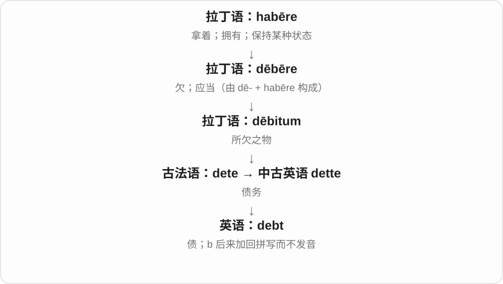
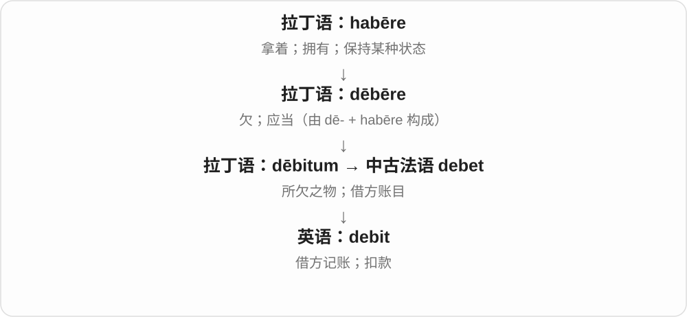
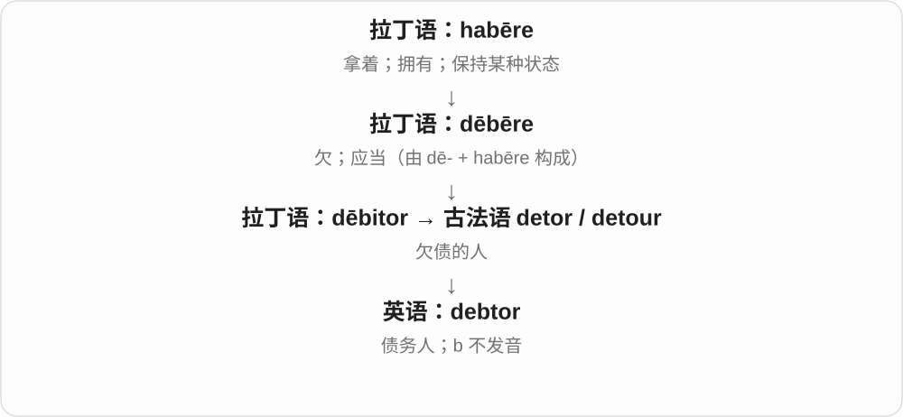

# 1280 · deb- — 欠；应当偿还或履行

[逐词精讲目录](../00_逐词精讲目录.md) · [总目录](../00_总目录_按常用程度.md)

## 核心词根与来源

拉丁 debere 表示欠、应当，debitum 是所欠之物。debt 和 debit 看起来几乎一样，却走过不同借入路线：前者的 b 后来补回拼写而不发音，后者读出 /b/。indebted 又把金钱上的亏欠扩展为受过帮助、心怀感激。

**DEB = OWE**

手里拿着一份还应归给别人的东西，账上便留下一笔“欠”。钱可以欠，人情也可以欠。

- **债务与债务人**：debt, debtor
- **记账与扣款**：debit, debited, debiting
- **负债与感激**：indebted, indebtedness

## 词形与演化规律

debere 与 de- + habere“持有”有关；经过法语变化出现 dette／debt。debit 保留 b 的读音。indebted 的 in- 表进入状态，不是“不”；-ness 把它变为状态名词。debited、debiting 是 debit 的屈折形式。

## 单词速览（常用到不常用）

| 单词 | 音标 | 核心意思 |
|---|---|---|
| [debt](#w-1) | /det/ | 债务；欠下的人情或恩情 |
| [debit](#w-2) | /ˈdebɪt/ | 借方记项；账户扣款；记入借方 |
| [indebted](#w-3) | /ɪnˈdetɪd/ | 欠债的；感激、受恩惠的 |
| [debtor](#w-4) | 英 /ˈdetə/；美 /ˈdetər/ | 债务人；欠钱的一方 |
| [indebtedness](#w-5) | /ɪnˈdetɪdnəs/ | 负债状况、负债程度；感激之情 |
| [debited](#w-6) | /ˈdebɪtɪd/ | 已扣款；被记入借方 |
| [debiting](#w-7) | /ˈdebɪtɪŋ/ | 扣款；记入借方的过程 |

## 逐词讲解

### 1. debt — 债务；欠下的人情或恩情

**音标**：/det/

**先抓住这个画面**

钱先拿来用了，但还属于别人，账上留着一笔“以后得还”，这就是 debt。

**怎么拆**

经古法语 dete 来自拉丁语 dēbitum“所欠之物”。英语原来写 dette，后来为了显出拉丁语来源补入 b，但读音没有加 /b/。

**怎么变成今天的意思**

钱的亏欠最直观；a debt of gratitude 则把应当回报的帮助比作债。in debt 是欠着债，不是“在债券里”。

**常见搭配与例句**

be in debt；pay off a debt；get out of debt；a debt of gratitude。

> They worked hard to pay off their debts.

他们努力工作还清欠债。

> I owe her a great debt of gratitude.

她帮了我很多，我对她深怀感激。

**别混淆**

debt 是所欠金额或亏欠关系；loan 是借出去或借进来的那笔贷款。debt 的 b 不发音，debit 的 b 发音。

### 2. debit — 借方记项；账户扣款；记入借方

**音标**：/ˈdebɪt/

**先抓住这个画面**

看银行流水，一笔钱从你的账户里扣出去，可叫 a debit；在会计里，它更严格地指“记在借方这一侧”。

**怎么拆**

经中古法语 debet 来自拉丁语 dēbitum，与 debt 同源；借入路线不同，b 保留了读音。

**怎么变成今天的意思**

日常银行语境容易联想到扣钱，但会计借方不等于所有账户都减少：它首先是记账方向，增减要看账户类型。

**常见搭配与例句**

a debit card；a direct debit；debit an account；debits and credits。

> The statement shows a debit of twenty dollars.

账单显示扣款二十美元。

> The bank debited the fee from my account.

银行从我的账户中扣除了这笔费用。

**别混淆**

debit card 通常动用账户资金；credit card 提供信用额度。debt /det/ 是欠债本身，debit /ˈdebɪt/ 是账项或记账动作。

### 3. indebted — 欠债的；感激、受恩惠的

**音标**：/ɪnˈdetɪd/

**先抓住这个画面**

欠别人一份：可以是钱，也可以是很难用钱计算的帮助。

**怎么拆**

从中古英语 endetten 的分词发展，往前接古法语 en- + dete“使处于债务中”；后来按拉丁来源恢复 b 的拼写，但 b 不发音。

**怎么变成今天的意思**

**拉丁 debere → debitum**  
欠、应当 → 所欠之物

↓

**古法语 en- + dete → endeter**  
使负债、进入欠债状态

↓

**中古英语 endetted → 英语 indebted**  
欠债的 → 因受帮助而感激的

a heavily indebted company 是负债很多的公司；I am indebted to you for your help 则是较郑重地表示“承蒙帮助，十分感激”。这里的 in- 是进入某种状态，不是否定，不能理解为“不欠债”。

**常见搭配与例句**

be indebted to someone for；deeply indebted；heavily indebted。

> I am deeply indebted to my colleagues for their support.

我十分感激同事们给予的支持。

> The report describes the problems facing heavily indebted companies.

报告描述了高负债企业面临的问题。

**别混淆**

in debt 更直接说欠钱；indebted to someone 常用来感谢帮助。感激义不意味着对方真的要求还钱。

### 4. debtor — 债务人；欠钱的一方

**音标**：英 /ˈdetə/；美 /ˈdetər/

**先抓住这个画面**

同一笔借贷里，拿了钱、负有偿还义务的那一方是 debtor。

**怎么拆**

经古法语 detor / detour 来自拉丁语 dēbitor“欠债者”。与 debt 一样，b 在后来拼写中恢复，却不发音。

**怎么变成今天的意思**

它指出债务关系中的角色，可以是个人，也可以是公司或政府。角色由谁欠谁来决定，不是由谁更富有决定。

**常见搭配与例句**

a debtor and a creditor；a debtor company；the debtor’s obligations。

> The debtor agreed to repay the amount in installments.

债务人同意分期偿还这笔款项。

> The letter lists both the debtor and the creditor.

信中列出了债务人和债权人。

**别混淆**

debtor 欠别人钱；creditor 有权收回钱。borrower 专指借款者，debtor 还可因未付款项等形成。

### 5. indebtedness — 负债状况、负债程度；感激之情

**音标**：/ɪnˈdetɪdnəs/

**先抓住这个画面**

把“欠着别人”的状态作为一个整体来谈。

**怎么拆**

indebted + -ness，形容词变成表示状态的名词；debt 一支的 b 仍不发音。

**怎么变成今天的意思**

**拉丁 debere → debitum**  
欠、应当 → 所欠之物

↓

**英语 indebted → indebtedness**  
欠债、感激 → 负债状态或感激之情

household indebtedness 是家庭部门负债状况，level of indebtedness 看债务负担有多重；acknowledge one’s indebtedness to a teacher 则是承认自己受益于老师。后者常见于序言或致谢，语气比较郑重。

**常见搭配与例句**

a level of indebtedness；household indebtedness；acknowledge indebtedness to。

> The study examines changes in household indebtedness.

这项研究考察了家庭负债状况的变化。

> In the introduction, she acknowledges her indebtedness to her first teacher.

她在序言中表达了对启蒙老师的感激。

**别混淆**

debt 可指一笔具体债务；indebtedness 更常概括负债状态或程度。感激义也比简单的 thanks 正式。

### 6. debited — 已扣款；被记入借方

**音标**：/ˈdebɪtɪd/

**先抓住这个画面**

账上已经记下这一笔；银行场景常表现为钱扣走了。

**怎么拆**

debit + -ed；末尾 t 后的 -ed 读 /ɪd/，这里 b 发音，与 debt /det/ 不同。

**怎么变成今天的意思**

**拉丁 debere → debitum**  
欠、应当 → 所欠之物

↓

**法语 debet → 英语 debit**  
所欠账项 → 借方记账、扣款

↓

**英语 debited**  
过去已记账；被扣款或被记入借方

The fee was debited from my account 是费用从账户扣除；my account was debited 则把账户作为被动句的主语。一般会计语境中 debited 表记借方，具体增加还是减少要看账户类别，不能把所有借方都翻成“余额下降”。

**常见搭配与例句**

be debited from an account；an account was debited；debited twice。

> The membership fee was debited from my account yesterday.

会员费昨天已从我的账户扣除。

> The same amount was debited twice by mistake.

同一笔金额被误扣了两次。

**别混淆**

debit 的 b 发音，debt 和 indebted 的 b 不发音。debited 是记账动作的过去形式，不等于 debtor“欠债的人”。

### 7. debiting — 扣款；记入借方的过程

**音标**：/ˈdebɪtɪŋ/

**先抓住这个画面**

正在把某笔金额按借方方向记到账上。

**怎么拆**

debit + -ing；重音不在最后一个音节，因此常规拼写不把末尾 t 双写。

**怎么变成今天的意思**

**拉丁 debere → debitum**  
欠、应当 → 所欠之物

↓

**法语 debet → 英语 debit**  
债务账项 → 借方记账、扣款

↓

**英语 debiting**  
正在扣款或记借方；这项操作

银行通知中的 debiting your account 常指从你的账户扣款。作为动作名词，debiting 可以与 crediting“记入贷方”对照。若在会计教材中看到它，要先确定是哪一类账户，不能只凭字面认为钱总是往外走。

**常见搭配与例句**

debiting an account；before debiting；debiting and crediting。

> The bank will notify you before debiting the annual fee.

银行会在扣取年费之前通知你。

> The exercise asks students to practise debiting and crediting accounts.

这道练习让学生练习账户的借方和贷方记账。

**别混淆**

debiting 是操作过程，a debit 是一次账项；indebted 是负债或受恩惠的状态，三者不要混用。

## 这一组要分清什么

debt /det/ 是债务，debit /ˈdebɪt/ 是借方账项或扣款动作。debtor 是欠款方，creditor 是有权收款方。借方在会计里是记账方向，并不永远表示账户减少。

## 串起来练习

The fee was debited from my account. Separately, I remain deeply indebted to the friend who helped me when I was in debt.

费用已经从我的账户扣除。另一方面，我仍十分感激那位曾在我欠债时帮助我的朋友。
