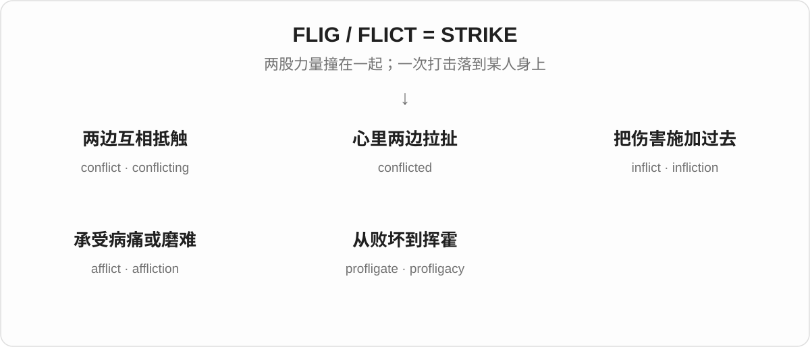
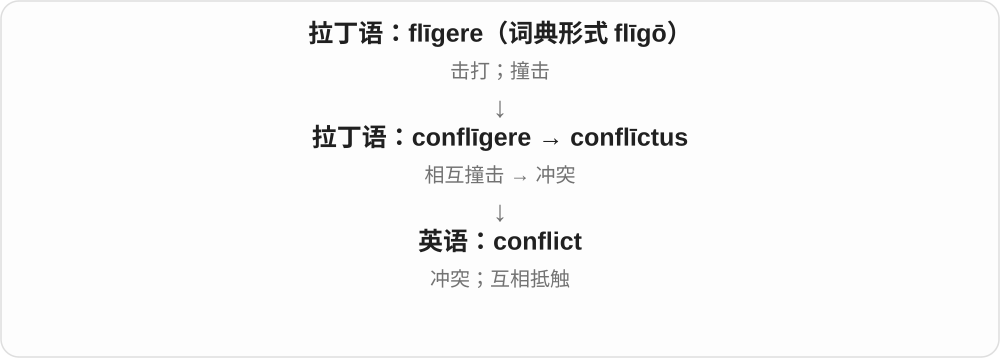
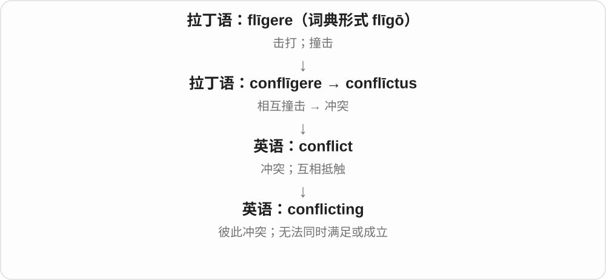
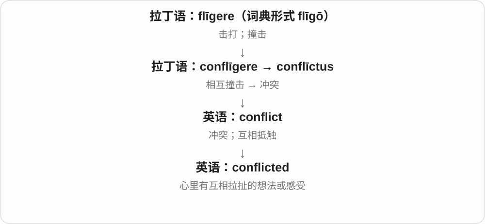
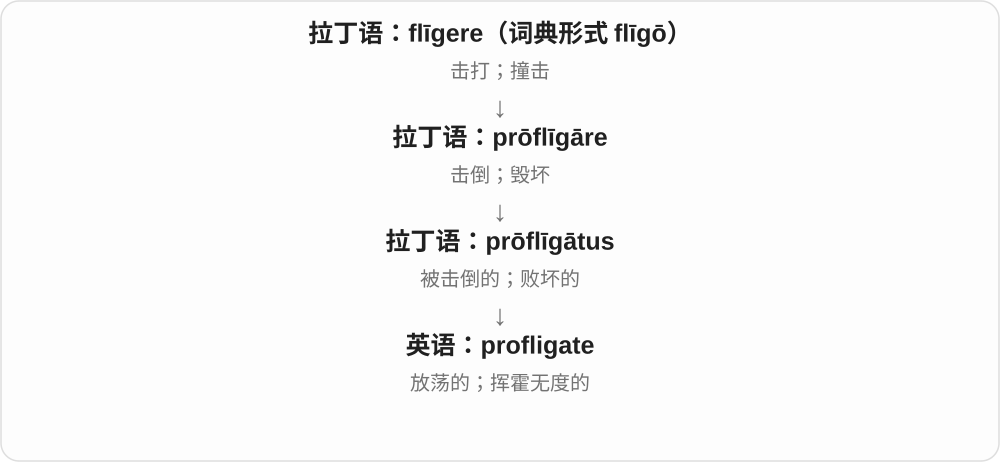
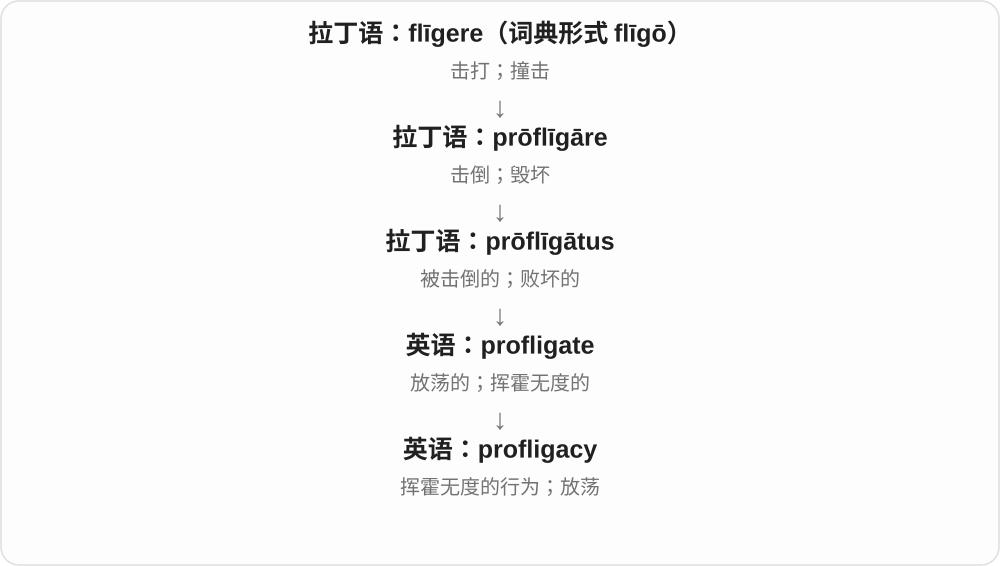

# 1340 · flig-, flict- — 撞击；击打；使受到打击

[逐词精讲目录](../00_逐词精讲目录.md) · [总目录](../00_总目录_按常用程度.md)

## 核心词根与来源

**flig-、flict-** 来自拉丁语 **flīgere**“击打、撞击”。两股力量相撞，形成 conflict；把伤害加到某人身上，是 inflict；病痛或困境持续让人受苦，是 afflict。先抓住动作方向，几组近似拼写就容易分清。

## 词形与演化规律

拉丁语 **flīg-** 与相关分词词干 **flīct-** 对应，所以英语既有 profligate，也有 conflict、inflict。前缀 con- 让力量相撞，in- 在 inflict 中表示向某处施加，ad- 遇到 f 同化成 af-，形成 afflict 这一支。不要把 inflict 的 in- 当成否定。

## 单词速览（按词族由简到繁）

同一基础词的相关扩展放在一起，先读基础形式，再读扩展；各组之间优先读常用的。具体词源关系见各词讲解。

| 单词 | 音标 | 核心意思 |
|---|---|---|
| [conflict](#w-1) | 名词：英 /ˈkɒnflɪkt/，美 /ˈkɑːnflɪkt/；动词 /kənˈflɪkt/ | 冲突；互相抵触 |
| [conflicting](#w-2) | /kənˈflɪktɪŋ/ | 互相矛盾的；彼此冲突的 |
| [conflicted](#w-4) | /kənˈflɪktɪd/ | 内心矛盾的；左右为难的 |
| [inflict](#w-3) | /ɪnˈflɪkt/ | 使遭受；施加伤害或痛苦 |
| [infliction](#w-7) | /ɪnˈflɪkʃən/ | 施加；使遭受痛苦或损害的行为 |
| [afflict](#w-6) | /əˈflɪkt/ | 折磨；使受苦；困扰 |
| [affliction](#w-5) | /əˈflɪkʃən/ | 病痛；磨难；苦恼 |
| [profligate](#w-8) | 英 /ˈprɒflɪɡət/；美 /ˈprɑːflɪɡət/ | 挥霍无度的；放荡的 |
| [profligacy](#w-9) | 英 /ˈprɒflɪɡəsi/；美 /ˈprɑːflɪɡəsi/ | 挥霍无度；放荡行为 |

## 逐词讲解

### 1. conflict — 冲突；互相抵触

**音标**：名词：英 /ˈkɒnflɪkt/，美 /ˈkɑːnflɪkt/；动词 /kənˈflɪkt/

**先抓住这个画面**

conflict 像两股力量撞在一起：两个人想要相反的结果，两个会议占同一段时间，或两份证词说得对不上。

**怎么拆**

拉丁语 con-（一起、相互）+ flīgere（撞击），形成 conflīgere；相关形式 conflīctus 进入英语。flict 与 flig 是同一历史词干的不同形式。

**怎么变成今天的意思**

从真实撞击扩展到人和意见之间的对抗。现代 conflict 可以是战争，也可以是日程、利益或观点无法同时满足，不一定有人动手。

**常见搭配与例句**

a conflict between A and B；conflict with…；a conflict of interest；resolve a conflict。

> The conflict between the two teams delayed the project.

两个团队之间的冲突拖慢了项目。

> Your account conflicts with what the camera recorded.

你的叙述与摄像头记录的情况不符。

**别混淆**

disagreement 可以只是看法不同；conflict 常突出两者互相抵触。名词重音在前，动词重音在后。

### 2. conflicting — 互相矛盾的；彼此冲突的

**音标**：/kənˈflɪktɪŋ/

**先抓住这个画面**

conflicting 把两个对象并排摆出来：一条消息说门开了，另一条却说仍然关着，两边无法一起成立。

**怎么拆**

conflict + -ing。可作动词形式；作形容词时描述正在互相抵触的意见、要求或信息。

**怎么变成今天的意思**

重点在对象之间的关系，不是某个人心情复杂。conflicting demands 可能是两件都合理的要求，只是时间或资源不允许同时满足。

**常见搭配与例句**

conflicting reports；conflicting advice；conflicting demands；conflicting interests。

> We received conflicting information about the departure time.

我们收到的出发时间信息互相矛盾。

> She struggled to balance the conflicting demands of work and study.

工作与学习的要求互相冲突，她努力在两者之间寻找平衡。

**别混淆**

conflicting 描述意见或要求打架；conflicted 常描述人心里打架。different 只是不同，不一定彼此矛盾。

### 3. conflicted — 内心矛盾的；左右为难的

**音标**：/kənˈflɪktɪd/

**先抓住这个画面**

conflicted 像心里有两个人往相反方向拉：你想接受新工作，又不愿离开现在的团队。

**怎么拆**

conflict + -ed。作形容词时，常描述内部存在冲突的状态；不是单纯表示过去和别人吵过架。

**怎么变成今天的意思**

conflict 的两股力量被放进同一个人的心里，于是有了左右为难。双方通常各有吸引力、责任或顾虑，才会让人难决定。

**常见搭配与例句**

feel conflicted；be conflicted about…；deeply conflicted；conflicted feelings。

> I felt conflicted about leaving a team I loved.

要离开一个我喜欢的团队，我心里很矛盾。

> She was conflicted: the offer was exciting, but the move would separate her from her family.

她左右为难：这个机会很令人期待，但搬走会让她与家人分开。

**别混淆**

confused 是没弄明白；conflicted 可以完全明白选项，却仍然因价值或感情冲突而难以选择。

### 4. inflict — 使遭受；施加伤害或痛苦

**音标**：/ɪnˈflɪkt/

**先抓住这个画面**

inflict 的镜头跟着“打击”走：谁把什么伤害，落到了谁身上。它通常带来不好的结果。

**怎么拆**

拉丁语 in-（向……上、在……上）+ flīgere（打击），形成 īnflīgere。这里的 in- 不是“不”。

**怎么变成今天的意思**

最早的击打画面，后来可用于痛苦、损害、惩罚等。现代常把伤害放作宾语：inflict damage on something，让某物承受损害。

**常见搭配与例句**

inflict pain / damage / suffering on…；inflict a defeat on…；inflict something on someone。

> The storm inflicted serious damage on the coastal villages.

暴风雨给沿海村庄造成了严重损害。

> Please do not inflict another hour of slides on us.

拜托，别再让我们忍受一小时的幻灯片了。

**别混淆**

inflict 强调造成或施加；suffer 强调承受。cause 范围更广，可以 cause joy，inflict 通常不用来送去快乐。

### 5. infliction — 施加；使遭受痛苦或损害的行为

**音标**：/ɪnˈflɪkʃən/

**先抓住这个画面**

infliction 把“让别人承受痛苦”这个动作拿出来讨论，焦点在造成伤害的过程。

**怎么拆**

来自拉丁语 īnflīctiōnem，属于 īnflīgere 的名词词族；现代可对照 inflict + -ion。

**怎么变成今天的意思**

inflict 说明谁做了什么；infliction 让整件事成为名词，如 the infliction of pain。它较正式，常用于严肃讨论。

**常见搭配与例句**

the infliction of pain；the deliberate infliction of harm；prevent the infliction of suffering。

> The film questions the deliberate infliction of pain for entertainment.

这部电影质疑为了娱乐而故意制造痛苦的做法。

> They argued against the infliction of unnecessary suffering.

他们反对让人承受不必要的痛苦。

**别混淆**

infliction 强调痛苦被施加的过程；affliction 常指人承受的病痛或磨难。一个看伤害如何来到，一个看人背着什么负担。

### 6. afflict — 折磨；使受苦；困扰

**音标**：/əˈflɪkt/

**先抓住这个画面**

afflict 像一个麻烦压在人身上，持续让人难受：疾病、忧虑，或者一个地区长期面对的困境。

**怎么拆**

拉丁语 ad- 遇到 f 同化成 af-，与 flīgere 组成 afflīgere；相关动词 afflīctāre 经中古英语传来。

**怎么变成今天的意思**

“受到打击”的画面扩展为被病痛或困境折磨。现代常让疾病、问题作主语，或说某人 be afflicted with 某种病痛。

**常见搭配与例句**

be afflicted with a disease；problems that afflict a region；be afflicted by doubt。

> The disease afflicts people of all ages.

这种疾病让各个年龄段的人都受到病痛折磨。

> The region has long been afflicted by drought.

这个地区长期受到干旱困扰。

**别混淆**

afflict 常突出使人持续受苦，比 bother 重。inflict 常跟 pain、damage 等被施加的东西；afflict 直接指向受苦的人或地方。

### 7. affliction — 病痛；磨难；苦恼

**音标**：/əˈflɪkʃən/

**先抓住这个画面**

affliction 是人背在身上的痛苦负担：一种长期疾病，或者一件不断折磨人的苦事。

**怎么拆**

经古法语 afliction，来自拉丁语 afflīctiōnem；属于 afflīctāre 的词族。现代可对照 afflict + -ion。

**怎么变成今天的意思**

与动作 afflict 相比，它常把注意力放在正在承受的苦痛，也可指苦痛的来源。语气比较重，带有正式或文学色彩。

**常见搭配与例句**

suffer from an affliction；a painful affliction；a common affliction；ease someone’s affliction。

> Arthritis was an affliction she had lived with for years.

关节炎是她多年来一直承受的病痛。

> He found comfort in reading during his affliction.

在经历苦难时，他从阅读中获得慰藉。

**别混淆**

problem 可以很小；affliction 通常令人明显受苦。把公交晚两分钟称为 an affliction，多半是在夸张或开玩笑。

### 8. profligate — 挥霍无度的；放荡的

**音标**：英 /ˈprɒflɪɡət/；美 /ˈprɑːflɪɡət/

**先抓住这个画面**

profligate 常像钱从手里不断漏掉，花得没有节制，也不考虑后果。它是明显的批评。

**怎么拆**

拉丁语 prō- + flīgere 形成 prōflīgāre“击倒、毁坏”；其分词 prōflīgātus 传入英语。这里主要学习形容词，词尾读 /ət/。

**怎么变成今天的意思**

历史线索先是被击倒、被毁坏，后来用于道德败坏或放荡的人，又发展出挥霍无度的用法。不是把 pro- 译成“向前”就能直接算出“浪费”。

**常见搭配与例句**

profligate spending；a profligate lifestyle；profligate with money；a profligate use of resources。

> Profligate spending left the club deeply in debt.

毫无节制的开支让俱乐部负债累累。

> The review criticized the project’s profligate use of energy.

评估报告批评这个项目严重浪费能源。

**别混淆**

generous 是慷慨地给予；profligate 是不负责任地挥霍。两者可能都花钱，却评价了完全不同的态度。

### 9. profligacy — 挥霍无度；放荡行为

**音标**：英 /ˈprɒflɪɡəsi/；美 /ˈprɑːflɪɡəsi/

**先抓住这个画面**

profligacy 是把“花钱像没有底、做事没有节制”概括成一种行为或习性。

**怎么拆**

profligate 对应名词 profligacy，结尾 -ate 在这里换成 -acy，可理解为表示性质或行为的名词形式。

**怎么变成今天的意思**

形容词说一个人或一笔开支很挥霍；名词则让你讨论挥霍本身带来的后果。如今谈财务浪费时尤其容易见到。

**常见搭配与例句**

financial profligacy；a reputation for profligacy；years of profligacy；criticize profligacy。

> Years of profligacy had drained the company’s reserves.

多年的挥霍耗尽了公司的储备。

> The proposal was rejected as an example of financial profligacy.

这项提案被认为是在挥霍资金，因此遭到否决。

**别混淆**

waste 可以指一次具体浪费；profligacy 常带有持续失去节制的批评。它不等于 merely spending a lot，合理的大额支出不自动算挥霍。

## 这一组要分清什么

**conflicted / conflicting**：conflicted 常形容人心里矛盾；conflicting 常形容两条信息、两种要求互相冲突。

**inflict / afflict**：inflict pain on someone 把痛苦施加给某人；a disease afflicts someone 是疾病使某人受苦。前者跟着伤害看方向，后者跟着受苦者看处境。

**profligate** 的现代义不能靠“向前打”硬猜；需要经过“击倒、毁坏 → 败坏、放荡 → 挥霍无度”这条历史变化。

## 串起来练习

**The conflict inflicted heavy losses on a region already afflicted by drought.**

冲突给一个已经深受干旱之苦的地区造成了重大损失。conflict 是双方冲突；inflicted 说损失被造成；afflicted 说当地一直承受困境。
