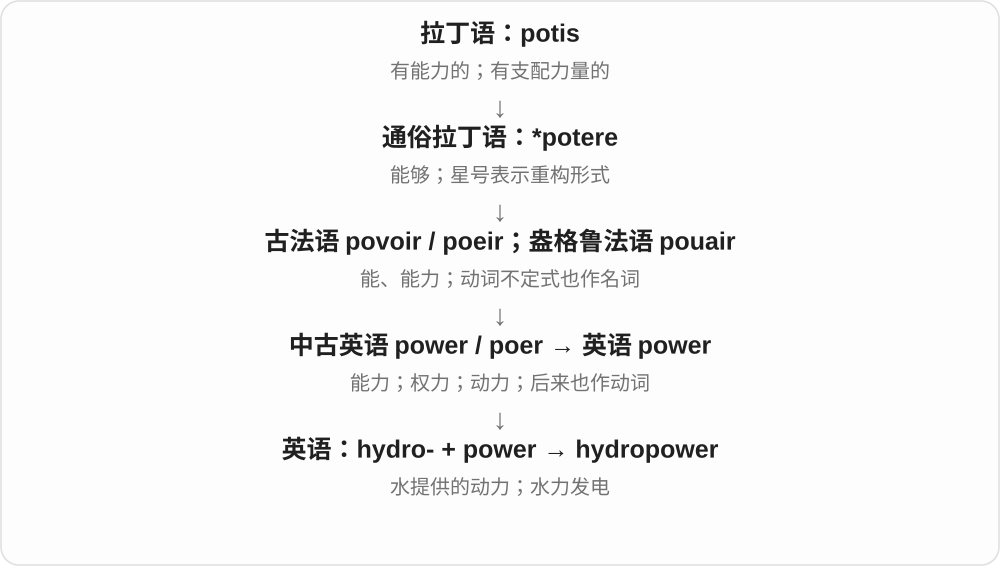

# 1705 · hydr- — 水；补水、液体作用与近代科学命名

[逐词精讲目录](../00_逐词精讲目录.md) · [总目录](../00_总目录_按常用程度.md)

## 核心词根与来源

hydro- 常是水，但在 hydrochloric、hydrogenation 等化学词里也可能代表 hydrogen 氢。现代科学词多数由古典成分近代组合，不是古希腊已经有现成英语术语。词源说明命名来由，不能替代现代定义：液压可用油，碳水化合物也不是把碳混进水。

**想象水被补进来、抽出去、压过管道，或在天地间循环。不同动作把同一个水的成分带进不同领域。**

希腊 hydōr → hydr-/hydro-；hydrate 补水 → dehydrate 去水、rehydrate 补回；hydraulic 液体传力；hydrology 研究水；hydroponics 营养液栽培。

- **补水、失水与补回**：hydrate, hydration, dehydrate, dehydrated, dehydration, rehydrate, rehydration
- **液压与取水装置**：hydraulic, hydraulics, hydraulically, hydrant
- **水文研究和水圈**：hydrology, hydrological, hydrologic, hydrologist, hydrosphere
- **水培与水电**：hydroponics, hydroponic, hydroelectric, hydroelectricity, hydropower
- **化学与材料**：carbohydrate, hydrogen, hydrochloric, hydrophobic, hydrophilic, hydrolysis, hydroxyl, hydrogenation
- **其他已讲支线**：hydrostatic, hydrodynamics, dehydrogenase, hydra

## 词形与演化规律

hydrate、dehydrate、rehydrate 的英美常用重音不同；hydration 的重音在 -ation。hydrological 有独立的新拉丁构词线，英语记录早于常见 hydrology，别把所有 -ical 都排成现代名词后代。

## 单词速览（常用到不常用）

| 单词 | 音标 | 核心意思 |
|---|---|---|
| [hydrogen](#w-1) | /ˈhaɪdrədʒən/ | 氢 |
| [hydraulic](#w-2) | 英 /haɪˈdrɒlɪk/；美 /haɪˈdrɔːlɪk/ | 液压的；水力的 |
| [dehydration](#w-3) | /ˌdiːhaɪˈdreɪʃən/ | 脱水；去除水分的过程 |
| [hydra](#w-4) | /ˈhaɪdrə/ | 多头水蛇怪；水螅；不断滋生的问题 |
| [dehydrated](#w-5) | 英 /ˌdiːhaɪˈdreɪtɪd/；美 /diːˈhaɪdreɪtɪd/ | 脱水的；缺水的；经脱水加工的 |
| [hydration](#w-6) | /haɪˈdreɪʃən/ | 补水；水合；使已有页面可交互〔编程〕 |
| [carbohydrate](#w-7) | 英 /ˌkɑːbəʊˈhaɪdreɪt/；美 /ˌkɑːrboʊˈhaɪdreɪt/ | 碳水化合物；糖类 |
| [hydroelectric](#w-8) | 英 /ˌhaɪdrəʊɪˈlektrɪk/；美 /ˌhaɪdroʊɪˈlektrɪk/ | 水力发电的 |
| [hydrate](#w-9) | 动词英 /haɪˈdreɪt/、美 /ˈhaɪdreɪt/；名词 /ˈhaɪdreɪt/ | 补水；使吸水；水合物 |
| [hydrophobic](#w-10) | 英 /ˌhaɪdrəˈfəʊbɪk/；美 /ˌhaɪdrəˈfoʊbɪk/ | 疏水的；不易与水混合或被水润湿的 |
| [dehydrogenase](#w-11) | 英 /diːˌhaɪˈdrɒdʒəneɪz/；美 /ˌdiːhaɪˈdrɑːdʒəneɪs/ | 脱氢酶 |
| [hydraulics](#w-12) | 英 /haɪˈdrɒlɪks/；美 /haɪˈdrɔːlɪks/ | 水力学、液压技术；液压系统 |
| [hydrolysis](#w-13) | 英 /haɪˈdrɒləsɪs/；美 /haɪˈdrɑːləsɪs/ | 水解 |
| [hydropower](#w-14) | 英 /ˈhaɪdrəʊˌpaʊə/；美 /ˈhaɪdroʊˌpaʊər/ | 水力；水力发电 |
| [hydrology](#w-15) | 英 /haɪˈdrɒlədʒi/；美 /haɪˈdrɑːlədʒi/ | 水文学 |
| [hydrant](#w-16) | /ˈhaɪdrənt/ | 消火栓；消防取水口 |
| [hydroxyl](#w-17) | 英 /haɪˈdrɒksɪl/；美 /haɪˈdrɑːksɪl/ | 羟基；羟自由基（依语境） |
| [hydrochloric](#w-18) | 英 /ˌhaɪdrəˈklɒrɪk/；美 /ˌhaɪdrəˈklɔːrɪk/ | 盐酸的；与氯化氢相关的 |
| [hydrological](#w-19) | 英 /ˌhaɪdrəˈlɒdʒɪkəl/；美 /ˌhaɪdrəˈlɑːdʒɪkəl/ | 水文的；水文学的 |
| [hydrostatic](#w-20) | 英 /ˌhaɪdrəʊˈstætɪk/；美 /ˌhaɪdroʊˈstætɪk/ | 流体静力的；静水压的 |
| [hydrophilic](#w-21) | 英 /ˌhaɪdrəʊˈfɪlɪk/；美 /ˌhaɪdrəˈfɪlɪk/ | 亲水的 |
| [hydrologic](#w-22) | 美 /ˌhaɪdrəˈlɑːdʒɪk/ | 水文的；水文学的 |
| [hydroponic](#w-23) | 英 /ˌhaɪdrəˈpɒnɪk/；美 /ˌhaɪdrəˈpɑːnɪk/ | 水培的；营养液无土栽培的 |
| [hydraulically](#w-24) | 英 /haɪˈdrɒlɪkli/；美 /haɪˈdrɔːlɪkli/ | 以液压方式；靠水力地 |
| [hydroponics](#w-25) | 英 /ˌhaɪdrəˈpɒnɪks/；美 /ˌhaɪdrəˈpɑːnɪks/ | 水培；营养液无土栽培 |
| [hydrogenation](#w-26) | 英 /haɪˌdrɒdʒəˈneɪʃən/；美 /haɪˌdrɑːdʒəˈneɪʃən/ | 氢化；加氢反应 |
| [rehydration](#w-27) | 英 /ˌriːhaɪˈdreɪʃən/ | 补回水分；复水；补液 |
| [dehydrate](#w-28) | 英 /ˌdiːhaɪˈdreɪt/；美 /diːˈhaɪdreɪt/ | 使脱水；脱水干燥；失去水分 |
| [hydrodynamics](#w-29) | 英 /ˌhaɪdrəʊdaɪˈnæmɪks/；美 /ˌhaɪdroʊdaɪˈnæmɪks/ | 流体动力学；水动力学 |
| [rehydrate](#w-30) | 英 /ˌriːhaɪˈdreɪt/；美 /riːˈhaɪdreɪt/ | 补回水分；使重新吸水 |
| [hydroelectricity](#w-31) | 英 /ˌhaɪdrəʊɪˌlekˈtrɪsəti/ | 水力发电产生的电能；水电 |
| [hydrologist](#w-32) | 英 /haɪˈdrɒlədʒɪst/；美 /haɪˈdrɑːlədʒɪst/ | 水文学家；水文研究人员 |
| [hydrosphere](#w-33) | 英 /ˈhaɪdrəʊsfɪə/；美 /ˈhaɪdroʊsfɪr/ | 水圈 |

## 逐词讲解

### 1. hydrogen — 氢

**音标**：/ˈhaɪdrədʒən/

**先抓住这个画面**

名称里的画面是“生成水”：氢和氧反应，可以形成水。

**怎么拆**

hydro- 水 + -gen 产生者，经法语 hydrogène 借入英语。

**怎么变成今天的意思**

**希腊 gígnesthai / génos / génesis**  
产生、出生；出身和种类；形成过程

↓

**希腊 hýdōr“水” + 产生词素 → 法语 hydrogène**  
18世纪化学命名：能与氧反应生成水的元素

↓

**英语 hydrogen**  
氢

hydrogen 是元素名，符号 H；日常说 hydrogen gas，通常指 H₂。它不是水本身，也不是把水倒进物体；名字记录的是早期化学家认识它的方式。

**常见搭配与例句**

hydrogen gas；hydrogen fuel；a hydrogen atom。

> Water contains hydrogen and oxygen.

水含有氢和氧。

> The project explores hydrogen as an energy carrier.

这个项目研究把氢用作能源载体。

**别混淆**

oxygen 的旧命名是“酸的产生者”，那是历史观念；这类名字帮助记忆，不替代现代化学定义。

### 2. hydraulic — 液压的；水力的

**音标**：英 /haɪˈdrɒlɪk/；美 /haɪˈdrɔːlɪk/

**先抓住这个画面**

让液体在压力下传递力量，把一个地方施加的力送到另一个地方。

**怎么拆**

希腊 hydr- 水 + aulos 管，经 hydraulikos、拉丁 hydraulicus 和法语 hydraulique 借入；原来与水力风琴相关。

**怎么变成今天的意思**

**希腊 hydōr，词干 hydr-**  
水；近代构词常用 hydro-

↓

**希腊 aulos 管 + hydr- → hydraulikos → 拉丁 hydraulicus → 法语 hydraulique → 英语 hydraulic**  
原与水力风琴有关 → 水的流动与机械运作

hydraulic brakes 是液压刹车；a hydraulic lift 是液压升降机。现代系统里的液体可以是油，不因词根是水就只允许用水。

**常见搭配与例句**

hydraulic pressure；hydraulic brakes；a hydraulic pump。

> The platform rises on a hydraulic lift.

平台由液压升降装置抬起。

> The mechanic checked the hydraulic pressure.

机械师检查了液压。

**别混淆**

pneumatic 主要用气体，hydraulic 主要用液体传力；electric 说明电能驱动，可能与液压系统同时出现。

### 3. dehydration — 脱水；去除水分的过程

**音标**：/ˌdiːhaɪˈdreɪʃən/

**先抓住这个画面**

既可以说身体失水的状态，也可以说加工时把水移走这件事。

**怎么拆**

de- 去除 + hydration 水合、补水；现代与 dehydrate/-ation 对应，但英语名词记录比 dehydrate 动词更早。

**怎么变成今天的意思**

**希腊 hydōr，词干 hydr-**  
水；近代构词常用 hydro-

↓

**法语 hydrate → 英语 hydrate〔名词〕**  
水合物

↓

**英语 hydrate〔动词〕，也受法语 hydrater 对应形式影响**  
与水结合 → 补水、使保持水分

↓

**英语 hydration；也可能经法语 hydration**  
与水结合或补水的过程

↓

**英语 de- + hydration → dehydration**  
去水、失水；不是一定先有英语 dehydrate 再造名词

food dehydration 是食品脱水；signs of dehydration 是脱水表现。先由上下文区分生产过程和身体状态，不把所有脱水都理解成生病。

**常见搭配与例句**

food dehydration；the risk of dehydration；severe dehydration。

> The museum display explains dehydration as a method of food preservation.

博物馆展板介绍了脱水这一食品保存方法。

> The leaflet describes common signs of dehydration.

宣传单介绍了常见的脱水表现。

**别混淆**

dehydration 侧重水分，exhaustion 侧重极度疲劳；两者可能同时发生，却不是同义词。

### 4. hydra — 多头水蛇怪；水螅；不断滋生的问题

**音标**：/ˈhaɪdrə/

**先抓住这个画面**

砍掉一个头又长出新的，是神话画面；日常借来形容问题一处解决、又冒出几处。

**怎么拆**

希腊 Hydra 与 hydros 水蛇、hydōr 水相连；后来名称借给淡水水螅，也发展出棘手多头问题的比喻。

**怎么变成今天的意思**

**希腊 hydōr，词干 hydr-**  
水；近代构词常用 hydro-

↓

**希腊 hydros 水蛇、Hydra → 英语 hydra**  
神话多头水蛇怪

↓

**近代动物名称与比喻**  
水螅；多头、不断再生的麻烦

biology 里的 hydra 是小型淡水动物，不是神话怪物。a hydra of problems 则强调问题枝节多、难一次解决；生物再生能力也使这个名称很形象。

**常见搭配与例句**

a freshwater hydra；a hydra of problems；the Hydra in Greek myth。

> The students observed a hydra under the microscope.

学生在显微镜下观察了一只水螅。

> The reform faced a hydra of overlapping problems.

这项改革面对一连串相互交织、不断冒出的问题。

**别混淆**

snake 是普通蛇；hydra 的神话、生物、比喻三义需按语境区分。不能把水螅叫成多头蛇的真实幼体。

### 5. dehydrated — 脱水的；缺水的；经脱水加工的

**音标**：英 /ˌdiːhaɪˈdreɪtɪd/；美 /diːˈhaɪdreɪtɪd/

**先抓住这个画面**

水分已经流失或被去掉：食物可以因此易保存，身体则可能因缺水受到影响。

**怎么拆**

dehydrate + -ed；过去分词作形容词，保留去水后的状态。

**怎么变成今天的意思**

**希腊 hydōr，词干 hydr-**  
水；近代构词常用 hydro-

↓

**法语 hydrate → 英语 hydrate〔名词〕**  
水合物

↓

**英语 hydrate〔动词〕，也受法语 hydrater 对应形式影响**  
与水结合 → 补水、使保持水分

↓

**英语 de- + hydrate → dehydrate → dehydrated**  
去水 → 已脱水的

dehydrated vegetables 是脱水蔬菜；feel dehydrated 是觉得身体缺水。它不只是 thirsty 口渴这一感觉，也不能仅凭词语判断具体健康程度。

**常见搭配与例句**

dehydrated food；dehydrated vegetables；become dehydrated。

> The meal contains dehydrated peas and carrots.

这份餐食含脱水豌豆和胡萝卜。

> The hikers arrived tired and dehydrated.

徒步者抵达时又累又缺水。

**别混淆**

dehydrating 是正在造成脱水，dehydrated 是已失水的状态；干燥食品不因此就没有营养。

### 6. hydration — 补水；水合；使已有页面可交互〔编程〕

**音标**：/haɪˈdreɪʃən/

**先抓住这个画面**

把水分补进去；在网页里，也借这个词说让已有页面获得交互能力。

**怎么拆**

hydrate 对应 -ation 名词，亦有法语 hydration 借入的可能。编程义是后来借用的比喻用法。

**怎么变成今天的意思**

**希腊 hydōr，词干 hydr-**  
水；近代构词常用 hydro-

↓

**法语 hydrate → 英语 hydrate〔名词〕**  
水合物

↓

**英语 hydrate〔动词〕，也受法语 hydrater 对应形式影响**  
与水结合 → 补水、使保持水分

↓

**英语 hydration；也可能经法语 hydration**  
与水结合或补水的过程

身体语境讲水分补充或状态；化学语境讲水合。React 的 hydration 则是在服务器已生成的 HTML 上接入客户端逻辑，让页面可交互，并非重新生成整页的同义词。

**常见搭配与例句**

adequate hydration；skin hydration；a hydration reaction；hydration mismatch。

> The sports centre provides information about hydration during exercise.

运动中心提供运动期间补水的相关信息。

> The team traced the hydration mismatch to different text on the server and client.

团队发现水合不匹配来自服务端与客户端文本不同。

**别混淆**

dehydration 是缺水或去水；hydration 是补水、水合。网页中的 hydration 不能照字面译成给设备加水。

### 7. carbohydrate — 碳水化合物；糖类

**音标**：英 /ˌkɑːbəʊˈhaɪdreɪt/；美 /ˌkɑːrboʊˈhaɪdreɪt/

**先抓住这个画面**

糖、淀粉等所属的一大类物质；日常营养标签上常简称碳水。

**怎么拆**

carbo- 碳 + hydrate 水合物；早期按一些分子中氢氧比例像水而命名，不表示真的把碳和水混合就得到糖。

**怎么变成今天的意思**

**希腊 hydōr，词干 hydr-**  
水；近代构词常用 hydro-

↓

**法语 hydrate → 英语 hydrate；carbo- + hydrate → carbohydrate**  
历史上看似碳的水合物 → 碳水化合物的类名

carbohydrates 包含糖、淀粉，也包含纤维等；并非只指米饭和面包，更不等于所有甜食。该名称保留历史认识，现代结构比字面意思复杂。

**常见搭配与例句**

complex carbohydrates；carbohydrate content；a source of carbohydrate。

> The label lists carbohydrate separately from fat and protein.

标签把碳水化合物与脂肪、蛋白质分开列出。

> Starch is a carbohydrate found in many staple foods.

淀粉是一种存在于许多主食中的碳水化合物。

**别混淆**

sugar 是糖，属于碳水的一部分；carbohydrate 范围更大。名称中的水不能理解为食品含水率。

### 8. hydroelectric — 水力发电的

**音标**：英 /ˌhaɪdrəʊɪˈlektrɪk/；美 /ˌhaɪdroʊɪˈlektrɪk/

**先抓住这个画面**

水往下落或流动，把涡轮推动起来，再由发电机把机械能转成电能。水在这里提供的是运动的力量。

**怎么拆**

hydro- 水，来自希腊 hydor + electric 电的；是近代工程科学的组合词。

**怎么变成今天的意思**

**古希腊 elektron → 拉丁 electrum**  
琥珀；摩擦后能吸引轻小物体

↓

**近代拉丁 electricus**  
像琥珀那样具有电性；吉尔伯特在 1600 年用于这一现象

↓

**近代英语 hydro- + electric → hydroelectric**  
利用水力产生电的

a hydroelectric dam 是与水力发电有关的坝；hydroelectric power 指水电。不要把它拆成“水本身是一种电”，也不要与电解水制氢混在一起：那是用电推动化学变化，方向不同。

**常见搭配与例句**

hydroelectric power；a hydroelectric plant；a hydroelectric dam。

> The region gets much of its electricity from hydroelectric power.

这个地区的大部分电力来自水力发电。

> The museum model shows water turning a turbine in a hydroelectric plant.

博物馆模型展示了水在水电站中推动涡轮的过程。

**别混淆**

hydroelectric 用水的流动或落差发电；electrolysis of water 是用电使水发生化学变化。

### 9. hydrate — 补水；使吸水；水合物

**音标**：动词英 /haɪˈdreɪt/、美 /ˈhaɪdreɪt/；名词 /ˈhaɪdreɪt/

**先抓住这个画面**

给缺水的对象补回水分；化学名词还可以指含结合水的物质。

**怎么拆**

先借法语名词 hydrate，取希腊 hydr- 水；英语动词由相关名词发展，也与法语 hydrater 对应。

**怎么变成今天的意思**

**希腊 hydōr，词干 hydr-**  
水；近代构词常用 hydro-

↓

**法语 hydrate → 英语 hydrate〔名词〕**  
水合物

↓

**英语 hydrate〔动词〕，也受法语 hydrater 对应形式影响**  
与水结合 → 补水、使保持水分

hydrate the skin 是给皮肤补水；hydrate dried ingredients 是让干食材吸水。化学里 a hydrate 是水合物，不能简单理解为把任何物质弄湿。

**常见搭配与例句**

hydrate the skin；stay hydrated；a crystalline hydrate。

> The cream is designed to hydrate dry skin.

这款面霜用于为干燥皮肤补水。

> The label identifies the compound as a hydrate.

标签注明这种化合物是水合物。

**别混淆**

moisten 只说弄湿；hydrate 可以强调吸收、保持水分或发生化学水合。名词与动词的重音有英美差异。

### 10. hydrophobic — 疏水的；不易与水混合或被水润湿的

**音标**：英 /ˌhaɪdrəˈfəʊbɪk/；美 /ˌhaɪdrəˈfoʊbɪk/

**先抓住这个画面**

水落上去不容易铺开，或材料不容易与水混在一起；像在回避水。

**怎么拆**

早期 hydrophobia 恐水 + -ic；材料义也可接 hydrophobe + -ic。现代看作 hydro- 水 + -phobic 很直观，但材料没有情绪。

**怎么变成今天的意思**

**希腊 hydor 水；phobos 恐惧**  
两个材料并列，组成恐水名称

↓

**希腊 hydrophobia 一系 → 英语 hydrophobia + -ic → hydrophobic**  
早期与恐水相关

↓

**材料义也可从 hydrophobe + -ic 分析**  
借回避水的意象说明疏水性质

a hydrophobic coating 可使水滴更容易聚成珠；hydrophobic molecules 不易与水形成有利相互作用。历史上也有恐水相关义，现代材料文章常取疏水义。

**常见搭配与例句**

a hydrophobic surface；a hydrophobic coating；hydrophobic molecules。

> Water formed small beads on the hydrophobic coating.

水在疏水涂层上形成了小水珠。

> The diagram shows the hydrophobic parts of the molecules facing inward.

图中分子的疏水部分朝向内部。

**别混淆**

hydrophilic 是亲水；hydrophobic 是疏水。waterproof 还涉及整体是否漏水，不能与表面疏水完全等同。

### 11. dehydrogenase — 脱氢酶

**音标**：英 /diːˌhaɪˈdrɒdʒəneɪz/；美 /ˌdiːhaɪˈdrɑːdʒəneɪs/

**先抓住这个画面**

像负责转交“氢和电子”的搬运工，帮助一种物质被氧化、另一种物质被还原。

**怎么拆**

de- 去掉 + hydrogen 氢 + -ase 酶。

**怎么变成今天的意思**

**希腊 gígnesthai / génos / génesis**  
产生、出生；出身和种类；形成过程

↓

**希腊 hýdōr“水” + 产生词素 → 法语 hydrogène**  
18世纪化学命名：能与氧反应生成水的元素

↓

**英语 hydrogen**  
氢

↓

**现代科学词 dehydrogenase**  
催化脱氢和相关转移反应的酶类

它是酶，不是氢气，也不是单纯把水吸走。不同脱氢酶作用于不同底物；名称常在前面加底物，例如 alcohol dehydrogenase。

**常见搭配与例句**

alcohol dehydrogenase；dehydrogenase activity。

> The researchers measured dehydrogenase activity in the cells.

研究人员测量了细胞中的脱氢酶活性。

> Alcohol dehydrogenase participates in alcohol metabolism.

醇脱氢酶参与酒精代谢。

**别混淆**

dehydration 是脱水；dehydrogenase 催化的是氢及相关电子转移，别混成同一个 dehyd-。

### 12. hydraulics — 水力学、液压技术；液压系统

**音标**：英 /haɪˈdrɒlɪks/；美 /haɪˈdrɔːlɪks/

**先抓住这个画面**

既可以研究液体怎样流、怎样传力，也可以指机器上实际工作的那套液压装置。

**怎么拆**

hydraulic 对应 -ics 学科、技术名；英语内部形成。

**怎么变成今天的意思**

**希腊 hydōr，词干 hydr-**  
水；近代构词常用 hydro-

↓

**希腊 aulos 管 + hydr- → hydraulikos → 拉丁 hydraulicus → 法语 hydraulique → 英语 hydraulic**  
原与水力风琴有关 → 水的流动与机械运作

↓

**英语 hydraulic → hydraulics**  
水力、液压相关 → 学科技术；机器的液压装置

study hydraulics 是学习水力学或液压技术；check the hydraulics 是检查液压系统。指学科时通常用单数谓语，指装置时常作复数理解。

**常见搭配与例句**

a course in hydraulics；aircraft hydraulics；check the hydraulics。

> Hydraulics is an important part of the engineering course.

水力学是这门工程课程的重要部分。

> The crew checked the aircraft’s hydraulics before departure.

机组在起飞前检查了飞机的液压系统。

**别混淆**

hydraulic 是形容词，hydraulics 是学科或装置名；结尾 s 不总是普通名词复数。

### 13. hydrolysis — 水解

**音标**：英 /haɪˈdrɒləsɪs/；美 /haɪˈdrɑːləsɪs/

**先抓住这个画面**

水参与反应，把原来连着的化学键断开。

**怎么拆**

现代科学构词 hydro-“水” + -lysis“分解”；两个成分分别接希腊 hýdōr 和 lýsis。不是古希腊人已经使用今天完整的化学术语。

**怎么变成今天的意思**

**古希腊 hýdōr；lúein → lýsis**  
水；解开、分解

↓

**现代科学 hydro- + -lysis → hydrolysis**  
水参与的断键反应

水解时水是反应参与者；把糖搅进水里直到看不见，通常只是溶解，并没有因此变成水解。消化中的一些分解过程就涉及酶促水解。

**常见搭配与例句**

the hydrolysis of；undergo hydrolysis；enzyme-catalysed hydrolysis。

> The experiment measured the rate of hydrolysis.

实验测量了水解反应的速率。

> Water participates directly in the hydrolysis of an ester.

水直接参与酯的水解反应。

**别混淆**

dissolution 是溶解；hydrolysis 是化学反应。catalysis 说反应被催化，两者关注点不同。

### 14. hydropower — 水力；水力发电

**音标**：英 /ˈhaɪdrəʊˌpaʊə/；美 /ˈhaɪdroʊˌpaʊər/

**先抓住这个画面**

hydropower 是借流动或下落的水把机器推起来，再把这种运动用于发电等工作。

**怎么拆**

hydro- 水，源自希腊语构词成分，加英语 power；这是在英语里组合的混合来源词，不是完整的古希腊借词。

**怎么变成今天的意思**

能源报道里通常指水力发电或其供电能力。读到 hydropower station，就把画面放在利用水推动涡轮的设施上。

**常见搭配与例句**

hydropower generation；a hydropower plant；small hydropower。

> The valley has several small hydropower plants.

这条山谷里有几座小型水电站。

> The report compares hydropower with wind energy.

报告比较了水力发电与风能。

**别混淆**

water power 可泛指水的机械动力；hydropower 在现代能源语境中特别常与发电相连。

### 15. hydrology — 水文学

**音标**：英 /haɪˈdrɒlədʒi/；美 /haɪˈdrɑːlədʒi/

**先抓住这个画面**

研究水从哪里来、流到哪里去、在地表和地下怎样存留与变化。

**怎么拆**

接新拉丁 hydrologia，也可按 hydro- 水 + -logy 研究理解；是近代学科名称。

**怎么变成今天的意思**

**希腊 hydōr，词干 hydr-**  
水；近代构词常用 hydro-

↓

**新拉丁 hydrologia → 英语 hydrology；也可按 hydro- + -logy 分析**  
水 + 研究 → 水文学

river hydrology 研究河流中的水；groundwater hydrology 研究地下水。降雨、蒸发、径流等一起构成水的循环，不只研究海洋。

**常见搭配与例句**

river hydrology；groundwater hydrology；a hydrology course。

> She studies hydrology to understand how rainfall affects river flow.

她学习水文学，以理解降雨怎样影响河流流量。

> The report combines geology with groundwater hydrology.

报告结合了地质学与地下水水文学。

**别混淆**

hydraulics 更侧重液体流动和工程应用；hydrology 更侧重自然环境中水的分布与循环。

### 16. hydrant — 消火栓；消防取水口

**音标**：/ˈhaɪdrənt/

**先抓住这个画面**

需要大量用水时，可以把水管接到这里，从供水系统取水。

**怎么拆**

hydr- 水 + -ant 的近代不规则构词；不是 hydrate 的普通现在分词。

**怎么变成今天的意思**

**希腊 hydōr，词干 hydr-**  
水；近代构词常用 hydro-

↓

**美国英语 hydr- + -ant → hydrant**  
与水有关的装置 → 消防等用途取水口

fire hydrant 是最常见搭配。有的露出地面，有的藏在地下接口里，关键是能够接出供水，不是外形必须像小柱子。

**常见搭配与例句**

a fire hydrant；connect to a hydrant；a hydrant outlet。

> The firefighters connected a hose to the hydrant.

消防员把水带接到消火栓上。

> The maintenance team inspected every hydrant on the street.

维护人员检查了街上每个消火栓。

**别混淆**

tap 是一般水龙头；hydrant 多为消防或市政大量供水用途。

### 17. hydroxyl — 羟基；羟自由基（依语境）

**音标**：英 /haɪˈdrɒksɪl/；美 /haɪˈdrɑːksɪl/

**先抓住这个画面**

把氧和氢看成搭在一起的一小组 OH，再看它是接在分子上还是独立带自由电子。

**怎么拆**

hydrogen、oxygen 的缩合成分 + -yl 基团词尾；不是完整 hydro + “木头”xyl-。

**怎么变成今天的意思**

**希腊 gígnesthai / génos / génesis**  
产生、出生；出身和种类；形成过程

↓

**希腊 hýdōr“水” + 产生词素 → 法语 hydrogène**  
18世纪化学命名：能与氧反应生成水的元素

↓

**英语 hydrogen**  
氢

↓

**hydrogen 与 oxygen 的名称成分 + -yl → hydroxyl**  
以氢、氧命名的 OH 相关词

教材常说 hydroxyl group，指分子上的 —OH；严格命名常用 hydroxy group。hydroxyl radical 是 •OH，自由基不能当成普通醇羟基，也不同于 OH⁻ 氢氧根离子。

**常见搭配与例句**

a hydroxyl group；the hydroxyl radical。

> Ethanol contains a hydroxyl group.

乙醇含有一个羟基。

> The hydroxyl radical reacts with many atmospheric compounds.

羟自由基会与许多大气化合物反应。

**别混淆**

OH 的连接方式、电荷和自由电子决定它是什么；看到同样两个字母不能一概而论。

### 18. hydrochloric — 盐酸的；与氯化氢相关的

**音标**：英 /ˌhaɪdrəˈklɒrɪk/；美 /ˌhaɪdrəˈklɔːrɪk/

**先抓住这个画面**

最常见的整组搭配 hydrochloric acid 就是盐酸。

**怎么拆**

hydro- 在这里取 hydrogen 氢，chlor- 取 chlorine 氯，再接 -ic；不能拆成水加绿色就当作现代定义。

**怎么变成今天的意思**

**希腊 hydōr，词干 hydr-**  
水；近代构词常用 hydro-

↓

**氢的名称 hydrogen → hydro-；与 chlor- 氯、-ic 组合 → hydrochloric**  
近代化学命名，表示氢与氯有关

↓

**hydrochloric acid**  
氯化氢的水溶液，即盐酸

hydrochloric acid 是氯化氢溶于水形成的酸。书面中几乎总与 acid 一起出现；胃液含盐酸是常见阅读场景。

**常见搭配与例句**

hydrochloric acid；dilute hydrochloric acid；hydrochloric acid solution。

> The textbook identifies hydrochloric acid as a component of gastric fluid.

教材指出，盐酸是胃液的一种成分。

> The report lists the concentration of the hydrochloric acid solution.

报告列出了该盐酸溶液的浓度。

**别混淆**

hydrochloric acid 是盐酸，chloric acid 是氯酸，是不同物质；多出的 hydro- 不能略掉。

### 19. hydrological — 水文的；水文学的

**音标**：英 /ˌhaɪdrəˈlɒdʒɪkəl/；美 /ˌhaɪdrəˈlɑːdʒɪkəl/

**先抓住这个画面**

把水在环境中怎样分布、流动和变化作为关注点。

**怎么拆**

接新拉丁 hydrologia 与英语 -ical；现代可与 hydrology 对照，但 hydrological 的英语记录更早，不能断言由后者直接派生。

**怎么变成今天的意思**

**希腊 hydōr，词干 hydr-**  
水；近代构词常用 hydro-

↓

**新拉丁 hydrologia + 英语 -ical → hydrological**  
水文相关的；英语形容词记录较 hydrology 更早

hydrological data 是降水、流量、水位等水文数据；a hydrological survey 是水文调查。它不是所有湿的东西都能套用的形容词。

**常见搭配与例句**

hydrological data；hydrological conditions；a hydrological survey。

> The project began with a detailed hydrological survey.

项目先进行了详细的水文调查。

> Changes in land use can alter local hydrological conditions.

土地用途变化会改变当地水文条件。

**别混淆**

hydrological 与 hydrologic 通常意思相近，选用受地区和固定搭配影响；hydraulic 常转向液压、水力作用。

### 20. hydrostatic — 流体静力的；静水压的

**音标**：英 /ˌhaɪdrəʊˈstætɪk/；美 /ˌhaɪdroʊˈstætɪk/

**先抓住这个画面**

水看似不动，也会从各个方向压住周围的东西。

**怎么拆**

hydro-“水、流体” + static，近代科学合成。

**怎么变成今天的意思**

**古希腊语：hístēmi / histánai；stásis**  
使站立、设立；站立、状态

↓

**古希腊 statikós → 法语 statique → 英语 static**  
与平衡、静止有关的 → 静态的、不变的

↓

**英语 hydro- + static → hydrostatic**  
与静止流体及其压力有关的

hydrostatic pressure 通常随着液体深度增加而增大。名称里有“静”，不表示压力为零。

**常见搭配与例句**

hydrostatic pressure；hydrostatic equilibrium；a hydrostatic test。

> Hydrostatic pressure increases with depth in the tank.

水箱内的静水压随深度增加而增大。

> The engineer calculated the hydrostatic force on the wall.

工程师计算了作用在墙上的静水压力。

**别混淆**

hydrodynamic 关注流体运动；hydrostatic 关注静止或平衡时的作用。

### 21. hydrophilic — 亲水的

**音标**：英 /ˌhaɪdrəʊˈfɪlɪk/；美 /ˌhaɪdrəˈfɪlɪk/

**先抓住这个画面**

分子或表面容易与水相互作用，像是愿意让水靠近。

**怎么拆**

现代可拆 hydro- 水 + -philic 亲和的；也有近代拉丁 hydrophilus 的构词背景。这里的喜爱是化学性质的比喻，没有人的感情。

**怎么变成今天的意思**

**古希腊语 philos / philein**  
亲爱的、喜爱；喜欢、亲近

↓

**希腊 hydr- 水、-philos 亲近 → 近代拉丁 hydrophilus 一系**  
亲水的古典构词基础

↓

**英语 hydrophilic**  
能与水等极性介质相互作用的

hydrophilic groups 是亲水基团，hydrophilic surfaces 容易被水润湿。亲水不等于整个物体必定完全溶于水：一个表面或某一部分也可以亲水。

**常见搭配与例句**

a hydrophilic surface；hydrophilic groups；a hydrophilic coating。

> The coating makes the surface more hydrophilic.

这种涂层让表面更亲水。

> The diagram shows the molecule’s hydrophilic head facing the water.

图中显示，分子的亲水头部朝向水。

**别混淆**

hydrophobic 是疏水的；hydrophilic 是亲水的。两者可以分别出现在同一个分子的不同部位。

### 22. hydrologic — 水文的；水文学的

**音标**：美 /ˌhaɪdrəˈlɑːdʒɪk/

**先抓住这个画面**

在水的循环、储存和流动这个层面上看问题。

**怎么拆**

hydrology 对应 -ic 形容词；与 hydrological 不是两个不同学科。

**怎么变成今天的意思**

**希腊 hydōr，词干 hydr-**  
水；近代构词常用 hydro-

↓

**新拉丁 hydrologia → 英语 hydrology；也可按 hydro- + -logy 分析**  
水 + 研究 → 水文学

↓

**英语 hydrology → hydrologic**  
水文学 → 水文的

hydrologic cycle 是水循环；hydrologic model 是模拟相关过程的模型。在美式科学写作里很常见。

**常见搭配与例句**

the hydrologic cycle；a hydrologic model；hydrologic processes。

> The diagram illustrates the hydrologic cycle.

图示说明了水循环。

> The researchers tested the hydrologic model against river measurements.

研究人员用河流实测数据检验了水文模型。

**别混淆**

hydrologic 与 hydrological 通常可以相互对应；不要把少了 -al 理解成范围必然更窄。

### 23. hydroponic — 水培的；营养液无土栽培的

**音标**：英 /ˌhaɪdrəˈpɒnɪk/；美 /ˌhaɪdrəˈpɑːnɪk/

**先抓住这个画面**

标明植物或种植系统采用水培方式，不靠普通土壤提供根部营养。

**怎么拆**

从 hydroponics 对应形成形容词；现代可看成 hydro- + -ponic，不能从 pon- 的近形词随意解释。

**怎么变成今天的意思**

**希腊 hydōr，词干 hydr-**  
水；近代构词常用 hydro-

↓

**hydro- + 取自希腊 ponos 劳作的 -ponics → 英语 hydroponics**  
借水进行栽培 → 营养液无土栽培

↓

**英语 hydroponics → hydroponic**  
无土营养液栽培 → 使用这种方式的

hydroponic lettuce 是水培生菜；a hydroponic system 是水培系统。这个词只说明栽培方式，不自动说明是否有机、零农药或营养一定更高。

**常见搭配与例句**

hydroponic lettuce；a hydroponic farm；hydroponic cultivation。

> The farm supplies hydroponic lettuce to local shops.

农场向当地商店供应水培生菜。

> They installed a small hydroponic system in the classroom.

他们在教室里安装了一套小型水培系统。

**别混淆**

hydroponic 是形容词，hydroponics 是技术名。hydraulic 说液压、水力，并非种植方式。

### 24. hydraulically — 以液压方式；靠水力地

**音标**：英 /haɪˈdrɒlɪkli/；美 /haɪˈdrɔːlɪkli/

**先抓住这个画面**

说明机器是怎样动作的：力量通过液体传过去。

**怎么拆**

hydraulic + -ally；副词说明驱动或控制方式。

**怎么变成今天的意思**

**希腊 hydōr，词干 hydr-**  
水；近代构词常用 hydro-

↓

**希腊 aulos 管 + hydr- → hydraulikos → 拉丁 hydraulicus → 法语 hydraulique → 英语 hydraulic**  
原与水力风琴有关 → 水的流动与机械运作

↓

**英语 hydraulic + -ally → hydraulically**  
液压的 → 以液压方式

hydraulically operated 表示液压操作；hydraulically powered 表示液压驱动。它不表示设备浸在水里。

**常见搭配与例句**

hydraulically operated；hydraulically powered；hydraulically controlled。

> The heavy doors are operated hydraulically.

这些厚重的门由液压装置操作。

> The ramp can be raised hydraulically from the control panel.

可以通过控制面板用液压装置升起坡道。

**别混淆**

electrically controlled 说控制信号或装置用电；hydraulically operated 说执行动作靠液压，二者可同时成立。

### 25. hydroponics — 水培；营养液无土栽培

**音标**：英 /ˌhaɪdrəˈpɒnɪks/；美 /ˌhaɪdrəˈpɑːnɪks/

**先抓住这个画面**

不用普通土壤供养根，而把所需矿质养分放在水溶液里送到根部。

**怎么拆**

hydro- 水 + -ponics，后者取自希腊 ponos 劳作；20世纪英语造词。

**怎么变成今天的意思**

**希腊 hydōr，词干 hydr-**  
水；近代构词常用 hydro-

↓

**hydro- + 取自希腊 ponos 劳作的 -ponics → 英语 hydroponics**  
借水进行栽培 → 营养液无土栽培

hydroponics 不一定让根一直完全浸在水中，也可用惰性材料支撑植物。核心是营养液供养，不是只把植物放进清水就能长期正常生长。

**常见搭配与例句**

grow plants using hydroponics；a hydroponics system；study hydroponics。

> The greenhouse uses hydroponics to grow lettuce without soil.

这座温室用水培方式无土种植生菜。

> Students measured the nutrient solution in the hydroponics system.

学生测量了水培系统中的营养液。

**别混淆**

hydroponics 通常作单数学科、技术名词；aquaponics 还把养鱼等水产系统结合进来，不能当成同一个词。

### 26. hydrogenation — 氢化；加氢反应

**音标**：英 /haɪˌdrɒdʒəˈneɪʃən/；美 /haɪˌdrɑːdʒəˈneɪʃən/

**先抓住这个画面**

hydrogenate 是“做加氢这件事”，hydrogenation 是这场反应或工艺本身。

**怎么拆**

hydrogen + -ation，与 hydrogenate 的动作名词对应。

**怎么变成今天的意思**

**希腊 gígnesthai / génos / génesis**  
产生、出生；出身和种类；形成过程

↓

**希腊 hýdōr“水” + 产生词素 → 法语 hydrogène**  
18世纪化学命名：能与氧反应生成水的元素

↓

**英语 hydrogen**  
氢

↓

**英语 hydrogenation**  
加入氢的反应或过程

partial hydrogenation 表示部分氢化，complete hydrogenation 表示完全氢化。名称里没有规定一种固定催化剂或所有反应都得到相同产物。

**常见搭配与例句**

catalytic hydrogenation；partial hydrogenation。

> Hydrogenation changed the physical properties of the oil.

氢化改变了这种油的物理性质。

> The paper compares two hydrogenation catalysts.

论文比较了两种加氢催化剂。

**别混淆**

hydrogenation 加氢；dehydrogenation 脱氢，方向相反。

### 27. rehydration — 补回水分；复水；补液

**音标**：英 /ˌriːhaɪˈdreɪʃən/

**先抓住这个画面**

把失去的水分补回来的过程，可以发生在身体或干燥食品中。

**怎么拆**

re- 再次 + hydration；名词本身有这一构词线，不必只从 rehydrate 再接词尾来讲。

**怎么变成今天的意思**

**希腊 hydōr，词干 hydr-**  
水；近代构词常用 hydro-

↓

**法语 hydrate → 英语 hydrate〔名词〕**  
水合物

↓

**英语 hydrate〔动词〕，也受法语 hydrater 对应形式影响**  
与水结合 → 补水、使保持水分

↓

**英语 hydration；也可能经法语 hydration**  
与水结合或补水的过程

↓

**英语 re- + hydration → rehydration**  
再次吸水、补回水分的过程

rehydration of dried food 是干食品复水；oral rehydration 是口服补液这一术语。具体方式另由情境决定，本词本身不规定配方或剂量。

**常见搭配与例句**

rehydration of；rehydration time；oral rehydration。

> The packaging gives the recommended rehydration time for the dried vegetables.

包装注明了脱水蔬菜建议的复水时间。

> The article explains the role of rehydration after fluid loss.

文章解释了失水后补液的作用。

**别混淆**

rehydration 是过程，rehydrated 是完成后的状态。它的反向词是 dehydration。

### 28. dehydrate — 使脱水；脱水干燥；失去水分

**音标**：英 /ˌdiːhaɪˈdreɪt/；美 /diːˈhaɪdreɪt/

**先抓住这个画面**

把原有的水拿走，或者水流失得比补进来快。

**怎么拆**

de- 去除 + hydrate；先用于化学去水，后来扩展到身体和食品。

**怎么变成今天的意思**

**希腊 hydōr，词干 hydr-**  
水；近代构词常用 hydro-

↓

**法语 hydrate → 英语 hydrate〔名词〕**  
水合物

↓

**英语 hydrate〔动词〕，也受法语 hydrater 对应形式影响**  
与水结合 → 补水、使保持水分

↓

**英语 de- + hydrate → dehydrate**  
去掉水分 → 使脱水、干燥保存

dehydrate fruit 是把水果脱水；a person dehydrates 是身体失水。前者可以是有意加工，后者可能是不利状态，不能只凭 de- 判断好坏。

**常见搭配与例句**

dehydrate fruit；become dehydrated；foods that dehydrate easily。

> The factory dehydrates vegetables for use in soup mixes.

工厂把蔬菜脱水，用于汤料包。

> The report explains how the material dehydrates when heated.

报告解释了这种材料受热后如何脱水。

**别混淆**

dry 可以是表面变干或总体干燥；dehydrate 更明确说失去或移除水分。

### 29. hydrodynamics — 流体动力学；水动力学

**音标**：英 /ˌhaɪdrəʊdaɪˈnæmɪks/；美 /ˌhaɪdroʊdaɪˈnæmɪks/

**先抓住这个画面**

关心流体怎样流动、流动又对物体产生什么力；日常可先从水流冲过桥墩、船穿过水面来理解。

**怎么拆**

源于近代拉丁 hydrodynamica，使用希腊来源的 hydro-“水”和 dynam-“力量”；英语改为 -ics 学科词形。它有自己的较早名词借入路线，不从较晚英语 hydrodynamic 硬造祖先。

**怎么变成今天的意思**

**希腊 hudor（水）与 dunamis（力量）的构词成分**  
hydro- 与 dynam-

↓

**近代拉丁 hydrodynamica → 英语 hydrodynamics**  
研究流动的流体及其作用力

hydrodynamics 常用于水或其他液体的运动研究，也能在更广的流体研究里使用。marine hydrodynamics 是海洋工程常见课程名，词尾虽有 s，学科名通常当单数。

**常见搭配与例句**

marine hydrodynamics；the hydrodynamics of；study hydrodynamics。

> The course teaches hydrodynamics through examples involving ships and waves.

这门课用船舶和波浪的例子讲授水动力学。

> Researchers studied the hydrodynamics of water flowing around the pier.

研究者分析了水流绕过桥墩时的流动与受力情况。

**别混淆**

hydrostatics 侧重流体静止时的情况；hydrodynamics 侧重流动与相关作用。fluid mechanics 是更宽的流体力学范围。

### 30. rehydrate — 补回水分；使重新吸水

**音标**：英 /ˌriːhaɪˈdreɪt/；美 /riːˈhaɪdreɪt/

**先抓住这个画面**

水分先少了，现在再加回来，让对象恢复含水状态。

**怎么拆**

re- 再次 + hydrate；英语构词，身体和干食材都可使用。

**怎么变成今天的意思**

**希腊 hydōr，词干 hydr-**  
水；近代构词常用 hydro-

↓

**法语 hydrate → 英语 hydrate〔名词〕**  
水合物

↓

**英语 hydrate〔动词〕，也受法语 hydrater 对应形式影响**  
与水结合 → 补水、使保持水分

↓

**英语 re- + hydrate → rehydrate**  
补水 → 重新补回水分

rehydrate dried mushrooms 是让干蘑菇吸水恢复；rehydrate after exercise 是运动后补水。re- 提醒这里是补回先前失去的水。

**常见搭配与例句**

rehydrate dried food；rehydrate after exercise；allow to rehydrate。

> The recipe asks you to rehydrate the dried mushrooms before cooking.

食谱要求烹饪前先让干蘑菇吸水恢复。

> The runners stopped to rest and rehydrate.

跑步者停下来休息、补水。

**别混淆**

hydrate 泛说补水；rehydrate 强调水分流失后的恢复。不是所有泡水都会把食品恢复得与新鲜时完全相同。

### 31. hydroelectricity — 水力发电产生的电能；水电

**音标**：英 /ˌhaɪdrəʊɪˌlekˈtrɪsəti/

**先抓住这个画面**

利用流动或下落的水带动设备，把水的能量转换成电。

**怎么拆**

hydro- 水 + electricity 电；与 hydroelectric 对应，是近代复合词。

**怎么变成今天的意思**

**希腊 hydōr，词干 hydr-**  
水；近代构词常用 hydro-

↓

**hydro- + electricity → 英语 hydroelectricity**  
水 + 电 → 水力产生的电能

generate hydroelectricity 是水力发电；不是让水本身变成电。hydropower 常可说水力发电或水能，hydroelectricity 明确落在电能。

**常见搭配与例句**

generate hydroelectricity；a source of hydroelectricity；rely on hydroelectricity。

> The station uses river water to generate hydroelectricity.

这座电站利用河水发电。

> Hydroelectricity supplies part of the region’s power demand.

水电满足了该地区部分用电需求。

**别混淆**

hydroelectric 是形容词，hydroelectricity 是电能名词；hydrogen 氢虽然同有 hydr-，不是同一能源概念。

### 32. hydrologist — 水文学家；水文研究人员

**音标**：英 /haɪˈdrɒlədʒɪst/；美 /haɪˈdrɑːlədʒɪst/

**先抓住这个画面**

研究水的路线和数量，帮助解释洪水、干旱、地下水等问题的人。

**怎么拆**

hydrology 去 -y 接 -ist；-ist 表示从事相关研究或工作的人。

**怎么变成今天的意思**

**希腊 hydōr，词干 hydr-**  
水；近代构词常用 hydro-

↓

**新拉丁 hydrologia → 英语 hydrology；也可按 hydro- + -logy 分析**  
水 + 研究 → 水文学

↓

**英语 hydrology → hydrologist**  
水文学 → 水文研究人员

a hydrologist may study river flow 描述其一种工作；领域也包括降雨、地下水和流域过程，并非只是负责修水管。

**常见搭配与例句**

a groundwater hydrologist；consult a hydrologist；a team of hydrologists。

> A hydrologist examined the changes in river flow.

一位水文学家研究了河流流量的变化。

> The planning team consulted a hydrologist about the wetland.

规划团队就这片湿地咨询了水文研究人员。

**别混淆**

plumber 是管道工；hydrologist 研究水文。hydraulic engineer 常关注水力或液压工程，工作可与水文学家交叉。

### 33. hydrosphere — 水圈

**音标**：英 /ˈhaɪdrəʊsfɪə/；美 /ˈhaɪdroʊsfɪr/

**先抓住这个画面**

把地球上的水作为一个相互联系的整体来看。

**怎么拆**

hydro- 水 + -sphere 圈、球；现代地球科学造词。

**怎么变成今天的意思**

**希腊 hydōr，词干 hydr-**  
水；近代构词常用 hydro-

↓

**hydro- + -sphere → 英语 hydrosphere**  
水 + 圈层 → 地球全部水体组成的系统

水圈广义包括海洋、河湖、地下水、冰雪和大气中的水。圈不是只指地面上一层液态水皮，而是把各种储存位置和状态连在一起。

**常见搭配与例句**

the Earth’s hydrosphere；interactions with the hydrosphere；changes in the hydrosphere。

> The lesson traces exchanges of water within the hydrosphere.

这堂课追踪了水圈内部不同部分之间的水分交换。

> Groundwater forms an important part of the hydrosphere.

地下水是水圈的重要组成部分。

**别混淆**

atmosphere 是大气圈；其中的水也参与水圈。地球各圈层按研究角度划分，范围可以相互交叠。

## 这一组要分清什么

hydraulic 用液体传力，pneumatic 用气体。hydrophobic 疏水不自动等于 waterproof 防漏。hydroponic 是栽培方式，hydroelectric 是发电方式。Hydra 的怪物与水螅名称要按上下文区分。

## 串起来练习

用 hydrate、dehydrate、rehydrate 描述干食品吸水的前后；比较 hydraulic 与 hydrological；解释为什么水培仍需要营养物质。
