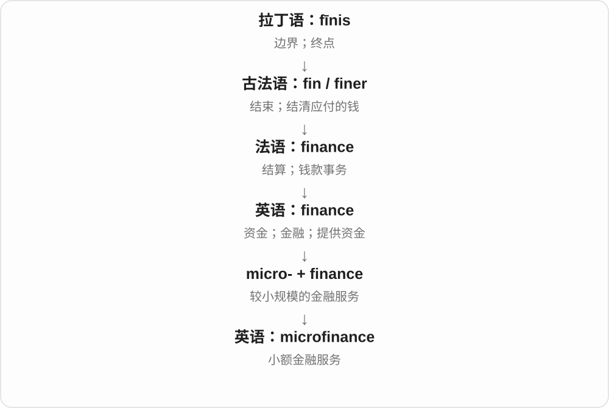
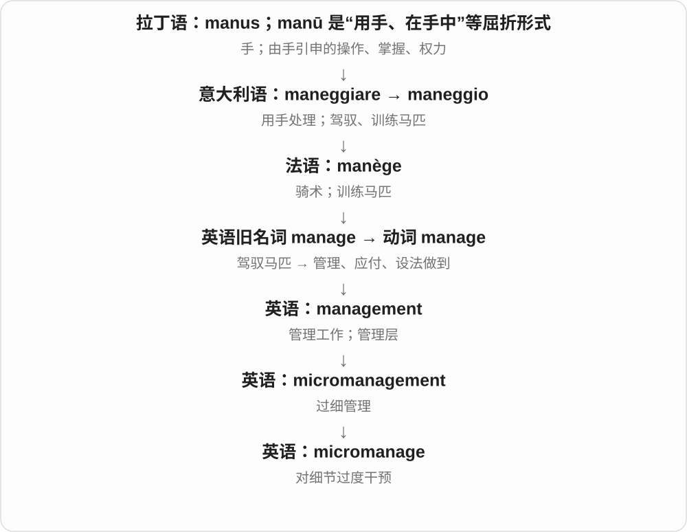
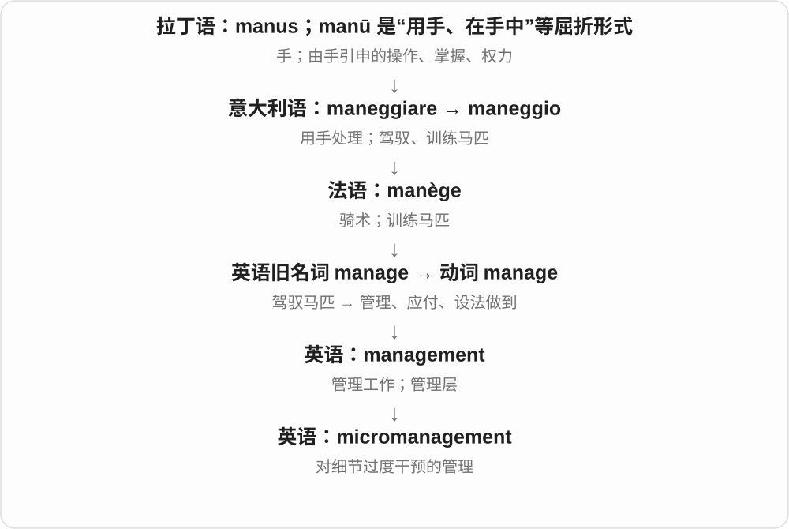

# 1886 · micr- — 小；微小；计量中的百万分之一

[逐词精讲目录](../00_逐词精讲目录.md) · [总目录](../00_总目录_按常用程度.md)

## 核心词根与来源

microphone、microscope、microchip 都与小尺度有关，但不是把任何东西都除以一百万。只有 micro- 用作计量前缀时，才严格表示百万分之一。micrometer 还能指精密测量仪，和长度单位的常见重音不同。

**把观察和行动缩到小尺度：看小东西、做小芯片、分析微小生命；在单位前则有严格的数值意义。**

希腊 mikros 小 → micro-；micro- + -scope → microscope；近代法语 microbe → microbe、microbial；micro- + cosm- 世界 → microcosm。计量 micro- + metre → 微米。

- **看小、听声与观察方式**：microscope, microscopic, microscopically, microphone
- **微小生命**：microbe, microbial, microorganism, microbiology, microbiologist
- **微小长度**：micrometer, micrometre, micron
- **电子设备与波**：microchip, microprocessor, microwave
- **环境中的小碎片**：microplastic, microplastics
- **小范围的社会与活动**：microcosm, microeconomics, microfinance, micromanage, micromanagement

## 词形与演化规律

micro- 常读 /ˈmaɪkrəʊ/ 或 /ˈmaɪkroʊ/；后面的词形会改变整体重音。microscope 首重音，microscopic 重音后移。micrometre 是英式单位拼写，micrometer 是美式单位拼写，也表示仪器。

## 单词速览（按词族由简到繁）

同一基础词的相关扩展放在一起，先读基础形式，再读扩展；各组之间优先读常用的。具体词源关系见各词讲解。

| 单词 | 音标 | 核心意思 |
|---|---|---|
| [microwave](#w-1) | 英 /ˈmaɪkrəweɪv/；美 /ˈmaɪkroʊweɪv/ | 微波；微波炉；用微波炉加热 |
| [microphone](#w-2) | 英 /ˈmaɪkrəfəʊn/；美 /ˈmaɪkrəfoʊn/ | 麦克风；话筒 |
| [microscope](#w-3) | 英 /ˈmaɪkrəskəʊp/；美 /ˈmaɪkrəskoʊp/ | 显微镜 |
| [microscopic](#w-4) | 英 /ˌmaɪkrəˈskɒpɪk/；美 /ˌmaɪkrəˈskɑːpɪk/ | 显微的；极微小的；极细致的 |
| [microscopically](#w-18) | 英 /ˌmaɪkrəˈskɒpɪkli/；美 /ˌmaɪkrəˈskɑːpɪkli/ | 通过显微观察；在微观上；极微小地 |
| [microbe](#w-11) | 英 /ˈmaɪkrəʊb/；美 /ˈmaɪkroʊb/ | 微生物 |
| [microbial](#w-5) | 英 /maɪˈkrəʊbiəl/；美 /maɪˈkroʊbiəl/ | 微生物的；由微生物引起或参与的 |
| [microbiology](#w-6) | 英 /ˌmaɪkrəʊbaɪˈɒlədʒi/；美 /ˌmaɪkroʊbaɪˈɑːlədʒi/ | 微生物学 |
| [microbiologist](#w-13) | 英 /ˌmaɪkrəʊbaɪˈɒlədʒɪst/；美 /ˌmaɪkroʊbaɪˈɑːlədʒɪst/ | 微生物学家 |
| [microprocessor](#w-7) | 英 /ˌmaɪkrəʊˈprəʊsesə/；美 /ˌmaɪkroʊˈprɑːsesər/ | 微处理器 |
| [microchip](#w-8) | /ˈmaɪkrəʊtʃɪp/〔英〕；/ˈmaɪkroʊtʃɪp/〔美〕 | 微芯片；给动物植入识别芯片 |
| [micron](#w-9) | 英 /ˈmaɪkrɒn/；美 /ˈmaɪkrɑːn/ | 微米〔仍常用的旧称〕 |
| [microcosm](#w-10) | 英 /ˈmaɪkrəʊkɒzəm/；美 /ˈmaɪkroʊkɑːzəm/ | 缩影；小世界 |
| [microfinance](#w-12) | /ˈmaɪkrəʊˌfaɪnæns/ | 小额金融服务 |
| [micrometer](#w-14) | 仪器：英 /maɪˈkrɒmɪtə/，美 /maɪˈkrɑːmɪtər/；单位〔美式〕/ˈmaɪkroʊmiːtər/ | 测微器；千分尺；微米〔美式拼写〕 |
| [microorganism](#w-15) | 英 /ˌmaɪkrəʊˈɔːɡənɪzəm/；美 /ˌmaɪkroʊˈɔːrɡənɪzəm/ | 微生物 |
| [micromanage](#w-16) | 英 /ˈmaɪkrəʊˌmænɪdʒ/；美 /ˈmaɪkroʊˌmænɪdʒ/ | 过细管理；对细节过度干预 |
| [micromanagement](#w-19) | /ˌmaɪkrəʊˈmænɪdʒmənt/；美 /ˌmaɪkroʊˈmænɪdʒmənt/ | 过细管理；事事插手的管理 |
| [microeconomics](#w-17) | 英 /ˌmaɪkrəʊˌiːkəˈnɒmɪks/；美 /ˌmaɪkroʊˌekəˈnɑːmɪks/ | 微观经济学 |
| [microplastic](#w-21) | 英 /ˈmaɪkrəʊplæstɪk/；美 /ˈmaɪkroʊplæstɪk/ | 微塑料；微塑料的〔名词作修饰语〕 |
| [microplastics](#w-20) | 英 /ˈmaɪkrəʊplæstɪks/；美 /ˈmaɪkroʊplæstɪks/ | 微塑料颗粒、碎片或纤维〔常用复数〕 |
| [micrometre](#w-22) | 英 /ˈmaɪkrəʊmiːtə/；美式拼写 micrometer，读 /ˈmaɪkroʊmiːtər/ | 微米〔英式拼写〕 |

## 逐词讲解

### 1. microwave — 微波；微波炉；用微波炉加热

**音标**：英 /ˈmaɪkrəweɪv/；美 /ˈmaɪkroʊweɪv/

**先抓住这个画面**

原先是一类电磁波；以它加热食物的炉子后来也直接叫同一个名字。

**怎么拆**

micro- 小 + wave 波；micro 表示相对较短的波长，不是说波长一定只有一微米。电器名由 microwave oven 缩短，动词再由设备名形成。

**怎么变成今天的意思**

**希腊 mikros 小 → 组合形式 micro-**  
通常说小；在计量单位前严格表示百万分之一

↓

**英语 micro- + wave → microwave〔电磁波〕**  
短波长电磁波的一类

↓

**microwave oven → 简称 microwave → 动词 microwave**  
微波炉 → 用微波炉加热

put it in the microwave 是放进微波炉；microwave the rice 是用微波炉加热米饭。波本身通常用复数 microwaves 来谈传播或加热。

**常见搭配与例句**

a microwave oven；in the microwave；microwave a meal；microwave signals。

> There is a microwave in the office kitchen.

办公室厨房里有一台微波炉。

> He microwaved the leftover rice for lunch.

他把剩米饭用微波炉加热后当午饭。

**别混淆**

microwave 是设备名时可数，指波时另有科学范围。它与小火 low heat 不是同一种加热描述。

### 2. microphone — 麦克风；话筒

**音标**：英 /ˈmaɪkrəfəʊn/；美 /ˈmaɪkrəfoʊn/

**先抓住这个画面**

把空气里的声音接住，转成可以传输、放大或录下的信号。

**怎么拆**

近代用 micro- “小、微弱” + -phone “声音”构词；早期名称用于听微弱声音的装置，后来用于电声话筒。

**怎么变成今天的意思**

**希腊 phōnḗ〔φωνή〕**  
声音、嗓音；与“说话”的动词相连

↓

**近代组合形式 phono- / -phone**  
以“声音”给技术、设备和语言概念命名

↓

**英语 micro- + -phone → microphone**  
小声音的器具 → 把声音转换为电信号的装置

micro- 在名称里不保证实物很小。麦克风负责拾音、转换，扬声器负责把信号变回声音；很多设备把这两个部件装在一起，功能仍不同。

**常见搭配与例句**

speak into a microphone；a wireless microphone；mute the microphone。

> Please keep the microphone close enough to pick up your voice.

请把麦克风放近一些，让它能收清你的声音。

> The microphone recorded every page rustle.

麦克风把每一次翻页的沙沙声都录下来了。

**别混淆**

megaphone 是让人声传得更远的扩音器；microphone 首先是收进声音，不必自身发出很响的声。

### 3. microscope — 显微镜

**音标**：英 /ˈmaɪkrəskəʊp/；美 /ˈmaɪkrəskoʊp/

**先抓住这个画面**

让小到难以看清的东西显出细节。

**怎么拆**

micro- 小 + -scope 观察仪器，接近代拉丁 microscopium 等造词；并不是古希腊已有现代显微镜。

**怎么变成今天的意思**

**希腊 skopein / skopos**  
观察；观察者、注视的目标；与 skeptesthai 观察、审视同源

↓

**希腊 mikros 小 + 观察词干 → 近代拉丁 microscopium**  
观察微小物体的工具

↓

**英语 microscope**  
显微镜

under a microscope 可以真说在显微镜下观察，也能比喻受到细查。显微镜有多种技术类型，不必把这个词限定成普通光学镜片。

**常见搭配与例句**

under a microscope；an electron microscope；examine with a microscope。

> The students examined the leaf cells under a microscope.

学生用显微镜观察了叶片细胞。

> After the error, every decision came under the microscope.

那次失误之后，每个决定都受到了仔细审查。

**别混淆**

telescope 看遥远对象，microscope 看微小细节；不是只靠镜筒长度来分。

### 4. microscopic — 显微的；极微小的；极细致的

**音标**：英 /ˌmaɪkrəˈskɒpɪk/；美 /ˌmaɪkrəˈskɑːpɪk/

**先抓住这个画面**

小到要把视线拉近很多，才能看清；也能夸张地说小得可怜。

**怎么拆**

microscope + -ic，词尾 e 去掉；从显微镜相关的延伸为微小的。

**怎么变成今天的意思**

**希腊 skopein / skopos**  
观察；观察者、注视的目标；与 skeptesthai 观察、审视同源

↓

**希腊 mikros 小 + 观察词干 → 近代拉丁 microscopium**  
观察微小物体的工具

↓

**英语 microscope**  
显微镜

↓

**英语 microscope + -ic → microscopic**  
显微镜相关的 → 微小的、细致入微的

microscopic organisms 是微生物；a microscopic apartment 常是夸张地说住处极小。microscopic examination 则是显微检查。

**常见搭配与例句**

microscopic organisms；microscopic examination；microscopic detail。

> The sample contained microscopic organisms.

样本里含有微生物。

> They rented a microscopic apartment near the station.

他们在车站附近租了一间小得可怜的公寓。

**别混淆**

tiny 只是小；microscopic 真义涉及显微尺度，口语里又可夸张，不一定真小到肉眼看不见。

### 5. microscopically — 通过显微观察；在微观上；极微小地

**音标**：英 /ˌmaɪkrəˈskɒpɪkli/；美 /ˌmaɪkrəˈskɑːpɪkli/

**先抓住这个画面**

说观察的方法，或强调某种差别细小到很难察觉。

**怎么拆**

microscopic + -ally；-ically 常读 /ɪkli/，不是把每个字母逐个读成音节。

**怎么变成今天的意思**

**希腊 skopein / skopos**  
观察；观察者、注视的目标；与 skeptesthai 观察、审视同源

↓

**希腊 mikros 小 + 观察词干 → 近代拉丁 microscopium**  
观察微小物体的工具

↓

**英语 microscope**  
显微镜

↓

**英语 microscopic + -ally → microscopically**  
显微的 → 用显微方法、在微观尺度上

examine microscopically 是用显微方法检查；microscopically small 强调极小。要看它修饰的是检查动作还是大小程度。

**常见搭配与例句**

examine microscopically；microscopically small；differ microscopically。

> The tissue was examined microscopically.

组织样本接受了显微检查。

> The surface is smooth to the touch but microscopically uneven.

表面摸起来光滑，但在微观上并不平整。

**别混淆**

microscopic 修饰名词，microscopically 修饰动作或程度；不要把后者当成一种新仪器。

### 6. microbe — 微生物

**音标**：英 /ˈmaɪkrəʊb/；美 /ˈmaɪkroʊb/

**先抓住这个画面**

个体非常小，通常要借助仪器才能看清的一类生命，里面既有有益的，也有会致病的。

**怎么拆**

近代法语 microbe 用希腊 mikros 小与 bios 生命构造，后借入英语；不按现代拼写误拆成 micro + 英语 be。

**怎么变成今天的意思**

**希腊 mikros 小 → 组合形式 micro-**  
通常说小；在计量单位前严格表示百万分之一

↓

**近代法语 microbe〔mikros 小 + bios 生命〕→ 英语 microbe**  
用古典成分命名微小生命，不是古希腊已有的现代微生物词

soil microbes 是土壤微生物；a harmful microbe 是有害微生物。细菌是其中常见一类，microbe 并不等于全部都是病菌。

**常见搭配与例句**

soil microbes；harmful microbes；beneficial microbes；microbes in water。

> Many microbes help break down dead plant material.

许多微生物帮助分解枯死的植物材料。

> The researchers studied microbes living in the soil.

研究人员研究了生活在土壤中的微生物。

**别混淆**

germ 日常更容易让人想到致病的病菌；microbe 范围和语气更中性。virus 在一般材料中也常被放入微生物讨论，生命分类另有专业边界。

### 7. microbial — 微生物的；由微生物引起或参与的

**音标**：英 /maɪˈkrəʊbiəl/；美 /maɪˈkroʊbiəl/

**先抓住这个画面**

从微生物本身转到它们的活动、群落和作用。

**怎么拆**

现代可分析 microbe 去 e + -ial；历史词源也联系新拉丁 microbion + -al，属于近代微生物命名词族。

**怎么变成今天的意思**

**希腊 mikros 小 → 组合形式 micro-**  
通常说小；在计量单位前严格表示百万分之一

↓

**法语 microbe 与相应新拉丁 microbion**  
微生物的近代名称

↓

**英语 microbial**  
接这组词干形成形容词；现代与 microbe + -ial 对应

microbial activity 是微生物活动；microbial contamination 是微生物污染。并非出现 microbial 就一定在说危险，也可能是发酵或生态分解。

**常见搭配与例句**

microbial activity；microbial growth；microbial communities；microbial contamination。

> Warm conditions increased microbial activity in the compost.

温暖条件增强了堆肥中的微生物活动。

> The study compares microbial communities in two lakes.

这项研究比较了两个湖泊中的微生物群落。

**别混淆**

bacterial 专指细菌相关；microbial 可以涉及更广的微生物。不要把两个范围一概等同。

### 8. microbiology — 微生物学

**音标**：英 /ˌmaɪkrəʊbaɪˈɒlədʒi/；美 /ˌmaɪkroʊbaɪˈɑːlədʒi/

**先抓住这个画面**

把研究视线缩小，去看细菌、微小真菌等肉眼难见的对象及其活动。

**怎么拆**

micro- “微小” + biology；微小的是研究对象，并不是“小规模做一点生物学”。

**怎么变成今天的意思**

**希腊 légō / lógos**  
选取、收集 → 讲述；话语、说明、道理、计算

↓

**希腊 bíos〔生命〕+ -logía → 新拉丁 biologia**  
近代学术造词：研究生命

↓

**英语 biology**  
研究生物及生命过程；名称经近代科学用法逐渐固定

↓

**英语 micro- + biology → microbiology**  
以微生物及相关对象为中心的生物学研究

它既研究致病微生物，也研究发酵、土壤养分循环等过程。领域中也包含病毒研究，因此不要用“是否独立存活”简单划掉所有病毒相关工作。

**常见搭配与例句**

food microbiology；a microbiology laboratory；research in microbiology。

> The microbiology team studied the organisms involved in making yogurt.

微生物学团队研究了制作酸奶时参与发酵的微生物。

> The water samples were sent to the microbiology laboratory.

水样被送往微生物实验室。

**别混淆**

microbiology 范围比 bacteriology 广；后者专门研究细菌。

### 9. microbiologist — 微生物学家

**音标**：英 /ˌmaɪkrəʊbaɪˈɒlədʒɪst/；美 /ˌmaɪkroʊbaɪˈɑːlədʒɪst/

**先抓住这个画面**

研究肉眼通常看不清的生命，怎样生活、变化并影响周围环境。

**怎么拆**

micro-“微小” + biologist“生物学家”；也对应 microbiology 的 -ist 研究者形式。

**怎么变成今天的意思**

**希腊 bios（βίος）**  
生命、一生、生活方式

↓

**近代构词成分 bio-**  
生命；生物；与生物有关的

↓

**现代 micro-“微小”与生物词族组合**  
微生物及其群体

↓

**英语 microbiology 与 microbiologist 词族**  
微生物学；从事微生物研究的人

microbiologist 可能研究环境中的微生物，也可能研究食品、工业或疾病相关问题。职业范围远不止“用显微镜看细菌”，还会分析遗传信息、代谢和群落关系。

**常见搭配与例句**

an environmental microbiologist；a clinical microbiologist；work as a microbiologist。

> The microbiologist studied organisms collected from seawater.

微生物学家研究了从海水中采集的生物。

> A microbiologist joined the food safety team.

一位微生物学家加入了食品安全团队。

**别混淆**

microbiologist 是微生物研究者；microbiome 是研究对象之一，不能用后者称人。

### 10. microprocessor — 微处理器

**音标**：英 /ˌmaɪkrəʊˈprəʊsesə/；美 /ˌmaɪkroʊˈprɑːsesər/

**先抓住这个画面**

把执行指令和处理数据的核心功能装进很小的芯片里。

**怎么拆**

micro- 小 + processor 处理器；近代电子技术复合词，不是每个里面有 micro 的东西都按百万分之一计算。

**怎么变成今天的意思**

**希腊 mikros 小 → 组合形式 micro-**  
通常说小；在计量单位前严格表示百万分之一

↓

**英语 micro- + processor → microprocessor**  
小型集成电路中的处理器

a microprocessor controls the device 是微处理器控制设备。它能执行程序和处理数据，但整台机器还需要存储、电源及其他部件配合。

**常见搭配与例句**

a microprocessor chip；a powerful microprocessor；controlled by a microprocessor。

> A microprocessor controls the washing machine’s cycle.

微处理器控制洗衣机的运行程序。

> The engineers tested the new microprocessor under different loads.

工程师测试了新微处理器在不同负载下的表现。

**别混淆**

microchip 是芯片统称，microprocessor 强调计算和控制功能；不能把所有芯片都叫处理器。

### 11. microchip — 微芯片；给动物植入识别芯片

**音标**：/ˈmaɪkrəʊtʃɪp/〔英〕；/ˈmaɪkroʊtʃɪp/〔美〕

**先抓住这个画面**

把许多微小电子元件集成在很小的一片材料上；宠物识别芯片也是一种用途。

**怎么拆**

micro- 小 + chip 小片；英语复合词，后来也由名词转成植入识别芯片的动词。

**怎么变成今天的意思**

**希腊 mikros 小 → 组合形式 micro-**  
通常说小；在计量单位前严格表示百万分之一

↓

**英语 micro- + chip → microchip〔名词〕**  
很小的一片集成电子电路

↓

**名词 → 动词 microchip**  
给动物植入识别芯片

a microchip inside the device 是设备里的芯片；a microchipped cat 是植入了识别芯片的猫。宠物识别芯片通常提供可读取的编号，不能一概当成实时定位器。

**常见搭配与例句**

a silicon microchip；a microchip implant；microchip a pet。

> The sensor contains a tiny microchip.

传感器里有一枚微芯片。

> The shelter checks whether each cat has been microchipped.

收容所会检查每只猫是否植入了识别芯片。

**别混淆**

microprocessor 是负责运算和指令处理的一类芯片；microchip 范围更广，也可能承担存储或其他功能。

### 12. micron — 微米〔仍常用的旧称〕

**音标**：英 /ˈmaɪkrɒn/；美 /ˈmaɪkrɑːn/

**先抓住这个画面**

看到一 micron，就按一微米理解；它不是另一种比微米更小的单位。

**怎么拆**

近代取希腊 mikron，mikros 小的中性形式，形成单位名称；经法语科学命名使用传入英语。

**怎么变成今天的意思**

**希腊 mikros 小 → 组合形式 micro-**  
通常说小；在计量单位前严格表示百万分之一

↓

**希腊 mikron〔mikros 的中性形式〕→ 法语 micron → 英语 micron**  
用小的这个形式命名米的百万分之一

five microns 是五微米；过滤、材料和制造说明中仍会看到 micron。正式科学表达更倾向 micrometre，但数值相同。

**常见搭配与例句**

a few microns thick；five microns in diameter；measured in microns。

> The particle is about eight microns across.

这个颗粒的宽度大约是八微米。

> The specification gives the coating thickness in microns.

规格说明用微米表示涂层厚度。

**别混淆**

micron = micrometre；nanometre 则小一千倍。不要因为词更短就判断它代表更小的量。

### 13. microcosm — 缩影；小世界

**音标**：英 /ˈmaɪkrəʊkɒzəm/；美 /ˈmaɪkroʊkɑːzəm/

**先抓住这个画面**

范围虽小，却能看到大社会、大系统里同样的关系和问题。

**怎么拆**

micro- 小 + cosm- 世界，经中世纪拉丁 microcosmus 与法语相关用法传来；并不是必须由现代英语 cosmos 截短构成。

**怎么变成今天的意思**

**希腊 mikros 小 + kosmos 世界 → 中世纪拉丁 microcosmus**  
小世界；早期把人体看成宇宙的缩影

↓

**英语 microcosm；一般小社会义也受法语 microcosme 影响**  
能反映更大整体特点的小范围

a microcosm of society 是社会的缩影；in microcosm 是以缩小形式呈现。重点是反映整体特点，未必是一比一缩小的模型。

**常见搭配与例句**

a microcosm of society；a microcosm of the city；in microcosm。

> The school is a microcosm of the wider community.

这所学校是周围社区的一个缩影。

> The dispute shows the industry’s wider problems in microcosm.

这场争执以小见大，反映了整个行业的问题。

**别混淆**

miniature 强调尺寸小；microcosm 更强调小范围里能看见大整体的结构或规律。

### 14. microfinance — 小额金融服务

**音标**：/ˈmaɪkrəʊˌfaɪnæns/

**先抓住这个画面**

microfinance 像把原本门槛很高的金融服务缩小到更小的资金需求：不仅可能有小额贷款，也可以包括储蓄和其他基本服务。

**怎么拆**

micro-（小）+ finance（金融服务）。是现代组合，不能把古希腊语 micro- 与拉丁语 fin- 当作古代已有的完整词。

**怎么变成今天的意思**

这里“小”主要指服务的资金规模和对象需求，而不是“金融学的一小部分”。这类词说明古典构词成分今天仍能用于命名新事物。

**常见搭配与例句**

a microfinance institution（小额金融机构）；microfinance services（小额金融服务）；a microfinance program（小额金融项目）。

> The organization offers microfinance services to small businesses.

该组织向小企业提供小额金融服务。

> The study compared several microfinance programs.

这项研究比较了几个小额金融项目。

**别混淆**

microcredit 主要指小额信贷；microfinance 范围更广。词本身也不保证某个项目一定低风险或有效。

### 15. micrometer — 测微器；千分尺；微米〔美式拼写〕

**音标**：仪器：英 /maɪˈkrɒmɪtə/，美 /maɪˈkrɑːmɪtər/；单位〔美式〕/ˈmaɪkroʊmiːtər/

**先抓住这个画面**

同样的拼写可以是一件精密测量工具，也可以是一个长度单位，读音和句子结构能帮助区分。

**怎么拆**

仪器名有法语 micromètre 及 micro- 小 + -meter 测量仪的来源；单位则是计量前缀 micro- 百万分之一 + meter 米，两个构词用途分开。

**怎么变成今天的意思**

**希腊 mikros 小 → 组合形式 micro-**  
通常说小；在计量单位前严格表示百万分之一

↓

**仪器线：micro- + -meter → 法语 micromètre / 英语 micrometer**  
测很小距离的仪器；后来也指精密工量具

↓

**并列单位线：计量 micro- + meter → micrometer**  
米的百万分之一；不是从仪器变成单位

use a micrometer 是用测微器；ten micrometers 是十微米。工具名不表示它只能测一微米，也不能仅凭名字保证某个产品的精度。

**常见搭配与例句**

measure with a micrometer；a micrometer screw；a few micrometers thick。

> She measured the wire’s thickness with a micrometer.

她用千分尺测量了金属丝的粗细。

> The coating is only ten micrometers thick.

这层涂层只有十微米厚。

**别混淆**

英式把单位写作 micrometre，仪器写 micrometer；美式两者同形。仪器常后重音，单位常首重音。

### 16. microorganism — 微生物

**音标**：英 /ˌmaɪkrəʊˈɔːɡənɪzəm/；美 /ˌmaɪkroʊˈɔːrɡənɪzəm/

**先抓住这个画面**

小到通常需要显微镜才能仔细观察的生命个体。

**怎么拆**

micro-“微小” + organism“生物体”；现代科学复合词，不是 micro + organ“微型器官”。

**怎么变成今天的意思**

**希腊语 organon → 拉丁语 organum**  
工具、器具；与 ergon 属同一更早词族

↓

**organism“生物体” + micro- → microorganism**  
微小的生物个体

常见例子包括细菌和酵母。许多微生物参与发酵和分解，并不都致病。

**常见搭配与例句**

soil microorganisms；beneficial microorganisms；culture a microorganism。

> Many microorganisms help break down fallen leaves.

许多微生物帮助分解落叶。

> The laboratory grew the microorganism in a nutrient solution.

实验室在营养液中培养了这种微生物。

**别混淆**

microorganism 是宽泛类别；pathogen 专指能致病的生物或病原体。

### 17. micromanage — 过细管理；对细节过度干预

**音标**：英 /ˈmaɪkrəʊˌmænɪdʒ/；美 /ˈmaɪkroʊˌmænɪdʒ/

**先抓住这个画面**

micromanage 就像把任务交出去后，仍攥着对方的每根手指，规定每一步怎么动。

**怎么拆**

现代可拆 micro- + manage；实际先有 micromanagement，再去掉名词尾部逆构成动词。

**怎么变成今天的意思**

常说 micromanage someone 或 micromanage a project；关注的是过度控制执行过程。

**常见搭配与例句**

micromanage a team；micromanage every detail；stop micromanaging。

> Give the team a clear goal without micromanaging every step.

把目标说清楚就好，别对团队的每一步都指手画脚。

> She trusts her staff and rarely micromanages them.

她信任员工，很少事事干预。

**别混淆**

manage 是管理；micromanage 通常是在批评管理者管得过细。

### 18. micromanagement — 过细管理；事事插手的管理

**音标**：/ˌmaɪkrəʊˈmænɪdʒmənt/；美 /ˌmaɪkroʊˈmænɪdʒmənt/

**先抓住这个画面**

micromanagement 像把显微镜架在每个员工手边，连很小的步骤都要过问，让人没有自主空间。

**怎么拆**

micro-（微小）+ management；英语动词 micromanage 是由这个名词逆构出来的。

**怎么变成今天的意思**

通常带批评意味，问题在于干预到不必要的程度，并不是说所有细节检查都不好。

**常见搭配与例句**

avoid micromanagement；excessive micromanagement；a culture of micromanagement。

> Constant approval requests turned routine work into an exercise in micromanagement.

不断要求请示批准，让日常工作变成了事事受管的流程。

> Clear goals can reduce the need for micromanagement.

目标明确后，就不必事事盯着细节管。

**别混淆**

supervision 是监督；micromanagement 强调过度紧盯细节、削弱执行者自主权。

### 19. microeconomics — 微观经济学

**音标**：英 /ˌmaɪkrəʊˌiːkəˈnɒmɪks/；美 /ˌmaɪkroʊˌekəˈnɑːmɪks/

**先抓住这个画面**

把镜头对准一个家庭、一家公司或一个市场，看它们怎样作选择、彼此影响。

**怎么拆**

micro-“小尺度” + economics；小指分析单位，可以研究巨型企业，不是专门研究小钱。

**怎么变成今天的意思**

**希腊 oîkos；相关 oikía**  
家、住处、家庭

↓

**希腊 oikonomía 一系 → 英语 economics**  
资源管理 → 经济学

↓

**英语 micro- + economics → microeconomics**  
考察个体选择与具体市场的学科

为什么涨价后买的人变少、企业怎样决定产量、不同商家如何竞争，都可用微观视角分析。它不代表问题不重要，而是先看具体参与者与机制。

**常见搭配与例句**

study microeconomics；introductory microeconomics；microeconomics of consumer choice。

> Microeconomics examines how consumers respond to changes in prices.

微观经济学研究消费者如何应对价格变化。

> The class used microeconomics to analyse competition between two large firms.

课堂用微观经济学分析两家大企业之间的竞争。

**别混淆**

macro- 与 micro- 区别分析层级。研究一家跨国公司的市场势力，仍可以是 microeconomics。

### 20. microplastic — 微塑料；微塑料的〔名词作修饰语〕

**音标**：英 /ˈmaɪkrəʊplæstɪk/；美 /ˈmaɪkroʊplæstɪk/

**先抓住这个画面**

塑料碎成很小的颗粒或纤维，作为污染材料存在于环境中。

**怎么拆**

micro- 小 + plastic 塑料；现代环境词汇，此处 micro- 不限定为恰好一微米。

**怎么变成今天的意思**

**希腊 mikros 小 → 组合形式 micro-**  
通常说小；在计量单位前严格表示百万分之一

↓

**英语 micro- + plastic → microplastic**  
小尺寸塑料颗粒、碎片或纤维的统称

microplastic pollution 是微塑料污染；不可数用法把它当作一类材料。常见定义以小于五毫米为范围，因此有些看得见，有些肉眼看不见。

**常见搭配与例句**

microplastic pollution；microplastic particles；microplastic contamination。

> The report examines microplastic pollution in coastal waters.

报告研究沿海水域的微塑料污染。

> The team tested the sediment for microplastic contamination.

团队检测沉积物是否受到微塑料污染。

**别混淆**

microplastic 不等于 biodegradable plastic 可降解塑料；变成小碎片也不表示材料已经消失。

### 21. microplastics — 微塑料颗粒、碎片或纤维〔常用复数〕

**音标**：英 /ˈmaɪkrəʊplæstɪks/；美 /ˈmaɪkroʊplæstɪks/

**先抓住这个画面**

把环境中许许多多的小塑料片和纤维放在一起谈，而不是指一大块完整塑料。

**怎么拆**

microplastic + 复数 -s；词典将 microplastic 与 microplastics 并列记录，末尾读 /ks/。

**怎么变成今天的意思**

**希腊 mikros 小 → 组合形式 micro-**  
通常说小；在计量单位前严格表示百万分之一

↓

**英语 micro- + plastic → microplastic → microplastics**  
微塑料材料 → 多种或大量微小塑料颗粒

microplastics in water 是水中的微塑料；can contain microplastics 可用于描述检测对象。来源可以是大塑料破碎，也可以是原本就小的塑料颗粒。

**常见搭配与例句**

microplastics in water；detect microplastics；microplastics and fibres。

> Researchers found microplastics in samples from the beach.

研究人员在海滩样本中发现了微塑料。

> The study compares methods for collecting microplastics from water.

研究比较了从水中收集微塑料的方法。

**别混淆**

一般谈这类污染物常用复数 microplastics；microplastic pollution 里则用单数形式作修饰语。大小分类不等于对健康影响作出具体结论。

### 22. micrometre — 微米〔英式拼写〕

**音标**：英 /ˈmaɪkrəʊmiːtə/；美式拼写 micrometer，读 /ˈmaɪkroʊmiːtər/

**先抓住这个画面**

把一米平均分成一百万份，其中一份就是一微米，符号为 μm。

**怎么拆**

计量 micro- 百万分之一 + metre 米；这里 micro- 有精确数值，不只是模糊的小。

**怎么变成今天的意思**

**希腊 mikros 小 → 组合形式 micro-**  
通常说小；在计量单位前严格表示百万分之一

↓

**国际计量前缀 micro- + metre → micrometre**  
10⁻⁶ 米，亦即 0.001 毫米

several micrometres wide 是几微米宽。单位符号写 μm；一毫米包含一千微米，别把 micro 与 milli 的数量级混淆。

**常见搭配与例句**

a micrometre in diameter；a few micrometres thick；measured in micrometres。

> The film is twenty micrometres thick.

这层薄膜厚二十微米。

> The scale bar represents one micrometre.

图中的比例尺表示一微米。

**别混淆**

micron 是仍常见的旧称；科学单位表达通常采用 micrometre。micrometer 还可能是测量仪器，要看语境。

## 这一组要分清什么

microchip 是芯片统称，microprocessor 是处理器。microcosm 是缩影，不必真的缩小一百万倍。micromanage 常批评连小细节都管，microfinance 则说小额金融服务。

## 串起来练习

区分 microbe、microbial、microbiology；分别读仪器与单位的 micrometer；用 microcosm 说明一个小场景怎样反映更大整体。
