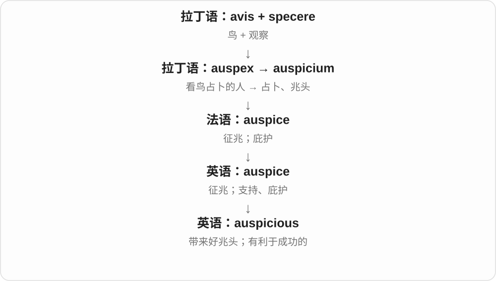
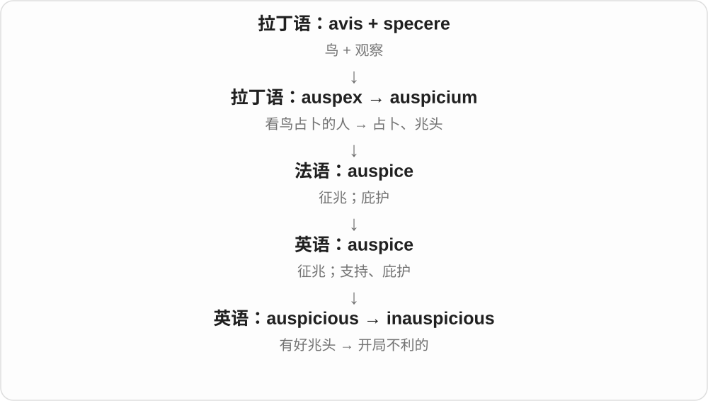

# 2106 · avi-, au- — 鸟

[逐词精讲目录](../00_逐词精讲目录.md) · [总目录](../00_总目录_按常用程度.md)

## 核心词根与来源

拉丁 avis 就是鸟。avian 直接说鸟类，aviary 是养鸟的地方；近代法语又借“鸟”的词干命名 aviation 和 aviator。auspice 一支把鸟与“看”结合，背景是观鸟占卜，现代却常说项目的支持者或有利的开局。

**avi-：鸟；在 auspic- 一支中，鸟与观察征兆联系起来。**

一条线抬头看鸟飞，后来用于人的飞行；另一条线是古人看鸟判断征兆，后来变成吉利、支持的说法。

- **鸟本身与住处**：avian、aviary
- **人类飞行**：aviation、aviator
- **看鸟判断征兆后的延伸**：auspice、auspices、auspicious、inauspicious

## 词形与演化规律

avi- 常能直接认出鸟的意思；au- 只在本组特定历史词里保留鸟的来源，不是所有 au- 都表示鸟。aviation 与 aviator 是近代法语造词借入，aviary 则借自较早的拉丁 aviarium。

## 单词速览（按词族由简到繁）

同一基础词的相关扩展放在一起，先读基础形式，再读扩展；各组之间优先读常用的。具体词源关系见各词讲解。

| 单词 | 音标 | 核心意思 |
|---|---|---|
| [aviation](#w-1) | 英、美 /ˌeɪviˈeɪʃn/ | 航空；航空业 |
| [auspice](#w-8) | 英 /ˈɔːspɪs/；美 /ˈɔːspɪs/ | 征兆；支持；庇护 |
| [auspices](#w-2) | 英、美 /ˈɔːspɪsɪz/ | 支持；主持；庇护〔常用复数〕 |
| [auspicious](#w-4) | 英 /ɔːˈspɪʃəs/；美 /ɔˈspɪʃəs/ | 预示顺利的；吉利的；有利的 |
| [inauspicious](#w-7) | 英 /ˌɪnɔːˈspɪʃəs/；美 /ˌɪnɔˈspɪʃəs/ | 不吉利的；预示不顺的 |
| [avian](#w-3) | 英、美 /ˈeɪviən/ | 鸟类的 |
| [aviator](#w-5) | 英 /ˈeɪvieɪtə/；美 /ˈeɪvieɪtər/ | 飞行员 |
| [aviary](#w-6) | 英 /ˈeɪviəri/；美 /ˈeɪvieri/ | 大型鸟舍；养鸟场所 |

## 逐词讲解

### 1. aviation — 航空；航空业

**音标**：英、美 /ˌeɪviˈeɪʃn/

**先抓住这个画面**

人借助飞行器进入空中的技术、活动和行业。

**怎么拆**

19 世纪法语 aviation 取拉丁 avis“鸟”造词，再借入英语。今天能拆出 avi- 与 -ation，但不能倒推古罗马已有航空业这个整词。

**怎么变成今天的意思**

**拉丁语 avis**  
鸟

↓

**19 世纪法语 aviation**  
用鸟的词干命名飞行技术与活动

↓

**英语 aviation**  
航空；航空业

把“鸟能飞”换成“人造飞行器让人也能飞”，就抓住了命名的联想。civil aviation 是民用航空，aviation safety 是航空安全；它比某一次 flight 的范围大。

**常见搭配与例句**

civil aviation；the aviation industry；aviation safety；aviation history。

> She works in the aviation industry.

她在航空业工作。

> The museum traces the early history of aviation.

这家博物馆追溯了航空发展的早期历史。

**别混淆**

flight 可以是一趟航班或一次飞行；aviation 常谈整个领域。airline 是航空公司，也不是 aviation 的同义词。

### 2. auspice — 征兆；支持；庇护

**音标**：英 /ˈɔːspɪs/；美 /ˈɔːspɪs/

**先抓住这个画面**

auspice 早先是看鸟判断的兆头；现代最常见的画面是某组织在背后支持、主持一项活动。

**怎么拆**

拉丁语 avis（鸟）+ specere（看）形成 auspex“观鸟占卜者”，再有 auspicium，经法语借入。

**怎么变成今天的意思**

由占卜的权威和主持，发展为赞助、庇护的含义。现代多用复数 auspices，尤其 under the auspices of。

**常见搭配与例句**

under the auspices of；favourable auspices。

> The exhibition was held under the auspices of the museum.

展览在博物馆的支持下举办。

> The workshop ran under the auspices of a local association.

研讨班由一个地方协会支持开展。

**别混淆**

auspices 指支持、主持关系；auspicious 才是“好兆头的”形容词。

### 3. auspices — 支持；主持；庇护〔常用复数〕

**音标**：英、美 /ˈɔːspɪsɪz/

**先抓住这个画面**

一项活动背后有某个机构或人物提供支持、照应。

**怎么拆**

auspice 的复数；单数经法语 auspice 借拉丁 auspicium“观鸟占卜”。更早 auspex 结合“鸟”与“观察”的成分。由征兆、较高力量的有利影响，走到现代组织支持这一用法。

**怎么变成今天的意思**

**拉丁语 avis**  
鸟

↓

**拉丁语 auspex → auspicium**  
观鸟判断征兆的人 → 观鸟占卜、征兆

↓

**法语 auspice → 英语 auspice / auspices**  
征兆；后延伸为有利影响、保护与支持

↓

**常用短语 under the auspices of**  
在某人或机构支持、主持或庇护下

读项目介绍时，under the auspices of a university 往往说明大学在背后主持或支持。它可能涉及组织、名义或其他帮助，不必只理解为这所大学出了钱，更不是今天仍在看鸟算吉凶。

**常见搭配与例句**

under the auspices of；under international auspices；under university auspices。

> The workshop was held under the auspices of the local university.

这次工作坊在当地大学的支持下举行。

> The restoration project began under the auspices of a heritage foundation.

修复项目在一家遗产基金会的主持与支持下启动。

**别混淆**

auspices 常放在固定短语里；auspicious 是形容词，表示好兆头、开局有利。不要把 under the auspices of 译成“在……的吉利下面”。

### 4. auspicious — 预示顺利的；吉利的；有利的

**音标**：英 /ɔːˈspɪʃəs/；美 /ɔˈspɪʃəs/

**先抓住这个画面**

auspicious 像刚出发就遇到顺风，让人觉得这会是个好开头。

**怎么拆**

与 auspice + -ious 对应；远源是 avis“鸟”+ specere“看”，古罗马人观察鸟来判断兆头。

**怎么变成今天的意思**

历史上与占卜相连，现代通常只是说开端、时机或条件令人看好，不必真的相信占卜。

**常见搭配与例句**

an auspicious start；an auspicious occasion；an auspicious sign。

> The team made an auspicious start to the season.

球队在赛季开始时取得了好兆头般的佳绩。

> The clear weather seemed an auspicious sign.

晴朗的天气似乎是个好兆头。

**别混淆**

auspicious 是好兆头；suspicious 是可疑，虽然字形相近，意义完全不同。

### 5. inauspicious — 不吉利的；预示不顺的

**音标**：英 /ˌɪnɔːˈspɪʃəs/；美 /ˌɪnɔˈspɪʃəs/

**先抓住这个画面**

inauspicious 像出发就遇到车坏、天黑，让人觉得开头不太顺。

**怎么拆**

in-（不）+ auspicious（有好兆头的）。

**怎么变成今天的意思**

现代常评价开始或时机，不一定涉及迷信，也不代表后来一定失败。

**常见搭配与例句**

an inauspicious start；an inauspicious beginning。

> The broken projector made for an inauspicious start.

投影仪坏了，让开场显得不太顺。

> Despite an inauspicious beginning, the event went well.

虽然开头不顺，活动后来进行得很好。

**别混淆**

unlucky 可直接说倒霉；inauspicious 更常说某情况让人不看好接下来的发展。

### 6. avian — 鸟类的

**音标**：英、美 /ˈeɪviən/

**先抓住这个画面**

把对象明确限定为鸟类，而不是所有会飞的动物。

**怎么拆**

取拉丁 avis“鸟”的词干 avi-，加 -ian 构成英语形容词。它不从 aviation“航空”缩略而来，也不意味着每种相关动物都能飞。

**怎么变成今天的意思**

**拉丁语 avis**  
鸟

↓

**英语 avi- + -ian → avian**  
鸟类相关的

avian species 是鸟类物种，avian behaviour 是鸟类行为。看到 avian flu，可以先理解为与鸟类相关的流感名称；avi- 关注的是鸟这类动物，不是飞行这个动作。

**常见搭配与例句**

avian species；avian behaviour；avian flu。

> The wetland supports a rich variety of avian species.

这片湿地生活着种类丰富的鸟类。

> The researchers compared avian behaviour in urban and rural areas.

研究人员比较了城市和乡村鸟类的行为。

**别混淆**

avian 说鸟类；aerial 说空中的。蝙蝠会飞，却不因此成为 avian animal；企鹅属于鸟类，即使不会飞。

### 7. aviator — 飞行员

**音标**：英 /ˈeɪvieɪtə/；美 /ˈeɪvieɪtər/

**先抓住这个画面**

驾驶飞行器的人，尤其容易出现在早期航空故事里。

**怎么拆**

借法语 aviateur，这个近代词以拉丁 avis“鸟”为基础，加人物成分 -ateur。英语末尾变成 -ator；不是先有一个古拉丁 aviator 再继承下来。

**怎么变成今天的意思**

**拉丁语 avis**  
鸟

↓

**19 世纪法语 aviateur**  
以鸟的词干形成飞行者名称

↓

**英语 aviator**  
飞行员；也用作相关服饰名称的修饰语

读航空先驱传记时，aviator 很常见；平日说职业飞行员，pilot 更普通。aviator sunglasses 是与飞行员眼镜式样联系起来的款式名称，并不是只有飞行员能戴。

**常见搭配与例句**

a pioneering aviator；an experienced aviator；aviator sunglasses。

> The exhibition celebrates pioneering women aviators.

这场展览纪念了早期开拓航空事业的女性飞行员。

> He bought a pair of aviator sunglasses at the airport.

他在机场买了一副飞行员款太阳镜。

**别混淆**

pilot 是现代职业描述中的常用词；aviator 较有历史、文学或特定航空语境的色彩。它描述飞行者，不是乘客。

### 8. aviary — 大型鸟舍；养鸟场所

**音标**：英 /ˈeɪviəri/；美 /ˈeɪvieri/

**先抓住这个画面**

给鸟围出的一个较大生活空间，常能让鸟在里面飞动。

**怎么拆**

借拉丁 aviarium“养鸟的地方”，来自 avis“鸟”及表示场所的成分。现代可把 avi- 对应鸟、-ary 对应场所来记，但英语并非从 aviation 去掉词尾造出它。

**怎么变成今天的意思**

**拉丁语 avis**  
鸟

↓

**拉丁语 aviarium**  
供养鸟的场所

↓

**英语 aviary**  
大型鸟笼、鸟舍

动物园里有时能走进一座网罩或大建筑，看鸟在枝条间活动，这样的场所可以叫 aviary。它强调圈养鸟的空间，不是野外任意一片鸟类栖息地。

**常见搭配与例句**

a large aviary；an outdoor aviary；birds in an aviary。

> Visitors can walk through the aviary and watch the birds overhead.

游客可以穿过鸟舍，观看头顶活动的鸟。

> The zoo built a larger aviary for the parrots.

动物园为鹦鹉建了一座更大的鸟舍。

**别混淆**

cage 泛指笼子，aviary 专门说养鸟的大笼或建筑；鸟自己搭的窝是 nest。

## 这一组要分清什么

aviation 指航空领域，avian 指鸟类；auspices 常说在某机构支持下，auspicious 则说开局或迹象有利。它们共享鸟这一源头，现代意思却不能互相替换。

## 串起来练习

用 aviation 和 aviator 分别写行业与从业者，再把“这次活动在大学支持下举行”改写成带 auspices 的句子。
