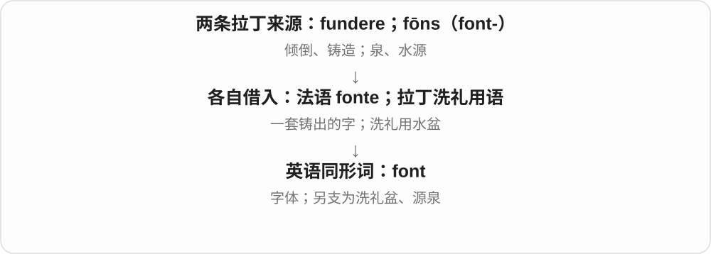

# 2371 · font- — 泉；水源

[逐词精讲目录](../00_逐词精讲目录.md) · [总目录](../00_总目录_按常用程度.md)

## 核心词根与来源

这组不大，但有一个很容易记错的地方：font 的“洗礼盆”和“字体”只是碰巧同形。前者接泉水，后者接金属活字的铸造，不能统一解释成“文字从泉里流出来”。

**font- 可以想成水不断涌出的泉眼。从真实的泉，容易借到知识和智慧的来源；与水有关的宗教器物也保留了这条来源。**

fons／font- 泉 → fontana → fountain 喷泉；fountain → fount 源泉；法语小称 fontanelle → 囟门。

- **泉水、喷泉与抽象来源**：fountain, fount
- **盛水器与同形词辨认**：font
- **借小泉眼形象命名的部位**：fontanelle

## 词形与演化规律

拉丁主格 fōns，属格 fontis，显出 font- 词干。fountain 经法语借入，fount 通常解释为它的后起缩短／逆构；fontanelle 的小称形成在法语一侧。

## 单词速览（按词族由简到繁）

同一基础词的相关扩展放在一起，先读基础形式，再读扩展；各组之间优先读常用的。具体词源关系见各词讲解。

| 单词 | 音标 | 核心意思 |
|---|---|---|
| [fountain](#w-1) | 英 /ˈfaʊntən/；美 /ˈfaʊntn/ | 喷泉；泉水；喷涌；大量事物的来源 |
| [font](#w-2) | 英 /fɒnt/；美 /fɑːnt/ | 字体；一套字形；洗礼盆；源泉〔另一来源〕 |
| [fount](#w-3) | 英美 /faʊnt/ | 源泉；来源〔偏文学或带幽默意味〕 |
| [fontanelle](#w-4) | 英 /ˌfɒntəˈnel/；美 /ˌfɑːntəˈnel/ | 囟门；婴儿颅骨间尚未闭合的柔软部位 |

## 逐词讲解

### 1. fountain — 喷泉；泉水；喷涌；大量事物的来源

**音标**：英 /ˈfaʊntən/；美 /ˈfaʊntn/

**先抓住这个画面**

核心画面是某处不断涌出东西：先是泉水，后来可以是人工水柱，也可以是一股火花或源源不断的资源。

**怎么拆**

经古法语 fontaine 借入，接后古典拉丁 fontana，是 fontanus“泉的”的阴性形式转作名词；再接 fons、词干 font-“泉”。不能把英语 fountain 当作 font 后加一个表示小物的 -ain。

**怎么变成今天的意思**

**拉丁 fōns，词干 font-**  
泉、水源

↓

**拉丁 fontānus → 后古典拉丁 fontāna**  
泉的 → 泉、水源这个名词

↓

**古法语 fontaine → 英语 fountain**  
天然泉水，后来也指人工喷泉

广场上的 fountain 通常是人工喷泉；a drinking fountain 是供人饮水的设施。a fountain of sparks 把向外喷出的火花比作水柱，a fountain of ideas 则借“不断涌出”说创意很多。

**常见搭配与例句**

a public fountain；a drinking fountain；a fountain of sparks；a fountain pen。钢笔的 fountain 借储墨器持续供墨的画面命名。

> We arranged to meet beside the fountain in the square.

我们约好在广场的喷泉旁碰面。

> A fountain of sparks rose from the firework.

烟花喷出了一股泉水般的火花。

> The workshop became a fountain of new ideas.

这次工作坊成了新点子不断涌现的源泉。

**别混淆**

spring 更常直接说自然涌出的泉；fountain 在现代日常场景里常是人工喷泉。两者历史上接近，今天常用场景已有区别。

### 2. font — 字体；一套字形；洗礼盆；源泉〔另一来源〕

**音标**：英 /fɒnt/；美 /fɑːnt/

**先抓住这个画面**

字体义可以想象早期印刷的一整套金属字：它们按统一风格铸造，拿来排版。

**怎么拆**

字体义来自法语 fonte“铸造”，源自 fondre / fundere。洗礼盆、源泉义另来自拉丁语 fōns、词干 font-，不要把两个同形词强接在一起。

**怎么变成今天的意思**

电脑里常说 change the font 换字体；传统排印严格区分 typeface 的设计与具体 font，日常用法常重叠。教堂的 stone font 通常是石制洗礼盆。

**常见搭配与例句**

choose a font；font size；a baptismal font。

> Choose a font that is easy to read on a small screen.

选一种在小屏幕上也容易阅读的字体。

> A stone font stands near the church entrance.

教堂入口附近立着一个石制洗礼盆。

**别混淆**

font 的字体义与 foundry“铸字作坊”有关；fountain“喷泉”的直接来源是另一条 fōns 支线。

### 3. fount — 源泉；来源〔偏文学或带幽默意味〕

**音标**：英美 /faʊnt/

**先抓住这个画面**

把一个人的知识、经验或热情想成一口泉，总能从那里得到新的东西。

**怎么拆**

通常解释为英语 fountain 的缩短或逆构，可能受到法语 font 的影响，也常以 mount／mountain 这类词形对应说明其形成。不是先有英语 fount 再加 -ain 才产生 fountain。

**怎么变成今天的意思**

**拉丁 fōns，词干 font-**  
泉、水源

↓

**拉丁 fontānus → 后古典拉丁 fontāna**  
泉的 → 泉、水源这个名词

↓

**古法语 fontaine → 英语 fountain**  
天然泉水，后来也指人工喷泉

↓

**英语 fount**  
从 fountain 缩短／逆构；保留泉和来源的比喻

最值得掌握的是 a fount of knowledge／wisdom，把某人形容成“知识宝库、智慧源泉”。它可以真心赞许，也可以轻微调侃，不必每次都翻成字面的泉水。

**常见搭配与例句**

a fount of knowledge；a fount of wisdom；an endless fount of ideas。

> Our librarian is a fount of knowledge about the town’s history.

我们的图书管理员对镇史了如指掌，像一座知识宝库。

> I am hardly a fount of wisdom when it comes to gardening.

说到园艺，我可远算不上什么智慧源泉。

**别混淆**

source 很中性，fount 更有文采，也容易带夸张。另有印刷术语 fount，作 font“字体”的拼写形式时常读 /fɒnt/ 或美 /fɑːnt/，那一支接铸造词源，不属于这里的泉水义。

### 4. fontanelle — 囟门；婴儿颅骨间尚未闭合的柔软部位

**音标**：英 /ˌfɒntəˈnel/；美 /ˌfɑːntəˈnel/

**先抓住这个画面**

婴儿的头骨不是一整块硬壳；几块骨之间还留有被软组织覆盖的部位，这就是家长常听到的“软点”。

**怎么拆**

英语借法语 fontanelle；古法语 fontenele 是 fontaine“泉”的小称形式，也见近代拉丁 fontanella 的医学传播。名称常解释为类比泉眼所在的小凹处，并非婴儿头上真的有泉水。

**怎么变成今天的意思**

**拉丁 fons → fontana → 古法语 fontaine**  
泉、水源

↓

**古法语小称 fontenele；法语 fontanelle**  
小泉眼；转用为人体的柔软凹处，近代拉丁亦有 fontanella

↓

**英语 fontanelle／fontanel**  
早期用于肌肉间凹处，后来用于婴儿的囟门

育儿文章中的 soft spot 常是它的通俗说法。囟门属于婴儿正常生长结构，帮助头颅适应生长；它有组织覆盖，不是一个裸露的洞。美式英语也常拼 fontanel，复数 fontanels 或 fontanelles 随词头拼写。

**常见搭配与例句**

the anterior fontanelle 前囟；the posterior fontanelle 后囟；fontanelle closure 囟门闭合。

> The nurse explained that a fontanelle is a normal soft area on a baby’s head.

护士解释说，囟门是婴儿头上正常存在的柔软部位。

> The parenting guide used the words “soft spot” instead of “fontanelle”.

那本育儿指南用通俗的“软点”来代替“囟门”这个术语。

**别混淆**

这里与 fountain 的关系发生在法语及更早的拉丁来源中，不是英语先有“喷泉”再新造医学单词。字体 font 的铸造词源也解释不了它。

## 这一组要分清什么

font 的字体义接法语 fonte“铸造”，不接 fons“泉”。fount 作为“知识源泉”读 /faʊnt/；印刷语境里的 fount 可以只是 font 的另一拼写，词义和读音要看场景。

## 串起来练习

She is a fount of local knowledge. 她是本地知识的宝库：知识像泉水一样可以不断从她那里得到。
