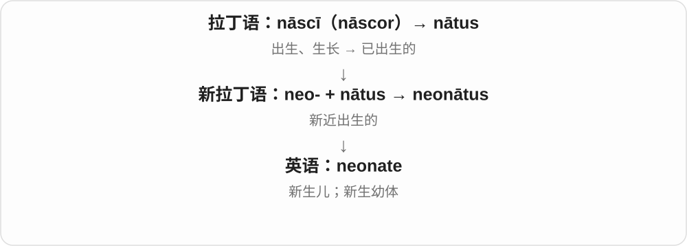
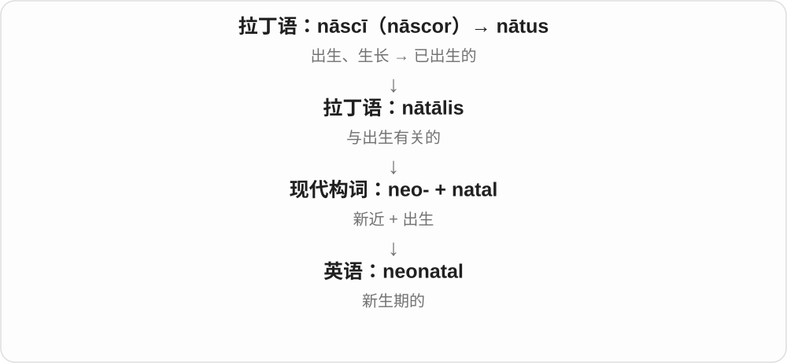

# 2664 · ne-, neo- — 新；较新的；新的发展形式

[逐词精讲目录](../00_逐词精讲目录.md) · [总目录](../00_总目录_按常用程度.md)

## 核心词根与来源

neo- 的新有不同参照：neon 是发现时的新元素，neolithic 是相对旧石器时代较新，neophyte 是刚入门的人，neoconservatism 是有具体历史的新政治流派。不能把所有新都理解成今天刚出现。

**在已经认识的事物旁边，标出新出现、新发现或重新发展的一支。**

希腊 neos 新 → neon 新发现的元素；neo- + lith- 石 → neolithic；neos + phytos 栽种的 → neophyte；neo- + 已有学说名称 → 新流派。

- **元素和材料**：neon, neodymium, neoprene
- **新阶段、新成员与身体名称**：neolithic, neophyte, neonatal, neonate, neocortex
- **新词、艺术与政治流派**：neologism, neoclassical, neoliberal, neoliberalism, neoconservative, neoconservatism

## 词形与演化规律

neo- 常见 /niːəʊ/ 或 /niːoʊ/，具体整词会弱化，如 neoprene、neolithic。neon 用的是希腊中性词形 neon；neodymium 的后半部分接双生元素的命名历史。

## 单词速览（按词族由简到繁）

同一基础词的相关扩展放在一起，先读基础形式，再读扩展；各组之间优先读常用的。具体词源关系见各词讲解。

| 单词 | 音标 | 核心意思 |
|---|---|---|
| [neon](#w-1) | 英 /ˈniːɒn/；美 /ˈniːɑːn/ | 氖；霓虹灯；鲜亮耀眼的〔颜色〕 |
| [neonate](#w-13) | 英 /ˈniːəʊneɪt/；美 /ˈniːoʊneɪt/ | 新生儿；新生幼体 |
| [neonatal](#w-2) | 英 /ˌniːəʊˈneɪtəl/；美 /ˌniːoʊˈneɪtəl/ | 新生儿的；新生期的 |
| [neoliberal](#w-3) | 英 /ˌniːəʊˈlɪbərəl/；美 /ˌniːoʊˈlɪbərəl/ | 新自由主义的；新自由主义者 |
| [neoliberalism](#w-6) | 英 /ˌniːəʊˈlɪbərəlɪzəm/；美 /ˌniːoʊˈlɪbərəlɪzəm/ | 新自由主义 |
| [neolithic](#w-4) | /ˌniːəˈlɪθɪk/ | 新石器时代的 |
| [neoclassical](#w-5) | 英 /ˌniːəʊˈklæsɪkəl/；美 /ˌniːoʊˈklæsɪkəl/ | 新古典主义的；新古典学派的 |
| [neoprene](#w-7) | /ˈniːəpriːn/ | 氯丁橡胶；由其制成的材料 |
| [neodymium](#w-8) | 英 /ˌniːəʊˈdɪmiəm/；美 /ˌniːoʊˈdɪmiəm/ | 钕 |
| [neophyte](#w-9) | 英 /ˈniːəfaɪt/；美 /ˈniːoʊfaɪt/ | 新手；初学者；新皈依者 |
| [neoconservative](#w-10) | 英 /ˌniːəʊkənˈsɜːvətɪv/；美 /ˌniːoʊkənˈsɜːrvətɪv/ | 新保守主义者；新保守主义的 |
| [neocortex](#w-11) | 英 /ˌniːəʊˈkɔːteks/；美 /ˌniːoʊˈkɔːrteks/ | 新皮质 |
| [neologism](#w-12) | 英 /niˈɒlədʒɪzəm/；美 /niˈɑːlədʒɪzəm/ | 新词；新用法 |
| [neoconservatism](#w-14) | 美 /ˌniːoʊkənˈsɜːrvəˌtɪzəm/ | 新保守主义 |

## 逐词讲解

### 1. neon — 氖；霓虹灯；鲜亮耀眼的〔颜色〕

**音标**：英 /ˈniːɒn/；美 /ˈniːɑːn/

**先抓住这个画面**

先是新发现的气体，后来让人想到夜街上发亮的招牌，再引出荧光般醒目的颜色。

**怎么拆**

直接借用希腊 neos 新的的中性形式 neon 命名元素；这里整个 neon 是古典词形，不必拆成现代 neo- 加气体后缀。

**怎么变成今天的意思**

**希腊 neos 新的 → neo-**  
新的、较新的，或对旧事物作新发展

↓

**希腊 neon 新的 → 英语元素名 neon**  
因新发现而命名

↓

**neon lights / neon signs → neon colours**  
从发光招牌扩展到特别鲜亮的颜色

neon signs 是霓虹招牌；neon pink 是鲜亮的荧光粉色。纯氖放电主要发橙红色光，日常叫霓虹灯的各种颜色并不都来自氖。

**常见搭配与例句**

a neon sign；neon lights；neon pink；neon gas。

> A neon sign glowed above the small cinema.

小电影院上方亮着一块霓虹招牌。

> She wore neon pink trainers to the race.

她穿着一双荧光粉色运动鞋参加比赛。

**别混淆**

neon 作颜色描述强调醒目，不表示衣料里含有氖。new 是英语本族词，neon 是用希腊语给元素起的名。

### 2. neonate — 新生儿；新生幼体

**音标**：英 /ˈniːəʊneɪt/；美 /ˈniːoʊneɪt/

**先抓住这个画面**

neonate 是刚出生、处在生命最初阶段的个体，是 newborn 的较专业说法。

**怎么拆**

新拉丁语 neonātus：neo-（新，希腊语成分）+ nātus（出生的，拉丁语成分）。

**怎么变成今天的意思**

人的医学语境通常指生命最初四周左右的新生儿阶段；动物研究中也会说新生幼体，范围依领域。

**常见搭配与例句**

a neonate；care of neonates；neonates in the study。

> The textbook includes a chapter on the care of neonates.

教材有一章介绍新生儿照护。

> The researchers weighed each neonate shortly after birth.

研究者在出生后不久给每个新生幼体称重。

**别混淆**

infant 的婴儿阶段通常更宽；neonate 特别突出出生后的最早时期。

### 3. neonatal — 新生儿的；新生期的

**音标**：英 /ˌniːəʊˈneɪtəl/；美 /ˌniːoʊˈneɪtəl/

**先抓住这个画面**

neonatal 把视线集中在刚出生后的那一小段生命起点，常修饰病房、照护和发育。

**怎么拆**

neo-（新）+ natal（出生的），是现代科学用古典成分造的词。

**怎么变成今天的意思**

postnatal 只说出生以后；neonatal 更具体地限定最早的新生期。它不是“尚未出生”的意思。

**常见搭配与例句**

neonatal care；a neonatal unit；the neonatal period。

> She works in a neonatal unit.

她在新生儿病区工作。

> The study focuses on neonatal development.

研究聚焦于新生期发育。

**别混淆**

prenatal 出生前；postnatal 出生后；neonatal 出生后最初的新生期。

### 4. neoliberal — 新自由主义的；新自由主义者

**音标**：英 /ˌniːəʊˈlɪbərəl/；美 /ˌniːoʊˈlɪbərəl/

**先抓住这个画面**

讨论常把市场竞争、私有产权和市场化改革放在中心；这是特定思想和政策标签，不只是“新一代自由派”。

**怎么拆**

neo- 新 + liberal，近现代政治经济用词。它在不同年代、作者笔下的范围有变化，不能只按构件推导出一份固定政策清单。

**怎么变成今天的意思**

**拉丁 liber**  
自由的；不受束缚的

↓

**拉丁 liberalis → 古法语 liberal／直接拉丁借入**  
适合自由人的；慷慨的

↓

**中古英语 → 英语 liberal**  
慷慨、宽容；近代又形成政治用法

↓

**近现代英语 neo- 新 + liberal → neoliberal**  
新自由主义相关的；历史使用范围有变化

neoliberal reforms 常用于谈市场化、私有化或放松某些经济限制的改革。这个标签也常出现在批评性论述中，是否赞同、怎样界定，需要读作者的具体说明。

**常见搭配与例句**

neoliberal reforms；neoliberal policies；a neoliberal approach。

> The chapter analyses reforms commonly described as neoliberal.

这一章分析了通常被称为新自由主义的改革。

> The author explains what she means by a neoliberal approach to education.

作者解释了她所说的教育领域新自由主义路径具体指什么。

**别混淆**

liberal 更宽泛；neoliberal 是特定历史和政策讨论中的标签。它不等于“政府完全不存在”，不同论者对政府角色也有具体安排。

### 5. neoliberalism — 新自由主义

**音标**：英 /ˌniːəʊˈlɪbərəlɪzəm/；美 /ˌniːoʊˈlɪbərəlɪzəm/

**先抓住这个画面**

把重视竞争市场、私有产权等的一组思想或改革取向作为整体来讨论；不同作者用这个名称圈出的范围并不完全一样。

**怎么拆**

neo- 新 + liberalism，或对应 neoliberal + -ism；属于近现代欧洲语言共同发展的政治经济词汇，并非古拉丁已有的学说名。

**怎么变成今天的意思**

**拉丁 liber**  
自由的；不受束缚的

↓

**法语／英语 liberal 及近代 liberalism 词族**  
自由主义相关用语

↓

**近现代 neo- + liberalism／neoliberal + -ism → neoliberalism**  
新自由主义的思想或政策标签

读到这个词，不必立刻把它当成一个单一、人人同意的定义。通常先看它在该文中指经济政策、政治哲学，还是更广的社会市场化现象。

**常见搭配与例句**

debates about neoliberalism；the history of neoliberalism；critics of neoliberalism。

> The reading list includes competing interpretations of neoliberalism.

阅读书目收录了对新自由主义的不同解释。

> The lecturer asked students to define neoliberalism before using it as a label.

讲师要求学生先明确新自由主义的定义，再使用这个标签。

**别混淆**

libertarianism 与它有某些交集，但不能直接画等号；neoliberalism 的许多讨论仍为国家保留维护市场规则等角色。

### 6. neolithic — 新石器时代的

**音标**：/ˌniːəˈlɪθɪk/

**先抓住这个画面**

历史学里的新是相对旧石器时代而言，不是相对今天的新。

**怎么拆**

十九世纪用 neo- 新 + 希腊 lithos 石 + -ic 造出的时代名称；常写 Neolithic，也见小写。

**怎么变成今天的意思**

**希腊 neos 新的 → neo-**  
新的、较新的，或对旧事物作新发展

↓

**近代 neo- + lith- 石 + -ic → Neolithic / neolithic**  
新石器时代相关，最初用来区分较新的石器文化阶段

Neolithic settlements 是新石器时代聚落；the Neolithic 是这一时代。各地区进入这一阶段的时间不同，不宜把一个地区的日期当成全世界统一起点。

**常见搭配与例句**

a Neolithic settlement；Neolithic tools；the Neolithic period。

> The museum displays tools from a Neolithic settlement.

博物馆展出了一个新石器时代聚落的工具。

> Researchers compared Neolithic communities in different regions.

研究人员比较了不同地区的新石器时代社群。

**别混淆**

Palaeolithic / Paleolithic 是旧石器时代的；Neolithic 是新石器时代的。两者的石都来自 lithos。

### 7. neoclassical — 新古典主义的；新古典学派的

**音标**：英 /ˌniːəʊˈklæsɪkəl/；美 /ˌniːoʊˈklæsɪkəl/

**先抓住这个画面**

不是第一次出现古典形式，而是在后来的时代重新取用、改造它。

**怎么拆**

neo-“新的、复兴的” + classical。

**怎么变成今天的意思**

艺术里常指重新重视古典形式的风格；neoclassical economics 则是经济学中另有特定含义的学派名称，不能按建筑风格去理解。

**常见搭配与例句**

neoclassical architecture；a neoclassical façade；neoclassical economics。

> The museum occupies a neoclassical building with tall columns.

博物馆坐落在一栋有高大立柱的新古典主义建筑中。

> The course introduces the basic assumptions of neoclassical economics.

课程介绍新古典经济学的基本假设。

**别混淆**

classical 可指古典传统本身；neoclassical 强调后世的再采用或特定新学派。

### 8. neoprene — 氯丁橡胶；由其制成的材料

**音标**：/ˈniːəpriːn/

**先抓住这个画面**

常见于潜水服和保护套的弹性材料：柔软、可弯曲，也能做成有厚度的衬垫。

**怎么拆**

二十世纪化工名称，neo- 新 + -prene，参照 chloroprene、isoprene 这类化学名称；不能把整个词按普通英语逐字翻成某种新布。

**怎么变成今天的意思**

**希腊 neos 新的 → neo-**  
新的、较新的，或对旧事物作新发展

↓

**近代 neo- + -prene → neoprene**  
以氯丁二烯聚合得到的合成橡胶名称

a neoprene wetsuit 是氯丁橡胶潜水服；a neoprene sleeve 可以是带缓冲作用的保护套。不同成品可能复合布料等其他材料，并不全是一块纯橡胶。

**常见搭配与例句**

a neoprene wetsuit；a neoprene sleeve；neoprene gloves。

> The laptop came with a padded neoprene sleeve.

这台笔记本电脑配有一个带衬垫的氯丁橡胶保护套。

> The diver checked the seams of her neoprene wetsuit.

潜水员检查了她的氯丁橡胶潜水服接缝。

**别混淆**

rubber 是更宽的橡胶类别；neoprene 指特定合成橡胶材料。名称里的 neo- 是命名时的新，不是每件产品都刚生产。

### 9. neodymium — 钕

**音标**：英 /ˌniːəʊˈdɪmiəm/；美 /ˌniːoʊˈdɪmiəm/

**先抓住这个画面**

一种稀土金属，在产品说明中最常见的搭配是钕磁铁。

**怎么拆**

新拉丁命名：neo- 新 + didymium 的相关部分；didymium 联系希腊 didymos 双生，历史上从原以为是一种元素的材料中分出了钕和镨。

**怎么变成今天的意思**

**希腊 neos 新的 → neo-**  
新的、较新的，或对旧事物作新发展

↓

**十九世纪 didymium 所指材料被分出不同元素 → neodymium**  
新双生者的命名背景；新拉丁名称进入英语

neodymium magnets 常指含钕、铁、硼的强力永磁体。词名讲的是发现和分离的历史，不是说这种金属只能成对出现。

**常见搭配与例句**

neodymium magnets；neodymium alloys；neodymium oxide。

> The speaker uses a compact neodymium magnet.

这个扬声器使用了一块小型钕磁铁。

> The article explains why neodymium is important in some electric motors.

这篇文章解释了钕为什么对某些电动机很重要。

**别混淆**

neon 是气体氖；neodymium 是金属钕。共同的 neo- 只表示当时新发现，不能据此推测性质相近。

### 10. neophyte — 新手；初学者；新皈依者

**音标**：英 /ˈniːəfaɪt/；美 /ˈniːoʊfaɪt/

**先抓住这个画面**

像刚栽下的小苗，刚进入一个领域，还没有扎稳根。

**怎么拆**

希腊 neos 新 + phytos 栽种、生长的 → neophytos 新栽的、新入教的，经教会拉丁 neophytus 借入英语。

**怎么变成今天的意思**

**希腊 neos 新的 → neo-**  
新的、较新的，或对旧事物作新发展

↓

**希腊 neophytos → 教会拉丁 neophytus → 英语 neophyte**  
新栽的意象 → 新皈依者 → 某领域的新手

a political neophyte 是刚进入政治领域的人；a neophyte in programming 是编程新手。这个词偏书面，有时略带老手看新手的口吻。

**常见搭配与例句**

a political neophyte；a relative neophyte；a neophyte in something。

> As a political neophyte, she had much to learn about campaigning.

作为政坛新人，她在竞选方面还有很多要学。

> The workshop welcomes both experts and neophytes.

这个工作坊欢迎专家和初学者参加。

**别混淆**

beginner 最平常；neophyte 更书面，常强调刚加入一项活动或群体。novice 也可说新手，并有宗教修习义。

### 11. neoconservative — 新保守主义者；新保守主义的

**音标**：英 /ˌniːəʊkənˈsɜːvətɪv/；美 /ˌniːoʊkənˈsɜːrvətɪv/

**先抓住这个画面**

一种有具体思想历史的政治标签，不是泛指刚开始持保守观点的人。

**怎么拆**

现代 neo- 新 + conservative 保守派、保守的；标签在不同时期有过不同所指，不能只靠字面定义一套永远不变的主张。

**怎么变成今天的意思**

**希腊 neos 新的 → neo-**  
新的、较新的，或对旧事物作新发展

↓

**英语 neo- + conservative → neoconservative**  
现代政治流派标签，后来常见于美国政治讨论

在美国外交政策讨论中，neoconservative 常与积极运用美国力量、包括军事力量干预国际事务的主张相连。也能作形容词，说 neoconservative ideas。

**常见搭配与例句**

a neoconservative thinker；neoconservative foreign policy；neoconservative ideas。

> The essay traces the influence of neoconservative thinkers on foreign policy.

这篇文章追溯了新保守主义思想家对外交政策的影响。

> The panel included a neoconservative and a critic of military intervention.

座谈会请来了一位新保守主义者和一位反对军事干预的评论者。

**别混淆**

conservative 范围更宽；neoconservative 指其中有特定历史背景的思想群体。neoliberal 是另一政治经济标签，不与它自动等同。

### 12. neocortex — 新皮质

**音标**：英 /ˌniːəʊˈkɔːteks/；美 /ˌniːoʊˈkɔːrteks/

**先抓住这个画面**

大脑皮质中的一大部分，参与感觉处理、运动和复杂认知等活动。

**怎么拆**

neo- 新 + cortex 皮层；近代解剖名称用新来与其他皮质类型相对，不是说这个人的脑组织刚长出来。

**怎么变成今天的意思**

**希腊 neos 新的 → neo-**  
新的、较新的，或对旧事物作新发展

↓

**近代 neo- + cortex → neocortex**  
形成大脑皮质某一部分的名称

the neocortex 说的是一个解剖范围。它参与许多活动，不能简单理解成一块只负责理性、与情绪完全分开的独立机器。

**常见搭配与例句**

the human neocortex；layers of the neocortex；activity in the neocortex。

> The diagram shows the neocortex as part of the cerebral cortex.

这张图把新皮质标为大脑皮质的一部分。

> The lecture explored how different regions of the neocortex work together.

讲座探讨了新皮质的不同区域如何协同工作。

**别混淆**

cortex 是皮层的广义名称；neocortex 是其中更具体的一部分。hypothalamus 是下丘脑，位置与功能范围都不同。

### 13. neologism — 新词；新用法

**音标**：英 /niˈɒlədʒɪzəm/；美 /niˈɑːlədʒɪzəm/

**先抓住这个画面**

语言里新长出的一块：可能是新造的词，也可能是旧词新添的意思。

**怎么拆**

借法语 néologisme，由希腊来源的 neo- “新” + log- “词”及 -ism 构成。

**怎么变成今天的意思**

**希腊 légō / lógos**  
选取、收集 → 讲述；话语、说明、道理、计算

↓

**法语 néo- + log- + -isme → néologisme → 英语 neologism**  
新创造或新使用的词语

一个网络社区可以先创造 neologism，之后它可能广泛传播，也可能很快消失。新不等于错，也不等于一定会被收进词典；词的流通情况还要继续看。

**常见搭配与例句**

coin a neologism；a recent neologism；the spread of a neologism。

> The novel introduced a neologism for its imaginary transport system.

小说为虚构的交通系统创造了一个新词。

> The researcher tracked how the neologism spread beyond the original forum.

研究者追踪了这个新词怎样传播到最初论坛之外。

**别混淆**

slang 是语体特点；neologism 是新旧时间上的特点，新词也可以非常正式。

### 14. neoconservatism — 新保守主义

**音标**：美 /ˌniːoʊkənˈsɜːrvəˌtɪzəm/

**先抓住这个画面**

把前一个词从持某种观点的人，转向那套思想及其发展。

**怎么拆**

neo- 新 + conservatism 保守主义；与 neoconservative 同族，但词源记录中这个名词较早出现，不能简单画成先有现代 neoconservative 再变名词。

**怎么变成今天的意思**

**希腊 neos 新的 → neo-**  
新的、较新的，或对旧事物作新发展

↓

**现代英语 neo- + conservatism → neoconservatism**  
形成思想流派名称；与 neoconservative 是相关而各有记录的构词

the rise of neoconservatism 是新保守主义的兴起。读新闻或历史时，要看文章讨论哪个时期、哪方面政策；思想标签本身不能代替具体主张。

**常见搭配与例句**

the rise of neoconservatism；the history of neoconservatism；critics of neoconservatism。

> The course examines the development of neoconservatism in the United States.

这门课研究新保守主义在美国的发展。

> The author distinguishes neoconservatism from other conservative traditions.

作者区分了新保守主义与其他保守主义传统。

**别混淆**

neoconservatism 是思想或运动，a neoconservative 是人。不是每个新提出的保守方案都属于这个流派。

## 这一组要分清什么

neo- 可表示新发展或复兴，不保证内容进步，也不表示所有流派一致。neon 作颜色词不代表材料含氖；neophyte 是新手，neonate 则是新生儿。

## 串起来练习

分别说明 neon、neolithic、neophyte 的新相对什么而言；用 neoconservative 与 neoconservatism 各造一句；比较 new 与 neo- 组合形式。
