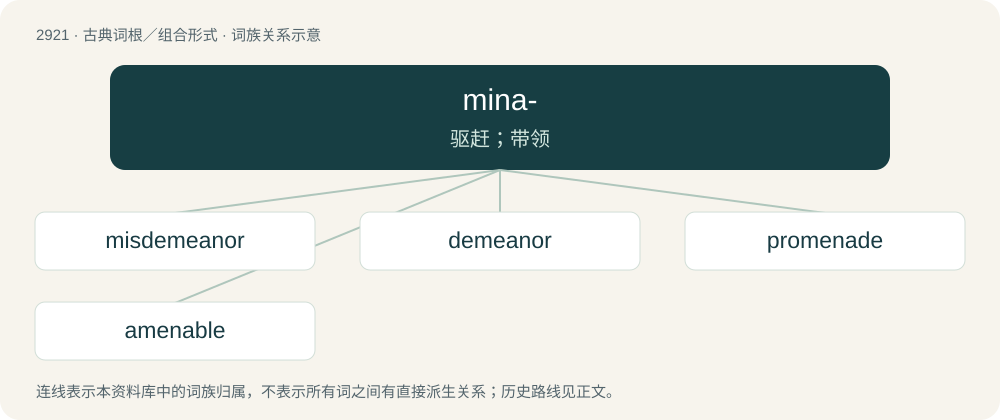

# 3032 · mina- — 驱赶；带领

[总目录](../00_总目录_按常用程度.md)

**类型**：古典词根／组合形式　｜　**来源语言**：拉丁语

## 核心含义与来源

- 核心含义：驱赶；带领
- 英文含义：lead
- 词形：mina-

**来源词形**：minare, variant of minari

## 词族图

## 单词速览（常用到不常用）

| 单词 | 音标 | 释义 |
|---|---|---|
| [misdemeanor](#w-1) | 英 /ˌmɪsdɪˈmiːnə(ɹ)/ | n. 行为不检, 品行不良, 轻罪, 不端行为 |
| [demeanor](#w-2) | 英 /dɪˈmiːnə(ɹ)/；美 /dɪˈminɚ/ | 行为, 品行, 举止 |
| [promenade](#w-3) | 英 /ˈpɹɒm.əˌnɑːd/；美 /ˌpɹɑm.əˈneɪd/ | n. 散步, 骑马, 舞会；vi. 漫步, 兜风；vt. 在...散步 |
| [amenable](#w-4) | 英 /əˈmiːnəbəl/；美 /əˈmɛn.ə.bəl/ | a. 服从的, 会接纳的, 有义务的；\[法\] 服从的, 有责任的, 有服从义务的 |

## 逐词详解

### 1. misdemeanor

**词性**：名词　｜　**音标**：英 /ˌmɪsdɪˈmiːnə(ɹ)/

**中文释义**：n. 行为不检, 品行不良, 轻罪, 不端行为

**英文义项**：Any act of misbehavior.

**构词拆分**：mis- + demeanor

**词源与演化**：

From mis- + demeanor.

**用法示例／搭配（非完整句）**：

> petty misdemeanor

该用例对应义项：Any act of misbehavior.

### 2. demeanor

**词性**：名词　｜　**音标**：英 /dɪˈmiːnə(ɹ)/；美 /dɪˈminɚ/

**中文释义**：行为, 品行, 举止

**英文义项**：The social, non-verbal behaviors (such as body language and facial expressions) that are characteristic of a person.

**词源与演化**：

From Middle English demenure, from the verb Middle English demenen, demeinen (“to handle, manage”), from Old French demener (“to guide, conduct”), from de- + mener (“to conduct, lead”), from Latin \*mināre (“to drive”) and minor (“to project or jut forth”).

**例句**：

> The man's demeanor made others suspicious of his intentions.

该用例对应义项：The social, non-verbal behaviors (such as body language and facial expressions) that are characteristic of a person.

### 3. promenade

**词性**：名词　｜　**音标**：英 /ˈpɹɒm.əˌnɑːd/；美 /ˌpɹɑm.əˈneɪd/

**中文释义**：n. 散步, 骑马, 舞会；vi. 漫步, 兜风；vt. 在...散步

**英文义项**：A prom (dance). / A walk taken for pleasure, display, or exercise; a stroll.

**词源与演化**：

Unadapted borrowing from French promenade, from promener (“to walk”).

**例句**：

> The market on the promenade sells second-hand clothes and bric-a-brac.

### 4. amenable

**词性**：形容词　｜　**音标**：英 /əˈmiːnəbəl/；美 /əˈmɛn.ə.bəl/

**中文释义**：a. 服从的, 会接纳的, 有义务的；\[法\] 服从的, 有责任的, 有服从义务的

**英文义项**：Willing to respond to persuasion or suggestions. / Willing to comply; easily led.

**词源与演化**：

Borrowed from Anglo-Norman amenable, amesnable, from amener (“to bring or lead, fetch in or to”) + -able (“-able”); amener is in turn from a- + mener (“to lead, conduct”), from Late Latin mināre (“to drive”), Latin deponent minārī (“to threaten, menace”).

**例句**：

> Decisions of the Boards of Appeal are amenable to actions before the Court of Justice of the European Communities.

该用例对应义项：Liable to the legal authority of (something).
