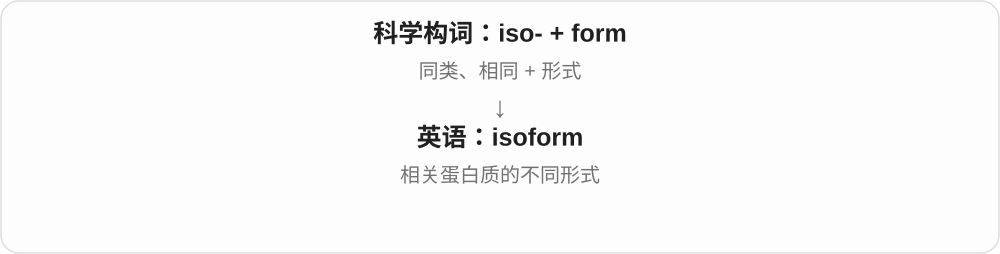

# 3196 · is-, iso- — 相同；相等

[逐词精讲目录](../00_逐词精讲目录.md) · [总目录](../00_总目录_按常用程度.md)

## 核心词根与来源

来自希腊 isos。iso- 是科学词汇里很有用的构词成分，但“相同”永远需要一个比较项目。isotope 同位素不是所有性质都相同，isomorphic 同构也不是外表一定长得一样。

**ISO = EQUAL / SAME**

把两样东西摆在一起，先问比较哪一项：位置、长度、温度、结构，还是张力？只有指定的那一项相同。

- **长度与几何关系**：isosceles、isometric
- **位置与分子结构**：isotope、isotopic、isomer、isopropyl、isoform
- **结构对应**：isomorphic、isomorphism
- **温度、张力与方向性质**：isothermal、isotonic、isotropic、anisotropic

## 词形与演化规律

iso- 常保留连接元音 o；遇元音开头的成分时可见 is-。isosceles 的第二部分是腿，isothermal 的 therm 是热，isometric 的 metr 是尺度，isotonic 的 ton 是张力。

## 单词速览（按词族由简到繁）

同一基础词的相关扩展放在一起，先读基础形式，再读扩展；各组之间优先读常用的。具体词源关系见各词讲解。

| 单词 | 音标 | 核心意思 |
|---|---|---|
| [isotope](#w-1) | 英 /ˈaɪsətəʊp/；美 /ˈaɪsətoʊp/ | 同位素 |
| [isotopic](#w-3) | 英 /ˌaɪsəˈtɒpɪk/；美 /ˌaɪsəˈtɑːpɪk/ | 同位素的；与同位素组成相关的 |
| [isometric](#w-2) | 英 /ˌaɪsəʊˈmetrɪk/；美 /ˌaɪsoʊˈmetrɪk/ | 等距的；等轴测的；等长收缩的 |
| [isotropic](#w-4) | 英 /ˌaɪsəˈtrɒpɪk/；美 /ˌaɪsəˈtrɑpɪk/ | 各向同性的 |
| [anisotropic](#w-5) | 英 /ˌænaɪsəˈtrɒpɪk/；美 /ˌænaɪsəˈtrɑpɪk/ | 各向异性的 |
| [isomorphic](#w-6) | 英 /ˌaɪsəʊˈmɔːfɪk/；美 /ˌaɪsoʊˈmɔːrfɪk/ | 同构的；形态或结构相同的 |
| [isopropyl](#w-7) | 英 /ˌaɪsəˈprəʊpəl/；美 /ˌaɪsəˈproʊpəl/ | 异丙基；异丙基的 |
| [isomer](#w-8) | 英 /ˈaɪsəmə/；美 /ˈaɪsəmər/ | 异构体；同分异构体 |
| [isomorphism](#w-9) | 英 /ˌaɪsəʊˈmɔːfɪzəm/；美 /ˌaɪsoʊˈmɔːrfɪzəm/ | 同构；同形现象 |
| [isothermal](#w-10) | 英 /ˌaɪsəˈθɜːməl/；美 /ˌaɪsəˈθɜːrməl/ | 等温的；恒温进行的 |
| [isoform](#w-11) | 英 /ˈaɪsəʊfɔːm/；美 /ˈaɪsoʊfɔːrm/ | 同工型；同一种蛋白质的不同形式 |
| [isosceles](#w-12) | 英 /aɪˈsɒsəliːz/；美 /aɪˈsɑːsəliːz/ | 等腰的 |
| [isotonic](#w-13) | 英 /ˌaɪsəˈtɒnɪk/；美 /ˌaɪsəˈtɑːnɪk/ | 等渗的；等张的 |

## 逐词讲解

### 1. isotope — 同位素

**音标**：英 /ˈaɪsətəʊp/；美 /ˈaɪsətoʊp/

**先抓住这个画面**

仍是同一种元素，质子数相同，但核里的中子数量可以不同。

**怎么拆**

iso- 相同 + -tope 位置；同一元素的不同形式占元素周期表的同一位置。1913年由 Soddy 使用的名称采纳了 Margaret Todd 的建议。

**怎么变成今天的意思**

**古希腊语 topos**  
地方、位置；更早来源未定

↓

**现代科学造词：iso- 相同 + -tope 位置 → isotope**  
1913年提出：在元素周期表里占同一位置

↓

**英语 isotope**  
同一元素的不同中子数组合

碳的不同同位素都属于碳，差别在中子数、质量等。并非所有同位素都有放射性：既有稳定同位素，也有放射性同位素。这里的同位不是说两个原子挤在同一空间位置。

**常见搭配与例句**

a stable isotope；a radioactive isotope；isotopes of carbon。

> The sample contains several isotopes of the same element.

样品中含有同一种元素的几种同位素。

> The researcher compared stable isotopes in the two water samples.

研究人员比较了两份水样中的稳定同位素。

**别混淆**

element 是元素类别；isotope 是同一元素内部的一种同位素形式。不同元素的质子数不同。

### 2. isotopic — 同位素的；与同位素组成相关的

**音标**：英 /ˌaɪsəˈtɒpɪk/；美 /ˌaɪsəˈtɑːpɪk/

**先抓住这个画面**

看一份材料里各种同位素怎样分布，用这种差别帮助了解它。

**怎么拆**

isotope + -ic，去末尾 e，重音移到 -top-。

**怎么变成今天的意思**

**古希腊语 topos**  
地方、位置；更早来源未定

↓

**现代科学造词：iso- 相同 + -tope 位置 → isotope**  
1913年提出：在元素周期表里占同一位置

↓

**英语 isotope**  
同一元素的不同中子数组合

↓

**英语 isotope + -ic → isotopic**  
同位素 → 同位素相关的

isotopic composition 是同位素组成；isotopic ratios 是各同位素数量的比例。它们可以提供材料来源或过程的线索，不必总涉及放射性。

**常见搭配与例句**

isotopic composition；isotopic ratios；isotopic analysis。

> The two samples have different isotopic compositions.

两份样品的同位素组成不同。

> Isotopic analysis helped the team compare possible sources of the water.

同位素分析帮助团队比较了水的可能来源。

**别混淆**

radioactive 强调会发生放射性衰变；isotopic 只是与同位素有关，不自动表示放射性。

### 3. isometric — 等距的；等轴测的；等长收缩的

**音标**：英 /ˌaɪsəʊˈmetrɪk/；美 /ˌaɪsoʊˈmetrɪk/

**先抓住这个画面**

核心是某种长度或尺度保持相同，具体要看领域。

**怎么拆**

iso-“相等” + -metric“度量的”，都接希腊成分。并非所有含义都是把物体做成同样大小。

**怎么变成今天的意思**

**古希腊 métron**  
尺度、测量；节拍、格律

↓

**希腊 ísos + métron → iso-、-metric → 英语 isometric**  
相等 + 度量 → 等尺度、等距等义

isometric drawing 用同一尺度表现三条主轴，常见于立体示意图；isometric exercise 让肌肉发力而长度没有明显改变，如保持某个姿势。

**常见搭配与例句**

an isometric drawing；isometric projection；isometric exercise。

> The manual includes an isometric drawing of the machine.

手册包含机器的等轴测图。

> Holding the position is an example of an isometric exercise.

保持这个姿势是等长练习的一个例子。

**别混淆**

isometric 图不像透视图那样把远处画得更小；运动用法中的等长也不表示肌肉没有用力。

### 4. isotropic — 各向同性的

**音标**：英 /ˌaɪsəˈtrɒpɪk/；美 /ˌaɪsəˈtrɑpɪk/

**先抓住这个画面**

朝不同方向测量，同一种性质给出的结果一样。

**怎么拆**

希腊 iso- 相同 + trop- 方向、转向 + -ic，近代科学组合词。

**怎么变成今天的意思**

**希腊 isos 相同 + tropos 方向、方式**  
换方向仍相同

↓

**近代英语 isotropic**  
某性质不依赖方向的

an isotropic material 是在所谈性质上各方向一致的材料。关键是方向，不是位置；严谨阅读时还要问，是光学、电学还是力学性质各向同性。

**常见搭配与例句**

an isotropic material；isotropic properties；an isotropic medium。

> The calculation assumes that the material is isotropic.

计算假定这种材料是各向同性的。

> The sample was isotropic with respect to the measured optical property.

就所测光学性质而言，这块样品是各向同性的。

**别混淆**

homogeneous 强调各位置均匀；isotropic 强调各方向相同。两者是不同维度，不能直接互换。

### 5. anisotropic — 各向异性的

**音标**：英 /ˌænaɪsəˈtrɒpɪk/；美 /ˌænaɪsəˈtrɑpɪk/

**先抓住这个画面**

顺着木纹与横着木纹用力，表现不同；方向改变，某种性质也改变。

**怎么拆**

an- 不 + isotropic 各向同性的。

**怎么变成今天的意思**

**希腊 iso- 相同 + trop- 方向 → isotropic**  
各方向性质相同

↓

**an- 不 + isotropic → anisotropic**  
性质随方向变化

anisotropic material 不一定是材料到处不均匀，而是某种性质依赖方向。木材是直观的例子：顺纹和横纹的力学表现不同。具体结论仍要说明测量的是哪一种性质。

**常见搭配与例句**

an anisotropic material；anisotropic properties；anisotropic behaviour。

> Wood is mechanically anisotropic because its properties depend on direction.

木材在力学上具有各向异性，因为其性质取决于方向。

> The model accounts for the anisotropic behaviour of the material.

模型考虑了这种材料的各向异性表现。

**别混淆**

uneven 可以说表面不平或分布不均；anisotropic 专门说方向依赖。不是简单的“质量参差不齐”。

### 6. isomorphic — 同构的；形态或结构相同的

**音标**：英 /ˌaɪsəʊˈmɔːfɪk/；美 /ˌaɪsoʊˈmɔːrfɪk/

**先抓住这个画面**

比较两个东西时，重点是它们的结构怎样对应，而不是标签或画法是否一样。

**怎么拆**

iso- 相同 + -morphic 形态相关，是近代科学构词；与 isomorphism 同一命名词族，不必先假定从后来的英语名词 isomorph 派生。

**怎么变成今天的意思**

**希腊 morphē 形状、形态**  
可以是外观，也可以是一个系统组织出来的形式

↓

**近代 iso- + -morphic → isomorphic**  
形成同形、同构这一科学形容词，与 isomorphism 配套使用

A is isomorphic to B 是 A 与 B 同构。两张图画得不同，仍可能有相同连接结构；而看着相似的两张图，也未必同构。

**常见搭配与例句**

isomorphic to；isomorphic graphs；isomorphic structures。

> The two graphs are isomorphic despite their different layouts.

这两张图虽然布局不同，却是同构的。

> The exercise asks whether the two groups are isomorphic.

这道练习题要求判断这两个群是否同构。

**别混淆**

identical 强调整体完全相同；isomorphic 关注指定的结构相同，元素的名字或外观可以不同。

### 7. isopropyl — 异丙基；异丙基的

**音标**：英 /ˌaɪsəˈprəʊpəl/；美 /ˌaɪsəˈproʊpəl/

**先抓住这个画面**

三个碳排成一个小骨架，从中间那个碳接到别处；名称用来区分另一种连接方式。

**怎么拆**

现代化学命名 iso- + propyl 丙基。这里 iso- 用于标明特定异构结构，远源仍是希腊 isos 相同，关联相同组成但不同连接方式的概念。

**怎么变成今天的意思**

**希腊 isos**  
相等；相同

↓

**化学命名 iso- + propyl**  
丙基的一种特定结构形式

↓

**英语 isopropyl**  
异丙基，常见于 isopropyl alcohol 异丙醇

日常最容易在 isopropyl alcohol 这个完整名称里遇到它。单独的 isopropyl 指化学基团，alcohol 才进一步说明是醇。记住“同类组成、连接方式有别”比把 iso- 一律翻成相同更有用。

**常见搭配与例句**

isopropyl alcohol；an isopropyl group；a bottle labelled isopropyl alcohol。

> The bottle was labelled “isopropyl alcohol.”

瓶子上标着“异丙醇”。

> The diagram shows an isopropyl group attached through its central carbon.

图中异丙基通过中间的碳原子与其他部分相连。

**别混淆**

isopropyl alcohol 是异丙醇，ethyl alcohol 是乙醇；名称都含 alcohol，并不表示它们是同一种物质或可相互替代。

### 8. isomer — 异构体；同分异构体

**音标**：英 /ˈaɪsəmə/；美 /ˈaɪsəmər/

**先抓住这个画面**

积木种类与数量相同，却搭成了不同结构。

**怎么拆**

现代可以看出 iso-“相同” + -mer“部分”；历史上名词由较早的 isomeric 逆构而来，形容词接德语 isomerisch 与希腊 isomeres“部分相同的”。

**怎么变成今天的意思**

**希腊语 meros**  
一部分、一份

↓

**希腊语 iso- + meros → isomeres**  
部分或份额相同的

↓

**德语 isomerisch → 英语 isomeric**  
十九世纪化学形容词

↓

**英语 isomer**  
从 isomeric 逆构出的名词：异构体

化学中的异构体有相同分子式，但原子的连接方式或空间排列不同，性质因此可能不同。不是原料少了一个，而是摆法、接法变了。

**常见搭配与例句**

an isomer of a compound；structural isomers；two isomers；separate the isomers。

> The two isomers have the same molecular formula but different structures.

这两种异构体分子式相同，结构却不同。

> The model shows how the same set of atoms can form different isomers.

模型展示了同一套原子怎样形成不同的异构体。

**别混淆**

isotope 同位素说某元素原子核中的中子数差别；isomer 异构体在这里说分子结构差别。核物理也有 isomer 的专门用法，需结合语境。

### 9. isomorphism — 同构；同形现象

**音标**：英 /ˌaɪsəʊˈmɔːfɪzəm/；美 /ˌaɪsoʊˈmɔːrfɪzəm/

**先抓住这个画面**

外表或标签可以不同，但把对应关系找对后，内部的结构仍能完整保留。

**怎么拆**

iso- 相同 + morph- 形态 + -ism；英语借入路线接法语 isomorphisme、德语 Isomorphismus，早期用于晶体研究。

**怎么变成今天的意思**

**希腊 morphē 形状、形态**  
可以是外观，也可以是一个系统组织出来的形式

↓

**近代德语 Isomorphismus → 法语 isomorphisme → 英语 isomorphism**  
iso- 相同 + morph- 形态；先见于晶体研究，后来用于数学等领域

↓

**从晶体形态用语扩展到数学等领域**  
数学里的同构要求保留相应结构，不仅是外观看着相似

在群、图等常见数学对象中，同构常由保结构的一一对应体现：换掉名字，运算或连接关系仍一样。晶体学中的同形含义则要按该领域解释。

**常见搭配与例句**

an isomorphism between A and B；find an isomorphism；graph isomorphism。

> The proof constructs an isomorphism between the two groups.

这个证明构造了两个群之间的同构映射。

> Relabeling the vertices revealed an isomorphism between the graphs.

重新标记顶点后，两张图之间的同构关系显现出来。

**别混淆**

similarity 是一般相似；isomorphism 在数学中是严格结构关系，光有相同数量的元素还不够。

### 10. isothermal — 等温的；恒温进行的

**音标**：英 /ˌaɪsəˈθɜːməl/；美 /ˌaɪsəˈθɜːrməl/

**先抓住这个画面**

系统可以膨胀、受压或发生别的变化，但我们关心的温度保持不变。

**怎么拆**

接法语 isotherme“等温的”并加 -al，远源是希腊 isos“相等”与 thermē“热”。现代可联系 isotherm + -al 或 iso- + thermal 记忆，但不必假设英语名词 isotherm 比形容词更早。

**怎么变成今天的意思**

**希腊 isos、thermē → 法语 isotherme**  
相等、热 → 等温的

↓

**法语词干 + -al → 英语 isothermal**  
等温的

↓

**isothermal process**  
温度保持恒定的过程

气体等温膨胀时，体积可以变化而温度不变。等温不等于“没有热传递”：系统可能与外界交换热量，恰好维持温度。

**常见搭配与例句**

an isothermal process；isothermal expansion；isothermal conditions。

> The model assumes isothermal expansion of the gas.

模型假定气体作等温膨胀。

> The experiment was performed under approximately isothermal conditions.

实验在近似恒温条件下进行。

**别混淆**

isothermal 规定温度不变；adiabatic 规定与外界没有热传递。它们不是同一个条件。

### 11. isoform — 同工型；同一种蛋白质的不同形式

**音标**：英 /ˈaɪsəʊfɔːm/；美 /ˈaɪsoʊfɔːrm/

**先抓住这个画面**

像同一款产品有几个版本：主体相关，某些序列或性质不同，作用也未必完全相同。

**怎么拆**

iso- 来自希腊语“相同、相等”，接英语 form；这是近代科学构词，不能字面译成“完全一样的形状”。

**怎么变成今天的意思**

例如一个基因的 RNA 经不同剪接，可产生不同蛋白质形式。重点是相关的版本，并不保证序列或功能完全一致。

**常见搭配与例句**

a protein isoform；different isoforms；an isoform of…。

> The researchers compared two isoforms of the protein.

研究人员比较了这种蛋白质的两个同工型。

> This gene can produce several protein isoforms through alternative splicing.

这个基因可以通过可变剪接产生几种蛋白质同工型。

**别混淆**

isoform 不是 isotope“同位素”；同工型谈相关分子形式，同位素谈元素原子。

### 12. isosceles — 等腰的

**音标**：英 /aɪˈsɒsəliːz/；美 /aɪˈsɑːsəliːz/

**先抓住这个画面**

把三角形的两条斜边想成两条腿：它们一样长，所以是“等腿”的三角形。

**怎么拆**

经拉丁 isosceles，来自希腊 isoskeles，由 isos 相等 + skelos 腿组成。

**怎么变成今天的意思**

**希腊 ísos；skélos**  
相等；腿

↓

**希腊 isos + skelos → isoskeles**  
两腿相等的

↓

**拉丁 isosceles → 英语 isosceles**  
等腰的，常修饰 triangle

最常见搭配是 isosceles triangle。通常说它有两条相等的边；采用“至少两边相等”的包含式定义时，等边三角形也属于特殊的等腰三角形。词源里的腿对应的是边，不是角。

**常见搭配与例句**

an isosceles triangle；the equal sides of an isosceles triangle。

> Draw an isosceles triangle with a base of six centimetres.

画一个底边长六厘米的等腰三角形。

> The two base angles of an isosceles triangle are equal.

等腰三角形的两个底角相等。

**别混淆**

equilateral 是三边相等，scalene 是三边长度各不相同。isosceles 的核心是有一对等长边。

### 13. isotonic — 等渗的；等张的

**音标**：英 /ˌaɪsəˈtɒnɪk/；美 /ˌaɪsəˈtɑːnɪk/

**先抓住这个画面**

关键不是“所有东西都一样”，而是某一项张力或渗透作用保持在相同水平。

**怎么拆**

关联希腊 isotonos，由 isos 相等 + tonos 张力、音调构成；进入现代生理学后发展出等张、等渗等专门含义。

**怎么变成今天的意思**

**希腊 isos**  
相等；相同

↓

**希腊 isos + tonos → isotonos**  
同等张力或音高

↓

**英语 isotonic**  
按领域指等张，或相对于另一液体等渗

描述溶液时，要问“相对谁等渗”：在细胞语境，强调不会引起细胞持续净吸水或失水而改变体积。它不表示两边成分一模一样。肌肉生理学中的 isotonic contraction 则指张力恒定而长度变化的理想化收缩类型。

**常见搭配与例句**

an isotonic solution；isotonic with plasma；an isotonic contraction。

> The diagram compares cells in isotonic and hypertonic solutions.

图中比较了处于等渗和高渗溶液中的细胞。

> The label describes the solution as isotonic with blood plasma.

标签把该溶液描述为相对于血浆等渗。

> The textbook distinguishes isotonic contractions from isometric contractions.

教材区分了等张收缩与等长收缩。

**别混淆**

isometric 强调长度或尺度不变；isotonic 强调张力相同。谈溶液时 isotonic 又是等渗，不能看到 tonic 就统一翻成肌肉张力。

## 这一组要分清什么

isometric、isotonic、isothermal 分别把不变或相等落在长度、张力、温度上；anisotropic 前面的 an- 否定各向同性。把第二个词根一起读，才知道到底哪里相同。

## 串起来练习

The geometry lesson began with an isosceles triangle, while the biology lesson discussed an isotonic solution.

几何课从等腰三角形讲起，生物课则讨论了等渗溶液。
