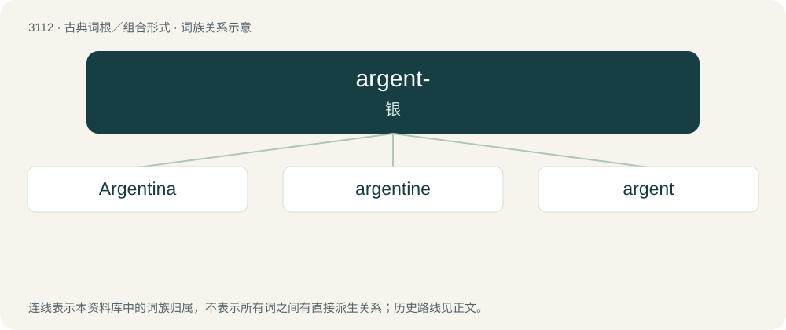

# 3208 · argent- — 银

[总目录](../00_总目录_按常用程度.md)

**类型**：古典词根／组合形式　｜　**来源语言**：拉丁语

## 核心含义与来源

- 核心含义：银
- 英文含义：silver
- 词形：argent-

**来源词形**：argentum

## 词族图

## 单词速览（常用到不常用）

| 单词 | 音标 | 释义 |
|---|---|---|
| [Argentina](#w-1) | /ɑːɹdʒənˈtiːnə/ | n. 阿根廷 |
| [argentine](#w-2) | 英 /ˈɑː(ɹ).d͡ʒənˌtiːn/ | n. 银, 银白色金属, 银白色鱼鳞, 阿根廷人；a. 银的, 银色的, 阿根廷的 |
| [argent](#w-3) | 英 /ˈɑːdʒənt/；美 /ˈɑɹd͡ʒənt/ | n. 银；a. 银制的, 似银的, 银色的 |

## 逐词详解

### 1. Argentina

**词性**：专有名词　｜　**音标**：/ɑːɹdʒənˈtiːnə/

**中文释义**：n. 阿根廷

**英文义项**：A country in South America. Official name: Argentine Republic. Capital: Buenos Aires.

**词源与演化**：

From Latin argentum (“silver”) + the feminine of the adjectival suffix -īnus; in reference to the Río de la Plata ("silver river"). Compare typologically copper (&lt;&lt; Ancient Greek Κύπρος (Kúpros, “Cyprus”), a semantic shift in the opposite direction).

**例句**：

> The journalist was found dead after doing a high-risk report in Argentina.

### 2. argentine

**词性**：形容词　｜　**音标**：英 /ˈɑː(ɹ).d͡ʒənˌtiːn/

**中文释义**：n. 银, 银白色金属, 银白色鱼鳞, 阿根廷人；a. 银的, 银色的, 阿根廷的

**英文义项**：Containing or resembling silver.

**构词拆分**：argent + -ine

**词源与演化**：

From Middle English argentyne, borrowed from Old French argentin (“silvery”), from Latin argentum (“silver”), equivalent to argent + -ine.

**例句**：

> The Argentine president said that diabetes is a disease of people with high purchasing power.

### 3. argent

**词性**：名词　｜　**音标**：英 /ˈɑːdʒənt/；美 /ˈɑɹd͡ʒənt/

**中文释义**：n. 银；a. 银制的, 似银的, 银色的

**英文义项**：The metal silver. / The white or silver tincture on a coat of arms.

**词源与演化**：

From Middle English argent, from Old French argent m (“silver”), from Latin argentum n (“white money, silver”).

**例句**：

> Tom's coat of arms is gules, a tierce argent.
