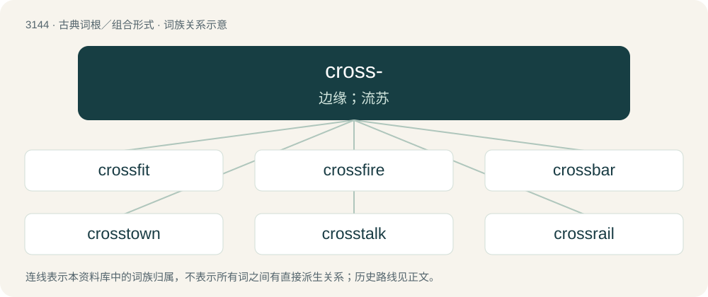

# 3244 · cross- — 边缘；流苏

[总目录](../00_总目录_按常用程度.md)

**类型**：古典词根／组合形式　｜　**来源语言**：古希腊语

## 核心含义与来源

- 核心含义：边缘；流苏
- 英文含义：fringe, tassel
- 词形：cross-

**来源词形**：κροσσός (krossós)

## 词族图

## 单词速览（常用到不常用）

| 单词 | 音标 | 释义 |
|---|---|---|
| [crossfit](#w-1) |  | 【英文】To participate in a CrossFit exercise regimen. |
| [crossfire](#w-2) | 英 /ˈkɹɒsfaɪə/；美 /ˈkɹɔːsfaɪɹ/ | n. 交叉火力, 串报, 串扰电流；\[电\] 交火 |
| [crossbar](#w-3) | 美 /ˈkɹ̠ɑs.bɑɹ/ | n. 闩, 横木, 球门的横木 |
| [crosstown](#w-4) | /ˌkrɒsˈtaʊn/ | a. 穿越市区的, 横越市区的；adv. 穿市区, 横跨市区地；n. 穿越市区的公共汽车 |
| [crosstalk](#w-5) | /ˈkrɔs,tɔːk/ | \[计\] 串扰, 串音, 串话 |
| [crossrail](#w-6) | /ˈkrɔsreil/ | n. 横木 |
| [crossbody](#w-7) |  | 【英文】Of a bag or belt etc., worn diagonally across the body. |
| [crosswind](#w-8) | 美 /ˈkɹɑːs.wɪnd/ | n. 侧风 |
| [crossbreed](#w-9) | /ˈkɹɑːsˌbɹiːd/ | n. 杂种；v. 异种交配, 培育杂种, (使)杂交 |

## 逐词详解

### 1. crossfit

**词性**：动词

**英文义项**：To participate in a CrossFit exercise regimen.

**构词拆分**：cross- + fit

**词源与演化**：

From cross-discipline fitness. Equivalent to cross- + fit.

### 2. crossfire

**词性**：名词　｜　**音标**：英 /ˈkɹɒsfaɪə/；美 /ˈkɹɔːsfaɪɹ/

**中文释义**：n. 交叉火力, 串报, 串扰电流；\[电\] 交火

**英文义项**：An arrangement of two or more weapons so each can fire diagonally at something in front of a line between them. / The danger to a third party passing between two belligerents firing at one another.

**构词拆分**：cross- + fire

**词源与演化**：

From cross- + fire.

**用法示例／搭配（非完整句）**：

> The two factions were either side of the road. A civilian lorry was caught in the crossfire and became collateral damage

该用例对应义项：The danger to a third party passing between two belligerents firing at one another.

### 3. crossbar

**词性**：名词　｜　**音标**：美 /ˈkɹ̠ɑs.bɑɹ/

**中文释义**：n. 闩, 横木, 球门的横木

**英文义项**：Any transverse bar or piece, such as a bar across a door, or the iron bar or stock which passes through the shank of an anchor. / The top of the goal structure.

**构词拆分**：cross- + bar

**词源与演化**：

From Middle English crose bar, equivalent to cross- + bar.

**例句**：

> The ball smacked the crossbar with the keeper beaten all ends up.

### 4. crosstown

**词性**：形容词　｜　**音标**：/ˌkrɒsˈtaʊn/

**中文释义**：a. 穿越市区的, 横越市区的；adv. 穿市区, 横跨市区地；n. 穿越市区的公共汽车

**英文义项**：Extending across a city or town. / Connecting different areas of a city or town without passing through downtown.

**构词拆分**：From cross- + town.

**词源与演化**：

From cross- + town.

**例句**：

> The football team beat our crosstown rivals last night.

该用例对应义项：Situated at the other end of town.

### 5. crosstalk

**词性**：名词　｜　**音标**：/ˈkrɔs,tɔːk/

**中文释义**：\[计\] 串扰, 串音, 串话

**英文义项**：Undesirable signals from a neighbouring transmission circuit; undesired coupling between circuits. / The situation where one or more components of a signal transduction pathway affect another pathway.

**构词拆分**：From cross- + talk.

**词源与演化**：

From cross- + talk. Usage in reference to the Chinese comedic performance is probably a loose calque from Chinese 相聲／相声 (xiàngsheng).

**例句**：

> I couldn't hear the opening address because of all the crosstalk around me.

该用例对应义项：Conversation that is incidental to the topic under discussion.

### 6. crossrail

**词性**：名词　｜　**音标**：/ˈkrɔsreil/

**中文释义**：n. 横木

**英文义项**：A rail that goes across something. / A commuter rail line that crosses a major city through a tunnel and which continues for a significant distance into the surrounding areas, generally with relatively high speeds and widely spaced stations compared to an underground or metro.

**构词拆分**：cross- + rail

**词源与演化**：

From cross- + rail.

**例句**：

> Crossrail is one of Europe's largest infrastructure construction projects.

### 7. crossbody

**词性**：形容词

**英文义项**：Of a bag or belt etc., worn diagonally across the body.

**构词拆分**：cross- + body

**词源与演化**：

From cross- + body.

**用法示例／搭配（非完整句）**：

> crossbody bag

该用例对应义项：Of a bag or belt etc., worn diagonally across the body.

### 8. crosswind

**词性**：名词　｜　**音标**：美 /ˈkɹɑːs.wɪnd/

**中文释义**：n. 侧风

**英文义项**：A wind blowing across a line of travel, especially perpendicularly.

**构词拆分**：cross- + wind

**词源与演化**：

From cross- + wind.

**例句**：

> Crosswind landings require coordinated rudder and aileron input to maintain alignment to the runway.

### 9. crossbreed

**词性**：动词　｜　**音标**：/ˈkɹɑːsˌbɹiːd/

**中文释义**：n. 杂种；v. 异种交配, 培育杂种, (使)杂交

**英文义项**：To produce (an organism) by the mating of individuals of different breeds, varieties, or species; hybridize. / To mate so as to produce a hybrid; interbreed.

**构词拆分**：cross- + breed

**词源与演化**：

From cross- + breed.

**例句**：

> Believing nectarines to be a crossbreed of plums and peaches is a widespread misconception.

## 其他候选词

- crossopterygii
