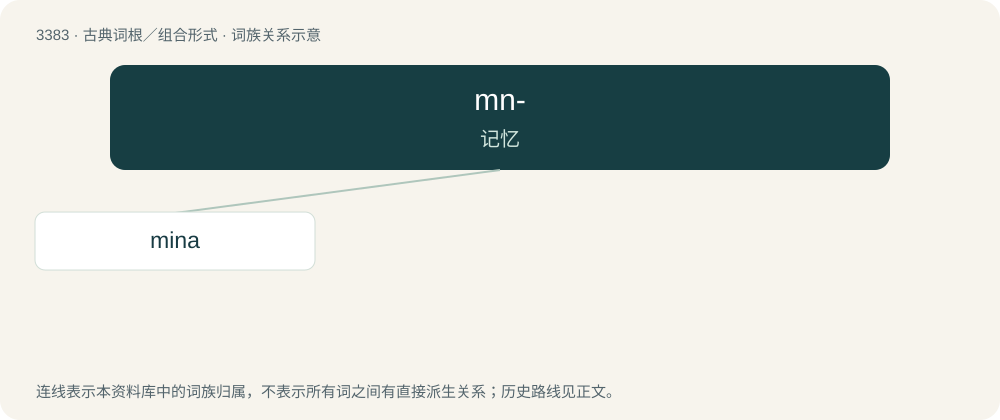

# 3469 · mn- — 记忆

[总目录](../00_总目录_按常用程度.md)

**类型**：古典词根／组合形式　｜　**来源语言**：古希腊语

## 核心含义与来源

- 核心含义：记忆
- 词形：mn-

**来源词形**：μνᾶ (mnâ)

## 词族图

## 单词速览（常用到不常用）

| 单词 | 音标 | 释义 |
|---|---|---|
| [mina](#w-1) | /ˈmainə/ | n. 迈纳(古希腊单位) |

## 逐词详解

### 1. mina

**词性**：名词　｜　**音标**：/ˈmainə/

**中文释义**：n. 迈纳(古希腊单位)

**英文义项**：A monetary unit of ancient Greece and the Middle East, originally equivalent to the weight of a mina of silver. / A unit of weight of varying value used in the ancient Middle East, especially Babylonia, Mesopotamia and Egypt; also an ancient Greek measure of weight equivalent to 1/60th of a talent, approximately 400-700 grams.

**词源与演化**：

Borrowed from Latin mina, from Ancient Greek μνᾶ (mnâ, “mna”). Compare maneh, from Biblical Hebrew מָנֶה (māne), as well as maund.

**例句**：

> Ziri and Mina were on their way back up to bed.

## 其他候选词

- mna
